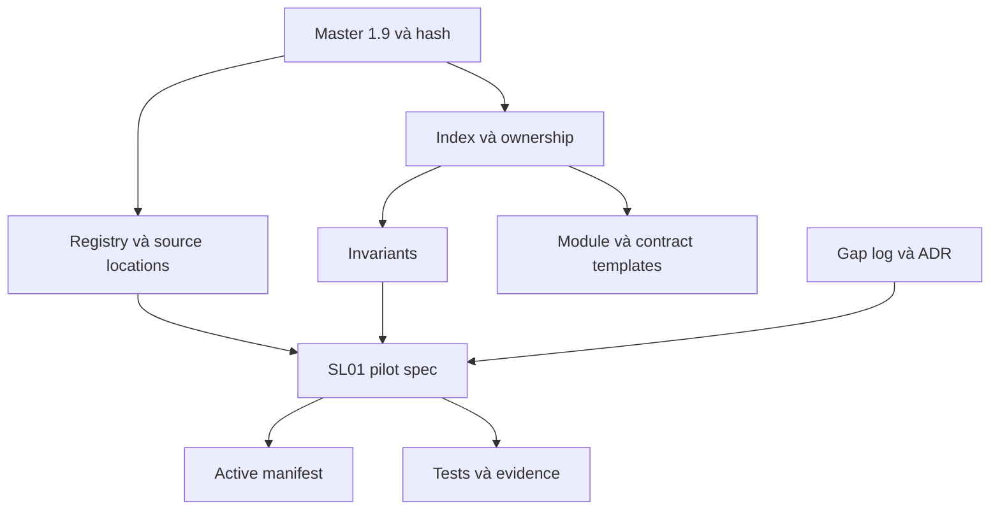
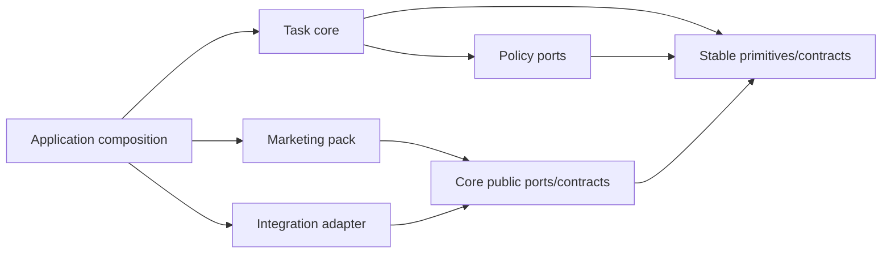
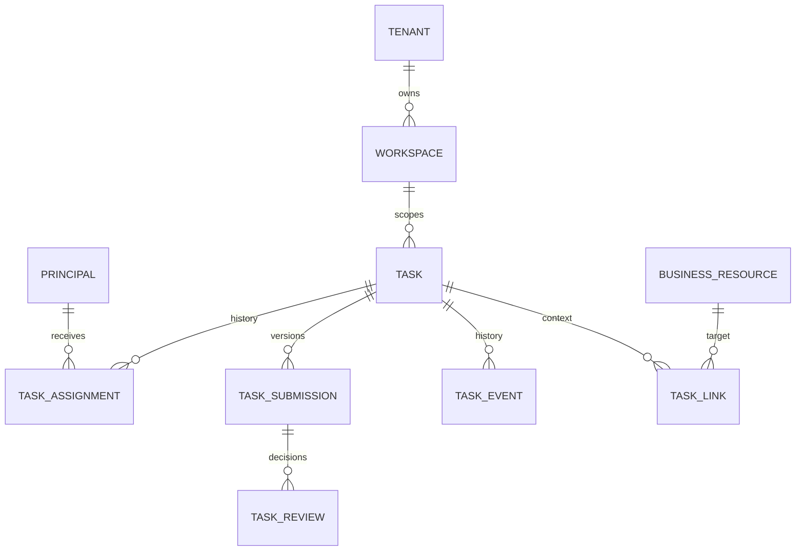
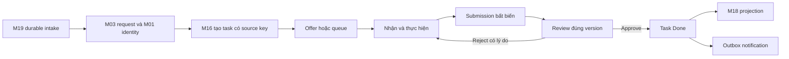

# Module ownership và dependency

Baseline 1.9; nguồn chính Master 3.0, 2.8, 5.1, 5.19. Chi tiết catalog nguyên văn ở [modules.json](../03-planning/trace/modules.json). Các ranh giới dưới là đề xuất tổ chức triển khai; không tạo 22 service.

| ID | Owner logic / phạm vi dữ liệu | Core / extension | Slice chính đề xuất |
|---|---|---|---|
| M01 | Contact/Account/identity/merge | Core identity | SL02 |
| M02 | Lead/Deal/Activities/assignment bán hàng | Core sales | SL03 |
| M03 | Conversation/Message/request routing | Core conversations | SL02 |
| M04 | Journey/instance/nhắc việc | Core automation; policy pack | SL06 |
| M05 | Referral/reward/loyalty ledger | Capability tùy chọn | SL07 |
| M06 | AI draft/evaluation/provenance | Adapter/core guard | SL07 |
| M07 | Catalog/quote/line/approval chào bán | Core commerce + mẫu SOW ngành | SL04 |
| M08 | Contract/order/period/handoff/renewal | Core agreement + điều khoản pack | SL04 |
| M09 | Receipt/obligation/allocation/refund | Core finance; ERP owns posted documents | SL05 |
| M10 | Commission/pool/payout/adjustment | Core incentive + policy | SL05 khi đủ policy |
| M11 | Ticket/SLA/entitlement/resolution | Core service | SL04 |
| M12 | Feedback/recovery/survey | Core CX | SL04/07 |
| M13 | Appointment/resource/booking | Core scheduling | SL03/06 |
| M14 | Principal/membership/grants/team/delegation | Core/platform | SL00 trở đi |
| M15 | Brief/IMC/campaign/launch/learning | Marketing Services pack; core contracts | SL04/07 |
| M16 | Tasks/assignment/submission/review/project/deliverable | Task Core; agency delivery extension | SL01/04/06 |
| M17 | Budget/cost/commitment/media funding | Finance controls + agency policy | SL05 |
| M18 | KPI definitions/facts/projections | Core reporting + ngành | Mọi slice basic; SL07 nâng cao |
| M19 | Connections/inbox/outbox/checkpoint/adapter | Integration platform | SL00/02 |
| M20 | Purpose/consent/suppression/privacy/retention | Cross-cutting data governance | SL00 trở đi |
| M21 | Partner sharing profiles/datasets/imports/reconciliation/reports | Agency outcome integration, core theo mức chia sẻ | SL08 sau foundation; API theo capability |
| M22 | Employee/employment/leave/attendance/payroll | HR extension; same app, separate data authority | SL09 HR-A; SL10 HR-B; SL11 HR-C |

Owner ở đây là domain chịu trách nhiệm, chưa phải nhân sự đã được chỉ định. BA/PO chỉ định người accountable trước enable. Một projection không được biến thành nguồn ghi; hạ tầng Outbox tích hợp ngoài `M19` tách biệt khỏi **Outbox/DLQ sự kiện nội bộ tại `M23-F12`** (`ADR-005`) và không sở hữu ý nghĩa event nghiệp vụ `M16`. Reviewer cấp quyền `M14` không tự được duyệt kết quả `M16` nếu thiếu assignment/authority.

## Bản đồ tài liệu

## 1. Import graph đề xuất — cạnh nghĩa là imports

Kiểm cycle trên package graph thực khi có code. DB repository private không import từ domain khác. Composition root wiring adapter vào port; domain không gọi provider SDK. Đồ thị này không mô tả mọi package hiện hữu vì repo ứng dụng chưa có.

## 2. Quan hệ dữ liệu — cạnh nghĩa là tham chiếu logic

BUSINESS_RESOURCE là khái niệm typed registry trong Master, chưa phải quyết định tạo một bảng chung. SL01 chưa bật liên kết CRM nên Task_Links có thể chưa tạo. FK nội workspace phải kiểm composite scope; quan hệ cross-workspace theo bridge/grant, không dùng một quy tắc tenant-only cho mọi bảng. Outbox liên kết aggregate bằng contract/payload không mặc định FK tới mọi aggregate.

## 3. Event/business flow — cạnh nghĩa là hành vi chuyển tiếp

Vòng reject/rework là nghiệp vụ hợp lệ; idempotency/correlation/guards bảo vệ hiệu ứng. Done không nối trực tiếp tới Paid, SLA fulfilled hoặc client acceptance. Mỗi nguồn nghĩa vụ quyết định bằng evidence riêng. M19 kiểm delivery/retry, không tự kết luận event nghiệp vụ đã hợp lệ chỉ vì đã nhận.

## Bảo trì thay đổi

Thay due policy: M16 spec + policy version + UC-W04 + BR-W03/04 + W-T11/12/13 + projection KPI. Thay workspace grants: M14 + M20 + mọi read/write consumer + U17/W-T02/07/36. Thay event schema: provider contract + consumers + fixture phiên bản cũ + outbox backlog compatibility. Không lấy phạm vi folder làm lý do bỏ regression liên quan.

## Module đã tách file

[M21 — Kết quả kinh doanh đối tác](../02-specs/modules/M21-PARTNER-BUSINESS-RESULTS.md) là file module chi tiết đầu tiên. 20 module cũ mới có bản đồ/inventory, chưa có đầy đủ file riêng. [SL08](../02-specs/slices/SL08-PARTNER-RESULTS.md) có thể triển khai sớm, không theo số thứ tự ID.

M21→M19 public ingest/connection contract; M21→M18 metric definitions; M21→M14/M20 quyền/purpose; M21→M16 exception task. CLIENT dataset có scope riêng; publish summary về AGENCY qua grant/bridge. Không import private repository, không sync write ngược Pancake mặc định.

[M22 — Quản trị nhân sự](../02-specs/modules/M22-HUMAN-RESOURCES.md) kế thừa identity/authority M14, entitlement M10; không tạo engine quyền hoặc hoa hồng thứ hai. [SL09–11](../02-specs/slices/SL09-11-HRM.md) phân kỳ triển khai, không thay ưu tiên SL08 đã đề xuất.

## Mở rộng Đề xuất sau Master v1.9 (`M01–M24`, ngày 15/11/2026)

Để đồng bộ toàn bộ năng lực quản trị, bảo mật vận hành, báo cáo hợp nhất và hiệu năng trước khi bóc tách chi tiết từng chức năng, tài liệu thiết kế đề xuất chuẩn hóa thêm 24 chức năng (không sửa đổi Baseline Master v1.9):

| ID | Owner logic / phạm vi dữ liệu | Core / extension | Slice chính đề xuất | Tệp đặc tả |
|---|---|---|---|---|
| M18 *(mở rộng F08–11)* | P&L hợp nhất (`M09+M17+M10+M22`), Ad-hoc Builder, Scheduled Delivery, Cockpit Data Quality | Core reporting mở rộng | SL03–07 | [M18-BI-REPORTING-EXPANSION.md](../02-specs/modules/M18-BI-REPORTING-EXPANSION.md) |
| M23 | Chính sách MFA/Session, Break-glass TTL, Approval Matrix, Pilot/Team Maker–Checker, Immutable Audit Console, Export Approval 2 lớp, DLP, Feature Flags, Lịch chuẩn/Quiet Hours, Danh mục dùng chung, Outbox/DLQ nội bộ & Backup Drill | Core governance & platform ops | SL00–07 | [M23-SYSTEM-ADMIN-SECURITY-OPS.md](../02-specs/modules/M23-SYSTEM-ADMIN-SECURITY-OPS.md) |
| M24 | UX Productivity (`Ctrl+K`, Split-View, Bulk dry-run, Quick Replies, Smart Notification/Digest) & Platform Scale (Read Model/Permission Cache, Queue Priority Isolation, Async Export/Archiving) | Cross-cutting UX & platform scale | SL00–07 | [M24-PERFORMANCE-AND-PRODUCTIVITY.md](../02-specs/modules/M24-PERFORMANCE-AND-PRODUCTIVITY.md) |

**Ranh giới Single Source of Truth (khử chồng chéo):**
- `M23-F03` quản lý luồng xin/duyệt/TTL Break-glass (`Maker != Checker`) và ghi grant hiệu lực sang `M14`; **`M14` là cổng kiểm tra quyền thực thi duy nhất (`EvaluateAccessDecision` + `CompileScopeFilter` + `BindDbTransactionContext`)** và sở hữu runtime `Break_Glass_Grants` + `Principal_Permission_Versions`.
- `M19-F07` chỉ quản lý adapter/Outbox/DLQ cho **tích hợp bên ngoài** (`Channel_Connections`, `Inbound_Events`, `Outbound_Intents`, `Message_Status_Events`, `Email_Delivery_Events`); **`M23-F12`** quản lý **Outbox/DLQ nội bộ dùng chung (`Internal_Outbox_Events` / `Internal_Dead_Letter_Queue`), `Queue Priority` và diễn tập Backup/Restore (`DR Startup Fence`)**.
- `M23` sở hữu bảng cấu hình dùng chung `Policy_Definitions` / `Policy_Versions` (`ENTITY-L2885`) và `Audit_Logs` (`ENTITY-L2787`); từng domain giữ bảng nghiệp vụ đặc thù riêng (`M20.Legal_Deadline_Policies`, `M20.Retention_Policies`) và `M14.Departments` thuộc cây tổ chức `M14`.
- **`Bank_Accounts` (`ADR-004`):** `M09.Bank_Accounts` giữ tài khoản ngân hàng pháp nhân thu/chi công ty; `M22.Employee_Bank_Accounts` giữ tài khoản cá nhân nhận lương/hoa hồng nhân sự.
- `M23-F10` sở hữu Lịch chuẩn Tenant/Pháp nhân, Ngày lễ & `Quiet Hours`; `M22-F07` kế thừa để phân ca nhân viên; `M04`/`M11`/`M16` đọc từ `M23-F10`.
- Chuỗi Export & **`Download Gateway SEC03` (`ADR-006`)** thống nhất: `M18-F10` / màn hình nguồn $\rightarrow$ duyệt 2 lớp & watermark `M23-F07` $\rightarrow$ chạy nền `M24-F08` $\rightarrow$ `Download Gateway SEC03` (`M14` live ACL/session + `expected_permission_version` $\rightarrow$ `M20` Scan/Hold/`6.8` HR gate $\rightarrow$ `M23-F07` Audit, cấm trả Storage URL thô).

## Quyết định Kiến trúc (`01-architecture/decisions/`)

1. [ADR-001 — Baseline Stack & Modular Monolith PostgreSQL](decisions/ADR-001-BASELINE-AND-STACK.md)
2. [ADR-002 — Cô lập Tổ chức, Pooled PostgreSQL RLS & `CompileScopeFilter`](decisions/ADR-002-ORG-ISOLATION-RLS-AND-SCOPE-FILTER.md)
3. [ADR-003 — `permission_version` Hai Chế độ, Cache `M24-F06` & Quản trị `SOLO/TEAM`](decisions/ADR-003-PERMISSION-VERSION-CACHE-AND-MODE-GOVERNANCE.md)
4. [ADR-004 — Bảng Nền tảng Dùng chung, Ranh giới SSoT & 3 Nhóm Kế thừa Cột `5.1`](decisions/ADR-004-SHARED-PLATFORM-TABLES-AND-BASE-SCHEMA.md)
5. [ADR-005 — Dual Outbox (`M19` Ngoài vs `M23-F12` Nội bộ), Cô lập 3 Làn Queue & Vault](decisions/ADR-005-DUAL-OUTBOX-3LANE-ISOLATION-AND-VAULT.md)
6. [ADR-006 — `Download Gateway` (`SEC03`), Zero-Trust `Remote Fetch` (`SEC04`) & `AI Gateway`](decisions/ADR-006-DOWNLOAD-GATEWAY-REMOTE-FETCH-AND-AI-GATEWAY.md)
7. [ADR-007 — Chuẩn hóa `HMAC` & Xoay khóa `Deletion_Ledger`, `Legal Hold` & DR Fence](decisions/ADR-007-PRIVACY-CANONICAL-HASH-LEGAL-HOLD-AND-DR-FENCE.md)
8. [ADR-008 — Khóa Hợp đồng Liên Module Wave 1 (`M14 <-> M19 <-> M20 <-> M22 <-> M03`)](decisions/ADR-008-OMNICHANNEL-CONTRACTS-RECEIPTS-AND-CROSS-EVENTS.md)
