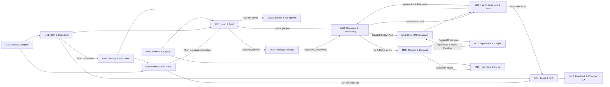
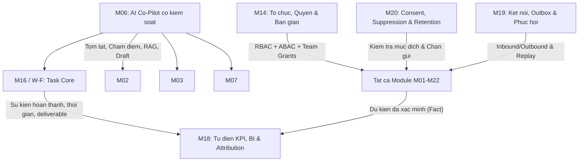
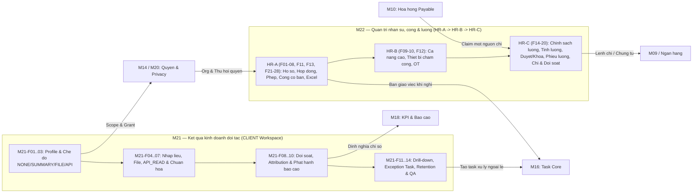
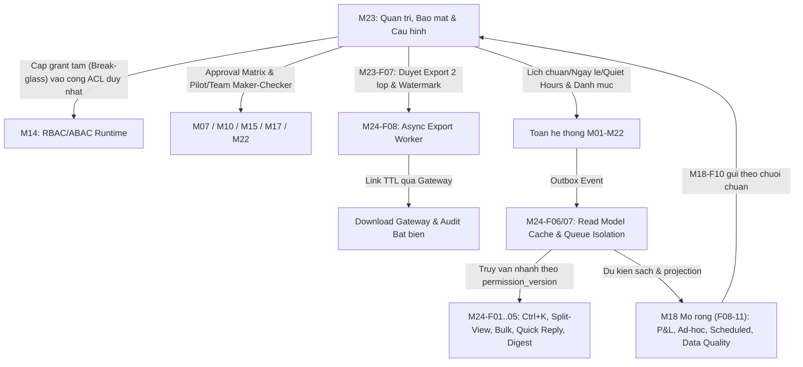

# Danh mục Toàn bộ 200 Chức năng Hệ thống CRM

Tài liệu tổng hợp toàn bộ **200 chức năng chi tiết** đang được đặc tả trong [Master BRD & SRS v1.9](../00-master/CRM_MASTER_BRD_SRS_HOP_NHAT.md) (`SHA-256: b6a3279f328e96e1e97d845e209be7a326516a0dba5e3a033d88e1f2162e421c`), sắp xếp theo thứ tự 22 module `M01 → M22` (bao gồm `W-F01–14` mở rộng của `M16`), kèm sơ đồ luồng chức năng liên module để phục vụ brainstorm, rà soát phạm vi và tách đặc tả chi tiết.

- **Tổng quan cấu trúc:** **M01–M24** (`M01–M22` baseline v1.9 = **200 chức năng chi tiết**; cộng `M18` mở rộng `M18-F08–11`, `M23` Quản trị & Bảo mật `M23-F01–12`, `M24` Hiệu năng & Hiệu suất `M24-F01–08` = **24 chức năng Đề xuất mở rộng**; tổng **224 chức năng**).
- **Tài liệu điều hướng:** [02-specs/README.md](README.md) • [01-architecture/INDEX.md](../01-architecture/INDEX.md) • [03-planning/ROADMAP.md](../03-planning/ROADMAP.md)

---

## Mục lục nhanh theo Module

| Nhóm | Module |
|---|---|
| **Khách hàng, Bán hàng & Hội thoại** | [M01](#m01) (6) • [M02](#m02) (7) • [M03](#m03) (8) • [M04](#m04) (6) • [M05](#m05) (7) • [M06](#m06) (8) |
| **Thương mại, Tài chính & Dịch vụ** | [M07](#m07) (7) • [M08](#m08) (7) • [M09](#m09) (7) • [M10](#m10) (7) • [M11](#m11) (7) • [M12](#m12) (8) • [M13](#m13) (7) |
| **Tổ chức, Marketing, Công việc & Dữ liệu** | [M14](#m14) (8) • [M15](#m15) (7) • [M16](#m16) (7 + 14 [W-F](#w-f)) • [M17](#m17) (7) • [M18](#m18) (7 + 4 [Mở rộng](#m18-exp)) • [M19](#m19) (8) • [M20](#m20) (8) |
| **Mở rộng Đối tác & Nhân sự (v1.9)** | [M21](#m21) (14) • [M22](#m22) (28) |
| **Đề xuất Mở rộng sau v1.9 (`M23–M24` & `M18+`)** | [M23](#m23) (12) • [M24](#m24) (8) • [M18 Mở rộng](#m18-exp) (4) |

---

## Sơ đồ Luồng Chức năng Liên Module

### 1. Luồng lõi CRM End-to-End (Intake → Sales → Contract → Delivery → Finance → Care)

### 2. Lớp Nền tảng Xuyên suốt (Quyền, Dữ liệu, AI, Công việc & BI)

### 3. Luồng Nghiệp vụ Mở rộng: Đối tác (`M21`) & Nhân sự (`M22`)

---

## M01 — CDP và hồ sơ khách hàng (6 chức năng)

Nguồn Master: Mục `3.1` (`FR01–FR03`, `M01-F01–06`).

| Chức năng | Mô tả | Chức năng / Module liên quan |
|---|---|---|
| **M01-F01** — Tạo hồ sơ | Tiếp nhận từ form, inbox hoặc nhập tay với nguồn và scope xác định; dùng nhãn provisional khi chưa rõ tên và không tự đoán quốc gia số điện thoại. | `M02`, `M11`, `M03` (inbox), `FR01` |
| **M01-F02** — Định danh (Identity resolution) | Liên kết external identity hoặc endpoint (SĐT/email) khi mapping xác minh cùng scope; nếu phát hiện xung đột người dùng thì chuyển hàng đợi steward xử lý. | `M03` (inbox), `M19` (connector), `FR02` |
| **M01-F03** — Quan hệ B2B | Ghi nhận vai trò đại diện (quyết định, tài chính, người dùng, ảnh hưởng) giữa Contact và nhiều Account kèm thời gian hiệu lực và lịch sử thay đổi. | `M02` (Deal), `M08` (Contract), `FR01` |
| **M01-F04** — Merge và Undo | Gộp hồ sơ trùng khi đủ bằng chứng trong cùng scope (giữ survivor, alias, journal); hoàn tác theo provenance và không tự mở rộng consent sau merge. | `M20` (`M20-F02` Consent), `M03`, `FR02` |
| **M01-F05** — Timeline khách hàng 360 | Hiển thị dòng thời gian hoạt động, hội thoại và tệp đính kèm khi mở hồ sơ; kiểm quyền từng đối tượng và không làm lộ số lượng bản ghi ngoài quyền. | `M02` (Sales), `M16` (Delivery), `M11`/`M12` (CX), `M03` |
| **M01-F06** — Phân nhóm RFM | Phân nhóm theo kỳ mua/dịch vụ, tiền sau hoàn trả và policy đang hiệu lực; giữ Unknown khi thiếu dữ liệu thay vì đánh nhầm khách trả trước năm là ngủ đông. | `M04` (Journey), `M09` (Payment), `M18` (KPI), `FR03` |

---

## M02 — Lead và Deal (7 chức năng)

Nguồn Master: Mục `3.2` (`FR04–FR06`, `M02-F01–07`).

| Chức năng | Mô tả | Chức năng / Module liên quan |
|---|---|---|
| **M02-F01** — Nhận nhu cầu (Lead Intake) | Tạo hoặc trả về bản ghi sẵn có theo `source_id` chống trùng khi webhook gửi lặp; cho phép model B2B/B2C là `Unknown` ở đầu vào nhưng vẫn gắn queue và SLA. | `M01` (`M01-F01`), `M03` (inbox), `M19` (ingest) |
| **M02-F02** — Phân và nhận việc | Phân lead theo scope, tính liên tục, kỹ năng, ca làm và sức chứa; đưa vào hàng đợi nếu hết người rảnh và cho phép claim nguyên tử chống tranh nhận. | `M14` (org/ca), `M02-F07` (Today), `M16` (`W-F02`), `FR05` |
| **M02-F03** — Bàn giao Marketing → Sales | Quản lý vòng đời `handover_status` (Pending/Accepted/Rejected/Recycled) độc lập với trạng thái lead; phân biệt hết năng lực (`NoCapacity`) với không phù hợp (`NoFit`). | `M02-F04`, `M15` (Marketing), `FR05` |
| **M02-F04** — Qualification | Thẩm định nhu cầu, đầu mối và hành động tiếp theo; bắt buộc xác định B2B hay B2C trước khi chuyển `Qualified` và giữ `Unknown` cho ngân sách chưa rõ. | `M02-F05`, `M01-F03`, `M06-F04`, `FR04` |
| **M02-F05** — Chuyển đổi thành Deal (Convert) | Chuyển lead `Qualified` sang cơ hội bán hàng theo conversion key bất biến để chống nhân bản, giữ lineage khi phát sinh nhu cầu mua mới khác nhau. | `M07` (`M07-F02` Quote), `M01`, `FR04` |
| **M02-F06** — Quản lý Pipeline Deal | Vận hành hai phễu riêng (B2B và B2C), hỗ trợ trạng thái `OnHold` kèm lý do và ngày rà soát mà không làm mất stage hiện tại; kiểm gate và lý do khi Won/Lost. | `M08` (`M08-F01` Hợp đồng), `M18` (Forecast), `FR04` |
| **M02-F07** — Danh sách Today và thu hồi | Theo dõi lời hẹn, cuộc gọi nhỡ (`NoAnswer` chỉ là attempt) và lịch next action; chuyển chủ sở hữu không tự reset đồng hồ SLA và tự động nhắc/thu hồi khi trễ. | `M11` (SLA engine), `M13` (Lịch hẹn), `FR06` |

---

## M03 — Omnichannel Inbox và bảo vệ nội dung (8 chức năng)

Nguồn Master: Mục `3.3` và `3.12` (`FR07–FR08`, `FR30–FR40`, `M03-F01–08`).

| Chức năng | Mô tả | Chức năng / Module liên quan |
|---|---|---|
| **M03-F01** — Thu nhận hội thoại đa kênh | Nhận sự kiện đã xác minh từ 5 kênh (Facebook, Zalo, Telegram, Email, Call); bỏ qua canonical event trùng và không biến status/read receipt thành Lead mới. | `M19` (`M19-F04`), `M01` (`M01-F02`), `FR30/31/33` |
| **M03-F02** — Phân loại yêu cầu trên hội thoại | Tách yêu cầu từ tin inbound: khiếu nại nối tới Ticket, nhu cầu mua nối tới Lead, trường hợp chưa rõ đưa vào hàng đợi phân loại giữ nguyên mốc thời gian chờ gốc. | `M02` (`M02-F01`), `M11` (`M11-F01`), `FR39`, `UC22` |
| **M03-F03** — Nhận và chuyển xử lý hội thoại | Cho phép claim từ queue hoặc bàn giao đổi ca theo scope, kỹ năng và capacity; giữ nguyên lịch sử và không làm reset đồng hồ SLA khi đổi người trả lời. | `M14` (quyền/ca), `M03-F06`, `FR35/36` |
| **M03-F04** — Soạn và gửi phản hồi | Tách biệt tuyệt đối ghi chú nội bộ với tin gửi ra ngoài; kiểm tra quyền, capability kênh, purpose/consent (`M20`) và quét tệp sạch trước khi xếp hàng gửi. | `M19` (`M19-F05`), `M20` (`M20-F03`), `FR32/34/40` |
| **M03-F05** — Theo dõi kết quả gửi tin | Phân biệt trạng thái `Accepted`, `Delivered`, `Read` và `unknown_outcome` khi timeout sau gửi để đối soát; biên nhận trùng không tính hoàn thành SLA hai lần. | `M19` (`M19-F05`), `M03-F06`, `UC19` |
| **M03-F06** — Quản lý nghĩa vụ trả lời | Chỉ dừng đồng hồ FRT/NRT đúng đối tượng (`response_targets`) và tiêu chí; note nội bộ hay auto-ack không dừng clock người và đóng thread không tự đóng Ticket. | `M11` (`M11-F03/04`), `FR36/39` |
| **M03-F07** — Timeline và tìm kiếm hội thoại | Truy vấn hội thoại theo ACL hiện tại ở cả danh sách, đếm, snippet và tệp tải về; Contact dùng chung giữa workspace không tự mở chéo lịch sử thread. | `M01-F05`, `M14-F04`, `M20`, `FR08/31/37` |
| **M03-F08** — Phục hồi khoảng trống lịch sử | Backfill tin nhắn sau sự cố/kết nối lại chỉ để bổ sung lịch sử; không kích hoạt gửi lại tin cũ, không tạo acquisition lead và không reset SLA đang chạy. | `M19` (`M19-F06`), `FR38` |

---

## M04 — Journey và nhắc việc có kiểm soát (6 chức năng)

Nguồn Master: Mục `3.4` (`FR09`, `M04-F01–06`).

| Chức năng | Mô tả | Chức năng / Module liên quan |
|---|---|---|
| **M04-F01** — Soạn phiên bản Journey | Tạo mẫu hành trình kèm purpose, trigger, bước chờ và điều kiện thoát/re-entry; chỉ cho kích hoạt khi có owner, policy Active và đầy đủ giới hạn tần suất. | `M01-F06`, `M18`, `FR09` |
| **M04-F02** — Xét điều kiện vào hành trình (Entry) | Đánh giá sự kiện nghiệp vụ đúng scope và purpose để tạo instance một lần theo key; chặn replay tạo trùng và không tự enroll dữ liệu lịch sử backfill. | `M01`, `M19`, `M20` |
| **M04-F03** — Lập lịch thực thi bước | Tính hạn nhắc việc/gửi tin theo business calendar hoặc mốc notice thực tế trên hợp đồng (ví dụ 60 ngày thay vì mặc định 45 ngày). | `M08` (`M08-F06` Hợp đồng), `M16` (`W-F05`) |
| **M04-F04** — Thực thi bước có kiểm soát | Sinh task nội bộ một lần hoặc tạo `Outbound_Intent` đi qua cổng kiểm quyền, capability và consent hiện tại; giữ trạng thái hold nếu thiếu policy duyệt. | `M03-F04`, `M16`, `M20-F03` |
| **M04-F05** — Điều phối xung đột tần suất (Arbitration) | Áp dụng cap gửi dùng chung theo endpoint/purpose qua nhiều journey; ưu tiên thông báo sự cố/suppression hơn tin bán hàng để tránh làm phiền khách. | `M12` (CX), `M11` (Incident), `M20` |
| **M04-F06** — Thoát hành trình và sửa lỗi | Tự động re-evaluate và hủy bước chưa gửi khi khách rút consent, mua hàng, khiếu nại hoặc hết hạn; giữ trạng thái Unknown để đối soát khi provider lỗi. | `M20-F02`, `M19`, `M11` |

---

## M05 — Referral và loyalty theo điều kiện kinh tế (7 chức năng)

Nguồn Master: Mục `3.5` (`FR10`, `M05-F01–07`).

| Chức năng | Mô tả | Chức năng / Module liên quan |
|---|---|---|
| **M05-F01** — Khai báo hồ sơ giới thiệu | Ghi nhận người giới thiệu, người mua/nhu cầu và bằng chứng nguồn; nếu thiếu chứng cứ thì giữ `PendingVerification` và chưa ghi nhận thưởng. | `M01`, `M02`, `FR10` |
| **M05-F02** — Kiểm tra điều kiện hợp lệ (Eligibility) | Rà soát self-referral, bên liên quan, khách cũ hoặc tranh chấp theo policy thay vì tin mù vào mã nhập; xuất trạng thái `Eligible / Rejected / Disputed`. | `M01-F02/03`, `M08` |
| **M05-F03** — Khóa quyền hưởng (Attribution lock) | Chụp nhanh policy, người giới thiệu và tỷ lệ hưởng tại thời điểm đạt điều kiện để không bị thay đổi khi nhân sự hoặc cấu hình mới thay đổi về sau. | `M10` (`M10-F01/02`), `M18` |
| **M05-F04** — Tính thưởng từ thực thu | Tính thưởng trên khoản thu/phân bổ đủ điều kiện theo pool được phép, chống cộng trùng với hoa hồng sales và chống lặp khi replay sự kiện. | `M09` (`M09-F04`), `M10` (`M10-F03`) |
| **M05-F05** — Duyệt và chi thưởng (Payout) | Tách biệt số được hưởng với số được duyệt chi; áp dụng khóa kỳ, idempotency và bằng chứng chi thực tế (ảnh bill không tự coi đã hoàn tất chi). | `M09`, `M10` (`M10-F05/06`) |
| **M05-F06** — Đảo thưởng và giải quyết tranh chấp | Xử lý hoàn tiền, gian lận hoặc điều chỉnh bằng bút toán đảo một lần hoặc adjustment ở kỳ mở mà không xóa lịch sử đã chi trả. | `M09` (`M09-F06`), `M10` (`M10-F07`) |
| **M05-F07** — Sổ điểm thưởng tùy chọn (Loyalty) | Quản lý tích/đổi/hết hạn điểm dạng sổ cái append-only (reserve trước khi trừ điểm) khi capability điểm được bật; đảm bảo không âm hoặc đổi trùng. | `M01`, `M20` (consent), `FR10` |

---

## M06 — AI Co-Pilot có kiểm soát (8 chức năng)

Nguồn Master: Mục `3.5.2` (`FR11–FR13`, `M06-F01–08`).

| Chức năng | Mô tả | Chức năng / Module liên quan |
|---|---|---|
| **M06-F01** — Chọn và kiểm quyền nguồn dữ liệu | Chỉ nạp ghi âm/tài liệu mà người yêu cầu hiện có quyền đọc và có mục đích hợp lệ kèm hash phiên bản; từ chối nếu vượt quyền. | `M14` (`M14-F04`), `M20` (`M20-F01`), `FR11` |
| **M06-F02** — Chuẩn bị và tối thiểu hóa dữ liệu AI | Kiểm tra phân loại dữ liệu, vùng lưu trữ, retention vendor; thực hiện che/giảm trường nhạy cảm và chặn gọi AI nếu vendor chưa đạt điều kiện. | `M20` (`M20-F07`), `M19` |
| **M06-F03** — Chuyển giọng nói thành văn bản và tóm tắt | Tạo bản nháp tóm tắt cuộc gọi/hội thoại kèm timestamp và model/prompt version; đánh dấu nội dung mơ hồ (số tiền, ngày hẹn) và không tự ghi đè field gốc. | `M03`, `M02`, `FR11` |
| **M06-F04** — Chấm điểm khách hàng theo rule giải thích được | Tính điểm fit/intent dựa trên dữ kiện có chứng cứ và rule version; thiếu dữ liệu đánh `Unknown` kèm độ phủ, không dùng thuộc tính nhạy cảm hoặc tự suy ngân sách. | `M02` (`M02-F04`), `M18`, `FR12` |
| **M06-F05** — Tìm kiếm tri thức RAG có trích dẫn | Truy xuất tài liệu đúng scope và phiên bản theo ACL hiện hành, bắt buộc gắn trích dẫn nguồn và báo thiếu dữ liệu nếu không có căn cứ. | `M03`, `M11`, `M15`, `FR12/37` |
| **M06-F06** — Duyệt và áp dụng bản nháp AI | Mọi nội dung AI tạo phải qua người có thẩm quyền duyệt đúng phiên bản; nếu người nhận, tệp đính kèm hoặc dữ liệu đích thay đổi thì hủy hiệu lực duyệt cũ. | `M03-F04`, `M16` (`W-F14`), `FR13` |
| **M06-F07** — Giới hạn công cụ và chống lạm quyền | Chặn model tự thực hiện thao tác nhạy cảm (xuất/xóa dữ liệu, đổi quyền, duyệt giá/hoàn tiền) và ngăn prompt injection từ tài liệu của khách hàng. | `M14`, `M20`, `FR13` |
| **M06-F08** — Giám sát chi phí, đánh giá và ngắt mạch | Theo dõi quota, độ trễ, tỷ lệ sửa của reviewer; tự động ngắt gọi AI khi vượt hạn mức/lỗi để công việc quay về luồng thủ công an toàn. | `M18`, `M19`, `M06-F03..05` |

---

## M07 — Danh mục và báo giá (7 chức năng)

Nguồn Master: Mục `3.6.1` (`FR14`, `M07-F01–07`).

| Chức năng | Mô tả | Chức năng / Module liên quan |
|---|---|---|
| **M07-F01** — Quản lý danh mục dịch vụ (Catalog) | Định nghĩa gói dịch vụ, đơn vị tính, loại phí, thuế và phạm vi bàn giao theo phiên bản để Sales và Delivery dùng chung một chuẩn. | `M16` (Delivery), `M15` (Brief), `FR14` |
| **M07-F02** — Lập báo giá và dự thảo SOW | Tạo báo giá từ Deal/Brief, tách bạch 3 nhóm dòng phí (`SERVICE / PRODUCTION / MEDIA`) cùng phần trước thuế, thuế và tổng thanh toán. | `M02` (`M02-F05`), `M15`, `FR14` |
| **M07-F03** — Tính giá, chiết khấu và biên lợi nhuận | Tính tổng tiền và margin theo số lượng, giá, giảm giá và giá vốn; ghi `Unknown` nếu thiếu cost và `N/A` nếu mẫu số bằng 0 thay vì báo biên lợi nhuận giả. | `M09` (Finance), `M17` (Budget), `M14-F07` |
| **M07-F04** — Trình duyệt báo giá và ngoại lệ | Định tuyến phê duyệt theo ma trận thẩm quyền khi giảm giá, sửa điều khoản hoặc rủi ro vượt ngưỡng; giữ trạng thái chờ nếu thiếu policy duyệt. | `M14` (Authority), `M17`, `FR14` |
| **M07-F05** — Gửi báo giá hợp lệ | Phát hành đúng phiên bản báo giá đã được duyệt qua kênh cho phép sau khi kiểm tra hạn hiệu lực và quyền liên hệ của người nhận. | `M03` (Inbox), `M20` (Consent), `M19` |
| **M07-F06** — Ghi nhận quyết định của khách hàng | Xác thực người có thẩm quyền và thời điểm chấp thuận/từ chối báo giá; yêu cầu revalidate nếu báo giá đã quá hạn hiệu lực. | `M08` (`M08-F01` Hợp đồng), `FR14` |
| **M07-F07** — Quản lý phiên bản sửa đổi (Revision) | Tạo bản revision mới khi khách đổi phạm vi, giá hoặc lịch thu; vô hiệu hóa các phê duyệt bị ảnh hưởng nhưng vẫn giữ nguyên lịch sử bản cũ. | `M07-F04`, `M08`, `FR14` |

---

## M08 — Hợp đồng và onboarding (7 chức năng)

Nguồn Master: Mục `3.6.2` (`FR15`, `M08-F01–07`).

| Chức năng | Mô tả | Chức năng / Module liên quan |
|---|---|---|
| **M08-F01** — Quản lý hợp đồng và phụ lục | Khởi tạo hợp đồng từ báo giá/SOW đã chốt; xác minh pháp nhân mua, người ký và gắn liên kết phụ lục về hợp đồng gốc. | `M07` (`M07-F06`), `M01-F03`, `FR15` |
| **M08-F02** — Sinh kỳ dịch vụ, đơn và lịch nghĩa vụ | Chuyển điều khoản thương mại thành các kỳ dịch vụ/order lines và lịch phải thu (lưu ý nhãn media không tự quyết định xử lý thuế). | `M09` (`M09-F01`), `M17`, `FR15` |
| **M08-F03** — Bàn giao Sales → Delivery (Handoff) | Chuyển giao SOW, mục tiêu, lời hứa thương mại và người phụ trách; chuyển các đầu vào còn thiếu từ khách thành blocker có hạn xử lý. | `M16` (`M16-F01`), `M15`, `FR15` |
| **M08-F04** — Cấp quyền bắt đầu triển khai (Start Authorization) | Kiểm tra đủ điều kiện hiệu lực hợp đồng, tạm ứng/hạn mức tín dụng, tài sản và năng lực trước khi cho triển khai; tách riêng gate chi media. | `M09`, `M17` (`M17-F05`), `M16-F01` |
| **M08-F05** — Theo dõi Onboarding và Success Plan | Quản lý checklist kickoff, cấp quyền tài sản quảng cáo, mốc nhận giá trị đầu tiên và nhịp báo cáo định kỳ với khách hàng. | `M13` (Lịch hẹn), `M12` (CX), `M16` |
| **M08-F06** — Gia hạn hợp đồng (Renewal) | Phát tín hiệu trước hạn `notice_deadline` theo điều khoản để đánh giá rủi ro/giá trị và tạo Deal tái ký mới (không tự động gia hạn chỉ bằng timer). | `M02` (`M02-F01/05`), `M04-F03`, `M07` |
| **M08-F07** — Thanh lý và kết thúc hợp đồng | Xử lý hết hạn hoặc chấm dứt sớm, chốt quyết toán từng nghĩa vụ thu/chi còn lại, bàn giao tài sản và thu hồi quyền truy cập mà không xóa lịch sử. | `M09`, `M12`, `M16`, `M14` |

---

## M09 — Nghĩa vụ thu, tiền, phân bổ và đối soát (7 chức năng)

Nguồn Master: Mục `3.6.3` (`FR16`, `M09-F01–07`).

| Chức năng | Mô tả | Chức năng / Module liên quan |
|---|---|---|
| **M09-F01** — Lập nghĩa vụ thu (Payment Obligations) | Tạo nghĩa vụ phải thu gắn chặt với từng dòng đơn/kỳ hợp đồng, tiền tệ, pháp nhân và bên mua; mọi đổi lịch thu đều qua bút toán điều chỉnh. | `M08` (`M08-F02`), `FR16` |
| **M09-F02** — Nhận bằng chứng giao dịch tiền | Ghi nhận giao dịch từ API ngân hàng/sao kê/tải tay với mã định danh nguồn duy nhất để không nhân đôi một giao dịch xuất hiện từ nhiều kênh. | `M19` (Adapter), `M09-F03`, `FR16` |
| **M09-F03** — Xác minh và ghép khoản thu vào khách | Tách biệt giao dịch tiền đã vào thực tế với việc gán chủ thể/nghĩa vụ; xử lý trường hợp trả hộ qua case có thẩm quyền mà không tự sửa pháp nhân. | `M01`, `M08`, `M09-F04` |
| **M09-F04** — Phân bổ tiền vào nghĩa vụ | Khóa theo thứ tự kỳ → receipt → obligation, kiểm tra số dư, scope và tiền tệ; không phụ thuộc hóa đơn ERP vẫn ghi nhận phân bổ và phát event cho hoa hồng. | `M10` (`M10-F03`), `M17` (`M17-F05`), `FR16` |
| **M09-F05** — Đối chiếu hóa đơn ERP | Liên kết chứng từ hóa đơn do ERP phát hành vào nghĩa vụ thu tương ứng; phân loại chênh lệch phí/chiết khấu/xóa nợ mà không làm phình tiền thu hay hoa hồng. | `M19` (ERP), `M10`, `M18` |
| **M09-F06** — Hoàn tiền (Refund) | Giữ chỗ (reserve) đúng phần tiền dư hoặc đã phân bổ trước khi hoàn; giữ nguyên khóa khi trạng thái ngân hàng là Unknown và chỉ đảo phần đã phân bổ khi xác nhận. | `M10` (`M10-F07`), `M05` (`M05-F06`), `FR16` |
| **M09-F07** — Đối soát và khóa kỳ kế toán | Khóa đồng bộ thao tác ghi nhận và đóng kỳ kế toán giữa sổ bank/CRM/ERP; chặn giao dịch rơi vào kỳ đã khóa bằng lỗi conflict và không chờ tác vụ ngoài dưới DB lock. | `M10`, `M18`, `M22-F20` |

---

## M10 — Hoa hồng, quyền hưởng và chi trả (7 chức năng)

Nguồn Master: Mục `3.6.4` (`FR17`, `M10-F01–07`).

| Chức năng | Mô tả | Chức năng / Module liên quan |
|---|---|---|
| **M10-F01** — Chốt snapshot chính sách hoa hồng | Đóng băng phiên bản, hash, tỷ lệ và cơ sở tính tại thời điểm giao dịch; thiếu policy hợp lệ giữ trạng thái `PendingPolicy` thay vì trỏ về rule sống. | `M07`, `M08`, `FR17` |
| **M10-F02** — Chốt danh sách người hưởng và tỷ trọng | Chia tỷ lệ trong từng pool (Hunter/Renewal/Referral) bảo đảm tổng bằng 1; đổi chủ sở hữu về sau không làm thay đổi quyền hưởng lịch sử đã khóa. | `M05` (`M05-F03`), `M14`, `M22-F18/22` |
| **M10-F03** — Tính tạm tính hoa hồng (Preview) | Tính hoa hồng theo tiền dịch vụ thực thu đã phân bổ, loại trừ VAT/media/write-off và áp rule riêng cho production kèm diễn giải từng thành phần. | `M09` (`M09-F04`), `M05-F04`, `FR17` |
| **M10-F04** — Xác nhận quyền hưởng đạt điều kiện (Earned) | Đối chiếu bằng chứng nghiệm thu và chất lượng trước khi chuyển `Earned`; thiếu chứng cứ giữ phần liên quan ở trạng thái pending. | `M12` (CX), `M16` (`M16-F05`), `FR17` |
| **M10-F05** — Duyệt chi trả hoa hồng (Payable) | Phê duyệt khoản hoa hồng trong kỳ mở theo đúng thẩm quyền mà không được tự ý sửa số tiền gốc đã post. | `M09`, `M14` (Authority), `M22-F18` |
| **M10-F06** — Chi trả và đối soát giao dịch | Tạo lô chi trả có reserve chống chi vượt, hỗ trợ replay an toàn và bắt buộc đối soát khi kết quả chi rơi vào trạng thái `Unknown`. | `M09`, `M22` (`M22-F18/20`), `M19` |
| **M10-F07** — Điều chỉnh và thu hồi sau hoàn tiền | Tạo bút toán đảo một phần hoặc adjustment ở kỳ mở khi khách hoàn tiền/lỗi chất lượng; không sửa trực tiếp bản ghi `Paid` hay tự trừ lương trái quy chế. | `M09` (`M09-F06`), `M22` (`M22-F18`) |

---

## M11 — Ticket và SLA (7 chức năng)

Nguồn Master: Mục `3.7.1` (`FR18`, `M11-F01–07`).

| Chức năng | Mô tả | Chức năng / Module liên quan |
|---|---|---|
| **M11-F01** — Tiếp nhận Ticket (Intake) | Tạo ticket từ mọi kênh kèm nguồn và phân loại yêu cầu; luôn nhận khiếu nại kể cả khi chưa xác minh đủ hồ sơ hoặc đã hết quota gói hỗ trợ. | `M01`, `M03` (`M03-F02`), `FR18` |
| **M11-F02** — Phân loại mức độ và gắn quyền SLA (Triage) | Gán mức độ nghiêm trọng `S1/S2/S3` theo tác động, độ khẩn và hợp đồng, tách biệt khỏi độ ưu tiên phát triển (`P0/P1`), đồng thời chụp snapshot quyền SLA. | `M08` (Hợp đồng), `M14` (Queue), `FR18` |
| **M11-F03** — Quản lý đồng hồ SLA (Clock Engine) | Vận hành độc lập 4 loại đồng hồ (FRT, NRT, thời gian xử lý, lời hứa cập nhật) theo lịch làm việc; tin nhắn bot hoặc ghi chú nội bộ không làm dừng clock người. | `M03` (`M03-F06`), `M11-F04`, `FR18` |
| **M11-F04** — Liên kết phản hồi đáp ứng SLA | Xác nhận tin nhắn trả lời đúng đối tượng yêu cầu và tiêu chí để hoàn tất chính xác episode SLA tương ứng. | `M03` (`M03-F04/06`), `FR39` |
| **M11-F05** — Điều phối xử lý Ticket | Phân tách hướng xử lý: lỗi do agency giao việc sang `M16`, đổi phạm vi đi qua Change Request, yêu cầu hoàn tiền chuyển sang `M09`/thẩm quyền tài chính. | `M16` (`W-F01`), `M09`, `M08`, `FR18` |
| **M11-F06** — Đóng và mở lại Ticket | Chỉ đóng khi có lý do và bằng chứng xử lý (tách trạng thái hết phản hồi với đã xác nhận); cho phép mở lại mà vẫn bảo toàn lịch sử vi phạm SLA cũ. | `M12` (`M12-F01/07`), `M11-F03` |
| **M11-F07** — Leo thang và điều phối sự cố lớn (Escalation) | Kích hoạt chủ trì và nhịp cập nhật khi sắp/đã vi phạm SLA hoặc có sự cố diện rộng; chuyển tiếp sang quy trình phục hồi trải nghiệm. | `M12` (`M12-F05`), `M14`, `M20-F08` |

---

## M12 — Voice of Customer và phục hồi trải nghiệm (8 chức năng)

Nguồn Master: Mục `3.7.2` (`FR19`, `M12-F01–08`).

| Chức năng | Mô tả | Chức năng / Module liên quan |
|---|---|---|
| **M12-F01** — Thu nhận phản hồi khách hàng | Gom phản hồi từ các cột mốc triển khai, ticket hoặc nhận xét trực tiếp; giữ provenance và tạo hồ sơ provisional nếu chưa định danh được khách. | `M03`, `M11-F06`, `M16-F05`, `FR19` |
| **M12-F02** — Chọn mẫu gửi khảo sát công bằng | Lựa chọn đối tượng sau khi hoàn tất touchpoint có kiểm tra thời gian nghỉ (cooldown) và xung đột ticket đang mở; cấm lọc bỏ khách khó tính để làm đẹp điểm. | `M04` (`FR09`), `M11`, `FR19` |
| **M12-F03** — Gửi khảo sát qua kênh hợp lệ | Kiểm tra mục đích liên hệ, trạng thái chặn gửi và ưu tiên sự cố trước khi phát hành lời mời khảo sát. | `M03` (`M03-F04`), `M20` (`M20-F03`), `M04-F05` |
| **M12-F04** — Tính chỉ số CSAT / NPS chuẩn hóa | Tính CSAT (4–5/1–5) và NPS (9–10 trừ 0–6) riêng biệt kèm kích thước mẫu và tỷ lệ bao phủ; không gán khách im lặng thành điểm thấp. | `M18` (`FR28`), `M10-F04` |
| **M12-F05** — Phân loại ca phục hồi (Recovery Triage) | Tự động tạo việc phục hồi có chủ trì và thời hạn khi nhận điểm thấp hoặc khiếu nại; gộp nối nếu trùng sự cố đang mở để không xử lý trùng lặp. | `M11` (`M11-F07`), `M16`, `FR18/19` |
| **M12-F06** — Thỏa thuận biện pháp khắc phục | Đề xuất phương án khắc phục và lời hứa với khách; mọi khoản hoàn tiền/đền bù vượt quyền phải qua phê duyệt và ghi nhận khi khách từ chối liên hệ lại. | `M09` (`FR16`), `M11`, `M14` |
| **M12-F07** — Xác minh hoàn tất phục hồi | Tách biệt trạng thái đã làm xong biện pháp (`RemedyDone`) với đã xác nhận khách hài lòng (`Verified`); cho phép mở lại nếu khách chưa đồng ý. | `M11-F06`, `M12-F05`, `FR19` |
| **M12-F08** — Khắc phục nguyên nhân gốc (CAPA) | Tạo hành động sửa lỗi hệ thống và cập nhật checklist/bài học sau sự cố mà không làm rò rỉ dữ liệu từ khách A sang khách B. | `M15` (`M15-F07`), `M16` (`W-F01`), `FR24/25` |

---

## M13 — Lịch hẹn và tài nguyên (7 chức năng)

Nguồn Master: Mục `3.8.1` (`FR20`, `M13-F01–07`).

| Chức năng | Mô tả | Chức năng / Module liên quan |
|---|---|---|
| **M13-F01** — Kiểm tra lịch rảnh (Availability) | Đề xuất khung giờ trống theo múi giờ, quyền truy cập lịch và dữ liệu hiện có; cảnh báo rõ nếu dữ liệu lịch bị thiếu hoặc cũ. | `M02`, `M08`, `M16`, `FR20` |
| **M13-F02** — Tạo lịch hẹn (Tentative) | Khởi tạo cuộc hẹn gắn đối tượng nghiệp vụ, thành phần tham gia và khung giờ hợp lệ kèm kiểm soát phiên bản. | `M02`, `M08-F05`, `M16`, `FR20` |
| **M13-F03** — Giữ chỗ tài nguyên/ekip (Booking Hold) | Khóa giữ chỗ nguyên tử cho ekip hoặc phòng họp theo thời hạn giữ chỗ (TTL) để ngăn bán trùng hai lịch vào cùng một khung giờ. | `M16` (`M16-F07`), `M14-F07`, `FR20` |
| **M13-F04** — Xác nhận lịch hẹn | Kiểm tra lại TTL giữ chỗ và sức chứa thực tế trước khi chuyển sang `Confirmed` và lên lịch gửi nhắc hẹn. | `M03`/`M04` (Nhắc lịch), `M13-F03` |
| **M13-F05** — Đổi lịch và hủy lịch | Tăng phiên bản lịch hẹn khi thay đổi hoặc hủy kèm lý do, giải phóng ngay khung tài nguyên cũ và hủy lời nhắc hẹn cũ. | `M03` (Inbox), `M13-F03/04` |
| **M13-F06** — Ghi nhận kết quả cuộc hẹn | Chốt kết quả diễn ra (`Completed / No-show`) cùng bằng chứng và hành động tiếp theo (không tự kết luận no-show chỉ vì thiếu GPS). | `M02-F07`, `M16`, `FR20` |
| **M13-F07** — Check-in hiện trường | Cho phép thu tọa độ GPS đúng thời điểm thực hiện công việc khi được cấp quyền, hoặc ghi nhận giải trình/bằng chứng thay thế khi từ chối chia sẻ vị trí. | `M20` (Privacy), `M16`, `FR20` |

---

## M14 — Tổ chức, nhóm và quyền vận hành (8 chức năng)

Nguồn Master: Mục `3.8.2` (`FR21`, `M14-F01–08`).

| Chức năng | Mô tả | Chức năng / Module liên quan |
|---|---|---|
| **M14-F01** — Thiết lập cơ cấu tổ chức & scope | Khai báo Tenant, chi nhánh vận hành (`branch`), pháp nhân ký (`legal_entity`) và workspace (`AGENCY / CLIENT`) tách bạch vai trò từng lớp. | Toàn hệ thống `M01–M22`, `M22-F02`, `FR21` |
| **M14-F02** — Gán vai trò và thành viên (Membership) | Cấp quyền theo người dùng, team, chi nhánh và hiệu lực thời gian bởi người có thẩm quyền; chặn quản trị kỹ thuật tự nâng quyền xem dữ liệu kinh doanh. | `M22-F01/02`, `SEC06`, `FR21` |
| **M14-F03** — Chia sẻ hồ sơ có phạm vi (Grants) | Cấp quyền truy cập có thời hạn tới từng hồ sơ và hành động/trường cụ thể (`Entity_Team_Grants`); chia sẻ Account không tự mở dữ liệu tài chính hay CLIENT workspace. | `M01`, `M16`, `M21-F02`, `FR08/21/37` |
| **M14-F04** — Kiểm tra quyền thực thi (RBAC + ABAC) | Áp dụng đồng nhất ở API, tìm kiếm, tải tệp, tác vụ nền và AI theo nguyên tắc deny thắng allow và fail-closed khi thiếu scope. | Toàn hệ thống `M01–M22`, Chương 6 |
| **M14-F05** — Ủy nhiệm và thay ca | Chỉ định người dự phòng (backup) xử lý công việc trong khoảng thời gian vắng mặt mà không tự thay đổi chủ sở hữu Deal hay hoa hồng lịch sử. | `M02`, `M03`, `M16`, `M22-F06`, `FR05/35` |
| **M14-F06** — Chuyển bộ phận và nghỉ việc | Thu hồi phiên đăng nhập và quyền ngay tại thời điểm hiệu lực trước khi bàn giao công việc đang mở (đưa về queue quản lý nếu thiếu người nhận). | `M22-F22`, `M16`, `M03`, `M02`, `UC12` |
| **M14-F07** — Quản lý năng lực và đơn giá nội bộ | Cung cấp snapshot lịch làm việc khả dụng và cost rate phục vụ xếp lịch dự án và tính biên lợi nhuận mà không làm lộ dữ liệu lương cá nhân. | `M16-F07`, `M07-F03`, `M22-F25`, `FR25/27` |
| **M14-F08** — Thẻ điểm đánh giá vận hành (Scorecard) | Tổng hợp chỉ số đánh giá theo vai trò và ngữ cảnh khi P2 bật; không tự xếp hạng hoặc phạt khi thiếu mẫu dữ liệu hay chỉ đếm số lượng thao tác. | `M18`, `M16` (`W-F13`), `FR27/28` |

---

## M15 — Brief, chiến lược, IMC và phê duyệt launch (7 chức năng)

Nguồn Master: Mục `3.9` (`FR22–FR24`, `M15-F01–07`).

| Chức năng | Mô tả | Chức năng / Module liên quan |
|---|---|---|
| **M15-F01** — Chọn mẫu Brief theo quy mô | Áp dụng checklist và trường bắt buộc phù hợp loại dịch vụ/hợp đồng (cho phép N/A có lý do) để job nhỏ không bị quy trình nặng cản trở. | `M07-F02`, `M08-F03`, `FR22` |
| **M15-F02** — Chẩn đoán và đặt mục tiêu | Phân tách rõ dữ kiện hiện trạng, giả định, mục tiêu tham vọng và chỉ số cam kết theo nguồn có quyền sử dụng. | `M18` (`M18-F02`), `M15-F03`, `FR22` |
| **M15-F03** — Lập chiến lược và kế hoạch IMC | Liên kết xuyên suốt từ mục tiêu → SOW → chiến dịch/đầu ra → KPI, chỉ lưu tham chiếu/checksum tới tài liệu chi tiết thay vì nhân bản file. | `M07`, `M16`, `M18`, `FR23` |
| **M15-F04** — Duyệt rủi ro theo từng khía cạnh | Tách biệt phê duyệt sáng tạo, đối tượng, ngân sách và điều khoản; sửa đổi phần nào làm mất hiệu lực đúng phê duyệt phụ thuộc phần đó. | `M17` (`M17-F01/05`), `M16`, `FR23` |
| **M15-F05** — Cổng quyết định phát hành (Launch Gate) | Kiểm tra đủ gate phạm vi, ngân sách, tiền, asset, tracking và quyền tài khoản trước khi bật chiến dịch (dùng bằng chứng thủ công nếu nền tảng không có API). | `M17-F05`, `M16-F03`, `M19`, `FR23` |
| **M15-F06** — Tối ưu và tạm dừng chiến dịch | Cho phép tinh chỉnh trong biên độ ngân sách/KPI được duyệt; vượt ngưỡng phải xin duyệt lại và không tự tắt/tăng tiền từ dữ liệu bị trễ. | `M17` (`M17-F07`), `M12` (CX), `M21-F12` |
| **M15-F07** — Thử nghiệm và rút bài học (Learning) | Lưu giả thuyết, đơn vị thử nghiệm, cửa sổ đo và kết luận có đủ cỡ mẫu; cấm đổi KPI sau khi xem số hoặc chia sẻ bài học chéo khách hàng trái scope. | `M18`, `M12-F08`, `FR24` |

---

## M16 — Quản lý công việc, dự án và nguồn lực (7 chức năng Delivery + 14 chức năng Task Core)

Nguồn Master: Mục `3.10` (`FR25`, `FR27`, `M16-F01–07`) và Mục `3.14` (`W-F01–14`).

### A. Nhóm Quản lý Dự án & Bàn giao Khách hàng (`M16-F01–07`)

| Chức năng | Mô tả | Chức năng / Module liên quan |
|---|---|---|
| **M16-F01** — Khởi tạo dự án từ bàn giao | Tạo dự án giao hàng (`CLIENT_DELIVERY`) hoặc dự án nội bộ (`INTERNAL`); chống tạo lặp theo business key và giữ `PendingStart` nếu thiếu gate bắt đầu. | `M08` (`M08-F03/04`), `W-F01`, `FR25` |
| **M16-F02** — Lập kế hoạch và phụ thuộc | Chia cột mốc, đầu ra khách mua (`Deliverables`), đầu việc (`Tasks`), người phụ trách/duyệt và phụ thuộc không vòng lặp. | `M13` (Lịch), `W-F08/11`, `FR25` |
| **M16-F03** — Sản xuất và kiểm tra chất lượng (QA) | Quản lý phiên bản tài sản/bài làm và checklist kiểm định nội bộ trước khi đưa ra vòng duyệt của khách hàng. | `M15-F05`, `W-F06/07`, `FR25` |
| **M16-F04** — Quản lý vòng sửa đổi (Feedback / Revision) | Gom phản hồi theo đợt; phân biệt sửa lỗi thuộc cam kết với thay đổi ý kiến tính vào quota sửa hoặc Change Request. | `M07-F07`, `M08`, `M11-F05` |
| **M16-F05** — Nghiệm thu đầu ra của khách | Ghi nhận quyết định chấp thuận đúng phiên bản/hash từ người có thẩm quyền phía khách hàng (tách biệt hoàn toàn `Task Done` với `Client Accepted`). | `M09` (Billing), `M10-F04`, `M12-F01`, `W-F07` |
| **M16-F06** — Xử lý tắc nghẽn và lập lại kế hoạch | Ghi nhận khoảng thời gian bị chặn (`Blocked`) do thiếu input/đổi scope và đánh giá Change Request mà không âm thầm dời ngày cam kết hợp đồng. | `M08`, `W-F05`, `FR25` |
| **M16-F07** — Phân bổ effort, capacity và chi phí dự án | Theo dõi công ước lượng, thực tế và đơn giá theo snapshot để tránh giao quá tải cho một nhân sự hoặc làm sai lệch biên lợi nhuận dự án. | `M14-F07`, `M17`, `W-F10/12`, `FR27` |

### B. Nhóm Task Core dùng chung (`W-F01–14`)

| Chức năng | Mô tả | Chức năng / Module liên quan |
|---|---|---|
| **W-F01** — Quản lý task đa ngữ cảnh (P0) | Hỗ trợ task cá nhân (`PERSONAL`), nội bộ (`INTERNAL`), gắn đối tượng CRM (`CRM`) và dự án (`PROJECT`) với ACL từng ngữ cảnh độc lập; việc nội bộ không ép có hợp đồng. | `M14`, `M20`, `M02`, `M11`, `M16-F01` |
| **W-F02** — Giao việc, Queue và Offer/Claim (P0) | Đảm bảo mỗi task chỉ có tối đa một assignee active; hỗ trợ giao trực tiếp (offer/accept/decline) hoặc qua hàng đợi có manager và claim nguyên tử. | `M14`, `M02-F02`, `M03-F03` |
| **W-F03** — Không gian My Work (P0) | Hiển thị thống nhất 4 góc nhìn (Được giao / Tôi giao / Chờ tôi duyệt / Theo dõi) trên cùng một dữ liệu gốc có kiểm quyền, không nhân bản bản ghi. | `M16`, `M14-F04` |
| **W-F04** — Bảng công việc đội nhóm (Team Board) (P0) | Cung cấp danh sách, bảng Kanban, bộ lọc và view lưu sẵn; thao tác kéo thả phải đi qua state guards và kiểm ACL trước khi đếm số lượng. | `M14-F03/04`, `W-F02` |
| **W-F05** — Hạn xử lý, nhắc việc, gia hạn & escalation (P0) | Theo dõi deadline, nhắc hẹn idempotent, luồng xin/duyệt gia hạn và cảnh báo trễ hạn; đổi hạn mới không được xóa vết vi phạm SLA/due cũ. | `M04-F03`, `M19` (Outbox), `M11` |
| **W-F06** — Trao đổi, @mention, tệp và kết quả (P0) | Gắn bình luận, nhắc tên, tệp quét sạch và phiên bản kết quả vào task; việc `@mention` không tự cấp quyền xem cho người ngoài scope. | `M14-F03/04`, `M20`, `M03` |
| **W-F07** — Duyệt kết quả, từ chối, mở lại & hủy (P0) | Nộp snapshot kết quả bất biến để reviewer duyệt/từ chối trả về làm lại đúng phiên bản; hỗ trợ hủy và mở lại có audit, giữ ranh giới `Done ≠ Accepted`. | `M16-F05`, `M14`, `M19` |
| **W-F08** — Checklist, subtask cơ bản & phụ thuộc FS (P0 giới hạn) | Tạo checklist/việc con và liên kết Finish-to-Start; chặn vòng lặp phụ thuộc và không cho task cha hoàn tất khi việc con bắt buộc chưa xong. | `M16-F02`, `M22-F21/22` |
| **W-F09** — Mẫu việc và lịch lặp định kỳ cơ bản (P0) | Khởi tạo mẫu công việc và lịch lặp theo calendar có preview trước, mã occurrence chống sinh trùng và xử lý an toàn khi chủ sở hữu nghỉ việc. | `M14-F06`, `M04-F03`, `M22-F22` |
| **W-F10** — Lập kế hoạch effort, timesheet & availability (P1) | Ghi nhận giờ dự kiến, giờ thực làm và thời gian trống theo lịch làm việc; tránh đếm trùng giờ giữa task cha và task con. | `M16-F07`, `M14-F07`, `M22-F07/13` |
| **W-F11** — Gantt, critical path & đa loại phụ thuộc (P1) | Vẽ tiến độ đường găng và phụ thuộc đa dạng khi đủ dữ liệu baseline/lịch làm việc mà không tự động dời ngày cam kết. | `M16-F02/06` |
| **W-F12** — Quản trị danh mục và nguồn lực liên phòng ban (P1) | Tổng hợp workload và nguồn lực giữa các team/phòng ban theo quyền cross-team, giữ trạng thái `Unknown` khi thiếu dữ liệu. | `M16-F07`, `M14-F07`, `M18` |
| **W-F13** — Liên kết Goal/OKR và Scorecard (P2) | Theo dõi mục tiêu theo công thức và nguồn được phê duyệt, tuyệt đối không đánh giá năng suất nhân sự chỉ bằng số lượng task Done. | `M14-F08`, `M18` |
| **W-F14** — AI hỗ trợ chia việc, tóm tắt & cảnh báo rủi ro (P2) | Tạo đề xuất chia nhỏ việc, tóm tắt tiến độ hoặc phát hiện rủi ro trễ dưới dạng bản nháp có nguồn kiểm duyệt; không tự đổi hạn hoặc quyền. | `M06` (`M06-F03/06/07`), `M16` |

---

## M17 — Ngân sách, chi phí, funding và health (7 chức năng)

Nguồn Master: Mục `3.10.2` (`FR26`, `M17-F01–07`).

| Chức năng | Mô tả | Chức năng / Module liên quan |
|---|---|---|
| **M17-F01** — Lập ngân sách tách bạch loại nguồn | Tách rõ 4 rổ tiền (chi phí tìm khách agency, chi phí dịch vụ, ngân sách media khách, doanh thu khách); giữ Draft nếu thiếu basis hoặc owner. | `M15`, `M18`, `M07`, `FR26` |
| **M17-F02** — Ghi nhận cam kết chi (Commitments) | Theo dõi các khoản đã đặt hàng nhà cung cấp/PO theo business key chống trùng, cảnh báo và xin điều chỉnh nếu vượt hạn mức còn lại. | `M16` (Delivery), `M17-F03/04` |
| **M17-F03** — Ghi nhận chi phí thực tế (Actuals) | Hạch toán chi phí thực phát sinh từ hóa đơn/chứng từ và tự động cấn trừ phần commitment tương ứng để không bị đếm chi phí hai lần. | `M09` (Finance), `M17-F02/04` |
| **M17-F04** — Dự báo chi phí hoàn tất (Forecast) | Tính phần ngân sách còn khả dụng (`Approved - Actual - OutstandingCommitment`) và chi phí dự kiến hoàn tất (ETC) trên cùng cơ sở tiền tệ/thuế. | `M17-F02/03`, `M18` |
| **M17-F05** — Kiểm soát hạn mức cấp tiền Media (Funding) | Kiểm tra nguồn tiền đã thu hoặc hạn mức tín dụng được duyệt của đúng khách hàng/pháp nhân trước khi cho phép nạp hoặc tăng chi media. | `M08-F04`, `M09-F04`, `M15-F05` |
| **M17-F06** — Chấm điểm sức khỏe và cảnh báo (Health) | Tổng hợp 4 chiều (tài chính, tiến độ, quan hệ, kết quả) kèm mức độ và bằng chứng; thiếu dữ liệu đánh `Unknown` thay vì hiện xanh giả. | `M12` (CX), `M18`, `M16` |
| **M17-F07** — Điều chỉnh và tái duyệt ngân sách | Xử lý thay đổi phạm vi/ngân sách vượt biên độ bằng revision và duyệt lại mà không sửa đè snapshot ngân sách đã phê duyệt trước đó. | `M15-F04/06`, `M07-F07` |

---

## M18 — Từ điển KPI, BI và attribution (7 chức năng)

Nguồn Master: Mục `3.11` (`FR28–FR29`, `M18-F01–07`).

| Chức năng | Mô tả | Chức năng / Module liên quan |
|---|---|---|
| **M18-F01** — Quản lý từ điển chỉ số (Metric Dictionary) | Chuẩn hóa mã chỉ số, công thức tử/mẫu, độ phân giải (grain), scope, hướng tốt/xấu và phiên bản để toàn công ty dùng chung một định nghĩa. | Tất cả module nguồn, `M21-F08`, `FR28` |
| **M18-F02** — Chốt mục tiêu KPI (Targets) | Lưu target đã được duyệt theo phiên bản và kỳ đo; xử lý mẫu số bằng 0 là `N/A` và phân biệt chỉ tiêu càng cao càng tốt hay càng thấp càng tốt. | `M15-F02`, `M17`, `FR28` |
| **M18-F03** — Thu nhận và hiệu chỉnh dữ kiện (Facts) | Nạp sự kiện số liệu theo business key chống trùng khi replay; hỗ trợ điều chỉnh dữ liệu trễ có lưu vết lineage và không điền số 0 khi thiếu nguồn. | Tất cả module phát fact, `M21-F04..08` |
| **M18-F04** — Tính toán và hiển thị báo cáo điều hành | Tách riêng CAC agency (không lẫn media khách), doanh thu ký/ghi nhận/thực thu và hiển thị rõ tử số/mẫu số của từng tỷ lệ. | `M09`, `M17`, `M02`, `FR28` |
| **M18-F05** — Mô hình phân bổ doanh thu (Attribution) | Chạy độc lập các model (First/Last/...) sao cho tổng credit một outcome ≤ 1 (phần thiếu để `Unknown`) và không gán tràn doanh thu sang mọi Contact. | `M01`, `M02`, `M15`, `M21-F09`, `FR29` |
| **M18-F06** — Phát hành báo cáo và drill-down theo quyền | Áp dụng đồng nhất quyền theo đối tượng/trường từ số tổng đến danh sách chi tiết và file export; khách hàng chỉ xem bản đã được publish đúng scope. | `M14-F04`, `M21-F10/11`, `M20` |
| **M18-F07** — Xuất kết quả chuyển đổi về nền tảng (P1) | Gửi phản hồi conversion về nền tảng quảng cáo có kiểm tra quyền/purpose trước khi gửi, tách biệt `Won ≠ Paid` và đồng bộ hoàn tiền theo API thực tế. | `M19`, `M20`, `M09`, `FR29` |

---

## M19 — Tích hợp và quản trị adapter (8 chức năng)

Nguồn Master: Mục `2.4` (`M19-F01–08`).

| Chức năng | Mô tả | Chức năng / Module liên quan |
|---|---|---|
| **M19-F01** — Đăng ký kết nối nguồn ngoài (Connector) | Khai báo tài khoản kênh/ứng dụng gắn với workspace chủ quản, phát hiện xung đột nếu tài khoản đã thuộc owner khác và không tự clone chéo khách. | `M03`, `M14`, `M21-F06`, `FR30`, `SEC02` |
| **M19-F02** — Cấp quyền và kết nối lại (OAuth/Reconnect) | Gắn quy trình OAuth callback một lần với đúng actor, phiên và workspace; xác minh tài khoản và scope trước khi thay token cũ. | `M14`, `M19-F01`, `SEC01` |
| **M19-F03** — Khai báo ma trận năng lực (Capabilities) | Ghi nhận từng năng lực (`receive / send / history / receipt / edit / delete`) theo trạng thái `verified / unsupported / pending / unknown` làm gate bật tính năng UI/API. | `M03`, `M21-F06`, `FR30/38` |
| **M19-F04** — Thu nhận Webhook/Sự kiện bền vững (Ingest) | Xác minh chữ ký, suy ra scope từ mapping server, lưu bền vào `Inbound_Events` trước khi trả ACK và cách ly payload lạ vào quarantine. | `M03-F01`, `M02-F01`, `M09-F02`, `FR33` |
| **M19-F05** — Phát sự kiện và gọi API ra ngoài (Dispatch) | Kiểm tra lại quyền/policy ngay trước khi gửi qua Outbox worker mà không giữ DB lock khi gọi mạng; đánh dấu `unknown_outcome` để đối soát khi timeout. | `M03-F04/05`, `M20-F03`, `M04-F04`, `FR34` |
| **M19-F06** — Đồng bộ tăng dần và phục hồi (Sync/Backfill) | Tiến con trỏ checkpoint chỉ sau khi xử lý bền vững cả trang dữ liệu; báo khoảng dữ liệu thiếu nếu kênh không hỗ trợ đọc lịch sử. | `M03-F08`, `M21-F06`, `UC21` |
| **M19-F07** — Giám sát sức khỏe, retry và DLQ | Tự động xử lý backoff/Retry-After theo mã lỗi HTTP, chuyển lỗi dữ liệu sang Dead-Letter Queue, đánh dấu degraded và cảnh báo cho owner khi mất quyền. | `M19-F04/05`, `M22-F28`, `FR38` |
| **M19-F08** — Replay có kiểm soát và xoay vòng khóa | Cho phép chạy lại sự kiện theo khoảng thời gian (có dry-run và lý do) đi qua đầy đủ dedup/consent; quản lý refresh token có khóa và chính sách egress tải media. | `M20`, `M14`, `SEC04`, `UC21` |

---

## M20 — Quản trị dữ liệu cá nhân và quyền chủ thể (8 chức năng)

Nguồn Master: Mục `6.3` và `6.4` (`M20-F01–08`).

| Chức năng | Mô tả | Chức năng / Module liên quan |
|---|---|---|
| **M20-F01** — Phê duyệt mục đích xử lý dữ liệu | Đăng ký hồ sơ xử lý (`Processing_Records`) cho từng connector/tính năng mới; giữ trạng thái Draft nếu chưa rõ cơ sở pháp lý, vai trò và phạm vi. | `M19`, `M06-F01`, `M14`, `UC14` |
| **M20-F02** — Cấp và rút lại sự đồng ý (Consent) | Lưu vết bằng chứng cấp quyền theo từng kênh/mục đích; khi rút quyền phải commit danh sách chặn trước khi xác nhận và không gộp rộng consent sau merge. | `M01-F04`, `M04-F06`, `FR02/09` |
| **M20-F03** — Kiểm tra chặn gửi bắt buộc (Suppression) | Kiểm tra danh sách chặn ngay trước lúc phát tin; phân biệt rõ lý do unsubscribe, bounce, khiếu nại và ngăn thao tác import hồi sinh quyền gửi đã rút. | `M03-F04`, `M04-F04`, `M12-F03`, `FR34`, `SEC05` |
| **M20-F04** — Tiếp nhận yêu cầu quyền chủ thể dữ liệu | Tạo case xử lý yêu cầu xem/sửa/xóa dù khách chưa định danh đầy đủ; khóa mốc thời gian nhận hợp lệ để tính hạn mà không làm lộ dữ liệu trước khi xác minh. | `M01`, `M22-F27`, `UC11` |
| **M20-F05** — Tính hạn xử lý nghĩa vụ pháp lý | Tính hạn phản hồi, xử lý và gia hạn theo đúng loại quyền, vai trò (Controller/Processor) và legal policy Active thay vì dùng chung một mốc ngày cố định. | `M20-F04/06`, Chương 6.3 |
| **M20-F06** — Lưu giữ, xóa và ẩn danh theo vòng đời | Tạm giữ phần dữ liệu dính `legal_hold`; thực hiện xóa/ẩn danh phần hết hạn và lưu sổ chứng cứ xóa (deletion ledger) phục vụ đối chiếu khi restore backup. | `M21-F13`, `M22-F27`, `UC11`, `NFR06` |
| **M20-F07** — Kiểm soát chuyển dữ liệu cho Vendor/AI/Xuyên biên giới | Chặn chuyển dữ liệu ra cloud, AI hoặc đối tác ngoài khi chưa đạt kiểm duyệt vùng lưu trữ/retention (cam kết no-train không mặc định đồng nghĩa zero-retention). | `M06-F02`, `M19` |
| **M20-F08** — Quản lý sự cố dữ liệu cá nhân (Data Incident) | Cô lập, bảo toàn chứng cứ và kích hoạt đánh giá nghĩa vụ thông báo ngay từ thời điểm phát hiện (awareness) mà không tự reset mốc thời gian khi xác nhận lại. | `M11-F07`, `M14`, Ops/Privacy |

---

## M21 — Kết quả kinh doanh đối tác (14 chức năng)

Nguồn Master: Mục `3.15` (`FR41`, `M21-F01–14`).

| Chức năng | Mô tả | Chức năng / Module liên quan |
|---|---|---|
| **M21-F01** — Khai báo hồ sơ chia sẻ dữ liệu đối tác (P0) | AM khai báo đối tác, shop, CLIENT workspace, phạm vi báo cáo và chế độ chia sẻ (`NONE / SUMMARY / FILE / API_READ`) tạo profile có phiên bản. | `M08`, `M14`, `UC-P01` |
| **M21-F02** — Phê duyệt phạm vi, grant và thu hồi chia sẻ (P0) | Chủ sở hữu duyệt phạm vi, mục đích và thời hạn chia sẻ tách biệt khỏi credential; kiểm quyền hiện hành mỗi lần đọc hoặc khi thu hồi. | `M14`, `M20`, `M21-F13`, `UC-P01/08` |
| **M21-F03** — Vận hành chế độ không chia sẻ dữ liệu `NONE` (P0) | Cho phép AM quản lý dịch vụ, công việc và báo cáo với nhãn `Unavailable` khi đối tác không cấp số liệu bán hàng, tuyệt đối không hiển thị giả thành số `0`. | `M16`, `M08`, `UC-P02` |
| **M21-F04** — Nhập và xác nhận số liệu tổng hợp `SUMMARY` (P0) | Đối tác hoặc AM nhập tổng hợp theo kỳ, chỉ số và bằng chứng nguồn; hỗ trợ quy trình nộp, xác nhận hoặc phát hành phiên bản chỉnh sửa. | `M18-F03`, `M21-F08`, `UC-P03` |
| **M21-F05** — Nhập tệp báo cáo đối tác `FILE` (P0) | Analyst tải tệp dữ liệu lên, quét an toàn, chạy thử (dry-run), xuất dòng lỗi và duyệt commit; xử lý tệp lớn qua job nền có checkpoint. | `M19` (Ingest), `M21-F07/08`, `UC-P04` |
| **M21-F06** — Đọc API đối tác có kiểm soát `API_READ` (P1 có điều kiện) | Integration operator kéo dữ liệu chỉ đọc (ví dụ Pancake) theo đúng quyền và capability đã xác minh, lưu dữ liệu nguồn bền vững và có phục hồi khoảng thiếu. | `M19` (`M19-F03/06`), `M21-F07`, `UC-P05` |
| **M21-F07** — Chuẩn hóa danh mục nguồn và ánh xạ trạng thái (P0) | Data steward quản lý phiên bản namespace nguồn/shop/đơn hàng và bảng ánh xạ từ trạng thái thô của sàn/POS sang trạng thái chuẩn, tránh gộp mù hai nguồn. | `M21-F05/06/08`, `UC-P04/05` |
| **M21-F08** — Đối soát nguồn trùng lặp và chuẩn hóa cơ sở đo (P0) | Analyst đối chiếu các nguồn cùng grain, kỳ, tiền tệ và trạng thái; chọn một nguồn hiệu lực cho mỗi phân vùng báo cáo để không cộng trùng `FILE + API + SUMMARY`. | `M18-F01/03`, `M21-F04..07`, `UC-P06` |
| **M21-F09** — Liên kết kết quả chiến dịch (Attribution) (P0 cơ bản) | Gắn kết quả đơn đối tác với chiến dịch dựa trên bằng chứng và model version; giữ trạng thái `Unknown` khi thiếu căn cứ và không tự nhận toàn bộ đơn shop do agency tạo. | `M15`, `M18-F05`, `UC-P06` |
| **M21-F10** — Phát hành snapshot báo cáo dịch vụ đối tác (P0) | AM/Analytics xuất bản báo cáo bất biến kèm source versions, coverage và ghi chú độ không chắc chắn; sửa sai phát hành bản correction mới thay vì sửa đè bản đã gửi. | `M18-F06`, `M14`, `UC-P07` |
| **M21-F11** — Xem chi tiết đơn hàng chỉ đọc `Order Drill-down` (P1) | Người có grant chi tiết xem projection đơn hàng đối tác đã tối thiểu hóa trường dữ liệu, không tạo Contact/Lead công ty từ người mua của đối tác. | `M21-F06/10`, `M14`, `M20`, `UC-P05/07` |
| **M21-F12** — Tạo và xử lý task ngoại lệ từ kết quả đối tác (P0 có điều kiện) | Khi bật rule ngoại lệ, AM xác nhận bất thường và chuyển `M16` tạo task xử lý đúng scope kèm business key chống trùng (không tạo 1 task cho mỗi đơn lẻ). | `M16` (`W-F01`), `M15-F06`, `UC-P09` |
| **M21-F13** — Quản lý hết hạn, thu hồi và lưu giữ dữ liệu đối tác (P0) | Privacy/Ops xử lý hết hạn, thu hồi quyền tải mới ngay lập tức, chạy retention/purge hoặc legal hold và bàn giao dữ liệu đúng thẩm quyền. | `M20` (`M20-F06`), `M14`, `UC-P08` |
| **M21-F14** — Kiểm định export, coverage và diễn tập khôi phục (P0) | QA/Analytics đối soát dữ liệu xuất, log, độ phủ kỳ và kiểm tra quy trình backup/restore (giữ sổ xóa và trạng thái grant) trước khi duyệt release profile. | `M18-F06`, `M20-F06`, `UC-P10` |

---

## M22 — Quản trị nhân sự, công và lương (28 chức năng)

Nguồn Master: Mục `3.16` (`FR42`, `M22-F01–28`), phân kỳ `HR-A` (SL09) → `HR-B` (SL10) → `HR-C` (SL11).

| Chức năng | Mô tả | Chức năng / Module liên quan |
|---|---|---|
| **M22-F01** — Hồ sơ nhân viên (HR-A) | Nhập hoặc import hồ sơ nhân viên với mã duy nhất trong tenant, giữ `Draft` nếu thiếu trường, hạn chế thu thập trường nhạy cảm khi chưa có mục đích và tách với `Employment`. | `M14-F02`, `M22-F02/26`, `UC-H01` |
| **M22-F02** — Tổ chức và điều chuyển nhân sự (HR-A) | Nhận cây cơ cấu từ `M14`, lưu lịch sử chức danh, phòng ban và quản lý theo ngày hiệu lực; thay đổi chức danh không tự mở quyền truy cập dữ liệu khách hàng. | `M14-F01/02`, `M22-F01`, `UC-H02` |
| **M22-F03** — Hợp đồng lao động và phụ lục (HR-A) | Quản lý vòng đời hợp đồng (`Draft / Review / Sign / Active`) và phụ lục theo thời hạn hiệu lực, nhắc hết hạn có người phụ trách; không tự coi upload tệp là đã ký. | `M22-F01/16`, `M16` (Nhắc việc), `UC-H03` |
| **M22-F04** — Năng lực, chứng chỉ và hồ sơ đính kèm (HR-A) | Lưu bằng cấp, chứng chỉ có hạn hiệu lực và bước HR xác minh trước khi dùng; tách biệt hoàn toàn tệp cá nhân khỏi tìm kiếm chung của CRM. | `M22-F01/27`, `M14-F04`, `UC-H03` |
| **M22-F05** — Chính sách phép và sổ phép (Leave Ledger) (HR-A) | Cấu hình loại phép, tích lũy/chuyển năm theo pháp nhân và ngày hiệu lực; ghi sổ cái phép (`credit / debit / reserve / release`) và giữ pending nếu thiếu policy. | `M22-F06/26`, `UC-H04` |
| **M22-F06** — Xin, duyệt và hủy đơn nghỉ phép (HR-A) | Nhân viên gửi đơn có người thay thế, quản lý duyệt theo lịch làm việc và số dư khả dụng (tính cả phần đã reserve); hủy đơn đã duyệt phải qua duyệt và hoàn phép 1 lần. | `M22-F05/07`, `M14-F05`, `UC-H04` |
| **M22-F07** — Lịch làm việc và ca cơ bản (HR-A) | Gán lịch tuần, giờ nghỉ, ngày lễ và timezone theo phiên bản hiệu lực; nhân viên chưa gán lịch không tự bị tính vắng mặt và không sửa hồi tố công đã khóa. | `M22-F06/08/09`, `M16` (`W-F10`), `UC-H05` |
| **M22-F08** — Chấm công cơ bản và nhập file Excel (HR-A) | Nhập công từ file có preview lỗi và lưu hash nguồn; sửa công thủ công phải ghi người nhập và lý do; công chưa duyệt không đưa vào tính lương. | `M22-F07/13/26`, `UC-H05` |
| **M22-F09** — Ca nâng cao và đổi ca (HR-B) | Xếp ca tuần/tháng, xử lý ca đêm gắn đúng ngày bắt đầu ca (lưu UTC + timezone) và quy trình đổi ca có người nhận duyệt, chống trùng ca. | `M22-F07/10/12`, `UC-H05` |
| **M22-F10** — Tích hợp thiết bị chấm công (HR-B) | Ánh xạ thiết bị–nhân viên, nhận log gốc bất biến có khóa chống trùng, đưa log chưa nhận diện vào quarantine và hỗ trợ nhận bù log khi thiết bị mất kết nối. | `M19`, `M22-F09/28`, `UC-H06` |
| **M22-F11** — Sửa công và giải trình ngoại lệ (HR-A) | Nhân viên gửi yêu cầu quên chấm công, công tác hoặc làm từ xa kèm chứng cứ tối thiểu; quản lý duyệt lưu vết trước/sau; thiếu công là exception chứ không tự trừ lương. | `M22-F08/13`, `UC-H07` |
| **M22-F12** — Quản lý tăng ca (OT) (HR-B) | Tách biệt duyệt kế hoạch đăng ký tăng ca và xác nhận giờ làm thực tế; đối chiếu giờ trùng với ca làm việc và cảnh báo/chặn khi vượt trần quy định. | `M22-F07/09/13`, `UC-H07` |
| **M22-F13** — Đối soát và khóa kỳ công (HR-A) | Liệt kê mọi ngoại lệ còn mở trước khi khóa kỳ công theo pháp nhân, xuất bản có phiên bản; mở lại kỳ đã khóa phải có lý do và kiểm tra kỳ lương liên quan. | `M22-F08/11/16`, `UC-H08` |
| **M22-F14** — Chính sách thu nhập và thành phần lương (HR-C) | Cấu hình lương cơ bản, phụ cấp, thưởng, tính chất thuế/bảo hiểm, công thức làm tròn và ngày hiệu lực; không hard-code tỷ lệ và chặn chạy lương thật khi thiếu policy. | `M22-F03/16`, `UC-H09` |
| **M22-F15** — Khấu trừ, người phụ thuộc và tạm ứng (HR-C) | Quản lý bảo hiểm, thuế, giảm trừ gia cảnh và lịch thu hồi tạm ứng có căn cứ duyệt; cảnh báo net âm chờ xử lý và cấm tự phạt tiền từ hồ sơ kỷ luật/đi muộn. | `M22-F14/16/23`, `UC-H09` |
| **M22-F16** — Tính và đối soát bảng lương (HR-C) | Chạy tính lương dựa trên công đã khóa và snapshot hợp đồng/policy (tính lặp cho kết quả giống nhau), tách đoạn khi tăng lương/vào-nghỉ giữa kỳ và đối chiếu chênh kỳ trước. | `M22-F13/14/15/17`, `UC-H09` |
| **M22-F17** — Duyệt và khóa kỳ lương (HR-C) | Phê duyệt đúng revision bảng lương với cơ chế tách maker/checker; thay đổi đầu vào làm mất hiệu lực duyệt nháp và mọi sửa sau khóa phải tạo adjustment. | `M22-F16/19/20`, `UC-H10` |
| **M22-F18** — Chi trả hoa hồng qua bảng lương (HR-C) | Nhận khoản hoa hồng `Payable` đã duyệt từ `M10` theo cơ chế claim một nguồn chi duy nhất, giữ quyền hưởng lịch sử khi đổi chủ/nghỉ việc và nhận adjustment khi hoàn tiền. | `M10` (`M10-F05..07`), `M22-F16/22`, `UC-H11` |
| **M22-F19** — Phát hành phiếu lương và xử lý thắc mắc (HR-C) | Cho phép nhân viên xem chi tiết phiếu lương đã công bố (`Published`) của riêng mình và gửi khiếu nại có SLA xử lý mà không sửa trực tiếp kỳ đã khóa. | `M22-F17/24`, `UC-H12` |
| **M22-F20** — Lập lệnh chi lương và đối soát thanh toán (HR-C) | Tạo file/lệnh chi từ kỳ lương đã khóa duyệt với kiểm tra tài khoản ngân hàng đã xác minh và checksum; tách trạng thái `Exported` khỏi `Paid` và xử lý từng dòng lỗi/Unknown. | `M09` (`M09-F07`), `M22-F17/24/28`, `UC-H13` |
| **M22-F21** — Tiếp nhận nhân viên mới và thử việc (HR-A) | Quản lý checklist onboarding (hợp đồng, tài sản, đào tạo) và nhắc hạn đánh giá thử việc; hoàn tất checklist không tự động tăng lương hay mở quyền vượt vai trò. | `M16` (`W-F08`), `M22-F03/23`, `UC-H14` |
| **M22-F22** — Nghỉ việc, bàn giao và tái tuyển (HR-A) | Xác nhận ngày nghỉ việc để `M14` thu hồi quyền, bàn giao việc/hội thoại/lead sang `M16/M03/M02`, giữ quyền hưởng `M10` và không phục hồi grant cũ nếu tái tuyển. | `M14-F06`, `M16`, `M03`, `M02`, `M10`, `UC-H14` |
| **M22-F23** — Quản lý tài sản cấp phát, thưởng và kỷ luật (HR-A) | Theo dõi giao/thu hồi tài sản cá nhân và quyết định thưởng/kỷ luật kèm chứng cứ; kỷ luật không tự sinh khấu trừ lương và thưởng phải tạo khoản duyệt riêng vào payroll. | `M22-F15/21/22`, `UC-H14` |
| **M22-F24** — Tự phục vụ hồ sơ nhân viên (ESS) (HR-A) | Cho phép nhân viên tự xem và đề xuất sửa trường được phép; thay đổi thông tin nhạy cảm hoặc số tài khoản ngân hàng bắt buộc qua HR xác minh trước kỳ chi. | `M22-F01/19/20`, `M14`, `UC-H12` |
| **M22-F25** — Báo cáo nhân sự và xuất dữ liệu phân quyền (HR-A/C) | Cung cấp báo cáo theo kỳ/pháp nhân/đơn vị kèm cảnh báo thiếu dữ liệu và audit export; quản lý chỉ xem công/availability và cost rate được phép mà không suy ra lương. | `M14-F07`, `M18`, `M22-F27`, `UC-H15` |
| **M22-F26** — Chuyển đổi dữ liệu từ Excel (Migration) (HR-A) | Hỗ trợ ánh xạ cột, chạy thử (dry-run), báo lỗi từng dòng, đối soát tổng, nạp batch và mở số dư phép có chứng cứ mà không âm thầm ghi đè dữ liệu hiện hữu. | `M22-F01/05/08`, `M19`, `UC-H16` |
| **M22-F27** — Bảo mật hồ sơ nhân sự và vòng đời dữ liệu (HR-A/C) | Bảo vệ dữ liệu lương/nhân sự theo dòng, trường, tệp, export, search và AI; áp dụng `legal_hold` và xử lý yêu cầu sửa/xóa mà không xóa sổ đã khóa tùy tiện. | `M20` (`M20-F04/06`), `M06`, `M14-F04`, `UC-H15` |
| **M22-F28** — Kết nối thiết bị, payroll ngoài, ngân hàng và phục hồi (HR-A/B/C) | Đảm bảo schema version, idempotency, retry/quarantine không đưa số liệu lương vào log kỹ thuật; mọi giao dịch tiền không rõ trạng thái bắt buộc đối soát trước khi thử lại. | `M19`, `M22-F10/20/26`, `UC-H06/13/16` |

---

## Phần Đề xuất Mở rộng sau Master v1.9 (24 chức năng — Chờ phê duyệt)

> **[Đề xuất mở rộng sau v1.9 — `CR-SYSADMIN-SEC-20261115`, `CR-BI-REPORT-20261115` & `CR-PERF-PRODUCTIVITY-20261115`]**  
> Bộ bổ sung sau phiên `/grill-me` (15/11/2026) đã được refactor tách rạch ròi theo domain (`M18+` • `M23` • `M24`) và khóa ranh giới *Single Source of Truth* với `M01–M22`. Xem chi tiết tại [M23-SYSTEM-ADMIN-SECURITY-OPS.md](modules/M23-SYSTEM-ADMIN-SECURITY-OPS.md), [M18-BI-REPORTING-EXPANSION.md](modules/M18-BI-REPORTING-EXPANSION.md) và [M24-PERFORMANCE-AND-PRODUCTIVITY.md](modules/M24-PERFORMANCE-AND-PRODUCTIVITY.md).

### 4. Sơ đồ Tích hợp Lớp Quản trị, Bảo mật, Báo cáo Nâng cao & Hiệu năng (`M18+`, `M23`, `M24`)

## M23 — Quản trị Hệ thống, Bảo mật Vận hành & Nền tảng Cấu hình (12 chức năng đề xuất)

Nguồn đặc tả: [M23-SYSTEM-ADMIN-SECURITY-OPS.md](modules/M23-SYSTEM-ADMIN-SECURITY-OPS.md).

| Chức năng | Mô tả | Chức năng / Module liên quan |
|---|---|---|
| **M23-F01** — Chính sách Đăng nhập, MFA & Mạng *(Đề xuất)* | Cấu hình độ mạnh mật khẩu, MFA bắt buộc cho vai trò rủi ro, session timeout và IP allowlist tùy chọn theo tenant/vai trò. | `M14`, `Chương 6.2` |
| **M23-F02** — Quản lý Phiên & Thu hồi khẩn cấp *(Đề xuất)* | Theo dõi phiên đang hoạt động trên thiết bị và ép đăng xuất cá nhân/hàng loạt, cập nhật ngay `permission_version`. | `M14-F06`, `M23-F01`, `M24-F06` |
| **M23-F03** — Quyền khẩn cấp `Break-glass` có TTL *(Đề xuất)* | Quản lý quy trình xin–duyệt–TTL (2–4h) và sinh grant tạm sang `M14` (`M14` kiểm ACL runtime duy nhất); cấm mở chéo `M22`. | `M14-F03`, `M23-F05`, `Chương 6.1` |
| **M23-F04** — Ma trận Thẩm quyền & Ngưỡng duyệt *(Đề xuất)* | Quản lý tập trung quy tắc ngưỡng tiền, chiết khấu và chuỗi người duyệt theo phiên bản hiệu lực cho mọi giao dịch trình duyệt. | `M07-F04`, `M10-F05`, `M15-F04`, `M17-F04`, `M22` |
| **M23-F05** — Chế độ `SOLO/PILOT` vs `TEAM` & Maker–Checker *(Đề xuất)* | Tự động nâng mức khóa Dual Control (cấm self-approval) khi tenant lên chế độ đội ngũ; phát cảnh báo tức thời cho CEO khi ở Pilot. | `M23-F03/04/07`, `Chương 6.1` |
| **M23-F06** — Trung tâm Điều tra Audit Log Bất biến *(Đề xuất)* | Tra cứu nhật ký thay đổi và truy cập nhạy cảm theo actor, target và `correlation_id` đã redact PII; cấm Admin xóa/sửa log. | Toàn hệ thống `M01–M24`, `Chương 6.2` |
| **M23-F07** — Hàng đợi Duyệt Export 2 lớp & Watermark *(Đề xuất)* | Kiểm duyệt yêu cầu xuất dữ liệu PII/tài chính khác người yêu cầu, nhúng watermark định danh và giao `M24-F08` kết xuất qua Gateway. | `M18-F06/10`, `M24-F08`, `Chương 6.2` |
| **M23-F08** — Giám sát Bất thường Truy cập & DLP *(Đề xuất)* | Phát hiện và cảnh báo bulk export bất thường, đăng nhập lạ ngoài giờ hoặc dò quét lỗi 403/404 để kích hoạt thu hồi phiên kịp thời. | `M23-F02/06/07`, `Chương 6.2` |
| **M23-F09** — Quản trị Feature Flags & Release Profile *(Đề xuất)* | Bật/tắt capability (`OFF/SHADOW/PILOT/ON`) theo tenant/workspace có kiểm tra dependency closure trước khi kích hoạt. | `M14`, `M21`, `M22`, `Chương 2.3/7.5` |
| **M23-F10** — Lịch làm việc, Ngày lễ & `Quiet Hours` *(Đề xuất)* | Nguồn chuẩn duy nhất cho lịch tenant/pháp nhân, ngày lễ và giờ yên tĩnh (`M22-F07` kế thừa phân ca nhân viên; `M04/11/16` đọc từ đây). | `M04`, `M11-F03`, `M13`, `M16`, `M22-F07`, `M24-F05` |
| **M23-F11** — Từ điển Danh mục & Thư viện Mẫu Dùng chung *(Đề xuất)* | Quản lý danh mục chuẩn (lý do Won/Lost/Hold/Cancel, thuế/tiền tệ) và mẫu Email/ZNS/Brief/Quick Replies có version, chỉ archive. | `M02`, `M03`, `M07`, `M15`, `M24-F04` |
| **M23-F12** — Sức khỏe Nền tảng, Outbox/DLQ & Backup Drill *(Đề xuất)* | Theo dõi Queue Priority `M24-F07`, replay DLQ nội bộ (tách khỏi `M19-F07` adapter ngoài) và lưu nhật ký diễn tập khôi phục `RPO/RTO`. | `M19-F07`, `M24-F07`, `NFR06` |

## M18 Mở rộng — Báo cáo Tổng hợp Nâng cao (4 chức năng đề xuất)

Nguồn đặc tả: [M18-BI-REPORTING-EXPANSION.md](modules/M18-BI-REPORTING-EXPANSION.md) (kết nối chung với [M18](#m18) `M18-F01–07` Baseline v1.9).

| Chức năng | Mô tả | Chức năng / Module liên quan |
|---|---|---|
| **M18-F08** — Báo cáo P&L & Dòng tiền Hợp nhất Công ty *(Đề xuất)* | Hợp nhất thực thu `M09`, chi phí/PO `M17`, hoa hồng `M10` và phân bổ nhân sự `M22` (theo cost rate) tách khỏi tiền media khách; giữ `Unknown` khi thiếu dữ liệu. | `M09`, `M10`, `M17`, `M22-F25`, `M14-F07` |
| **M18-F09** — Trình Tự tạo Báo cáo Linh hoạt (Ad-hoc Builder) *(Đề xuất)* | Kéo thả tự tạo báo cáo dựa trên `Metric Dictionary` đã duyệt (`M18-F01`), lọc đúng phạm vi `RBAC/ABAC` và chặn phép cộng sai grain. | `M18-F01/04`, `M14-F04` |
| **M18-F10** — Lập lịch Xuất & Gửi Báo cáo Định kỳ *(Đề xuất)* | Lập lịch PDF/XLSX (ngày/tuần/tháng), kiểm lại quyền người nhận qua `M14` lúc phát hành và chạy theo chuỗi `M23-F07` $\rightarrow$ `M24-F08` $\rightarrow$ Gateway. | `M18-F06`, `M23-F07`, `M24-F08`, `M14-F06` |
| **M18-F11** — Cockpit Chất lượng Dữ liệu & Adoption *(Đề xuất)* | Đo tỷ lệ thiếu trường, trùng chưa merge, payment chưa ghép, connector trễ và thiếu `next_action`; tạo nhanh task xử lý sang `M16`. | `Chương 8.3`, `M01`, `M02`, `M16`, `M19` |

## M24 — Lớp Tăng Hiệu năng Hệ thống & Hiệu suất Người dùng (8 chức năng đề xuất)

Nguồn đặc tả: [M24-PERFORMANCE-AND-PRODUCTIVITY.md](modules/M24-PERFORMANCE-AND-PRODUCTIVITY.md).

| Chức năng | Mô tả | Chức năng / Module liên quan |
|---|---|---|
| **M24-F01** — Command Palette (`Ctrl+K`) & Phím tắt *(Đề xuất)* | Tìm toàn cục tiếng Việt có/không dấu và thực thi hành động nhanh (`Next Action`, `Ghi cuộc gọi`, `Chuyển stage`) trong $\le 3$ bước kèm lọc ACL. | `M01–M03`, `M16`, `M14-F04`, `NFR09` |
| **M24-F02** — Split-View Workspace đa khung *(Đề xuất)* | Hiển thị song song danh sách, khung xử lý chính (Inbox/Task) và Hồ sơ 360/Deal/Ticket liên quan trên cùng màn hình với ACL kiểm từng pane. | `M01`, `M02`, `M03`, `M11`, `M16` |
| **M24-F03** — Bulk Actions có Dry-run & Audit *(Đề xuất)* | Cập nhật hàng loạt (giao việc, gắn nhãn, đóng/dời hạn) có xem trước lỗi, kiểm `expected_version` và Audit; cấm duyệt tiền hay xóa PII. | `M02`, `M16`, `M23-F06`, `INV-25` |
| **M24-F04** — Thư viện Quick Replies / Macro Đa kênh *(Đề xuất)* | Chèn mẫu phản hồi kèm biến ngữ cảnh trên `M03`/`M11` để tăng tốc độ trả lời mà vẫn đi qua bước duyệt người dùng và cổng `M20`. | `M03-F04`, `M11-F04`, `M20-F03`, `M23-F11` |
| **M24-F05** — Smart Notification Center, Digest & Quiet Hours *(Đề xuất)* | Gom thông báo định kỳ giảm nhiễu, ưu tiên cảnh báo `Urgent/SLA`, giấu nội dung PII ở payload ngoài và tôn trọng `Quiet Hours` từ `M23-F10`. | `M04`, `M11`, `M16`, `M23-F10` |
| **M24-F06** — Read Model Projections & Permission Cache *(Đề xuất)* | Tách bảng chiếu đọc cho Timeline 360, Team Board và BI cập nhật bất đồng bộ theo `Outbox`, vô hiệu cache tức thì theo `permission_version`. | `M01-F05`, `M14-F04`, `M18`, `M23-F02`, `W-F03/04` |
| **M24-F07** — Queue Priority Isolation & Backpressure *(Đề xuất)* | Tách 3 làn hàng đợi (Critical Webhook/Tiền/SLA $\rightarrow$ Interactive $\rightarrow$ Heavy Batch Import/AI/BI) chống nghẽn dây chuyền. | `M06`, `M09`, `M11`, `M19`, `M23-F12` |
| **M24-F08** — Async Export Pipeline & Lifecycle Archiving *(Đề xuất)* | Động cơ chạy nền mọi export lớn sau duyệt `M23-F07` (về Gateway) và phân vùng/lưu trữ lạnh giữ nguyên `Legal Hold` & `Deletion_Ledger`. | `M18-F10`, `M20-F06`, `M23-F07`, `NFR01/06` |
