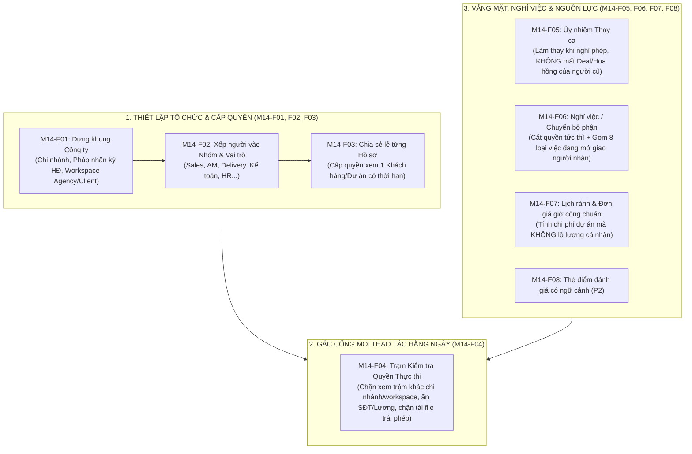
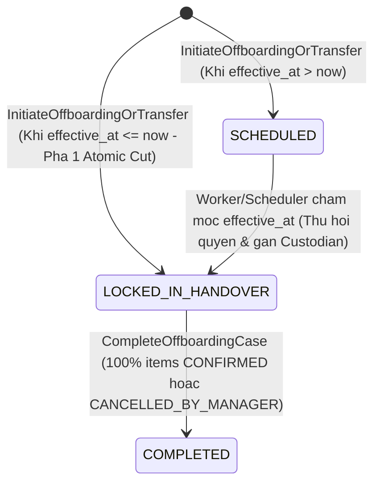
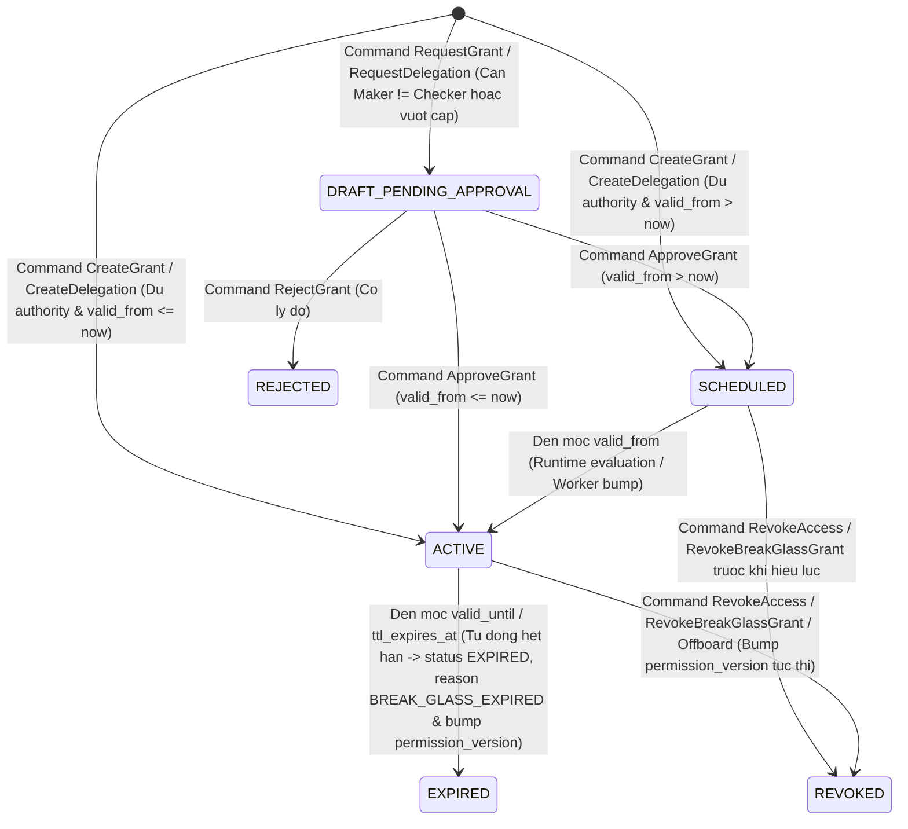

# M14 — Tổ chức, Chi nhánh, Thành viên, Quyền & Bàn giao Nhân sự

Đặc tả chi tiết cấp Module & Chức năng (`Per-Module & Per-Function Spec`) cho **M14**, dẫn xuất từ [CRM_MASTER_BRD_SRS_HOP_NHAT.md](../../00-master/CRM_MASTER_BRD_SRS_HOP_NHAT.md) (`v1.9`). Tài liệu thuộc giai đoạn `Documentation-Only`; chưa có mã nguồn ứng dụng, chưa chạy migration DB và mọi ca kiểm thử đều ở trạng thái `Not Run`.

---

## 1. Manifest

- **Baseline nguồn:** [CRM_MASTER_BRD_SRS_HOP_NHAT.md](../../00-master/CRM_MASTER_BRD_SRS_HOP_NHAT.md), Phiên bản `1.9`, `SHA-256: b6a3279f328e96e1e97d845e209be7a326516a0dba5e3a033d88e1f2162e421c`.
- **Mục nguồn trong Master v1.9:**
  - Mục `3.8.2` (`FR21`, `ĐẶC TẢ MODULE M14`, dòng `1029–1067`)
  - Mục `3.10.3` (`FR27 — Hiệu suất và phần HR tối thiểu`, dòng `1206–1217`), `3.14.1` (`Departments` vs `Teams`, dòng `1562`), `3.15` (`FR41`, dòng `1814`), `3.16.3` (`M22-F02/F22`, dòng `2003`)
  - Mục `4.12` (`UC12 — Bàn giao khi Sales nghỉ việc`, dòng `2226–2238`) và `4.14` (`UC14 — Mở ngành hoặc client workspace mới`, dòng `2252–2264`)
  - Mục `5.1` (Nguyên tắc schema `11 cột chuẩn gốc` + `legal_entity_id` theo `ADR-004` thành **12 cột `Nhóm A`**, gồm `business_line_id`, dòng `2487–2553`), `5.13` (`ENTITY-L2761..2763`, `ENTITY-L2787`), `5.14` (RLS & pooled connection), `5.18` (`ENTITY-L2860`, `ENTITY-L2863`, `ENTITY-L2881`, `ENTITY-L2882`, `ENTITY-L2885`)
  - Chương `6` (`6.1 Mô hình quyền`, `6.2 Download gateway & revoke`, `6.5 Quyền Inbox`, `6.6 Quyền Work`, `6.7 Quyền M21`, `6.8 Quyền M22`, dòng `3083–3260`) & Chương `7` (`7.1` `NFR05..12`, `7.3`, dòng `3271–3300`)
  - Chương `9` & Phụ lục `A/F` (`U05`, `U16`, `U17`, `U22`, `INT15`, `INT23`, `INT26`, `INT28`, `INT29`, `OC03`, `OC14`, `OC18`, `OC20`, `CEO-U01/03/10/15/17/18/26`, `CMO-U17/22`, `CX-U01/02/09/19/21`, `H-T04/35/40/41/43/44/47`, `P-T02..06/30/31/35/36`, `W-T01/02/07/29/36`, `RV01/10/15`, `CR01/10`, `SEC03`, `SEC06`, `SEC-U03`, `SEC-U06`, `O03`, `O04`, `O06`, `O08`, `W-O01/04/06`).
- **Status:** `Reviewed (CR-20261116-WAVE1-RECONCILIATION Applied)` *(Đã áp dụng đồng bộ các khắc phục hậu kiểm toán Luồng A, `C14` & `ADR-002..008`, và vượt cổng tái rà soát Fresh-Context với `CRITICAL = 0, HIGH = 0`)*.
- **Change Proposal & ADRs liên quan:** [CR-20261116-WAVE1-RECONCILIATION.md](../changes/archive/CR-20261116-WAVE1-RECONCILIATION.md), [ADR-002](../../01-architecture/decisions/ADR-002-ORG-ISOLATION-RLS-AND-SCOPE-FILTER.md), [ADR-003](../../01-architecture/decisions/ADR-003-PERMISSION-VERSION-CACHE-AND-MODE-GOVERNANCE.md), [ADR-004](../../01-architecture/decisions/ADR-004-SHARED-PLATFORM-TABLES-AND-BASE-SCHEMA.md), [ADR-005](../../01-architecture/decisions/ADR-005-DUAL-OUTBOX-3LANE-ISOLATION-AND-VAULT.md), [ADR-006](../../01-architecture/decisions/ADR-006-DOWNLOAD-GATEWAY-REMOTE-FETCH-AND-AI-GATEWAY.md), [ADR-007](../../01-architecture/decisions/ADR-007-PRIVACY-CANONICAL-HASH-LEGAL-HOLD-AND-DR-FENCE.md), [ADR-008](../../01-architecture/decisions/ADR-008-OMNICHANNEL-CONTRACTS-RECEIPTS-AND-CROSS-EVENTS.md).
- **Domain Owner & Vai trò chịu trách nhiệm:**
  - **Accountable Business Role:** Chủ dự án / CEO (`Owner`) & Ops/Privacy Owner (phê duyệt cấu trúc tổ chức, thẩm quyền cấp quyền, chính sách kiêm nhiệm `SOLO_PILOT` $\leftrightarrow$ `TEAM`).
  - **Technical Reviewer:** Security / Platform Architect.
- **Ranh giới *Single Source of Truth* (`INV-01`, `INV-02`, `INV-13`, `INV-22..25`, `ADR-002..004`):**
  - **`M14` sở hữu độc quyền (`23 Owned Entities`):** `Tenants`, `Branches`, `Legal_Entities`, `Business_Lines`, `Brands`, `Business_Units`, `Workspaces`, `Workspace_Account_Links`, `Contract_Workspace_Grants`, `Departments`, `Users`, `Principal_Permission_Versions` (`DB SoT`), `Teams`, `Memberships`, `Roles`, `Role_Bindings`, `Entity_Team_Grants`, `Break_Glass_Grants` (`Runtime ACL Store`), `Delegations`, `Offboarding_Cases`, `Offboarding_Checklist_Items`, `Capacity_Cost_Snapshots` (`P1`), `Scorecard_Reviews` (`[PROPOSED] P2`).
  - **Shared Platform Tables & `Bank_Accounts` (`ADR-004`):** `Audit_Logs` (`ENTITY-L2787`) và khung `Policy_Definitions` / `Policy_Versions` (`ENTITY-L2885`) thuộc **quyền quản trị nền tảng của `M23`** (`M23-F06` Audit Ledger & `M23` Platform Policy Engine); `M14` ghi audit qua Shared Audit Port và khai báo tham số chính sách miền `M14` trên `Policy_Versions`. Bảng `Bank_Accounts` (`ENTITY-L2860`, `O04`) cho Pháp nhân thuộc **`M09`**, tách biệt với `Employee_Bank_Accounts` cá nhân thuộc **`M22`**.
  - **`M14` vs `M22` (Nhân sự & Lương):** `M22` sở hữu hồ sơ nhân viên (`Employee`), hợp đồng lao động (`Employment`), chấm công và bảng lương (`HR-C`). `M14` tiêu thụ bất đồng bộ `hr.employment.changed.v1`, `hr.availability.changed.v1`, `hr.offboarding.effective.v1` để cập nhật `Departments` hiển thị, snapshot năng lực và kích hoạt `M14-F06` (`M22-F22`); thay đổi chức danh ở `M22` **không tự động mở quyền dữ liệu** (`INV-02`, `H-T04`). `M14-F07` chỉ lưu snapshot `availability` (không có lý do nghỉ) và `standard_cost_rate` chuẩn hóa (`Rate=NULL/UNKNOWN`), tuyệt đối không lưu lương cá nhân (`INV-01`).
  - **`M14` vs `M23` (Quản trị bảo mật vận hành):** `M23-F03` quản lý workflow xin–duyệt `Break-glass` có TTL (`Maker != Checker` khi `TEAM`) và gọi command `ApplyBreakGlassGrant` / `RevokeBreakGlassGrant` ghi vào bảng runtime `Break_Glass_Grants` tại `M14`; `M23-F05` quản lý quy trình chuyển cấp `SOLO_PILOT <-> TEAM` và gọi `SetTenantOperatingMode` cập nhật `M14.Tenants.operating_mode`. **`M14-F04` là cổng kiểm tra quyền thực thi (`RBAC + ABAC + Legal Hold + Break-Glass`) duy nhất** (`INV-23`).
  - **`M14` vs `M20` (`Legal Hold` & Sự cố & `CLIENT scope`):** `M14` tiêu thụ `M20.LegalHoldChanged` để áp chế độ `RESTRICTED_LEGAL_HOLD` vào `M14-F04` (`ADR-007`), tiêu thụ `M20.DataIncidentEscalated` để khóa khẩn cấp actor rò rỉ, và kiểm tra `processing_scope` (`M20-F01` / `O06`) trước khi kích hoạt `CLIENT workspace` (`FR41`, `UC14`).
  - **`M14` vs `M24` (Cache quyền):** `M14` giữ DB Authoritative SoT `Principal_Permission_Versions`; `M24-F06` chỉ giữ cache mirror `Permission_Cache_Versions` theo 2 chế độ `INTERACTIVE_READ` vs `GUARDED_EXECUTION` (`ADR-003`, `INV-25`).
- **Public Contracts cung cấp (`02-specs/contracts/`):**
  - [M14-PRINCIPAL-ACCESS-DECISION.md](../contracts/M14-PRINCIPAL-ACCESS-DECISION.md) — Hợp đồng Lõi (`BindDbTransactionContext` + `EvaluateAccessDecision` + `CompileScopeFilter`), 4 Published Domain Events (`M14.PermissionVersionBumped`, `M14.UserOffboardingLocked`, `M14.WorkHandoverAssigned`, `M14.WorkspaceActivated`) và Subscribed Events từ `M20`, `M22`, `M23`.
- **Core vs Industry-Pack Boundary:** Toàn bộ `M14-F01..06` thuộc **Platform Core (`P0`, `SL00` trở đi)**; `M14-F07` thuộc mở rộng quản trị nguồn lực (`P1`, `SL06/SL07`); `M14-F08` thuộc quản trị hiệu suất có ngữ cảnh (`[PROPOSED] P2`, `SL07`, cờ `ENABLE_M14_SCORECARD_P2`).
- **Read first:** [INVARIANTS.md](../../01-architecture/INVARIANTS.md), [INDEX.md](../../01-architecture/INDEX.md), [M14-PRINCIPAL-ACCESS-DECISION.md](../contracts/M14-PRINCIPAL-ACCESS-DECISION.md), [M23-SYSTEM-ADMIN-SECURITY-OPS.md](M23-SYSTEM-ADMIN-SECURITY-OPS.md).
- **Read on demand:** [ADR-002](../../01-architecture/decisions/ADR-002-ORG-ISOLATION-RLS-AND-SCOPE-FILTER.md), [ADR-003](../../01-architecture/decisions/ADR-003-PERMISSION-VERSION-CACHE-AND-MODE-GOVERNANCE.md), [ADR-004](../../01-architecture/decisions/ADR-004-SHARED-PLATFORM-TABLES-AND-BASE-SCHEMA.md), [ADR-007](../../01-architecture/decisions/ADR-007-PRIVACY-CANONICAL-HASH-LEGAL-HOLD-AND-DR-FENCE.md), [GAPS.md](../../03-planning/GAPS.md).
- **Allowed write paths (Giai đoạn hiện tại):** Chỉ cập nhật tài liệu trong `01-architecture/`, `02-specs/` và `03-planning/`; chưa mở `application_write_scope` (`Documentation-Only`).

---

## 2. Requirement trace

### 2.1. Danh mục 18 ID sở hữu trực tiếp bởi `M14` (`owner == M14` trong `requirements.json`)

| ID nguồn | Source anchor/line | Ý nghĩa | Owner/consumer | Priority | Applicability | Test | Evidence |
|---|---|---|---|---|---|---|---|
| `FR21` | Master `3.8.2` (dòng `1054`) | Phân quyền tổ chức, hai chi nhánh, pháp nhân, workspace `AGENCY/CLIENT` và bàn giao đúng scope | Owner: `M14` / Consumers: `M01–M24` | `P0` (Scope nền) / `P1` (2 nhánh) | Mọi release từ `SL00` | `M14-AC01..03`, `U16`, `U17`, `INT29`, `SEC-U06` | Not Run |
| `M14-F01` | Master `3.8.2` (dòng `1035`) | Thiết lập cơ cấu tổ chức: `Tenant`, `Branch`, `Legal_Entity`, `Workspace (AGENCY/CLIENT)` | Owner: `M14` / Consumers: `M01–M24` | `P0` | Mọi tenant (`SL00+`) | `M14-AC01`, `U17`, `CEO-U10` | Not Run |
| `M14-F02` | Master `3.8.2` (dòng `1036`) | Gán vai trò và thành viên (`Membership`, `Role_Bindings`) theo thẩm quyền cấp quyền và thời hạn | Owner: `M14` / Consumers: `M01–M24` | `P0` | Mọi tenant (`SL00+`) | `M14-AC02`, `SEC-U06` | Not Run |
| `M14-F03` | Master `3.8.2` (dòng `1037`) | Chia sẻ hồ sơ có phạm vi (`Entity_Team_Grants`) tới đúng đối tượng, hành động, trường và thời hạn | Owner: `M14` / Consumers: `M01`, `M02`, `M08`, `M11`, `M16`, `M21` | `P0` | Mọi tenant (`SL00+`) | `M14-AC01`, `U17`, `CEO-U17`, `RV10` | Not Run |
| `M14-F04` | Master `3.8.2` (dòng `1038`) | Kiểm tra quyền thực thi (`RBAC + ABAC`, `Deny-wins`, `Fail-closed`) tại API, Search, File, Worker, AI | Owner: `M14` / Consumers: `M01–M24` | `P0` | Mọi request & background job | `M14-AC01`, `INT23`, `INT29`, `RV15`, `OC20` | Not Run |
| `M14-F05` | Master `3.8.2` (dòng `1039`) | Ủy nhiệm và thay ca (`Delegations`) có thời hạn, không tự đổi Deal owner hay hoa hồng lịch sử | Owner: `M14` / Consumers: `M02`, `M03`, `M11`, `M16`, `M22` | `P0` | Khi nhân sự vắng mặt/thay ca | `M14-AC03`, `CEO-U15`, `CX-U21` | Not Run |
| `M14-F06` | Master `3.8.2` (dòng `1040`) | Chuyển bộ phận và nghỉ việc: cắt phiên/quyền tức thì, bàn giao open work có xác nhận hoặc về queue quản lý | Owner: `M14` / Consumers: `M02`, `M03`, `M07`, `M08`, `M11`, `M12`, `M13`, `M15`, `M16`, `M17`, `M19`, `M22`, `M23` | `P0` | Khi chuyển nhánh hoặc nghỉ việc (`UC12`) | `M14-AC03`, `U16`, `SEC-U03`, `OC18`, `CX-U21` | Not Run |
| `M14-F07` | Master `3.8.2` (dòng `1041`) | Quản lý năng lực khả dụng (`Availability`) và đơn giá nội bộ (`Cost Rate`) theo hiệu lực, ẩn lương cá nhân | Owner: `M14` / Consumers: `M07`, `M16`, `M17`, `M18`, `M22` | `P1` | Khi bật quản lý capacity/margin (`SL06/07`) | `CMO-U17`, `CEO-U01` *(phối hợp `M07/M17/M18`)* | Not Run |
| `M14-F08` | Master `3.8.2` (dòng `1042`) | Thẻ điểm đánh giá vận hành (`Scorecard`) theo vai trò/bối cảnh, không xếp hạng khi thiếu mẫu, không phạt theo số thao tác | Owner: `M14` / Consumers: `M16`, `M18` | `P2` | Khi bật P2 Scorecard (`FR27`, cờ `ENABLE_M14_SCORECARD_P2`) | `M14-AC03` | Not Run |
| `M14-AC01` | Master `3.8.2` (dòng `1050`) | Tiêu chí nghiệm thu: Xung đột vai trò (`Role conflict`) và chia sẻ `Account` giữ đúng `Deny-wins` và scope | Owner: `M14` / Consumers: `M01`, `M03`, `M08` | `P0` | Mọi release (`SL00+`) | `INT29`, `U17` | Not Run |
| `M14-AC02` | Master `3.8.2` (dòng `1050`) | Tiêu chí nghiệm thu: Admin tự cấp Finance hoặc Manager cấp quyền ngoài chi nhánh bị chặn | Owner: `M14` / Consumers: `M09`, `M23` | `P0` | Mọi release (`SL00+`) | `SEC-U06` | Not Run |
| `M14-AC03` | Master `3.8.2` (dòng `1050`) | Tiêu chí nghiệm thu: Offboarding giữ actor lịch sử, cắt token/download, bàn giao đủ open work; thiếu dữ liệu không xếp hạng | Owner: `M14` / Consumers: `M02`, `M03`, `M16` | `P0` | Mọi release (`SL00+`) | `U16`, `SEC-U03`, `OC18` | Not Run |
| `UC12` | Master `4.12` (dòng `2226`) | Use Case bàn giao khi Sales/nhân sự nghỉ việc (cắt phiên $\rightarrow$ thu hồi quyền $\rightarrow$ bàn giao open work có xác nhận) | Owner: `M14` / Consumers: `M02`, `M03`, `M11`, `M16`, `M22` | `P0` | Mọi release (`SL00+`) | `U16`, `SEC-U03`, `OC18`, `CX-U21` | Not Run |
| `UC14` | Master `4.14` (dòng `2252`) | Use Case mở gói ngành hoặc `CLIENT workspace` mới đảm bảo cách ly dữ liệu tuyệt đối | Owner: `M14` / Consumers: `M18`, `M19`, `M20`, `M21`, `M23` | `P0` | Khi tạo `Workspace` hoặc bật Pack | `U17`, `OC24`, `RV10` | Not Run |
| `SEC03` | Master Phụ lục `F` (dòng `4687`) | Kiểm soát bảo mật: Download Gateway kiểm tra quyền hiện tại trên mỗi request (kể cả `Range/resume`), thay thế raw presigned URL | Owner: `M14` / Consumers: `M03`, `M20` *(áp cho mọi tệp nhạy cảm `6.2`)* | `P0` | Mọi tải tệp nhạy cảm (`6.2`) | `SEC-U03`, `U16` | Not Run |
| `SEC06` | Master Phụ lục `F` (dòng `4690`) | Kiểm soát bảo mật: Kiểm tra thẩm quyền cấp quyền (`Grant Authority`) và chặn tự nâng quyền qua role/team/config | Owner: `M14` / Consumers: `M23`, `M01–M22` | `P0` | Mọi thao tác cấp quyền (`6.1`) | `SEC-U06`, `M14-AC02` | Not Run |
| `SEC-U03` | Master `9.14` (dòng `3823`) | Ca kiểm thử bảo mật: Cấp link file nhạy cảm $\rightarrow$ revoke user/grant $\rightarrow$ thử `GET/Range/link copy` bị từ chối ngay | Owner: `M14` / Consumers: `M03`, `M16`, `M20` | `P0` | Mọi release (`SL00+`) | `SEC-U03`, `U16` | Not Run |
| `SEC-U06` | Master `9.14` (dòng `3826`) | Ca kiểm thử bảo mật: Admin connector tự gán Finance, Manager cấp ngoài branch, tự kéo dài Break-glass đều bị từ chối | Owner: `M14` / Consumers: `M23` | `P0` | Mọi release (`SL00+`) | `SEC-U06` | Not Run |

---

### 2.2. Truy vết Mở rộng từ `consumers == M14`, `PLATFORM`, Module Liên kết & `entities-contracts.json` (`Rule 1`)

| ID nguồn | Source anchor/line | Ý nghĩa trong ngữ cảnh `M14` | Vai trò của `M14` | Priority | Applicability | Test | Evidence |
|---|---|---|---|---|---|---|---|
| `FR08` | Master `3.3.2` (dòng `588`) | Che dữ liệu nhạy cảm (`Data Masking` server-side) và giữ quyền khi bàn giao hội thoại | `Primary Policy Provider` (cấp `masked_fields` cho `M03`) | `P0` | Mọi truy vấn PII (`SL00+`) | `U16`, `OC18` | Not Run |
| `FR25` | Master `3.10.1` (dòng `1132`) | Quản lý công việc dùng chung & capacity: `M14` kiểm tra authority giao/duyệt/xem private task (`6.6`) | `Authority Provider` cho `M16` | `P0` | Từ `SL01` | `W-T01`, `W-T02`, `W-T07`, `W-T29`, `W-T36` | Not Run |
| `FR27` | Master `3.10.3` (dòng `1206`) | Hiệu suất & HR tối thiểu: `M14-F07` giữ availability/cost rate snapshot, `M14-F08` giữ scorecard P2 | `Co-Owner` cùng `M16` / `M22` | `P0` (Org) / `P1` (Cost) / `P2` (Scorecard) | Theo cấp độ `SL00` / `SL06` / `SL07` | `M14-AC03`, `CMO-U17` | Not Run |
| `FR35` | Master `3.12.6` (dòng `1337`) | Phân công hội thoại, chuyển ca và bàn giao khi vắng mặt/nghỉ việc | `Delegation/Offboarding Provider` cho `M03` | `P0` | Từ `SL02` | `U16`, `OC18`, `CX-U09`, `CX-U19` | Not Run |
| `FR37` | Master `3.12.8` (dòng `1363`) | Cách ly đa tầng `Tenant/Workspace/Branch` và quyền trên từng đối tượng/file trong Inbox | `Core Access Engine` cho `M03` | `P0` | Từ `SL00/SL02` | `U16`, `U17`, `INT23`, `INT29` | Not Run |
| `FR41` | Master `3.15` (dòng `1814`) | Cô lập dữ liệu Partner/Client portal (`M21`): Partner ở `CLIENT workspace` chỉ xem phạm vi `Account/Contract` đã cấp | `Consumer / Core Scope Guard` (`consumers == M14` trong `requirements.json`) | `P0` | Từ `SL04/SL09` | `P-T02..06`, `P-T30..31`, `P-T35..36`, `CEO-U17` | Not Run |
| `M21-F02`, `M21-F13`, `M21-F14` | Master `3.15` (dòng `1818–1832`) | Cổng khách hàng `CLIENT workspace`, quản trị thành viên Partner và chia sẻ có điều kiện sang `AGENCY` | `Co-Consumer / ACL Provider` cho `M21` (`UC14`) | `P0–P1` | Từ `SL04/SL09` | `P-T02..06`, `P-T30..31`, `P-T35..36`, `U17` | Not Run |
| `M22-F01`, `M22-F02`, `M22-F22`, `M22-F25`, `M22-F27` | Master `3.16.3` (dòng `2003`) & `M22` | Đồng bộ danh mục `Departments`, trạng thái tuyển dụng/điều chuyển, lịch khả dụng (`availability`) và quy trình `Offboarding` từ `M22` (`consumers == M14` cho `M22-F02/F22`) | `Event Consumer` (hồ sơ HR) & `ACL Guard` | `P0–P1` | Từ `SL01/SL08` | `H-T04`, `H-T35/40/41/43/44/47` | Not Run |
| `M20-F05`, `M20-F08` (`M20.LegalHoldChanged`, `M20.DataIncidentEscalated`) | Master `3.13` & `C20` | Áp chế độ chỉ đọc hạn chế `RESTRICTED_LEGAL_HOLD` khi có Legal Hold và khóa khẩn cấp actor khi có sự cố rò rỉ | `Required Event Consumer` của `M20` | `P0` | Từ `SL00` | `M20-LEGAL-HOLD-ACL`, `INT28` | Not Run |
| `U05`, `U16`, `U17`, `U22` | Master `9.5` (dòng `3548–3565`) | B2C grant không cần `Account` giả (`U05`); revoke link/Range (`U16`); chặn dò ID cross-workspace (`U17`); AI prompt injection bị chặn ở retrieval policy (`U22`) | `Primary Owner` (`U05/16/17`) & `AI Guard` (`U22`) | `P0` | Mọi release (`SL00+`, `U22` từ `SL07`) | `U05`, `U16`, `U17`, `U22`, `SEC-U03`, `OC20` | Not Run |
| `INT15`, `INT23`, `INT26`, `INT28`, `INT29` | Master `9.10` (dòng `3637–3651`) | Bảo toàn hoa hồng lịch sử (`INT15`); Worker/Search recheck (`INT23`); Restore backup không hồi sinh revoke (`INT26`, `CEO-U26`); AI & Legal Hold guard (`INT28`); `Deny-wins` (`INT29`) | `Primary / Co-Owner` | `P0` | Mọi release (`SL00+`) | `INT15`, `INT23`, `INT26`, `INT28`, `INT29`, `CEO-U26` | Not Run |
| `CEO-U01`, `CMO-U17`, `CMO-U22` | Master `9.12` (dòng `3688, 3726`) | `M14-F07` trả `cost_rate = NULL (UNKNOWN)` khi chưa cấu hình để `M07/M17/M18` không báo lãi ảo `100%` (`CEO-U01`); chốt version cost theo kỳ (`CMO-U17`); kiểm phạm vi phân bổ ngân sách/chỉ số (`CMO-U22`) | `Cost/Capacity Data Provider` (không sở hữu phép tính biên `100%`) | `P0–P1` | Từ `SL04–06` | `CEO-U01`, `CMO-U17`, `CMO-U22` | Not Run |
| `CEO-U03`, `CEO-U10`, `CEO-U15`, `CEO-U17`, `CEO-U18` | Master `9.12` (dòng `3690–3705`) | Thiếu `authority` nghiệm thu (`CEO-U03`); chặn thu tiền khác `legal_entity_id` (`CEO-U10`); giữ hoa hồng khi chuyển Sales (`CEO-U15`); `CLIENT` mở link `AGENCY` (`CEO-U17`); Worker recheck sau revoke (`CEO-U18`) | `Primary / Authority / Scope Provider` | `P0` | Từ `SL03–SL05` | `CEO-U03`, `CEO-U10`, `CEO-U15`, `CEO-U17`, `CEO-U18` | Not Run |
| `CX-U01`, `CX-U02`, `CX-U09`, `CX-U19`, `CX-U21` | Master `9.12` (dòng `3752–3772`) | 1 Contact nhiều `Account` (`CX-U01`); kiểm phạm vi merge/xem lịch sử (`CX-U02`); chuyển ca/bàn giao hội thoại & pending approval (`CX-U09`, `CX-U19`, `CX-U21`) | `Primary Owner` (`M14-F03/04/05/06`) | `P0` | Từ `SL01–SL04` | `CX-U01`, `CX-U02`, `CX-U09`, `CX-U19`, `CX-U21` | Not Run |
| `RV01`, `RV10`, `RV15`, `CR01`, `CR10` | Master `9.13` (dòng `3783–3797`) | Cross-branch/cross-workspace isolation (`RV01`), chặn sửa bridge `Workspace_Account_Links` (`RV10`), PG `SET LOCAL` trên pool/savepoint (`RV15`), đối soát ràng buộc/conflict (`CR01`, `CR10`) | `Primary Owner` (`M14-F01/03/04`) | `P0` | Từ `SL00` / `SL04` | `RV01`, `RV10`, `RV15`, `CR01`, `CR10` | Not Run |
| `OC03`, `OC14`, `OC18`, `OC20` | Master `9.9` (dòng `3592–3609`) | Xóa/ẩn danh dữ liệu tôn trọng ranh giới `workspace` (`OC03`); định danh & gán vai đúng nhánh (`OC14`); sales nghỉ việc khi mở deal/thread (`OC18`); AI prompt đọc chéo workspace bị chặn ở `CompileScopeFilter` (`OC20`) | `Primary / Policy Guard` | `P0` | Từ `SL00–07` | `OC03`, `OC14`, `OC18`, `OC20` | Not Run |
| `H-T04`, `H-T35/40/41/43/44/47` | Master `9.18` (dòng `3997–4045`) | HR chuyển phòng/chức danh ở `M22` không tự mở quyền CRM (`H-T04` — `consumers == M14`); ẩn lương/lý do nghỉ, offboard đồng bộ HR $\leftrightarrow$ CRM (`H-T35/40/41/43/44/47`) | `Consumer & Isolation Guard` | `P0` | Từ `SL01/SL08` | `H-T04`, `H-T35`, `H-T40`, `H-T41`, `H-T43`, `H-T44`, `H-T47` | Not Run |
| `P-T02..06`, `P-T30..31`, `P-T35..36` | Master `9.17` | Kiểm thử cô lập `CLIENT workspace`, thu hồi thành viên/Partner, chặn lộ hợp đồng/hoa hồng `AGENCY` (`FR41`) | `ACL & Scope Provider` cho `M21` | `P0` | Từ `SL04/SL09` | `P-T02`, `P-T03`, `P-T04`, `P-T05`, `P-T06`, `P-T30`, `P-T31`, `P-T35`, `P-T36` | Not Run |
| `W-T01/02/07/29/36`, `W-O01/04/06` | Master `9.16`, `A.6` | Quyền xem/duyệt công việc, ẩn `PERSONAL` task khỏi cấp trên (`W-O04`), Custodian mặc định (`W-O01`), thiếu `cost_rate` không quy `0` (`W-O06`) | `Scope & Capacity Provider` cho `M16` | `P0–P1` | Từ `SL01/SL06` | `W-T01`, `W-T02`, `W-T07`, `W-T29`, `W-T36` | Not Run |
| `NFR05`, `NFR06`, `NFR07`, `NFR10`, `NFR11`, `NFR12` | Master `7.1` (dòng `3275–3282`) | `NFR05`: Khả dụng SLO `99,9%/tháng` (~`43,2p` downtime); `NFR06`: `RPO <= 15p`, `RTO <= 4h`, restore không hồi sinh revoke; `NFR07`: Cô lập `0` truy cập chéo tenant/workspace (API, file, search, BI, AI); `NFR10`: Accessibility; `NFR11`: Log có `correlation_id`, không PII/secret; `NFR12`: Portability export mở | `Core Owner` (`NFR07`) & `Core Contributor` (`NFR05/06/10/11/12`) | `P0` | Mọi release (`SL00+`) | `U17`, `SEC-U03`, `INT26`, `RV15`, `UI-A11Y-M14` | Not Run |
| `O03` / `O04` / `O06` / `O08` | Master `A.6` (dòng `4211–4216`) | Tham số mở về kiêm nhiệm (`O03`), tài khoản ngân hàng pháp nhân `M09` vs nhân viên `M22` (`O04`), chế độ dữ liệu `CLIENT workspace` (`O06`), gán chi nhánh–pháp nhân (`O08`) | `Policy Schema Contributor` (trên `M23.Policy_Versions`) | `P0` | Cấu hình trước Go-live | Kiểm tra `Fail-Closed` khi chưa cấu hình (`GAP-*`) | Not Run |
| `ENTITY-L2761..2763`, `ENTITY-L2787`, `ENTITY-L2860`, `ENTITY-L2863`, `ENTITY-L2881`, `ENTITY-L2882`, `ENTITY-L2885` | Master `5.13` & `5.18` | Các thực thể tổ chức/quyền thuộc `M14`; riêng `ENTITY-L2787` (`Audit_Logs`) & `ENTITY-L2885` (`Policy_Definitions/Versions`) dùng chung do `M23` quản trị nền tảng (`ADR-004`); `ENTITY-L2860` tách `Bank_Accounts` sang `M09/M22` | `Schema Owner` (`M14` Entities) & `Consumer` (`M23` Shared) | `P0` | Tách bảng chi tiết tại Mục `4. Data/API` | Kiểm tra schema & FK composite | Not Run |

---

## 3. Hành vi

### 3.0A. Tổng quan Cơ chế Hoạt động của Module `M14` (`Executive & Business Walkthrough`)

Trong toàn bộ kiến trúc CRM (`M01–M24`), **`M14` đóng vai trò là "Bộ khung Tổ chức + Trạm Kiểm soát Cửa ra vào + Trung tâm Bàn giao Công việc"**. Mọi module nghiệp vụ khác (Bán hàng `M02`, Hộp thư đa kênh `M03`, Báo giá/Hợp đồng `M07/M08`, Tài chính `M09`, Hoa hồng `M10`, Giao việc `M16`, Nhân sự `M22`...) trước khi cho phép bất kỳ ai **xem, sửa, duyệt, tải tệp đính kèm hay xuất báo cáo** đều bắt buộc đi qua `M14`.

Cơ chế vận hành tổng thể của `M14` xoay quanh **3 trụ cột nối tiếp nhau**:
1. **Trụ cột 1 — Thiết lập Khung Tổ chức & Cấp quyền (`M14-F01`, `M14-F02`, `M14-F03`):** Dựng cấu trúc công ty (tách biệt Chi nhánh vận hành, Pháp nhân ký hợp đồng/nhận tiền, Không gian nội bộ `AGENCY` và Không gian khách hàng `CLIENT`), xếp nhân sự vào phòng ban/vai trò (`Role_Bindings`), và cho phép chia sẻ có thời hạn từng hồ sơ lẻ (`Entity_Team_Grants`) mà không làm lộ toàn bộ kho dữ liệu.
2. **Trụ cột 2 — Gác cổng Truy cập Thực thi Thời gian thực (`M14-F04`):** Kiểm tra quyền đồng nhất trên mọi đường (API, danh sách tìm kiếm, đếm số lượng `count`, tải file qua `Download Gateway`, tác vụ chạy ngầm `Background Worker` và trợ lý AI `M06`) theo nguyên tắc **Lệnh cấm luôn thắng (`Deny-wins`)** và **Thiếu ngữ cảnh thì khóa mặc định (`Fail-closed`)**.
3. **Trụ cột 3 — Vận hành Thay ca, Nghỉ việc & Quản trị Nguồn lực (`M14-F05`, `M14-F06`, `M14-F07`, `M14-F08`):** Đảm bảo khi nhân viên nghỉ phép có người làm thay (`Act-On-Behalf`) mà không mất Deal/Hoa hồng; khi nhân viên nghỉ việc thì cắt quyền tức thì trong 1 bước nhưng gom đủ 8 nhóm việc đang mở giao cho người nhận mới có xác nhận; đồng thời cung cấp lịch rảnh và đơn giá giờ công chuẩn để tính chi phí dự án mà không làm lộ bảng lương cá nhân.

---

### 3.0B. Mô hình Máy trạng thái Cốt lõi (`Core State Machines`)

#### A1. Vòng đời Tài khoản Người dùng (`Users.status` — Quyết định `/grill-me` #2)

```mermaid
stateDiagram-v2
    [*] --> INVITED : Command InviteUser
    INVITED --> ACTIVE : Command ActivateUser (Xac minh danh tinh & MFA neu bat buoc)
    INVITED --> CANCELLED : Command RevokeInvite / Het han Token
    ACTIVE --> SUSPENDED : Command SuspendUser (Tam khoa bao mat / Incident M20 / Nghi dai ngay)
    SUSPENDED --> ACTIVE : Command ReactivateUser (Co review quyen; KHONG tu hoi sinh grant cu)
    ACTIVE --> OFFBOARDING_LOCKED : InitiateOffboarding (case_type = OFFBOARD tai effective_at)
    SUSPENDED --> OFFBOARDING_LOCKED : InitiateOffboarding (case_type = OFFBOARD tai effective_at)
    OFFBOARDING_LOCKED --> OFFBOARDED : CompleteOffboardingCase (100% Open Work CONFIRMED/CANCELLED_BY_MANAGER)
    OFFBOARDED --> ACTIVE : Command RehireReactivateUser (Phai duyet moi, tao Membership moi, KHONG khoi phuc grant lich su)
```

> **Lưu ý tách biệt (`ADR-002` / `M14-F06`):** Chỉ hồ sơ có `case_type = 'OFFBOARD'` mới chuyển `Users.status` sang `OFFBOARDING_LOCKED` $\rightarrow$ `OFFBOARDED`. Với `case_type = 'BRANCH_TRANSFER'` hoặc `'ROLE_CHANGE'`, `Users.status` vẫn là `ACTIVE` ở chi nhánh/vai trò mới, còn quyền tại chi nhánh/vai trò cũ bị khóa/thu hồi nguyên tử trong Pha 1 và open work chạy hết vòng đời `Offboarding_Cases.status` bên dưới.

#### A2. Vòng đời Ca Bàn giao Nghỉ việc / Chuyển bộ phận (`Offboarding_Cases.status` — `[PROPOSED]`)

#### B. Vòng đời Cấp quyền Hồ sơ (`Entity_Team_Grants`) & Ủy nhiệm (`Delegations` — Quyết định `/grill-me` #1)

---

### 3.1. `M14-F01` — Thiết lập Cơ cấu Tổ chức & Scope (`Tenants`, `Branches`, `Legal_Entities`, `Departments`, `Workspaces`)

- **Mục tiêu & Phạm vi:** Thiết lập và cô lập ranh giới 4 chiều độc lập: Tổ chức thuê bao (`Tenant`) $\rightarrow$ Pháp nhân ký kết/hạch toán (`Legal_Entity`) $\rightarrow$ Chi nhánh vận hành (`Branch`) $\rightarrow$ Không gian làm việc (`Workspace: AGENCY | CLIENT`), kèm danh mục phòng ban hiển thị (`Departments`) (`INV-01`).
- **Tác nhân & Kích hoạt:** `Owner/CEO` hoặc `Org Admin` được ủy quyền thực hiện các lệnh `CreateBranch`, `CreateLegalEntity`, `CreateWorkspace`, `LinkWorkspaceToAccount` (`UC14`).
- **Tiền điều kiện & Đầu vào:** Phiên xác thực hợp lệ; có `code`, `name`, `timezone` (mặc định `Asia/Ho_Chi_Minh`), `workspace_type` (`AGENCY` hoặc `CLIENT`), `legal_entity_id` và `client_account_id` + `processing_scope` (bắt buộc nếu `workspace_type = 'CLIENT'`).
- **Mô tả Nghiệp vụ & Cơ chế Hoạt động Từng bước (`Step-by-Step Operational Flow`):**
  1. **Khởi tạo mặc định khi chạy Pilot (`Single-Branch/Single-Entity Ready`):** Ngay khi khởi tạo hệ thống cho công ty, `M14-F01` tạo sẵn 1 `AGENCY Workspace` mặc định, 1 Chi nhánh mặc định (`Default Branch`) và 1 Pháp nhân mặc định (`Default Legal Entity`). Ở giai đoạn công ty chỉ có 1 chi nhánh, hệ thống tự động điền giá trị mặc định này vào các giao dịch nội bộ khi Pilot chưa bật đa chi nhánh (`O08 = false`) để nhân viên không phải chọn tay nhưng dữ liệu vẫn có đủ khóa phân vùng.
  2. **Mở rộng đa Chi nhánh, đa Pháp nhân & Phòng ban:** Khi công ty mở thêm Chi nhánh mới hoặc thêm Pháp nhân mới, `M14-F01` giữ tách biệt hai khái niệm này: một Chi nhánh có thể bán dịch vụ đứng tên Pháp nhân A hoặc Pháp nhân B, nhưng tiền thu về của Pháp nhân A tuyệt đối không được cấn trừ sang công nợ của Pháp nhân B (`CEO-U10`). Danh mục `Departments` phục vụ sơ đồ tổ chức/báo cáo nhân sự, tách biệt khỏi quyền truy cập (`INV-02`).
  3. **Mở Không gian Khách hàng (`CLIENT Workspace` — `UC14`, `FR41`):** Khi công ty ký hợp đồng với đối tác/khách hàng và muốn mở riêng `CLIENT Workspace`, Admin gọi lệnh `CreateWorkspace(type='CLIENT')`. Hệ thống kiểm tra 3 chốt chặn trước khi kích hoạt:
     - Đã có hồ sơ khách hàng (`Account`) tương ứng trong `AGENCY Workspace` chưa?
     - Đã đăng ký mục đích xử lý dữ liệu (`processing_scope` / DPA hợp lệ tại `M20-F01` theo `O06`) chưa? Nếu chưa, chặn với mã `PRIVACY_PURPOSE_UNAPPROVED` (đồng bộ `C20`).
     - Đã tạo bản ghi cầu nối hợp lệ (`Workspace_Account_Links` / `Contract_Workspace_Grants`) khớp pháp nhân thanh toán chưa (`RV10`)?
  4. **Ví dụ Tình huống Thực tế:** Công ty có 2 đối tác dùng `CLIENT Workspace` là *Nhãn hàng Mỹ phẩm X* và *Chuỗi Thời trang Y*. Nhờ cơ chế cô lập `workspace_id` của `M14-F01`, nhân sự hoặc tài khoản đối tác thuộc *Workspace X* hoàn toàn không biết đến sự tồn tại của *Workspace Y*, và cũng không thể truy cập ngược vào hợp đồng gốc hay bảng tính hoa hồng nội bộ nằm trong `AGENCY Workspace` (`P-T02..06`, `CEO-U17`).
- **Quy tắc Hành vi (Chuẩn EARS):**
  1. `[MASTER]` **Ubiquitous (`INV-01`, `3.8.2`):** Hệ thống `M14` phải luôn tách biệt 4 khái niệm `tenant_id`, `legal_entity_id`, `branch_id` và `workspace_id`; tuyệt đối không dùng `branch_id` để thay thế cho `legal_entity_id` (bên ký hợp đồng/nhận tiền) hoặc `workspace_id` (ranh giới dữ liệu `AGENCY` vs `CLIENT`).
  2. `[PROPOSED]` **State-Driven (Diễn giải thiết kế từ Master `5.1` dòng `2499–2500`, `O08`):** Trong khi `multi_branch_and_legal_entity_mode (O08) = false` (`Pilot` 1 chi nhánh/1 pháp nhân), `M14` tự động gán `default_branch_id` và `default_legal_entity_id` đã khởi tạo sẵn cho giao dịch mới để giữ khóa phân vùng đồng nhất; ngay khi bật `O08 = true`, mọi hợp đồng/chi nhánh đều bắt buộc chỉ định tường minh.
  3. `[MASTER]` **Ubiquitous (`5.1`, `ENTITY-L2763`):** Mỗi `Tenant` phải luôn có đúng một `Workspace` mặc định mang `workspace_type = 'AGENCY'`; mọi dữ liệu nghiệp vụ scoped (`Nhóm A`, `ADR-004`) phải có `workspace_id NOT NULL` (tuyệt đối không dùng `workspace_id = NULL` để biểu diễn dữ liệu của Agency).
  4. `[MASTER]` **Event-Driven (`UC14`, `FR41`, `5.1`, `RV10`):** Khi nhận lệnh khởi tạo hoặc kích hoạt một `Workspace` có `workspace_type = 'CLIENT'`, `M14` phải bắt buộc xác minh: (a) `client_account_id` tồn tại trong `AGENCY` workspace của cùng `tenant_id`, (b) có `Processing_Record` / DPA (`O06`) hợp lệ tại `M20-F01` (`PRIVACY_PURPOSE_UNAPPROVED` nếu thiếu), và (c) cầu nối `Workspace_Account_Links` / `Contract_Workspace_Grants` khớp `billing_legal_entity_id`.
  5. `[MASTER]` + `[PROPOSED]` **Unwanted/Error (`RV10`, `3.8.2`):** Nếu bất kỳ lệnh nào cố gắng đổi `client_account_id` của `Workspace` hoặc đổi `buyer_account_id` của `Contract` làm lệch cầu nối `Workspace_Account_Links` / `Contract_Workspace_Grants` đang mở, `M14` phải từ chối giao dịch ở cả `INSERT` và `UPDATE` với mã lỗi đề xuất `SCOPE_BRIDGE_INTEGRITY_VIOLATION` và không cho phép chuyển công nợ/dữ liệu trái phạm vi bằng cách đổi chi nhánh (`branch_id`).
- **Xử lý Đồng thời, Idempotency & Side Effects:**
  - Khóa `UNIQUE (tenant_id, code)` trên `Branches`, `Legal_Entities`, `Business_Lines`, `Departments`, `Workspaces`. Lệnh tạo lặp cùng `Idempotency-Key` và cùng payload trả về bản ghi đã tạo; khác payload trả `409 CONFLICT_IDEMPOTENCY`.
  - Khi kích hoạt `CLIENT workspace` mới thành công (`UC14`), ghi `Audit_Logs` (`M23-F06`) và phát sự kiện `M14.WorkspaceActivated` (kèm `processing_scope` và `default_legal_entity_id`) qua Internal Outbox (`M23-F12`).

---

### 3.2. `M14-F02` — Gán Vai trò và Thành viên (`Memberships`, `Role_Bindings` & Runtime `Break_Glass_Grants`)

- **Mục tiêu & Phạm vi:** Quản lý danh tính người dùng (`Users`), tư cách thành viên (`Memberships`), gán vai trò có thời hạn (`Role_Bindings`), thực thi runtime `Break_Glass_Grants` nhận từ `M23-F03`, và ngăn chặn tự nâng quyền (`Self-elevation` — `SEC06`).
- **Tác nhân & Kích hoạt:** `Owner/CEO`, `Branch/Team Manager` (trong phạm vi chi nhánh/nhóm được cấp `grant_authority`), `Org Admin` (gọi `InviteUser`, `ActivateUser`, `SuspendUser`, `ReactivateUser`, `AssignRoleBinding`, `RevokeAccess`), và kênh nội bộ từ `M23-F03`/`M23-F05` (`ApplyBreakGlassGrant`, `RevokeBreakGlassGrant`, `SetTenantOperatingMode`), plus HR events từ `M22`.
- **Tiền điều kiện & Đầu vào:** `tenant_id` trích từ verified server session (cấm lấy từ body); payload gồm `target_user_id`, `workspace_id`, `branch_id` (nếu scoped), `role_id`, `effect` (`ALLOW | DENY`), `valid_from`, `valid_until`, `reason` (`NN`), `expected_version` (`row_version` khi update/revoke), `Idempotency-Key`.
- **Mô tả Nghiệp vụ & Cơ chế Hoạt động Từng bước (`Step-by-Step Operational Flow`):**
  1. **Mời và kích hoạt tài khoản (`Invite` $\rightarrow$ `Activate`):** Quản trị viên tạo lời mời kèm `Membership` dự kiến (`INVITED`). Chỉ khi xác minh danh tính và bật MFA (nếu Role yêu cầu), tài khoản mới chuyển sang `ACTIVE`.
  2. **Kiểm tra thẩm quyền của người cấp quyền (`Grant Authority Check`):** Hệ thống tra `Roles.grantable_role_codes` và phạm vi chi nhánh của `grantor_id`; chặn `TECH_ADMIN` tự gán `FINANCE/PRIVACY/SALES` hoặc `Branch Manager` cấp vượt nhánh (`SEC06`, `M14-AC02`).
  3. **Kiểm soát kiêm nhiệm (`SOLO_PILOT` vs `TEAM` — `ADR-003`):** Ở `SOLO_PILOT`, `Owner` được phép tự cấp quyền có gắn cờ audit kiêm nhiệm; khi `M23-F05` gọi `SetTenantOperatingMode('TEAM')`, mọi tự nâng quyền nhạy cảm (`Finance`, `Privacy`, `Tenant-wide`, `Break-glass`) phải chuyển `DRAFT_PENDING_APPROVAL` chờ `Maker != Checker`.
  4. **Tiếp nhận `Break-Glass` (`M23-F03` $\rightarrow$ `M14`) & Điều chuyển HR (`M22` $\rightarrow$ `M14`):** Khi `M23-F03` duyệt phiếu Break-glass có `incident_ticket_id` và `ttl_expires_at`, lệnh `ApplyBreakGlassGrant` ghi trực tiếp bản ghi quyền khẩn cấp vào `M14.Break_Glass_Grants` và bump `permission_version`. Khi `M22` gửi `hr.employment.changed.v1`, `M14` chỉ cập nhật `Departments`/hiển thị, không tự mở quyền CRM (`H-T04`, `INV-02`).
  5. **Ví dụ Tình huống Thực tế:** Nhân viên kỹ thuật `TECH_ADMIN` mở DevTools gọi `POST /v1/org/users/{me}/role-bindings` để tự thêm vai trò `FINANCE_VIEWER` nhằm xem bảng doanh thu và ngân hàng Pháp nhân. Server trích `tenant_id` từ session, đối chiếu `grantable_role_codes` của `TECH_ADMIN` (không chứa `FINANCE_*`) $\rightarrow$ lập tức chặn `403 AUTH_INSUFFICIENT_GRANT_AUTHORITY`, đồng thời ghi `Audit_Logs` (`M23-F06`) và bắn cảnh báo bất thường sang `M23-F08` (`SEC-U06`).
- **Quy tắc Hành vi (Chuẩn EARS):**
  1. `[MASTER]` **Ubiquitous (`5.13`, `ENTITY-L2762`):** `M14` phải luôn suy xuất `tenant_id` từ phiên xác thực phía server của người gọi; tuyệt đối không nhận `tenant_id` từ request body khi tạo hoặc sửa `Users`, `Memberships`, `Role_Bindings`.
  2. `[MASTER]` + `[PROPOSED]` **Unwanted/Error (`M14-AC02`, `SEC06`, `SEC-U06`, `6.1`):** Nếu người gọi (`grantor_id`) cố gắng: (a) gán một `Role` nằm ngoài `Roles.grantable_role_codes` của mình, (b) `TECH_ADMIN` tự gán hoặc gán cho người khác vai trò `FINANCE / PRIVACY / BUSINESS_READ / PAYROLL`, hoặc (c) `Branch Manager` gán quyền vượt ra ngoài `branch_id` mình quản lý, thì `M14` phải từ chối ngay (`403`) với mã lỗi đề xuất thống nhất `AUTH_INSUFFICIENT_GRANT_AUTHORITY` và ghi nhận cảnh báo bảo mật vào `Audit_Logs`.
  3. `[PROPOSED]` **State-Driven (`INV-22`, `O03`, `ADR-003`):** Trong khi `Tenant.operating_mode = 'TEAM'`, nếu người dùng yêu cầu cấp hoặc nâng quyền `Tenant-wide`, `Finance`, `Privacy/Export`, hoặc `Break-glass` cho chính mình (`grantor_id == target_user_id`), `M14` phải chặn kích hoạt trực tiếp, chuyển bản ghi sang `DRAFT_PENDING_APPROVAL` và yêu cầu một người phê duyệt độc lập (`approver_id != grantor_id`) xác nhận (`Maker != Checker`).
  4. `[MASTER]` **Event-Driven (`3.8.2` dòng `1046`):** Khi một người dùng ở trạng thái `SUSPENDED` hoặc `OFFBOARDED` được thực hiện lệnh `ReactivateUser` / `RehireReactivateUser`, `M14` chỉ khôi phục trạng thái định danh `Users.status = 'ACTIVE'` sau khi có phê duyệt, và **tuyệt đối không tự động hồi sinh các `Role_Bindings` hay `Entity_Team_Grants` đã bị thu hồi trước đó**.
  5. `[MASTER]` **Event-Driven (`INV-02`, `H-T04`, `M22-F02`):** Khi nhận sự kiện `hr.employment.changed.v1` từ `M22` (xử lý idempotent và sắp xếp theo `effective_at` + `aggregate_version` để an toàn khi đến lệch thứ tự), `M14` chỉ cập nhật hiển thị `Departments`/`job_title` tham chiếu và **tuyệt đối không tự động cấp hoặc mở rộng quyền đọc dữ liệu khách hàng, tài chính hay bảng lương** nếu chưa có lệnh `AssignRoleBinding` hợp lệ được phê duyệt.
- **Xử lý Đồng thời, Idempotency & Side Effects:**
  - Mọi cập nhật/thu hồi trên `Memberships`, `Role_Bindings`, `Break_Glass_Grants` phải kiểm tra `expected_version = row_version` (trả `409 CONFLICT_VERSION` nếu xung đột `INV-09`), tăng nguyên tử `Principal_Permission_Versions.permission_version` (`+1`), ghi `Audit_Logs` (`grantor_id`, `approval_ref`, `reason`, `valid_from/until`, `incident_ticket_id`), và phát `M14.PermissionVersionBumped` qua Internal Outbox.
  - Các command `ApplyBreakGlassGrant`, `RevokeBreakGlassGrant`, `SetTenantOperatingMode` bắt buộc có `Idempotency-Key` và chỉ chấp nhận chữ ký/quyền gọi từ service nội bộ `M23-F03`/`M23-F05` (`INV-23`).

---

### 3.3. `M14-F03` — Chia sẻ Hồ sơ có Phạm vi (`Entity_Team_Grants` & Cross-Workspace Bridges)

- **Mục tiêu & Phạm vi:** Cho phép chia sẻ có thời hạn từng bản ghi nghiệp vụ cụ thể (`Contact`, `Account`, `Deal`, `Project`, `Ticket`, `Report_Snapshot`, `Deliverable`, `Task`) cho cá nhân hoặc nhóm (`Team`) với danh sách hành động (`allowed_actions[]`), trường xem (`allowed_fields[]`), trường che (`masked_fields[]`), trường cấm (`forbidden_fields[]`) xác định mà không làm lộ toàn bộ kho khách hàng hay dữ liệu tài chính (`FR08`, `FR21`, `FR37`, `FR41`).
- **Tác nhân & Kích hoạt:** Chủ sở hữu hồ sơ có quyền `SHARE_GRANT`, `Team Lead/AM`, hoặc `Data Steward` gọi lệnh `GrantEntityAccess`, `RevokeAccess`, `LinkWorkspaceToAccount`, `GrantContractWorkspaceBridge`.
- **Tiền điều kiện & Đầu vào:** Phiên `ACTIVE`; `resource_type` thuộc enum `C14`; `resource_id` tồn tại hợp lệ trong `(tenant_id, workspace_id)` đích; đúng 1 trong 2 trường `grantee_user_id` hoặc `grantee_team_id` khác `NULL`; `valid_until > valid_from` (nếu có hạn); `reason` bắt buộc; `Idempotency-Key`.
- **Mô tả Nghiệp vụ & Cơ chế Hoạt động Từng bước (`Step-by-Step Operational Flow`):**
  1. **Cấp quyền chính xác đến từng Hồ sơ, Hành động & Trường dữ liệu:** AM chia sẻ `Project #P-205` cho nhân viên B trong 14 ngày chỉ với `allowed_actions = ['READ', 'COMMENT']`, tự động đẩy SĐT/email gốc vào `masked_fields` và giá vốn/chiết khấu vào `forbidden_fields`.
  2. **Nguyên tắc "Không mở lan" (`No Implicit Cascade`):**
     - Chia sẻ một `Account` chỉ mở thông tin định danh/phối hợp của `Account` đó; **không tự động mở công nợ/hóa đơn/hoa hồng `M09/M10`** và **không mở quyền sang `CLIENT Workspace` (`CEO-U17`)**.
     - Nếu `Contact` đại diện cho cả `Account A` và `Account B`, nhưng nhân viên chỉ có `Entity_Team_Grant` trên `Account A`, thì `M14` chỉ cho phép thấy `Deal`, `Ticket`, `Activity`, `Attachment` và `Count` gắn với `Account A`, ẩn tuyệt đối `Account B` (`CX-U01`).
  3. **Hỗ trợ khách hàng cá nhân (`B2C` — `U05`) & Cầu nối Hợp đồng (`Contract_Workspace_Grants`):** Cho phép grant trực tiếp trên `Contact`, `Deal`, `Ticket` không cần tạo `Account` giả; khi cấp cầu nối `Contract` sang `CLIENT Workspace`, kiểm tra nghiêm `allowed_relations` và `billing_legal_entity_id` (`RV10`).
- **Quy tắc Hành vi (Chuẩn EARS):**
  1. `[MASTER]` **Ubiquitous (`5.18`, `ENTITY-L2863`):** Mỗi bản ghi `Entity_Team_Grants` trong `M14` phải chỉ định tường minh đúng 1 tài nguyên đích (`resource_type` + `resource_id` kiểm tra tồn tại cùng `tenant_id/workspace_id`), đúng 1 đối tượng nhận (`grantee_user_id` XOR `grantee_team_id`), `effect` (`ALLOW | DENY`), `allowed_actions[]`, `allowed_fields[]`, `masked_fields[]`, `forbidden_fields[]`, thời hạn (`valid_from`, `valid_until`), `grantor_id` và `reason`.
  2. `[MASTER]` **Ubiquitous (`3.8.2` dòng `1037, 1064`, `CEO-U17`):** Khi cấp `Entity_Team_Grant` trên một `Account`, `M14` phải giới hạn phạm vi ở thông tin định danh/phối hợp của `Account` đó; **tuyệt đối không tự động mở quyền đọc sổ cái tài chính/hoa hồng của Agency (`M09/M10`) và không tự động mở quyền truy cập toàn bộ `CLIENT workspace` (`M21/M15/M16`) của khách hàng đó**.
  3. `[MASTER]` **Ubiquitous (`3.8.2` dòng `1048, 1064`, `U05`):** Đối với khách hàng cá nhân (`B2C`), `M14` phải cho phép cấp `Entity_Team_Grant` trực tiếp trên `Contact`, `Deal` hoặc `Ticket` mà **không bắt buộc tạo `Account` doanh nghiệp giả**.
  4. `[MASTER]` + `[PROPOSED]` **Unwanted/Error (`5.18` dòng `2863`, `SEC06`):** Nếu người dùng chỉ có quyền sửa nội dung bản ghi (`UPDATE`) nhưng không có quyền chia sẻ (`SHARE_GRANT`), hoặc cố gia hạn âm thầm một grant đang bị `Entity/Role DENY`, `M14` phải từ chối với mã lỗi đề xuất thống nhất `AUTH_SHARE_AUTHORITY_REQUIRED`.
  5. `[MASTER]` **Event-Driven (`CX-U01`, `3.1`):** Khi một `Contact` đại diện cho 2 `Account` nhưng nhân viên chỉ có `Entity_Team_Grant` trên `Account A`, `M14` phải truyền danh sách `granted_account_ids` vào `CompileScopeFilter` (`ADR-002`) để cô lập chỉ thấy `Deal`, `Ticket`, `Activity`, `Attachment` và `Count` gắn với `Account A`, ẩn tuyệt đối dữ liệu của `Account B`.
- **Xử lý Đồng thời, Idempotency & Side Effects:**
  - Khi tạo, hết hạn (`valid_until`), hoặc `RevokeAccess`, `M14` kiểm tra `expected_version`, cập nhật trạng thái grant, tăng `Principal_Permission_Versions.permission_version` của mọi principal bị ảnh hưởng và phát `M14.PermissionVersionBumped`.

---

### 3.4. `M14-F04` — Kiểm tra Quyền Thực thi (`Runtime RBAC + ABAC + Legal Hold + Break-Glass`, `Deny-Wins`, `Fail-Closed`)

- **Mục tiêu & Phạm vi:** Cổng quyết định quyền tập trung duy nhất (`INV-23`) thực thi [Hợp đồng M14-PRINCIPAL-ACCESS-DECISION](../contracts/M14-PRINCIPAL-ACCESS-DECISION.md) (`C14`) gồm `BindDbTransactionContext`, `EvaluateAccessDecision`, `CompileScopeFilter` và tiêu thụ `M20.LegalHoldChanged` / `M20.DataIncidentEscalated` trên mọi kênh (`API`, `List/Search/Count`, `Download Gateway SEC03`, `Background Worker CEO-U18`, `BI M18`, `AI Retrieval OC20/U22`).
- **Tác nhân & Kích hoạt:** Mọi module `M01–M24`, `Download Gateway`, `Worker Engine` (`M19`, `M24-F03/F08`), `M06` AI Retrieval gọi đồng bộ trước khi đọc/ghi/xuất dữ liệu.
- **Tiền điều kiện & Đầu vào:** Đủ `tenant_id`, `workspace_id` (lấy từ session/job context), `principal_id`, `principal_type` (`USER | SERVICE_PRINCIPAL | PORTAL_CLIENT`), `execution_mode` (`INTERACTIVE_READ | GUARDED_EXECUTION`), `expected_permission_version` (bắt buộc non-null khi `GUARDED_EXECUTION`), `resource_type`, `action`, `context_flags`, `correlation_id`.
- **Mô tả Nghiệp vụ & Cơ chế Hoạt động Từng bước (`Step-by-Step Operational Flow` — 7 Bước Tất định `C14` / `ADR-002` / `ADR-003`):**
  1. **Bước 1–2 — Kiểm định danh Principal & 2 Chế độ `permission_version` (`ADR-003`):**
     - Kiểm trạng thái hợp lệ theo `principal_type` (`USER.status = 'ACTIVE'` và `Membership = 'ACTIVE'`; `SERVICE_PRINCIPAL` key active; `PORTAL_CLIENT` chỉ đọc đúng `CLIENT workspace`).
     - Với `execution_mode = 'GUARDED_EXECUTION'` (`Worker M19`, `Bulk M24-F03`, `Export M24-F08`, `Download Gateway GET/Range`): kiểm thẳng Primary DB `Principal_Permission_Versions`; nếu `expected_permission_version <> db_version` $\rightarrow$ **Fail-Closed tức thì** (`409 AUTH_PERMISSION_VERSION_STALE` cho Worker/Bulk/Export; `401/403` cho Download Gateway `U16`, `CEO-U18`, `INT23`).
     - Với `execution_mode = 'INTERACTIVE_READ'` (UI/API đọc): nếu cache `M24-F06` lệch `db_version`, vô hiệu hóa cache của principal đó, nạp quyền mới nhất từ Primary DB và tiếp tục đánh giá.
  2. **Bước 3–5 — Cô lập Scope, Bảo vệ `PERSONAL` / `RESTRICTED_LEGAL_HOLD` & `Deny-Wins`:**
     - Chặn chéo `Workspace` nếu thiếu bridge `Workspace_Account_Links`/`Contract_Workspace_Grants` khớp `resource_type` + `allowed_relations` (trả `404 RESOURCE_NOT_FOUND_OR_DENIED` non-disclosure `U17`); kiểm khớp `legal_entity_id` cho tài chính/hợp đồng (`CEO-U10`).
     - Bảo vệ `visibility_scope = 'PERSONAL'` (`W-O04`, `INV-02`: chặn cấp trên nếu không có grant trực tiếp).
     - Kiểm trạng thái `RESTRICTED_LEGAL_HOLD` (cập nhật từ `M20.LegalHoldChanged`, `ADR-007`): khóa toàn bộ Sales/CSKH/Marketing/Update/Export/Purge; chỉ cho `READ`/`VIEW_AUDIT` đối với vai trò `FINANCE / PRIVACY / LEGAL_AUDITOR`.
     - Kiểm tra cả **`Role_Bindings (effect = 'DENY')`** và **`Entity_Team_Grants (effect = 'DENY')`**: có bất kỳ `DENY` khớp là chặn ngay (`403 AUTH_DENY_POLICY_ACTIVE`, `INT29`), kể cả `Break-Glass` thông thường cũng không đè được `Entity/Legal DENY`.
  3. **Bước 6–7 — Tổng hợp `RBAC + ABAC` & Biên dịch Bộ lọc 6 tầng (`CompileScopeFilter` — `ADR-002`):**
     - Yêu cầu cả vai trò (`Role` / `Delegation` / `Break_Glass_Grants`) và phạm vi (`WORKSPACE` / `BRANCH` không gồm `RESTRICTED` / `owner` / `delegated` / `entity grant` / `account grant`) cùng thỏa; xuất `field_policy` (`allowed_fields`, `masked_fields`, `forbidden_fields`).
     - Trong `CompileScopeFilter`: **tuyệt đối bỏ `OR branch_id` vô điều kiện**, ép đủ 6 tầng hội (`tenant`, `workspace/bridge`, `legal_entity`, `PERSONAL protection`, `scoped RBAC/ABAC`, `Role DENY + Entity DENY + Legal Hold`), kèm `BindDbTransactionContext` đặt 5 biến `SET LOCAL app.current_*` cho PG RLS (`RV15`).
  4. **Ví dụ Tình huống Thực tế:** Nhân viên Sales bấm tạo lệnh "Xuất Excel danh sách Deal" lúc 09:00 (`expected_permission_version = 10`). Lúc 09:01 Admin thu hồi quyền Export và chuyển Sales sang `SUSPENDED` (`permission_version = 11`). Lúc 09:02 Worker `M24-F08` chạy job gọi `EvaluateAccessDecision(execution_mode='GUARDED_EXECUTION', expected_permission_version=10)` $\rightarrow$ phát hiện `Status != ACTIVE` & version lệch `10 != 11` $\rightarrow$ chặn ngay `409 AUTH_PERMISSION_VERSION_STALE`, hủy xuất file và ghi `Audit_Logs` (`CEO-U18`).
- **Quy tắc Hành vi (Chuẩn EARS):**
  1. `[MASTER]` **Ubiquitous (`6.1`, `M14-AC01`, `INT29`):** Khi đánh giá quyền cho một `(principal_id, resource, action)`, `M14-F04` phải yêu cầu cả **RBAC** và **ABAC** cùng thỏa mãn; nếu tồn tại bất kỳ quy tắc `DENY` nào từ `Role_Bindings` **hoặc** `Entity_Team_Grants` đang hiệu lực thì **quyết định cuối cùng bắt buộc là `DENY` (`Deny-wins`)** — kể cả qua `CompileScopeFilter`.
  2. `[MASTER]` + `[PROPOSED]` **Unwanted/Error (`INV-13`, `RV15`, `ADR-002`, `ADR-003`):** Nếu request hoặc PG connection pool thiếu `tenant_id`, thiếu `workspace_id` (tài nguyên scoped), thiếu 5 biến GUC `SET LOCAL app.current_*`, hoặc ở chế độ `GUARDED_EXECUTION` bị lệch `expected_permission_version`, `M14-F04` phải **Fail-Closed** tức thì (`409 AUTH_PERMISSION_VERSION_STALE` cho Worker/Bulk/Export; `401/403` cho Download Gateway); ở chế độ `INTERACTIVE_READ`, `M14-F04` vô hiệu hóa cache `M24-F06` và nạp trực tiếp từ Primary DB.
  3. `[MASTER]` **Ubiquitous (`INV-02`, `6.6`, `W-O04`):** `M14-F04` phải đảm bảo các thao tác liên kết bản ghi (`Task_Links`, `Conversation_Subject_Links`), nhắc tên (`@mention`), gộp hồ sơ (`Merge`) hoặc chức danh cấp trên (`Line Manager / CEO`) **không tự động mở quyền đọc** trên tài nguyên đích hoặc công việc `PERSONAL` nếu người xem không có grant hợp lệ (`CX-U02`, `H-T04`).
  4. `[MASTER]` + `[PROPOSED]` **Event-Driven (`6.2`, `SEC03`, `SEC-U03`, `U16`):** Khi nhận yêu cầu tải tệp nhạy cảm qua `Download Gateway` (`GET / HTTP Range / Resume / Link copy`), `M14-F04` phải kiểm tra trực tiếp trên Primary DB trạng thái user (`!= OFFBOARDING_LOCKED / SUSPENDED / OFFBOARDED`), `expected_permission_version`, `Entity_Team_Grants` hiện hành, và phối hợp cổng `M20` kiểm `Legal Hold / Retention`; nếu thu hồi hoặc lệch version $\rightarrow$ từ chối ngay `401/403`.
  5. `[MASTER]` **Event-Driven (`6.1`, `CEO-U18`, `INT23`):** Khi một `Background Worker` (`M19`, `M24-F03/F08`) bắt đầu chạy job đã xếp hàng từ trước, Worker bắt buộc gọi `M14-F04` ở chế độ `GUARDED_EXECUTION` kèm `expected_permission_version` tại thời điểm chạy (tuyệt đối không chạy theo quyền cũ lúc enqueue).
  6. `[MASTER]` + `[PROPOSED]` **Ubiquitous (`U17`, `U22`, `OC20`, `INV-02`):** Khi thực thi danh sách, tìm kiếm, đếm số lượng (`count`) hoặc truy xuất ngữ cảnh AI (`RAG`), `M14-F04` phải gắn `CompileScopeFilter` (`6` tầng hội `ADR-002`, không dùng `OR branch_id`) vào truy vấn gốc để bản ghi ngoài quyền không bao giờ lọt vào `total_count`, `snippet` hay prompt AI (kể cả khi bị tấn công prompt injection `U22`).
  7. `[MASTER]` + `[PROPOSED]` **Event-Driven (`M20.LegalHoldChanged`, `M20.DataIncidentEscalated`, `ADR-007`):** Khi nhận `M20.LegalHoldChanged`, `M14` phải đánh dấu `RESTRICTED_LEGAL_HOLD` vào scope bản ghi/workspace tương ứng và bump `permission_version` để khóa mọi vai trò vận hành thường (chỉ giữ quyền đọc kiểm toán cho `FINANCE/PRIVACY/LEGAL_AUDITOR`); khi nhận `M20.DataIncidentEscalated` mức `S1/S2`, `M14` kích hoạt khóa khẩn cấp `SuspendUser` cho actor nghi bị lộ.
- **Xử lý Đồng thời, Idempotency & Side Effects:**
  - `BindDbTransactionContext`, `EvaluateAccessDecision`, `CompileScopeFilter` đều là hàm thuần đọc (`Read-Only / Idempotent`), chạy trong transaction ngắn gắn 5 biến `SET LOCAL app.current_*` (`app.current_tenant_id`, `app.current_workspace_id`, `app.current_principal_id`, `app.current_permission_version`, `app.current_acting_mode`) tự xóa khi commit/rollback trên PG pool (`RV15`).
  - Side effect duy nhất là ghi bất đồng bộ `Audit_Logs` (`M23-F06`) + cảnh báo `M23-F08` khi dùng `BREAK_GLASS`/`DELEGATED` hoặc phát hiện thử xâm nhập `AUTH_CROSS_WORKSPACE_BLOCKED` / `AUTH_INSUFFICIENT_GRANT_AUTHORITY`.

---

### 3.5. `M14-F05` — Ủy nhiệm và Thay ca (`Delegations` — Quyết định `/grill-me` #1)

- **Mục tiêu & Phạm vi:** Cho phép nhân sự vắng mặt tạm thời (nghỉ phép, công tác, đổi ca) ủy nhiệm có thời hạn cho người dự phòng (`delegatee_id`) xử lý các công việc đang mở mà không làm xáo trộn chủ sở hữu thương mại hay lịch sử hoa hồng (`FR05`, `FR35`).
- **Tác nhân & Kích hoạt:** Nhân sự ủy nhiệm (`delegator_id`) hoặc Quản lý trực tiếp (`Team Lead / Branch Manager`) gọi lệnh `CreateDelegation`, `ApproveGrant`, `RevokeDelegation`.
- **Tiền điều kiện & Đầu vào:** `delegator_id != delegatee_id`; `delegatee_id` đang `ACTIVE` và đã có sẵn `Membership` + `Role_Binding` tương thích tại chính `(workspace_id, branch_id)` đích; `valid_until > valid_from`; thời lượng không vượt quá `delegation_max_duration_days` (nếu vượt hoặc chứa quyền phê duyệt nhạy cảm phải chờ Manager duyệt); `reason`, `Idempotency-Key`.
- **Mô tả Nghiệp vụ & Cơ chế Hoạt động Từng bước (`Step-by-Step Operational Flow`):**
  1. **Tạo phiếu Ủy nhiệm & Tiền kiểm vai trò nền:** Khi Sales A nghỉ phép 3 ngày, A (hoặc Trưởng nhóm) tạo phiếu ủy nhiệm cho đồng nghiệp B trong cùng chi nhánh/workspace. `M14-F05` chặn ngay nếu B thiếu `Membership` hoặc thiếu vai trò nền tương ứng (`DELEGATION_TARGET_MISSING_BASE_ROLE`).
  2. **Khóa tự kích hoạt quyền nhạy cảm:** Nếu ủy nhiệm bao gồm quyền duyệt báo giá vượt khung, hợp đồng, hoàn tiền hay xóa PII, phiếu đi vào `DRAFT_PENDING_APPROVAL` để quản lý có thẩm quyền duyệt (`Maker != Checker`).
  3. **Cơ chế "Làm thay nhưng không cướp chủ quyền" (`Act-On-Behalf`) & Ví dụ Thực tế:** Sales A ủy nhiệm `DEAL` và `CONVERSATION` cho Sales B từ 16/11 đến 18/11. Sales B trả lời tin nhắn khách và kéo giai đoạn Deal #D-108 thành công; trường `owner_id` trên Deal và quyền hưởng hoa hồng tại `M10` **vẫn giữ tên của Sales A**, còn `Audit_Logs` ghi `actor_id = B`, `delegated_from_id = A`, `delegation_id = #DEL-12`. Ngày 19/11 hệ thống tự chuyển phiếu sang `EXPIRED` và bump `permission_version` của B.
- **Quy tắc Hành vi (Chuẩn EARS):**
  1. `[MASTER]` + `[PROPOSED]` **Precondition/Unwanted (`3.8.2` dòng `1039`, Quyết định `/grill-me` #1):** Khi nhận lệnh `CreateDelegation(delegator_id, delegatee_id, workspace_id, branch_id, resource_types[], allowed_actions[], valid_from, valid_until)`, `M14` phải kiểm tra `delegatee_id` đang ở trạng thái `ACTIVE` và đã có sẵn `Membership` + `Role_Binding` nền tương thích tại đúng `workspace_id / branch_id` đó; nếu không đạt phải từ chối với mã lỗi `DELEGATION_TARGET_MISSING_BASE_ROLE`.
  2. `[PROPOSED]` **Unwanted/Error (Quyết định `/grill-me` #1):** Nếu `allowed_actions` bao gồm quyền phê duyệt nhạy cảm (`APPROVE`, `FINANCE_POST`, `DELETE_PRIVACY`, `SHARE_GRANT`) hoặc vượt ngưỡng `delegation_max_duration_days`, `M14` phải chặn tự kích hoạt và chuyển `DRAFT_PENDING_APPROVAL` chờ cấp quản lý (`Approval Matrix` `M23-F04`).
  3. `[MASTER]` + `[PROPOSED]` **Ubiquitous (`3.8.2` dòng `1039`, `CEO-U15`, `INT15`):** Trong suốt thời gian `Delegation` đang `ACTIVE`, `M14` phải giữ nguyên trường `owner_id = delegator_id` trên mọi `Lead`, `Deal`, `Contract`, `Quote` và `Commission_Entries` lịch sử; `delegatee_id` chỉ thao tác dưới `acting_mode = 'DELEGATED'` và `Audit_Logs` phải lưu đủ `actor_id = delegatee_id`, `delegated_from_id = delegator_id`, `delegation_id`.
  4. `[PROPOSED]` **Event-Driven:** Khi thời gian hiện tại vượt quá `valid_until` hoặc khi `RevokeDelegation` được gọi, `M14` tự động chuyển `Delegations.status` sang `EXPIRED` / `REVOKED`, tăng `Principal_Permission_Versions.permission_version` của `delegatee_id` và phát `M14.PermissionVersionBumped`.
- **Xử lý Đồng thời, Idempotency & Side Effects:**
  - Dùng `Idempotency-Key` khi tạo; `expected_version = row_version` khi duyệt hoặc thu hồi (`409 CONFLICT_VERSION`). Mọi thay đổi `ACTIVE <-> EXPIRED/REVOKED` đều bump `permission_version` của `delegatee_id` trong cùng transaction và ghi `Audit_Logs` (`M23-F06`).

---

### 3.6. `M14-F06` — Chuyển Bộ phận và Nghỉ việc (`Two-Phase Offboarding / Transfer` & `UC12` — Quyết định `/grill-me` #2)

- **Mục tiêu & Phạm vi:** Đảm bảo khi nhân sự nghỉ việc (`OFFBOARD`), chuyển chi nhánh (`BRANCH_TRANSFER`) hoặc đổi vai trò nhạy cảm (`ROLE_CHANGE`), quyền truy cập cũ bị cắt tức thì tại `effective_at`, trong khi 100% công việc đang mở được bàn giao có xác nhận hoặc gán cho `Custodian` mà không mất dấu vết lịch sử (`UC12`, `M14-AC03`, `U16`, `OC18`, `CX-U21`, `M22-F22`).
- **Tác nhân & Kích hoạt:** `HR Approver / Ops Admin / Branch Manager` hoặc sự kiện `hr.offboarding.effective.v1` từ `M22-F22` gọi lệnh `InitiateOffboardingOrTransfer`, `AssignWorkHandoverRecipient`, `ConfirmWorkHandoverItem`, `CancelWorkHandoverItem`, `CompleteOffboardingCase`.
- **Tiền điều kiện & Đầu vào:** `user_id` tồn tại; `case_type` (`OFFBOARD | BRANCH_TRANSFER | ROLE_CHANGE`); nếu `BRANCH_TRANSFER` bắt buộc có `from_branch_id`, `to_branch_id` (và `from/to_workspace_id` nếu đổi workspace); nếu `ROLE_CHANGE` có `to_role_ids`; `effective_at`, `default_custodian_id` (hoặc suy xuất `queue_manager_user_id` / `Branch Manager`); `expected_version`, `Idempotency-Key`.
- **Mô tả Nghiệp vụ & Cơ chế Hoạt động Từng bước (`Step-by-Step Operational Flow`):**
  1. **Lên lịch & Pha 1 — Khóa quyền tức thì + Gán `Custodian`:**
     - Nếu `effective_at > now()`: ca mở ở `SCHEDULED` để chuẩn bị rà soát; ngay khi chạm `effective_at` (hoặc ngay lập tức nếu `effective_at <= now()`), ca chuyển `LOCKED_IN_HANDOVER`.
     - **Nếu `case_type = 'OFFBOARD'`:** chuyển `Users.status = 'OFFBOARDING_LOCKED'`, thu hồi toàn bộ `Role_Bindings`, `Entity_Team_Grants`, `Delegations`, tăng `permission_version`, kích hoạt `M23-F02` hủy mọi session/JWT và chặn `Download Gateway` (`U16`).
     - **Nếu `case_type = 'BRANCH_TRANSFER'` hoặc `'ROLE_CHANGE'`:** **giữ `Users.status = 'ACTIVE'`**, chỉ khóa `Membership`/thu hồi `Role_Bindings`/`Entity_Team_Grants` thuộc `from_branch_id` hoặc vai trò cũ, tăng `permission_version` (để không mang quyền nhánh cũ sang nhánh mới `H-T04`), đồng thời gom open work của nhánh/vai trò cũ vào bàn giao.
     - **Quét đủ 8 nhóm Open Work & gán `Custodian` (`W-O01`):** Mọi mục mở đổ vào `Offboarding_Checklist_Items` và gắn ngay `custodian_user_id = queue_manager_user_id` (fallback `Branch_Manager / Owner`).
  2. **Pha 2 — Phân bổ, Xác nhận & Đóng ca bàn giao:** Quản lý giao từng mục cho `proposed_recipient_id`. Người nhận bấm `ACCEPT` (cập nhật `owner_id`/`assignee_id` mới nhưng **giữ `created_by` & hoa hồng lịch sử** `INT15`) hoặc `REJECT` có lý do. Khi 100% mục đạt `CONFIRMED` hoặc `CANCELLED_BY_MANAGER`, `Offboarding_Cases` đóng sang `COMPLETED` (và chỉ riêng `case_type = 'OFFBOARD'` mới chuyển `Users.status = 'OFFBOARDED'`).
  3. **Ví dụ Tình huống Thực tế:** Sales Nam chuyển từ Chi nhánh Hà Nội sang Chi nhánh TP.HCM lúc 00:00 ngày 01/12 (`case_type = BRANCH_TRANSFER`). Tại 00:00:01, `Membership` chi nhánh Hà Nội của Nam bị khóa và toàn bộ 12 Deal + 4 Hội thoại Zalo đang mở tại Hà Nội chuyển quyền giám hộ tạm về Trưởng nhóm Hà Nội; tài khoản của Nam vẫn `ACTIVE` để nhận việc ở TP.HCM nhưng bấm mở link Deal cũ của Hà Nội bị chặn `403` ngay. Khi 16 đầu việc được đồng nghiệp Hà Nội bấm `Accept`, ca bàn giao đóng `COMPLETED` mà không đánh dấu nhầm Nam là `OFFBOARDED`.
- **Quy tắc Hành vi (Chuẩn EARS):**
  1. `[MASTER]` + `[PROPOSED]` **Event-Driven — Pha 1 Cắt quyền tức thì (`UC12`, `U16`, `M14-AC03`, `M22-F22`):** Khi chạm mốc `effective_at` của `InitiateOffboardingOrTransfer` (hoặc nhận `hr.offboarding.effective.v1`), `M14` phải chuyển ca sang `LOCKED_IN_HANDOVER` và thực hiện nguyên tử trong 1 transaction:
     - Nếu `case_type = 'OFFBOARD'`: chuyển `Users.status = 'OFFBOARDING_LOCKED'` và thu hồi toàn bộ `Role_Bindings`, `Entity_Team_Grants`, `Delegations`, `Break_Glass_Grants`;
     - Nếu `case_type = 'BRANCH_TRANSFER'`: giữ `Users.status = 'ACTIVE'`, khóa `Membership` tại `from_branch_id` và thu hồi toàn bộ grant/binding gắn nhánh cũ (`H-T04`);
     - Nếu `case_type = 'ROLE_CHANGE'`: giữ `Users.status = 'ACTIVE'`, thu hồi các `Role_Bindings` cũ ngoài `to_role_ids` và đưa các việc vượt thẩm quyền vai trò mới vào bàn giao;
     - Tăng `Principal_Permission_Versions.permission_version` và phát `M14.PermissionVersionBumped` + `M14.UserOffboardingLocked` để `M23-F02` cắt phiên và `Download Gateway` (`SEC03`) chặn tải tệp (`Range/resume`) thuộc phạm vi đã thu hồi.
  2. `[MASTER]` **Event-Driven — Quét toàn diện Open Work (`3.8.2` dòng `1044, 1052`, `UC12`, `CX-U21`):** Khi khởi tạo `Offboarding_Cases`, `M14` phải thu thập đầy đủ 8 nhóm đối tượng đang mở vào `Offboarding_Checklist_Items`:
     - (1) `Lead` & `Deal` đang mở (`M02`),
     - (2) `Conversation / Thread` đang gán (`M03`),
     - (3) `Ticket` & `Customer_Promises` đang mở (`M11/M12`),
     - (4) `Appointments` sắp tới (`M13`),
     - (5) `Tasks`, `Task_Assignment Offers` đang chờ, `Task_Reviews` đang chờ duyệt (`M16`),
     - (6) `Recurring_Task_Templates` và `Queue Manager` mà người đó đang làm chủ (`M16`),
     - (7) `Scheduled Outbound Intents / Journeys` gắn với actor đó (`M03/M04/M19`),
     - (8) `Pending Approvals` đang chờ người đó duyệt (`M07/M15/M17/M23`).
  3. `[MASTER]` + `[PROPOSED]` **State-Driven — Cơ chế Người giám hộ tạm thời (`UC12`, `W-O01`):** Trong khi hạng mục ở `CUSTODIAN_HOLD` hoặc `PENDING_ACCEPT`, `M14` gán `custodian_user_id = queue_manager_user_id` (fallback `Branch_Manager / Owner`) để nhận cảnh báo SLA (cảnh báo aging nếu quá `custodian_aging_alert_hours`, `[OPEN-GAP: GAP-M14-06]`), tuyệt đối không để việc vô chủ.
  4. `[MASTER]` + `[PROPOSED]` **Event-Driven — Pha 2 Xác nhận bàn giao (`3.8.2` dòng `1044`, `UC12`):** Khi `proposed_recipient_id` gọi `ConfirmWorkHandoverItem(item_id, ACCEPT | REJECT, reason)`:
     - Nếu `ACCEPT`: cập nhật hạng mục sang `CONFIRMED`, cấp quyền cần thiết và phát `M14.WorkHandoverAssigned` tới `M02/M03/M07/M08/M11/M12/M13/M15/M16/M17/M19/M22/M23` để đổi `owner_id`/`assignee_id` mới nhưng **bắt buộc giữ nguyên `created_by / historical_actor_id` và người hưởng hoa hồng lịch sử (`CEO-U15`, `INT15`)**.
     - Nếu `REJECT`: bắt buộc nhập `reason` và trả về `CUSTODIAN_HOLD` cho `Queue Manager`.
  5. `[PROPOSED]` **State-Driven — Đóng ca bàn giao phân biệt `case_type` (`UC12`):** `M14` chỉ cho phép `CompleteOffboardingCase` chuyển `Offboarding_Cases.status = 'COMPLETED'` khi 100% items đạt `CONFIRMED` hoặc `CANCELLED_BY_MANAGER`; **chỉ khi `case_type = 'OFFBOARD'` mới chuyển `Users.status` từ `OFFBOARDING_LOCKED` sang `OFFBOARDED`** (các ca `BRANCH_TRANSFER` và `ROLE_CHANGE` giữ `Users.status = 'ACTIVE'`).
- **Xử lý Đồng thời, Idempotency & Side Effects:**
  - Dùng `Idempotency-Key` chống kích hoạt trùng ca bàn giao (kể cả khi `M22` gửi lặp `hr.offboarding.effective.v1`); mỗi `ConfirmWorkHandoverItem` kiểm tra `expected_version` (tránh hai người cùng nhận 1 item). Mọi chuyển trạng thái ghi `Audit_Logs` (`M23-F06`) và phát event qua Outbox.

---

### 3.7. `M14-F07` — Quản lý Năng lực Khả dụng và Đơn giá Nội bộ (`Capacity & Internal Cost Rate`)

- **Mục tiêu & Phạm vi:** Cung cấp quỹ giờ khả dụng (`Availability`) và đơn giá phân bổ chi phí chuẩn theo kỳ (`Capacity_Cost_Snapshots`) cho `M16-F07`, `M07-F03`, `M17`, `M18` mà **tuyệt đối không làm lộ bảng lương hay lý do nghỉ phép cá nhân từ `M22`** (`FR25`, `FR27`, `6.8`, `CMO-U17`).
- **Tác nhân & Kích hoạt:** `Ops/Delivery Lead` hoặc `Finance Cost Controller` gọi `UpsertCostRateSnapshot`, `SyncAvailabilitySnapshot`; hệ thống nhận `hr.availability.changed.v1` từ `M22-F25`; `M07/M16/M17/M18` đọc qua `GET /v1/access/cost-capacity`.
- **Tiền điều kiện & Đầu vào:** `workspace_id`, `user_id` hoặc `role_id`, `effective_from` (`date`), `effective_to` (`NULL` hoặc `>= effective_from`), `standard_cost_rate` (`NULL` hoặc `>= 0`, không `NaN/Infinity`), `available_hours_per_week` (`>= 0`).
- **Mô tả Nghiệp vụ & Cơ chế Hoạt động Từng bước (`Step-by-Step Operational Flow`):**
  1. **Tách biệt Đơn giá phân bổ & Lương cá nhân:** `M14-F07` chỉ nhận `available_hours` từ `M22` (loại bỏ chi tiết nghỉ ốm/nghỉ thai sản/mức lương `M22`) và lưu `standard_cost_rate` theo vai trò/bậc công việc do Finance cấu hình.
  2. **Snapshot theo kỳ hiệu lực & Chống lãi ảo `100%` (`CEO-U01`):** Khi đổi đơn giá kỳ mới, tạo dòng version mới giữ nguyên lịch sử dự án cũ (`CMO-U17`).
  3. **Ví dụ Tình huống Thực tế:** Công ty vừa tuyển thêm 1 Junior Designer mới nhưng Finance chưa nhập đơn giá chuẩn. Khi PM lập dự toán trên `M07/M17` gọi `GET /v1/access/cost-capacity`, `M14-F07` trả `cost_rate = NULL`, `rate_status = 'UNKNOWN'` (thay vì `0 đ`) để `M07/M17/M18` hiển thị cảnh báo *"Chưa có dữ liệu đơn giá"* thay vì báo lãi ảo `100%` (`CEO-U01`, `W-O06`).
- **Quy tắc Hành vi (Chuẩn EARS):**
  1. `[MASTER]` + `[PROPOSED]` **Ubiquitous (`3.8.2` dòng `1041`, `3.10.3`, `6.8`):** `M14-F07` chỉ lưu trữ và cung cấp đơn giá phân bổ chuẩn (đặt tên cột đề xuất `standard_cost_rate`) và giờ khả dụng (`available_hours_per_week`) theo `effective_from / effective_to`; **tuyệt đối không lưu hoặc trả ra lương thực nhận (`net/gross salary`), thưởng, phụ cấp, CCCD, `Employee_Bank_Accounts` hay lý do nghỉ phép từ `M22`** (`H-T35/40/41`).
  2. `[MASTER]` **Unwanted/Error (`3.8.2` dòng `1041`, `CEO-U01`, `W-O06`):** Nếu nhân sự/vai trò chưa có cấu hình `standard_cost_rate` hoặc snapshot đã hết hạn tại ngày tính toán, `M14-F07` phải trả `cost_rate = NULL` và `rate_status = 'UNKNOWN'`; **tuyệt đối không tự quy đổi về `0`**, để `M07/M17/M18` chặn việc báo lãi ảo `100%`.
  3. `[MASTER]` **Event-Driven (`CMO-U17`):** Khi nhận `hr.availability.changed.v1` từ `M22` hoặc lệnh `UpsertCostRateSnapshot`, `M14-F07` tạo bản ghi mới theo kỳ `effective_from`, không ghi đè snapshot các kỳ dự án/báo giá đã chốt.
- **Xử lý Đồng thời, Idempotency & Side Effects:**
  - Chặn chồng lấn khoảng `[effective_from, effective_to]` cho cùng `(tenant_id, workspace_id, user_id/role_id)` bằng exclusion/CAS `expected_version`. Ghi `Audit_Logs` mỗi khi chỉnh `standard_cost_rate`.

---

### 3.8. `M14-F08` — Thẻ điểm Đánh giá Vận hành có Ngữ cảnh (`Operational Scorecard — P2`)

- **Mục tiêu & Phạm vi:** Hỗ trợ tổng hợp chỉ số phục vụ huấn luyện (`coaching`) khi bật gói `P2` (`FR27`), khóa xếp hạng khi thiếu mẫu (`M14-AC03`), và ngăn việc dùng số lượng click/task thô để phạt lương (`R26`, `3.10.3`).
- **Tác nhân & Kích hoạt:** `Delivery/Sales Manager` hoặc `Owner` xem/khởi tạo kỳ review qua `GET /v1/access/scorecard` và nhân viên gửi giải trình qua `POST /v1/access/scorecard/rebuttal` (chỉ mở khi Feature Flag `ENABLE_M14_SCORECARD_P2 = true`).
- **Tiền điều kiện & Đầu vào:** `ENABLE_M14_SCORECARD_P2 = true`; định nghĩa KPI đã được duyệt ở `M18-F01`; dữ liệu bối cảnh từ `M16-F06` (`project_mix`, `client_wait_intervals`, phân loại `defect` vs `change_request`).
- **Mô tả Nghiệp vụ & Cơ chế Hoạt động Từng bước (`Step-by-Step Operational Flow`):**
  1. **Kiểm tra định nghĩa & Cỡ mẫu (`min_sample_size`):** Chỉ hiển thị đánh giá khi đủ cỡ mẫu tối thiểu (`[OPEN-GAP: GAP-M14-05]`); thiếu mẫu đánh dấu `INSUFFICIENT_DATA` và ẩn ranking.
  2. **Lưu bối cảnh & Quyền giải trình (`employee_rebuttal_note`) — Ví dụ Thực tế:** Một AM phụ trách 2 dự án phức tạp bị trễ hạn tổng thời gian 5 ngày, nhưng log từ `M16` cho thấy `4 ngày` là thời gian `client_wait_intervals` (chờ khách duyệt layout) và `2 yêu cầu` là khách đổi đề bài (`change_request`). Thẻ điểm hiển thị tách bạch các yếu tố này kèm ô cho AM ghi giải trình trước khi quản lý chốt kỳ coaching, và không phát sinh bất kỳ lệnh trừ lương nào sang `M22`.
- **Quy tắc Hành vi (Chuẩn EARS):**
  1. `[PROPOSED]` **Optional/Capability (Cụ thể hóa Master `3.8.2` dòng `1042`, `3.10.3`):** Khi capability flag `ENABLE_M14_SCORECARD_P2 = true`, `M14-F08` chỉ hiển thị `Scorecard_Reviews` khi chỉ số đã được `M18-F01` duyệt định nghĩa, đạt ngưỡng cỡ mẫu (`min_sample_size`) và đính kèm đủ bối cảnh (`project_mix`, `client_wait_intervals` từ `M16-F06`, `defect_vs_change_request`).
  2. `[MASTER]` **Unwanted/Error (`3.8.2` dòng `1042`, `3.10.3`, `M14-AC03`, `R26`):** Nếu kỳ đánh giá thiếu dữ liệu nguồn hoặc cỡ mẫu nhỏ hơn ngưỡng tối thiểu, `M14-F08` phải gán `evaluation_status = 'INSUFFICIENT_DATA'` và chặn xếp hạng (`ranking`); hệ thống **tuyệt đối không tự động phát sinh phiếu phạt tiền/khấu trừ lương (`M22`) dựa trên số thao tác CRM, số task `Done` hay dự báo AI**.
  3. `[MASTER]` **Ubiquitous (`3.10.3`):** Mọi bản ghi `Scorecard_Reviews` trong `M14-F08` phải có trường giải trình của nhân sự (`employee_rebuttal_note`) và dấu thời gian xác nhận trước khi đóng kỳ đánh giá (`CLOSED`).
- **Xử lý Đồng thời, Idempotency & Side Effects:**
  - Khi feature flag `ENABLE_M14_SCORECARD_P2 = false`, mọi endpoint đọc/ghi scorecard trả `404 CAPABILITY_DISABLED`. Cập nhật nhận xét/giải trình kiểm tra `expected_version` và ghi `Audit_Logs`.

---

## 4. Data/API

### 4.1. Sơ đồ ERD Logic Đã Tách Bảng Độc lập (`Unbundled Logical ERD — Rule 3 / GAP-04`, `ADR-004`)

```mermaid
erDiagram
    Tenants ||--o{ Legal_Entities : owns
    Tenants ||--o{ Branches : contains
    Tenants ||--o{ Business_Lines : classifies
    Tenants ||--o{ Departments : displays_org_units
    Tenants ||--o{ Workspaces : isolates
    Legal_Entities ||--o{ Brands : registers
    Brands ||--o{ Business_Units : structures
    Workspaces ||--o{ Workspace_Account_Links : bridges_to_agency_account
    Workspaces ||--o{ Contract_Workspace_Grants : governs_cross_scope
    Tenants ||--o{ Users : registers
    Tenants ||--o{ Principal_Permission_Versions : versions_by_principal_type
    Users |o--o| Principal_Permission_Versions : maps_when_USER
    Tenants ||--o{ Teams : organizes
    Users ||--o{ Memberships : belongs_to
    Teams ||--o{ Memberships : includes
    Branches ||--o{ Memberships : scopes
    Tenants ||--o{ Roles : defines
    Memberships ||--o{ Role_Bindings : binds_role
    Roles ||--o{ Role_Bindings : grants_permissions
    Users ||--o{ Entity_Team_Grants : receives_or_grants
    Teams ||--o{ Entity_Team_Grants : receives_team_grant
    Users ||--o{ Break_Glass_Grants : holds_emergency_ttl_acl
    Users ||--o{ Delegations : delegates_act_on_behalf
    Users ||--o{ Offboarding_Cases : undergoes
    Offboarding_Cases ||--o{ Offboarding_Checklist_Items : tracks_open_work
    Users ||--o{ Capacity_Cost_Snapshots : has_cost_and_capacity
    Users ||--o{ Scorecard_Reviews : holds_p2_scorecard
    Tenants ||--o{ Policy_Definitions : "references M23 Shared Governance"
    Policy_Definitions ||--o{ Policy_Versions : versions
    Tenants ||--o{ Audit_Logs : "writes via M23 Shared Ledger"
```

---

### 4.2. Từ điển Bảng & Cột Logic (`Unbundled Table Dictionary` — `ADR-004`)

> **Quy ước kế thừa 3 Biến thể `Master 5.1` (`ADR-004`):**
> - **`Nhóm A — Scoped Business Entity` (`[MASTER] 5.1`):** Kế thừa đủ `id uuid PK NN`, `tenant_id uuid NN`, `workspace_id uuid NN`, `branch_id uuid NULL`, `legal_entity_id uuid NULL`, `business_line_id uuid NULL`, `created_at timestamptz NN`, `updated_at timestamptz NN`, `created_by uuid NN`, `updated_by uuid NN`, `row_version bigint NN DEFAULT 1`, `archived_at timestamptz NULL` + ràng buộc `UNIQUE (tenant_id, workspace_id, id)` cho composite FK.
> - **`Nhóm B — Tenant Catalog / Governance Entity` (`[MASTER] 5.1 L2491`):** Áp ngoại lệ cấp Tenant — `id uuid PK NN`, `tenant_id uuid NN`, `branch_id uuid NULL`, `legal_entity_id uuid NULL`, `business_line_id uuid NULL`, `workspace_id uuid NULL` *(tùy chọn)*, `created_at`, `updated_at`, `created_by`, `updated_by`, `row_version`, `archived_at` + `UNIQUE (tenant_id, id)`.
> - **`Nhóm C — Append-Only Immutable Ledger` (`ADR-004`):** Kế thừa `id`, `tenant_id`, `workspace_id (NULL/NN)`, `branch_id NULL`, `legal_entity_id NULL`, `business_line_id NULL`, `created_at`, `created_by`, `occurred_at`, `received_at`, `correlation_id` — **tuyệt đối KHÔNG có `updated_at`, `updated_by`, `row_version`, `archived_at`**; cấm `UPDATE/DELETE` dưới `app_runtime_role`.

#### A. 23 Thực thể Sở hữu Độc quyền của `M14` (`1 bảng = 1 dòng`, `Rule 3 / GAP-04`)

| Tên bảng độc lập (`Nhóm`) | Nguồn truy vết Master / ADR | Các cột chuyên biệt & Kiểu dữ liệu | Ràng buộc & Quy tắc toàn vẹn (`Constraints & Indexes`) |
|---|---|---|---|
| `Tenants` (`Nhóm B`) | `[MASTER]` `5.1`, `5.13` (`ENTITY-L2761`) | `code varchar(50) NN`, `name varchar(255) NN`, `operating_mode varchar(16) NN DEFAULT 'SOLO_PILOT'` (`SOLO_PILOT \| TEAM`), `default_timezone varchar(64) NN DEFAULT 'Asia/Ho_Chi_Minh'`, `status varchar(20) NN` | `UNIQUE (code)`. Đọc/cập nhật `operating_mode` qua `M23-F05 -> SetTenantOperatingMode` (`ADR-003`). |
| `Branches` (`Nhóm B`) | `[MASTER]` `5.1`, `5.13` (`ENTITY-L2761`) | `code varchar(50) NN`, `name varchar(255) NN`, `parent_branch_id uuid FK NULL`, `default_legal_entity_id uuid FK NULL`, `manager_user_id uuid FK NULL`, `status varchar(20) NN`, `effective_from date NN`, `effective_to date NULL` | `UNIQUE (tenant_id, code)`. Tách biệt `Legal_Entities` và `Workspaces` (`INV-01`). |
| `Legal_Entities` (`Nhóm B`) | `[MASTER]` `5.1`, `5.18` (`ENTITY-L2860`) | `code varchar(50) NN`, `legal_name varchar(255) NN`, `tax_code varchar(50) NN`, `default_currency char(3) NN DEFAULT 'VND'`, `representative_user_id uuid FK NULL`, `status varchar(20) NN` | `UNIQUE (tenant_id, code)`, `UNIQUE (tenant_id, tax_code)`. Bắt buộc cho `Contracts`, `Payments` (`CEO-U10`). *(`Bank_Accounts` pháp nhân thuộc `M09`; tài khoản cá nhân thuộc `M22`, `ADR-004`)*. |
| `Business_Lines` (`Nhóm B`) | `[MASTER]` `5.1`, `5.13` (`ENTITY-L2761`) | `code varchar(50) NN`, `name varchar(255) NN`, `status varchar(20) NN` | `UNIQUE (tenant_id, code)`. Đích cho FK `business_line_id` toàn hệ thống (`5.1 L2501`). |
| `Brands` (`Nhóm B`) | `[MASTER]` `5.18` (`ENTITY-L2882`) | `code varchar(50) NN`, `display_name varchar(255) NN`, `legal_entity_id uuid FK NN`, `customer_reference text NULL`, `effective_from date NN`, `effective_to date NULL` | `UNIQUE (tenant_id, code)`. Gói `P1`; luôn neo về `legal_entity_id` thanh toán canonical. |
| `Business_Units` (`Nhóm B`) | `[MASTER]` `5.18` (`ENTITY-L2882`) | `brand_id uuid FK NULL`, `code varchar(50) NN`, `display_name varchar(255) NN`, `billing_account_id uuid FK NULL`, `legal_entity_id uuid FK NN`, `effective_from date NN`, `effective_to date NULL` | `UNIQUE (tenant_id, code)`. Tách riêng dòng khỏi `Brands` theo `Rule 3 / GAP-04`. |
| `Departments` (`Nhóm B`) | `[MASTER]` `3.14.1 L1562` + `[PROPOSED]` | `code varchar(50) NN`, `name varchar(255) NN`, `parent_department_id uuid FK NULL`, `branch_id uuid FK NULL`, `external_hr_dept_ref varchar(100) NULL`, `status varchar(20) NN` | `UNIQUE (tenant_id, code)`. Đồng bộ từ `M22` để hiển thị cây tổ chức; **tuyệt đối không tự sinh ACL** (`INV-02`, `H-T04`). |
| `Workspaces` (`Nhóm B`) | `[MASTER]` `5.1`, `5.13` (`ENTITY-L2763`) | `code varchar(50) NN`, `name varchar(255) NN`, `workspace_type varchar(16) NN` (`AGENCY \| CLIENT`), `client_account_id uuid FK NULL`, `default_legal_entity_id uuid FK NN`, `controller_name text NULL`, `processing_scope text NULL`, `status varchar(20) NN` | Partial unique: đúng 1 `AGENCY` mặc định/tenant; `CLIENT` bắt buộc `client_account_id IS NOT NULL` & `processing_scope IS NOT NULL` (`UC14`, `FR41`). |
| `Workspace_Account_Links` (`Nhóm A`) | `[MASTER]` `5.1`, `5.18` (`ENTITY-L2881`) | `source_workspace_id uuid FK NN` (`CLIENT`, đồng thời là `workspace_id` sở hữu cho PostgreSQL RLS), `target_workspace_id uuid FK NN` (`AGENCY`), `client_account_id uuid FK NN`, `billing_legal_entity_id uuid FK NN`, `relation_type varchar(30) NN`, `authority_approval_ref uuid NULL`, `valid_from timestamptz NN`, `valid_until timestamptz NULL`, `revoked_at timestamptz NULL` | Cầu nối hợp thức hóa liên kết `CLIENT` $\leftrightarrow$ `Account` (`RV10`). RLS chủ sở hữu theo `workspace_id = source_workspace_id`; chiều đọc từ `AGENCY` dùng `verified_bridge_keys` / `SECURITY DEFINER` của `M14-F04`. Kiểm tra cả `INSERT`, `UPDATE`, `REVOKE`. |
| `Contract_Workspace_Grants` (`Nhóm A`) | `[MASTER]` `5.1`, `5.18` (`ENTITY-L2881`) | `contract_id uuid FK NN`, `agency_workspace_id uuid FK NN` (đồng thời là `workspace_id` sở hữu cho PostgreSQL RLS), `client_workspace_id uuid FK NN`, `project_id uuid FK NULL`, `allowed_relations jsonb NN`, `valid_from timestamptz NN`, `valid_until timestamptz NULL`, `revoked_at timestamptz NULL` | Cho phép `Project` trong `CLIENT` tham chiếu đúng quan hệ cho phép sang `Contract` ở `AGENCY` (`RV10`, `CEO-U17`). RLS chủ sở hữu theo `workspace_id = agency_workspace_id`; `CLIENT` truy xuất hợp lệ qua `M14.CompileScopeFilter` (`verified_bridge_keys`). |
| `Users` (`Nhóm B`) | `[MASTER]` `5.13` (`ENTITY-L2762`) | `auth_subject varchar(255) NN`, `email varchar(255) NN`, `display_name varchar(255) NN`, `department_id uuid FK NULL`, `status varchar(30) NN` (`INVITED \| ACTIVE \| SUSPENDED \| OFFBOARDING_LOCKED \| OFFBOARDED \| CANCELLED`), `mfa_enabled boolean NN DEFAULT false`, `last_active_at timestamptz NULL`, `offboarded_at timestamptz NULL` | `UNIQUE (tenant_id, auth_subject)`, `UNIQUE (tenant_id, email)`. Khác với bảng `Employees` của `M22`. |
| `Principal_Permission_Versions` (`Nhóm B`) | `[PROPOSED]` (`6.1`, `INV-25`, `ADR-003`) | `principal_type varchar(30) NN` (`USER \| SERVICE_PRINCIPAL \| PORTAL_CLIENT`), `principal_id uuid NN` *(không khóa `FK Users` để hỗ trợ cả `SERVICE_PRINCIPAL` & `PORTAL_CLIENT`)*, `permission_version bigint NN DEFAULT 1`, `last_bumped_at timestamptz NN`, `last_bump_reason varchar(100) NN` | Kế thừa PK `id uuid` từ `Nhóm B` + `UNIQUE (tenant_id, principal_type, principal_id)`. Authoritative DB SoT (`M14` sở hữu; `M24-F06` chỉ giữ cache mirror). Tăng nguyên tử `+1` mọi thay đổi ACL. |
| `Teams` (`Nhóm A`) | `[MASTER]` `3.8.2`, `5.13` (`ENTITY-L2762`) | `workspace_id uuid FK NN`, `branch_id uuid FK NULL`, `code varchar(50) NN`, `name varchar(255) NN`, `lead_user_id uuid FK NULL`, `queue_manager_user_id uuid FK NULL`, `status varchar(20) NN` | `UNIQUE (tenant_id, workspace_id, code)`. Lưu `queue_manager_user_id` làm Custodian mặc định (`W-O01`). |
| `Memberships` (`Nhóm A`) | `[MASTER]` `5.13` (`ENTITY-L2762`) | `user_id uuid FK NN`, `workspace_id uuid FK NN`, `branch_id uuid FK NULL`, `team_id uuid FK NULL`, `is_primary_branch boolean NN DEFAULT false`, `status varchar(20) NN`, `valid_from timestamptz NN`, `valid_until timestamptz NULL` | `INDEX (tenant_id, workspace_id, user_id, status)`. Phải `ACTIVE` mới vào Bước 1 `EvaluateAccessDecision`. |
| `Roles` (`Nhóm B`) | `[MASTER]` `6.1`, `5.13` (`ENTITY-L2762`), `ADR-002` | `code varchar(50) NN`, `name varchar(255) NN`, `role_category varchar(30) NN` (`EXEC \| SALES \| MARKETING \| AM_CSKH \| DELIVERY \| FINANCE \| PRIVACY \| TECH_ADMIN \| LEGAL_AUDITOR \| PORTAL`), `default_data_scope varchar(20) NN DEFAULT 'OWN_ONLY'` (`OWN_ONLY \| TEAM \| BRANCH \| WORKSPACE`), `permissions_matrix jsonb NN` *(shape chuẩn `{resource_type: {actions: [], data_scope: 'OWN_ONLY\|TEAM\|BRANCH\|WORKSPACE', field_policy: {...}}}`)*, `grantable_role_codes jsonb NN`, `is_system_role boolean NN` | `UNIQUE (tenant_id, code)`. Tách rõ `UPDATE` vs `APPROVE`; khai báo rõ `data_scope` (`ADR-002 L51`); `TECH_ADMIN` bị cấm đọc kinh doanh/lương (`6.1`). |
| `Role_Bindings` (`Nhóm A`) | `[MASTER]` `5.13` (`ENTITY-L2762`) | `membership_id uuid FK NN`, `user_id uuid FK NN`, `role_id uuid FK NN`, `workspace_id uuid FK NN`, `branch_id uuid FK NULL`, `legal_entity_id uuid FK NULL`, `effect varchar(10) NN DEFAULT 'ALLOW'` (`ALLOW \| DENY`), `grantor_id uuid FK NN`, `approval_ref uuid NULL`, `reason text NN`, `valid_from timestamptz NN`, `valid_until timestamptz NULL`, `revoked_at timestamptz NULL` | Kiểm `grantable_role_codes` (`SEC06`, `M14-AC02`). `effect = 'DENY'` áp vào cả `CompileScopeFilter` (`ADR-002`). |
| `Entity_Team_Grants` (`Nhóm A`) | `[MASTER]` `5.18` (`ENTITY-L2863`) | `workspace_id uuid FK NN`, `resource_type varchar(40) NN`, `resource_id uuid NN`, `grantee_user_id uuid FK NULL`, `grantee_team_id uuid FK NULL`, `effect varchar(10) NN DEFAULT 'ALLOW'` (`ALLOW \| DENY`), `allowed_actions jsonb NN`, `allowed_fields jsonb NN`, `masked_fields jsonb NN`, `forbidden_fields jsonb NN DEFAULT '[]'`, `grantor_id uuid FK NN`, `approval_ref uuid NULL`, `reason text NN`, `status varchar(30) NN` (`DRAFT_PENDING_APPROVAL \| SCHEDULED \| ACTIVE \| REJECTED \| EXPIRED \| REVOKED`), `valid_from timestamptz NN`, `valid_until timestamptz NULL`, `revoked_at timestamptz NULL` | `CHECK (num_nonnulls(grantee_user_id, grantee_team_id) = 1)`. `INDEX (tenant_id, workspace_id, resource_type, resource_id, status)`. |
| `Break_Glass_Grants` (`Nhóm A`) | `[PROPOSED]` (`INV-23`, `M23-F03`, `ADR-003`) | `user_id uuid FK Users NN`, `workspace_id uuid FK NN`, `approval_request_id uuid NN`, `incident_ticket_id varchar(80) NN`, `scope_resource_types jsonb NN`, `allowed_actions jsonb NN`, `approved_by uuid FK Users NN`, `reason text NN`, `status varchar(20) NN` (`ACTIVE \| EXPIRED \| REVOKED`), `granted_at timestamptz NN`, `ttl_expires_at timestamptz NN`, `revoked_at timestamptz NULL` | Runtime ACL store tại `M14` do `M23-F03` ghi qua `ApplyBreakGlassGrant`. `CHECK (ttl_expires_at > granted_at)`. Không tự đè `Entity/Legal DENY`. |
| `Delegations` (`Nhóm A`) | `[MASTER]` `M14-F05` + `[PROPOSED]` | `workspace_id uuid FK NN`, `branch_id uuid FK NULL`, `delegator_id uuid FK NN`, `delegatee_id uuid FK NN`, `scope_resource_types jsonb NN`, `allowed_actions jsonb NN`, `specific_resource_ids jsonb NULL`, `approval_ref uuid NULL`, `reason text NN`, `status varchar(30) NN` (`DRAFT_PENDING_APPROVAL \| SCHEDULED \| ACTIVE \| REJECTED \| EXPIRED \| REVOKED`), `valid_from timestamptz NN`, `valid_until timestamptz NN`, `revoked_at timestamptz NULL` | `CHECK (delegator_id <> delegatee_id AND valid_until > valid_from)`. Không đổi `owner_id` trên hồ sơ gốc (`CEO-U15`). |
| `Offboarding_Cases` (`Nhóm B`) | `[MASTER]` `M14-F06`, `UC12` + `[PROPOSED]` | `user_id uuid FK NN`, `case_type varchar(20) NN` (`OFFBOARD \| BRANCH_TRANSFER \| ROLE_CHANGE`), `from_branch_id uuid FK NULL`, `to_branch_id uuid FK NULL`, `from_workspace_id uuid FK NULL`, `to_workspace_id uuid FK NULL`, `to_role_ids jsonb NULL`, `effective_at timestamptz NN`, `status varchar(30) NN` (`SCHEDULED \| LOCKED_IN_HANDOVER \| COMPLETED`), `default_custodian_id uuid FK NN`, `initiated_by uuid FK NN`, `custodian_sla_alerted_at timestamptz NULL`, `completed_at timestamptz NULL` | `BRANCH_TRANSFER` & `ROLE_CHANGE` giữ `Users.status = 'ACTIVE'`; chỉ `OFFBOARD` mới chuyển `Users.status = 'OFFBOARDED'` khi `COMPLETED`. |
| `Offboarding_Checklist_Items` (`Nhóm A`) | `[MASTER]` `M14-F06`, `UC12` + `[PROPOSED]` | `offboarding_case_id uuid FK NN`, `workspace_id uuid FK NN`, `item_category varchar(30) NN` (`LEAD \| DEAL \| CONVERSATION \| TICKET \| PROMISE \| APPOINTMENT \| TASK \| TASK_OFFER \| TASK_REVIEW \| RECURRING_TEMPLATE \| QUEUE_MANAGER \| SCHEDULED_INTENT \| PENDING_APPROVAL`), `item_id uuid NN`, `custodian_user_id uuid FK NN`, `proposed_recipient_id uuid FK NULL`, `handover_status varchar(25) NN` (`CUSTODIAN_HOLD \| PENDING_ACCEPT \| CONFIRMED \| REJECTED \| CANCELLED_BY_MANAGER`), `recipient_decided_at timestamptz NULL`, `rejection_reason text NULL` | `UNIQUE (offboarding_case_id, item_category, item_id)`. Không một open work nào bị vô chủ (`UC12`). |
| `Capacity_Cost_Snapshots` (`Nhóm A`) | `[MASTER]` `M14-F07`, `FR27` + `[PROPOSED]` | `workspace_id uuid FK NN`, `branch_id uuid FK NULL`, `user_id uuid FK NULL`, `role_id uuid FK NULL`, `available_hours_per_week numeric(6,2) NULL`, `standard_cost_rate numeric(18,2) NULL`, `currency char(3) NN DEFAULT 'VND'`, `rate_status varchar(20) NN` (`CONFIGURED \| UNKNOWN`), `effective_from date NN`, `effective_to date NULL` | `CHECK (standard_cost_rate IS NULL OR (standard_cost_rate >= 0 AND standard_cost_rate NOT IN ('NaN'::numeric, 'Infinity'::numeric, '-Infinity'::numeric)))`. Thiếu rate để `NULL + UNKNOWN` (`CEO-U01`). |
| `Scorecard_Reviews` (`Nhóm A`) | `[PROPOSED]` (`P2`, `M14-F08`, `FR27`) | `workspace_id uuid FK NN`, `user_id uuid FK Users NN`, `review_period_start date NN`, `review_period_end date NN`, `metric_definition_version varchar(50) NN`, `sample_size int NN`, `evaluation_status varchar(25) NN` (`ELIGIBLE \| INSUFFICIENT_DATA \| CLOSED`), `context_metrics jsonb NN` (`project_mix`, `client_wait_intervals`, `defect_vs_change_request`), `employee_rebuttal_note text NULL`, `reviewer_id uuid FK NULL`, `confirmed_at timestamptz NULL` | Chỉ bật khi `ENABLE_M14_SCORECARD_P2 = true`; khóa ranking khi `evaluation_status = 'INSUFFICIENT_DATA'` (`M14-AC03`). |

#### B. 3 Bảng Nền tảng Dùng chung được Tham chiếu (`Shared Platform Entities — SSoT tại M23 theo ADR-004`)

| Tên bảng (`SSoT`) | Nguồn truy vết Master / ADR | Vai trò & Trường tối thiểu `M14` tham chiếu / ghi | Ràng buộc toàn vẹn |
|---|---|---|---|
| `Policy_Definitions` (`Nhóm B` — `M23`) | `[MASTER]` `5.18` (`ENTITY-L2885`), `ADR-004` | `policy_code varchar(80) NN`, `domain_module varchar(20) NN`, `scope_type varchar(30) NN`, `owner_role_id uuid FK NULL` | `UNIQUE (tenant_id, policy_code)`. Tách khỏi `Policy_Versions` (`Rule 3 / GAP-04`). |
| `Policy_Versions` (`Nhóm B` — `M23`) | `[MASTER]` `5.18` (`ENTITY-L2885`), `ADR-004` | `policy_definition_id uuid FK NN`, `version_no int NN`, `config_payload jsonb NN`, `status varchar(20) NN` (`DRAFT \| REVIEWED \| ACTIVE \| SUPERSEDED`), `effective_from timestamptz NULL`, `approved_by uuid FK NULL` | `INV-14`: Thiếu `owner_role_id` hoặc chưa `ACTIVE` $\rightarrow$ `fail-closed` đối với thao tác phụ thuộc. |
| `Audit_Logs` (`Nhóm C` — `M23-F06`) | `[MASTER]` `5.13` (`ENTITY-L2787`), `6.2`, `ADR-004` | `workspace_id uuid NULL`, `actor_id uuid NN`, `delegated_from_id uuid NULL`, `break_glass_grant_id uuid NULL`, `action varchar(80) NN`, `target_type varchar(50) NN`, `target_id uuid NULL`, `before_redacted jsonb NULL`, `after_redacted jsonb NULL`, `reason text NULL`, `correlation_id uuid NN`, `client_ip_masked varchar(64) NULL`, `occurred_at timestamptz NN` | **Append-only (`Nhóm C`)** thuộc quản trị `M23-F06` — không có `updated_at/row_version/archived_at`; cấm `UPDATE/DELETE` dưới app role; redact PII trước khi ghi. |

---

### 4.3. Bảng Tham số Cấu hình & Chính sách (`Policy/Config Parameters — Safe Default / Fail-Closed` theo `Rule 4` & `INV-14`)

| Mã tham số / GAP | Tên biến cấu hình trong `M23.Policy_Versions` | Kiểu dữ liệu | Giá trị Mặc định An toàn (`Safe Default / Fail-Closed`) khi chưa cấu hình `[PROPOSED]` | Vai trò Phê duyệt (`Active`) |
|---|---|---|---|---|
| `O03` / `GAP-15` | `tenant_operating_mode` & `team_mode_min_approvers` | `enum('SOLO_PILOT', 'TEAM')`, `int` (đề xuất `>= 3`) `[OPEN-GAP: GAP-15]` | Mặc định `SOLO_PILOT` gắn cờ audit kiêm nhiệm; chuyển sang `TEAM` qua `M23-F05` sẽ **tự động khóa (`Fail-Closed`) `Maker == Checker`** cho Finance/Privacy/Break-glass (`M14-AC02`, `INV-22`). | `Owner / CEO` |
| `O03` / `GAP-06` | `privacy_and_steward_role_binding_ids` | `uuid[] NULL` `[OPEN-GAP: GAP-06]` | Luôn mở luồng tiếp nhận `Privacy_Requests` định tuyến về `Owner/CEO` (`Master 6.3 L3149`), nhưng nếu `NULL` thì **Fail-Closed (`POLICY_UNCONFIGURED_PRIVACY_OWNER`)** mọi duyệt xuất PII hàng loạt, auto-purge, merge danh tính rủi ro cao và kích hoạt AI xử lý PII. | `Owner / CEO` |
| `O06` / `GAP-M14-02` | `client_workspace_allowed_data_mode` | `enum('AGGREGATE_ONLY', 'SCOPED_PII_WITH_DPA')` `[OPEN-GAP: GAP-M14-02]` | Mặc định `AGGREGATE_ONLY`: cấm tạo/đồng bộ PII khách cuối vào `CLIENT workspace` khi chưa có `Processing_Records` + DPA `ACTIVE` tại `M20-F01` (`PRIVACY_PURPOSE_UNAPPROVED`). | `Owner / CEO` + `Privacy Owner` |
| `O08` / `GAP-12` / `GAP-M14-03` | `multi_branch_and_legal_entity_mode` | `boolean` (mặc định `false` khi Pilot) `[OPEN-GAP: GAP-12, GAP-M14-03]` | Khi `false`: gán `default_branch_id` & `default_legal_entity_id`; khi `true`: bắt buộc chỉ định tường minh cặp chi nhánh–pháp nhân theo cấu hình doanh nghiệp (`CEO-U10`). | `Owner / CEO` + `Finance Lead` |
| `O04` / `GAP-M14-04` | `corporate_vs_personal_bank_owner_rule` | `constraint (fixed true theo ADR-004)` + danh mục tài khoản thực `[OPEN-GAP: GAP-M14-04]` | Khóa kiến trúc bất biến (`ADR-004`): Tài khoản ngân hàng Pháp nhân thuộc `M09`; tài khoản lương nhân viên thuộc `M22`; chặn đọc chéo giữa 2 miền qua `M14-F04`. `O04` chỉ chốt danh mục ngân hàng/ERP thực tế khi vận hành. | `Owner / CEO` + `Finance Lead` |
| `W-O01` / `GAP-05` | `default_offboarding_custodian_role` | `uuid NULL` (`queue_manager_user_id`) `[OPEN-GAP: GAP-05]` | Nếu thiếu `queue_manager_user_id`, tự động fallback về `Branch_Manager` (hoặc `Owner/CEO`), tuyệt đối không để open work vô chủ (`UC12`). | `Ops Lead` |
| `W-O04` | `personal_work_supervisor_visibility` | `boolean` (cố định `false` theo `INV-02`) | Luôn `false`: Cấp trên không tự xem được `PERSONAL` task của nhân viên nếu chưa được share/publish. | Khóa cứng theo `INV-02` |
| `M14-F05` / `GAP-M14-01` | `delegation_max_duration_days` | `int` (`Safe Default = 14 ngày`) `[OPEN-GAP: GAP-M14-01]` | Vượt `14` ngày (hoặc chứa quyền phê duyệt nhạy cảm) $\rightarrow$ chuyển `DRAFT_PENDING_APPROVAL` chờ Manager/Owner duyệt (`GAPS.md`). | `Ops Lead` + `Owner` |
| `M14-F08` / `GAP-M14-05` | `scorecard_min_sample_size` | `int` (đề xuất theo vai trò, chưa chốt số cứng) `[OPEN-GAP: GAP-M14-05]` | Thiếu cấu hình hoặc cỡ mẫu chưa đạt $\rightarrow$ `Scorecard_Reviews.evaluation_status = 'INSUFFICIENT_DATA'`, khóa xếp hạng (`M14-AC03`). | `Delivery Lead` + `Owner` |
| `M14-F06` / `GAP-M14-06` | `custodian_aging_alert_hours` | `int` (đề xuất `[PROPOSED]`: `24` giờ) `[OPEN-GAP: GAP-M14-06]` | Quá ngưỡng `CUSTODIAN_HOLD` mà chưa gán/xác nhận người nhận $\rightarrow$ gửi cảnh báo nhắc việc lên `Branch Manager / Ops`. | `Ops Lead` |

---

### 4.4. Hợp đồng API Nội bộ & Liên Module (`Commands, Queries & Public Contracts`)

- **Public Cross-Module Contract:** [02-specs/contracts/M14-PRINCIPAL-ACCESS-DECISION.md](../contracts/M14-PRINCIPAL-ACCESS-DECISION.md) (`BindDbTransactionContext`, `EvaluateAccessDecision`, `CompileScopeFilter`, 4 Published Events & 4 Subscribed Event Streams).
- **Chuẩn Error Envelope Thống nhất (`C14`):** Mọi lỗi từ `M14` trả về JSON `{ "code": "string", "message": "string", "field_errors": [{"field": "string", "reason": "string"}], "correlation_id": "uuid" }` và áp dụng `404 RESOURCE_NOT_FOUND_OR_DENIED` khi thử dò tài nguyên ngoài scope `Workspace` (`U17` Non-Disclosure).
- **Bảng Command & Query Nội bộ của `M14`:**

| Command / Query Endpoint | Actor được phép | Kiểm tra Tiền điều kiện & Guard (`CAS / Authority`) | Kết quả Thành công & Mã lỗi chính |
|---|---|---|---|
| `POST /v1/org/branches` & `POST /v1/org/legal-entities` (`CreateBranch`, `CreateLegalEntity`) | `Owner/CEO`, `Authorized Org Admin` | `Idempotency-Key`, `UNIQUE (tenant_id, code)`, `UNIQUE (tenant_id, tax_code)` trên Pháp nhân | `201 Created`; `403 AUTH_INSUFFICIENT_GRANT_AUTHORITY`; `409 CONFLICT_IDEMPOTENCY` |
| `POST /v1/org/workspaces` & `POST /v1/org/workspace-links` (`CreateWorkspace`, `LinkWorkspaceToAccount` — `UC14`) | `Owner/CEO`, `Authorized Org Admin` | `Idempotency-Key`; nếu `CLIENT` phải có `client_account_id` + `Processing_Record` đã duyệt ở `M20` (`O06`) + `Contract_Workspace_Grants` hợp pháp nhân (`RV10`) | `201 Created` + phát `M14.WorkspaceActivated`; `403 AUTH_INSUFFICIENT_GRANT_AUTHORITY`; `422 PRIVACY_PURPOSE_UNAPPROVED`; `422 SCOPE_BRIDGE_INTEGRITY_VIOLATION` |
| `POST /v1/org/users/invite` & `POST /v1/org/users/{id}/activate\|suspend\|reactivate` | `Org Admin`, `Security Admin`, `M20 Incident` | `tenant_id` từ server session; `expected_version` CAS; `Reactivate` không tự khôi phục grant cũ (`3.8.2 L1046`) | `200/201` + bump `permission_version` (nếu suspend) & thu hồi session `M23-F02`; `409 CONFLICT_VERSION` |
| `POST /v1/org/users/{id}/role-bindings` (`AssignRoleBinding` — `M14-F02`) | `Grantor` có `grant_authority` trong scope | Chặn `TECH_ADMIN` cấp `Finance/Privacy/Business`, chặn vượt nhánh (`SEC06`); nếu `TEAM` và tự cấp nhạy cảm $\rightarrow$ `DRAFT_PENDING_APPROVAL` | `201 Created` (`202 Pending Approval`) + bump `permission_version`; `403 AUTH_INSUFFICIENT_GRANT_AUTHORITY` (`M14-AC02`) |
| `POST /v1/access/entity-grants` (`GrantEntityAccess` — `M14-F03`) | Resource Owner / Steward / Manager có quyền `SHARE_GRANT` | Kiểm composite FK trong `(tenant_id, workspace_id)`, không vượt quyền `DENY`, hỗ trợ B2C (`U05`) | `201 Created` + bump `permission_version`; `403 AUTH_SHARE_AUTHORITY_REQUIRED`; `404 RESOURCE_NOT_FOUND_OR_DENIED` |
| `POST /v1/access/grants/{id}/revoke` (`RevokeAccess` — `M14-F02/03`) | Grantor, Resource Owner, Security/Privacy Approver | Kiểm `expected_version = row_version` (`INV-09`) | `200 OK` + bump `permission_version` + phát `M14.PermissionVersionBumped`; `409 CONFLICT_VERSION` |
| `POST /v1/internal/access/break-glass` & `.../revoke` (`ApplyBreakGlassGrant`, `RevokeBreakGlassGrant`) | `Service Principal M23-F03` (`INV-23`, `ADR-003`) | Đã có `approval_request_id` (`Maker != Checker` khi `TEAM`), `incident_ticket_id`, `ttl_expires_at > now()`, `Idempotency-Key` | `200/201` + lưu `Break_Glass_Grants` + bump `permission_version`; `403 AUTH_RBAC_FORBIDDEN` |
| `POST /v1/internal/org/operating-mode` (`SetTenantOperatingMode`) | `Service Principal M23-F05` (`ADR-003`) | Xác minh điều kiện nâng cấp từ `M23-F05` + `expected_version` | `200 OK` cập nhật `Tenants.operating_mode`; `409 CONFLICT_VERSION` |
| `POST /v1/access/delegations` & `POST /v1/access/delegations/{id}/revoke` (`CreateDelegation`, `RevokeDelegation`) | Delegator hoặc Manager trực tiếp | `delegatee_id` có `ACTIVE Membership + Base Role`; quyền nhạy cảm hoặc > `delegation_max_duration_days` chờ duyệt (`DRAFT_PENDING_APPROVAL`); CAS khi revoke | `201 Created` / `200 OK` + bump `permission_version` (khi kích hoạt/hủy); `422 DELEGATION_TARGET_MISSING_BASE_ROLE` |
| `POST /v1/org/users/{id}/offboard` (`InitiateOffboardingOrTransfer` — `M14-F06`, `UC12`) | `HR Approver`, `Ops Admin`, `Owner`, `M22 Event` | `Idempotency-Key` + `expected_version`; `OFFBOARD` khóa `Users` sang `OFFBOARDING_LOCKED`, `BRANCH_TRANSFER`/`ROLE_CHANGE` giữ `Users = ACTIVE` và khóa nhánh/role cũ; quét 8 nhóm open work | `200 OK` + phát `M14.UserOffboardingLocked` & `M14.PermissionVersionBumped`; `409 CONFLICT_VERSION` |
| `POST /v1/org/offboarding-cases/{case_id}/items/{item_id}/assign\|confirm\|cancel` & `POST .../complete` | `Queue Manager`, `proposed_recipient_id`, `Custodian` | `expected_version`; `REJECT` bắt buộc lý do; `CompleteOffboardingCase` kiểm 100% items `CONFIRMED` hoặc `CANCELLED_BY_MANAGER` | `200 OK` + phát `M14.WorkHandoverAssigned`; `422 OFFBOARDING_INCOMPLETE_CHECKLIST`; `409 CONFLICT_VERSION` |
| `POST /v1/access/cost-capacity` (`UpsertCostRateSnapshot`, `SyncAvailabilitySnapshot`) & `GET /v1/access/cost-capacity` | `Finance Cost Controller`, `Ops Lead`, `M22 Event` / Consumers (`M07/M16/M17/M18/M22-F25`) | Không chồng lấn kỳ hiệu lực; **trả `cost_rate = NULL` + `rate_status = 'UNKNOWN'` khi thiếu cấu hình** (`CEO-U01`); ẩn lương `M22` | `200/201`; `409 CONFLICT_VERSION`; `422 OVERLAPPING_EFFECTIVE_WINDOW` |
| `GET /v1/access/scorecard` & `POST /v1/access/scorecard/rebuttal` (`P2`) | `Manager`, `Owner`, `Employee` (bản thân) | Yêu cầu `ENABLE_M14_SCORECARD_P2 = true` + định nghĩa `M18-F01`; khóa ranking nếu `INSUFFICIENT_DATA` (`M14-AC03`) | `200 OK`; `404 CAPABILITY_DISABLED`; `409 CONFLICT_VERSION` |
| `GET /v1/access/effective-preview` (`PreviewEffectivePermissions`) | `Org/Security Admin` (trong scope) | Giải thích nguồn `ALLOW / DENY` (Role/Grant/Legal Hold/Break-Glass); **không lộ nội dung dữ liệu nghiệp vụ** (`3.8.2 L1044`) | `200 OK` |

---

## 5. UI/operations

### 5.1. Danh mục Màn hình, 4 Trạng thái Chuẩn, Accessibility & Metric Freshness (`MODULE-SPEC.md`)

1. **Màn hình Cây Tổ chức, Pháp nhân & Workspace (`M14-F01`):**
   - Tách biệt các tab: `Branches`, `Legal Entities`, `Departments` *(hiển thị đồng bộ `M22`, chỉ đọc)*, `Workspaces` (`AGENCY` vs `CLIENT`), và `Teams`.
   - **Empty:** Khi mới khởi tạo Tenant (`Pilot`), hiển thị sẵn `Default Branch`, `Default Legal Entity`, `Default AGENCY Workspace` kèm hướng dẫn mở rộng đa chi nhánh (`O08`).
   - **Loading:** Skeleton theo vùng cây/bảng, khóa nút submit trùng khi đang tạo.
   - **Error:** Hiển thị thông báo chi tiết theo `correlation_id`, giữ input đã nhập; lỗi `409 CONFLICT_VERSION` / `SCOPE_BRIDGE_INTEGRITY_VIOLATION` nhắc tải lại bản mới nhất.
   - **Permission Denied:** Ẩn nút cấu hình ngoài phạm vi và hiển thị thông báo `Non-disclosure Permission Denied` (không lộ danh sách `CLIENT workspace` ngoài quyền `U17`).
2. **Màn hình Quản lý Thành viên, Role Bindings, Entity Grants, Break-Glass Runtime & Preview Quyền (`M14-F02/03/04`):**
   - Form cấp quyền bắt buộc `Principal`, `Resource/Scope`, `Role/Actions/Fields`, `Valid From/Until`, `Reason`.
   - **Empty / Loading / Error / Permission Denied:** Empty state gợi ý vai trò chuẩn; Loading spinner khi tính Preview; Error `403 AUTH_INSUFFICIENT_GRANT_AUTHORITY` / `403 AUTH_SHARE_AUTHORITY_REQUIRED` giải thích rõ thiếu thẩm quyền nào; User thường không thấy tab quản trị `Role_Bindings` của người khác.
   - **Preview Quyền Hiệu Lực (`GET /v1/access/effective-preview`):** Chỉ hiển thị cây nguồn `ALLOW` / `DENY` / `RESTRICTED_LEGAL_HOLD`, tuyệt đối không lộ dữ liệu nghiệp vụ (`3.8.2 L1044`).
3. **Màn hình Ủy nhiệm Thay ca (`M14-F05`) & Trung tâm Bàn giao Nghỉ việc / Chuyển bộ phận (`M14-F06` — `UC12`):**
   - Hiển thị tiến độ 2 pha của `Offboarding_Cases` (`SCHEDULED -> LOCKED_IN_HANDOVER -> COMPLETED`), dấu thời gian cắt session (`Locked at`) và tỷ lệ xác nhận 8 nhóm việc (`Confirmed X / Total Y`), ghi chú rõ giữ nguyên `Users.status = 'ACTIVE'` cho ca `BRANCH_TRANSFER` / `ROLE_CHANGE`.
   - **Empty / Loading / Error / Permission Denied:** Empty state hiển thị *"Không có ca bàn giao mở"*; Loading skeleton khi quét 8 nhóm việc; Error `422 OFFBOARDING_INCOMPLETE_CHECKLIST` liệt kê danh sách item chưa xử lý khi bấm đóng ca; Chỉ người được chỉ định (`proposed_recipient_id`) mới thấy nút `Accept / Reject (có lý do)` hoặc `Queue Manager` thấy nút `Re-assign`.
4. **Màn hình Capacity/Cost Snapshot (`M14-F07` — `P1`) & Scorecard (`M14-F08` — `P2`):**
   - **Empty / Loading / Error / Permission Denied:** Khi chưa cấu hình `standard_cost_rate`, hiển thị badge vàng `Chưa cấu hình đơn giá (Unknown)` — **cấm hiển thị `0 đ`** (`CEO-U01`); khi `ENABLE_M14_SCORECARD_P2 = false` thì ẩn hoàn toàn menu `Scorecard`; khi thiếu mẫu hiển thị `Chưa đủ dữ liệu đánh giá (INSUFFICIENT_DATA)` và khóa nút ranking; lương/CCCD cá nhân từ `M22` bị ẩn (`Permission Denied`).
- **Accessibility (`NFR10`):** Mọi bảng phân quyền, ma trận `Role_Bindings`, cây tổ chức và hộp thoại `Confirm Work Handover` phải hỗ trợ điều hướng hoàn toàn bằng bàn phím (`Tab / Enter / Escape`), gắn thuộc tính `aria-label` rõ ràng cho trạng thái `ALLOW / DENY / CUSTODIAN_HOLD / UNKNOWN`, đạt tương phản tối thiểu WCAG `AA` (không chỉ phân biệt bằng màu xanh/đỏ).
- **Metric Freshness (`Độ tươi dữ liệu`):**
  - `Principal_Permission_Versions` & `EvaluateAccessDecision`: **Đồng bộ thời gian thực (`0ms` stale tại `GUARDED_EXECUTION` / `Download Gateway` trên Primary DB)**; `M24-F06` cache invalidation mục tiêu `< 1s` (`ADR-003`).
  - `Capacity_Cost_Snapshots`: Cập nhật trong `<= 1 phút` sau sự kiện `hr.availability.changed.v1` hoặc lệnh `UpsertCostRateSnapshot`, gắn nhãn `Effective From`.
  - `Scorecard_Reviews` (`P2`): Tổng hợp theo batch hằng đêm hoặc on-demand khi Manager mở kỳ review kèm timestamp `Last Computed At` và cờ `Sample Size` (`M18-F01`).

### 5.2. Vận hành, Giám sát, Lưu trữ, DR & Xử lý Lỗi Tích hợp (`Observability, Retention & Operations`)

- **Metrics & Cảnh báo vận hành (`Alerts`):**
  - `m14_access_eval_latency_ms` (`p95`, `p99`): Giám sát độ trễ hàm `EvaluateAccessDecision` và `CompileScopeFilter` (`SLO NFR05: 99,9%/tháng`).
  - `m14_permission_revoke_propagation_lag_ms`: Độ trễ từ lúc commit `Revoke/Offboard` đến khi `M24-F06` xóa cache và `Download Gateway` chặn (`0ms` thực tế tại `GUARDED_EXECUTION` trên Primary DB).
  - `m14_self_elevation_attempt_total` & `m14_cross_workspace_probe_total`: Cảnh báo tức thời về `M23-F08` khi phát hiện hành vi thử tự nâng quyền (`SEC-U06`) hoặc dò ID khác workspace (`U17`).
  - `m14_offboarding_unconfirmed_items_aging`: Cảnh báo cho `Branch Manager / Ops` nếu hạng mục trong `Offboarding_Checklist_Items` nằm ở `CUSTODIAN_HOLD` quá ngưỡng `custodian_aging_alert_hours` (`[OPEN-GAP: GAP-M14-06]`, đề xuất `[PROPOSED]` `24h`).
- **Chính sách Lưu trữ Dữ liệu & Nhật ký (`Retention — 6.4`, `ADR-004`):**
  - `Audit_Logs` (`M23-F06`) lưu bất biến theo khung thời gian cấu hình doanh nghiệp (`Master 6.4 L3178`, `[OPEN-GAP: GAP-M20-02]`) và tự động khóa đóng băng khi có `Legal_Hold` (`M20-F05`).
  - Lịch sử `Offboarding_Cases`, `Role_Bindings (REVOKED/EXPIRED)` và `Users.id` lịch sử được giữ nguyên ở trạng thái inactive/archived (không xóa cứng) để bảo toàn truy vết `created_by` và quyền hoa hồng `M10` (`INT15`, `M14-AC03`).
- **Backup, Restore SLA & Thứ tự Khôi phục (`NFR06`, `7.3`, `INT26`, `CEO-U26`):**
  - Cam kết **`RPO <= 15 phút`**, **`RTO <= 4 giờ`** (`Master 7.1 NFR06`).
  - Khi khôi phục từ backup, **trước khi mở traffic API và bật Worker Queue**, bắt buộc phối hợp `M23-F12` & `M20` (`VerifyPostRestoreComplianceGate` — `ADR-007`) để **đối soát và áp lại toàn bộ lệnh `Revoke / Suspend / Offboard / Legal Hold`** diễn ra trong khoảng `RPO` từ `Audit_Logs / Revocation Ledger`, ngăn chặn hồi sinh quyền đã cắt (`INT26`, `CEO-U26`).
- **Phân định Trách nhiệm khi Tích hợp Lỗi (`Integration Failure Ownership`):**
  - **Lỗi xóa cache `M24-F06` hoặc trễ Outbox `M14.PermissionVersionBumped`:** Không làm lộ quyền vì mọi lệnh ghi/tải tệp/Worker đều chạy `GUARDED_EXECUTION` đọc thẳng `M14.Principal_Permission_Versions` trên Primary DB (`Fail-Closed`, `ADR-003`). Ticket vận hành thuộc `M24/M23-F12`.
  - **Lỗi `M23-F02` chậm hủy JWT session:** `M14-F04` vẫn từ chối 100% request của `OFFBOARDING_LOCKED / SUSPENDED` ở Bước 1 `EvaluateAccessDecision`; `M23-F02` chịu trách nhiệm thu hồi token lặp lại qua DLQ nội bộ.
  - **Lỗi hoặc đến lệch thứ tự từ `M22` (`hr.employment/availability/offboarding.changed.v1`):** `M14` tiêu thụ idempotent theo `(event_id)` và ưu tiên mốc `effective_at / aggregate_version`; message lỗi đẩy vào DLQ nội bộ (`M23-F12`), đội `M22 + Ops` xử lý đối soát mà **không tự ý nới quyền CRM**.
- **Runbook Xử lý Sự cố nhanh:**
  - **Tình huống 1 — Khẩn cấp khóa nhân sự nghỉ việc đột xuất / nghi lộ thiết bị (`M20.DataIncidentEscalated`):** Gọi `InitiateOffboarding` / `SuspendUser` $\rightarrow$ `M14` bump `permission_version`, thu hồi hết grant, gọi `M23-F02` cắt session, chặn `Download Gateway` (`U16`) và chuyển open work về `Custodian`.
  - **Tình huống 2 — Sai lệch cầu nối `CLIENT workspace` (`RV10`):** Khóa tạm `Workspace_Account_Links`, chạy script đối soát đọc `billing_legal_entity_id` và chỉ mở lại sau khi Admin + Finance xác nhận.

---

## 6. Migration và gate

### 6.1. Chiến lược Migration, Cutover, Constraint Debt & Feature Flag Closure (`Expand -> Migrate -> Contract`)

1. **Clean Install (`SL00` Foundation $\rightarrow$ `SL07`):**
   - **`SL00–SL01` (`21` bảng Core `M14`):** `Tenants`, `Branches`, `Legal_Entities`, `Business_Lines`, `Brands`, `Business_Units`, `Departments`, `Workspaces`, `Workspace_Account_Links`, `Contract_Workspace_Grants`, `Users`, `Principal_Permission_Versions`, `Teams`, `Memberships`, `Roles`, `Role_Bindings`, `Entity_Team_Grants`, `Break_Glass_Grants`, `Delegations`, `Offboarding_Cases`, `Offboarding_Checklist_Items` (cùng `M23.Policy_Definitions`, `M23.Policy_Versions`, `M23.Audit_Logs` của nền tảng `ADR-004`).
   - **`SL06–SL07` (`2` bảng mở rộng):** `Capacity_Cost_Snapshots` (`P1`, `M14-F07`) và `Scorecard_Reviews` (`[PROPOSED] P2`, `M14-F08`).
   - Thiết lập DB Role `app_runtime_role` **không có `SUPERUSER` và không có `BYPASSRLS`**; bật `ENABLE ROW LEVEL SECURITY` và `FORCE ROW LEVEL SECURITY` trên toàn bộ bảng scoped với 5 GUC `SET LOCAL app.current_*` (`5.14`, `RV15`, `ADR-002`).
2. **Upgrade Path, Backfill & Constraint Debt (`Expand -> Migrate -> Contract`):**
   - **Expand:** Khi nâng cấp từ Pilot lên đa chi nhánh (`O08`) hoặc bổ sung `business_line_id` / `Break_Glass_Grants`, thêm cột ở trạng thái `NULLABLE`, tạo bảng mới và dual-write từ `M23-F03 -> M14`.
   - **Migrate / Backfill:** Nạp dữ liệu tổ chức/nhân sự cũ qua bảng staging, gán mặc định `default_branch_id`, `default_legal_entity_id`, khóa mọi `workspace_id = NULL` không hợp lệ và **tuyệt đối không tự gán role `Admin/Finance/Privacy`** (`6.4`); thiết lập `Principal_Permission_Versions = 1` cho user hiện hữu.
   - **Contract (Constraint Debt):** Sau khi 100% bản ghi hợp lệ mới khóa `NOT NULL` / composite FK `UNIQUE (tenant_id, workspace_id, id)` (`RV10`) và bật trigger chống sửa lệch `client_account_id`.
3. **Feature Flag Closure (`ADR-003` / `ADR-004`):**
   - `O03` (`tenant_operating_mode`): Mặc định `SOLO_PILOT`; khi `TEAM` khóa cứng `Maker == Checker`.
   - `O06` (`client_workspace_allowed_data_mode`): Mặc định `AGGREGATE_ONLY`; chỉ mở PII khách khi `M20-F01` duyệt DPA.
   - `O08` (`multi_branch_and_legal_entity_mode`): Mặc định `false` (Pilot); bật `true` bắt buộc chọn tường minh chi nhánh & pháp nhân.
   - `ENABLE_M14_SCORECARD_P2`: Mặc định `false`; khi tắt ẩn UI và trả `404 CAPABILITY_DISABLED`.
4. **Phục hồi Sau Restore Backup (`INT26`, `CEO-U26`, `ADR-007`):** Khóa cổng người dùng & Worker cho tới khi hoàn tất đối soát `Revocation Ledger` + `M20.VerifyPostRestoreComplianceGate`.

---

### 6.2. Ma trận Kiểm thử & Cổng Nghiệm thu (`Test Applicability Matrix` — `MODULE-SPEC.md` Đầy đủ Cột)

> **Trạng thái kiểm chứng hiện tại (`Documentation-Only`):** Toàn bộ ca kiểm thử dưới đây đều ở trạng thái **`Not Run`** (`Actual = Not Run / No Repo`, `Build = N/A (Docs-Only)` theo kỷ luật `AGENTS.md` và `INV-16`).

| Mã Test | Yêu cầu / Chức năng | Severity | Kịch bản kiểm thử & Tiêu chí Đậu (`Expected`) | Actual | Build | Fixture | Applicability / Slice | Status | Evidence |
|---|---|---|---|---|---|---|---|---|---|
| `M14-AC01` / `INT29` | `FR21`, `FR37`, `M14-F03`, `M14-F04` | `P0 Blocker` | Xung đột `Role/Entity ALLOW` vs `DENY` (kể cả qua `CompileScopeFilter`), bỏ `OR branch_id` vô điều kiện; Grant `Account` không mở `CLIENT workspace`/sổ tài chính | `Not Run / No Repo` | `N/A (Docs-Only)` | `Fixture-ACL-01` | Applicable (`SL00+`) | `Not Run` | Pending Build |
| `M14-AC02` / `SEC-U06` | `FR21`, `M14-F02`, `SEC06` | `P0 Blocker` | `TECH_ADMIN` tự gán `Finance/Privacy`, `Branch Manager` cấp ngoài nhánh, tự kéo dài `Break-glass`, hoặc tự duyệt khi `TEAM` $\rightarrow$ Bị từ chối `403` và ghi `Audit_Logs` | `Not Run / No Repo` | `N/A (Docs-Only)` | `Fixture-AUTH-02` | Applicable (`SL00+`) | `Not Run` | Pending Build |
| `M14-AC03` / `CX-U21` / `OC18` | `FR08`, `FR21`, `FR27`, `FR35`, `M14-F06`, `M14-F08` | `P0 Blocker` | Offboard cắt token tức thì, giữ actor & hoa hồng lịch sử, 8 nhóm open work có người nhận/Custodian; `BRANCH_TRANSFER` giữ `Users = ACTIVE`; Scorecard thiếu mẫu khóa ranking | `Not Run / No Repo` | `N/A (Docs-Only)` | `Fixture-OFFB-03` | `F06` (`SL00+`); `F08` (`P2/SL07`) | `Not Run` | Pending Build |
| `U16` / `SEC-U03` | `UC12`, `M14-F04/F06`, `SEC03` | `P0 Blocker` | Sau khi revoke/offboard, dùng JWT hoặc URL `Download Gateway` cũ (`GET`, `HTTP Range/resume`, link copy) mang `expected_permission_version` cũ $\rightarrow$ Từ chối `401/403` ngay | `Not Run / No Repo` | `N/A (Docs-Only)` | `Fixture-GW-04` | Applicable (`SL00+`) | `Not Run` | Pending Build |
| `U17` / `NFR07` / `OC03` | `UC14`, `M14-F01/04`, `NFR07` | `P0 Blocker` | Dùng ID của `Workspace` khác qua API, Search, Count, File, BI, AI hoặc lệnh xóa cross-workspace (`OC03`) $\rightarrow$ Chặn `404` non-disclosure, `0` rò rỉ `count`/`snippet` | `Not Run / No Repo` | `N/A (Docs-Only)` | `Fixture-ISO-05` | Applicable (`SL00+`) | `Not Run` | Pending Build |
| `INT23` / `CEO-U18` | `FR21`, `FR37`, `M14-F04` | `P0 Blocker` | Tab/Search mở sẵn (`INTERACTIVE_READ`) tự reload DB bỏ qua cache cũ; Worker `M19` / Bulk `M24-F03` / Export `M24-F08` (`GUARDED_EXECUTION`) lệch `permission_version` $\rightarrow$ `409 AUTH_PERMISSION_VERSION_STALE` | `Not Run / No Repo` | `N/A (Docs-Only)` | `Fixture-VER-06` | Applicable (`SL00+`) | `Not Run` | Pending Build |
| `M20-LEGAL-HOLD-ACL` | `M20-F05/F08`, `M14-F04` | `P0 Blocker` | Nhận `M20.LegalHoldChanged` bật `RESTRICTED_LEGAL_HOLD` $\rightarrow$ `EvaluateAccessDecision` & `CompileScopeFilter` khóa Sales/CSKH, chỉ cho `FINANCE/PRIVACY/LEGAL_AUDITOR` đọc kiểm toán | `Not Run / No Repo` | `N/A (Docs-Only)` | `Fixture-LH-07` | Applicable (`SL00+`) | `Not Run` | Pending Build |
| `RV15` / `RV01` | `M14-F04`, `5.14`, `6.1` | `P0 Blocker` | Hai tenant dùng chung PG connection pool (rollback/savepoint/thiếu 5 GUC `SET LOCAL app.current_*`) $\rightarrow$ `Fail-Closed` trả `0` dòng, không rò rỉ session | `Not Run / No Repo` | `N/A (Docs-Only)` | `Fixture-RLS-08` | Applicable (`SL00+`) | `Not Run` | Pending Build |
| `RV10` | `M14-F01`, `M14-F03`, `UC14` | `P0 Critical` | Liên kết cross-workspace khác khách hàng hoặc sửa `buyer` trên `Contract` làm lệch cầu nối $\rightarrow$ Chặn cả `INSERT` & `UPDATE` với `SCOPE_BRIDGE_INTEGRITY_VIOLATION` | `Not Run / No Repo` | `N/A (Docs-Only)` | `Fixture-BRG-09` | Applicable (`SL04+`) | `Not Run` | Pending Build |
| `U05` | `M14-F03`, `3.8.2` | `P1 Major` | Chia sẻ trực tiếp hồ sơ khách hàng cá nhân (`B2C Contact/Deal/Ticket`) bằng `Entity_Team_Grants` thành công mà không bắt tạo `Account` giả | `Not Run / No Repo` | `N/A (Docs-Only)` | `Fixture-B2C-10` | Applicable (`SL00+`) | `Not Run` | Pending Build |
| `U22` / `OC20` / `INT28` | `M14-F04`, `M06`, `M20` | `P0 Critical` | Prompt injection ép AI đọc hồ sơ workspace khác hoặc vượt `Legal Hold` $\rightarrow$ Bị chặn tại `CompileScopeFilter` & tool policy `M14-F04` (`INT28`, `OC20`) | `Not Run / No Repo` | `N/A (Docs-Only)` | `Fixture-AI-11` | Applicable (`SL07` AI) | `Not Run` | Pending Build |
| `INT15` / `CEO-U15` | `FR17`, `FR21`, `M14-F05/06` | `P0 Critical` | Ủy nhiệm hoặc chuyển Sales/chi nhánh sau khi chốt payout $\rightarrow$ Giữ nguyên người hưởng hoa hồng lịch sử & `created_by`, ghi `Audit_Logs` (`delegated_from_id`) | `Not Run / No Repo` | `N/A (Docs-Only)` | `Fixture-COM-12` | Applicable (`SL05+`) | `Not Run` | Pending Build |
| `CEO-U01` / `CMO-U17` / `CMO-U22` | `M14-F07`, `FR27`, `W-O06` | `P0 Critical` | `M14-F07` trả `cost_rate = NULL` + `UNKNOWN` khi chưa cấu hình (hỗ trợ `M07/M17/M18` không báo lãi ảo `100%`), giữ version lịch sử theo kỳ (`CMO-U17`), kiểm phạm vi chỉ số (`CMO-U22`) | `Not Run / No Repo` | `N/A (Docs-Only)` | `Fixture-COST-13` | Applicable (`SL04–06`) | `Not Run` | Pending Build |
| `CEO-U03` / `CEO-U10` / `CEO-U17` | `FR16`, `FR21`, `M14-F01/03` | `P0 Critical` | Chặn nghiệm thu thiếu `authority` (`CEO-U03`); chặn thu tiền khác `legal_entity_id` (`CEO-U10`); chặn `CLIENT workspace` mở link `AGENCY` (`CEO-U17`) | `Not Run / No Repo` | `N/A (Docs-Only)` | `Fixture-LE-14` | Applicable (`SL04–05`) | `Not Run` | Pending Build |
| `CX-U01` / `CX-U02` / `CX-U09` / `CX-U19` | `FR08`, `FR35`, `M14-F03/04/05/06` | `P0 Critical` | 1 Contact gắn 2 Account chỉ thấy Account được grant (`CX-U01`), merge không tự mở quyền (`CX-U02`), chuyển ca/bàn giao hội thoại giữ SLA (`CX-U09/19`) | `Not Run / No Repo` | `N/A (Docs-Only)` | `Fixture-CX-15` | Applicable (`SL02–04`) | `Not Run` | Pending Build |
| `OC14` / `CR01` / `CR10` | `FR21`, `M14-F01/02/06` | `P1 Major` | Định danh & gán quyền đúng nhánh (`OC14`), kiểm tra ràng buộc conflict phiên bản & dữ liệu khi backfill/giao ca (`CR01`, `CR10`) | `Not Run / No Repo` | `N/A (Docs-Only)` | `Fixture-CR-16` | Applicable (`SL00+`) | `Not Run` | Pending Build |
| `H-T04` / `H-T35/40/41/43/44/47` | `M22-F01/02/22/25/27`, `M14-F02/06/07` | `P0 Critical` | Điều chuyển phòng ban ở `M22` không tự mở quyền CRM (`H-T04`); ẩn lương/lý do nghỉ ở `M14-F07`; nhận sự kiện HR lệch thứ tự vẫn offboard an toàn | `Not Run / No Repo` | `N/A (Docs-Only)` | `Fixture-HR-17` | Applicable (`SL01/SL08`) | `Not Run` | Pending Build |
| `P-T02..06` / `P-T30..31` / `P-T35..36` | `FR41`, `M21-F02/13/14`, `M14-F01/03/04` | `P0 Critical` | Partner ở `CLIENT workspace` bị cách ly chéo giữa các Client (`P-T02..06`), thu hồi quyền tức thì (`P-T30/31`), không lộ hợp đồng/hoa hồng `AGENCY` (`P-T35/36`) | `Not Run / No Repo` | `N/A (Docs-Only)` | `Fixture-PTL-18` | Applicable (`SL04/SL09`) | `Not Run` | Pending Build |
| `W-T01/02/07/29/36` | `FR25`, `M14-F04`, `W-O04` | `P0 Critical` | Kiểm tra quyền giao/duyệt công việc, chặn Line Manager/CEO xem `PERSONAL` task chưa chia sẻ (`W-O04`), Custodian giữ SLA | `Not Run / No Repo` | `N/A (Docs-Only)` | `Fixture-WRK-19` | Applicable (`SL01+`) | `Not Run` | Pending Build |
| `INT26` / `CEO-U26` / `NFR06` | `M14-F06`, `NFR06`, `ADR-007` | `P0 Blocker` | Restore từ backup có sự kiện revoke/offboard diễn ra trong cửa sổ `RPO` $\rightarrow$ Bắt buộc replay ledger chặn hồi sinh quyền trước khi mở traffic (`RPO <= 15p`, `RTO <= 4h`) | `Not Run / No Repo` | `N/A (Docs-Only)` | `Fixture-DR-20` | Applicable (`SL00+`) | `Not Run` | Pending Build |
| `NFR05` / `NFR10` / `NFR11` / `NFR12` | `Master 7.1`, `M14-F01..08` | `P1 Major` | SLO khả dụng `99,9%` (`NFR05`), điều hướng bàn phím/ARIA/WCAG `AA` màn hình phân quyền (`NFR10`), log có `correlation_id` không lộ PII (`NFR11`), export dữ liệu cấu hình (`NFR12`) | `Not Run / No Repo` | `N/A (Docs-Only)` | `Fixture-NFR-21` | Applicable (`SL00+`) | `Not Run` | Pending Build |
