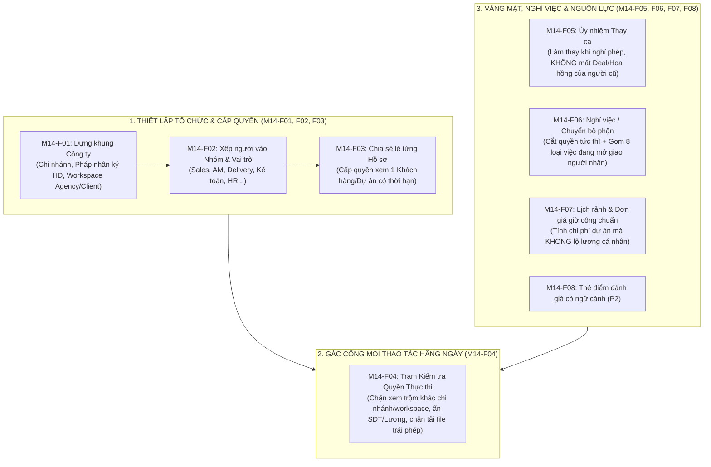
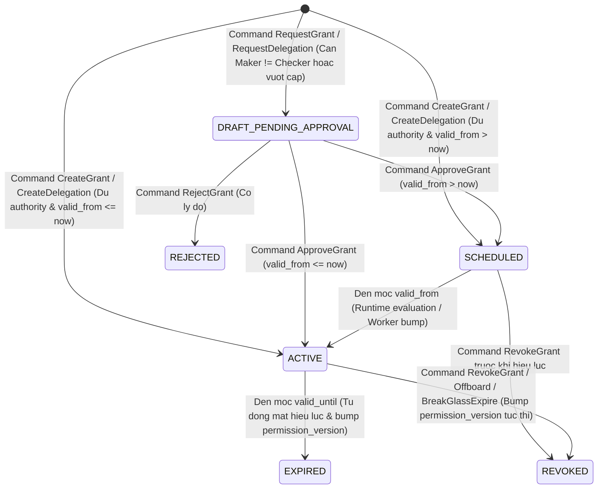
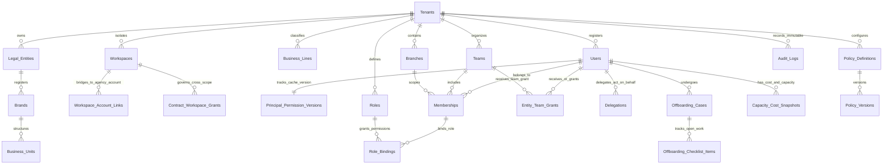

# M14 — Tổ chức, Chi nhánh, Thành viên, Quyền & Bàn giao Nhân sự

Đặc tả chi tiết cấp Module & Chức năng (`Per-Module & Per-Function Spec`) cho **M14**, dẫn xuất từ [CRM_MASTER_BRD_SRS_HOP_NHAT.md](../../00-master/CRM_MASTER_BRD_SRS_HOP_NHAT.md) (`v1.9`). Tài liệu thuộc giai đoạn `Documentation-Only`; chưa có mã nguồn ứng dụng, chưa chạy migration DB và mọi ca kiểm thử đều ở trạng thái `Not Run`.

---

## 1. Manifest

- **Baseline nguồn:** [CRM_MASTER_BRD_SRS_HOP_NHAT.md](../../00-master/CRM_MASTER_BRD_SRS_HOP_NHAT.md), Phiên bản `1.9`, `SHA-256: b6a3279f328e96e1e97d845e209be7a326516a0dba5e3a033d88e1f2162e421c`.
- **Mục nguồn trong Master v1.9:**
  - Mục `3.8.2` (`FR21`, `ĐẶC TẢ MODULE M14`, dòng `1029–1067`)
  - Mục `3.10.3` (`FR27 — Hiệu suất và phần HR tối thiểu`, dòng `1206–1217`)
  - Mục `4.12` (`UC12 — Bàn giao khi Sales nghỉ việc`, dòng `2226–2238`) và `4.14` (`UC14 — Mở ngành hoặc client workspace mới`, dòng `2252–2264`)
  - Mục `5.1` (Nguyên tắc schema & 10 cột chuẩn, dòng `2487–2553`), `5.13` (`ENTITY-L2761..2763`, `ENTITY-L2787`), `5.14` (RLS & pooled connection), `5.18` (`ENTITY-L2860`, `ENTITY-L2863`, `ENTITY-L2881`, `ENTITY-L2882`, `ENTITY-L2885`)
  - Chương `6` (`6.1 Mô hình quyền`, `6.2 Download gateway & revoke`, `6.5 Quyền Inbox`, `6.6 Quyền Work`, `6.7 Quyền M21`, `6.8 Quyền M22`, dòng `3083–3260`)
  - Chương `9` & Phụ lục `A/F` (`U16`, `U17`, `INT15`, `INT23`, `INT29`, `CEO-U03/10/15/17/18`, `CX-U01/21`, `RV10/15`, `SEC03`, `SEC06`, `SEC-U03`, `SEC-U06`, `O03`, `O06`, `O08`).
- **Status:** `Reviewed` (Đã chốt qua cổng `/grill-me` 3 quyết định kiến trúc Tầng 1 và tích hợp mô tả luồng hoạt động chi tiết từng chức năng `M14-F01..08` ngày `15/11/2026`).
- **Domain Owner & Vai trò chịu trách nhiệm:**
  - **Accountable Business Role:** Chủ dự án / CEO (`Owner`) & Ops/Privacy Owner (phê duyệt cấu trúc tổ chức, thẩm quyền cấp quyền, chính sách kiêm nhiệm `SOLO/PILOT` $\leftrightarrow$ `TEAM`).
  - **Technical Reviewer:** Security / Platform Architect.
- **Ranh giới *Single Source of Truth* (`INV-01`, `INV-02`, `INV-13`, `INV-22..25`):**
  - **`M14` sở hữu độc quyền (`Owned Entities`):** `Tenants`, `Branches`, `Legal_Entities`, `Business_Lines`, `Brands`, `Business_Units`, `Workspaces`, `Workspace_Account_Links`, `Contract_Workspace_Grants`, `Users`, `Teams`, `Memberships`, `Roles`, `Role_Bindings`, `Entity_Team_Grants`, `Principal_Permission_Versions`, `Delegations`, `Offboarding_Cases`, `Offboarding_Checklist_Items`, `Capacity_Cost_Snapshots`.
  - **`M14` vs `M22` (Nhân sự & Lương):** `M22` sở hữu hồ sơ nhân viên (`Employee`), hợp đồng lao động (`Employment`), chấm công và bảng lương (`HR-C`). Thay đổi chức danh/phòng ban ở `M22` **không tự động mở quyền đọc dữ liệu khách hàng hay lương** nếu không có `Role_Bindings` / `Entity_Team_Grants` tại `M14`. `M14-F07` chỉ lưu snapshot `availability` và `internal_cost_rate` phục vụ tính capacity/biên lợi nhuận dự án, tuyệt đối không lưu hoặc làm lộ lương cá nhân (`INV-01`, HRM Invariants).
  - **`M14` vs `M23` (Quản trị bảo mật vận hành):** `M23-F03` quản lý luồng xin–duyệt `Break-glass` có TTL và ghi grant tạm thời sang `M14`; **`M14-F04` là cổng kiểm tra quyền thực thi (`RBAC + ABAC`) duy nhất** cho mọi module (`INV-23`).
  - **`M14` vs `M24` (Cache quyền):** `M24-F06` chỉ cache kết quả đọc gắn kèm `permission_version` do `M14` cấp; khi `M14` tăng `permission_version` và phát `M14.PermissionVersionBumped`, cache cũ lập tức mất hiệu lực (`INV-25`).
- **Public Contracts cung cấp (`02-specs/contracts/`):**
  - [M14-PRINCIPAL-ACCESS-DECISION.md](../contracts/M14-PRINCIPAL-ACCESS-DECISION.md) — Hợp đồng Kép (`EvaluateAccessDecision` + `CompileScopeFilter`) và 4 Domain Events (`M14.PermissionVersionBumped`, `M14.UserOffboardingLocked`, `M14.WorkHandoverAssigned`, `M14.WorkspaceActivated`).
- **Core vs Industry-Pack Boundary:** Toàn bộ `M14-F01..06` thuộc **Platform Core (`P0`, `SL00` trở đi)**; `M14-F07` thuộc mở rộng quản trị nguồn lực (`P1`, `SL06/SL07`); `M14-F08` thuộc quản trị hiệu suất có ngữ cảnh (`P2`, `SL07`).
- **Read first:** [INVARIANTS.md](../../01-architecture/INVARIANTS.md), [INDEX.md](../../01-architecture/INDEX.md), [M14-PRINCIPAL-ACCESS-DECISION.md](../contracts/M14-PRINCIPAL-ACCESS-DECISION.md), [M23-SYSTEM-ADMIN-SECURITY-OPS.md](M23-SYSTEM-ADMIN-SECURITY-OPS.md).
- **Allowed write paths (Giai đoạn hiện tại):** Chỉ cập nhật tài liệu trong `02-specs/` và `03-planning/`; chưa mở `application_write_scope`.

---

## 2. Requirement trace

### 2.1. Danh mục 18 ID sở hữu trực tiếp bởi `M14` (`owner == M14` trong `requirements.json`)

| ID nguồn | Source anchor/line | Ý nghĩa | Owner/consumer | Priority | Applicability | Test | Evidence |
|---|---|---|---|---|---|---|---|
| `FR21` | Master `3.8.2` (dòng `1054`) | Phân quyền tổ chức, hai chi nhánh, pháp nhân, workspace `AGENCY/CLIENT` và bàn giao đúng scope | Owner: `M14` / Consumers: `M01–M24` | `P0` (Scope nền) / `P1` (2 nhánh) | Mọi release từ `SL00` | `M14-AC01..03`, `U16`, `U17`, `INT29`, `SEC-U06` | Not Run |
| `M14-F01` | Master `3.8.2` (dòng `1035`) | Thiết lập cơ cấu tổ chức: `Tenant`, `Branch`, `Legal_Entity`, `Workspace (AGENCY/CLIENT)` | Owner: `M14` / Consumers: `M01–M24` | `P0` | Mọi tenant (`SL00+`) | `M14-AC01`, `U17`, `CEO-U10` | Not Run |
| `M14-F02` | Master `3.8.2` (dòng `1036`) | Gán vai trò và thành viên (`Membership`, `Role_Bindings`) theo thẩm quyền cấp quyền và thời hạn | Owner: `M14` / Consumers: `M01–M24` | `P0` | Mọi tenant (`SL00+`) | `M14-AC02`, `SEC-U06` | Not Run |
| `M14-F03` | Master `3.8.2` (dòng `1037`) | Chia sẻ hồ sơ có phạm vi (`Entity_Team_Grants`) tới đúng đối tượng, hành động, trường và thời hạn | Owner: `M14` / Consumers: `M01`, `M02`, `M08`, `M11`, `M16`, `M21` | `P0` | Mọi tenant (`SL00+`) | `M14-AC01`, `U17`, `CEO-U17`, `RV10` | Not Run |
| `M14-F04` | Master `3.8.2` (dòng `1038`) | Kiểm tra quyền thực thi (`RBAC + ABAC`, `Deny-wins`, `Fail-closed`) tại API, Search, File, Worker, AI | Owner: `M14` / Consumers: `M01–M24` | `P0` | Mọi request & background job | `M14-AC01`, `INT23`, `INT29`, `RV15`, `OC20` | Not Run |
| `M14-F05` | Master `3.8.2` (dòng `1039`) | Ủy nhiệm và thay ca (`Delegations`) có thời hạn, không tự đổi Deal owner hay hoa hồng lịch sử | Owner: `M14` / Consumers: `M02`, `M03`, `M11`, `M16`, `M22` | `P0` | Khi nhân sự vắng mặt/thay ca | `M14-AC03`, `CEO-U15`, `CX-U21` | Not Run |
| `M14-F06` | Master `3.8.2` (dòng `1040`) | Chuyển bộ phận và nghỉ việc: cắt phiên/quyền tức thì, bàn giao open work có xác nhận hoặc về queue quản lý | Owner: `M14` / Consumers: `M02`, `M03`, `M08`, `M11`, `M13`, `M16`, `M22`, `M23` | `P0` | Khi chuyển nhánh hoặc nghỉ việc (`UC12`) | `M14-AC03`, `U16`, `SEC-U03`, `OC18`, `CX-U21` | Not Run |
| `M14-F07` | Master `3.8.2` (dòng `1041`) | Quản lý năng lực khả dụng (`Availability`) và đơn giá nội bộ (`Cost Rate`) theo hiệu lực, ẩn lương cá nhân | Owner: `M14` / Consumers: `M07`, `M16`, `M17`, `M18`, `M22` | `P1` | Khi bật quản lý capacity/margin (`SL06/07`) | `CEO-U01`, `CMO-U17` | Not Run |
| `M14-F08` | Master `3.8.2` (dòng `1042`) | Thẻ điểm đánh giá vận hành (`Scorecard`) theo vai trò/bối cảnh, không xếp hạng khi thiếu mẫu, không phạt theo số thao tác | Owner: `M14` / Consumers: `M16`, `M18` | `P2` | Khi bật P2 Scorecard (`FR27`) | `M14-AC03` | Not Run |
| `M14-AC01` | Master `3.8.2` (dòng `1050`) | Tiêu chí nghiệm thu: Xung đột vai trò (`Role conflict`) và chia sẻ `Account` giữ đúng `Deny-wins` và scope | Owner: `M14` / Consumers: `M01`, `M03`, `M08` | `P0` | Mọi release (`SL00+`) | `INT29`, `U17` | Not Run |
| `M14-AC02` | Master `3.8.2` (dòng `1050`) | Tiêu chí nghiệm thu: Admin tự cấp Finance hoặc Manager cấp quyền ngoài chi nhánh bị chặn | Owner: `M14` / Consumers: `M09`, `M23` | `P0` | Mọi release (`SL00+`) | `SEC-U06` | Not Run |
| `M14-AC03` | Master `3.8.2` (dòng `1050`) | Tiêu chí nghiệm thu: Offboarding giữ actor lịch sử, cắt token/download, bàn giao đủ open work; thiếu dữ liệu không xếp hạng | Owner: `M14` / Consumers: `M02`, `M03`, `M16` | `P0` | Mọi release (`SL00+`) | `U16`, `SEC-U03`, `OC18` | Not Run |
| `UC12` | Master `4.12` (dòng `2226`) | Use Case bàn giao khi Sales/nhân sự nghỉ việc (cắt phiên $\rightarrow$ thu hồi quyền $\rightarrow$ bàn giao open work có xác nhận) | Owner: `M14` / Consumers: `M02`, `M03`, `M11`, `M16`, `M22` | `P0` | Mọi release (`SL00+`) | `U16`, `SEC-U03`, `OC18`, `CX-U21` | Not Run |
| `UC14` | Master `4.14` (dòng `2252`) | Use Case mở gói ngành hoặc `CLIENT workspace` mới đảm bảo cách ly dữ liệu tuyệt đối | Owner: `M14` / Consumers: `M18`, `M19`, `M20`, `M21`, `M23` | `P0` | Khi tạo `Workspace` hoặc bật Pack | `U17`, `OC24`, `RV10` | Not Run |
| `SEC03` | Master Phụ lục `F` (dòng `4687`) | Kiểm soát bảo mật: Download Gateway kiểm tra quyền hiện tại trên mỗi request (kể cả `Range/resume`), thay thế raw presigned URL | Owner: `M14` (Policy) + `M20/M03` / Consumers: `M01–M24` | `P0` | Mọi tải tệp nhạy cảm (`6.2`) | `SEC-U03`, `U16` | Not Run |
| `SEC06` | Master Phụ lục `F` (dòng `4690`) | Kiểm soát bảo mật: Kiểm tra thẩm quyền cấp quyền (`Grant Authority`) và chặn tự nâng quyền qua role/team/config | Owner: `M14` / Consumers: `M23`, `M01–M22` | `P0` | Mọi thao tác cấp quyền (`6.1`) | `SEC-U06`, `M14-AC02` | Not Run |
| `SEC-U03` | Master `9.14` (dòng `3823`) | Ca kiểm thử bảo mật: Cấp link file nhạy cảm $\rightarrow$ revoke user/grant $\rightarrow$ thử `GET/Range/link copy` bị từ chối ngay | Owner: `M14` / Consumers: `M03`, `M16`, `M20` | `P0` | Mọi release (`SL00+`) | `SEC-U03`, `U16` | Not Run |
| `SEC-U06` | Master `9.14` (dòng `3826`) | Ca kiểm thử bảo mật: Admin connector tự gán Finance, Manager cấp ngoài branch, tự kéo dài Break-glass đều bị từ chối | Owner: `M14` / Consumers: `M23` | `P0` | Mọi release (`SL00+`) | `SEC-U06` | Not Run |

---

### 2.2. Truy vết Mở rộng từ Nhóm `221 missing_owner`, `PLATFORM`,Module Liên kết & `entities-contracts.json` (`Rule 1`)

| ID nguồn | Source anchor/line | Ý nghĩa trong ngữ cảnh `M14` | Vai trò của `M14` | Priority | Applicability | Test | Evidence |
|---|---|---|---|---|---|---|---|
| `FR08` | Master `3.3.2` (dòng `588`) | Che dữ liệu nhạy cảm (`Data Masking` server-side) và giữ quyền khi bàn giao hội thoại | `Primary Policy Provider` (cấp `masked_fields` cho `M03`) | `P0` | Mọi truy vấn PII (`SL00+`) | `U16`, `OC18` | Not Run |
| `FR25` | Master `3.10.1` (dòng `1132`) | Quản lý công việc dùng chung & capacity: `M14` kiểm tra authority giao/duyệt/xem private task (`6.6`) | `Authority Provider` cho `M16` | `P0` | Từ `SL01` | `W-T01`, `W-T02`, `W-T36` | Not Run |
| `FR27` | Master `3.10.3` (dòng `1206`) | Hiệu suất & HR tối thiểu: `M14-F07` giữ availability/cost rate snapshot, `M14-F08` giữ scorecard P2 | `Co-Owner` cùng `M16` / `M22` | `P0` (Org) / `P1` (Cost) / `P2` (Scorecard) | Theo cấp độ `SL00` / `SL06` / `SL07` | `M14-AC03`, `CEO-U01` | Not Run |
| `FR35` | Master `3.12.6` (dòng `1337`) | Phân công hội thoại, chuyển ca và bàn giao khi vắng mặt/nghỉ việc | `Delegation/Offboarding Provider` cho `M03` | `P0` | Từ `SL02` | `U16`, `OC18`, `CX-U09` | Not Run |
| `FR37` | Master `3.12.8` (dòng `1363`) | Cách ly đa tầng `Tenant/Workspace/Branch` và quyền trên từng đối tượng/file trong Inbox | `Core Access Engine` cho `M03` | `P0` | Từ `SL00/SL02` | `U16`, `U17`, `INT23`, `INT29` | Not Run |
| `U16` | Master `9.5` (dòng `3559`) | User đã offboard dùng token hoặc URL Download Gateway cũ (kể cả `Range/resume`) bị từ chối sau commit revoke | `Primary Owner` (cùng Download Gateway) | `P0` | Mọi release (`SL00+`) | `U16`, `SEC-U03` | Not Run |
| `U17` | Master `9.5` (dòng `3560`) | Dùng ID của `Workspace` khác không làm lộ dữ liệu qua API, Search, Count, File, BI hay AI | `Primary Owner` (`M14-F04`) | `P0` | Mọi release (`SL00+`) | `U17`, `OC03`, `OC20` | Not Run |
| `INT15` | Master `9.10` (dòng `3637`) | Đổi owner/chi nhánh sau payout: `M14-F05/F06` giữ nguyên người hưởng hoa hồng lịch sử | `Co-Owner` cùng `M10` | `P0` | Khi bật `M10` (`SL05`) | `INT15`, `CEO-U15` | Not Run |
| `INT23` | Master `9.10` (dòng `3645`) | Bị revoke quyền khi tab/search/job còn mở: kiểm tra lại quyền tại thời điểm gửi/export/download | `Primary Owner` (`M14-F04`) | `P0` | Mọi release (`SL00+`) | `INT23`, `CEO-U18` | Not Run |
| `INT29` | Master `9.10` (dòng `3651`) | Hai role vừa `Allow` vừa `Deny` cùng tác động lên 1 đối tượng: thực thi đúng `Deny-wins` | `Primary Owner` (`M14-F04`) | `P0` | Mọi release (`SL00+`) | `INT29`, `M14-AC01` | Not Run |
| `CEO-U03` | Master `9.12` (dòng `3690`) | Người liên hệ chấp thuận nhưng không có quyền nghiệm thu (`authority`) trong `M14/M01` $\rightarrow$ chặn chuyển `Accepted` | `Authority Provider` cho `M08/M16` | `P0` | Từ `SL04` | `CEO-U03` | Not Run |
| `CEO-U10` | Master `9.12` (dòng `3697`) | Chặn phân bổ khoản thu của Pháp nhân A (`legal_entity_id`) sang nghĩa vụ của Pháp nhân B | `Scope Guard Provider` cho `M09` | `P0` | Từ `SL05` | `CEO-U10` | Not Run |
| `CEO-U15` | Master `9.12` (dòng `3702`) | Đổi Sales/chi nhánh giữa dự án: bàn giao task/ticket/ACL có audit nhưng không đổi hoa hồng lịch sử | `Primary Owner` (`M14-F05/06`) | `P0` | Từ `SL03/SL05` | `CEO-U15`, `INT15` | Not Run |
| `CEO-U17` | Master `9.12` (dòng `3704`) | User thuộc `CLIENT workspace` mở link hợp đồng/hoa hồng nội bộ `AGENCY` bị chặn hoàn toàn | `Primary Owner` (`M14-F03/04`) | `P0` | Khi mở `CLIENT workspace` | `CEO-U17`, `U17` | Not Run |
| `CEO-U18` | Master `9.12` (dòng `3705`) | Thu hồi quyền sau khi job export đã vào hàng đợi: Worker bắt buộc recheck `M14-F04` lúc chạy và lúc tải | `Primary Owner` (`M14-F04`) | `P0` | Mọi background job (`SL00+`) | `CEO-U18`, `INT23` | Not Run |
| `CX-U01` | Master `9.12` (dòng `3752`) | Một Contact đại diện 2 Account nhưng Agent chỉ có grant 1 bên: cấm lộ deal/ticket/count/file bên kia | `Primary Owner` (`M14-F03/04`) | `P0` | Từ `SL02/SL04` | `CX-U01`, `U17` | Not Run |
| `CX-U21` | Master `9.12` (dòng `3772`) | Chuyển nhân sự khi đang có `scheduled send` và `approval pending`: toàn bộ được gán Custodian/Owner mới, giữ actor cũ | `Primary Owner` (`M14-F06`) | `P0` | Từ `SL01/SL02` | `CX-U21`, `U16` | Not Run |
| `RV10` | Master `9.13` (dòng `3792`) | Liên kết cross-workspace cùng tenant nhưng khác khách hàng hoặc đổi buyer sau grant $\rightarrow$ chặn cả `INSERT` và `UPDATE` | `Primary Owner` (`M14-F01/03`) | `P0` | Mọi cầu nối cross-workspace | `RV10` | Not Run |
| `RV15` | Master `9.13` (dòng `3797`) | Hai tenant dùng chung pooled DB connection, rollback/savepoint/thiếu context $\rightarrow$ `fail-closed`, không rò rỉ session | `Primary Owner` (`M14-F04`) | `P0` | Từ `SL00` | `RV15` | Not Run |
| `OC18` | Master `9.9` (dòng `3607`) | Sales nghỉ việc khi còn thread/Deal đang mở: thu hồi quyền tức thì và bàn giao an toàn | `Primary Owner` (`M14-F06`) | `P0` | Từ `SL02/SL03` | `OC18`, `U16` | Not Run |
| `OC20` | Master `9.9` (dòng `3609`) | Người dùng yêu cầu AI đọc hồ sơ workspace khác qua chat $\rightarrow$ chặn tại tầng retrieval/tool policy của `M14-F04` | `Policy Guard` cho `M06` | `P0` | Khi bật `M06` (`SL07`) | `OC20`, `U22` | Not Run |
| `NFR05` | Master `7.1` (dòng `3275`) | Bảo mật xác thực, phân quyền RBAC/ABAC, kiểm soát phiên và chống leo thang đặc quyền | `Core Contributor` (`PLATFORM`) | `P0` | Mọi release (`SL00+`) | `SEC-U03`, `SEC-U06`, `U16`, `U17` | Not Run |
| `O03` / `O06` / `O08` | Master `A.6` (dòng `4211, 4214, 4216`) | Tham số mở về kiêm nhiệm vai trò (`O03`), phạm vi xử lý dữ liệu `CLIENT workspace` (`O06`), pháp nhân chi nhánh (`O08`) | `Policy Schema Owner` (`M14`) | `P0` | Cấu hình trước Go-live | Kiểm tra `Fail-Closed` khi chưa cấu hình | Not Run |
| `ENTITY-L2761..2763`, `ENTITY-L2787`, `ENTITY-L2860`, `ENTITY-L2863`, `ENTITY-L2881`, `ENTITY-L2882`, `ENTITY-L2885` | Master `5.13` & `5.18` | Các khai báo bảng tổ chức, thành viên, quyền, cầu nối workspace, pháp nhân và audit log | `Schema Owner` (`M14`) | `P0` | Tách bảng chi tiết tại Mục `4. Data/API` | Kiểm tra schema & FK composite | Not Run |

---

## 3. Hành vi

### 3.0A. Tổng quan Cơ chế Hoạt động của Module `M14` (`Executive & Business Walkthrough`)

Trong toàn bộ kiến trúc CRM (`M01–M24`), **`M14` đóng vai trò là "Bộ khung Tổ chức + Trạm Kiểm soát Cửa ra vào + Trung tâm Bàn giao Công việc"**. Mọi module nghiệp vụ khác (Bán hàng `M02`, Hộp thư đa kênh `M03`, Báo giá/Hợp đồng `M07/M08`, Tài chính `M09`, Hoa hồng `M10`, Giao việc `M16`, Nhân sự `M22`...) trước khi cho phép bất kỳ ai **xem, sửa, duyệt, tải tệp đính kèm hay xuất báo cáo** đều bắt buộc đi qua `M14`.

Cơ chế vận hành tổng thể của `M14` xoay quanh **3 trụ cột nối tiếp nhau**:
1. **Trụ cột 1 — Thiết lập Khung Tổ chức & Cấp quyền (`M14-F01`, `M14-F02`, `M14-F03`):** Dựng cấu trúc công ty (tách biệt Chi nhánh vận hành, Pháp nhân ký hợp đồng/nhận tiền, Không gian nội bộ `AGENCY` và Không gian khách hàng `CLIENT`), xếp nhân sự vào phòng ban/vai trò (`Role_Bindings`), và cho phép chia sẻ có thời hạn từng hồ sơ lẻ (`Entity_Team_Grants`) mà không làm lộ toàn bộ kho dữ liệu.
2. **Trụ cột 2 — Gác cổng Truy cập Thực thi Thời gian thực (`M14-F04`):** Kiểm tra quyền đồng nhất trên mọi đường (API, danh sách tìm kiếm, đếm số lượng `count`, tải file qua `Download Gateway`, tác vụ chạy ngầm `Background Worker` và trợ lý AI `M06`) theo nguyên tắc **Lệnh cấm luôn thắng (`Deny-wins`)** và **Thiếu ngữ cảnh thì khóa mặc định (`Fail-closed`)**.
3. **Trụ cột 3 — Vận hành Thay ca, Nghỉ việc & Quản trị Nguồn lực (`M14-F05`, `M14-F06`, `M14-F07`, `M14-F08`):** Đảm bảo khi nhân viên nghỉ phép có người làm thay (`Act-On-Behalf`) mà không mất Deal/Hoa hồng; khi nhân viên nghỉ việc thì cắt quyền tức thì trong 1 bước nhưng gom đủ 8 nhóm việc đang mở giao cho người nhận mới có xác nhận; đồng thời cung cấp lịch rảnh và đơn giá giờ công chuẩn để tính chi phí dự án mà không làm lộ bảng lương cá nhân.

---

### 3.0B. Mô hình Máy trạng thái Cốt lõi (`Core State Machines`)

#### A. Vòng đời Người dùng & Bàn giao Nghỉ việc (`Users.status` & `Offboarding_Cases.status` — Quyết định `/grill-me` #2)

```mermaid
stateDiagram-v2
    [*] --> INVITED : Command InviteUser
    INVITED --> ACTIVE : Command ActivateUser (Xac minh danh tinh & MFA neu bat buoc)
    INVITED --> CANCELLED : Command RevokeInvite / Het han Token
    ACTIVE --> SUSPENDED : Command SuspendUser (Tam khoa bao mat / nghi dai ngay)
    SUSPENDED --> ACTIVE : Command ReactivateUser (Co review quyen; KHONG tu hoi sinh grant cu)
    ACTIVE --> OFFBOARDING_LOCKED : Command InitiateOffboarding tai effective_at (Pha 1 - Atomic Cut)
    SUSPENDED --> OFFBOARDING_LOCKED : Command InitiateOffboarding tai effective_at (Pha 1 - Atomic Cut)
    OFFBOARDING_LOCKED --> OFFBOARDED : Command CompleteOffboarding (Pha 2 - 100% Open Work da co Owner moi xac nhan)
    OFFBOARDED --> ACTIVE : Command RehireReactivateUser (Phai duyet moi, tao Membership moi, KHONG khoi phuc grant lich su)
```

#### B. Vòng đời Cấp quyền Hồ sơ (`Entity_Team_Grants`) & Ủy nhiệm (`Delegations` — Quyết định `/grill-me` #1)

---

### 3.1. `M14-F01` — Thiết lập Cơ cấu Tổ chức & Scope (`Tenants`, `Branches`, `Legal_Entities`, `Workspaces`)

- **Mục tiêu & Phạm vi:** Thiết lập và cô lập ranh giới 4 chiều độc lập: Tổ chức thuê bao (`Tenant`) $\rightarrow$ Pháp nhân ký kết/hạch toán (`Legal_Entity`) $\rightarrow$ Chi nhánh vận hành (`Branch`) $\rightarrow$ Không gian làm việc (`Workspace: AGENCY | CLIENT`) (`INV-01`).
- **Tác nhân & Kích hoạt:** `Owner/CEO` hoặc `Org Admin` được ủy quyền thực hiện các lệnh `CreateBranch`, `CreateLegalEntity`, `CreateWorkspace`, `LinkWorkspaceToAccount` (`UC14`).
- **Tiền điều kiện & Đầu vào:** Phiên xác thực hợp lệ; có `code`, `name`, `timezone` (mặc định `Asia/Ho_Chi_Minh`), `workspace_type` (`AGENCY` hoặc `CLIENT`), `legal_entity_id` và `client_account_id` (bắt buộc nếu `workspace_type = 'CLIENT'`).
- **Mô tả Nghiệp vụ & Cơ chế Hoạt động Từng bước (`Step-by-Step Operational Flow`):**
  1. **Khởi tạo mặc định khi chạy Pilot (`Single-Branch/Single-Entity Ready`):** Ngay khi khởi tạo hệ thống cho công ty, `M14-F01` tạo sẵn 1 `AGENCY Workspace` mặc định, 1 Chi nhánh mặc định (`Default Branch`) và 1 Pháp nhân mặc định (`Default Legal Entity`). Ở giai đoạn công ty chỉ có 1 chi nhánh, hệ thống tự động điền ngầm các giá trị mặc định này vào mọi giao dịch để nhân viên không phải chọn tay nhưng dữ liệu vẫn có đủ khóa phân vùng.
  2. **Mở rộng đa Chi nhánh & đa Pháp nhân:** Khi công ty mở thêm Chi nhánh mới (ví dụ: Chi nhánh TP.HCM) hoặc thêm Pháp nhân mới (công ty con đứng tên ký hợp đồng riêng), `M14-F01` giữ tách biệt hai khái niệm này: một Chi nhánh có thể bán dịch vụ đứng tên Pháp nhân A hoặc Pháp nhân B, nhưng tiền thu về của Pháp nhân A tuyệt đối không được cấn trừ sang công nợ của Pháp nhân B (`CEO-U10`).
  3. **Mở Không gian Khách hàng (`CLIENT Workspace` — `UC14`):** Khi công ty ký hợp đồng với một đối tác/khách hàng lớn và muốn mở riêng cho họ một không gian làm việc (`CLIENT Workspace` để theo dõi báo cáo `M21` hoặc tiến độ dự án `M16`), Admin gọi lệnh `CreateWorkspace(type='CLIENT')`. Hệ thống kiểm tra 3 chốt chặn trước khi kích hoạt:
     - Đã có hồ sơ khách hàng (`Account`) tương ứng trong `AGENCY Workspace` chưa?
     - Đã đăng ký mục đích xử lý dữ liệu (`processing_scope` tại `M20-F01`) chưa?
     - Đã tạo bản ghi cầu nối hợp lệ (`Workspace_Account_Links` / `Contract_Workspace_Grants`) khớp pháp nhân thanh toán chưa?
  4. **Ví dụ Tình huống Thực tế:** Công ty có 2 đối tác dùng `CLIENT Workspace` là *Nhãn hàng Mỹ phẩm X* và *Chuỗi Thời trang Y*. Nhờ cơ chế cô lập `workspace_id` của `M14-F01`, nhân sự hoặc tài khoản đối tác thuộc *Workspace X* hoàn toàn không biết đến sự tồn tại của *Workspace Y*, và cũng không thể truy cập ngược vào hợp đồng gốc hay bảng tính hoa hồng nội bộ nằm trong `AGENCY Workspace`.
- **Quy tắc Hành vi (Chuẩn EARS):**
  1. `[MASTER]` **Ubiquitous (`INV-01`, `3.8.2`):** Hệ thống `M14` phải luôn tách biệt 4 khái niệm `tenant_id`, `legal_entity_id`, `branch_id` và `workspace_id`; tuyệt đối không dùng `branch_id` để thay thế cho `legal_entity_id` (bên ký hợp đồng/nhận tiền) hoặc `workspace_id` (ranh giới dữ liệu `AGENCY` vs `CLIENT`).
  2. `[MASTER]` **State-Driven (`3.8.2`, `5.1`):** Trong khi doanh nghiệp đang vận hành ở quy mô 1 chi nhánh và 1 pháp nhân (`Pilot`), `M14` phải tự động gán `default_branch_id` và `default_legal_entity_id` đã khởi tạo sẵn cho các giao dịch nội bộ thay vì dùng giá trị `NULL` để bỏ qua kiểm tra phạm vi.
  3. `[MASTER]` **Ubiquitous (`5.1`, `ENTITY-L2763`):** Mỗi `Tenant` phải luôn có đúng một `Workspace` mặc định mang `workspace_type = 'AGENCY'`; mọi dữ liệu nghiệp vụ scoped phải có `workspace_id NOT NULL` (tuyệt đối không dùng `workspace_id = NULL` để biểu diễn dữ liệu của Agency).
  4. `[MASTER]` **Event-Driven (`UC14`, `5.1`, `RV10`):** Khi nhận lệnh khởi tạo hoặc kích hoạt một `Workspace` có `workspace_type = 'CLIENT'`, `M14` phải bắt buộc xác minh: (a) `client_account_id` tồn tại trong `AGENCY` workspace của cùng `tenant_id`, (b) có bản ghi cầu nối `Workspace_Account_Links` kèm mục đích xử lý dữ liệu (`processing_scope` theo `M20-F01`), và (c) pháp nhân thanh toán (`billing_legal_party`) trên hợp đồng khớp với khách hàng được cấp quyền.
  5. `[MASTER]` **Unwanted/Error (`RV10`, `3.8.2`):** Nếu bất kỳ lệnh nào cố gắng đổi `client_account_id` của `Workspace` hoặc đổi `buyer_account_id` của `Contract` làm lệch cầu nối `Workspace_Account_Links` / `Contract_Workspace_Grants` đang mở, `M14` phải từ chối giao dịch với mã lỗi `SCOPE_BRIDGE_INTEGRITY_VIOLATION` và không cho phép chuyển công nợ/dữ liệu trái phạm vi bằng cách đổi chi nhánh (`branch_id`).
- **Xử lý Đồng thời, Idempotency & Side Effects:**
  - Khóa `UNIQUE (tenant_id, code)` trên `Branches`, `Legal_Entities`, `Workspaces`. Lệnh tạo lặp cùng `idempotency_key` và cùng payload trả về bản ghi đã tạo; khác payload trả `409 CONFLICT_IDEMPOTENCY`.
  - Khi kích hoạt `CLIENT workspace` mới thành công (`UC14`), ghi `Audit_Logs` và phát sự kiện `M14.WorkspaceActivated` qua Outbox.

---

### 3.2. `M14-F02` — Gán Vai trò và Thành viên (`Memberships` & `Role_Bindings`)

- **Mục tiêu & Phạm vi:** Quản lý danh tính người dùng (`Users`), tư cách thành viên theo đơn vị (`Memberships`) và gán vai trò có thời hạn (`Role_Bindings`), ngăn chặn việc tự nâng quyền (`Self-elevation` — `SEC06`).
- **Tác nhân & Kích hoạt:** `Owner/CEO`, `Branch/Team Manager` (trong phạm vi chi nhánh/nhóm được cấp `grant_authority`), hoặc `Org Admin` gọi lệnh `InviteUser`, `ActivateUser`, `AssignRoleBinding`, `RevokeRoleBinding`.
- **Mô tả Nghiệp vụ & Cơ chế Hoạt động Từng bước (`Step-by-Step Operational Flow`):**
  1. **Mời và kích hoạt tài khoản (`Invite` $\rightarrow$ `Activate`):** Quản trị viên tạo lời mời nhân sự mới kèm cấu hình Chi nhánh/Nhóm dự kiến (`Memberships`). Chỉ khi nhân sự xác minh danh tính (và bật MFA nếu vai trò yêu cầu), tài khoản mới chuyển sang `ACTIVE`.
  2. **Kiểm tra thẩm quyền của người cấp quyền (`Grant Authority Check`):** Khi một Quản lý bấm gán vai trò (`Role_Binding`) cho nhân viên, `M14-F02` tra cứu bảng `Roles.grantable_role_codes` và phạm vi chi nhánh của người cấp:
     - Trưởng Chi nhánh Hà Nội chỉ được gán các vai trò nghiệp vụ bên trong Chi nhánh Hà Nội; nếu chọn Chi nhánh TP.HCM $\rightarrow$ hệ thống chặn ngay.
     - Nhân viên IT / Admin kỹ thuật (`TECH_ADMIN`) chỉ có quyền cấu hình hệ thống/connector, tuyệt đối không thể tự gán cho mình vai trò Kế toán (`FINANCE`), Quản trị dữ liệu riêng tư (`PRIVACY`) hay quyền xem bảng lương/doanh số (`SEC06`, `M14-AC02`).
  3. **Kiểm soát kiêm nhiệm (`SOLO_PILOT` vs `TEAM`):** Ở giai đoạn `SOLO_PILOT` (chủ doanh nghiệp kiêm nhiều vai trò), hệ thống cho phép `Owner` tự cấp quyền có ghi cờ audit kiêm nhiệm. Ngay khi công ty chuyển sang chế độ `TEAM`, mọi thao tác cấp quyền nhạy cảm (`Finance`, `Privacy`, `Tenant-wide`, `Break-glass`) cho chính mình đều bị chuyển sang trạng thái chờ một người phê duyệt độc lập (`Maker != Checker`).
  4. **Cách ly với thay đổi nhân sự ở `M22` và khi mở khóa lại tài khoản:** Nếu bộ phận HR cập nhật chức danh ở module Nhân sự (`M22`), quyền truy cập CRM không tự động mở rộng nếu chưa có lệnh `AssignRoleBinding` tại `M14-F02`. Tương tự, khi mở khóa một tài khoản từng bị tạm khóa (`SUSPENDED` $\rightarrow$ `ACTIVE`), các quyền đặc biệt đã thu hồi trước đó không tự động phục hồi.
- **Quy tắc Hành vi (Chuẩn EARS):**
  1. `[MASTER]` **Ubiquitous (`5.13`, `ENTITY-L2762`):** `M14` phải luôn suy xuất `tenant_id` từ phiên xác thực phía server của người gọi; tuyệt đối không nhận `tenant_id` từ request body khi tạo hoặc sửa `Users`, `Memberships`, `Role_Bindings`.
  2. `[MASTER]` **Unwanted/Error (`M14-AC02`, `SEC06`, `SEC-U06`, `6.1`):** Nếu người gọi (`grantor_id`) cố gắng: (a) gán một `Role` có quyền cao hơn hoặc nằm ngoài phạm vi `grant_authority` của mình, (b) `Technical Admin` tự gán cho mình hoặc người khác vai trò `Finance / Privacy / Sales Business Read`, hoặc (c) `Branch Manager` gán quyền vượt ra ngoài `branch_id` mình quản lý, thì `M14` phải từ chối ngay với mã lỗi `AUTH_INSUFFICIENT_GRANT_AUTHORITY` và ghi nhận cảnh báo bảo mật vào `Audit_Logs`.
  3. `[MASTER]` + `[PROPOSED]` **State-Driven (`INV-22`, `6.1`):** Trong khi `Tenant` đang ở chế độ `TEAM` (`operating_mode = 'TEAM'`), nếu người dùng yêu cầu cấp hoặc nâng quyền `Tenant-wide`, `Finance`, `Privacy/Export`, hoặc `Break-glass` cho chính mình (`grantor_id == target_user_id`), `M14` phải chặn kích hoạt trực tiếp, chuyển bản ghi sang trạng thái `DRAFT_PENDING_APPROVAL` và yêu cầu một người phê duyệt có thẩm quyền độc lập (`approver_id != grantor_id`) xác nhận.
  4. `[MASTER]` **Event-Driven (`3.8.2` dòng `1046`):** Khi một người dùng ở trạng thái `SUSPENDED` hoặc `OFFBOARDED` được thực hiện lệnh `ReactivateUser`, `M14` chỉ khôi phục trạng thái định danh `Users.status = 'ACTIVE'` sau khi có phê duyệt, và **tuyệt đối không tự động hồi sinh các `Role_Bindings` hay `Entity_Team_Grants` đã bị thu hồi trước đó**.
  5. `[MASTER]` **Event-Driven (`INV-02`, HRM Invariants):** Khi nhận sự kiện thay đổi chức danh hoặc phòng ban từ `M22` (`Employee/Employment`), `M14` không được tự động cấp thêm quyền đọc dữ liệu khách hàng, tài chính hay bảng lương nếu chưa có lệnh `AssignRoleBinding` hợp lệ được phê duyệt.
- **Xử lý Đồng thời, Idempotency & Side Effects:**
  - Mọi thay đổi trên `Memberships` hoặc `Role_Bindings` phải kiểm tra `expected_version = row_version`, tăng `Principal_Permission_Versions.permission_version` của `target_user_id` lên `+1`, ghi `Audit_Logs` (gồm `grantor_id`, `approval_ref`, `reason`, `valid_from/until`) và phát sự kiện `M14.PermissionVersionBumped` trong cùng transaction.

---

### 3.3. `M14-F03` — Chia sẻ Hồ sơ có Phạm vi (`Entity_Team_Grants` & Cross-Workspace Bridges)

- **Mục tiêu & Phạm vi:** Cho phép chia sẻ có thời hạn từng bản ghi nghiệp vụ cụ thể (`Contact`, `Account`, `Deal`, `Project`, `Ticket`, `Report_Snapshot`) cho cá nhân hoặc nhóm (`Team`) với danh sách hành động (`actions[]`) và trường dữ liệu (`allowed_fields[]`) xác định mà không làm lộ toàn bộ hồ sơ khách hàng hay dữ liệu tài chính (`FR08`, `FR21`, `FR37`).
- **Tác nhân & Kích hoạt:** Chủ sở hữu hồ sơ có quyền chia sẻ, `Team Lead/AM`, hoặc `Data Steward` gọi lệnh `GrantEntityAccess`, `RevokeEntityAccess`.
- **Mô tả Nghiệp vụ & Cơ chế Hoạt động Từng bước (`Step-by-Step Operational Flow`):**
  1. **Cấp quyền chính xác đến từng Hồ sơ, Hành động & Trường dữ liệu:** Khi một AM hoặc Sales cần mời chuyên viên Thiết kế/Media ở nhóm khác vào hỗ trợ 1 Dự án hoặc 1 Deal trong 14 ngày, họ không cần xin cấp quyền toàn chi nhánh cho người đó. Thay vào đó, họ tạo một `Entity_Team_Grant` chỉ định rõ:
     - **Hồ sơ nào:** Ví dụ `Deal #D-102` hoặc `Project #P-205`.
     - **Ai được nhận:** Cá nhân nhân viên B hoặc Nhóm Creative.
     - **Được làm gì (`allowed_actions`):** Chỉ xem (`READ`) và bình luận (`COMMENT`), không được sửa giá hay xóa.
     - **Trường nào bị che (`masked_fields`):** Tự động che số điện thoại/email cá nhân gốc của khách và giá trị chiết khấu nhạy cảm.
     - **Thời hạn (`valid_until`):** Tự động thu hồi sau 14 ngày.
  2. **Nguyên tắc "Không mở lan" (`No Implicit Cascade`):**
     - Chia sẻ một khách hàng doanh nghiệp (`Account`) chỉ mở thông tin định danh và lịch sử phối hợp được phép của `Account` đó; **không tự động mở bảng công nợ/hóa đơn/hoa hồng nội bộ (`M09/M10`)** và **không tự động cho phép truy cập vào `CLIENT Workspace` riêng của khách hàng đó (`CEO-U17`)**.
     - Nếu một người liên hệ (`Contact`) làm đại diện cho 2 công ty khách hàng (`Account A` và `Account B`), nhưng nhân viên chỉ được cấp quyền trên `Account A`, thì khi mở hồ sơ `Contact` đó, hệ thống tự động ẩn toàn bộ Deal, Ticket, Ghi chú, Tệp đính kèm và số đếm (`Count`) thuộc về `Account B` (`CX-U01`).
  3. **Hỗ trợ mượt mà khách hàng cá nhân (`B2C`):** Với khách lẻ không có công ty, nhân viên cấp quyền chia sẻ trực tiếp trên `Contact`, `Deal` hoặc `Ticket` mà không bị ép phải tạo một `Account` công ty giả.
- **Quy tắc Hành vi (Chuẩn EARS):**
  1. `[MASTER]` **Ubiquitous (`5.18`, `ENTITY-L2863`):** Mỗi bản ghi `Entity_Team_Grants` trong `M14` phải chỉ định tường minh đúng 1 tài nguyên đích (`resource_type` + `resource_id` có kiểm tra FK cùng scope), người/nhóm nhận (`grantee_user_id` hoặc `grantee_team_id`), danh sách hành động (`READ`, `UPDATE`, `COMMENT`...), danh sách trường được phép xem (`field_scope`), thời hạn (`valid_from`, `valid_until`), `grantor_id` và `reason`.
  2. `[MASTER]` **Ubiquitous (`3.8.2` dòng `1037, 1064`, `CEO-U17`):** Khi cấp `Entity_Team_Grant` trên một `Account`, `M14` phải giới hạn phạm vi ở thông tin định danh/phối hợp của `Account` đó; **tuyệt đối không tự động mở quyền đọc sổ cái tài chính/hoa hồng của Agency (`M09/M10`) và không tự động mở quyền truy cập toàn bộ `CLIENT workspace` (`M21/M15/M16`) của khách hàng đó**.
  3. `[MASTER]` **Ubiquitous (`3.8.2` dòng `1048, 1064`, `U05`):** Đối với khách hàng cá nhân (`B2C`), `M14` phải cho phép cấp `Entity_Team_Grant` trực tiếp trên `Contact`, `Deal` hoặc `Ticket` mà **không bắt buộc tạo `Account` doanh nghiệp giả**.
  4. `[MASTER]` **Unwanted/Error (`5.18` dòng `2863`, `SEC06`):** Nếu người dùng chỉ có quyền sửa nội dung bản ghi (`UPDATE`) nhưng không có quyền cấp chia sẻ (`SHARE_GRANT` authority) cố gọi lệnh `GrantEntityAccess`, hoặc cố gia hạn âm thầm một grant đã bị `DENY`, `M14` phải từ chối với mã lỗi `AUTH_SHARE_AUTHORITY_REQUIRED`.
  5. `[MASTER]` **Event-Driven (`CX-U01`, `3.1`):** Khi một `Contact` đại diện cho 2 `Account` (`Contact_Account_Roles`) nhưng nhân viên chỉ có `Entity_Team_Grant` trên `Account A`, `M14` phải cô lập để nhân viên đó chỉ thấy các `Deal`, `Ticket`, `Activity`, `Attachment` và `Count` gắn với `Account A`, ẩn tuyệt đối dữ liệu của `Account B`.
- **Xử lý Đồng thời, Idempotency & Side Effects:**
  - Khi `valid_until` đến hạn hoặc khi thực thi lệnh `RevokeEntityAccess`, `M14` cập nhật trạng thái grant, tăng `permission_version` của các principal bị ảnh hưởng và phát `M14.PermissionVersionBumped`.

---

### 3.4. `M14-F04` — Kiểm tra Quyền Thực thi (`Runtime RBAC + ABAC`, `Deny-Wins`, `Fail-Closed` — Quyết định `/grill-me` #3)

- **Mục tiêu & Phạm vi:** Cổng quyết định quyền tập trung thực thi [Hợp đồng M14-PRINCIPAL-ACCESS-DECISION](../contracts/M14-PRINCIPAL-ACCESS-DECISION.md) đồng nhất trên mọi đường: REST/GraphQL API, List/Search/Count, Download Gateway (`SEC03`), Background Worker (`CEO-U18`), BI (`M18`) và AI Co-Pilot (`M06` / `OC20`).
- **Tác nhân & Kích hoạt:** Mọi module `M01–M24` gọi đồng bộ `EvaluateAccessDecision` hoặc `CompileScopeFilter` trước khi đọc/ghi/xuất dữ liệu.
- **Mô tả Nghiệp vụ & Cơ chế Hoạt động Từng bước (`Step-by-Step Operational Flow`):**
  1. **Hai chế độ kiểm tra quyền bao phủ 100% tình huống:**
     - **Chế độ 1 — Kiểm tra Hành động / Bản ghi đơn lẻ (`EvaluateAccessDecision`):** Dùng khi nhân viên bấm mở 1 hồ sơ, bấm nútSửa/Duyệt, khi `Download Gateway` xử lý lượt tải tệp đính kèm, hoặc khi `Background Worker` bắt đầu chạy một tác vụ xuất báo cáo/gửi tin. Hàm kiểm tra theo đúng thứ tự ưu tiên 5 bước: *(1) Tài khoản còn `ACTIVE` và `permission_version` khớp không? $\rightarrow$ (2) Đúng `Tenant` và `Workspace` không? $\rightarrow$ (3) Có lệnh Cấm (`DENY`) nào không? (Nếu có là chặn ngay — `Deny-wins`) $\rightarrow$ (4) Có Grant chia sẻ (`M14-F03`), Ủy nhiệm (`M14-F05`) hay Break-glass (`M23-F03`) còn hạn không? $\rightarrow$ (5) Role và phạm vi Chi nhánh (`M14-F02`) có cho phép không?* Kết quả trả về kèm danh sách trường cần làm mờ (`masked_fields`).
     - **Chế độ 2 — Biên dịch Bộ lọc cho Danh sách, Tìm kiếm, Thống kê & AI (`CompileScopeFilter`):** Dùng khi nhân viên xem danh sách, gõ tìm kiếm, xem con số thống kê (`Count`) trên Dashboard hoặc hỏi trợ lý AI (`M06`). Thay vì lấy hết dữ liệu lên rồi mới lọc (dễ làm lộ tổng số lượng bản ghi hoặc làm chậm hệ thống), `M14-F04` gắn điều kiện lọc phạm vi (`Predicate AST` + biến phiên `SET LOCAL` trên PostgreSQL) thẳng vào câu truy vấn cơ sở dữ liệu. Nhờ đó, hồ sơ ngoài quyền hoàn toàn "vô hình" — không xuất hiện trong kết quả tìm kiếm, không cộng vào số đếm `Count`, và AI không bao giờ đọc được để trả lời nhầm (`U17`, `OC20`).
  2. **Kiểm tra lại tại thời điểm Tải tệp (`Download Gateway`) và thời điểm Chạy ngầm (`Worker Recheck`):**
     - Không bao giờ cấp link tải file thô sống lâu không kiểm soát. Mỗi khi người dùng bấm tải file nhạy cảm (hợp đồng, ghi âm cuộc gọi, báo cáo xuất ra) — kể cả tải tiếp file đang tải dở (`HTTP Range/resume`) hoặc dán link sang cửa sổ khác — `Download Gateway` đều gọi `M14-F04` kiểm tra quyền ngay giây đó (`SEC03`, `U16`).
     - Nếu nhân viên bấm "Xuất Excel" lúc 9h00, đến 9h01 bị thu hồi quyền, thì lúc 9h02 khi Worker chạy lệnh xuất hoặc khi bấm tải file về, `M14-F04` phát hiện `permission_version` đã đổi và chặn ngay (`CEO-U18`).
- **Quy tắc Hành vi (Chuẩn EARS):**
  1. `[MASTER]` **Ubiquitous (`6.1`, `M14-AC01`, `INT29`):** Khi đánh giá quyền cho một `(principal_id, resource, action)`, `M14-F04` phải yêu cầu cả **RBAC** (vai trò có phép thực hiện `action`) và **ABAC** (phạm vi `tenant/workspace/branch/owner/grant/sensitivity` hợp lệ) cùng thỏa mãn; nếu tồn tại bất kỳ quy tắc `DENY` nào từ `Role_Bindings` hoặc `Entity_Team_Grants` đang hiệu lực thì **quyết định cuối cùng bắt buộc là `DENY` (`Deny-wins`)**.
  2. `[MASTER]` **Unwanted/Error (`INV-13`, `RV15`, `6.1`):** Nếu request hoặc kết nối DB trong pool bị thiếu `tenant_id`, thiếu `workspace_id` (đối với tài nguyên scoped), hoặc `expected_permission_version` không khớp, `M14-F04` phải lập tức từ chối theo nguyên tắc **`Fail-Closed`** và tuyệt đối không dùng lại biến session cũ của kết nối trước trong pool.
  3. `[MASTER]` **Ubiquitous (`INV-02`, `6.6`, `W-O04`):** `M14-F04` phải đảm bảo các thao tác liên kết bản ghi (`Task_Links`, `Conversation_Subject_Links`), nhắc tên (`@mention`), gộp hồ sơ (`Merge`) hoặc chức danh cấp trên (`Line Manager / CEO`) **không tự động mở quyền đọc** trên tài nguyên đích hoặc công việc cá nhân (`PERSONAL` task) nếu người xem không có grant hợp lệ trên chính tài nguyên đó.
  4. `[MASTER]` **Event-Driven (`6.2`, `SEC03`, `SEC-U03`, `U16`):** Khi nhận yêu cầu tải tệp nhạy cảm (PII, hợp đồng, ghi âm, chứng từ tài chính, file export) qua `Download Gateway` — kể cả request tải tiếp `HTTP Range / Resume` hoặc dùng lại link đã copy — `M14-F04` phải kiểm tra lại trạng thái phiên, `permission_version` và grant hiện hành tại đúng thời điểm request; nếu quyền đã bị thu hồi hoặc user đã `OFFBOARDING_LOCKED`, phải từ chối ngay với `403/401`.
  5. `[MASTER]` **Event-Driven (`6.1`, `CEO-U18`, `INT23`):** Khi một tác vụ nền (`Background Worker`: gửi tin `M19`, xuất báo cáo `M24-F08`, đồng bộ dữ liệu) bắt đầu thực thi một job đã xếp hàng từ trước, Worker bắt buộc gọi `M14-F04` để kiểm tra lại quyền hiện hành của `actor_id / service_principal` tại thời điểm chạy (không được chạy dựa trên quyền lúc đưa vào queue).
  6. `[MASTER]` + `[PROPOSED]` **Ubiquitous (`U17`, `OC20`, `INV-02`):** Khi thực thi truy vấn danh sách, tìm kiếm, đếm số lượng (`count`) hoặc truy xuất ngữ cảnh AI (`RAG`), `M14-F04` phải biên dịch bộ lọc phạm vi (`CompileScopeFilter`) đẩy xuống câu truy vấn gốc để bản ghi ngoài quyền không bao giờ xuất hiện trong tổng số đếm (`total_count`), đoạn trích (`snippet`) hay ngữ cảnh prompt AI.

---

### 3.5. `M14-F05` — Ủy nhiệm và Thay ca (`Delegations` — Quyết định `/grill-me` #1)

- **Mục tiêu & Phạm vi:** Cho phép nhân sự vắng mặt tạm thời (nghỉ phép, công tác, đổi ca) ủy nhiệm có thời hạn cho người dự phòng (`delegatee_id`) xử lý các công việc đang mở mà không làm xáo trộn chủ sở hữu thương mại hay lịch sử hoa hồng (`FR05`, `FR35`).
- **Tác nhân & Kích hoạt:** Nhân sự ủy nhiệm (`delegator_id`) hoặc Quản lý trực tiếp (`Team Lead / Branch Manager`) gọi lệnh `CreateDelegation`, `RevokeDelegation`.
- **Mô tả Nghiệp vụ & Cơ chế Hoạt động Từng bước (`Step-by-Step Operational Flow`):**
  1. **Tạo phiếu Ủy nhiệm có thời hạn:** Khi Sales/AM A chuẩn bị nghỉ phép 3 ngày, A (hoặc Trưởng nhóm của A) tạo phiếu ủy nhiệm (`Delegation`) chọn đồng nghiệp B làm người xử lý thay từ `valid_from` đến `valid_until` cho các nhóm việc cần trực (ví dụ: Hội thoại khách hàng `CONVERSATION`, Cơ hội bán hàng `DEAL`, Công việc dự án `TASK`).
  2. **Chốt chặn tiền kiểm (`Base-Role Pre-check`):** Để tránh việc lợi dụng tính năng ủy nhiệm làm "cửa hậu" tuồn dữ liệu sang chi nhánh khác hoặc bộ phận không liên quan, `M14-F05` kiểm tra ngay:
     - Đồng nghiệp B phải đang `ACTIVE` và **đã có sẵn tư cách thành viên (`Membership`) cùng vai trò nền tương thích (`Role_Binding`) tại chính Chi nhánh / Workspace đó**.
     - Nếu phạm vi ủy nhiệm chứa các quyền phê duyệt trọng yếu (Duyệt báo giá vượt khung, Duyệt hợp đồng, Duyệt chi/hoàn tiền, Xóa dữ liệu riêng tư), nhân viên không được tự kích hoạt mà bắt buộc qua cấp Quản lý phê duyệt.
  3. **Cơ chế "Làm thay nhưng không cướp chủ quyền" (`Act-On-Behalf`):**
     - Trong suốt thời gian ủy nhiệm có hiệu lực, đồng nghiệp B thấy các hội thoại, Deal và Task được ủy nhiệm của A và thao tác xử lý bình thường.
     - Tuy nhiên, trường **Chủ sở hữu thương mại (`owner_id`) trên Lead, Deal, Hợp đồng và quyền hưởng Hoa hồng (`M10`) vẫn giữ nguyên tên của A**.
     - Mọi thao tác do B thực hiện đều được ghi rõ vào nhật ký kiểm toán (`Audit_Logs`): `actor_id = B`, `delegated_from_id = A` (*"Nhân viên B thực hiện thay mặt Nhân viên A theo phiếu ủy nhiệm #..."*).
  4. **Tự động kết thúc:** Ngay khi hết giờ `valid_until` (hoặc khi A đi làm lại sớm và bấm `RevokeDelegation`), quyền làm thay của B tự động chấm dứt và `permission_version` của B được tăng lên để làm mới bộ nhớ đệm.
- **Quy tắc Hành vi (Chuẩn EARS):**
  1. `[MASTER]` + `[PROPOSED]` **Precondition/Unwanted (`3.8.2` dòng `1039`, Quyết định `/grill-me` #1):** Khi nhận lệnh `CreateDelegation(delegator_id, delegatee_id, workspace_id, branch_id, resource_types[], allowed_actions[], valid_from, valid_until)`, `M14` phải kiểm tra người nhận ủy nhiệm (`delegatee_id`) **đang ở trạng thái `ACTIVE` và đã có sẵn `Membership` + `Role_Binding` nền tương thích tại đúng `workspace_id / branch_id` đó**; nếu `delegatee_id` thuộc chi nhánh khác chưa được cấp quyền hoặc không có vai trò chuyên môn tương ứng thì phải từ chối với mã lỗi `DELEGATION_TARGET_MISSING_BASE_ROLE`.
  2. `[PROPOSED]` **Unwanted/Error (Quyết định `/grill-me` #1):** Nếu danh sách `allowed_actions` trong lệnh ủy nhiệm bao gồm các quyền phê duyệt nhạy cảm (`APPROVE` báo giá vượt ngưỡng/hợp đồng/ngân sách, `FINANCE_POST`, `PRIVACY_DELETE`, `SHARE_GRANT`), `M14` phải chặn tự kích hoạt và bắt buộc chuyển qua phê duyệt của cấp quản lý có thẩm quyền (`Approval Matrix` `M23-F04`).
  3. `[MASTER]` + `[PROPOSED]` **Ubiquitous (`3.8.2` dòng `1039`, `CEO-U15`, `INT15`):** Trong suốt thời gian `Delegation` đang `ACTIVE`, `M14` phải giữ nguyên trường `owner_id = delegator_id` trên mọi `Lead`, `Deal`, `Contract`, `Quote` và `Commission_Entries` lịch sử; người nhận ủy nhiệm (`delegatee_id`) chỉ được cấp quyền thao tác thay mặt (`acting_mode = 'DELEGATED'`) và mọi bản ghi `Audit_Logs` phát sinh phải lưu đồng thời `actor_id = delegatee_id`, `delegated_from_id = delegator_id` và `delegation_id`.
  4. `[PROPOSED]` **Event-Driven:** Khi thời gian hiện tại vượt quá `valid_until` hoặc khi lệnh `RevokeDelegation` được gọi, `M14` phải tự động chuyển trạng thái bản ghi `Delegations` sang `EXPIRED` / `REVOKED`, tăng `permission_version` của `delegatee_id` và phát sự kiện `M14.PermissionVersionBumped`.

---

### 3.6. `M14-F06` — Chuyển Bộ phận và Nghỉ việc (`Two-Phase Offboarding` & `UC12` — Quyết định `/grill-me` #2)

- **Mục tiêu & Phạm vi:** Đảm bảo khi nhân sự chuyển chi nhánh/bộ phận hoặc nghỉ việc (`UC12`), toàn bộ quyền truy cập và phiên đăng nhập bị cắt tức thì tại thời điểm hiệu lực (`effective_at`), trong khi 100% công việc đang mở được bàn giao có xác nhận hoặc có người giám hộ (`Queue Manager`) mà không làm mất dấu vết lịch sử (`M14-AC03`, `U16`, `OC18`, `CX-U21`).
- **Tác nhân & Kích hoạt:** `HR Approver / Ops Admin / Branch Manager` (hoặc sự kiện xác nhận nghỉ việc từ `M22-F22`) gọi lệnh `InitiateOffboardingOrTransfer`, `ConfirmWorkHandoverItem`, `CompleteOffboardingCase`.
- **Mô tả Nghiệp vụ & Cơ chế Hoạt động Từng bước (`Step-by-Step Operational Flow`):**
  1. **Bài toán thực tế cần giải quyết:** Khi một nhân sự (đặc biệt là Sales hoặc AM) nghỉ việc hoặc chuyển chi nhánh, doanh nghiệp đối mặt với 2 rủi ro trái ngược: nếu chờ bàn giao xong mới khóa tài khoản thì nhân sự có thể tải trộm danh sách khách hàng trước khi đi; ngược lại, nếu khóa tài khoản ngay mà chưa ai nhận việc thì tin nhắn khách hàng, lịch hẹn và các lời hứa SLA sẽ bị bỏ rơi không ai xử lý. `M14-F06` giải quyết triệt để bằng **Quy trình 2 Pha**:
  2. **Pha 1 — Khóa quyền tức thì & Gán Người giám hộ tạm thời (Diễn ra tự động trong 1 giao dịch ngay tại giờ `effective_at`):**
     - **Bước 1a (Cắt quyền tuyệt đối):** Chuyển trạng thái tài khoản sang `OFFBOARDING_LOCKED`, thu hồi toàn bộ Role/Grant/Ủy nhiệm, tăng `permission_version` và bắn sự kiện sang `M23-F02` để đăng xuất toàn bộ thiết bị đang mở, đồng thời chặn ngay mọi link tải file (`Download Gateway`) mà người đó từng mở trước đó (`U16`).
     - **Bước 1b (Quét sạch 8 nhóm việc đang mở):** Hệ thống tự động gom toàn bộ công việc chưa đóng của người đó vào bảng `Offboarding_Checklist_Items`, bao gồm: *(1) Lead & Deal đang mở, (2) Hội thoại khách hàng đang chat, (3) Ticket & Lời hứa với khách, (4) Lịch hẹn sắp tới, (5) Task & bài chờ duyệt, (6) Mẫu việc định kỳ / Hàng đợi người đó làm chủ, (7) Tin nhắn/Chiến dịch hẹn giờ gửi, và (8) Các phiếu đang chờ người đó phê duyệt*.
     - **Bước 1c (Gán Người giám hộ `Custodian` ngay lập tức):** Toàn bộ các đầu việc trên được gán ngay cho **Quản lý hàng đợi (`Queue Manager` hoặc `Branch Manager`) làm Người giám hộ tạm thời (`Custodian`)**. Nhờ vậy, ngay từ giây đầu tiên nhân viên cũ bị khóa máy, mọi tin nhắn khách hàng gửi tới hay cảnh báo sắp trễ hạn SLA đều đổ về màn hình của Quản lý, không có một giây nào công việc bị "vô chủ".
  3. **Pha 2 — Phân bổ và Xác nhận nhận bàn giao (`Confirm Handover`):**
     - Quản lý chỉ định người nhận mới (`proposed_recipient_id`) cho từng đầu việc (hoặc theo lô).
     - Người nhận mới nhìn thấy danh sách việc được bàn giao trên màn hình và bấm **`Accept` (Xác nhận nhận việc)** hoặc **`Reject` kèm lý do** (để Quản lý giao cho người khác phù hợp hơn).
     - Khi người nhận mới bấm `Accept`, hệ thống chuyển quyền phụ trách hiện hành (`owner_id / assignee_id`) sang người mới để làm tiếp, nhưng **giữ nguyên bất biến tên người tạo lịch sử (`created_by`) và giữ nguyên các khoản hoa hồng lịch sử đã chốt của người nghỉ việc (`CEO-U15`, `INT15`)**.
     - Chỉ khi **100% đầu việc trong danh sách kiểm tra đã được xác nhận**, hồ sơ bàn giao mới đóng hoàn tất và chuyển trạng thái nhân sự sang `OFFBOARDED`.
- **Quy tắc Hành vi (Chuẩn EARS):**
  1. `[MASTER]` + `[PROPOSED]` **Event-Driven — Pha 1 Cắt quyền tức thì (`UC12`, `U16`, `M14-AC03`, Quyết định `/grill-me` #2):** Ngay tại thời điểm `effective_at` của lệnh `InitiateOffboardingOrTransfer`, `M14` phải thực hiện nguyên tử trong 1 transaction:
     - Chuyển `Users.status` sang `OFFBOARDING_LOCKED` (nếu nghỉ việc) hoặc khóa `Membership` tại chi nhánh cũ (nếu chuyển chi nhánh);
     - Thu hồi (`REVOKED`) toàn bộ `Role_Bindings`, `Entity_Team_Grants`, `Delegations` liên quan và tăng `Principal_Permission_Versions.permission_version`;
     - Phát sự kiện `M14.PermissionVersionBumped` và `M14.UserOffboardingLocked` để `M23-F02` hủy toàn bộ active sessions/tokens và `Download Gateway` (`SEC03`) từ chối mọi request tải tệp mới (kể cả `Range/resume`) của người đó.
  2. `[MASTER]` **Event-Driven — Quét toàn diện Open Work (`3.8.2` dòng `1044, 1052`, `UC12`, `CX-U21`):** Khi khởi tạo `Offboarding_Cases`, `M14` phải thu thập đầy đủ 8 nhóm đối tượng đang mở của nhân sự đó vào `Offboarding_Checklist_Items`:
     - (1) `Lead` & `Deal` đang mở (`M02`),
     - (2) `Conversation / Thread` đang gán (`M03`),
     - (3) `Ticket` & `Customer_Promises` đang mở (`M11/M12`),
     - (4) `Appointments` sắp tới (`M13`),
     - (5) `Tasks`, `Task_Assignment Offers` đang chờ, `Task_Reviews` đang chờ duyệt (`M16`),
     - (6) `Recurring_Task_Templates` và `Queue Manager` mà người đó đang làm chủ (`M16`),
     - (7) `Scheduled Outbound Intents / Journeys` gắn với actor đó (`M03/M04/M19`),
     - (8) `Pending Approvals` đang chờ người đó duyệt (`M07/M15/M17/M23`).
  3. `[MASTER]` + `[PROPOSED]` **State-Driven — Cơ chế Người giám hộ tạm thời (`UC12`, Quyết định `/grill-me` #2):** Trong khi một hạng mục trong `Offboarding_Checklist_Items` chưa được người nhận mới (`proposed_recipient_id`) bấm `Accept` (hoặc chưa chỉ định được người nhận), `M14` phải tự động gán `custodian_id = queue_manager_id` của bộ phận/hàng đợi tương ứng để tiếp nhận cảnh báo SLA và điều phối tạm thời (nếu bộ phận chưa cấu hình `queue_manager_id` thì leo thang về `Branch_Manager / Owner` theo `Safe Default`).
  4. `[MASTER]` + `[PROPOSED]` **Event-Driven — Pha 2 Xác nhận bàn giao (`3.8.2` dòng `1044`, `UC12`):** Khi người nhận mới (`proposed_recipient_id`) gọi lệnh `ConfirmWorkHandoverItem(item_id, decision: ACCEPT | REJECT, reason)`:
     - Nếu `ACCEPT`: `M14` cập nhật hạng mục sang `CONFIRMED`, cấp grant tương ứng cho người nhận mới và phát sự kiện `M14.WorkHandoverAssigned` để module đích (`M02/M03/M11/M13/M16`) cập nhật `assignee_id / owner_id` hiện hành nhưng **bắt buộc giữ nguyên `created_by / historical_actor_id` và quyền hưởng hoa hồng lịch sử đã chốt (`CEO-U15`, `INT15`)**.
     - Nếu `REJECT`: bắt buộc nhập `reason` và trả hạng mục về hàng đợi của `Queue Manager` để chỉ định người khác.
  5. `[PROPOSED]` **State-Driven — Đóng ca bàn giao (`UC12`):** `M14` chỉ cho phép chuyển `Offboarding_Cases.status` sang `COMPLETED` và `Users.status` sang `OFFBOARDED` khi **100% hạng mục trong `Offboarding_Checklist_Items` đã ở trạng thái `CONFIRMED` hoặc `CANCELLED_BY_MANAGER`**.

---

### 3.7. `M14-F07` — Quản lý Năng lực Khả dụng và Đơn giá Nội bộ (`Capacity & Internal Cost Rate`)

- **Mục tiêu & Phạm vi:** Cung cấp dữ liệu lịch khả dụng (`Availability`) và đơn giá chi phí chuẩn theo giờ/vai trò (`Internal Cost Rate Snapshot`) cho `M16-F07` (xếp lịch/tính effort dự án) và `M07-F03` / `M17` (ước tính giá vốn/biên lợi nhuận) mà **tuyệt đối không làm lộ bảng lương cá nhân ở `M22`** (`FR25`, `FR27`, `6.8`).
- **Tác nhân & Kích hoạt:** `Ops/Delivery Lead` hoặc `Finance Cost Controller` gọi lệnh `UpsertCostRateSnapshot`, `SyncAvailabilitySnapshot` (hoặc nhận projection đã làm mờ từ `M22-F07/F25`).
- **Mô tả Nghiệp vụ & Cơ chế Hoạt động Từng bước (`Step-by-Step Operational Flow`):**
  1. **Tách biệt "Đơn giá tính chi phí dự án" và "Lương thực nhận cá nhân":** Khi Quản lý dự án (`M16`) phân bổ công việc hoặc khi Sales/Finance (`M07/M17`) tính giá vốn của một gói dịch vụ, họ cần biết 1 giờ công của *Senior Designer* hay *Account Executive* tốn bao nhiêu chi phí nội bộ và tuần này nhân sự đó còn trống bao nhiêu giờ. Tuy nhiên, họ **không được phép biết lương thực nhận, thưởng hay phụ cấp cá nhân** của từng người trong bảng lương `M22`.
  2. **Lưu trữ Snapshot có kỳ hiệu lực (`Capacity_Cost_Snapshots`):** `M14-F07` lưu quỹ giờ khả dụng (`available_hours_per_week`) và đơn giá phân bổ chuẩn theo bậc/vai trò (`standard_cost_rate`) kèm ngày hiệu lực (`effective_from` $\rightarrow$ `effective_to`). Khi thay đổi đơn giá ở kỳ mới, hệ thống tạo phiên bản mới chứ không sửa đè làm sai lệch báo cáo lãi lỗ của các dự án đã chốt kỳ trước (`CMO-U17`).
  3. **Chống báo lãi ảo `100%` khi thiếu đơn giá (`CEO-U01`):** Nếu một nhân sự mới vào hoặc một vai trò chưa được cài đặt `standard_cost_rate`, `M14-F07` trả về trạng thái `rate_status = 'UNKNOWN'` (`NULL`). Hệ thống **cấm trả về số `0 đ`**, vì nếu tính chi phí giờ công bằng `0 đ`, báo cáo dự án sẽ hiển thị biên lợi nhuận ảo `100%` đánh lừa Ban Giám đốc.
- **Quy tắc Hành vi (Chuẩn EARS):**
  1. `[MASTER]` **Ubiquitous (`3.8.2` dòng `1041`, `3.10.3`, `6.8`):** `M14-F07` chỉ được lưu trữ và công bố `standard_cost_rate` (đơn giá phân bổ chi phí theo bậc/vai trò hoặc dải chuẩn hóa) và `available_hours_capacity` kèm khoảng thời gian hiệu lực (`effective_from`, `effective_to`); **tuyệt đối không lưu lương thực nhận (`net/gross salary`), thưởng cá nhân, phụ cấp, CCCD, tài khoản ngân hàng hay lý do nghỉ phép riêng tư từ `M22`**.
  2. `[MASTER]` **Unwanted/Error (`3.8.2` dòng `1041`, `CEO-U01`, `W-O06`):** Nếu một nhân sự hoặc vai trò chưa được cấu hình `standard_cost_rate` hoặc dữ liệu `availability` đã hết hạn hiệu lực tại kỳ tính toán, `M14-F07` phải trả về trạng thái `rate_status = 'UNKNOWN'` (`cost_rate = NULL`); **tuyệt đối không được suy diễn hoặc trả về `cost_rate = 0`** (nhằm ngăn `M07/M17/M18` hiển thị biên lợi nhuận ảo `100%` — `CEO-U01`).
  3. `[MASTER]` **Event-Driven (`CMO-U17`):** Khi cập nhật `standard_cost_rate` mới, `M14-F07` phải tạo bản ghi version mới có `effective_from` rõ ràng và **không ghi đè lên các `Capacity_Cost_Snapshots` của các kỳ dự án/báo giá đã khóa trước đó**.

---

### 3.8. `M14-F08` — Thẻ điểm Đánh giá Vận hành có Ngữ cảnh (`Operational Scorecard — P2`)

- **Mục tiêu & Phạm vi:** Hỗ trợ tổng hợp chỉ số phục vụ huấn luyện (`coaching`) và đánh giá vận hành theo vai trò khi bật gói `P2` (`FR27`), chống việc dùng số đếm thao tác thô để phạt nhân sự (`R26`, `3.10.3`).
- **Tác nhân & Kích hoạt:** `Delivery/Sales Manager` hoặc `Owner` xem hoặc tạo kỳ review trên `M14-F08` (chỉ hoạt động khi feature flag `ENABLE_M14_SCORECARD_P2 = true`).
- **Mô tả Nghiệp vụ & Cơ chế Hoạt động Từng bước (`Step-by-Step Operational Flow`):**
  1. **Chỉ đánh giá khi đủ mẫu và có bối cảnh công bằng:** Tính năng này mặc định tắt ở giai đoạn đầu và chỉ bật ở giai đoạn trưởng thành (`P2`). Khi tổng hợp thẻ điểm của nhân viên, `M14-F08` bắt buộc lấy kèm dữ liệu bối cảnh từ `M16`: độ khó của dự án (`project_mix`), thời gian bị dừng đồng hồ do chờ khách hàng phản hồi (`client_wait_intervals`), và phân biệt rõ lỗi phải làm lại (`defect rework`) với yêu cầu khách hàng đổi ý (`change request`).
  2. **Khóa xếp hạng khi thiếu dữ liệu (`INSUFFICIENT_DATA`):** Nếu trong kỳ nhân sự mới nhận quá ít đầu việc (chưa đạt cỡ mẫu tối thiểu `min_sample_size`), hệ thống hiển thị nhãn `Chưa đủ dữ liệu đánh giá` và không xếp hạng cao/thấp để tránh kết luận thiên lệch (`M14-AC03`).
  3. **Cấm phạt tự động theo số lần bấm nút & Quyền giải trình:** Hệ thống tuyệt đối không dùng số lượng click chuột, số tin nhắn gửi đi hay số task bấm `Done` để tự động tạo phiếu phạt tiền/khấu trừ lương sang `M22`. Trước khi đóng kỳ đánh giá, nhân sự luôn có ô nhập ý kiến giải trình (`employee_rebuttal_note`) được lưu kèm vĩnh viễn trong hồ sơ đánh giá.
- **Quy tắc Hành vi (Chuẩn EARS):**
  1. `[MASTER]` **Optional/Capability (`3.8.2` dòng `1042`, `3.10.3`):** Khi capability `ENABLE_M14_SCORECARD_P2` được bật, `M14-F08` chỉ được hiển thị thẻ điểm khi chỉ số đã có định nghĩa được duyệt trong `M18-F01`, đạt cỡ mẫu tối thiểu (`min_sample_size`) và kèm theo dữ liệu bối cảnh (`project_mix`, `client_wait_intervals` từ `M16-F06`, `defect_vs_change_request`).
  2. `[MASTER]` **Unwanted/Error (`3.8.2` dòng `1042`, `3.10.3`, `M14-AC03`, `R26`):** Nếu kỳ đánh giá thiếu dữ liệu nguồn hoặc cỡ mẫu nhỏ hơn ngưỡng tối thiểu, `M14-F08` phải hiển thị trạng thái `INSUFFICIENT_DATA` và chặn việc xếp hạng (`ranking`); hệ thống **tuyệt đối không được tự động tạo phiếu phạt tiền/khấu trừ lương (`M22`) chỉ dựa trên số lượng thao tác CRM, số lượng task `Done` hay dự báo AI**.
  3. `[MASTER]` **Ubiquitous (`3.10.3`):** Mọi bản ghi `Scorecard_Reviews` trong `M14-F08` phải có trường giải trình của nhân sự (`employee_rebuttal_note`) và lịch sử xác nhận trước khi đóng kỳ đánh giá.

---

## 4. Data/API

### 4.1. Sơ đồ ERD Logic Đã Tách Bảng Độc lập (`Unbundled Logical ERD — Rule 3 / GAP-04`)

---

### 4.2. Từ điển Bảng & Cột Logic (`Unbundled Table Dictionary`)

> **Quy ước kế thừa Mục `5.1` (`[MASTER]`):** Mọi bảng dưới đây mặc định kế thừa các cột chuẩn: `id uuid PK NOT NULL`, `tenant_id uuid NOT NULL`, `created_at timestamptz NOT NULL DEFAULT now()`, `updated_at timestamptz NOT NULL DEFAULT now()`, `created_by uuid NOT NULL`, `updated_by uuid NOT NULL`, `row_version bigint NOT NULL DEFAULT 1`, `archived_at timestamptz NULL`. Các bảng dữ liệu scoped có thêm `workspace_id uuid NOT NULL`, `branch_id uuid NULL`, `legal_entity_id uuid NULL` và ràng buộc `UNIQUE (tenant_id, workspace_id, id)` để làm đích cho composite FK.

| Tên bảng độc lập | Nguồn truy vết Master | Các cột chuyên biệt & Kiểu dữ liệu | Ràng buộc & Quy tắc toàn vẹn (`Constraints & Indexes`) |
|---|---|---|---|
| `Tenants` | `[MASTER]` `5.1`, `5.13` (`ENTITY-L2761`) | `code varchar(50) NN`, `name varchar(255) NN`, `operating_mode varchar(16) NN DEFAULT 'SOLO_PILOT'` (`SOLO_PILOT \| TEAM`), `default_timezone varchar(64) NN DEFAULT 'Asia/Ho_Chi_Minh'`, `status varchar(20) NN` | `UNIQUE (code)`. Nguồn gốc mọi isolation. |
| `Branches` | `[MASTER]` `5.1`, `5.13` (`ENTITY-L2761`) | `code varchar(50) NN`, `name varchar(255) NN`, `parent_branch_id uuid NULL`, `default_legal_entity_id uuid FK NULL`, `manager_user_id uuid FK NULL`, `status varchar(20) NN`, `effective_from date NN`, `effective_to date NULL` | `UNIQUE (tenant_id, code)`. Khác với `Legal_Entities` và `Workspaces` (`INV-01`). |
| `Business_Lines` | `[MASTER]` `5.1`, `5.13` (`ENTITY-L2761`) | `code varchar(50) NN`, `name varchar(255) NN`, `status varchar(20) NN` | `UNIQUE (tenant_id, code)`. Phân loại dòng dịch vụ. |
| `Legal_Entities` | `[MASTER]` `5.1`, `5.18` (`ENTITY-L2860`) | `code varchar(50) NN`, `legal_name varchar(255) NN`, `tax_code varchar(50) NN`, `default_currency char(3) NN DEFAULT 'VND'`, `representative_user_id uuid FK NULL`, `status varchar(20) NN` | `UNIQUE (tenant_id, code)`, `UNIQUE (tenant_id, tax_code)`. Bắt buộc cho `Contracts`, `Payments`, `Finance_Periods` (`CEO-U10`). *(Bảng `Bank_Accounts` tách sang `M09/M22`)*. |
| `Brands` & `Business_Units` | `[MASTER]` `5.18` (`ENTITY-L2882`) | `display_name varchar(255) NN`, `billing_account_id uuid FK NULL`, `legal_entity_id uuid FK NN`, `customer_reference text NULL`, `effective_from date NN`, `effective_to date NULL` | Tùy chọn `P1`; luôn giữ `legal_entity_id` thanh toán canonical. |
| `Workspaces` | `[MASTER]` `5.1`, `5.13` (`ENTITY-L2763`) | `code varchar(50) NN`, `name varchar(255) NN`, `workspace_type varchar(16) NN` (`AGENCY \| CLIENT`), `client_account_id uuid FK NULL`, `default_legal_entity_id uuid FK NN`, `controller_name text NULL`, `processing_scope text NULL`, `status varchar(20) NN` | Partial unique: đúng 1 `AGENCY` mặc định/tenant; nếu `workspace_type = 'CLIENT'` thì `client_account_id IS NOT NULL` và `processing_scope IS NOT NULL` (`UC14`). |
| `Workspace_Account_Links` | `[MASTER]` `5.1`, `5.18` (`ENTITY-L2881`) | `source_workspace_id uuid FK NN` (`CLIENT`), `target_workspace_id uuid FK NN` (`AGENCY`), `client_account_id uuid FK NN`, `billing_legal_entity_id uuid FK NN`, `relation_type varchar(30) NN`, `authority_approval_ref uuid NULL`, `valid_from timestamptz NN`, `valid_until timestamptz NULL`, `revoked_at timestamptz NULL` | Cầu nối hợp thức hóa liên kết giữa `CLIENT workspace` và `Account` trong `AGENCY` (`RV10`). Kiểm tra bằng trigger có lock khi insert/update/revoke. |
| `Contract_Workspace_Grants` | `[MASTER]` `5.1`, `5.18` (`ENTITY-L2881`) | `contract_id uuid FK NN`, `agency_workspace_id uuid FK NN`, `client_workspace_id uuid FK NN`, `project_id uuid FK NULL`, `allowed_relations jsonb NN`, `valid_from timestamptz NN`, `valid_until timestamptz NULL`, `revoked_at timestamptz NULL` | Cho phép `Project` trong `CLIENT workspace` tham chiếu hợp lệ tới `Contract` trong `AGENCY workspace` (`5.1`, `RV10`). |
| `Users` | `[MASTER]` `5.13` (`ENTITY-L2762`) | `auth_subject varchar(255) NN`, `email varchar(255) NN`, `display_name varchar(255) NN`, `status varchar(30) NN` (`INVITED \| ACTIVE \| SUSPENDED \| OFFBOARDING_LOCKED \| OFFBOARDED`), `mfa_enabled boolean NN DEFAULT false`, `last_active_at timestamptz NULL`, `offboarded_at timestamptz NULL` | `UNIQUE (tenant_id, auth_subject)`, `UNIQUE (tenant_id, email)`. Khác với bảng `Employees` của `M22`. |
| `Principal_Permission_Versions` | `[PROPOSED]` (từ `6.1`, `INV-25`) | `principal_id uuid PK FK Users NN`, `tenant_id uuid NN`, `permission_version bigint NN DEFAULT 1`, `last_bumped_at timestamptz NN`, `last_bump_reason varchar(100) NN` | Tăng nguyên tử (`+1`) mỗi khi grant/role/delegation/status của user thay đổi để vô hiệu hóa cache `M24-F06` và token cũ (`U16`). |
| `Teams` | `[MASTER]` `3.8.2`, `5.13` (`ENTITY-L2762`) | `workspace_id uuid FK NN`, `branch_id uuid FK NULL`, `code varchar(50) NN`, `name varchar(255) NN`, `lead_user_id uuid FK NULL`, `queue_manager_user_id uuid FK NULL`, `status varchar(20) NN` | `UNIQUE (tenant_id, workspace_id, code)`. Lưu `queue_manager_user_id` làm Custodian mặc định khi offboard (`M14-F06`). |
| `Memberships` | `[MASTER]` `5.13` (`ENTITY-L2762`) | `user_id uuid FK NN`, `workspace_id uuid FK NN`, `branch_id uuid FK NULL`, `team_id uuid FK NULL`, `is_primary_branch boolean NN DEFAULT false`, `status varchar(20) NN`, `valid_from timestamptz NN`, `valid_until timestamptz NULL` | `INDEX (tenant_id, workspace_id, user_id, status)`. Tư cách thành viên không tự động mở mọi dữ liệu nếu thiếu `Role_Bindings`. |
| `Roles` | `[MASTER]` `6.1`, `5.13` (`ENTITY-L2762`) | `code varchar(50) NN`, `name varchar(255) NN`, `role_category varchar(30) NN` (`EXEC \| SALES \| MARKETING \| AM_CSKH \| DELIVERY \| FINANCE \| PRIVACY \| TECH_ADMIN \| PORTAL`), `permissions_matrix jsonb NN`, `grantable_role_codes jsonb NN`, `is_system_role boolean NN` | `UNIQUE (tenant_id, code)`. Tách rõ quyền `UPDATE` và `APPROVE`; `TECH_ADMIN` không có quyền đọc dữ liệu kinh doanh/lương (`6.1`). |
| `Role_Bindings` | `[MASTER]` `5.13` (`ENTITY-L2762`) | `membership_id uuid FK NN`, `user_id uuid FK NN`, `role_id uuid FK NN`, `workspace_id uuid FK NN`, `branch_id uuid FK NULL`, `legal_entity_id uuid FK NULL`, `effect varchar(10) NN DEFAULT 'ALLOW'` (`ALLOW \| DENY`), `grantor_id uuid FK NN`, `approval_ref uuid NULL`, `reason text NN`, `valid_from timestamptz NN`, `valid_until timestamptz NULL`, `revoked_at timestamptz NULL` | Kiểm tra `grantor_id` phải có quyền cấp `role_id` trong `grantable_role_codes` (`SEC06`, `M14-AC02`). |
| `Entity_Team_Grants` | `[MASTER]` `5.18` (`ENTITY-L2863`) | `workspace_id uuid FK NN`, `resource_type varchar(40) NN`, `resource_id uuid NN`, `grantee_user_id uuid FK NULL`, `grantee_team_id uuid FK NULL`, `effect varchar(10) NN DEFAULT 'ALLOW'` (`ALLOW \| DENY`), `allowed_actions jsonb NN`, `allowed_fields jsonb NN`, `masked_fields jsonb NN`, `grantor_id uuid FK NN`, `approval_ref uuid NULL`, `reason text NN`, `status varchar(30) NN`, `valid_from timestamptz NN`, `valid_until timestamptz NULL`, `revoked_at timestamptz NULL` | `CHECK (num_nonnulls(grantee_user_id, grantee_team_id) = 1)`. `INDEX (tenant_id, workspace_id, resource_type, resource_id, status)`. |
| `Delegations` | `[MASTER]` `M14-F05` + `[PROPOSED]` | `workspace_id uuid FK NN`, `branch_id uuid FK NULL`, `delegator_id uuid FK NN`, `delegatee_id uuid FK NN`, `scope_resource_types jsonb NN`, `allowed_actions jsonb NN`, `specific_resource_ids jsonb NULL`, `approval_ref uuid NULL`, `reason text NN`, `status varchar(30) NN` (`DRAFT_PENDING_APPROVAL \| SCHEDULED \| ACTIVE \| EXPIRED \| REVOKED`), `valid_from timestamptz NN`, `valid_until timestamptz NN`, `revoked_at timestamptz NULL` | `CHECK (delegator_id <> delegatee_id AND valid_until > valid_from)`. Không đổi `owner_id` trên hồ sơ gốc (`CEO-U15`). |
| `Offboarding_Cases` | `[MASTER]` `M14-F06`, `UC12` + `[PROPOSED]` | `user_id uuid FK NN`, `case_type varchar(20) NN` (`OFFBOARD \| BRANCH_TRANSFER \| ROLE_CHANGE`), `from_branch_id uuid FK NULL`, `to_branch_id uuid FK NULL`, `effective_at timestamptz NN`, `status varchar(30) NN` (`SCHEDULED \| LOCKED_IN_HANDOVER \| COMPLETED`), `default_custodian_id uuid FK NN`, `initiated_by uuid FK NN`, `completed_at timestamptz NULL` | Quản lý quy trình cắt quyền tức thì (Pha 1) và bàn giao có xác nhận (Pha 2) theo `UC12`. |
| `Offboarding_Checklist_Items` | `[MASTER]` `M14-F06`, `UC12` + `[PROPOSED]` | `offboarding_case_id uuid FK NN`, `workspace_id uuid FK NN`, `item_category varchar(30) NN` (`LEAD \| DEAL \| CONVERSATION \| TICKET \| PROMISE \| APPOINTMENT \| TASK \| TASK_OFFER \| TASK_REVIEW \| RECURRING_TEMPLATE \| QUEUE_MANAGER \| SCHEDULED_INTENT \| PENDING_APPROVAL`), `item_id uuid NN`, `custodian_user_id uuid FK NN`, `proposed_recipient_id uuid FK NULL`, `handover_status varchar(25) NN` (`CUSTODIAN_HOLD \| PENDING_ACCEPT \| CONFIRMED \| REJECTED`), `recipient_decided_at timestamptz NULL`, `rejection_reason text NULL` | `UNIQUE (offboarding_case_id, item_category, item_id)`. Không một open work nào bị vô chủ (`UC12`). |
| `Capacity_Cost_Snapshots` | `[MASTER]` `M14-F07`, `FR27` + `[PROPOSED]` | `workspace_id uuid FK NN`, `branch_id uuid FK NULL`, `user_id uuid FK NULL`, `role_id uuid FK NULL`, `available_hours_per_week numeric(6,2) NULL`, `standard_cost_rate numeric(18,2) NULL`, `currency char(3) NN DEFAULT 'VND'`, `rate_status varchar(20) NN` (`CONFIGURED \| UNKNOWN`), `effective_from date NN`, `effective_to date NULL` | `CHECK (standard_cost_rate IS NULL OR (standard_cost_rate >= 0 AND standard_cost_rate NOT IN ('NaN'::numeric, 'Infinity'::numeric, '-Infinity'::numeric)))`. Thiếu rate bắt buộc để `NULL` + `UNKNOWN` (`CEO-U01`). |
| `Policy_Definitions` & `Policy_Versions` | `[MASTER]` `5.18` (`ENTITY-L2885`) | `policy_code varchar(80) NN`, `scope_type varchar(30) NN`, `owner_role_id uuid FK NULL`, `version_no int NN`, `config_payload jsonb NN`, `status varchar(20) NN` (`DRAFT \| REVIEWED \| ACTIVE \| SUPERSEDED`), `effective_from timestamptz NULL`, `approved_by uuid FK NULL` | `INV-14`: Policy chưa có `owner_role_id` hoặc đang ở `DRAFT` thì không tự động kích hoạt; thao tác phụ thuộc phải `fail-closed`. |
| `Audit_Logs` | `[MASTER]` `5.13` (`ENTITY-L2787`), `6.2` | `workspace_id uuid NULL`, `actor_id uuid NN`, `delegated_from_id uuid NULL`, `impersonation_grant_id uuid NULL`, `action varchar(80) NN`, `target_type varchar(50) NN`, `target_id uuid NULL`, `before_redacted jsonb NULL`, `after_redacted jsonb NULL`, `reason text NULL`, `correlation_id uuid NN`, `client_ip_masked varchar(64) NULL`, `occurred_at timestamptz NN` | **Append-only** (cấm `UPDATE/DELETE` dưới app role); tự động redact PII trước khi ghi (`6.2`). |

---

### 4.3. Bảng Tham số Cấu hình & Chính sách (`Policy/Config Parameters — Safe Default / Fail-Closed` theo `Rule 4` & `INV-14`)

| Mã tham số / GAP | Tên biến cấu hình trong `Policy_Versions` | Kiểu dữ liệu | Giá trị Mặc định An toàn (`Safe Default / Fail-Closed`) khi chưa cấu hình | Vai trò có quyền Phê duyệt (`Active`) |
|---|---|---|---|---|
| `O03` / `GAP-15` | `tenant_operating_mode` & `team_mode_min_approvers` | `enum('SOLO_PILOT', 'TEAM')`, `int` (đề xuất `>= 3`) | Mặc định khởi tạo `SOLO_PILOT` có gắn cờ audit kiêm nhiệm rõ ràng; ngay khi chuyển sang `TEAM`, hệ thống **tự động khóa (`Fail-Closed`) mọi lệnh tự duyệt (`Maker == Checker`)** cho cấp quyền Finance/Privacy/Break-glass (`M14-AC02`, `INV-22`). `[OPEN-GAP: GAP-15]` | `Owner / CEO` |
| `O03` / `GAP-06` | `privacy_and_steward_role_binding_ids` | `uuid[] NULL` | Nếu `NULL` (chưa chỉ định người giữ vai Privacy Owner / Data Steward): **Chặn (`Fail-Closed`) mọi lệnh duyệt xuất PII hàng loạt, gộp danh tính rủi ro cao và xóa dữ liệu cá nhân**, trả mã lỗi `POLICY_UNCONFIGURED_PRIVACY_OWNER`. `[OPEN-GAP: GAP-06]` | `Owner / CEO` |
| `O06` | `client_workspace_allowed_data_mode` | `enum('AGGREGATE_ONLY', 'SCOPED_PII_WITH_DPA')` | Mặc định `AGGREGATE_ONLY` (không cho phép tạo/đồng bộ PII khách cuối vào `CLIENT workspace` cho tới khi `Processing_Records` / DPA ở `M20-F01` được duyệt `ACTIVE`). | `Owner / CEO` + `Privacy Owner` |
| `O08` | `multi_branch_and_legal_entity_mode` | `boolean` (mặc định `false` ở Pilot) | Khi `false`: sử dụng `default_branch_id` và `default_legal_entity_id` duy nhất của Tenant; khi bật `true`: bắt buộc mọi Hợp đồng/Khoản thu chỉ định tường minh `branch_id` và `legal_entity_id` (`CEO-U10`). | `Owner / CEO` + `Finance Lead` |
| `W-O01` / `GAP-05` | `default_offboarding_custodian_role` | `uuid NULL` (`queue_manager_user_id`) | Nếu bộ phận chưa gán `queue_manager_user_id`: khi nhân sự nghỉ việc (`M14-F06`), hệ thống **tự động gán `Branch_Manager` (hoặc `Owner/CEO`) làm Custodian**, tuyệt đối không để open work vô chủ (`UC12`). `[OPEN-GAP: GAP-05]` | `Ops Lead` |
| `W-O04` / `GAP-06` | `personal_work_supervisor_visibility` | `boolean` (cố định `false` theo `INV-02`) | Luôn `false`: Cấp trên (`Line Manager / CEO`) không tự động nhìn thấy `PERSONAL` task của nhân viên nếu chưa được nhân viên chia sẻ hoặc publish. | Khóa cứng theo `INV-02` |
| `M14-F05` Policy | `delegation_max_duration_days` | `int` (đề xuất tối đa `30` ngày) | Nếu vượt quá số ngày cấu hình (hoặc khi chưa cấu hình thì giới hạn cứng `14` ngày): bắt buộc `Branch Manager / Owner` phê duyệt trước khi `Delegation` chuyển sang `ACTIVE`. `[OPEN-GAP: GAP-M14-01]` | `Ops Lead` + `Owner` |

---

### 4.4. Hợp đồng API Nội bộ & Liên Module (`Commands, Queries & Public Contracts`)

- **Public Cross-Module Contract:** Đã tách thành tệp độc lập tại [02-specs/contracts/M14-PRINCIPAL-ACCESS-DECISION.md](../contracts/M14-PRINCIPAL-ACCESS-DECISION.md) (bao gồm `EvaluateAccessDecision`, `CompileScopeFilter` và 4 sự kiện Outbox).
- **Bảng Command & Query Nội bộ của `M14`:**

| Command / Query Endpoint | Actor được phép | Kiểm tra Tiền điều kiện & Guard (`CAS / Authority`) | Kết quả Thành công & Mã lỗi chính |
|---|---|---|---|
| `POST /v1/org/workspaces` (`CreateWorkspace` — `UC14`) | `Owner/CEO`, `Authorized Org Admin` | `Idempotency-Key`; nếu `CLIENT` phải có `client_account_id` + `processing_scope` đã duyệt ở `M20` | `201 Created` + phát `M14.WorkspaceActivated`; `403 AUTH_INSUFFICIENT_GRANT_AUTHORITY`; `422 MISSING_CLIENT_DPA_SCOPE` |
| `POST /v1/org/users/{id}/role-bindings` (`AssignRoleBinding` — `M14-F02`) | `Grantor` có `grant_authority` trong scope | Kiểm tra `grantor` không tự nâng quyền (`SEC06`); nếu ở chế độ `TEAM` và cấp quyền nhạy cảm cho chính mình $\rightarrow$ chuyển `DRAFT_PENDING_APPROVAL` | `201 Created` (hoặc `202 Pending Approval`) + bump `permission_version`; `403 SELF_ELEVATION_FORBIDDEN` (`M14-AC02`) |
| `POST /v1/access/entity-grants` (`GrantEntityAccess` — `M14-F03`) | Resource Owner / Steward / Manager có quyền `SHARE_GRANT` | Kiểm tra composite FK của `resource_id` trong cùng `tenant_id/workspace_id`; kiểm tra `valid_until` | `201 Created` + bump `permission_version`; `403 SHARE_AUTHORITY_DENIED`; `404 RESOURCE_NOT_IN_SCOPE` |
| `POST /v1/access/grants/{id}/revoke` (`RevokeAccess` — `M14-F02/03`) | Grantor, Resource Owner, Security/Privacy Approver | Kiểm tra `expected_version = row_version` (`INV-09`) | `200 OK` + bump `permission_version` + phát `M14.PermissionVersionBumped` tức thì; `409 CONFLICT_VERSION` |
| `POST /v1/access/delegations` (`CreateDelegation` — `M14-F05`) | Delegator hoặc Manager trực tiếp | Kiểm tra `delegatee_id` có sẵn `Membership` + `Role_Binding` tại `workspace_id/branch_id`; chặn ủy nhiệm tự do quyền `APPROVE/FINANCE/PRIVACY` | `201 Created` (`SCHEDULED` hoặc `ACTIVE`); `422 DELEGATION_TARGET_MISSING_BASE_ROLE` |
| `POST /v1/org/users/{id}/offboard` (`InitiateOffboarding` — `M14-F06`, `UC12`) | `HR Approver`, `Ops Admin`, `Owner` | Kiểm tra `expected_version`; tại `effective_at` khóa user sang `OFFBOARDING_LOCKED`, thu hồi mọi session/grant, gom 8 nhóm open work gán tạm `Custodian` | `200 OK` + phát `M14.UserOffboardingLocked` & `M14.PermissionVersionBumped`; `409 CONFLICT_VERSION` |
| `POST /v1/org/offboarding-cases/{case_id}/items/{item_id}/confirm` (`ConfirmWorkHandoverItem`) | `proposed_recipient_id` hoặc `custodian_user_id` | Kiểm tra `expected_version`; nếu `REJECT` bắt buộc có `rejection_reason` | `200 OK` + phát `M14.WorkHandoverAssigned` (nếu `ACCEPT`); khi 100% items hoàn tất thì đóng ca sang `OFFBOARDED` |
| `GET /v1/access/effective-preview` (`PreviewEffectivePermissions`) | `Org/Security Admin` (trong scope được cấp) | Chỉ giải thích nguồn `ALLOW / DENY` (Role nào, Grant nào, Rule nào chặn) để phục vụ hỗ trợ vận hành; **tuyệt đối không trả nội dung dữ liệu nghiệp vụ** (`3.8.2` dòng `1044`) | `200 OK` (cây giải thích quyết định quyền đã che dữ liệu nghiệp vụ) |

---

## 5. UI/operations

### 5.1. Danh mục Màn hình & Trạng thái Giao diện (`4 Standard UI States`)

1. **Màn hình Cây Tổ chức, Pháp nhân & Workspace (`M14-F01`):**
   - Hiển thị tách biệt 4 tab: `Branches` (Chi nhánh vận hành), `Legal Entities` (Pháp nhân ký kết/hạch toán), `Workspaces` (`AGENCY` vs `CLIENT` kèm liên kết `Account`), và `Teams`.
   - **Empty State:** Khi mới khởi tạo Tenant (`Pilot`), hiển thị sẵn 1 `AGENCY Workspace` mặc định, 1 `Default Branch` và 1 `Default Legal Entity` kèm hướng dẫn cấu hình mở rộng.
   - **Loading / Error / Permission Denied:** Skeleton theo khu vực; lỗi xung đột phiên bản (`409`) nhắc tải lại dữ liệu mới nhất; nếu không có quyền quản trị tổ chức thì ẩn nút tạo/sửa và hiển thị thông báo `Non-disclosure Permission Denied` (không lộ danh sách `CLIENT workspace` ngoài phạm vi).
2. **Màn hình Quản lý Thành viên, Role Bindings, Entity Grants & Preview Quyền (`M14-F02/03/04`):**
   - Form cấp quyền bắt buộc chọn: `Principal`, `Resource/Scope`, `Role/Actions/Fields`, `Valid From/Until`, và nhập `Reason`.
   - Khi Admin bấm **"Preview Quyền Hiệu Lực"**: hiển thị bảng giải thích vì sao User được phép (`ALLOW`) hoặc bị chặn (`DENY` bởi quy tắc nào) mà không hiển thị nội dung bản ghi khách hàng.
3. **Màn hình Ủy nhiệm Thay ca (`M14-F05`) & Trung tâm Bàn giao Nghỉ việc (`M14-F06` — `UC12`):**
   - Hiển thị tiến độ 2 pha của `Offboarding_Cases`: trạng thái khóa bảo mật (`Locked & Revoked at ...`) và thanh tiến độ xác nhận của 8 nhóm công việc đang mở (`Confirmed X / Total Y`).
   - Giao diện của người nhận bàn giao (`Recipient`) hiển thị danh sách công việc được chuyển giao kèm nút `Accept Handover` hoặc `Request Re-route (Reject có lý do)`.
4. **Màn hình Capacity/Cost Snapshot (`M14-F07` — `P1`) & Scorecard (`M14-F08` — `P2`):**
   - Khi một nhân sự chưa có `standard_cost_rate`, UI hiển thị nhãn cảnh báo màu vàng `Chưa cấu hình đơn giá (Unknown)` — không hiển thị `0 đ`.
   - Khi `Scorecard` thiếu cỡ mẫu, UI hiển thị `Chưa đủ dữ liệu đánh giá (Insufficient Sample)` và khóa tính năng xếp hạng.

### 5.2. Vận hành, Giám sát, Nhật ký & Runbook (`Observability & Operations`)

- **Metrics & Cảnh báo vận hành (`Alerts`):**
  - `m14_access_eval_latency_ms` (`p95`, `p99`): Giám sát độ trễ hàm `EvaluateAccessDecision` và `CompileScopeFilter`.
  - `m14_permission_revoke_propagation_lag_ms`: Độ trễ từ lúc commit `Revoke/Offboard` đến khi `M24-F06` xóa cache và `Download Gateway` chặn request (`SLO`: kiểm tra trực tiếp trên DB khi `permission_version` lệch, độ trễ hiệu lực thực tế = `0ms` đối với Download Gateway và Worker recheck).
  - `m14_self_elevation_attempt_total` & `m14_cross_workspace_probe_total`: Cảnh báo tức thời về `M23-F08` khi phát hiện hành vi thử tự nâng quyền (`SEC-U06`) hoặc dò ID khác workspace (`U17`).
  - `m14_offboarding_unconfirmed_items_aging`: Cảnh báo cho `Branch Manager / Ops` nếu các hạng mục bàn giao trong `Offboarding_Checklist_Items` nằm ở trạng thái `CUSTODIAN_HOLD` quá 24 giờ chưa có người nhận chính thức.
- **Runbook xử lý sự cố:**
  - **Tình huống 1 — Khẩn cấp khóa tài khoản nhân sự nghỉ việc đột xuất / nghi lộ thiết bị:** Thực thi `InitiateOffboarding` (hoặc `SuspendUser`) $\rightarrow$ hệ thống tự động tăng `permission_version`, thu hồi session qua `M23-F02`, chặn `Download Gateway` (`U16`) và chuyển toàn bộ open work về `Queue Manager` làm Custodian trong cùng 1 bước.
  - **Tình huống 2 — Lỗi Outbox chậm phát sự kiện `M14.PermissionVersionBumped`:** Các thao tác nhạy cảm (`Download Gateway`, `Approve`, `Finance`, `Export`, `Worker Job`) luôn truyền `expected_permission_version` hoặc đọc thẳng bảng `Principal_Permission_Versions` trên Primary DB nên vẫn chặn đúng quyền ngay cả khi cache consumer chưa nhận event (`Fail-Closed`).

---

## 6. Migration và gate

### 6.1. Chiến lược Migration, Cutover & Khôi phục (`Expand -> Migrate -> Contract`)

1. **Clean Install (`SL00` Foundation):**
   - Khởi tạo các bảng cốt lõi của `M14` (`Tenants`, `Branches`, `Legal_Entities`, `Workspaces`, `Users`, `Principal_Permission_Versions`, `Teams`, `Memberships`, `Roles`, `Role_Bindings`, `Entity_Team_Grants`, `Delegations`, `Offboarding_Cases`, `Offboarding_Checklist_Items`, `Policy_Definitions`, `Policy_Versions`, `Audit_Logs`).
   - Thiết lập DB Role cho ứng dụng (`app_runtime_role`) **không có quyền `SUPERUSER` và không có `BYPASSRLS`**; bật `ENABLE ROW LEVEL SECURITY` và `FORCE ROW LEVEL SECURITY` trên toàn bộ bảng scoped (`5.14`, `S09`).
2. **Cutover & Backfill dữ liệu lịch sử (`9.6`, `6.4`):**
   - Khi import người dùng và phân quyền từ hệ thống cũ/Excel: chạy qua bảng staging, kiểm tra không có bản ghi nào thiếu `tenant_id` hoặc `workspace_id`, không tự động gán quyền `Admin/Finance` mặc định.
   - **Sau khi Restore từ Backup (`INT26`, `CEO-U26`):** Trước khi mở lại cổng truy cập cho người dùng và bật lại Background Workers, bắt buộc chạy bước đối soát `Audit_Logs` / `Revocation Ledger` để áp lại toàn bộ lệnh `Revoke / Offboard` đã diễn ra trước sự cố, ngăn chặn việc hồi sinh quyền đã bị thu hồi.

---

### 6.2. Ma trận Kiểm thử & Cổng Nghiệm thu (`Test Applicability Matrix`)

> **Trạng thái kiểm chứng hiện tại:** Toàn bộ ca kiểm thử ứng dụng dưới đây đều ở trạng thái **`Not Run`** (chưa có mã nguồn ứng dụng và chưa chạy DB/UAT thật theo `INV-16`).

| Mã Test | Yêu cầu / Chức năng | Kịch bản kiểm thử & Tiêu chí Đậu (`Expected Outcome`) | Cấp độ / Slice kích hoạt | Applicability | Status / Evidence |
|---|---|---|---|---|---|
| `M14-AC01` | `FR21`, `FR37`, `M14-F03`, `M14-F04` | User có 1 Role `ALLOW` và 1 Role/Grant `DENY` trên cùng tài nguyên; hoặc có Grant trên `Account` và thử mở `CLIENT workspace` / sổ tài chính agency $\rightarrow$ Hệ thống thực thi đúng `Deny-wins`, chặn truy cập ngoài phạm vi | `P0` / `SL00` | Applicable (`SL00+`) | `Not Run` |
| `M14-AC02` | `FR21`, `M14-F02`, `SEC06` | `Technical Admin` tự gán Role `Finance/Privacy` hoặc `Branch Manager` cấp quyền cho nhân sự sang chi nhánh khác ngoài phạm vi $\rightarrow$ Bị từ chối (`403`) và ghi `Audit_Logs` | `P0` / `SL00` | Applicable (`SL00+`) | `Not Run` |
| `M14-AC03` | `FR08`, `FR21`, `FR27`, `FR35`, `M14-F06`, `M14-F08` | Offboarding nhân sự cắt token tức thì, giữ nguyên `actor` lịch sử, toàn bộ open work có người nhận hoặc `Queue Manager` giám hộ; khi thiếu mẫu dữ liệu thì `Scorecard` không xếp hạng | `P0` (`F06`) / `P2` (`F08`) | `F06` tại `SL00/01`; `F08` khi bật `P2` | `Not Run` |
| `U16` | `UC12`, `M14-F06`, `SEC03` | Sau khi commit khóa user hoặc thu hồi grant, dùng lại JWT cũ hoặc URL `Download Gateway` cũ (thử cả `GET`, `HTTP Range/resume`, tab trình duyệt khác, link copy) $\rightarrow$ Bị từ chối `401/403` ngay lập tức | `P0` / `SL00` | Applicable (`SL00+`) | `Not Run` |
| `U17` | `UC14`, `M14-F01`, `M14-F04` | Dùng `id` bản ghi của `Workspace` khác gọi qua API, Search, Count, File, BI hoặc AI $\rightarrow$ Chặn hoàn toàn, không làm lộ `count` hay `snippet` | `P0` / `SL00` | Applicable (`SL00+`) | `Not Run` |
| `SEC-U03` | `SEC03`, `M14-F04` | Cấp link tệp nhạy cảm $\rightarrow$ thu hồi grant $\rightarrow$ thử tải lại qua `GET/Range` không session hoặc session đã revoke $\rightarrow$ Gateway từ chối, cache không trả nội dung | `P0` / `SL00` | Applicable (`SL00+`) | `Not Run` |
| `SEC-U06` | `SEC06`, `M14-F02` | Admin connector tự gán Finance, Manager cấp ngoài branch, user tự thêm vào team hoặc tự kéo dài `Break-glass` $\rightarrow$ Từ chối toàn bộ (test cả chế độ `SOLO_PILOT` và `TEAM`) | `P0` / `SL00` | Applicable (`SL00+`) | `Not Run` |
| `INT15` / `CEO-U15` | `FR17`, `FR21`, `M14-F05`, `M14-F06` | Đổi `owner` hoặc chuyển chi nhánh sau khi đã phát sinh quyền hưởng hoa hồng $\rightarrow$ Bàn giao công việc mới có audit nhưng giữ nguyên người hưởng hoa hồng lịch sử | `P0` / `SL05` | Applicable khi bật `M10` | `Not Run` |
| `INT23` / `CEO-U18` | `FR21`, `FR37`, `M14-F04` | Thu hồi quyền sau khi user đã mở sẵn tab tìm kiếm hoặc sau khi job export đã vào hàng đợi $\rightarrow$ Khi bấm gửi/tải hoặc khi Worker chạy job, `M14-F04` recheck và chặn ngay | `P0` / `SL00` | Applicable (`SL00+`) | `Not Run` |
| `INT29` | `FR21`, `FR37`, `M14-F04` | Kiểm thử xung đột quyền `Allow` vs `Deny` trên nền tảng DB/App thực tế $\rightarrow$ Luôn đảm bảo `Deny` thắng `Allow` | `P0` / `SL00` | Applicable (`SL00+`) | `Not Run` |
| `RV10` | `M14-F01`, `M14-F03` | Liên kết cross-workspace cùng tenant nhưng khác khách hàng, hoặc sửa `buyer` trên `Contract` sau khi cấp grant $\rightarrow$ Trigger/Guard chặn cả `INSERT` và `UPDATE` | `P0` / `SL04` | Applicable khi bật cross-workspace | `Not Run` |
| `RV15` | `M14-F04`, `5.14`, `6.1` | Hai tenant dùng chung 1 kết nối trong PostgreSQL connection pool (kèm kịch bản rollback/savepoint/thiếu context) $\rightarrow$ `SET LOCAL` cô lập hoàn toàn, thiếu context thì `fail-closed` | `P0` / `SL00` | Applicable (`SL00+`) | `Not Run` |
| `CEO-U01` | `M14-F07`, `FR27` | Nhân sự chưa cấu hình `standard_cost_rate` hoặc hết hiệu lực $\rightarrow$ Trả về `UNKNOWN`, không trả `0` làm báo cáo hiển thị biên lợi nhuận `100%` | `P0` / `SL04–06` | Applicable khi tính cost/margin | `Not Run` |
| `CEO-U03` | `FR21`, `M14-F03` | Contact phía khách hàng bấm chấp thuận nhưng không có `authority` nghiệm thu $\rightarrow$ Chỉ lưu evidence, chặn chuyển trạng thái `Accepted` | `P0` / `SL04` | Applicable (`SL04+`) | `Not Run` |
| `CEO-U10` | `FR16`, `FR21`, `M14-F01` | Phân bổ khoản thu (`Payment`) của Pháp nhân A sang nghĩa vụ thu (`Obligation`) của Pháp nhân B $\rightarrow$ Bị chặn bởi kiểm tra `legal_entity_id` | `P0` / `SL05` | Applicable (`SL05+`) | `Not Run` |
| `CEO-U17` | `FR21`, `M14-F03`, `M14-F04` | User thuộc `CLIENT workspace` mở link hợp đồng hoặc bảng hoa hồng nội bộ `AGENCY` $\rightarrow$ Bị chặn hoàn toàn | `P0` / `SL04` | Applicable khi mở `CLIENT workspace` | `Not Run` |
| `CX-U01` | `M14-F03`, `M14-F04` | Một Contact đại diện 2 doanh nghiệp (`Account A` & `B`), nhân viên chỉ được cấp quyền `Account A` $\rightarrow$ Không lộ deal, ticket, note, số lượng (`count`) hay tệp của `Account B` | `P0` / `SL02` | Applicable (`SL02+`) | `Not Run` |
| `CX-U21` / `OC18` | `M14-F06`, `UC12` | Nhân sự chuyển vị trí/nghỉ việc khi đang có `Conversation`, `Deal`, `Scheduled Send` và `Approval Pending` $\rightarrow$ Cắt quyền cũ, toàn bộ hạng mục có `Custodian/Owner` mới, giữ nguyên actor lịch sử | `P0` / `SL01–03` | Applicable (`SL01+`) | `Not Run` |
| `OC20` | `M14-F04`, `M06` | Người dùng ra lệnh cho AI đọc hồ sơ của `Workspace` khác qua cửa sổ chat $\rightarrow$ Bị chặn ngay tại tầng `CompileScopeFilter` / Tool Policy của `M14-F04` | `P0` / `SL07` | Applicable khi bật `M06` | `Not Run` |
