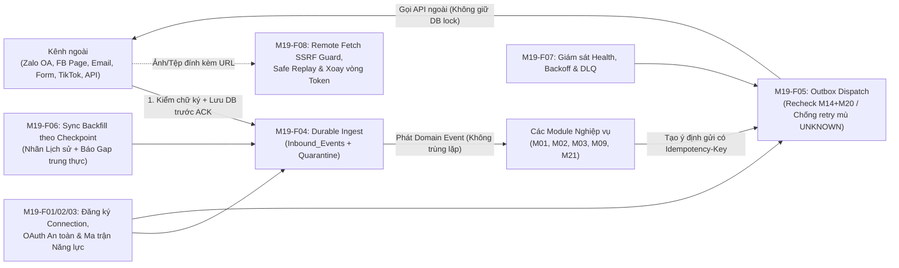
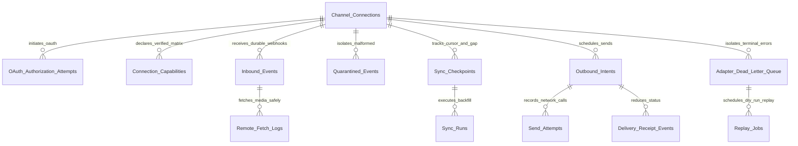

# M19 — Kết nối Bên ngoài, Thu nhận Sự kiện (Ingest), Phát Sự kiện (Outbox) & Phục hồi

Đặc tả chi tiết cấp Module & Chức năng (`Per-Module & Per-Function Spec`) cho **M19**, dẫn xuất từ [CRM_MASTER_BRD_SRS_HOP_NHAT.md](../../00-master/CRM_MASTER_BRD_SRS_HOP_NHAT.md) (`v1.9`). Tài liệu thuộc giai đoạn `Documentation-Only`; chưa có mã nguồn ứng dụng, chưa chạy migration DB và mọi ca kiểm thử đều ở trạng thái `Not Run`.

---

## 1. Manifest

- **Baseline nguồn:** [CRM_MASTER_BRD_SRS_HOP_NHAT.md](../../00-master/CRM_MASTER_BRD_SRS_HOP_NHAT.md), Phiên bản `1.9`, `SHA-256: b6a3279f328e96e1e97d845e209be7a326516a0dba5e3a033d88e1f2162e421c`.
- **Mục nguồn trong Master v1.9:**
  - Chương `2` (`2.4 Danh mục tích hợp`, `ĐẶC TẢ MODULE M19`, `2.5 Hợp đồng kỹ thuật`, `2.6 Quản trị credential & Authorization binding`, `2.7 Kiến trúc Omnichannel 5 kênh`, dòng `213–330`)
  - Mục `3.12` (`FR30`, `FR33`, `FR34`, `FR38`, `FR40`, `3.12.12 Chính sách kênh`, dòng `1270–1427`)
  - Mục `4.19` (`UC19`), `4.21` (`UC21 — Mất kết nối và phục hồi không gây spam`, dòng `2336–2346`)
  - Mục `5.14` (Outbox/transaction lock), `5.16` (`Channel_Connections`, `Inbound_Events`, `Outbound_Intents`, `Send_Attempts`, `Sync_Checkpoints`, dòng `2810–2837`), `5.13` (`ENTITY-L2786`), `5.18` (`ENTITY-L2893`)
  - Mục `7.6` (`ONFR01–06`, dòng `3306–3320`)
  - Chương `9` & Phụ lục `F/G` (`SEC01`, `SEC02`, `SEC04`, `SEC-U01`, `SEC-U02`, `SEC-U04`, `OC01..24`, `INT01`, `INT11`, `INT24..26`, `RV05`, `RV11`, `RV17`, `OM-G01..10`).
- **Status:** `Reviewed` (Đã chốt qua cổng `/grill-me` 3 quyết định kiến trúc Tầng 1 và tích hợp mô tả luồng hoạt động chi tiết từng chức năng `M19-F01..08` ngày `16/11/2026`).
- **Domain Owner & Vai trò chịu trách nhiệm:**
  - **Accountable Business Role:** Integration Owner / Ops Lead.
  - **Technical Role:** Technical Admin / Connection Operator (chỉ thao tác kết nối/health/replay trong scope được `M14` cấp; **không mặc nhiên đọc nội dung chat hay duyệt chứng từ tài chính** — `2.4` dòng `250`).
- **Ranh giới *Single Source of Truth* (`INV-03`, `INV-06`, `INV-07`, `INV-08`, `INV-23`):**
  - **`M19` sở hữu độc quyền (`Owned Entities`):** `Channel_Connections`, `OAuth_Authorization_Attempts`, `Connection_Capabilities`, `Inbound_Events`, `Quarantined_Events`, `Outbound_Intents`, `Send_Attempts`, `Delivery_Receipt_Events`, `Sync_Checkpoints`, `Sync_Runs`, `Adapter_Dead_Letter_Queue`, `Replay_Jobs`, `Remote_Fetch_Logs`.
  - **`M19` vs `M23-F12` (Ngoài hệ thống vs Nội bộ — `INV-23`):** `M19` chịu trách nhiệm toàn bộ giao tiếp biên với **hệ thống bên ngoài** (Zalo OA/ZBS, Facebook, TikTok, Email, Web Form, VoIP, Payment/E-Invoice, Partner API `M21-F06`) và DLQ của adapter ngoài. Còn hàng đợi `Outbox/DLQ` cho sự kiện **liên module nội bộ** thuộc về `M23-F12` (`INV-23`).
  - **`M19` vs `M03` (Hội thoại & Inbox):** `M19` cung cấp ống dẫn tin bền vững, kiểm chữ ký, chống trùng sự kiện và thực thi `Send_Attempts`; `M03` sở hữu `Conversations`, `Messages`, phân công nhân viên (`Routing/CAS`), và `Inbox` nghiệp vụ. Một `Channel_Connection` của `M19` có thể phục vụ nhiều `Inboxes` nội bộ trong cùng 1 `Workspace`, không tự clone sang `Workspace` khách khác (`M19-F01`).
  - **`M19` vs `M14` & `M20` (Quyền & Chặn gửi):** Mọi lệnh điều phối gửi tin ra ngoài ở `M19-F05` (kể cả khi `Replay` ở `M19-F08`) bắt buộc kiểm lại quyền `M14-F04` (`EvaluateAccessDecision`) và kiểm lại chặn gửi `M20-F03` (`EvaluateOutboundCompliance`) ở thời điểm phát tin thực tế.
  - **`M19` vs `M09` / `M21` / `M16` (Nguồn sự thật đối tác):** `M19` không tự biến dữ liệu nhận về thành nguồn chân lý thay thế Ngân hàng/ERP (`M09`), Pancake/POS đối tác (`M21`), hay PMS ngoài (`M16`); `M19` chỉ vận chuyển có kiểm chứng và giữ provenance.
- **Public Contracts cung cấp (`02-specs/contracts/`):**
  - [M19-DURABLE-INGEST-OUTBOX.md](../contracts/M19-DURABLE-INGEST-OUTBOX.md) — Hợp đồng 3 Trụ cột (`IngestWebhookEvent`, `DispatchOutboundIntent`, `ExecuteSafeRemoteFetch`) và 4 Domain Events (`M19.InboundEventPersisted`, `M19.OutboundDispatchResulted`, `M19.ConnectionHealthChanged`, `M19.SyncCoverageGapReported`).
- **Core vs Industry-Pack Boundary:** Khung lõi `M19-F01..08` thuộc **Platform Core (`P0`, `SL00/SL02+`)**. Ở giai đoạn `Pilot / SL02` ưu tiên chạy tối thiểu 1 kênh/nguồn đã kiểm chứng năng lực thực tế (`FR30`), còn các kênh nâng cao (`Facebook Lead Ads`, `TikTok DM`, `VoIP`, `MISA/ERP`, `Pancake API_READ`) chỉ mở sau khi bảng `Connection_Capabilities` của từng tài khoản được thử nghiệm và xác nhận độc lập (`GAP-08`).
- **Read first:** [INVARIANTS.md](../../01-architecture/INVARIANTS.md), [INDEX.md](../../01-architecture/INDEX.md), [M14-PRINCIPAL-ACCESS-DECISION.md](../contracts/M14-PRINCIPAL-ACCESS-DECISION.md), [M20-SUPPRESSION-PRIVACY-GATE.md](../contracts/M20-SUPPRESSION-PRIVACY-GATE.md), [M19-DURABLE-INGEST-OUTBOX.md](../contracts/M19-DURABLE-INGEST-OUTBOX.md).
- **Allowed write paths (Giai đoạn hiện tại):** Chỉ cập nhật tài liệu trong `02-specs/` và `03-planning/`; chưa mở `application_write_scope`.

---

## 2. Requirement trace

### 2.1. Danh mục 24 ID sở hữu trực tiếp bởi `M19` (`owner == M19` trong `requirements.json`)

| ID nguồn | Source anchor/line | Ý nghĩa | Owner/consumer | Priority | Applicability | Test | Evidence |
|---|---|---|---|---|---|---|---|
| `M19-F01` | Master `2.4` (dòng `237`) | Đăng ký kết nối nguồn ngoài (`Channel_Connections`), khóa sở hữu duy nhất 1 workspace active, phát hiện xung đột không lộ chủ cũ | Owner: `M19` / Consumers: `M03`, `M14`, `M21-F06` | `P0` | Từ `SL00/SL02` | `M19-AC01`, `SEC-U02`, `OC02/03` | Not Run |
| `M19-F02` | Master `2.4/2.6` (dòng `238, 274`) | Cấp quyền và kết nối lại (`OAuth / Reconnect`) có binding phiên-tài khoản-CSRF/PKCE một lần và xác minh account/scope | Owner: `M19` / Consumers: `M14`, `M03` | `P0` | Từ `SL00/SL02` | `M19-AC01`, `SEC-U01` | Not Run |
| `M19-F03` | Master `2.4/2.7` (dòng `239, 317`) | Khai báo và kiểm chứng ma trận 9 năng lực (`Connection_Capabilities`) làm gate bật/tắt nút UI/API | Owner: `M19` / Consumers: `M03`, `M21-F06` | `P0` | Từ `SL02` | `OC15`, `OM-G01`, `OM-G02` | Not Run |
| `M19-F04` | Master `2.4/2.5` (dòng `240, 256, 321`) | Thu nhận Webhook/Sự kiện bền vững (`Inbound_Events`), xác minh chữ ký/secret theo kênh, lưu DB trước khi ACK, cách ly payload lỗi | Owner: `M19` / Consumers: `M01–M03`, `M09`, `M21` | `P0` | Từ `SL02` | `M19-AC02`, `ONFR02`, `OC01`, `INT01` | Not Run |
| `M19-F05` | Master `2.4/2.7` (dòng `241, 323`) | Phát tin & gọi API ra ngoài qua Outbox Worker (`Outbound_Intents`, `Send_Attempts`), recheck `M14+M20`, không giữ lock DB, chuyển timeout sang `UNKNOWN_OUTCOME` | Owner: `M19` / Consumers: `M03`, `M04`, `M12`, `M20` | `P0` | Từ `SL02` | `M19-AC02`, `OC05/06/17`, `INT25`, `OM-G08` | Not Run |
| `M19-F06` | Master `2.4/4.21` (dòng `242, 325`) | Đồng bộ tăng dần và phục hồi từ con trỏ (`Sync_Checkpoints`, `Sync_Runs`), gắn nhãn historical không tạo SLA/chiến dịch, báo khoảng thiếu trung thực | Owner: `M19` / Consumers: `M03`, `M18`, `M21` | `P0` | Từ `SL02` | `M19-AC03`, `OC08/09/21`, `OM-G09` | Not Run |
| `M19-F07` | Master `2.4/2.6` (dòng `243, 272`) | Giám sát sức khỏe adapter, backoff/`Retry-After`, chuyển lỗi schema sang DLQ, dừng gửi khi mất quyền và cảnh báo Owner | Owner: `M19` / Consumers: `M03`, `M16`, `M22-F28`, `M23-F12` | `P0` | Từ `SL00/SL02` | `ONFR05`, `ONFR06` | Not Run |
| `M19-F08` | Master `2.4/3.12.11` (dòng `244, 1409`) | Replay sự kiện có giới hạn/dry-run/audit, xoay vòng token có mutex lock, và `Remote Fetch` tải media qua SSRF egress guard | Owner: `M19` / Consumers: `M03`, `M14`, `M20` | `P0` | Từ `SL02` | `M19-AC02/03`, `SEC-U04`, `OC14` | Not Run |
| `M19-AC01` | Master `2.4` (dòng `252`) | Tiêu chí nghiệm thu: Callback OAuth sai/replay và việc kết nối cùng external account cho hai workspace bị chặn an toàn | Owner: `M19` / Consumers: `M03`, `M14` | `P0` | Từ `SL00/SL02` | `SEC-U01`, `SEC-U02` | Not Run |
| `M19-AC02` | Master `2.4` (dòng `252`) | Tiêu chí nghiệm thu: Restart/replay/revoke/timeout không làm mất hoặc nhân đôi effect, và không retry mù lệnh `POST` không rõ kết quả | Owner: `M19` / Consumers: `M03`, `M04`, `M20` | `P0` | Từ `SL02` | `OC01/05/06/17`, `INT25`, `U01/U15` | Not Run |
| `M19-AC03` | Master `2.4` (dòng `252`) | Tiêu chí nghiệm thu: URL nội bộ/redirect lén qua Remote Fetch bị chặn; khoảng thiếu lịch sử đồng bộ (`coverage gap`) hiển thị trung thực | Owner: `M19` / Consumers: `M03`, `M18`, `M20` | `P0` | Từ `SL02` | `SEC-U04`, `OC14`, `OC21` | Not Run |
| `UC21` | Master `4.21` (dòng `2336`) | Use Case mất kết nối kênh ngoài và phục hồi có kiểm soát (cảnh báo $\rightarrow$ reauth $\rightarrow$ backfill/reconcile $\rightarrow$ hủy intent quá hạn, không xả spam) | Owner: `M19` / Consumers: `M03`, `M04`, `M20`, `M21` | `P0` | Từ `SL02` | `OC08/09/19/21`, `M19-AC02/03` | Not Run |
| `SEC01` | Master Phụ lục `F` (dòng `4685`) | Kiểm soát bảo mật: Binding OAuth callback gắn chặt `actor / session / provider / expected_account / scope / one-time token` | Owner: `M19` / Consumers: `M03`, `M14`, `M23` | `P0` | Từ `SL02` | `SEC-U01` | Not Run |
| `SEC02` | Master Phụ lục `F` (dòng `4686`) | Kiểm soát bảo mật: Định danh namespace chủ quản duy nhất cho tài khoản ngoài, chống activate/reconnect trùng scope | Owner: `M19` / Consumers: `M03`, `M14`, `M21` | `P0` | Từ `SL02` | `SEC-U02` | Not Run |
| `SEC04` | Master Phụ lục `F` (dòng `4688`) | Kiểm soát bảo mật: `Remote Fetch` có allowlist, kiểm IP sau DNS resolve, chặn redirect/private IP và không rò token | Owner: `M19` (cùng `M03`) / Consumers: `M01`, `M16`, `M20` | `P0` | Từ `SL02` | `SEC-U04` | Not Run |
| `SEC-U01` | Master `9.14` (dòng `3821`) | Ca kiểm thử bảo mật: OAuth callback sai phiên/scope, callback replay hoặc chọn nhầm account khác khi reconnect đều bị chặn và giữ nguyên token cũ | Owner: `M19` / Consumers: `M03`, `M23` | `P0` | Từ `SL02` | `SEC-U01`, `M19-AC01` | Not Run |
| `SEC-U02` | Master `9.14` (dòng `3822`) | Ca kiểm thử bảo mật: Đua tranh activate cùng Page/OA/mailbox ở hai `CLIENT workspace` và lộ lỗi constraint; 1 bên thắng, bên còn lại không lộ chủ sở hữu | Owner: `M19` / Consumers: `M03`, `M14` | `P0` | Từ `SL02` | `SEC-U02`, `M19-AC01` | Not Run |
| `SEC-U04` | Master `9.14` (dòng `3824`) | Ca kiểm thử bảo mật: Thử URL `localhost`, IP cloud metadata `169.254.169.254`, IPv4/IPv6 private, redirect hoặc DNS rebinding $\rightarrow$ Bị chặn hoàn toàn | Owner: `M19` / Consumers: `M03`, `M16` | `P0` | Từ `SL02` | `SEC-U04`, `M19-AC03` | Not Run |
| `ONFR01` | Master `7.6` (dòng `3312`) | Phi chức năng: Độ trễ từ event webhook hợp lệ được nhận đến khi hiển thị ở Inbox `p95 <= 5 giây` ở tải baseline (tách thời gian trễ phía provider) | Owner: `M19` / Consumers: `M03`, `M24` | `P0` | Mục tiêu thiết kế PoC (`SL02+`) | Benchmark tải PoC | Not Run |
| `ONFR02` | Master `7.6` (dòng `3313`) | Phi chức năng: Luôn ghi bền `Inbound_Events` vào DB trước khi trả `2xx ACK` (`p95 <= 1 giây`); DB lỗi không được trả ACK thành công | Owner: `M19` | `P0` | Từ `SL02` | Fault injection DB / Restart worker | Not Run |
| `ONFR03` | Master `7.6` (dòng `3314`) | Phi chức năng: Replay cùng 1 event 10 lần không tạo hiệu ứng trùng và không rò dữ liệu giữa hai workspace | Owner: `M19` / Consumers: `M01`, `M02`, `M03`, `M14` | `P0` | Từ `SL02` | `OC01`, `ONFR03` | Not Run |
| `ONFR04` | Master `7.6` (dòng `3315`) | Phi chức năng: Chịu tải kiểm thử `10 event/giây` liên tục 15 phút và burst `50 event/giây` trong 60 giây không mất event | Owner: `M19` / Consumers: `M24` | `P1` | Profile kiểm thử tải (`SL02+`) | Benchmark burst tải PoC | Not Run |
| `ONFR05` | Master `7.6` (dòng `3316`) | Phi chức năng: Phát cảnh báo kèm runbook cho Connection Owner khi lỗi quyền/token hết hạn hoặc backlog chờ vượt quá 5 phút | Owner: `M19` / Consumers: `M16`, `M23` | `P0` | Từ `SL02` | Fault injection alert | Not Run |
| `ONFR06` | Master `7.6` (dòng `3317`) | Phi chức năng: Đo lường độ sẵn sàng (`Availability 99,9%`) của CRM tách biệt khỏi thời gian provider ngoài bị sập (báo cáo 2 lớp trung thực) | Owner: `M19` / Consumers: `M18`, `M23` | `P1` | Giám sát vận hành (`SL02+`) | Báo cáo SLA 2 lớp | Not Run |

---

### 2.2. Truy vết Mở rộng từ Nhóm `221 missing_owner`, `PLATFORM`, `M03` & `entities-contracts.json` (`Rule 1`)

| ID nguồn | Source anchor/line | Ý nghĩa trong ngữ cảnh `M19` | Vai trò của `M19` | Priority | Applicability | Test | Evidence |
|---|---|---|---|---|---|---|---|
| `FR30` / `FR38` | Master `3.12.1` & `3.12.9` | Quản trị kết nối đa kênh, ma trận năng lực, sức khỏe sync và báo cáo khoảng dữ liệu thiếu | `Runtime Platform Owner` cho `M03` | `P0` | Từ `SL02` | `OC15`, `OC21`, `OM-G01/02` | Not Run |
| `FR33` / `FR34` | Master `3.12.4` & `3.12.5` | Thu nhận webhook chống trùng/lệch thứ tự (`FR33`) và điều phối gửi tin idempotent/recheck/unknown outcome (`FR34`) | `Transport & Outbox Owner` cho `M03/M04` | `P0` | Từ `SL02` | `OC01`, `OC05`, `OC06`, `OC07`, `INT25` | Not Run |
| `FR40` | Master `3.12.11` | Bảo vệ email inbound/outbound và quét an toàn media tải từ URL ngoài (`Remote Fetch`) | `Transport & Egress Owner` cho `M03` | `P0` | Từ `SL02` | `SEC-U04`, `OC13`, `OC14`, `INT24` | Not Run |
| `OC01` / `INT01` | Master `9.9` & `9.10` | Một tin nhắn / Lead Ads gửi lặp 10 webhook giống nhau $\rightarrow$ Chỉ 1 hiệu ứng sống, backfill lịch sử không tạo nurture/SLA mới | `Primary Owner` (`M19-F04/06`) | `P0` | Từ `SL02` | `OC01`, `INT01`, `ONFR03` | Not Run |
| `OC05` / `OC06` / `INT25` | Master `9.9` & `9.10` | Double-click gửi tin $\rightarrow$ 1 `Outbound_Intent` (`OC05`); Provider nhận rồi timeout $\rightarrow$ `UNKNOWN_OUTCOME`, cấm retry mù (`OC06`, `INT25`) | `Primary Owner` (`M19-F05`) | `P0` | Từ `SL02` | `OC05`, `OC06`, `INT25`, `OM-G08` | Not Run |
| `OC07` / `OM-G08` | Master `9.9` & `9.15` | Sự kiện `READ` đến trước `DELIVERED` $\rightarrow$ Lưu lịch sử append-only và không để reducer lùi trạng thái | `Primary Owner` (`M19-F04/05`) | `P0` | Từ `SL02` | `OC07`, `OM-G08` | Not Run |
| `OC08` / `OC09` / `OC21` | Master `9.9` | Token hết hạn kết nối lại sau 2h không xả tin hết hạn (`OC08`), backfill 30 ngày không kích hoạt SLA sống (`OC09`), API cấm đọc lịch sử thì báo khoảng thiếu thật (`OC21`) | `Primary Owner` (`M19-F06/07`) | `P0` | Từ `SL02` | `OC08`, `OC09`, `OC21`, `UC21` | Not Run |
| `OC19` / `INT26` | Master `9.9` & `9.10` | Restore DB chứa `Outbound_Intents` cũ: đối soát trước khi bật worker, không phát lại hàng loạt tin nhắn cũ | `Primary Owner` (`M19-F05/08`) phối hợp `M20` | `P0` | Từ `SL00/SL02` | `OC19`, `INT26` | Not Run |
| `OM-G01` / `OM-G02` / `OM-G10` | Master `9.15` (`CR-OMNI-20261016`) | Tách cửa sổ Zalo 48h miễn phí vs OpenAPI 7 ngày có phí (`OM-G01`); Verifier secret Telegram & edit/chat namespace (`OM-G02`); Chống vòng lặp echo hai chiều với vendor inbox (`OM-G10`) | `Adapter & Protocol Owner` (`M19-F03/04/05`) | `P0` | Khi bật kênh tương ứng | `OM-G01`, `OM-G02`, `OM-G10` | Not Run |
| `ENTITY-L2786`, `ENTITY-L2816`, `ENTITY-L2824..2826`, `ENTITY-L2829` | Master `5.13` & `5.16` | Khai báo bảng `Channel_Connections`, `Inbound_Events`, `Outbound_Intents`, `Send_Attempts`, `Sync_Checkpoints`, `Outbox`, `Webhook_Inbox`, `Connector_Mappings` | `Schema Owner` (`M19`) | `P0` | Tách bảng chi tiết tại Mục `4. Data/API` | Kiểm tra schema & unique constraints | Not Run |

---

## 3. Hành vi

### 3.0A. Tổng quan Cơ chế Hoạt động của Module `M19` (`Executive & Business Walkthrough`)

Trong kiến trúc CRM, **`M19` là "Trạm Trung chuyển Biên giới & Bộ điều hợp Đa kênh"**. Không một kênh ngoài nào (Zalo OA, Facebook Page, TikTok, Gmail/Outlook, Web Form, Tổng đài hay API Đối tác) nói chuyện trực tiếp với cơ sở dữ liệu nghiệp vụ của CRM — mọi dữ liệu đi **VÀO** hay đi **RA** đều phải đi qua 3 lớp bảo vệ của `M19`:

1. **Lớp 1 — Định danh Kết nối & Kiểm chứng Năng lực (`M19-F01`, `M19-F02`, `M19-F03`):** Quản lý toàn bộ tài khoản kết nối (`Channel_Connections`), đảm bảo **1 Fanpage / 1 Zalo OA chỉ thuộc quyền chủ quản của đúng 1 Workspace tại một thời điểm** (không bao giờ lẫn dữ liệu giữa khách hàng A và khách hàng B), khóa quy trình OAuth một lần chống đánh cắp token, và công bố bảng năng lực thực tế (`Connection_Capabilities`: kênh nào chỉ đọc được tin nhắn mới, kênh nào gửi được, kênh nào chưa được nền tảng cấp quyền).
2. **Lớp 2 — Ống dẫn Chiều vào `Ingest` & Đồng bộ Phục hồi (`M19-F04`, `M19-F06`):**
   - Mọi sự kiện Webhook gửi vào đều được **kiểm tra chữ ký/secret riêng theo từng kênh**, suy ra đúng `Workspace` từ cấu hình trên server, **lưu xuống DB bền vững trước rồi mới trả lời `200 OK`** (`Durable-Before-ACK`), giúp không bao giờ mất tin nhắn của khách dù hệ thống đang khởi động lại.
   - Khi mất kết nối rồi nối lại (`UC21`), `M19-F06` kéo bổ sung lịch sử từ con trỏ `Sync_Checkpoints` với nhãn **`BACKFILL` (dữ liệu lịch sử)** để **tuyệt đối không tạo lại chiến dịch quảng cáo hay kích hoạt báo động trễ hạn SLA giả cho tin nhắn từ tuần trước**.
3. **Lớp 3 — Ống dẫn Chiều ra `Outbox Dispatch`, Chẩn đoán Lỗi & Tải Media An toàn (`M19-F05`, `M19-F07`, `M19-F08`):**
   - Trước khi gửi bất kỳ tin nhắn nào ra ngoài, Worker của `M19-F05` hỏi lại quyền (`M14`) và danh sách chặn gửi (`M20`) ngay giây gửi, **không khóa bảng DB lúc chờ mạng**, và nếu gặp tình huống **mạng đứt/timeout không rõ đối tác đã nhận tin hay chưa (`UNKNOWN_OUTCOME`)** thì **dừng retry mù** để đối soát, tránh gửi lặp 5 lần làm phiền khách hàng.
   - Mọi file ảnh/tệp đính kèm từ URL ngoài đều đi qua trạm kiểm tra an ninh `Remote Fetch` (`M19-F08`) để chặn tin tặc lợi dụng tải địa chỉ máy chủ nội bộ (`SSRF`).



---

### 3.0B. Mô hình Máy trạng thái Cốt lõi (`Core State Machines`)

#### A. Vòng đời Kết nối Nguồn Ngoài (`Channel_Connections.status` — `M19-F01`, `M19-F02`, `M19-F07`)

```mermaid
stateDiagram-v2
    [*] --> PENDING_AUTHORIZATION : Command RegisterConnection (Khai bao account & namespace; chua duoc gui/nhan)
    PENDING_AUTHORIZATION --> ACTIVE : Command CompleteOAuth & VerifyCapabilities (Dung account/scope & it nhat 1 capability verified)
    ACTIVE --> DEGRADED : Phat sinh 429/5xx lien tiep, backlog > 5 phut hoac qua han Sync Checkpoint
    DEGRADED --> ACTIVE : Suc khoe hoi phuc (Worker drain xong backlog & checkpoint tien trien)
    ACTIVE --> REAUTHORIZATION_REQUIRED : Loi 401/403 hoac het han Refresh Token (Dung chieu Send/Ingest anh huong; giu Queue theo TTL)
    DEGRADED --> REAUTHORIZATION_REQUIRED : Loi 401/403 tu Provider
    REAUTHORIZATION_REQUIRED --> ACTIVE : Command CompleteReconnectOAuth (Dung workspace & external_account_id cu; kiem lai backlog het TTL)
    ACTIVE --> PAUSED : Command PauseConnection (Tam dung co chu dich de bao tri hoac chuan bi chuyen chu)
    PAUSED --> ACTIVE : Command ResumeConnection
    REAUTHORIZATION_REQUIRED --> DISCONNECTED : Command DisconnectConnection (Thu hoi token; giu lich su o Workspace cu)
    PAUSED --> DISCONNECTED : Command DisconnectConnection / TransferCompleted
    ACTIVE --> DISCONNECTED : Command DisconnectConnection (Thu hoi token tai Vault)
```



#### B. Vòng đời Ý định Gửi Tin / Gọi API Ra Ngoài (`Outbound_Intents.status` — `M19-F05`, `INV-08`, `INT25`)

```mermaid
stateDiagram-v2
    [*] --> QUEUED : Command EnqueueOutboundIntent (Da kiem tra M14 + M20; co Idempotency-Key & expires_at TTL)
    QUEUED --> DISPATCHING : Outbox Worker lay viec (Goi M14+M20 Recheck dat & con TTL -> nha DB lock truoc khi goi mang)
    QUEUED --> BLOCKED_BY_POLICY : Recheck tai dispatch bi M14 hoac M20 chan (Revoke quyen / Rut consent)
    QUEUED --> EXPIRED_CANCELLED : Qua han TTL expires_at hoac Connection da bi Disconnect truoc khi gui
    DISPATCHING --> ACCEPTED : Provider tra HTTP 2xx kem provider_message_id (Chua mac dinh la Delivered/Read)
    DISPATCHING --> RETRY_WAITING : Loi mang truoc gui / HTTP 429 / 5xx (Len lich backoff + Retry-After trong han TTL)
    RETRY_WAITING --> DISPATCHING : Den gio retry (Chay lai M14+M20 Recheck & TTL)
    RETRY_WAITING --> EXPIRED_CANCELLED : Qua han TTL khi cho retry
    RETRY_WAITING --> FAILED_TERMINAL : Loi du lieu 4xx khong the tu sua hoac vuot so lan thu toi da
    DISPATCHING --> UNKNOWN_OUTCOME : Timeout / Dut mang SAU KHI co the da gui payload sang Provider (CAM RETRY MU)
    UNKNOWN_OUTCOME --> ACCEPTED : Reconcile Job / Operator xac minh Provider da nhan tin (Co bang chung)
    UNKNOWN_OUTCOME --> FAILED_TERMINAL : Operator / API tra cuu xac nhan Provider chua nhan (Cho phep tao intent moi neu can)
    ACCEPTED --> DELIVERED : Webhook Receipt xac nhan Da giao (Status Reducer khong lui trang thai)
    DELIVERED --> READ : Webhook Receipt xac nhan Da doc
```

---

### 3.1. `M19-F01` — Đăng ký Kết nối Nguồn Ngoài (`Channel_Connections` & Single-Owner Namespace Guard)

- **Mục tiêu & Phạm vi:** Khai báo một kết nối kênh hoặc hệ thống ngoài (`Facebook Page`, `Zalo OA`, `TikTok Business`, `Mailbox`, `Web Form`, `Pancake API_READ`) gắn với đúng một `Workspace` chủ quản, ngăn chặn triệt để hai không gian làm việc khác nhau kết nối chồng chéo vào cùng một tài khoản kênh và làm rò rỉ tin nhắn chéo khách hàng (`FR30`, `SEC02`, `SEC-U02`).
- **Tác nhân & Kích hoạt:** `Integration Owner` hoặc `Org Admin` được `M14` cấp quyền gọi lệnh `RegisterChannelConnection`, `TransferConnectionOwnership`.
- **Mô tả Nghiệp vụ & Cơ chế Hoạt động Từng bước (`Step-by-Step Operational Flow`):**
  1. **Khóa "1 Chủ Duy Nhất" theo Cặp Định danh Thực (`Single Active Owner`):**
     - Khi công ty tạo kết nối tới một tài khoản bên ngoài (ví dụ *Facebook Page ID `10998877`* hoặc *Zalo OA ID `oa-5566`*), `M19-F01` ghi nhận bộ ba khóa: `(provider, provider_namespace, external_account_id)`. Trong đó `provider_namespace` phân biệt app/cụm máy chủ/bot nếu cần.
     - Nếu `CLIENT Workspace của Khách hàng A` đã kết nối *Page `10998877`*, sau đó một nhân viên ở `Workspace B` (hoặc một đối tác khác) cố tình đăng ký hoặc OAuth lại chính *Page `10998877`* đó $\rightarrow$ Cơ sở dữ liệu chặn đứng ngay với lỗi `409 CONNECTION_OWNERSHIP_CONFLICT`.
     - **Chống lộ thông tin khi báo lỗi (`Non-Disclosure` — `SEC-U02`):** Thông báo lỗi chỉ nói *"Tài khoản nguồn này hiện đang được quản lý trong hệ thống, không thể kích hoạt trùng"* — **tuyệt đối không hiển thị tên Workspace hay tên khách hàng đang giữ kết nối đó**.
  2. **Chia sẻ Nhiều Hàng đợi Nội bộ trên cùng 1 Kết nối (`One Connection -> Many Inboxes`):** Trong cùng một `Workspace` chủ quản, một Zalo OA hoặc Gmail chung có thể đổ vào nhiều hàng đợi Inbox (ví dụ Inbox Tư vấn vs Inbox Khiếu nại), nhưng toàn bộ đều thuộc cùng 1 `Workspace` chứ không tự động nhân bản dữ liệu sang `Workspace` của khách hàng khác.
  3. **Quy trình Chuyển chủ Có Kiểm soát (`Controlled Transfer`):** Nếu thực sự cần bàn giao một tài khoản kênh sang `Workspace` mới, `M19-F01` cấm gán đè ngang mà bắt buộc qua 4 bước: *(1) Tạm dừng (`PAUSE`) nhận/gửi $\rightarrow$ (2) Xử lý hoặc hủy toàn bộ `Outbound_Intents` đang chờ + chốt `Sync_Checkpoint` $\rightarrow$ (3) Thu hồi grant cũ $\rightarrow$ (4) Kích hoạt bên mới, còn **toàn bộ lịch sử hội thoại cũ vẫn nằm lại ở Workspace nguồn, không tự chép sang khách mới***.
- **Quy tắc Hành vi (Chuẩn EARS):**
  1. `[MASTER]` **Ubiquitous (`2.7` dòng `315`, `5.16` dòng `2816`):** Mỗi bản ghi `Channel_Connections` phải giữ cố định một `owner_workspace_id NOT NULL` trong suốt thời gian đang `ACTIVE`, `DEGRADED`, hoặc `REAUTHORIZATION_REQUIRED`.
  2. `[MASTER]` **Unwanted/Error (`SEC02`, `SEC-U02`, `5.16` dòng `2816`, Quyết định `/grill-me` #1):** Nếu bất kỳ yêu cầu nào cố gắng đăng ký hoặc kích hoạt cùng một bộ `(provider, provider_namespace, external_account_id)` đang được kích hoạt ở một `Workspace` khác, `M19-F01` phải từ chối với mã lỗi `409 CONNECTION_OWNERSHIP_CONFLICT`, tuyệt đối không trả về ID/tên của workspace hoặc chủ sở hữu đang giữ kết nối (`SEC-U02`), và không trả chi tiết raw constraint của PostgreSQL (`2.7` dòng `329`).
  3. `[MASTER]` **Event-Driven (`2.4` dòng `248`, Quyết định `/grill-me` #1):** Khi thực thi chuyển quyền sở hữu kết nối sang `Workspace` mới, `M19-F01` phải bắt buộc hoàn tất tuần tự: chuyển kết nối cũ sang `PAUSED`, giải quyết hết `Outbound_Intents` đang chờ, chốt `Sync_Checkpoints`, thu hồi grant/token cũ, rồi mới kích hoạt kết nối ở `Workspace` mới và giữ nguyên lịch sử hội thoại cũ tại `Workspace` ban đầu.

---

### 3.2. `M19-F02` — Cấp Quyền OAuth và Kết nối Lại (`OAuth Authorization Binding` & `Reconnect`)

- **Mục tiêu & Phạm vi:** Bảo vệ luồng đăng nhập ủy quyền OAuth với Facebook, Google, Microsoft, Zalo, TikTok khỏi các đòn tấn công cướp phiên (`CSRF`), dùng lại callback cũ (`Replay`), hoặc đổi nhầm tài khoản ngoài ý muốn khi kết nối lại (`SEC01`, `SEC-U01`).
- **Tác nhân & Kích hoạt:** `Integration Owner / Org Admin` bấm nút "Kết nối OAuth" hoặc "Kết nối lại (`Reconnect`)" từ giao diện quản trị `M19`.
- **Mô tả Nghiệp vụ & Cơ chế Hoạt động Từng bước (`Step-by-Step Operational Flow`):**
  1. **Tạo Phiếu Khởi tạo Dùng Một Lần (`One-Time OAuth Attempt`):** Trước khi chuyển hướng người dùng sang màn hình đăng nhập của Facebook/Google/Zalo, server của `M19-F02` sinh ra một bản ghi `OAuth_Authorization_Attempts` lưu: `actor_id`, `session_id`, `tenant_id`, `workspace_id`, `connection_id`, `expected_external_account_id` (nếu là kết nối lại), `state_token_hash`, `pkce_code_verifier_encrypted` (theo chuẩn `PKCE S256` nếu provider hỗ trợ) và thời hạn hết hiệu lực (ví dụ 10 phút).
  2. **Kiểm tra Nghiêm ngặt khi Callback Quay về:** Khi nhà cung cấp gọi về Callback URL của CRM:
     - Phải trùng đúng `actor_id`, phiên đăng nhập hiện tại và `state_token` **chưa từng được sử dụng trước đây** (tránh kẻ gian gửi lại link callback cũ — `SEC-U01`).
     - Sau khi đổi được Access Token từ provider, server của `M19-F02` tự gọi API đọc danh sách tài khoản/scopes thực tế mà token đó vừa được cấp.
     - **Chặn nhầm tài khoản khi Reconnect (`SEC-U01`):** Nếu ban đầu kết nối đang nối với *Page A*, nhưng lúc Reconnect người quản trị lại bấm nhầm sang *Page B* trên màn hình Facebook $\rightarrow$ `M19-F02` phát hiện `actual_external_account_id != expected_external_account_id`, lập tức **từ chối lưu, không ghi đè token cũ, và báo lỗi rõ ràng**.
  3. **Lưu Bí mật trong Vault, không hiện ra UI:** Token sau khi xác minh thành công được mã hóa và lưu vào Secret Manager/Vault; bảng `Channel_Connections` chỉ giữ `secret_ref`, danh sách `scopes` đã xác minh và `expires_at`.
- **Quy tắc Hành vi (Chuẩn EARS):**
  1. `[MASTER]` **Event-Driven (`2.6` dòng `274`, `SEC01`):** Khi khởi tạo quy trình OAuth, `M19-F02` phải tạo bản ghi `OAuth_Authorization_Attempts` trên server gắn chặt `actor_id`, `session_id`, `tenant_id`, `workspace_id`, `connection_id`, `state_nonce` dùng một lần, `expires_at` và `PKCE S256` (nếu provider hỗ trợ, không tự hạ cấp im lặng bỏ PKCE).
  2. `[MASTER]` **Unwanted/Error (`SEC-U01`, `2.6` dòng `274`):** Khi nhận OAuth Callback, nếu `state_nonce` sai, đã qua sử dụng (`REPLAY`), đã hết hạn, khác người dùng/phiên khởi tạo, hoặc sau khi đổi token kiểm tra thấy `external_account_id` / `granted_scopes` không khớp với kết nối dự kiến, `M19-F02` phải từ chối (`403 OAUTH_BINDING_MISMATCH`), **tuyệt đối không thay thế token hiện hữu** và ghi cảnh báo vào `Audit_Logs`.
  3. `[MASTER]` **Ubiquitous (`2.6` dòng `274`):** `M19-F02` tuyệt đối không tin `tenant_id`, `workspace_id`, hay `account_id` truyền qua URL query hoặc form của phía client khi xử lý OAuth callback; mọi phạm vi phải đọc từ `OAuth_Authorization_Attempts` trên server.

---

### 3.3. `M19-F03` — Khai báo và Kiểm chứng Ma trận Năng lực (`Connection_Capabilities` Feature Gate)

- **Mục tiêu & Phạm vi:** Ghi nhận trung thực từng khả năng thực tế mà một tài khoản/gói API đối tác thực sự làm được (`receive`, `send`, `attachments`, `delivery_receipt`, `read_receipt`, `history_backfill`, `edit`, `delete`, `native_reply_echo`, `paid_zbs_template`) để làm cổng bật/tắt tự động trên giao diện và API, tuyệt đối không hứa hẹn hoặc hiển thị tính năng giả (`FR30`, `FR38`, `OC15`, `OM-G01`, `OM-G02`).
- **Tác nhân & Kích hoạt:** `Integration Owner` chạy lệnh `VerifyConnectionCapability` (sau PoC/thử nghiệm tài khoản thật) hoặc Adapter tự cập nhật trạng thái khi kiểm định token/quyền.
- **Mô tả Nghiệp vụ & Cơ chế Hoạt động Từng bước (`Step-by-Step Operational Flow`):**
  1. **Mỗi Năng lực là một Đèn xanh/Đỏ độc lập:** Thực tế tại Việt Nam, có tài khoản TikTok Business chỉ được xem báo cáo quảng cáo mà chưa được duyệt API nhắn tin DM (`OC15`), hoặc một Webhook Web Form chỉ có năng lực **nhận (`receive`)** chứ không thể nhắn chat 2 chiều (`send`), hoặc Zalo OA chỉ miễn phí trong 48 giờ đầu còn qua 48 giờ phải có ngân sách OpenAPI 7 ngày (`OM-G01`). `M19-F03` lưu riêng trạng thái của từng năng lực trong `Connection_Capabilities`:
     - `CAPABILITY_VERIFIED` (Đã chạy thử thành công trên đúng `api_version` và tài khoản thật, có ngày kiểm `checked_at` & `evidence_ref`).
     - `PENDING_APPROVAL` (Đang chờ Facebook/Zalo/TikTok duyệt app review).
     - `UNSUPPORTED` (Nền tảng không hỗ trợ, ví dụ Web Form không hỗ trợ `read_receipt`).
     - `UNKNOWN` (Chưa từng kiểm chứng trên tài khoản thật).
  2. **Gate Giao diện & Nghiệp vụ (`UI & API Feature Gate`):**
     - `M03` (Hộp thư Inbox) đọc bảng này từ `M19-F03`: nếu năng lực `send` đang ở `PENDING_APPROVAL` hoặc `UNSUPPORTED`, nút "Trả lời trực tiếp" bị khóa kèm nhãn *"Chưa có quyền gửi hai chiều — xử lý tại trang chính thức của kênh"* (`OC15`, `2.7` dòng `313`).
     - Không bao giờ dùng tài liệu giới thiệu chung của nhà cung cấp (như thấy trên web Pancake hay Meta có nút bấm trên giao diện web) để đánh dấu bừa là `CAPABILITY_VERIFIED` cho API (`3.12.1` dòng `1282`).
- **Quy tắc Hành vi (Chuẩn EARS):**
  1. `[MASTER]` **Ubiquitous (`2.7` dòng `317`, `3.12.1` dòng `1282`):** `M19-F03` phải lưu trạng thái độc lập cho từng năng lực (`receive`, `send`, `attachments`, `delivery_receipt`, `read_receipt`, `history_backfill`, `edit`, `delete`, `native_reply_echo`, `paid_template`) theo 4 giá trị `CAPABILITY_VERIFIED`, `UNSUPPORTED`, `PENDING_APPROVAL`, hoặc `UNKNOWN`, kèm `api_version`, `checked_at`, và `evidence_ref`.
  2. `[MASTER]` **Unwanted/Error (`2.4` dòng `239`, `3.12.1` dòng `1280`, `OC15`):** Nếu bất kỳ module nào (như `M03` hoặc `M04`) gọi lệnh gửi tin hoặc đọc lịch sử trên một `Channel_Connection` mà năng lực tương ứng chưa ở trạng thái `CAPABILITY_VERIFIED`, `M19-F03` phải từ chối với mã lỗi `CAPABILITY_NOT_VERIFIED` và chặn hiển thị nút thao tác tương ứng trên UI; nếu thiếu năng lực `read_receipt`, trạng thái đọc phải hiển thị là `UNKNOWN` chứ không được giả làm *"Khách chưa đọc"* (`7.6` dòng `3319`).
  3. `[MASTER]` **Ubiquitous (`3.12.12`, `OM-G01`):** Đối với kênh Zalo OA / ZBS, `M19-F03` phải tách biệt giữa năng lực gửi miễn phí trong cửa sổ 48h và chính sách gửi có phí/OpenAPI (hoặc ZBS template) theo manifest đã kiểm chứng, liên kết với kiểm tra ngân sách (`M17`) trước khi gửi tin có phí.

---

### 3.4. `M19-F04` — Thu nhận Webhook & Sự kiện Bền vững (`Durable Ingest` & `Quarantine`)

- **Mục tiêu & Phạm vi:** Tiếp nhận an toàn 100% sự kiện từ các kênh ngoài gửi về theo nguyên tắc **Xác minh chuẩn từng kênh $\rightarrow$ Ghi bền vào DB trước khi trả `200 OK` (`Durable-Before-ACK`) $\rightarrow$ Chống trùng lặp (`Idempotent`) $\rightarrow$ Cách ly payload dị biệt (`Quarantine`)** (`FR33`, `INV-07`, `ONFR02`, `OC01`).
- **Tác nhân & Kích hoạt:** Webhook HTTP POST từ Zalo, Facebook, TikTok, Gmail/Graph Push, VoIP CDR, Web Form, hoặc Payment Gateway.
- **Mô tả Nghiệp vụ & Cơ chế Hoạt động Từng bước (`Step-by-Step Operational Flow`):**
  1. **Xác minh danh tính Webhook theo đúng chuẩn từng kênh (`Protocol-Specific Verification` — `3.12.12`, `OM-G02`):** Không áp sai một thuật toán chung cho mọi kênh:
     - **Telegram:** Kiểm tra header bí mật `X-Telegram-Bot-Api-Secret-Token` (`OM-G02`).
     - **Facebook / Zalo / Payment Gateway:** Kiểm tra chữ ký `HMAC-SHA256` kèm dấu thời gian chống replay theo đặc tả đã kiểm chứng của từng nhà cung cấp.
     - **Web Form:** Kiểm tra anti-spam, rate-limit và xác minh tên miền nguồn (`OC22`).
     - Mọi request sai chữ ký bị từ chối ngay (`401 INGEST_SIGNATURE_INVALID`).
  2. **Suy xuất `Workspace` từ cấu hình Server & Lưu Bền trước khi Trả lời (`Durable-Before-ACK` — `ONFR02`):**
     - Lấy `connection_id`, `tenant_id`, `workspace_id` từ ánh xạ trên server (không tin ID giả trong payload).
     - Ghi ngay sự kiện vào bảng `Inbound_Events` (kèm khóa chống trùng `UNIQUE (connection_id, event_key)`).
     - **Chốt chặn sống còn (`ONFR02`):** Chỉ sau khi cơ sở dữ liệu báo `COMMIT` thành công thì cổng Webhook mới trả HTTP `200/202` cho nhà cung cấp. Nếu DB đang gặp sự cố không ghi được $\rightarrow$ trả HTTP `500/503` để Facebook/Zalo tự xếp hàng gửi lại sau ít phút, tuyệt đối không trả `200` xong rồi làm mất tin nhắn trong RAM!
  3. **Chống trùng 10 lần vẫn chỉ 1 kết quả & Cách ly Payload lỗi (`OC01`, `M19-F04`):**
     - Nếu Facebook gửi lại cùng một tin nhắn 10 lần liên tiếp (do mạng chập chờn), lần 2..10 đụng khóa `UNIQUE` sẽ trả `200 OK (deduplicated = true)` và không bao giờ tạo ra 10 Lead hay 10 tin nhắn rác trong Inbox (`OC01`, `INT01`).
     - Nếu một payload có chữ ký hợp lệ nhưng đối tác vừa đổi định dạng JSON làm parser chưa hiểu được $\rightarrow$ `M19-F04` đưa bản ghi đó vào `Quarantined_Events` (cách ly để Kỹ sư xem sau) chứ không để 1 sự kiện lạ làm tắc cả hàng đợi hàng nghìn tin nhắn khác.
- **Quy tắc Hành vi (Chuẩn EARS):**
  1. `[MASTER]` **Event-Driven (`2.7` dòng `321`, `INV-07`, `ONFR02`):** Khi nhận webhook từ bên ngoài, `M19-F04` phải hoàn tất xác minh chữ ký/secret đúng giao thức của kênh, giới hạn kích thước payload, suy xuất `(tenant_id, workspace_id, connection_id)` từ mapping server, và **`COMMIT` bản ghi vào `Inbound_Events` (ngân sách nội bộ `p95 <= 1 giây`) trước khi trả HTTP `2xx ACK`**; nếu ghi DB thất bại, bắt buộc trả lỗi HTTP `5xx` để provider gửi lại.
  2. `[MASTER]` **Ubiquitous (`2.5` dòng `256`, `3.12.4`, `OC01`, `ONFR03`, `OM-G02`):** `M19-F04` phải cưỡng chế khử trùng lặp tại tầng database bằng khóa duy nhất `(tenant_id, connection_id, event_key)` (trong đó với Telegram sử dụng namespace `update_id` và khóa tin nhắn kèm `(chat_id, message_id)` — `OM-G02`); nếu nhận lặp lại cùng `event_key` nhiều lần thì trả `200 OK` idempotent và **không phát lại sự kiện `M19.InboundEventPersisted` gây nhân đôi Lead/Message/SLA**.
  3. `[MASTER]` **Unwanted/Error (`2.4` dòng `240`, `3.12.11`):** Nếu payload webhook hợp lệ về chữ ký nhưng sai schema, lỗi định dạng hoặc vượt quá chính sách nội dung, `M19-F04` phải chuyển payload sang bảng cách ly `Quarantined_Events` để operator xử lý và giải phóng luồng xử lý cho các sự kiện hợp lệ kế tiếp.

---

### 3.5. `M19-F05` — Phát Sự kiện & Gọi API Ra Ngoài (`Outbox Worker`, `Authoritative Recheck` & `UNKNOWN_OUTCOME`)

- **Mục tiêu & Phạm vi:** Tiếp nhận các lệnh gửi tin nhắn, email hoặc đồng bộ hóa từ các module nghiệp vụ (`M03`, `M04`, `M12`, `M09`), thực thi gửi ra bên ngoài một cách bền vững theo mô hình Transactional Outbox, chống gửi nhầm khi quyền/consent vừa bị thu hồi và chống gửi đúp khi mạng timeout (`FR34`, `INV-06`, `INV-08`, `OC05`, `OC06`, `INT25`, Quyết định `/grill-me` #2).
- **Tác nhân & Kích hoạt:** `M03/M04/M12` gọi lệnh `EnqueueOutboundIntent` (trong cùng transaction nghiệp vụ); `M19 Outbox Worker` lấy việc gửi theo lịch và `Reconciliation Worker` xử lý các ca `UNKNOWN_OUTCOME`.
- **Mô tả Nghiệp vụ & Cơ chế Hoạt động Từng bước (`Step-by-Step Operational Flow`):**
  1. **Chống Double-Click ngay lúc tạo Ý định gửi (`Idempotent Enqueue` — `OC05`):** Nếu nhân viên lỡ bấm nút "Gửi" 2 lần liên tiếp hoặc trình duyệt tự gửi lại request vì mạng yếu, nhờ có `UNIQUE (workspace_id, idempotency_key)` nên hệ thống chỉ tạo đúng 1 `Outbound_Intent` và gửi đi 1 tin nhắn duy nhất.
  2. **Kiểm tra Quyền, Danh sách chặn & Hạn dùng ngay giây Gửi (`Just-in-Time Guard`):** Khi Worker chuẩn bị gọi API Zalo/Facebook/Email để phát tin:
     - Kiểm tra **TTL hết hạn chưa (`expires_at`)?** Nếu kết nối bị mất mạng 2 tiếng rồi mới nối lại (`UC21`, `OC08`), các tin nhắn quảng cáo/nhắc việc đã quá hạn sẽ tự động hủy (`EXPIRED_CANCELLED`) thay vì "xả bão" tin nhắn lỗi thời sang máy khách.
     - Hỏi lại **`M14-F04` (`EvaluateAccessDecision`)**: Nhân viên tạo lệnh gửi có vừa nghỉ việc hoặc bị tước quyền không? (`INT23`, `CEO-U18`).
     - Hỏi lại **`M20-F03` (`EvaluateOutboundCompliance`)**: Khách hàng có vừa bấm Hủy đăng ký trong lúc tin nhắn đang nằm chờ trong hàng đợi không? (`U15`, `OC17`).
     - Kiểm tra năng lực kênh (`M19-F03`), cửa sổ gửi và ngân sách ZBS nếu là tin có phí (`OM-G01`).
  3. **Nhả Khóa DB trước khi Gọi Mạng & Dừng ở `UNKNOWN_OUTCOME` khi Timeout (`INV-06`, `INV-08`, `INT25`):**
     - Worker ghi trạng thái `DISPATCHING`, đóng giao dịch DB (tuyệt đối không ôm lock cơ sở dữ liệu trong lúc chờ mạng đối tác phản hồi chậm 10–30 giây!).
     - Nếu đối tác trả về **`HTTP 2xx`**: Lưu `provider_message_id` và chuyển `ACCEPTED` (chưa vội báo "Đã đọc" hay "Khách đã nhận" cho tới khi có webhook biên nhận giao nhận).
     - Nếu đối tác **Timeout sau khi Worker đã đẩy yêu cầu sang mạng (`UNKNOWN_OUTCOME`)**: Hệ thống **tuyệt đối cấm tự động thử gửi lại (`No Blind Retry`)**, vì rất có thể Zalo/Ngân hàng đã nhận và gửi cho khách rồi mà chỉ bị rớt gói tin trả lời! Ca này được khóa ở trạng thái `UNKNOWN_OUTCOME` để Job Đối soát tự động tra cứu lại trạng thái bên đối tác hoặc giao cho Operator xác minh có bằng chứng (`INT25`, `OM-G08`).
- **Quy tắc Hành vi (Chuẩn EARS):**
  1. `[MASTER]` **Ubiquitous (`5.16` dòng `2825`, `OC05`):** Mọi lệnh `EnqueueOutboundIntent` phải yêu cầu `idempotency_key` duy nhất trong phạm vi `(tenant_id, workspace_id)` và lưu `expires_at` (`TTL`), không cho phép cùng `idempotency_key` với nội dung payload khác nhau (trả `409`).
  2. `[MASTER]` **Event-Driven (`2.4` dòng `241`, `3.12.5`, `INV-06`, `INV-08`):** Ngay trước khi thực thi gọi mạng trong `M19-F05`, Outbox Worker bắt buộc:
     - Kiểm tra `now() <= expires_at` (quá hạn $\rightarrow$ `EXPIRED_CANCELLED` — `OC08`);
     - Gọi đồng bộ `M14-F04` và `M20-F03` (`check_stage = 'DISPATCH_AUTHORITATIVE'`) — nếu không đạt $\rightarrow$ `BLOCKED_BY_POLICY`;
     - Nhả hoàn toàn transaction/lock DB trước khi mở HTTP request sang nhà cung cấp.
  3. `[MASTER]` **Unwanted/Error (`2.7` dòng `323`, `3.12.5`, `INT25`, `OC06`, `OM-G08`, Quyết định `/grill-me` #2):** Nếu lệnh gọi `POST` gửi tin/thanh toán bị Timeout sau khi kết nối mạng có thể đã gửi payload tới nhà cung cấp, `M19-F05` phải chuyển `Outbound_Intents.status` sang `UNKNOWN_OUTCOME`, **tuyệt đối cấm retry tự động**, và kích hoạt quy trình đối soát (tra cứu API provider nếu có hoặc tạo tác vụ xác minh có audit cho Operator).
  4. `[MASTER]` **Ubiquitous (`5.16` dòng `2823`, `OC07`, `OM-G08`):** Bộ giảm trạng thái biên nhận gửi (`Delivery_Receipt_Events`) phải lưu sự kiện `append-only` và áp dụng quy tắc đơn điệu (`READ > DELIVERED > ACCEPTED`), tuyệt đối không cho phép sự kiện `DELIVERED` đến muộn ghi đè làm lùi trạng thái đã đạt `READ`.

---

### 3.6. `M19-F06` — Đồng bộ Tăng dần và Phục hồi Dữ liệu Thiếu (`Sync_Checkpoints`, `Backfill` & `Coverage Gap`)

- **Mục tiêu & Phạm vi:** Khôi phục dữ liệu tin nhắn, đơn hàng đối tác (`M21-F06`) hoặc lịch sử email sau khi kết nối bị gián đoạn hoặc vừa mới cài đặt mà vẫn **đảm bảo không kích hoạt lại kịch bản chăm sóc tự động cũ, không tạo SLA vi phạm giả, và trung thực công bố phần dữ liệu không lấy lại được** (`FR38`, `UC21`, `OC08`, `OC09`, `OC21`, `OM-G09`).
- **Tác nhân & Kích hoạt:** Scheduler định kỳ kéo lịch sử (`History Sync`, `Gmail Watch / History Sync`, `MS Graph Delta`), hoặc `Integration Owner` kích hoạt `StartBackfillRun` sau khi `Reconnect`.
- **Mô tả Nghiệp vụ & Cơ chế Hoạt động Từng bước (`Step-by-Step Operational Flow`):**
  1. **Chỉ dịch con trỏ (`Checkpoint`) sau khi đã xử lý an toàn cả Trang (`Page`):** Khi kéo lịch sử 100 tin nhắn/trang từ Email hoặc Pancake, nếu trang 1 đang xử lý đến tin thứ 50 mà Worker bị tắt ngang $\rightarrow$ `Sync_Checkpoints` vẫn giữ nguyên vị trí đầu trang 1 để lần chạy lại không bị bỏ sót tin 51–100. Chỉ khi 100% tin nhắn trong trang đã qua khử trùng lặp và `COMMIT` xong vào DB, con trỏ `cursor_encrypted` mới được cập nhật tiến lên.
  2. **Nhãn Dữ liệu Lịch sử (`source_mode = 'BACKFILL'`) — Chống "Bão Giả" (`OC09`, `INT01`, `OM-G09`):** Khi kéo bù lại 30 ngày tin nhắn cũ từ tháng trước vào Inbox, toàn bộ sự kiện này được gắn cờ `source_mode = 'BACKFILL'`. Các module `M02`, `M03`, `M04`, `M11` nhận được cờ này sẽ:
     - Đưa tin nhắn vào đúng dòng thời gian (`Timeline`) để nhân viên đọc đủ ngữ cảnh lịch sử (`M03-F08`).
     - **Tuyệt đối không mở lại hội thoại đã đóng (`Resolved` — `OM-G09`), không khởi chạy Journey gửi tin nhắn chào mừng (`M04`), và không bật đồng hồ đếm trễ hạn SLA cho tin nhắn của 2 tuần trước (`OC09`)**.
  3. **Báo cáo Trung thực Khoảng dữ liệu Thiếu (`Coverage Gap` — `OC21`, `UC21`):** Ví dụ có những kênh (như Web Form không có kho lưu trữ hoặc một số API chỉ cho phép lấy 7 ngày gần nhất) khiến khoảng thời gian mất mạng 10 ngày không thể lấy bù hết 3 ngày đầu. `M19-F06` bắt buộc lưu `coverage_from`, `coverage_to` và `gap_reason` vào `Sync_Checkpoints / Sync_Runs`, đồng thời phát sự kiện `M19.SyncCoverageGapReported` để `M03` và `M18` hiển thị cảnh báo thật chứ **không báo dối "Đã đồng bộ 100%"** (`3.12.9` dòng `1382`, `OC21`).
- **Quy tắc Hành vi (Chuẩn EARS):**
  1. `[MASTER]` **Ubiquitous (`2.4` dòng `242`, `2.7` dòng `325`):** Trong mọi lượt đồng bộ phân trang (`Sync_Runs`), `M19-F06` chỉ được cập nhật tiến con trỏ `Sync_Checkpoints.cursor_encrypted` sau khi toàn bộ sự kiện trong trang hiện tại đã qua pipeline chống trùng (`Inbound_Events`) và `COMMIT` thành công vào cơ sở dữ liệu.
  2. `[MASTER]` **Event-Driven (`UC21`, `OC09`, `INT01`, `OM-G09`, Quyết định `/grill-me` #3):** Khi đẩy các sự kiện lấy được từ đồng bộ bù (`Backfill`) hoặc chạy lại (`Replay`) vào pipeline `M19-F04`, `M19-F06` bắt buộc gắn cờ `source_mode = 'BACKFILL' | 'REPLAY'`; các consumer nghiệp vụ không được tạo SLA sống mới, không kích hoạt chiến dịch tự động/nurture mới và không tự động mở lại các hội thoại đã đóng hợp lệ (`Resolved`).
  3. `[MASTER]` **Event-Driven (`2.4` dòng `242`, `3.12.9`, `UC21`, `OC21`):** Nếu API của nhà cung cấp không hỗ trợ đọc lại lịch sử hoặc khoảng thời gian mất kết nối đã vượt quá cửa sổ giữ dữ liệu của provider, `M19-F06` phải ghi nhận chính xác `coverage_from`, `coverage_to` và `gap_reason`, phát `M19.SyncCoverageGapReported`, và giữ trạng thái coverage là `PARTIAL` hoặc `UNKNOWN` khi không có mẫu số đối chiếu từ nguồn ngoài.

---

### 3.7. `M19-F07` — Giám sát Sức khỏe Kết nối, Retry Backoff & Hàng đợi Lỗi (`Health, Retry & Adapter DLQ`)

- **Mục tiêu & Phạm vi:** Tự động phân loại lỗi đối tác theo bản chất (lỗi tạm thời vs mất quyền vs lỗi dữ liệu), tự giãn nhịp retry lịch sự để không bị khóa IP, cô lập lỗi sai định dạng vào Hàng đợi Chết (`Adapter_Dead_Letter_Queue`), và cảnh báo kịp thời cho người phụ trách kèm hướng dẫn xử lý (`FR38`, `ONFR05`, `ONFR06`, `INV-23`).
- **Tác nhân & Kích hoạt:** Phản hồi HTTP `401/403/429/5xx` từ đối tác, bộ đếm backlog hàng đợi vượt ngưỡng, hoặc Scheduler theo dõi gia hạn `Watch/Subscription` (Gmail/MS Graph).
- **Mô tả Nghiệp vụ & Cơ chế Hoạt động Từng bước (`Step-by-Step Operational Flow`):**
  1. **Xử lý Thông minh theo Mã lỗi (Không thử lại mù quáng):**
     - **Lỗi quá tải / mạng tạm thời (`HTTP 429 Too Many Requests`, `502/503`):** Tôn trọng tuyệt đối thời gian chờ mà đối tác yêu cầu trong header `Retry-After`; nếu không có thì giãn nhịp dần theo mốc `1 phút → 5 phút → 15 phút → 60 phút + jitter ngẫu nhiên` để tránh "bão request" khi kênh vừa sống lại.
     - **Lỗi mất quyền / Hết hạn Token (`HTTP 401/403`):** Thử lại mạng không bao giờ sửa được lỗi hết hạn token! Do đó `M19-F07` **dừng ngay việc gửi mới**, đổi trạng thái kết nối sang `REAUTHORIZATION_REQUIRED`, giữ nguyên các intent còn hạn trong hàng đợi và bắn cảnh báo khẩn cấp cho `Connection Owner` kèm đường dẫn vào bước `Reconnect` (`M19-F02`).
     - **Lỗi dữ liệu / sai cấu trúc (`HTTP 400/422`):** Đưa ngay vào `Adapter_Dead_Letter_Queue` (DLQ) kèm mã lỗi đã làm sạch dữ liệu cá nhân (`redacted`) để kỹ sư kiểm tra, không cho retry làm tắc hàng đợi chính.
  2. **Phát Cảnh báo Sau 5 Phút & Báo cáo SLA Hai Lớp (`ONFR05`, `ONFR06`):**
     - Nếu hàng đợi ùn ứ (`oldest_pending_age > 5 phút`) hoặc token mất quyền, hệ thống gửi thông báo kèm Runbook xử lý cho đúng `Connection Owner` (có cơ chế gom thông báo để không spam 100 tin báo lỗi giống nhau — `ONFR05`).
     - Trên bảng điều hành sức khỏe, độ sẵn sàng của CRM (`99,9%`) được thống kê **tách biệt khỏi thời gian Zalo/Facebook bị sập mạng** (`ONFR06`), giúp Ban Giám đốc và nhân viên biết chính xác lỗi do phần mềm CRM hay do nhà mạng đối tác đang bảo trì.
- **Quy tắc Hành vi (Chuẩn EARS):**
  1. `[MASTER]` **Event-Driven (`2.4` dòng `243`, `2.5` dòng `258`, `2.7` dòng `325`):** Khi gặp lỗi từ API đối tác, `M19-F07` phải phân nhánh hành vi bắt buộc:
     - Với `HTTP 429/5xx` hoặc lỗi mạng tạm thời (không phải `UNKNOWN_OUTCOME`): áp dụng `Retry-After` hoặc backoff `1/5/15/60 phút + jitter` trong giới hạn TTL;
     - Với `HTTP 401/403` (mất quyền/hết hạn token): dừng luồng gửi/đồng bộ bị ảnh hưởng, chuyển `Channel_Connections.status` sang `REAUTHORIZATION_REQUIRED` và không retry mù như lỗi mạng;
     - Với lỗi schema/dữ liệu (`4xx`): chuyển ngay vào `Adapter_Dead_Letter_Queue` kèm `error_code` đã redact PII.
  2. `[MASTER]` **Event-Driven (`ONFR05`):** Khi một kết nối chuyển `DEGRADED / REAUTHORIZATION_REQUIRED` hoặc độ tuổi sự kiện chưa xử lý (`oldest_pending_age`) vượt quá `5 phút`, `M19-F07` phải gửi cảnh báo có kiểm soát chống trùng lặp kèm Runbook tới `owner_user_id` (và `backup_owner_id`) và phát `M19.ConnectionHealthChanged`.
  3. `[MASTER]` **Ubiquitous (`ONFR06`, `INV-23`):** `M19-F07` chỉ quản lý sức khỏe và DLQ của các adapter kết nối ngoài (tách biệt khỏi hàng đợi sự kiện nội bộ tại `M23-F12`), đồng thời báo cáo độ khả dụng (`Availability`) theo hai lớp tách biệt: tầng lõi CRM vs từng nhà cung cấp ngoài.

---

### 3.8. `M19-F08` — Replay Có Kiểm soát, Xoay vòng Token & `Remote Fetch` An toàn (`SEC04`, `UC21`)

- **Mục tiêu & Phạm vi:** Cho phép kỹ thuật viên chạy lại có kiểm soát các sự kiện bị lỗi/DLQ trong một khoảng thời gian xác định (bắt buộc chạy thử `Dry-Run` trước khi chạy thật), bảo vệ an toàn khi làm mới/xoay vòng OAuth token (`Token Refresh Mutex`), và thực thi trạm kiểm tra an ninh `SSRF` khi tải tệp đính kèm từ URL của đối tác (`2.4` dòng `244, 246`, `3.12.11` dòng `1409`, `SEC04`, `SEC-U04`).
- **Tác nhân & Kích hoạt:** `Integration Operator` có quyền chạy lệnh `PreviewReplayDryRun`, `ExecuteControlledReplay`; Background Worker chạy `RefreshOAuthTokenWithLock` và `FetchExternalMediaSafely`.
- **Mô tả Nghiệp vụ & Cơ chế Hoạt động Từng bước (`Step-by-Step Operational Flow`):**
  1. **Replay Có Chốt Chặn (Cấm nút "Replay Mọi Thứ"):**
     - Nếu hệ thống vừa sửa xong một lỗi parser ở DLQ và cần chạy lại dữ liệu từ 14h00 đến 15h00 hôm nay, Operator phải khai báo rõ: **kết nối nào (`connection_id`), khoảng thời gian nào (`from_at` $\rightarrow$ `to_at`), lý do (`reason`)**, và **bắt buộc chạy chế độ xem trước (`Dry-Run`)** để biết chính xác lệnh này sẽ chạm vào bao nhiêu bản ghi.
     - Nếu số lượng lớn hoặc có tác động nhạy cảm, phải có người phê duyệt độc lập (`Reviewer`). Toàn bộ sự kiện khi Replay vẫn đi qua đầy đủ khử trùng lặp (`M19-F04`), kiểm tra quyền (`M14`) và kiểm tra danh sách chặn gửi (`M20`) — **không bao giờ dùng Replay làm đường vòng gửi lại tin cho khách đã bấm Hủy đăng ký (`2.4` dòng `244`)**.
  2. **Khóa Xoay vòng Token (`Refresh Mutex`):** Nhiều kênh (như Zalo OA v4, TikTok) sử dụng cơ chế *One-Time Refresh Token* — nghĩa là mỗi lần lấy token mới thì refresh token cũ bị hủy ngay lập tức. Nếu 2 Worker chạy song song cùng lúc mang refresh token cũ đi xin cấp mới, Worker thứ 2 sẽ làm hỏng kết nối của Worker thứ 1! Vì vậy `M19-F08` bắt buộc khóa `Channel_Connection` trong suốt quá trình refresh token để tuần tự hóa 100%.
  3. **Trạm Tải Media Chống Xuyên Mạng Nội bộ (`Remote Fetch SSRF Guard` — `SEC04`, `SEC-U04`):** Khi khách gửi ảnh/PDF qua Webhook, đối tác trả về một đường dẫn URL tải file. Trước khi Worker tải file về lưu vào kho CRM:
     - Kiểm tra tên miền URL phải nằm trong `allowed_media_hosts` của kênh đó (ví dụ `cdn.fbsbx.com`, `zdn.vn`).
     - Tự phân giải DNS ra địa chỉ IP thực tế và **chặn đứng ngay nếu IP thuộc mạng nội bộ/riêng tư** (`127.0.0.1`, `10.x.x.x`, `172.16.x.x`, `192.168.x.x`, hoặc địa chỉ `169.254.169.254` dùng để đánh cắp mật khẩu máy chủ Cloud — `SEC-U04`).
     - Tắt chuyển hướng tự do (`Redirect`) để tránh chiêu "tên miền ngoài giả vờ chuyển hướng vào `localhost`", đồng thời áp dụng giới hạn dung lượng tối đa và quét mã độc trước khi cho nhân viên tải qua `Download Gateway` (`OC14`).
- **Quy tắc Hành vi (Chuẩn EARS):**
  1. `[MASTER]` **Precondition/Unwanted (`2.4` dòng `244, 246`, Quyết định `/grill-me` #3):** Khi nhận lệnh chạy lại sự kiện (`Replay`), `M19-F08` bắt buộc yêu cầu `connection_id` (hoặc phạm vi cụ thể), `from_at`, `to_at` hữu hạn, `reason`, và bước `Dry-Run` trước khi thực thi (`Execution`); tuyệt đối cấm nút replay toàn cục không giới hạn phạm vi, và mọi event phát lại phải đi qua đầy đủ khử trùng lặp, kiểm quyền `M14` và kiểm `Consent/Suppression` tại `M20`.
  2. `[MASTER]` **Concurrency (`2.4` dòng `248`, `2.6` dòng `272`):** Khi làm mới hoặc xoay vòng OAuth `refresh_token`, `M19-F08` phải giữ khóa độc quyền (`lock / mutex`) theo `connection_id` để ngăn hai worker đồng thời làm mới và ghi đè token của nhau.
  3. `[MASTER]` **Unwanted/Error (`3.12.11` dòng `1409`, `SEC04`, `SEC-U04`):** Khi tải tệp đính kèm từ URL ngoài (`Remote Fetch`), `M19-F08` bắt buộc chỉ cho phép `HTTPS` tới domain trong allowlist manifest của connector, phân giải DNS và chặn mọi địa chỉ IP `loopback`, `link-local/metadata` (`169.254.0.0/16`), `private IPv4/IPv6`, hoặc `reserved ranges`; mặc định tắt `HTTP Redirect` (nếu manifest cho phép redirect CDN phải re-validate IP từng hop và tuyệt đối không gửi kèm token xác thực sang host chuyển hướng); vi phạm lập tức bị từ chối (`EGRESS_SSRF_BLOCKED`) và ghi audit.

---

## 4. Data/API

### 4.1. Sơ đồ ERD Logic Đã Tách Bảng Độc lập (`Unbundled Logical ERD — Rule 3 / GAP-04`)



---

### 4.2. Từ điển Bảng & Cột Logic (`Unbundled Table Dictionary`)

> **Quy ước kế thừa Mục `5.1` & `5.16` (`[MASTER]`):** Mọi bảng dưới đây mặc định kế thừa các cột chuẩn: `id uuid PK NOT NULL`, `tenant_id uuid NOT NULL`, `workspace_id uuid NOT NULL`, `created_at timestamptz NOT NULL DEFAULT now()`, `updated_at timestamptz NOT NULL DEFAULT now()`, `created_by uuid NOT NULL`, `updated_by uuid NOT NULL`, `row_version bigint NOT NULL DEFAULT 1`, `archived_at timestamptz NULL`, và ràng buộc `UNIQUE (tenant_id, workspace_id, id)` để làm đích cho composite FK.

| Tên bảng độc lập | Nguồn truy vết Master | Các cột chuyên biệt & Kiểu dữ liệu | Ràng buộc & Quy tắc toàn vẹn (`Constraints & Indexes`) |
|---|---|---|---|
| `Channel_Connections` | `[MASTER]` `5.16` (`ENTITY-L2816`), `SEC02` | `provider varchar(40) NN`, `provider_namespace text NN`, `external_account_id text NN`, `display_name varchar(255) NN`, `secret_ref text NULL`, `granted_scopes jsonb NN`, `api_version varchar(40) NN`, `status varchar(30) NN` (`PENDING_AUTHORIZATION \| ACTIVE \| DEGRADED \| REAUTHORIZATION_REQUIRED \| PAUSED \| DISCONNECTED`), `owner_user_id uuid FK NN`, `backup_owner_user_id uuid FK NULL`, `token_expires_at timestamptz NULL`, `last_sync_at timestamptz NULL`, `health_reason_redacted text NULL` | **Partial Unique Anti-Hijack (`SEC-U02`):** `UNIQUE (tenant_id, provider, provider_namespace, external_account_id) WHERE status IN ('ACTIVE', 'DEGRADED', 'REAUTHORIZATION_REQUIRED')`. Tuyệt đối không lưu plaintext token/secret (`2.6`). |
| `OAuth_Authorization_Attempts` | `[MASTER]` `2.6` (dòng `274`), `SEC01` | `connection_id uuid FK NULL`, `provider varchar(40) NN`, `expected_external_account_id text NULL`, `initiated_by_actor_id uuid FK NN`, `initiated_session_id uuid NN`, `state_nonce_hash char(64) NN`, `pkce_challenge_hash char(64) NULL`, `pkce_verifier_encrypted bytea NULL`, `redirect_uri text NN`, `status varchar(25) NN` (`PENDING \| CONSUMED \| EXPIRED \| REJECTED`), `expires_at timestamptz NN`, `consumed_at timestamptz NULL` | `UNIQUE (state_nonce_hash)`. Dùng đúng 1 lần; hết hạn hoặc lệch session/actor/account bị từ chối (`SEC-U01`). |
| `Connection_Capabilities` | `[MASTER]` `2.7` (dòng `317`), `M19-F03` | `connection_id uuid FK NN`, `capability_code varchar(40) NN` (`receive \| send \| attachments \| delivery_receipt \| read_receipt \| history_backfill \| edit \| delete \| native_reply_echo \| paid_template`), `capability_status varchar(25) NN` (`CAPABILITY_VERIFIED \| UNSUPPORTED \| PENDING_APPROVAL \| UNKNOWN`), `api_version varchar(40) NN`, `pricing_or_window_policy jsonb NULL`, `checked_at timestamptz NULL`, `checked_by uuid FK NULL`, `evidence_ref text NULL` | `UNIQUE (tenant_id, workspace_id, connection_id, capability_code)`. Chặn API/UI nếu chưa đạt `CAPABILITY_VERIFIED` (`OC15`, `OM-G01`). |
| `Inbound_Events` | `[MASTER]` `5.13` (`ENTITY-L2786`), `5.16` (`ENTITY-L2824`) | `connection_id uuid FK NN`, `event_key text NN`, `event_type varchar(50) NN`, `source_mode varchar(16) NN DEFAULT 'LIVE'` (`LIVE \| BACKFILL \| REPLAY`), `signature_verified boolean NN`, `payload_ref text NN`, `occurred_at timestamptz NULL`, `received_at timestamptz NN`, `processing_status varchar(25) NN` (`RECEIVED_DURABLE \| PROCESSING \| PROCESSED \| DUPLICATE \| FAILED_DLQ`), `attempts int NN DEFAULT 0`, `error_code text NULL`, `correlation_id uuid NN` | `UNIQUE (tenant_id, connection_id, event_key)`. Bắt buộc commit trước khi webhook trả `2xx ACK` (`ONFR02`, `OC01`). `INDEX (tenant_id, processing_status, received_at)`. |
| `Quarantined_Events` | `[MASTER]` `2.4` (`M19-F04`), `3.12.11` | `connection_id uuid FK NN`, `raw_event_key text NULL`, `quarantine_reason varchar(60) NN` (`SCHEMA_MISMATCH \| SSRF_OR_MALWARE \| SIZE_EXCEEDED \| UNMAPPED_CHANNEL_OBJECT`), `payload_ref text NN`, `error_redacted text NN`, `status varchar(20) NN` (`OPEN \| DISCARDED \| REPROCESSED`), `reviewed_by uuid FK NULL` | Cách ly payload bất thường; mở xem raw payload bắt buộc có support grant TTL riêng tại `M14` (`2.4` dòng `246`). |
| `Outbound_Intents` | `[MASTER]` `5.16` (`ENTITY-L2825`), `FR34` | `connection_id uuid FK NN`, `idempotency_key uuid NN`, `actor_id uuid FK NN`, `expected_permission_version bigint NN`, `channel varchar(30) NN`, `purpose_code varchar(40) NN`, `endpoint_lookup_hash char(64) NN`, `message_ref uuid NULL`, `payload_ref text NN`, `policy_snapshot jsonb NN`, `status varchar(30) NN` (`QUEUED \| DISPATCHING \| RETRY_WAITING \| ACCEPTED \| DELIVERED \| READ \| BLOCKED_BY_POLICY \| EXPIRED_CANCELLED \| UNKNOWN_OUTCOME \| FAILED_TERMINAL`), `provider_message_id text NULL`, `attempt_count int NN DEFAULT 0`, `next_attempt_at timestamptz NULL`, `expires_at timestamptz NN`, `reconcile_due_at timestamptz NULL`, `block_reason_code varchar(60) NULL` | `UNIQUE (tenant_id, workspace_id, idempotency_key)` (`OC05`). `INDEX (status, next_attempt_at)`. Không cho retry mù khi ở `UNKNOWN_OUTCOME` (`INT25`). |
| `Send_Attempts` | `[MASTER]` `5.16` (`ENTITY-L2826`) | `outbound_intent_id uuid FK NN`, `attempt_no int NN`, `request_ref text NN`, `http_status int NULL`, `provider_response_ref text NULL`, `outcome varchar(30) NN` (`ACCEPTED \| TRANSIENT_ERROR \| RATE_LIMITED \| AUTH_ERROR \| TERMINAL_ERROR \| TIMEOUT_UNKNOWN`), `error_code_redacted text NULL`, `started_at timestamptz NN`, `completed_at timestamptz NULL` | `UNIQUE (tenant_id, workspace_id, outbound_intent_id, attempt_no)`. Tuyệt đối không lưu token hoặc PII nội dung tin nhắn thô (`ENTITY-L2826`). |
| `Delivery_Receipt_Events` | `[MASTER]` `5.16` (`ENTITY-L2823`), `OC07` | `outbound_intent_id uuid FK NULL`, `message_id uuid FK NULL`, `connection_id uuid FK NN`, `provider_event_id text NN`, `receipt_status varchar(25) NN` (`ACCEPTED \| DELIVERED \| READ \| FAILED`), `occurred_at timestamptz NN`, `received_at timestamptz NN`, `detail_redacted jsonb NULL` | **Append-only.** `UNIQUE (tenant_id, connection_id, provider_event_id, receipt_status)`. Reducer giữ thứ tự đơn điệu (`READ > DELIVERED > ACCEPTED` — `OM-G08`). |
| `Sync_Checkpoints` | `[MASTER]` `5.16` (`ENTITY-L2829`), `UC21` | `connection_id uuid FK NN`, `stream_key varchar(80) NN`, `cursor_encrypted text NULL`, `coverage_from timestamptz NULL`, `coverage_to timestamptz NULL`, `coverage_status varchar(20) NN` (`COMPLETE \| PARTIAL \| UNKNOWN`), `gap_reason text NULL`, `last_success_at timestamptz NULL`, `watch_expires_at timestamptz NULL` | `UNIQUE (tenant_id, workspace_id, connection_id, stream_key)`. Chỉ tiến cursor sau khi commit cả page (`M19-F06`). |
| `Sync_Runs` | `[MASTER]` `4.21` (`UC21`) + `[PROPOSED]` | `connection_id uuid FK NN`, `checkpoint_id uuid FK NN`, `run_mode varchar(20) NN` (`DELTA_POLL \| BACKFILL \| WATCH_RENEW`), `range_from timestamptz NULL`, `range_to timestamptz NULL`, `status varchar(25) NN` (`RUNNING \| COMPLETED \| COMPLETED_WITH_GAP \| FAILED`), `events_fetched int NN DEFAULT 0`, `events_deduplicated int NN DEFAULT 0`, `started_at timestamptz NN`, `finished_at timestamptz NULL` | Ghi lại chi tiết số lượng đồng bộ và khoảng thiếu thực tế sau mất kết nối (`OC21`). |
| `Adapter_Dead_Letter_Queue` | `[MASTER]` `2.4` (`M19-F07`), `INV-23` | `connection_id uuid FK NN`, `source_direction varchar(16) NN` (`INBOUND \| OUTBOUND`), `source_record_id uuid NN`, `error_code varchar(60) NN`, `error_summary_redacted text NN`, `retry_count int NN`, `owner_user_id uuid FK NN`, `status varchar(20) NN` (`OPEN \| REPLAY_SCHEDULED \| RESOLVED \| DISCARDED`), `last_failed_at timestamptz NN` | Tách biệt hoàn toàn khỏi DLQ nội bộ của nền tảng (`M23-F12` — `INV-23`). |
| `Replay_Jobs` | `[MASTER]` `2.4` (`M19-F08`), `UC21` | `connection_id uuid FK NN`, `requested_by uuid FK NN`, `approved_by uuid FK NULL`, `mode varchar(16) NN` (`DRY_RUN \| EXECUTE`), `range_from timestamptz NN`, `range_to timestamptz NN`, `reason text NN`, `estimated_count int NULL`, `executed_count int NN DEFAULT 0`, `blocked_by_policy_count int NN DEFAULT 0`, `status varchar(25) NN` (`DRAFT \| DRY_RUN_READY \| RUNNING \| COMPLETED \| FAILED`) | `CHECK (range_to > range_from)`. Bắt buộc có `reason` và khoảng thời gian hữu hạn (`M19-F08`). |
| `Remote_Fetch_Logs` | `[MASTER]` `3.12.11` (dòng `1409`), `SEC04` | `connection_id uuid FK NN`, `inbound_event_id uuid FK NULL`, `target_url_hash char(64) NN`, `resolved_host varchar(255) NN`, `resolved_ip_redacted varchar(64) NULL`, `fetch_decision varchar(25) NN` (`ALLOWED \| BLOCKED_SSRF \| BLOCKED_ALLOWLIST \| BLOCKED_SIZE_OR_MIME`), `content_sha256 char(64) NULL`, `mime_type varchar(100) NULL`, `size_bytes bigint NULL`, `scan_status varchar(20) NN` (`PENDING \| CLEAN \| INFECTED \| FAILED`) | Lưu vết kiểm tra allowlist/DNS/IP và kết quả quét mã độc trước khi cho phép tải qua `Download Gateway` (`SEC-U04`, `OC14`). |

---

### 4.3. Bảng Tham số Cấu hình & Chính sách (`Policy/Config Parameters — Safe Default / Fail-Closed` theo `Rule 4` & `INV-14`)

| Mã tham số / GAP | Tên biến cấu hình trong `Policy_Versions` | Kiểu dữ liệu | Giá trị Mặc định An toàn (`Safe Default / Fail-Closed`) khi chưa cấu hình | Vai trò có quyền Phê duyệt (`Active`) |
|---|---|---|---|---|
| `GAP-08` | `verified_channel_manifest_matrix` | `jsonb` | Toàn bộ kênh chưa chạy PoC thực tế đều mặc định `capability_status = 'UNKNOWN'` (`Fail-Closed`: khóa nút gửi/sync tương ứng, `SL02` mock trước; chỉ mở live sau khi xác minh tài khoản và API thật). `[OPEN-GAP: GAP-08]` | `Integration Owner` + `Ops Lead` |
| `GAP-M19-01` | `outbound_intent_default_ttl_minutes` & `retry_backoff_schedule_minutes` | `int`, `int[]` | Mặc định `TTL = 120 phút` (cho tin nhắn/CSKH tức thời; riêng chiến dịch marketing do `M04` chốt nhưng tối đa không quá `1440 phút`), lịch retry `[1, 5, 15, 60]` phút + jitter; hết TTL tự hủy (`EXPIRED_CANCELLED` — `OC08`). `[OPEN-GAP: GAP-M19-01]` | `Integration Owner` + `CX Lead` |
| `GAP-M19-02` | `remote_fetch_max_bytes` & `remote_fetch_timeout_ms` | `bigint`, `int` | Mặc định `max_bytes = 26214400` (`25 MB`), `connect_timeout = 3000ms`, `read_timeout = 15000ms`, `follow_redirects = false`, chặn toàn bộ IP private/loopback/metadata (`SEC-U04`). `[OPEN-GAP: GAP-M19-02]` | `Security Lead` + `Integration Owner` |
| `ONFR05` Policy | `adapter_backlog_alert_threshold_minutes` | `int` (mặc định `5` phút) | Khi `oldest_pending_age > 5 phút` hoặc trạng thái `REAUTHORIZATION_REQUIRED`, phát cảnh báo gom nhóm kèm Runbook tới `owner_user_id` & `backup_owner_user_id`. | `Ops Lead` |

---

### 4.4. Hợp đồng API Nội bộ & Liên Module (`Commands, Queries & Public Contracts`)

- **Public Cross-Module Contract:** Đã tách thành tệp độc lập tại [02-specs/contracts/M19-DURABLE-INGEST-OUTBOX.md](../contracts/M19-DURABLE-INGEST-OUTBOX.md) (bao gồm `IngestWebhookEvent`, `DispatchOutboundIntent`, `ExecuteSafeRemoteFetch` và 4 sự kiện Outbox).
- **Bảng Command & Query Nội bộ của `M19`:**

| Command / Query Endpoint | Actor được phép | Kiểm tra Tiền điều kiện & Guard (`CAS / Authority`) | Kết quả Thành công & Mã lỗi chính |
|---|---|---|---|
| `POST /v1/integrations/connections` (`RegisterConnection` — `M19-F01`) | `Integration Owner`, `Org Admin` | Kiểm tra `M14` authority trong `workspace_id`; kiểm tra không trùng `(provider, provider_namespace, external_account_id)` đang active ở workspace khác | `201 Created` (`PENDING_AUTHORIZATION`); `409 CONNECTION_OWNERSHIP_CONFLICT` (không lộ chủ cũ `SEC-U02`) |
| `POST /v1/integrations/connections/{id}/oauth/start` & `GET /v1/integrations/oauth/callback` (`M19-F02`) | `Integration Owner` (cùng `actor` & `session`) | Lưu one-time `state_nonce` + `PKCE S256`; callback đối chiếu session, nonce chưa dùng, external account khớp dự kiến và scopes | `200 OK` (lưu `secret_ref` vào Vault); `403 OAUTH_BINDING_MISMATCH` (không ghi đè token cũ `SEC-U01`) |
| `POST /v1/integrations/connections/{id}/capabilities/verify` (`VerifyCapability` — `M19-F03`) | `Integration Owner` | Bắt buộc đính kèm `api_version`, `evidence_ref`, và phân tách `eligibility_rule` vs `pricing_rule` (như Zalo 48h/7 ngày) | `200 OK` (`CAPABILITY_VERIFIED` + phát `M19.ConnectionHealthChanged`) |
| `POST /v1/webhooks/{provider}/{namespace}` (`IngestWebhook` — `M19-F04`) | `External Provider` (xác minh chữ ký/secret theo adapter) | Xác minh chữ ký theo kênh; suy xuất `connection/workspace` từ DB; ghi bền `Inbound_Events` (`UNIQUE event_key`) trước trả ACK | `200/202` (sau DB `COMMIT` — `ONFR02`); `401 INGEST_SIGNATURE_INVALID`; `5xx` nếu DB lỗi |
| `POST /v1/integrations/outbound-intents/{id}/reconcile` (`ReconcileUnknownOutcome` — `M19-F05`) | `Reconciliation Worker`, `Integration Operator` | Chỉ áp dụng cho intent đang ở `UNKNOWN_OUTCOME`; bắt buộc có `evidence_ref` từ API tra cứu đối tác hoặc xác nhận thủ công | `200 OK` (chuyển sang `ACCEPTED` hoặc `FAILED_TERMINAL` có audit — `INT25`) |
| `POST /v1/integrations/connections/{id}/pause` & `/transfer` (`M19-F01`) | `Integration Owner` + `Org Owner` | Yêu cầu tạm dừng nhận/gửi, xử lý hết `Outbound_Intents` đang chờ, chốt `Sync_Checkpoint` và revoke grant cũ trước khi chuyển | `200 OK`; `409 PENDING_INTENTS_NOT_QUIESCED` |
| `POST /v1/integrations/connections/{id}/replay` (`DryRun / ExecuteReplay` — `M19-F08`) | `Integration Operator` (kèm Reviewer nếu rủi ro cao) | Bắt buộc có `from_at`, `to_at` hữu hạn, `reason`, và đã chạy `DRY_RUN`; đi qua `M14` + `M20` trước mọi tác động gửi | `202 Accepted` (trả `replay_job_id`); `422 DRY_RUN_REQUIRED` |

---

## 5. UI/operations

### 5.1. Danh mục Màn hình & Trạng thái Giao diện (`4 Standard UI States`)

1. **Màn hình Quản lý Kết nối & Ma trận Năng lực (`Channel Connections & Capabilities` — `M19-F01/02/03`):**
   - Hiển thị danh sách kết nối theo Workspace với mã màu trạng thái (`ACTIVE`, `DEGRADED`, `REAUTHORIZATION_REQUIRED`, `PAUSED`), người chịu trách nhiệm (`owner_user_id` + `backup_owner_user_id`), ngày hết hạn token (chỉ hiện trạng thái/ngày hết hạn — **tuyệt đối không hiển thị plaintext token/secret** — `2.4` dòng `246`), và bảng tick trạng thái 9 năng lực kèm ngày kiểm định gần nhất.
   - **Conflict / Permission Denied State:** Khi kết nối trùng tài khoản đã có chủ khác, hiển thị thông báo trung tính không tiết lộ tên workspace đang sở hữu (`SEC-U02`).
2. **Màn hình Giám sát Đồng bộ, Khoảng Thiếu & Độ Trễ (`Sync Coverage & Health Monitor` — `M19-F06/07`):**
   - Hiển thị thời điểm đồng bộ thành công gần nhất (`last_success_at`), độ tuổi sự kiện chờ cũ nhất (`oldest_pending_age`), thanh timeline chỉ rõ các vùng `COMPLETE` vs `PARTIAL / COVERAGE_GAP` (`OC21`), và bảng **Availability 2 lớp** (CRM Core 99,9% vs từng nhà cung cấp Zalo/Meta/Email — `ONFR06`).
3. **Màn hình Hàng đợi Chết (`Adapter DLQ`), Đối soát `UNKNOWN_OUTCOME` & Công cụ `Replay` (`M19-F05/07/08`):**
   - Hiển thị các intent bị kẹt `UNKNOWN_OUTCOME` kèm nút *"Tra cứu lại từ Provider"* hoặc *"Xác nhận kết quả thủ công (Kèm bằng chứng)"*.
   - Form `Replay` bắt buộc chọn khoảng ngày giờ cụ thể, nhập lý do, bấm **"Chạy thử (Dry-Run)"** xem trước số lượng bản ghi ảnh hưởng rồi mới mở nút **"Thực thi Replay"**.
   - Xem nội dung payload lỗi chi tiết trong DLQ/Quarantine bị ẩn mặc định, chỉ mở khi Operator có `Break-glass/Support Grant TTL` từ `M14`/`M23`.

### 5.2. Vận hành, Giám sát, Nhật ký & Runbook (`Observability & Operations`)

- **Metrics & Cảnh báo vận hành (`7.6` dòng `3319`, `ONFR01..06`):**
  - `m19_inbound_received_total`, `m19_inbound_deduplicated_total`, `m19_inbound_quarantined_total`
  - `m19_webhook_ack_latency_ms` (`SLO p95 <= 1000ms` — `ONFR02`) và `m19_inbound_to_inbox_latency_ms` (`SLO p95 <= 5000ms` — `ONFR01`)
  - `m19_oldest_pending_age_seconds` (Cảnh báo `ONFR05` khi `> 300 giây`)
  - `m19_outbound_unknown_outcome_count` & `m19_provider_429_rate`
  - `m19_ssrf_egress_blocked_total` (Cảnh báo bảo mật ngay về `M23-F08` khi phát hiện payload chèn IP nội bộ `SEC-U04`).
- **Runbook xử lý sự cố:**
  - **Tình huống 1 — Mất quyền OAuth (`REAUTHORIZATION_REQUIRED`):** M19 tự ngắt luồng gửi để tránh lỗi dây chuyền $\rightarrow$ Cảnh báo Connection Owner $\rightarrow$ Owner thực hiện `Reconnect OAuth` (`M19-F02`) đúng tài khoản cũ $\rightarrow$ M19 tự động hủy các intent đã hết hạn TTL (`OC08`), đẩy tiếp các intent còn hạn qua cổng `M14+M20`, và chạy `Sync Backfill` từ `Sync_Checkpoint` gần nhất.
  - **Tình huống 2 — Khôi phục DB sau sự cố (`DR Restore` — `OC19`, `INT26`):** Khi bật lại từ backup cũ, mặc định khóa Outbox Worker của `M19` ở trạng thái `PAUSED` $\rightarrow$ Chạy đối soát `VerifyPostRestoreComplianceGate` của `M20` $\rightarrow$ Chuyển toàn bộ `Outbound_Intents` đã quá hạn sang `EXPIRED_CANCELLED` để tuyệt đối không gửi lại tin nhắn cũ từ thời điểm backup (`OC19`), rồi mới mở Worker.

---

## 6. Migration và gate

### 6.1. Chiến lược Migration, Cutover & Secrets (`Expand -> Migrate -> Contract`)

1. **Khởi tạo Kết nối & Vault (`SL02`):**
   - Thiết lập tách biệt database role của Worker khỏi Migration role (`2.4` dòng `250`). Toàn bộ OAuth `access_token`, `refresh_token` và `webhook_secret` phải nằm trong Secret Manager / Vault (đã mã hóa theo từng Tenant/Connection), không lưu cột plain text trong PostgreSQL.
2. **Diễn tập Phục hồi (`DR Drill` — `7.6` dòng `3319`):**
   - Trước khi Go-live kênh thật (`SL02`), bắt buộc diễn tập khôi phục bao gồm: phục hồi credential trong Vault, giữ nguyên `Sync_Checkpoints`, chạy đối soát `Outbound_Intents` quá hạn (`OC19`) và áp lại `Endpoint_Suppressions` của `M20` (`INT26`) trước khi bật lạiWorker.

---

### 6.2. Ma trận Kiểm thử & Cổng Nghiệm thu (`Test Applicability Matrix`)

> **Trạng thái kiểm chứng hiện tại:** Toàn bộ ca kiểm thử ứng dụng dưới đây đều ở trạng thái **`Not Run`** (chưa có mã nguồn ứng dụng và chưa chạy DB/PoC/UAT thật theo `INV-16`).

| Mã Test | Yêu cầu / Chức năng | Kịch bản kiểm thử & Tiêu chí Đậu (`Expected Outcome`) | Cấp độ / Slice kích hoạt | Applicability | Status / Evidence |
|---|---|---|---|---|---|
| `M19-AC01` / `SEC-U01` / `SEC-U02` | `M19-F01`, `M19-F02`, `SEC01`, `SEC02` | (1) Gửi callback OAuth sai phiên/scope, callback replay hoặc chọn nhầm tài khoản ngoài khi reconnect; (2) Hai `CLIENT workspace` đua tranh kích hoạt cùng 1 Page/OA/Mailbox $\rightarrow$ Chặn toàn bộ callback sai/replay, giữ nguyên token cũ; 1 bên thắng, bên còn lại nhận `409` mà không lộ tên chủ sở hữu hoặc chi tiết SQL | `P0` / `SL02` | Applicable (`SL02+`) | `Not Run` |
| `M19-AC02` / `OC01` / `OC05` | `M19-F04`, `M19-F05`, `FR33`, `FR34`, `ONFR03` | (1) Gửi lặp 10 webhook giống hệt nhau hoặc double-click nút Gửi; (2) Khởi động lại worker ngay giữa lúc xử lý $\rightarrow$ Chỉ tạo đúng 1 hiệu ứng/intent duy nhất, không mất và không nhân đôi tin nhắn | `P0` / `SL02` | Applicable (`SL02+`) | `Not Run` |
| `OC06` / `INT25` / `OM-G08` | `M19-F05`, `FR34`, `INV-08` | Giả lập nhà cung cấp đã nhận tin nhắn nhưng đường truyền bị Read Timeout không trả phản hồi $\rightarrow$ Hệ thống chuyển intent sang `UNKNOWN_OUTCOME`, tuyệt đối không retry mù, đưa vào hàng đợi đối soát có audit | `P0` / `SL02` | Applicable (`SL02+`) | `Not Run` |
| `OC07` / `OM-G08` | `M19-F04`, `M19-F05` | Webhook báo `READ` đến trước webhook `DELIVERED` $\rightarrow$ Lưu append-only vào `Delivery_Receipt_Events`, bộ giảm trạng thái không cho lùi trạng thái về `DELIVERED` | `P0` / `SL02` | Applicable (`SL02+`) | `Not Run` |
| `M19-AC03` / `SEC-U04` / `OC14` | `M19-F08`, `SEC04`, `FR40` | Đưa vào payload webhook các URL chứa `localhost`, `127.0.0.1`, `169.254.169.254`, dải IP nội bộ IPv4/IPv6, redirect chéo sang mạng riêng, DNS đổi IP hoặc file quá cỡ/nhiễm độc $\rightarrow$ `Remote Fetch` chặn toàn bộ (`EGRESS_SSRF_BLOCKED`) không chạm mạng nội bộ | `P0` / `SL02` | Applicable (`SL02+`) | `Not Run` |
| `UC21` / `OC08` / `OC09` / `OC21` | `M19-F06`, `M19-F07`, `FR38` | Ngắt quyền token 2 giờ rồi kết nối lại, đồng thời backfill dữ liệu 30 ngày với 1 khoảng bị API từ chối trả lịch sử $\rightarrow$ Hủy các intent quá hạn TTL (`OC08`), gắn cờ `BACKFILL` không kích hoạt SLA/nurture mới (`OC09`), và báo trung thực khoảng thiếu `coverage gap` (`OC21`) | `P0` / `SL02` | Applicable (`SL02+`) | `Not Run` |
| `OC19` / `INT26` | `M19-F05`, `M19-F08` | Khôi phục DB từ bản sao lưu có sẵn các `Outbound_Intents` cũ đang chờ gửi $\rightarrow$ Đối soát trạng thái `EXPIRED_CANCELLED` và áp lại `M20` suppression trước khi mở Worker, không xả bão tin cũ | `P0` / `SL00–02` | Applicable (`SL02+`) | `Not Run` |
| `OM-G01` / `OM-G02` / `OC15` | `M19-F03`, `M19-F04`, `3.12.12` | (1) Zalo OA qua mốc 48h nhưng còn trong 7 ngày OpenAPI có phí kiểm tra budget; (2) Telegram webhook kiểm tra `Secret-Token` header & `update_id/chat_id/message_id`; (3) TikTok chưa duyệt messaging $\rightarrow$ khóa nút trả lời trên UI | `P0` / `SL02–07` | Theo kênh bật | `Not Run` |
| `ONFR01` / `ONFR02` / `ONFR04` / `ONFR05` / `ONFR06` | `M19-F04`, `M19-F07` | Đo kiểm tải `10 event/giây` (15 phút) & burst `50 event/giây` (60 giây); fault-injection lỗi DB khi nhận webhook kiểm `No ACK without Durable Write` (`ONFR02 <= 1s`, `ONFR01 <= 5s`), cảnh báo backlog > 5 phút (`ONFR05`), và báo cáo Availability 2 lớp (`ONFR06`) | `P0/P1` / `SL02+` | Profile tải & giám sát PoC | `Not Run` |
