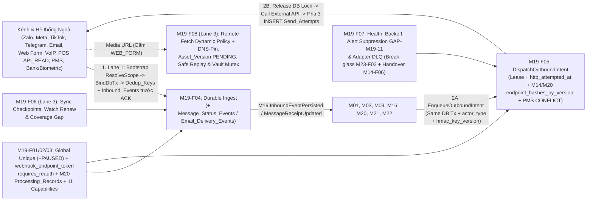

# M19 — Kết nối Bên ngoài, Thu nhận Sự kiện (Ingest), Phát Sự kiện (Outbox) & Phục hồi

Đặc tả chi tiết cấp Module & Chức năng (`Per-Module & Per-Function Spec`) cho **M19**, dẫn xuất từ [CRM_MASTER_BRD_SRS_HOP_NHAT.md](../../00-master/CRM_MASTER_BRD_SRS_HOP_NHAT.md) (`v1.9`). Tài liệu thuộc giai đoạn `Documentation-Only`; chưa có mã nguồn ứng dụng, chưa chạy migration DB và mọi ca kiểm thử đều ở trạng thái `Not Run`.

---

## 1. Manifest

- **Baseline nguồn:** [CRM_MASTER_BRD_SRS_HOP_NHAT.md](../../00-master/CRM_MASTER_BRD_SRS_HOP_NHAT.md), Phiên bản `1.9`, `SHA-256: b6a3279f328e96e1e97d845e209be7a326516a0dba5e3a033d88e1f2162e421c`.
- **Mục nguồn trong Master v1.9:**
  - Chương `2` (`2.4 Danh mục tích hợp & Đặc tả Module M19`, `2.5 Hợp đồng kỹ thuật`, `2.6 Quản trị credential & Authorization binding`, `2.7 Kiến trúc Omnichannel 5 kênh`, dòng `213–330`)
  - Mục `3.12` (`FR30`, `FR33`, `FR34`, `FR38`, `FR40`, `3.12.5`, `3.12.9`, `3.12.11`, `3.12.12 Chính sách kênh`, dòng `1270–1430`)
  - Mục `4.19` (`UC19`), `4.21` (`UC21 — Mất kết nối và phục hồi không gây spam`, dòng `2314–2345`)
  - Mục `5.1` (`L2491`, `L2495–2506` Quy tắc tên bảng & kế thừa cột), `5.13` (`ENTITY-L2786`), `5.14` (Outbox/transaction lock), `5.16` (`ENTITY-L2816`, `ENTITY-L2823..2826`, `ENTITY-L2829`, dòng `2810–2837`), `5.17` (`CONTRACT-L2845`), `5.18` (`ENTITY-L2893`, `L2895`, `L2897`), `6.3` (`L3159`), `6.4` (`L3178`)
  - Mục `7.1` (`NFR04–08`, `NFR10–11`), `7.3` (`L3294`), `7.6` (`ONFR01–06`, dòng `3306–3320`), `7.9` (`H-NFR08`)
  - Chương `9` & Phụ lục `A/E/F/G` (`SEC01`, `SEC02`, `SEC04`, `SEC-U01`, `SEC-U02`, `SEC-U04`, `SEC-U05`, `U01`, `U15`, `OC01..24`, `INT01`, `INT11`, `INT15`, `INT23..26`, `RV05`, `RV11`, `RV15`, `RV17`, `CEO-U18`, `CEO-U26`, `CMO-U08`, `CMO-U09`, `CMO-U22`, `CMO-U25`, `CX-U08`, `CX-U20`, `CX-U22`, `OM-G01..10`, `P-T17`, `UC-W10`, `W-T32`, `W-T33`, `CR11`, `CR12`, `O04`, `O06`, `O08`, `L4713`).
- **Status:** `Reviewed (CR-20261116-WAVE1-RECONCILIATION Applied; CR-20261116-WAVE1-5-HARDENING Applied; CR-20261116-WAVE1-REVIEW-FIXES Applied); CR-20261116-SKILL-TEMPLATE-ALIGN` *(Đã đối soát đồng bộ `C19`, `C14`, `C16`, `C20`, `ADR-002..009`, `Master v1.9` theo [CR-20261116-WAVE1-RECONCILIATION.md](../changes/archive/CR-20261116-WAVE1-RECONCILIATION.md), `CR-20261116-WAVE1-5-HARDENING` và [CR-20261116-WAVE1-REVIEW-FIXES.md](../changes/archive/CR-20261116-WAVE1-REVIEW-FIXES.md))*.
- **Approved_Scope:** `Wave 1/1.5 M19 External Integrations, Durable Ingest, Outbox Dispatch & Recovery (M19-F01..08, C19)`
- **Approved_By:** `Chủ dự án`
- **Decision_Ref:** `CR-20261116-WAVE1-RECONCILIATION; CR-20261116-WAVE1-5-HARDENING; CR-20261116-WAVE1-REVIEW-FIXES; CR-20261116-SKILL-TEMPLATE-ALIGN`
- **Approved_At:** `2026-11-16`
- **Domain Owner & Vai trò chịu trách nhiệm:**
  - **Accountable Business Role:** Integration Owner / Ops Lead.
  - **Technical Role:** Technical Admin / Connection Operator (chỉ thao tác kết nối/health/replay trong scope được `M14` cấp; **không mặc nhiên đọc nội dung chat hay duyệt chứng từ tài chính** — `2.4` dòng `250`). Mở xem raw payload bị cách ly trong `Quarantined_Events` / `Adapter_Dead_Letter_Queue` bắt buộc có `Break-glass / Support Grant` TTL qua `M23-F03` (`Maker != Checker`) + `M14` (`INV-22`); đối soát thu chi tài chính thuộc `Finance` (`M09`), gộp hồ sơ thuộc `Data Steward` (`M01`).
- **Ranh giới *Single Source of Truth* (`INV-03`, `INV-06`, `INV-07`, `INV-08`, `INV-21`, `INV-23`, `ADR-004`, `ADR-005`, `ADR-008`, `ADR-009`):**
  - **`M19` sở hữu độc quyền (`15 Owned Entities + 1 phần Connector_Mappings`):**
    - `[MASTER]` (`5.16`/`5.18`/`5.13`/`2.4`): `Channel_Connections` (`ENTITY-L2816`), `Inbound_Events` (`ENTITY-L2824` — canonical duy nhất thay `Webhook_Inbox` tại `5.13` theo `5.18 L2897`), `Outbound_Intents` (`ENTITY-L2825`), `Send_Attempts` (`ENTITY-L2826`), `Message_Status_Events` (`ENTITY-L2823` — **khôi phục tên chuẩn Master**, bãi bỏ tên tự đặt `Delivery_Receipt_Events`), `Email_Delivery_Events` (`ENTITY-L2893` — ingest event bounce/complaint bất biến; còn `Endpoint_Suppressions` thuộc `M20`), `Sync_Checkpoints` (`ENTITY-L2829`), `Adapter_Dead_Letter_Queue` (DLQ riêng cho adapter ngoài), và phần ánh xạ kỹ thuật `Connector_Mappings` (`ENTITY-L2786`) cho kênh ngoài (tách biệt với `M21.Partner_Source_Bindings` của POS và bảng ánh xạ nhân viên–máy chấm công của `M22-F10`).
    - `[PROPOSED]` (`ADR-004/005`): `OAuth_Authorization_Attempts`, `Connection_Capabilities`, `Inbound_Event_Dedup_Keys`, `Quarantined_Events`, `Sync_Runs`, `Replay_Jobs`, `Remote_Fetch_Logs`.
  - **`M19` vs `M23-F12` & Cô lập 3 Làn Queue (`M24-F07`, `ADR-005`, `INV-23`):** `M19` **chỉ** quản lý giao tiếp biên, Outbox và DLQ đối với **hệ thống bên ngoài** (`Zalo OA/ZBS`, `Meta/Facebook`, `TikTok`, `Telegram`, `Email Gmail/Graph`, `Web Form`, `VoIP/SIP`, `Payment/E-Invoice`, `Partner API M21-F06`, `PMS`, `Thiết bị chấm công M22-F10` & `Ngân hàng chi lương M22-F28`). Toàn bộ Outbox/DLQ cho **sự kiện liên module nội bộ** (`M14.*`, `M16.*`, `M20.*`, `M22.*`, Notification) thuộc về **`M23-F12`**. Trên hạ tầng worker (`M24-F07`), **`M19-F04` Live Webhook Ingest** & reply trực tiếp chạy ở **`Lane 1 (REALTIME_CRITICAL)`**; **`M19-F06` Backfill** (phục vụ `M03`, `M16`, `M18`, `M21`), **`M19-F08` Replay & Remote Fetch** và chiến dịch hàng loạt bị cô lập hoàn toàn sang **`Lane 3 (HEAVY_BATCH_BACKFILL)`**.
  - **`M19` vs `M03` & `M16` (Hội thoại, PMS Sync & Trạng thái Gửi/Nhận — `ADR-008`, `ADR-009`):** `Outbound_Intents` chỉ giữ **trạng thái vận chuyển** (`QUEUED -> DISPATCHING -> RETRY_WAITING / ACCEPTED / CONFLICT / BLOCKED_BY_POLICY / EXPIRED_CANCELLED / UNKNOWN_OUTCOME / FAILED_TERMINAL`); còn trạng thái giao nhận/đọc/bounce trên hội thoại (`DELIVERED`, `READ`, `BOUNCED`, `COMPLAINED`, `FAILED`) được nạp bất biến vào `Message_Status_Events` / `Email_Delivery_Events` (hỗ trợ cả webhook receipt đến sớm trước khi Pha 3 `DispatchOutboundIntent` kịp commit `ACCEPTED`, và chuyển tiếp `DELIVERED/READ -> COMPLAINED/FAILED`) rồi phát qua `M19.MessageReceiptUpdated` để **`M03.Messages`** cập nhật đơn điệu (`ACCEPTED -> READ`, `ACCEPTED/DELIVERED/READ -> COMPLAINED/FAILED`). Đồng bộ PMS (`UC-W10` / `W-T32` / `W-T33`) truyền qua `TASK_SYNC` + `CONFLICT` để `M16.External_Task_Mappings` đối chiếu hai chiều không echo. Một `Channel_Connection` có thể cấp cho nhiều `Inboxes` nội bộ trong cùng 1 `Workspace`, không tự clone sang `Workspace` khách khác (`M19-F01`).
  - **`M19` vs `M14` & `M20` (Bootstrap `FORCE RLS`, Quyền Thực thi, Chặn Gửi, `HMAC` & Tiêu thụ Event — `ADR-002/003/006/007/008`):**
    - Trước khi đọc/ghi bất kỳ bảng `Nhóm A/C` nào tại điểm nhận webhook (`FORCE RLS`): Worker/Handler bắt buộc gọi Bootstrap `SECURITY DEFINER` Port **`C14.ResolveConnectionScopeByWebhookEndpoint(provider, provider_namespace, webhook_endpoint_token [nullable])`** để nhận đủ **`(connection_id, tenant_id, workspace_id, workspace_type, connection_status, acting_principal_id, permission_version)`** rồi gọi ngay **`M14.BindDbTransactionContext(tenant_id, workspace_id, workspace_type, acting_principal_id, permission_version, 'SYSTEM_WORKER', correlation_id)`** (**đủ 6 GUC + `correlation_id`** theo `C14`).
    - Trước khi kích hoạt kết nối: `M19-F01/F02` gọi `M20` kiểm `Processing_Records.status == 'ACTIVE'` (`Master 6.3 L3159`, thiếu trả `422 PRIVACY_PURPOSE_UNAPPROVED`) và `EvaluateVendorAndAiTransfer` (`M19_EXTERNAL_WEBHOOK` | `REMOTE_VENDOR_API`).
    - Khi điều phối gửi/replay (`M19-F05/F08`): Worker bắt buộc gọi `M14.EvaluateAccessDecision` chế độ **`GUARDED_EXECUTION`** (truyền `principal_type = actor_type` thuộc `USER | SERVICE_PRINCIPAL | PORTAL_CLIENT` và `expected_permission_version`, dùng `resource_type`/`action` chuẩn `C14`) và `M20.EvaluateOutboundCompliance` (`DISPATCH_AUTHORITATIVE`, truyền đủ `contact_id`, `sender_profile_id`, `channel` 8 giá trị, `purpose_code varchar(80)`, `hmac_key_version`, và **`endpoint_hashes_by_version[]`**; riêng `channel = 'WEBHOOK'` với `message_category IN ('TRANSACTIONAL_TICKET_OR_APPOINTMENT', 'TASK_SYNC', 'SYSTEM_SYNC')` khi **không mang PII khách hàng** vẫn giữ Bước 1 [`Deletion_Ledger` + `Endpoint_Suppressions`], Bước 2 [`Processing_Records` + `EvaluateVendorAndAiTransfer`], và Bước 4 [`Legal_Hold`] của `M20`, chỉ được miễn Bước 3 Consent tiếp thị và miễn Bước 5 Sender Profile `EMAIL/SMS/ZALO` theo `C19`/`C20`).
    - `M19` tiêu thụ bắt buộc 8 sự kiện: `M14.PermissionVersionBumped`, `M14.UserOffboardingLocked` (+ `ListOpenIntentsForPrincipal` bàn giao `SCHEDULED_INTENT`, `Channel_Connections.owner_user_id`, `Adapter_DLQ.owner_user_id` tách khỏi `actor_id` gốc `INT15`), `M14.WorkHandoverAssigned`, `M14.WorkspaceActivated`, `M20.EndpointSuppressed`, `M20.SubjectErasureExecuted` (`erased_subject_refs[]` xóa sạch `Inbound_Events`, `Quarantined_Events`, `Adapter_Dead_Letter_Queue`), `M20.DataIncidentEscalated`, `M23.FeatureFlagUpdated`.
  - **`M19` vs `M09` / `M21-F06` (`API_READ`) / `M22-F10/28` / `M16` & Khai báo Ngoại lệ Non-Messaging (`O04`, `O06`, `O08`, `ADR-005`):** Phân loại kết nối bằng `provider_category` (`MESSAGING | EMAIL | VOIP | PMS | PARTNER_POS_READ | ERP_FINANCE | HRM_DEVICE_OR_BANK`); khóa cứng allowlist chỉ đọc `READ_ONLY_PARTNER_SYNC` cho `M21-F06` (`INV-21`, `P-T17`); đặt `allow_auto_retry = false` cho mọi giao dịch tiền/chi lương/thuế/tin ZBS có phí (`Master 2.5 L258`, `NFR08`); áp adapter versioning & quarantine cho thiết bị chấm công/ngân hàng (`H-NFR08`). Không tự thay thế SSoT ngân hàng/ERP (`M09`), POS (`M21`), hay PMS (`M16`).
- **Public Contracts cung cấp (`02-specs/contracts/`):**
  - [M19-DURABLE-INGEST-OUTBOX.md](../contracts/M19-DURABLE-INGEST-OUTBOX.md) (`v1.2`) — Hợp đồng **5 Cổng/Trụ cột Tích hợp Ngoài** (`IngestWebhookEvent`, `EnqueueOutboundIntent`, `DispatchOutboundIntent`, `ExecuteSafeRemoteFetch`, `ReplayConnectionEvents`) + **Cổng Bàn giao `ListOpenIntentsForPrincipal`** (`M14-F06`), **5 Domain Events phát hành** (`M19.InboundEventPersisted`, `M19.OutboundDispatchResulted`, `M19.MessageReceiptUpdated`, `M19.ConnectionHealthChanged`, `M19.SyncCoverageGapReported`) và **8 sự kiện liên module tiêu thụ**.
- **Core vs Industry-Pack Boundary:** Khung lõi `M19-F01..08` thuộc **Platform Core (`P0`, `SL00/SL02+`)**. Ở giai đoạn `Pilot / SL02` ưu tiên chạy tối thiểu 1 kênh/nguồn đã kiểm chứng năng lực thực tế (`FR30`), còn các kênh nâng cao (`Facebook Lead Ads`, `TikTok DM`, `VoIP`, `MISA/ERP`, `Pancake API_READ`, `PMS`, `Biometric/Bank`) chỉ mở sau khi `Connection_Capabilities`, `Processing_Records` (`M20`) và contract test PoC của từng tài khoản được xác nhận độc lập (`[OPEN-GAP: GAP-08]`, `[OPEN-GAP: GAP-M19-03]`, `[OPEN-GAP: GAP-M19-04]`, `[OPEN-GAP: GAP-M19-10]`).
- **ADRs Kiến trúc Liên quan:** [ADR-002](../../01-architecture/decisions/ADR-002-ORG-ISOLATION-RLS-AND-SCOPE-FILTER.md), [ADR-003](../../01-architecture/decisions/ADR-003-PERMISSION-VERSION-CACHE-AND-MODE-GOVERNANCE.md), [ADR-004](../../01-architecture/decisions/ADR-004-SHARED-PLATFORM-TABLES-AND-BASE-SCHEMA.md), [ADR-005](../../01-architecture/decisions/ADR-005-DUAL-OUTBOX-3LANE-ISOLATION-AND-VAULT.md), [ADR-006](../../01-architecture/decisions/ADR-006-DOWNLOAD-GATEWAY-REMOTE-FETCH-AND-AI-GATEWAY.md), [ADR-007](../../01-architecture/decisions/ADR-007-PRIVACY-CANONICAL-HASH-LEGAL-HOLD-AND-DR-FENCE.md), [ADR-008](../../01-architecture/decisions/ADR-008-OMNICHANNEL-CONTRACTS-RECEIPTS-AND-CROSS-EVENTS.md), [ADR-009](../../01-architecture/decisions/ADR-009-M16-WORK-PROJECTS-TASK-CORE-BOUNDARIES.md).
- **Read first:** [INVARIANTS.md](../../01-architecture/INVARIANTS.md), [INDEX.md](../../01-architecture/INDEX.md), [M14-PRINCIPAL-ACCESS-DECISION.md](../contracts/M14-PRINCIPAL-ACCESS-DECISION.md), [M16-TASK-CORE-COMMANDS.md](../contracts/M16-TASK-CORE-COMMANDS.md), [M20-SUPPRESSION-PRIVACY-GATE.md](../contracts/M20-SUPPRESSION-PRIVACY-GATE.md), [M19-DURABLE-INGEST-OUTBOX.md](../contracts/M19-DURABLE-INGEST-OUTBOX.md).
- **Read on demand:** [OMNICHANNEL_AUDIT_RESEARCH_2026-10-16.md](../../04-research/reports/OMNICHANNEL_AUDIT_RESEARCH_2026-10-16.md), [M16-WORK-PROJECTS-TASK-CORE.md](M16-WORK-PROJECTS-TASK-CORE.md), [M21-PARTNER-BUSINESS-RESULTS.md](M21-PARTNER-BUSINESS-RESULTS.md), [M22-HUMAN-RESOURCES.md](M22-HUMAN-RESOURCES.md), [M23-SYSTEM-ADMIN-SECURITY-OPS.md](M23-SYSTEM-ADMIN-SECURITY-OPS.md), [M24-PERFORMANCE-AND-PRODUCTIVITY.md](M24-PERFORMANCE-AND-PRODUCTIVITY.md).
- **Allowed write paths (Giai đoạn hiện tại):** Chỉ cập nhật tài liệu trong `02-specs/`, `01-architecture/` và `03-planning/`; chưa mở `application_write_scope` (`AGENTS.md`).

---

## 2. Requirement trace

### 2.1. Danh mục 24 ID sở hữu trực tiếp bởi `M19` (`owner == M19` trong `requirements.json`)

| ID nguồn | Source anchor/line | Ý nghĩa | Owner/consumer | Hành vi / Contract | Priority | Applicability | Test | Evidence |
|---|---|---|---|---|---|---|---|---|
| `M19-F01` | Master `2.4` (dòng `237`) | Đăng ký kết nối nguồn ngoài (`Channel_Connections`), khóa sở hữu duy nhất toàn cục xuyên Tenant (cả lúc `PAUSED`) + `webhook_endpoint_token`, kiểm `Processing_Records`, phát hiện xung đột không lộ chủ cũ | Owner: `M19` / Consumers: `M03`, `M14`, `M16`, `M20`, `M21-F06`, `M22` | `### 3.1 M19-F01` | `P0` | Từ `SL00/SL02` | `M19-AC01`, `SEC-U02`, `OC02/03` | Not Run |
| `M19-F02` | Master `2.4/2.6` (dòng `238, 274`) | Cấp quyền và kết nối lại (`OAuth / Reconnect`) có binding phiên-tài khoản-CSRF/PKCE một lần, xác minh account/scope và kiểm soát cờ `requires_reauth` | Owner: `M19` / Consumers: `M14`, `M03`, `M16`, `M21`, `M23` | `### 3.2 M19-F02` | `P0` | Từ `SL00/SL02` | `M19-AC01`, `SEC-U01` | Not Run |
| `M19-F03` | Master `2.4/2.7` (dòng `239, 317`) | Khai báo và kiểm chứng ma trận năng lực (`Connection_Capabilities` — 11 key gồm VoIP & ZBS trả phí) làm gate bật/tắt nút UI/API | Owner: `M19` / Consumers: `M03`, `M16`, `M17`, `M21-F06` | `### 3.3 M19-F03` | `P0` | Từ `SL02` | `OC15`, `OC16`, `OM-G01`, `OM-G02`, `P-T17` | Not Run |
| `M19-F04` | Master `2.4/2.5` (dòng `240, 256, 321`) | Thu nhận Webhook/Sự kiện bền vững (`Inbound_Events` + `Inbound_Event_Dedup_Keys` tại Lane 1), bootstrap `ResolveConnectionScopeByWebhookEndpoint` trước `BindDbTransactionContext`, lưu DB trước khi ACK, cách ly payload lỗi | Owner: `M19` / Consumers: `M01–M03`, `M09`, `M16`, `M20`, `M21`, `M22` | `### 3.4 M19-F04`, `C19` | `P0` | Từ `SL02` | `M19-AC02`, `ONFR02`, `OC01`, `INT01`, `OC22`, `W-T33` | Not Run |
| `M19-F05` | Master `2.4/2.7` (dòng `241, 323`) | Khởi tạo & phát tin/lệnh API ra ngoài qua Outbox Worker (`EnqueueOutboundIntent` + `DispatchOutboundIntent`, `Outbound_Intents` với `actor_type`/`lease`/`http_attempted_at`, `Send_Attempts` chỉ `INSERT` tại Pha 3, `Message_Status_Events`), recheck `M14+M20` (`endpoint_hashes_by_version[]`), không giữ lock DB, xử lý `CONFLICT` PMS & khóa retry mù `UNKNOWN_OUTCOME` | Owner: `M19` / Consumers: `M03`, `M04`, `M09`, `M12`, `M16`, `M20`, `M22` | `### 3.5 M19-F05`, `C19` | `P0` | Từ `SL02` | `M19-AC02`, `OC05/06/07/17`, `INT25`, `OM-G08`, `NFR08`, `W-T32` | Not Run |
| `M19-F06` | Master `2.4/4.21` (dòng `242, 325`) | Đồng bộ tăng dần và phục hồi từ con trỏ (`Sync_Checkpoints`, `Sync_Runs` tại Lane 3), gia hạn Watch/Subscription, fallback khi cursor hết hạn, gắn nhãn historical không tạo SLA/chiến dịch, báo khoảng thiếu trung thực | Owner: `M19` / Consumers: `M03`, `M16`, `M18`, `M21` | `### 3.6 M19-F06`, `C19` | `P0` | Từ `SL02` | `M19-AC03`, `OC08/09/21`, `OM-G09`, `CMO-U25` | Not Run |
| `M19-F07` | Master `2.4/2.6` (dòng `243, 272`) | Giám sát sức khỏe adapter, backoff/`Retry-After`, chuyển lỗi schema sang `Adapter_Dead_Letter_Queue` (tách DLQ riêng khỏi Internal Outbox `M23-F12`), dừng gửi khi mất quyền và cảnh báo Owner (`M23-F08`) kèm chống bão alert (`GAP-M19-11`) & bàn giao `M14-F06` | Owner: `M19` / Consumers: `M03`, `M14`, `M16`, `M21`, `M22-F28`, `M23-F08`, `M23-F12` | `### 3.7 M19-F07` | `P0` | Từ `SL00/SL02` | `ONFR05`, `ONFR06`, `CX-U22`, `INT15` | Not Run |
| `M19-F08` | Master `2.4/3.12.11` (dòng `244, 1409`) | Replay sự kiện có giới hạn/dry-run/audit tại Lane 3, xoay vòng token có mutex lock trong Vault, `Remote Fetch` tải media qua SSRF egress guard + cấm `WEB_FORM` + đọc giới hạn động `M23.Policy_Versions` + tính MIME `+33%` + cấp `asset_version_id` `PENDING` ngay từ đầu & `Download Gateway SEC03` | Owner: `M19` / Consumers: `M03`, `M14`, `M20`, `M23` | `### 3.8 M19-F08`, `C19` | `P0` | Từ `SL02` | `M19-AC02/03`, `SEC-U04`, `OC13`, `OC14`, `INT24` | Not Run |
| `M19-AC01` | Master `2.4` (dòng `252`) | Tiêu chí nghiệm thu: Callback OAuth sai/replay và việc kết nối cùng external account cho hai tenant/workspace (kể cả khi `PAUSED`) bị chặn an toàn; `ResumeConnection` bị chặn khi `requires_reauth = true` | Owner: `M19` / Consumers: `M03`, `M14`, `M21` | `### 3.1–3.2` | `P0` | Từ `SL00/SL02` | `SEC-U01`, `SEC-U02` | Not Run |
| `M19-AC02` | Master `2.4` (dòng `252`) | Tiêu chí nghiệm thu: Restart/replay/revoke/timeout không làm mất hoặc nhân đôi effect, và không retry mù lệnh `POST` không rõ kết quả (`http_attempted_at IS NOT NULL`) | Owner: `M19` / Consumers: `M03`, `M04`, `M09`, `M16`, `M20` | `### 3.4–3.5`, `C19 §2.1–2.3` | `P0` | Từ `SL02` | `OC01/05/06/17`, `INT25`, `U01`, `U15` | Not Run |
| `M19-AC03` | Master `2.4` (dòng `252`) | Tiêu chí nghiệm thu: URL nội bộ/IPv6/CGNAT/redirect lén/SVG-HTML/WEB_FORM qua Remote Fetch bị chặn; khoảng thiếu lịch sử đồng bộ (`coverage gap`) hiển thị trung thực | Owner: `M19` / Consumers: `M03`, `M18`, `M20` | `### 3.8 M19-F08`, `C19 §2.4` | `P0` | Từ `SL02` | `SEC-U04`, `OC14`, `OC21` | Not Run |
| `UC21` | Master `4.21` (dòng `2336`) | Use Case mất kết nối kênh ngoài và phục hồi có kiểm soát (cảnh báo $\rightarrow$ reauth $\rightarrow$ backfill/reconcile $\rightarrow$ hủy intent quá hạn, không xả spam) | Owner: `M19` / Consumers: `M03`, `M04`, `M16`, `M20`, `M21` | `### 3.6–3.7`, `C19 §2.5` | `P0` | Từ `SL02` | `OC08/09/19/21`, `M19-AC02/03` | Not Run |
| `SEC01` | Master Phụ lục `F` (dòng `4685`) | Kiểm soát bảo mật: Binding OAuth callback gắn chặt `actor / session / provider / expected_account / scope / one-time token` | Owner: `M19` / Consumers: `M03`, `M14`, `M23` | `### 3.1–3.2` | `P0` | Từ `SL02` | `SEC-U01` | Not Run |
| `SEC02` | Master Phụ lục `F` (dòng `4686`) | Kiểm soát bảo mật: Định danh namespace chủ quản duy nhất toàn cục cho tài khoản ngoài + `webhook_endpoint_token`, chống activate/reconnect trùng scope | Owner: `M19` / Consumers: `M03`, `M14`, `M21` | `### 3.1–3.2` | `P0` | Từ `SL02` | `SEC-U02` | Not Run |
| `SEC04` | Master Phụ lục `F` (dòng `4688`) | Kiểm soát bảo mật: `Remote Fetch` có allowlist, kiểm IP sau DNS resolve (DNS-pinning), chặn redirect/private IPv4-IPv6-CGNAT, cấm `WEB_FORM`/`SVG`/`HTML` và không rò token | Owner: `M19` (cùng `M03`) / Consumers: `M01`, `M16`, `M20` | `### 3.8 M19-F08`, `C19 §2.4` | `P0` | Từ `SL02` | `SEC-U04`, `OC14` | Not Run |
| `SEC-U01` | Master `9.14` (dòng `3821`) | Ca kiểm thử bảo mật: OAuth callback sai phiên/scope, callback replay hoặc chọn nhầm account khác khi reconnect đều bị chặn và giữ nguyên token cũ | Owner: `M19` / Consumers: `M03`, `M14`, `M23` | `### 3.1–3.2` | `P0` | Từ `SL02` | `SEC-U01`, `M19-AC01` | Not Run |
| `SEC-U02` | Master `9.14` (dòng `3822`) | Ca kiểm thử bảo mật: Đua tranh activate cùng Page/OA/mailbox ở hai Tenant/Workspace và lộ lỗi constraint; 1 bên thắng, bên còn lại không lộ chủ sở hữu | Owner: `M19` / Consumers: `M03`, `M14` | `### 3.1–3.2` | `P0` | Từ `SL02` | `SEC-U02`, `M19-AC01` | Not Run |
| `SEC-U04` | Master `9.14` (dòng `3824`) | Ca kiểm thử bảo mật: Thử URL `localhost`, IP cloud metadata `169.254.169.254`, IPv4/IPv6 private (`0.0.0.0/8`, `100.64.0.0/10`, `::ffff:*`, `fc00::/7`, `fe80::/10`), redirect, DNS rebinding, `SVG/HTML`, `WEB_FORM`, hoặc file vượt cỡ $\rightarrow$ Bị chặn hoàn toàn | Owner: `M19` / Consumers: `M03`, `M16`, `M20` | `### 3.8 M19-F08`, `C19 §2.4` | `P0` | Từ `SL02` | `SEC-U04`, `M19-AC03` | Not Run |
| `ONFR01` | Master `7.6` (dòng `3312`) | Phi chức năng: Độ trễ từ event webhook hợp lệ được nhận đến khi hiển thị ở Inbox `p95 <= 5 giây` ở tải baseline (tách thời gian trễ phía provider) | Owner: `M19` / Consumers: `M03`, `M24` | `### 3.4–3.7`, `Mục 5.2` | `P0` | Mục tiêu thiết kế PoC (`SL02+`) | `ONFR01` | Not Run |
| `ONFR02` | Master `7.6` (dòng `3313`) | Phi chức năng: Luôn ghi bền `Inbound_Events` + `Inbound_Event_Dedup_Keys` vào DB trước khi trả `2xx ACK` (`p95 <= 1 giây`, ngân sách nội bộ chặt hơn `NFR04 <= 2s`); DB lỗi không được trả ACK thành công | Owner: `M19` / Consumers: `M03`, `M24` | `### 3.4–3.7`, `Mục 5.2` | `P0` | Từ `SL02` | `ONFR02` | Not Run |
| `ONFR03` | Master `7.6` (dòng `3314`) | Phi chức năng: Replay cùng 1 event 10 lần (kể cả sau khi dọn raw payload `payload_ref` 30 ngày) không tạo hiệu ứng trùng và không rò dữ liệu giữa hai workspace | Owner: `M19` / Consumers: `M01`, `M02`, `M03`, `M14` | `### 3.4–3.7`, `Mục 5.2` | `P0` | Từ `SL02` | `OC01`, `ONFR03` | Not Run |
| `ONFR04` | Master `7.6` (dòng `3315`) | Phi chức năng: Chịu tải kiểm thử `10 event/giây` liên tục 15 phút và burst `50 event/giây` trong 60 giây không mất event (cô lập Lane 1 vs Lane 3) | Owner: `M19` / Consumers: `M24` | `### 3.4–3.7`, `Mục 5.2` | `P1` | Profile kiểm thử tải (`SL02+`) | `ONFR04` | Not Run |
| `ONFR05` | Master `7.6` (dòng `3316`) | Phi chức năng: Phát cảnh báo kèm runbook cho Connection Owner khi lỗi quyền/token hết hạn hoặc backlog chờ vượt quá `5 phút` (ngưỡng phát hiện `[MASTER]`; cửa sổ chống bão gom alert lặp thuộc `[OPEN-GAP: GAP-M19-11]`) | Owner: `M19` / Consumers: `M16`, `M23` | `### 3.4–3.7`, `Mục 5.2` | `P0` | Từ `SL02` | `ONFR05`, `[OPEN-GAP: GAP-M19-11]` | Not Run |
| `ONFR06` | Master `7.6` (dòng `3317`) | Phi chức năng: Đo lường độ sẵn sàng (`Availability 99,9%`) của CRM tách biệt khỏi thời gian provider ngoài bị sập (báo cáo 2 lớp trung thực) | Owner: `M19` / Consumers: `M18`, `M23` | `### 3.4–3.7`, `Mục 5.2` | `P1` | Giám sát vận hành (`SL02+`) | `ONFR06` | Not Run |

---

### 2.2. Truy vết Mở rộng (`missing_owner`, `PLATFORM`, `M03/M16/M21/M22` & `entities-contracts.json` — `Rule 1`)

| ID nguồn | Source anchor/line | Ý nghĩa trong ngữ cảnh `M19` | Vai trò của `M19` | Hành vi / Contract | Priority | Applicability | Test | Evidence |
|---|---|---|---|---|---|---|---|---|
| `FR30` / `FR38` | Master `3.12.1` & `3.12.9` | Quản trị kết nối đa kênh, ma trận năng lực, sức khỏe sync và báo cáo khoảng dữ liệu thiếu (`expired cursor -> full sync`) | `Runtime Platform Owner` cho `M03`, `M16` | `### 3.1–3.8`, `C19` | `P0` | Từ `SL02` | `OC15`, `OC21`, `OM-G01/02` | Not Run |
| `FR33` / `FR34` | Master `3.12.4` & `3.12.5` | Thu nhận webhook chống trùng/lệch thứ tự (`FR33`) và điều phối gửi tin idempotent/recheck/unknown outcome/soft-bounce (`FR34`) | `Transport & Outbox Owner` cho `M03/M04` | `### 3.1–3.8`, `C19` | `P0` | Từ `SL02` | `OC01`, `OC05`, `OC06`, `OC07`, `INT25` | Not Run |
| `FR40` | Master `3.12.11` | Bảo vệ email inbound/outbound (MIME `+33%`, HTML script/pixel strip, threading) và quét an toàn media tải từ URL ngoài (`Remote Fetch`) | `Transport & Egress Owner` cho `M03` | `### 3.8 M19-F08`, `C19 §2.4` | `P0` | Từ `SL02` | `SEC-U04`, `OC13`, `OC14`, `INT24` | Not Run |
| `UC19` | Master `4.19` (`L2314`) | Trả lời từ CRM và xử lý gửi chưa rõ kết quả (`Owner: M03`, phụ thuộc ống dẫn `M19-F05`) | `Outbox Transport & Reconcile Provider` | `### 3.1–3.8`, `C19` | `P0` | Từ `SL02` | `OC05`, `OC06`, `INT25`, `OM-G08` | Not Run |
| `UC-W10` / `W-T32` / `W-T33` | Master `4.23` (`L2375, 2441`), `9.16.1` (`L3886–3887`) | Đồng bộ hai chiều có kiểm soát với PMS ngoài (`provider_category = 'PMS'`, `TASK_SYNC`, trạng thái `CONFLICT` khi PMS từ chối due/parent closed `W-T32`, trường `external_task_id`/`external_version`/`echo_operation_key` chống echo `W-T33`) | `External PMS Transport & Sync Provider` cho `M16` (`External_Task_Mappings`) | `### 3.1–3.8`, `C19` | `P1` | Khi bật PMS (`W-O05`, `GAP-M19-10`) | `W-T32`, `W-T33` | Not Run |
| `CR11` / `CR12` | Master `9.11` (`L3670`), Phụ lục `E.3` (`L4599–4600`) | `CR11`: Connector capability & recovery contract (`FR30–40, UC17–21` — không hứa quyền/lịch sử API chưa kiểm chứng); `CR12`: Consent/purpose/endpoint + send arbitration (`FR02/09/13/34/37` — ngăn gửi sai/trùng & giữ suppression qua `M20`) | `CR11 Primary Enforcer` & `CR12 Outbox/Suppression Participant` (phối hợp `M20`) | `### 3.1–3.8`, `C19` | `P0` | Từ `SL02` | `M19-AC01..03`, `OC15..17`, `OC21`, `SEC-U05` | Not Run |
| `NFR04` / `NFR05` / `NFR06` | Master `7.1` & `7.3` | `NFR04`: Webhook ACK `P95 <= 2s` (`ONFR02 <= 1s` nội bộ); `NFR05`: SLO core `99.9%` tách provider; `NFR06`: DR Drill giữ cursor/outbox/suppression | `NFR Implementer` (phối hợp `M23/M24`) | `### 3.4–3.7`, `Mục 5.2` | `P0` | Từ `SL00/SL02` | `NFR04`, `ONFR02`, `OC19`, `INT26` | Not Run |
| `NFR07` / `NFR08` / `NFR10` / `NFR11` | Master `7.1` (`L3277–3281`) | `NFR07`: 0 truy cập chéo tenant/workspace + mask lỗi DB (`RV15`); `NFR08`: Tiền/replay 100 lần idempotent (`allow_auto_retry=false`); `NFR10`: UI Accessibility; `NFR11`: Correlation ID, không log token/PII | `NFR Implementer` (xuyên suốt `M19-F01..08`) | `### 3.4–3.7`, `Mục 5.2` | `P0` | Từ `SL00/SL02` | `SEC-U02`, `RV15`, `M19-AC02`, `NFR10/11` | Not Run |
| `OC01` / `OC02` / `OC03` / `INT01` | Master `9.9` & `9.10` | `OC01`/`INT01`: Webhook lặp 10 lần + backfill chỉ 1 effect sống; `OC02`: 2 Page cùng subject ID không gộp Contact; `OC03`: 2 CLIENT workspace cùng email không đọc chéo/trộn kết nối | `Primary Owner` (`M19-F01/04/06`) | `### 3.1–3.8`, `C19` | `P0` | Từ `SL02` | `OC01`, `OC02`, `OC03`, `INT01`, `ONFR03` | Not Run |
| `OC05` / `OC06` / `INT25` / `U01` / `U15` | Master `9.9`, `9.10`, `2.4` | Double-click gửi tin $\rightarrow$ 1 `Outbound_Intent` (`OC05`); Timeout/crash sau gửi $\rightarrow$ `UNKNOWN_OUTCOME` (`OC06`, `INT25`); Idempotency & rút consent không xả tin (`U01`, `U15`) | `Primary Owner` (`M19-F05`) | `### 3.1–3.8`, `C19` | `P0` | Từ `SL02` | `OC05`, `OC06`, `INT25`, `OM-G08`, `U01`, `U15` | Not Run |
| `OC07` / `OM-G08` / `RV05` / `RV11` | Master `9.9`, `9.13`, `9.15` | `OC07/OM-G08`: `READ` đến trước `DELIVERED` hoặc receipt đến sớm trước Pha 3 $\rightarrow$ `Message_Status_Events` giữ đơn điệu (hỗ trợ `DELIVERED/READ -> COMPLAINED/FAILED`); `RV05`: Reply không tự kéo cửa sổ, `BACKFILL` không làm mới eligibility; `RV11`: Signed status/spam không ép tạo Contact bừa | `Primary Owner` (`M19-F04/05`) | `### 3.1–3.8`, `C19` | `P0` | Từ `SL02` | `OC07`, `OM-G08`, `RV05`, `RV11` | Not Run |
| `OC08` / `OC09` / `OC21` / `CX-U08` / `CX-U22` | Master `9.9` & `9.12` | `OC08`: Hết hạn TTL tự hủy khi reconnect; `OC09`: Backfill 30 ngày giữ `BACKFILL` không bật SLA; `OC21`: Báo gap thật; `CX-U08`: Giữ nguyên `occurred_at` vs `received_at`; `CX-U22`: Page mất scope gửi $\rightarrow$ UI báo degraded, không tự đổi kênh | `Primary Owner` (`M19-F06/07`) | `### 3.1–3.8`, `C19` | `P0` | Từ `SL02` | `OC08`, `OC09`, `OC21`, `UC21`, `CX-U08`, `CX-U22` | Not Run |
| `OC11` / `OC13` / `OC14` / `OC22` / `OC23` / `INT24` | Master `9.9` & `9.10` | `OC11`: Private note tuyệt đối không sinh `Outbound_Intent`; `OC13/INT24`: Strip HTML script/pixel & không kế thừa BCC; `OC14`: Quarantine attachment độc; `OC22`: Chống spam/replay Web Form & cấm kích hoạt Remote Fetch; `OC23`: Đồng bộ hoặc công bố gap `native_reply_echo` | `Transport & Guard Owner` (`M19-F04/05/08`) | `### 3.1–3.8`, `C19` | `P0` | Từ `SL02` | `OC11`, `OC13`, `OC14`, `OC22`, `OC23`, `INT24` | Not Run |
| `OC15` / `OC16` / `OC17` / `RV20` / `CX-U20` / `CMO-U08` / `CMO-U09` | Master `9.9`, `9.12` & `9.13` (`L3802`) | `OC15`: Chặn gửi TikTok chưa duyệt; `OC16`: Chặn Meta reply ngoài window/manifest chưa xác minh; `OC17/CX-U20/CMO-U08`: Chặn & hủy queue khi rút consent (`M20.EndpointSuppressed`); `RV20`: Feature Flag Closure tắt sạch webhook/worker khi tắt cờ kênh; `CMO-U09`: Retry 10 lần chỉ 1 canonical outcome | `Outbox & Gate Enforcer` (`M19-F03/04/05`) | `### 3.1–3.8`, `C19` | `P0` | Từ `SL02` | `OC15`, `OC16`, `OC17`, `RV20`, `CX-U20`, `CMO-U08`, `CMO-U09` | Not Run |
| `OC19` / `INT26` / `INT11` / `INT15` / `INT23` / `CEO-U18` / `CEO-U26` | Master `9.9`, `9.10`, `9.12` | `OC19/INT26/CEO-U26`: DR Restore khóa Worker trước $\rightarrow$ `M20` gate $\rightarrow$ hủy `Outbound_Intents` cũ (`EXPIRED_CANCELLED`); `INT11`: Bank API + sao kê có provenance; `INT15` & `M14-F06`: Bàn giao `SCHEDULED_INTENT` / `Channel_Connections.owner_user_id` / `Adapter_DLQ.owner_user_id` giữ nguyên `actor_id` gốc; `INT23/CEO-U18`: Recheck `M14` `GUARDED_EXECUTION` khi revoke quyền/bàn giao | `Outbox, Offboarding & DR Fence Participant` (`M19-F01/05/07/08`) | `### 3.1–3.8`, `C19` | `P0` | Từ `SL00/SL02` | `OC19`, `INT11`, `INT15`, `INT23`, `INT26`, `CEO-U18`, `CEO-U26` | Not Run |
| `RV15` / `RV17` / `CMO-U22` / `CMO-U25` | Master `9.12` & `9.13` | `RV15`: Worker chạy `app/worker_runtime_role` + `SET LOCAL` pooled isolation + `ResolveConnectionScopeByWebhookEndpoint` trước `BindDbTransactionContext` + error envelope che lỗi Postgres; `RV17`: Hủy queue ngay khi `M20` revoke + kiểm `Processing_Records` trước bật; `CMO-U22`: Nhầm dataset khách $\rightarrow$ Fail-closed; `CMO-U25`: API ngừng sync $\rightarrow$ `Freshness Degraded/Unknown` | `Security & Reliability Enforcer` (`M19`) | `### 3.1–3.8`, `C19` | `P0` | Từ `SL00/SL02` | `RV15`, `RV17`, `CMO-U22`, `CMO-U25` | Not Run |
| `OM-G01` / `OM-G02` / `OM-G07` / `OM-G09` / `OM-G10` | Master `9.15` (`CR-OMNI-20261016`) | `OM-G01`: Zalo 48h free vs OpenAPI 7d có phí (`allow_auto_retry=false` khi tính phí); `OM-G02`: Telegram Secret-Token & `update_id/chat_id/message_id`; `OM-G07`: VoIP CDR & Recording tách `conversation.status`; `OM-G09`: Backfill không tự reopen; `OM-G10`: Vendor inbox anti-echo | `Adapter & Protocol Owner` (`M19-F03/04/05/06`) | `### 3.1–3.8`, `C19` | `P0` | Khi bật kênh tương ứng | `OM-G01`, `OM-G02`, `OM-G07`, `OM-G09`, `OM-G10` | Not Run |
| `P-T17` (`M21-F06`) / `H-NFR08` (`M22-F10/28`) / `M03-F01` / `M03-F08` / `M14-F06` / `M20-F07` / `M23-F03` / `M23-F09` / `M23-F12` / `M24-F07` | Master `7.9`, `9.12`, Module Specs | `P-T17`: Khóa read-only `API_READ` cho `M21-F06`; `H-NFR08`: Versioning + quarantine thiết bị chấm công (`M22-F10`) & bank (`M22-F28`); `M03-F01/08`: Bơm inbound vào Inbox; `M14-F06`: Port `ListOpenIntentsForPrincipal` bàn giao 3 hạng mục; `M20-F07`: Vendor transfer gate; `M23-F03`: Break-glass xem DLQ; `M23-F09`: Feature flag closure (`RV20`); `M23-F12`: Tách Outbox nội bộ; `M24-F07`: 3-Lane queue | `Integration Platform Provider` | `### 3.4–3.7`, `Mục 5.2` | `P0/P1` | Theo module liên kết | `P-T17`, `H-NFR08`, `OC19`, `RV20`, `ONFR04`, `INT15` | Not Run |
| `O04` / `O06` / `O08` | Master `A.6` (`L4212–4216`) | `O04`: Chốt danh mục OA/Page/domain/ngân hàng/ERP thực; `O06`: Cơ chế dữ liệu CLIENT workspace (`AGGREGATE_ONLY` vs `SCOPED_PII_WITH_DPA`); `O08`: SLA 24/7 & DR capability thực tế (`[OPEN-GAP: GAP-M19-10]`, `[OPEN-GAP: GAP-08]`) | `Dependency Closure Owner` (`[OPEN-GAP: GAP-M19-10]`) | `Mục 4.3` | `P0` | Trước Go-live kênh/khách thật | `[OPEN-GAP: GAP-08, GAP-M19-10]` | Not Run |
| `ENTITY-L2786`, `ENTITY-L2816`, `ENTITY-L2823`, `ENTITY-L2824`, `ENTITY-L2825`, `ENTITY-L2826`, `ENTITY-L2829`, `ENTITY-L2893` | Master `5.13`, `5.16`, `5.18` | Truy vết chính xác 8 thực thể Master thuộc phạm vi `M19`: `Connector_Mappings` (phần adapter ngoài), `Channel_Connections`, `Message_Status_Events`, `Inbound_Events` (canonical thay `Webhook_Inbox`), `Outbound_Intents`, `Send_Attempts`, `Sync_Checkpoints`, `Email_Delivery_Events` (ingest bounce/complaint) | `Schema Owner` (`M19`) | `Mục 4.2`, `Mục 4.1` | `P0` | Chi tiết tại Mục `4.2 Data/API` | `M19-AC01..03`, `OC01`, `RV15` | Not Run |
| `CONTRACT-L0268`, `CONTRACT-L0276`, `CONTRACT-L0303`, `CONTRACT-L0315`, `CONTRACT-L2845` | Master `2.5`, `2.7`, `5.17` | `CONTRACT-L0268`: Tiêu thụ `M20.EndpointSuppressed` sau `POST /v1/consents/revoke`; `CONTRACT-L0276/0303/0315`: Kiến trúc 5 kênh, ma trận năng lực & vòng đời adapter; `CONTRACT-L2845`: `POST /v1/connections/{id}/replay` có bounded range & dry-run | `Contract Owner` (`C19` & `M19 4.4`) | `C19`, `Mục 4.4` | `P0` | Tích hợp & OpenAPI Stage | `M19-AC01..03`, `OC05`, `W-T32`, `W-T33` | Not Run |

---

## 3. Hành vi

### 3.0A. Tổng quan Cơ chế Hoạt động của Module `M19` (`Executive & Business Walkthrough`)

Trong kiến trúc CRM, **`M19` là "Trạm Trung chuyển Biên giới & Bộ điều hợp Kết nối Ngoài"** (tách biệt dứt khoát với hàng đợi sự kiện nội bộ `M23-F12` theo `ADR-005`). Không một kênh ngoài nào (`Zalo OA/ZBS`, `Facebook Page`, `TikTok Business`, `Telegram`, `Gmail/Outlook`, `Web Form`, `Tổng đài VoIP`, `Ngân hàng/ERP`, `Pancake POS API_READ`, `PMS`, `Thiết bị chấm công`) được ghi trực tiếp vào cơ sở dữ liệu nghiệp vụ của CRM — mọi dữ liệu đi **VÀO** hay đi **RA** đều phải qua **5 Cổng/Trụ cột Tích hợp Chuẩn hóa + Cổng Bàn giao `ListOpenIntentsForPrincipal` (`C19`)** và **3 Lớp Bảo vệ (`ADR-005/006/008`)**:

1. **Lớp 1 — Định danh Kết nối Toàn cục, Kiểm `Processing_Records` & Ma trận Năng lực (`M19-F01`, `M19-F02`, `M19-F03`):**
   - Đảm bảo **1 Fanpage / 1 Zalo OA / 1 Mailbox chỉ thuộc quyền chủ quản của đúng 1 Workspace trên toàn hệ thống (xuyên Tenant)** suốt thời gian `ACTIVE`, `DEGRADED`, `REAUTHORIZATION_REQUIRED`, và **`PAUSED`** (`UNIQUE (provider, provider_namespace, external_account_id)` + `webhook_endpoint_token char(64) NN UNIQUE`) — chỉ giải phóng khóa sau khi hoàn tất quy trình chuyển/ngắt sang `DISCONNECTED`, ngăn chặn hoàn toàn cướp webhook xuyên Tenant & rò rỉ chéo khách hàng (`SEC-U02`). Kết nối bị mất quyền (`requires_reauth = true`) bị chặn `PAUSED -> ACTIVE` qua `ResumeConnection` cho tới khi hoàn tất `CompleteReconnectOAuth`.
   - Bắt buộc `M20.Processing_Records = ACTIVE` (`Master 6.3 L3159`, thiếu trả `422 PRIVACY_PURPOSE_UNAPPROVED`) trước khi bật kết nối live; phân loại rõ `provider_category` (`MESSAGING | EMAIL | VOIP | PMS | PARTNER_POS_READ | ERP_FINANCE | HRM_DEVICE_OR_BANK`) và khóa cứng `READ_ONLY_PARTNER_SYNC` cho `M21-F06` (`P-T17`, `INV-21`).
   - Công bố **11 năng lực thực tế (`Connection_Capabilities`)** gồm cả `paid_template` và `call_and_recording`; tuyệt đối đánh dấu `UNVERIFIED_UNTIL_POC` đối với cơ chế chưa kiểm chứng (chữ ký webhook Zalo, danh mục Meta tags).
2. **Lớp 2 — Bootstrap `FORCE RLS`, Ống dẫn Chiều vào `Ingest` (Lane 1) & Đồng bộ Phục hồi (Lane 3) (`M19-F04`, `M19-F06`):**
   - `IngestWebhookEvent` chạy ở **`Lane 1 (REALTIME_CRITICAL)`** (`M24-F07`): qua route `/v1/webhooks/{provider}/{webhook_endpoint_token}` (hoặc resolver kiểm chữ ký), gọi trước Bootstrap `SECURITY DEFINER` Port **`C14.ResolveConnectionScopeByWebhookEndpoint(provider, provider_namespace, webhook_endpoint_token [nullable])`** nhận đủ **`(connection_id, tenant_id, workspace_id, workspace_type, connection_status, acting_principal_id, permission_version)`** rồi gọi ngay **`M14.BindDbTransactionContext(tenant_id, workspace_id, workspace_type, acting_principal_id, permission_version, 'SYSTEM_WORKER', correlation_id)`** (**đủ 6 GUC + `correlation_id`** theo `C14`) trước khi đọc/ghi mọi bảng `Nhóm A/C` (gỡ deadlock `FORCE RLS`, `INV-07`).
   - Kiểm tra xác thực riêng từng kênh (như `X-Telegram-Bot-Api-Secret-Token`, không tự bịa HMAC cho Zalo khi chưa PoC), lưu bền **`Inbound_Event_Dedup_Keys`** (`event_key` & `occurred_at` giữ lâu hơn `timestamp_skew` & lâu hơn mốc xóa raw `payload_ref` 30 ngày `GAP-M19-08`) + **`Inbound_Events`** (`ON CONFLICT (tenant_id, connection_id, event_key) DO NOTHING`) trước khi trả `2xx ACK` (`ONFR02 p95 <= 1s` nội bộ nằm trong `NFR04 <= 2s`). Tách `STATUS_RECEIPT` / `EMAIL_BOUNCE_OR_COMPLAINT` sang `Message_Status_Events` (`ENTITY-L2823`, tiếp nhận cả receipt đến sớm trước khi Pha 3 commit `ACCEPTED` và chuyển `DELIVERED/READ -> COMPLAINED/FAILED`) & `Email_Delivery_Events` (`ENTITY-L2893`), đồng thời hỗ trợ `TASK_SYNC` cho `M16` PMS sync (`UC-W10` / `W-T33`).
   - Khi phục hồi sau mất kết nối (`UC21`), `M19-F06` chạy ở **`Lane 3 (HEAVY_BATCH_BACKFILL)`**, gia hạn `Gmail Watch / MS Graph Subscription`, fallback `Conditional Full Sync` nếu cursor hết hạn, gắn nhãn **`source_mode = 'BACKFILL'`** chống bật SLA/chiến dịch giả, và phát `M19.SyncCoverageGapReported` trung thực (`OC21`).
3. **Lớp 3 — Ống dẫn Chiều ra `Outbox Dispatch`, Chẩn đoán Lỗi & `Remote Fetch` (`M19-F05`, `M19-F07`, `M19-F08`):**
   - `EnqueueOutboundIntent` commit nguyên tử trong cùng DB transaction nghiệp vụ (truyền đủ `actor_type`, `hmac_key_version`, `message_id`, `contact_id`, `sender_profile_id`, `channel`, `purpose_code varchar(80)`, `message_category` gồm cả `TASK_SYNC | SYSTEM_SYNC`, trường `EvaluateVendorAndAiTransfer` [`vendor_code`, `processing_record_id`, `source_resource_type`, `source_resource_id`, `data_classes[]`, `payload_provenance`], `risk_class`, `allow_auto_retry`, và `owner_user_id` tách khỏi `actor_id` gốc cho `SCHEDULED_INTENT` `INT15`).
   - `DispatchOutboundIntent` claim CAS gắn `lease_owner_id` / `lease_expires_at`, kiểm lại quyền `M14` (`GUARDED_EXECUTION` + `actor_type` + `expected_permission_version`), kiểm lại `M20.EvaluateOutboundCompliance` (`DISPATCH_AUTHORITATIVE` truyền `endpoint_hashes_by_version[]`) + `M20.EvaluateVendorAndAiTransfer` (`M19_EXTERNAL_WEBHOOK | REMOTE_VENDOR_API` cho truyền dữ liệu bên thứ 3), đóng dấu `http_attempted_at` trước khi mở socket HTTP và nhả DB lock hoàn toàn trước khi gọi mạng; **`Send_Attempts` chỉ `INSERT` tại Pha 3 sau HTTP hoàn tất**; **cấm retry mù** (`allow_auto_retry = false` cho giao dịch tiền/chi lương/thuế/tin ZBS có phí `Master 2.5 L258`; crash khi đang `DISPATCHING` có `http_attempted_at IS NOT NULL` phải chuyển `UNKNOWN_OUTCOME`, không đẩy về `QUEUED` mù); và trả **`CONFLICT`** (`W-T32`) kèm `(source_domain_ref, external_task_id, external_version, echo_operation_key)` cho PMS `M16`.
   - `ExecuteSafeRemoteFetch` & `Replay` bị cô lập ở **`Lane 3`**: **cấm `WEB_FORM` kích hoạt Remote Fetch**, đọc giới hạn động & `total_timeout_ms` từ `M23.Policy_Versions` (không tin `provider_reported_limit_bytes` chưa verify), `follow_redirects = false` mặc định, kiểm DNS-pinning + chặn đủ IPv4/IPv6/CGNAT (`0.0.0.0/8`, `100.64.0.0/10`, `::ffff:*`, `fc00::/7`, `fe80::/10`...), xác minh magic bytes MIME + cấm `SVG/HTML` active + tính tổng Email MIME `+33%`, cấp `asset_version_id` (`PENDING`) ngay từ đầu trước khi quét AV & `Download Gateway SEC03`.



---

### 3.0B. Mô hình Máy trạng thái Cốt lõi (`Core State Machines`)

#### A. Vòng đời Kết nối Nguồn Ngoài (`Channel_Connections.status` — `M19-F01`, `M19-F02`, `M19-F07`, `ADR-008`)

> **Bất biến Khóa Duy nhất Anti-Hijack Xuyên Tenant (`SEC-U02`, `ADR-008`):** Khóa toàn cục **`UNIQUE (provider, provider_namespace, external_account_id)`** bảo vệ kết nối ở **cả 4 trạng thái**: `ACTIVE`, `DEGRADED`, `REAUTHORIZATION_REQUIRED`, và **`PAUSED`** (kèm `webhook_endpoint_token char(64) NN UNIQUE`) — chỉ được giải phóng sau khi hoàn tất quy trình `Disconnect` / `Transfer` về `DISCONNECTED`. Đồng thời cờ **`requires_reauth boolean NN DEFAULT false`** chặn tuyệt đối đường vòng `REAUTHORIZATION_REQUIRED -> PAUSED -> ACTIVE` qua `ResumeConnection` cho tới khi hoàn tất `CompleteReconnectOAuth`.

```mermaid
stateDiagram-v2
    [*] --> PENDING_AUTHORIZATION : RegisterConnection (Kiem trung toan cuc xuyen Tenant & cap webhook_endpoint_token; chua cho gui/nhan)
    PENDING_AUTHORIZATION --> ACTIVE : CompleteOAuth & VerifyCapabilities & M20.Processing_Records ACTIVE (requires_reauth = false)
    PENDING_AUTHORIZATION --> DISCONNECTED : DisconnectConnection / CancelSetup (Huy ket noi chua kich hoat)
    ACTIVE --> DEGRADED : Phat sinh 429/5xx lien tiep, backlog > 5 phut hoac qua han Sync Checkpoint
    DEGRADED --> ACTIVE : Suc khoe hoi phuc (Worker drain xong backlog & checkpoint tien trien)
    ACTIVE --> REAUTHORIZATION_REQUIRED : Loi 401/403, het Refresh Token, hoac nhan M20.DataIncidentEscalated (dat requires_reauth = true)
    DEGRADED --> REAUTHORIZATION_REQUIRED : Loi 401/403 hoac su co ro ri token (dat requires_reauth = true)
    REAUTHORIZATION_REQUIRED --> ACTIVE : CompleteReconnectOAuth (Dung account & workspace cu + Refresh Mutex -> dat requires_reauth = false)
    ACTIVE --> PAUSED : PauseConnection / M23.FeatureFlagUpdated OFF (Giu khoa anti-hijack xuyen Tenant)
    DEGRADED --> PAUSED : PauseConnection (Tam dung khan cap khi su co / bao tri)
    REAUTHORIZATION_REQUIRED --> PAUSED : PauseConnection (Giu nguyen requires_reauth = true; cam ResumeConnection mo lai)
    PAUSED --> ACTIVE : ResumeConnection CHI KHI requires_reauth == false (Recheck Processing_Records & Capabilities)
    PAUSED --> ACTIVE : CompleteReconnectOAuth [khi requires_reauth == true] (Dat requires_reauth = false + Verify scope/account)
    ACTIVE --> DISCONNECTED : DisconnectConnection (Thu hoi secret Vault; nha khoa namespace)
    DEGRADED --> DISCONNECTED : DisconnectConnection (Thu hoi secret Vault)
    REAUTHORIZATION_REQUIRED --> DISCONNECTED : DisconnectConnection (Giu lich su o Workspace cu)
    PAUSED --> DISCONNECTED : DisconnectConnection / TransferCompleted (Sau khi quiesce & revoke grant cu)
```



#### B. Vòng đời Vận chuyển Ý định Gửi (`Outbound_Intents.status` — Transport State ONLY theo `C19` & `ADR-008`)

```mermaid
stateDiagram-v2
    [*] --> QUEUED : EnqueueOutboundIntent (Same TX domain; actor_type + hmac_key_version + expires_at + allow_auto_retry)
    QUEUED --> DISPATCHING : Worker CAS claim (gan lease_owner_id, lease_token & lease_expires_at, nha DB lock; micro-commit CAS http_attempted_at truoc socket)
    QUEUED --> BLOCKED_BY_POLICY : Nhan M20.EndpointSuppressed / M20.SubjectErasureExecuted / M14.UserOffboardingLocked hoac Recheck fail / API_READ
    QUEUED --> EXPIRED_CANCELLED : Qua han expires_at TTL / Connection DISCONNECTED / DR Restore Freeze (OC08, OC19)
    DISPATCHING --> RETRY_WAITING : Reaper thu hoi het lease_expires_at KHI http_attempted_at IS NULL VA now() < expires_at VA allow_auto_retry = true (tang pre_socket_reclaim_count <= 3)
    DISPATCHING --> QUEUED : Reaper thu hoi het lease_expires_at KHI http_attempted_at IS NULL VA now() < expires_at VA allow_auto_retry = false (tang pre_socket_reclaim_count <= 3; chua phat socket)
    DISPATCHING --> EXPIRED_CANCELLED : Reaper thu hoi het lease_expires_at KHI http_attempted_at IS NULL VA now() >= expires_at (INTENT_TTL_EXPIRED_BEFORE_SOCKET)
    DISPATCHING --> ACCEPTED : Provider HTTP 2xx kem provider_message_id (Pha 3 CAS lease_token + INSERT Send_Attempts)
    DISPATCHING --> CONFLICT : Provider HTTP 409 / lech external_version / rejected_due / parent_closed PMS (W-T32)
    DISPATCHING --> RETRY_WAITING : Loi mang/429/5xx tam thoi sau HTTP CHI KHI allow_auto_retry = true (OC06, 2.5 L258)
    DISPATCHING --> BLOCKED_BY_POLICY : Recheck tai giay gui bi M14 (409 version stale) hoac M20 chan
    DISPATCHING --> FAILED_TERMINAL : Loi du lieu 4xx/schema bi tu choi vinh vien HOAC pre_socket_reclaim_count > 3 (PRE_SOCKET_WORKER_CRASH_LIMIT)
    DISPATCHING --> UNKNOWN_OUTCOME : Timeout / worker crash het lease sau http_attempted_at IS NOT NULL (bat ke TTL/allow_auto_retry) hoac allow_auto_retry = false gap loi mo ho (CAM RETRY MU)
    RETRY_WAITING --> DISPATCHING : Den next_attempt_at (Goi lai M14+M20 Recheck & con TTL, cap lease_token moi)
    RETRY_WAITING --> BLOCKED_BY_POLICY : Nhan M20.EndpointSuppressed / SubjectErasureExecuted hoac bi M14/M20 chan luc recheck
    RETRY_WAITING --> EXPIRED_CANCELLED : Qua han TTL khi cho retry (OC08)
    RETRY_WAITING --> FAILED_TERMINAL : Loi du lieu 4xx khong the tu sua hoac vuot max attempts
    UNKNOWN_OUTCOME --> ACCEPTED : Reconcile Job / Operator xac minh Provider da nhan HOAC Pha 3 ket qua HTTP 2xx ve muon khop last_attempted_lease_token
    UNKNOWN_OUTCOME --> FAILED_TERMINAL : Operator / API tra cuu xac minh Provider chua nhan (Cho phep tao intent moi)
```

#### C. Bộ Giảm Trạng thái Biên nhận Giao vận (`Message_Status_Events` `ENTITY-L2823` $\rightarrow$ `M03.Messages` qua `M19.MessageReceiptUpdated`)

```mermaid
stateDiagram-v2
    [*] --> ACCEPTED : Pha 3 DispatchOutboundIntent = ACCEPTED
    [*] --> DELIVERED : Webhook DELIVERED den som truoc Pha 3 ACCEPTED (neo theo provider_message_id; cam Pha 3 ghi de nguoc)
    [*] --> READ : Webhook READ den som truoc Pha 3 ACCEPTED (neo theo provider_message_id)
    [*] --> COMPLAINED : Webhook COMPLAINED den som truoc Pha 3 ACCEPTED (kich hoat M20 Endpoint_Suppressions)
    [*] --> FAILED : Webhook FAILED/BOUNCED den som truoc Pha 3 ACCEPTED
    ACCEPTED --> DELIVERED : Webhook / Email_Delivery_Events = DELIVERED
    ACCEPTED --> READ : Webhook READ den truoc hoac kenh bo qua DELIVERED (OC07, OM-G08)
    ACCEPTED --> COMPLAINED : Spam complaint sau khi MTA/Provider da ACCEPTED
    ACCEPTED --> FAILED : Email Bounce (BOUNCED_HARD/SOFT) hoac loi phat sau khi da ACCEPTED (3.12.5 L1334)
    DELIVERED --> READ : Webhook Receipt xac nhan Da doc (Reducer don dieu: khong lui ve DELIVERED khi da READ)
    DELIVERED --> COMPLAINED : Nguoi nhan bao cao spam sau khi da DELIVERED (kich hoat M20 Endpoint_Suppressions)
    DELIVERED --> FAILED : Loi phat sinh mu / bounce sau khi da DELIVERED
    READ --> COMPLAINED : Nguoi nhan bao cao spam sau khi da READ (kich hoat M20 Endpoint_Suppressions)
    READ --> FAILED : Thu hoi/that bai sau cung sau khi da READ (khong lui ve DELIVERED/SENT)
```



---

### 3.1. `M19-F01` — Đăng ký Kết nối Nguồn Ngoài (`Channel_Connections` & Global Anti-Hijack Guard)

- **Mục tiêu & Phạm vi:** Khai báo một kết nối kênh hoặc hệ thống ngoài (`Facebook Page`, `Zalo OA`, `TikTok Business`, `Telegram Bot`, `Mailbox Gmail/MS Graph`, `Web Form`, `VoIP/SIP`, `Payment GW/ERP MISA`, `Pancake API_READ`, `PMS`, `Thiết bị chấm công/Ngân hàng`) gắn với đúng một `Workspace` chủ quản (`workspace_id NN`), phân loại rõ `provider_category` (`MESSAGING | EMAIL | VOIP | PMS | PARTNER_POS_READ | ERP_FINANCE | HRM_DEVICE_OR_BANK` — `O04/O06/O08`) và khóa cứng quyền chỉ đọc cho `API_READ`, cấp `webhook_endpoint_token char(64) NN UNIQUE` ngăn chặn cướp webhook xuyên Tenant & rò rỉ dữ liệu chéo khách hàng (`FR30`, `SEC02`, `SEC-U02`, `OC03`).
- **Tác nhân & Kích hoạt:** `Integration Owner` hoặc `Org Admin` được `M14` cấp quyền gọi lệnh `RegisterChannelConnection`, `ActivateConnection`, `PauseConnection`, `ResumeConnection`, `TransferConnectionOwnership`.
- **Tiền điều kiện & Đầu vào bắt buộc:**
  - Actor có quyền `CONNECT` / `TRANSFER` trong `tenant_id` & `workspace_id` đích xác minh qua `M14.EvaluateAccessDecision` (`resource_type = 'CHANNEL_CONNECTION'`, `execution_mode = 'GUARDED_EXECUTION'`).
  - Workspace đích đang `ACTIVE` (`M14.WorkspaceActivated`). Với `CLIENT workspace` thuộc `O06`, phải có `dpa_data_mode` hợp lệ (`AGGREGATE_ONLY` mặc định hoặc `SCOPED_PII_WITH_DPA`).
  - **Gate Pháp lý bắt buộc trước kích hoạt (`Master 6.3 L3159`):** `M20.Processing_Records` tương ứng của Workspace/mục đích phải ở trạng thái `ACTIVE` (chưa duyệt trả `422 PRIVACY_PURPOSE_UNAPPROVED`), và nếu kết nối đẩy/nhận dữ liệu qua vendor ngoài phải vượt qua `M20.EvaluateVendorAndAiTransfer` (`M19_EXTERNAL_WEBHOOK`).
  - Đầu vào tối thiểu: `provider`, `provider_category`, `provider_namespace`, `external_account_id`, `capability_profile` (`STANDARD | READ_ONLY_PARTNER_SYNC`), `owner_user_id`, `backup_owner_user_id`, `Idempotency-Key`, `expected_version` (với update/transfer).
- **Mô tả Nghiệp vụ & Cơ chế Hoạt động Từng bước (`Step-by-Step Operational Flow`):**
  1. **Khóa "1 Chủ Duy Nhất Toàn Cục Xuyên Tenant" kể cả khi `PAUSED` (`Global Single Active/Paused Owner` — `ADR-008`):**
     - `M19-F01` ghi nhận khóa duy nhất toàn cục: **`UNIQUE (provider, provider_namespace, external_account_id)`** (không chia theo `tenant_id`!) bao phủ toàn bộ 4 trạng thái `'ACTIVE'`, `'DEGRADED'`, `'REAUTHORIZATION_REQUIRED'`, và **`'PAUSED'`**, đồng thời sinh **`webhook_endpoint_token char(64) NN UNIQUE`** để định tuyến webhook an toàn.
     - *Ví dụ cụ thể:* `Tenant Agency X / Workspace Khách hàng A` đang tạm dừng (`PAUSED`) *Zalo OA `oa-5566`* trong 2 ngày để chuyển giao nhân sự. Nếu một admin ở `Tenant Y` hoặc `Workspace Khách hàng B` cố gọi `RegisterConnection` cho *Zalo OA `oa-5566`* trong lúc đang `PAUSED` $\rightarrow$ DB chặn đứng với mã lỗi `[PROPOSED]` `409 CONNECTION_OWNERSHIP_CONFLICT` thực thi yêu cầu `[MASTER]` non-disclosure `SEC-U02` (chỉ thông báo *"Tài khoản nguồn này hiện đang được quản lý trong hệ thống"*, **không tiết lộ `Tenant X`, `Workspace A` hay raw PostgreSQL constraint** — `2.7 L329`).
  2. **Chặn Vòng Bypass `REAUTHORIZATION_REQUIRED -> PAUSED -> ACTIVE` (`requires_reauth`):**
     - Khi kết nối mất token/lỗi 401/403 hoặc dính `M20.DataIncidentEscalated`, hệ thống đặt **`requires_reauth = true`**. Nếu Operator chuyển kết nối sang `PAUSED`, cờ `requires_reauth` vẫn giữ `true`; lệnh `ResumeConnection` bị từ chối (`422 REAUTHORIZATION_REQUIRED`) cho tới khi hoàn tất `CompleteReconnectOAuth` (`M19-F02`).
  3. **Nhiều Inbox Nội bộ Chung 1 Kết nối, Ngoại lệ Non-Messaging & Bàn giao `M14-F06` (`O04/O06/O08`, `INT15`):**
     - Trong cùng 1 `Workspace`, một Zalo OA hoặc Gmail chung có thể đổ về nhiều `Inboxes` (`M03`), tuyệt đối không tự nhân bản sang `Workspace` khách khác.
     - Kết nối `M21-F06` (`PARTNER_POS_READ` như Pancake POS) bắt buộc gắn `capability_profile = 'READ_ONLY_PARTNER_SYNC'` để khóa ghi ngược (`INV-21`, `P-T17`); kết nối PMS ngoài gắn `provider_category = 'PMS'` (`UC-W10`).
     - Khi `owner_user_id` nghỉ việc/chuyển bộ phận (`M14-F06`), `Channel_Connections.owner_user_id` được liệt kê qua `ListOpenIntentsForPrincipal` và bàn giao sang `backup_owner_user_id`/`default_custodian_id` $\rightarrow$ `confirmed_recipient_id`, bảo toàn `created_by` gốc (`INT15`).
  4. **Quy trình Chuyển chủ Có Kiểm soát (`Controlled Transfer`):** Bắt buộc 4 bước tuần tự: `(1) PAUSE kết nối cũ -> (2) Quiesce/hủy hết Outbound_Intents còn pending & chốt Sync_Checkpoint -> (3) Thu hồi grant & secret cũ trong Vault -> (4) Kích hoạt mới ở Workspace đích trong khi lịch sử hội thoại cũ vẫn nằm nguyên tại Workspace nguồn`.
- **Đồng thời & Idempotency:** Tạo kết nối mới hỗ trợ `Idempotency-Key` theo `(tenant_id, workspace_id, idempotency_key)`; tranh chấp đồng thời kích hoạt giữa 2 Tenant/Workspace (`SEC-U02`) được xử lý bằng partial unique index toàn cục trong transaction, 1 bên thắng và bên còn lại nhận `409` được che chi tiết SQL; mọi chuyển trạng thái `Pause/Resume/Transfer/Disconnect` kiểm tra `expected_version` (`row_version` CAS).
- **Quy tắc Hành vi (Chuẩn EARS):**
  1. `[MASTER]` **Ubiquitous (`2.7 L315`, `5.16 L2816`):** Mỗi bản ghi `Channel_Connections` phải giữ cố định một `workspace_id NOT NULL`, một `webhook_endpoint_token char(64) NN UNIQUE`, và không được tự động nhân bản hoặc đổi `workspace_id` khi reconnect (ngoài quy trình chuyển chủ có kiểm soát bên trên).
  2. `[MASTER]` + `[PROPOSED]` **Unwanted/Error (`SEC02`, `SEC-U02`, `2.7 L329`, `ADR-008`):** Nếu có yêu cầu đăng ký hoặc kích hoạt cùng `(provider, provider_namespace, external_account_id)` đang ở bất kỳ trạng thái `ACTIVE`, `DEGRADED`, `REAUTHORIZATION_REQUIRED`, hoặc **`PAUSED`** (kể cả khác Tenant hoặc khác Workspace), `M19-F01` phải từ chối bằng mã lỗi `[PROPOSED]` `409 CONNECTION_OWNERSHIP_CONFLICT`, tuyệt đối không tiết lộ ID/tên Tenant/Workspace giữ kết nối hoặc chi tiết lỗi PostgreSQL `unique/FK`.
  3. `[MASTER]` **Precondition (`6.3 L3159`):** `M19-F01` cấm chuyển `Channel_Connections.status` sang `ACTIVE` nếu hồ sơ `Processing_Records` tương ứng tại `M20` chưa đạt `ACTIVE` (`422 PRIVACY_PURPOSE_UNAPPROVED`) hoặc `M20.EvaluateVendorAndAiTransfer` trả `BLOCK`; đồng thời cấm `ResumeConnection` từ `PAUSED` sang `ACTIVE` nếu `requires_reauth = true` (`422 REAUTHORIZATION_REQUIRED`).
  4. `[MASTER]` **Event-Driven (`2.4 L248`):** Khi chuyển chủ sang `Workspace` mới, `M19-F01` bắt buộc hoàn tất tuần tự: `PAUSED` $\rightarrow$ giải quyết hết pending `Outbound_Intents` $\rightarrow$ chốt `Sync_Checkpoints` $\rightarrow$ thu hồi token/grant cũ $\rightarrow$ kích hoạt tại workspace mới; giữ nguyên lịch sử hội thoại cũ ở workspace nguồn.

---

### 3.2. `M19-F02` — Cấp Quyền OAuth và Kết nối Lại (`OAuth Authorization Binding` & `Reconnect`)

- **Mục tiêu & Phạm vi:** Bảo vệ luồng OAuth với Facebook, Google, Microsoft, Zalo, TikTok khỏi tấn công cướp phiên (`CSRF`), callback replay, hạ cấp bảo mật PKCE, và nối nhầm tài khoản ngoài khi `Reconnect` (`SEC01`, `SEC-U01`).
- **Tác nhân & Kích hoạt:** `Integration Owner / Org Admin` bấm "Kết nối OAuth" hoặc "Kết nối lại (`Reconnect`)" từ UI quản trị `M19`.
- **Tiền điều kiện & Đầu vào bắt buộc:** Bản ghi `Channel_Connections` tồn tại hợp lệ thuộc `tenant_id` & `workspace_id` của actor; `M14.EvaluateAccessDecision` trả `ALLOW` (`CONNECT`); khi `Reconnect`, trường `expected_external_account_id` bắt buộc khớp chủ cũ; `redirect_uri` nằm trong allowlist cấu hình server.
- **Mô tả Nghiệp vụ & Cơ chế Hoạt động Từng bước (`Step-by-Step Operational Flow`):**
  1. **Tạo Phiếu Khởi tạo Dùng Một Lần (`OAuth_Authorization_Attempts`):** Trước khi chuyển hướng, server lưu bản ghi có `actor_id`, `session_id`, `tenant_id`, `workspace_id`, `connection_id`, `expected_external_account_id`, `state_nonce_hash` dùng 1 lần, `pkce_verifier_encrypted` (`PKCE S256`), và `expires_at` theo tham số `[OPEN-GAP: GAP-M19-07]` `oauth_state_ttl_minutes = 10 phút`. Đối với nhà cung cấp không hỗ trợ PKCE, adapter bắt buộc đánh dấu cần cơ chế bảo vệ thay thế đã review, không tắt im lặng việc kiểm tra (`SEC-U01`).
  2. **Kiểm tra Nghiêm ngặt khi Callback Quay về & Reconnect:**
     - Đối chiếu `actor_id`, `session_id` hiện tại và `state_nonce_hash` **chưa qua sử dụng** & chưa hết hạn. Sau khi đổi Access Token từ provider, server gọi API provider xác minh `actual_external_account_id` & `granted_scopes`.
     - *Ví dụ cụ thể:* Khi reconnect *Fanpage A (`1099`)*, Admin bấm nhầm chọn *Fanpage B (`2088`)* trên hộp thoại Facebook $\rightarrow$ Server phát hiện `2088 != 1099` $\rightarrow$ từ chối với mã `[PROPOSED]` `403 OAUTH_BINDING_MISMATCH`, **giữ nguyên hoàn toàn token cũ trong Vault** (và giữ nguyên `requires_reauth = true`) và ghi `Audit_Logs`.
  3. **Lưu Bí mật Envelope Vault, Mở khóa `requires_reauth` & Ánh xạ Trạng thái `2.6 L272`:** Token lưu trong KMS/Vault (`ADR-005`), chỉ lưu `secret_ref` & `token_expires_at` vào DB. Khi token hết hạn (`2.6 L272`), trạng thái chuyển sang `REAUTHORIZATION_REQUIRED` kèm đặt `requires_reauth = true` (tách riêng từ `Degraded` để vận hành chính xác) và cho phép **nhập thủ công có provenance** ở `M03` đối với kênh đang mất kết nối (`2.4 L233`). Chỉ khi **`CompleteReconnectOAuth`** xác minh thành công mới đặt lại `requires_reauth = false` và chuyển `ACTIVE` (hoặc cho phép `ResumeConnection` nếu đang giữ `PAUSED` bảo trì).
- **Đồng thời & Idempotency:** Bản ghi `OAuth_Authorization_Attempts` cập nhật trạng thái `PENDING -> CONSUMED` bằng cập nhật nguyên tử `WHERE status = 'PENDING' AND expires_at > now()`, đảm bảo dù có 2 callback gửi cùng lúc (`Replay`/`Race`) thì tối đa 1 request đổi token thành công, request thứ hai bị chặn `403 OAUTH_BINDING_MISMATCH`.
- **Quy tắc Hành vi (Chuẩn EARS):**
  1. `[MASTER]` **Event-Driven (`2.6 L274`, `SEC01`):** Khi khởi tạo OAuth, `M19-F02` phải tạo `OAuth_Authorization_Attempts` trên server gắn chặt `actor_id`, `session_id`, `tenant_id`, `workspace_id`, `connection_id`, `state_nonce_hash` một lần, `expires_at` (`[OPEN-GAP: GAP-M19-07]`) và `PKCE S256` nếu hỗ trợ (không hạ cấp im lặng bỏ PKCE).
  2. `[MASTER]` + `[PROPOSED]` **Unwanted/Error (`SEC-U01`, `2.6 L274`):** Khi nhận OAuth Callback, nếu `state_nonce` sai, đã dùng (`REPLAY`), hết hạn, khác người khởi tạo/phiên hoặc `actual_external_account_id` / `granted_scopes` không khớp dự kiến, `M19-F02` phải từ chối (`[PROPOSED]` `403 OAUTH_BINDING_MISMATCH`), **tuyệt đối không thay thế token hiện có** và giữ nguyên `requires_reauth = true`, đồng thời ghi audit bảo mật.
  3. `[MASTER]` **Ubiquitous (`2.6 L274`):** Tuyệt đối không tin `tenant_id`, `workspace_id`, hay `account_id` từ URL query/form client ở callback; mọi scope suy xuất từ bản ghi `OAuth_Authorization_Attempts` trên server; chỉ `CompleteReconnectOAuth` thành công mới xóa cờ `requires_reauth = false`.

---

### 3.3. `M19-F03` — Khai báo và Kiểm chứng Ma trận 11 Năng lực (`Connection_Capabilities` Feature Gate)

- **Mục tiêu & Phạm vi:** Khai báo trung thực từng năng lực thực tế mà tài khoản/API đối tác đã được kiểm chứng làm được trên **11 mã năng lực chuẩn hóa** (`receive`, `send`, `attachments`, `delivery_receipt`, `read_receipt`, `history_backfill`, `edit`, `delete`, `native_reply_echo`, `paid_template`, `call_and_recording`), làm gate bật/tắt UI và API cho `M03`/`M04`/`M16`/`M21`/`M22` (`FR30`, `FR38`, `CR11`, `OC15`, `OM-G01`, `OM-G07`, `P-T17`).
- **Tác nhân & Kích hoạt:** `Integration Owner` gọi `VerifyConnectionCapability` sau PoC/test tài khoản thật hoặc Adapter tự hạ trạng thái khi phát hiện mất scope (`CX-U22`).
- **Tiền điều kiện & Đầu vào bắt buộc:** `connection_id` đã có `Channel_Connections`; đính kèm `api_version`, `evidence_ref` (log/ID test tài khoản thật — **cấm đánh dấu từ trang giới thiệu sản phẩm đối tác** `3.12.1 L1282`), và `verified_policy_manifest_version` nếu là Zalo/Meta.
- **Mô tả Nghiệp vụ & Cơ chế Hoạt động Từng bước (`Step-by-Step Operational Flow`):**
  1. **Ma trận 11 Năng lực & Quy tắc Cho phép Gửi:**
     - Mỗi năng lực mang 1 trong 4 trạng thái `[MASTER]`: `CAPABILITY_VERIFIED`, `UNSUPPORTED`, `PENDING_APPROVAL`, `UNKNOWN` (mặc định ban đầu là `UNKNOWN` — Fail-Closed `[OPEN-GAP: GAP-08]`).
     - **Chính sách Zalo & Meta (`3.12.12 L1417–1420`, `Phụ lục G L4713`):** Với Zalo OA/ZBS, tách `free_48h_window` khỏi `paid_template` / OpenAPI 7 ngày có phí (`OM-G01`: phải kiểm ngân sách `M17` trước gửi có phí). **Với Meta Message Tags & xử lý `429`: mặc định khóa sau `UNVERIFIED_UNTIL_POC` (`[OPEN-GAP: GAP-M19-04]`)**, cấm nút "Tag chung" dùng làm đường vòng vượt policy (`OC16`).
     - **VoIP (`OM-G07`) & Read-Only POS (`P-T17`):** Kênh VoIP khai báo riêng năng lực `call_and_recording`; kết nối `M21-F06` (`API_READ`) bắt buộc đặt `send = UNSUPPORTED`, `edit = UNSUPPORTED`, `delete = UNSUPPORTED`.
  2. **Gate UI & `UNKNOWN` Read Receipt:** `M03` đọc ma trận này để khóa nút Reply khi `send != CAPABILITY_VERIFIED` (`OC15`, `CX-U22`). Nếu `read_receipt != CAPABILITY_VERIFIED`, trạng thái đọc **bắt buộc hiển thị là `UNKNOWN`**, không giả làm *"Khách chưa đọc"* (`7.6 L3319`).
- **Đồng thời & Idempotency:** Cập nhật năng lực theo khóa `UNIQUE (tenant_id, workspace_id, connection_id, capability_code)` kèm `expected_version`, mỗi thay đổi từ `CAPABILITY_VERIFIED -> PENDING_APPROVAL/UNKNOWN` phát ngay `M19.ConnectionHealthChanged`.
- **Quy tắc Hành vi (Chuẩn EARS):**
  1. `[MASTER]` **Ubiquitous (`2.7 L317`, `3.12.1 L1282`, `CR11`):** `M19-F03` phải lưu trạng thái độc lập cho từng năng lực trong 11 capability code chuẩn (`receive`, `send`, `attachments`, `delivery_receipt`, `read_receipt`, `history_backfill`, `edit`, `delete`, `native_reply_echo`, `paid_template`, `call_and_recording`) kèm `api_version`, `checked_at`, và `evidence_ref` từ kiểm thử tài khoản thật.
  2. `[MASTER]` **Unwanted/Error (`OC15`, `OC16`, `7.6 L3319`):** Mọi lệnh gửi hoặc đọc lịch sử dùng năng lực chưa đạt `CAPABILITY_VERIFIED` đều bị từ chối (`422 CAPABILITY_NOT_VERIFIED`); nếu kênh không hỗ trợ `read_receipt`, trạng thái đọc bắt buộc trả `UNKNOWN` thay vì `false` / *"Chưa đọc"*.
  3. `[MASTER]` **Precondition (`3.12.12 L1419`, `OM-G01`, `P-T17`):** Cấm hardcode danh mục Meta Message Tags trước khi có `verified_policy_manifest_version` PoC (`[OPEN-GAP: GAP-M19-04]`); tách điều kiện miễn phí 48h vs OpenAPI 7 ngày có phí ở Zalo (`OM-G01`); và khóa cứng năng lực ghi cho `READ_ONLY_PARTNER_SYNC` (`M21-F06`).

---

### 3.4. `M19-F04` — Thu nhận Webhook & Sự kiện Bền vững (`Bootstrap FORCE RLS`, `Dedup Keys`, `Email/Status/PMS Events` & `Quarantine`)

- **Mục tiêu & Phạm vi:** Tiếp nhận 100% sự kiện webhook/đối tác tại **`Lane 1 (REALTIME_CRITICAL)`** theo nguyên tắc: **Phân giải scope qua Bootstrap `SECURITY DEFINER` trước `FORCE RLS` $\rightarrow$ Xác minh đúng giao thức đã kiểm chứng của từng kênh $\rightarrow$ Ghi bền `Inbound_Event_Dedup_Keys` + `Inbound_Events` trước khi trả `2xx ACK` $\rightarrow$ Chống replay vượt mốc xóa 30 ngày & không nuốt nhầm status receipt đến sớm $\rightarrow$ Cách ly payload dị biệt (`Quarantine`)** (`FR33`, `ONFR02`, `OC01`, `OM-G02`, `OC13`, `OC22`, `W-T33`).
- **Tác nhân & Kích hoạt:** Webhook POST tới `/v1/webhooks/{provider}/{webhook_endpoint_token}` (hoặc app-level resolver kiểm chữ ký) từ `Facebook Page`, `Zalo OA` (khi hoàn tất PoC), `TikTok BM`, `Telegram Bot`, `Gmail/MS Graph Push`, `Web Form`, `VoIP/SIP CDR`, `Payment Gateway`, hoặc adapter pull `Pancake/POS`, `ERP MISA`, `PMS` (`TASK_SYNC`), `Thiết bị chấm công M22-F10`.
- **Tiền điều kiện & Đầu vào bắt buộc:** Có `Channel_Connections` hợp lệ; endpoint webhook thuộc feature flag đang `ON` (`M23.FeatureFlagUpdated` = `OFF` $\rightarrow$ từ chối ngay `404/503 Feature Flag Closure` `RV20`); đầu vào khớp `IngestWebhookEventInput` (`provider`, `provider_namespace`, `webhook_endpoint_token`, `signature_headers`, `raw_body_ref`, `event_key`, `event_type` gồm cả `TASK_SYNC`, `received_at`, `source_mode`, `correlation_id`).
- **Mô tả Nghiệp vụ & Cơ chế Hoạt động Từng bước (`Step-by-Step Operational Flow`):**
  1. **Bootstrap `FORCE RLS` Trước Mọi Truy vấn `Nhóm A/C` (`ADR-002`, `RV15`):**
     - Do mọi bảng `Nhóm A/C` đều bật `FORCE ROW LEVEL SECURITY`, webhook endpoint không thể tự đọc `Channel_Connections` dưới `app_runtime_role` / `worker_runtime_role` khi chưa có GUC context.
     - Bước đầu tiên bắt buộc gọi Bootstrap `SECURITY DEFINER` Port **`C14.ResolveConnectionScopeByWebhookEndpoint(provider, provider_namespace, webhook_endpoint_token [nullable])`** (hoặc giải bằng resolver kiểm chữ ký với app-level webhook) để nhận đủ **`(connection_id, tenant_id, workspace_id, workspace_type, connection_status, acting_principal_id, permission_version)`** rồi **gọi ngay `M14.BindDbTransactionContext(tenant_id, workspace_id, workspace_type, acting_principal_id, permission_version, 'SYSTEM_WORKER', correlation_id)`** (**đủ 6 GUC + `correlation_id`** theo `C14`) trước khi đọc/ghi mọi bảng `Nhóm A/C` (`INV-07`).
  2. **Xác minh Chữ ký / Secret Đúng Chuẩn Kênh (`Master 3.12.12 L1418–1420` & `Phụ lục G L4713`):**
     - **Telegram:** Kiểm tra header bí mật `X-Telegram-Bot-Api-Secret-Token` (`OM-G02`), dedup event theo `update_id` trong connection và định danh message theo `(chat_id, message_id)`.
     - **Zalo OA (`[OPEN-GAP: GAP-M19-03]`):** Hợp đồng chữ ký webhook của Zalo OA chưa được xác minh chính thức trong Master `3.12.12 L1420` & `Phụ lục G L4713` — **TUYỆT ĐỐI KHÔNG tự giả định `HMAC-SHA256` trước PoC**; adapter Zalo giữ cờ **`UNVERIFIED_UNTIL_POC` (`Fail-Closed`)** cho tới khi hoàn tất contract test với tài liệu Zalo chính thức.
     - **Facebook / Payment Gateway / PMS:** Chỉ xác minh chữ ký và kiểm `timestamp_skew` theo contract manifest đã kiểm chứng của nhà cung cấp đó (nếu thiếu chữ ký, sai hoặc lệch quá `timestamp_skew` $\rightarrow$ `401 INGEST_SIGNATURE_INVALID`).
     - **Web Form & Non-Messaging (`OC22`, `H-NFR08`):** Web Form kiểm tra rate-limit, anti-spam & origin domain (`OC22`, không tự đánh dấu email nhập tay là đã xác minh) và **tuyệt đối bị cấm kích hoạt `ExecuteSafeRemoteFetch`** (`SEC04`); Biometric/Bank (`M22-F10`) kiểm schema version adapter, lệch version $\rightarrow$ đẩy `Quarantined_Events` (`H-NFR08`).
  3. **`Inbound_Event_Dedup_Keys`, Trích xuất HMAC Erasure & `Durable-Before-ACK` tại `Lane 1` (`ONFR02` vs `NFR04`, `GAP-M19-08`):**
     - Thực thi trong 1 DB transaction sau `BindDbTransactionContext`:
       - Kiểm tra & chèn **`Inbound_Event_Dedup_Keys`** (`INSERT ... ON CONFLICT (tenant_id, connection_id, event_key) DO NOTHING`): lưu `event_key` & `occurred_at` lâu hơn `timestamp_skew` và tách hoàn toàn khỏi lịch xóa raw `payload_ref` sau 30 ngày (`GAP-M19-08`), chặn triệt để replay webhook thanh toán/đơn hàng cũ ngay cả sau khi blob payload đã bị purge.
       - Nếu là event mới: trích xuất từ payload đã xác minh các trường `subject_hmac_sha256` & `endpoint_lookup_hash` (kèm `hmac_key_version`) để lưu trên `Inbound_Events` / `Quarantined_Events` (giúp `M20.SubjectErasureExecuted` `erased_subject_refs[]` xóa sạch sau này) và thực thi `INSERT INTO Inbound_Events (...) ON CONFLICT (tenant_id, connection_id, event_key) DO NOTHING`.
       - Nếu là `STATUS_RECEIPT` hoặc `EMAIL_BOUNCE_OR_COMPLAINT`: ghi tách vào **`Message_Status_Events`** (`ENTITY-L2823`, **hỗ trợ tiếp nhận cả webhook receipt đến sớm trước khi Pha 3 `DispatchOutboundIntent` kịp commit `ACCEPTED`** thông qua `provider_message_id`, và hỗ trợ chuyển tiếp **`DELIVERED/READ -> COMPLAINED/FAILED`**) hoặc **`Email_Delivery_Events`** (`ENTITY-L2893`), phát `M19.MessageReceiptUpdated` kèm **`provider_event_id`**, `hmac_key_version`, và `endpoint_masked` (`endpoint_masked_redacted`) để `M20-F03` tiêu thụ idempotent (`M20:226`).
       - Nếu là `TASK_SYNC` từ `PMS` (`UC-W10`, `W-T33`): lưu kèm `source_domain_ref`, `external_task_id`, `external_version`, `echo_operation_key` và phát `M19.InboundEventPersisted` sang `M16`.
     - Chỉ trả `HTTP 200/202` **SAU KHI DB `COMMIT` thành công** (ngân sách nội bộ `ONFR02 p95 <= 1s` nằm trong `NFR04 <= 2s`); DB lỗi $\rightarrow$ trả `503 DURABLE_WRITE_UNAVAILABLE`.
  4. **Bảo vệ Email Inbound (`3.12.11 L1404–1406`, `OC13`, `INT24`) & VoIP (`OM-G07`):**
     - **Email:** Không từ chối email chỉ vì Subject dài (`3.12.11 L1406`); strip toàn bộ `<script>`, event handlers & invisible tracking pixels khỏi HTML; threading ưu tiên `provider thread_id` / `Message-ID/In-Reply-To/References` (cấm gom bừa chỉ vì cùng Subject + Sender trong 30 ngày).
     - **VoIP (`OM-G07`):** Webhook CDR & file recording cập nhật trạng thái cuộc gọi/ghi âm riêng, không tự ghi giá trị `MISSED` vào `M03.Conversations.status`.
     - **Quarantine & Non-Contact Signing (`RV11`):** Signed status/spam event không tự ép tạo `Contact` mới (`RV11`, `5.18 L2895`); payload sai schema sau xác minh chữ ký đẩy vào `Quarantined_Events` (kèm `subject_hmac_sha256` & `endpoint_lookup_hash` nếu trích xuất được) và trả về ACK kèm cảnh báo nhẹ để không làm nghẽn sự kiện hợp lệ khác.
- **Đồng thời & Idempotency:** Mọi kênh dùng đồng thời **`Inbound_Event_Dedup_Keys`** (`UNIQUE (tenant_id, connection_id, event_key)`, giữ vượt `timestamp_skew` và vượt 30 ngày xóa raw `payload_ref`) và `Inbound_Events` (`UNIQUE (tenant_id, connection_id, event_key)`); nhận 10 webhook lặp tạo đúng 1 event (`OC01`, `ONFR03`) và không phát lại `M19.InboundEventPersisted`. Riêng status receipt tách khóa `UNIQUE (tenant_id, connection_id, provider_event_id, receipt_status)`.
- **Quy tắc Hành vi (Chuẩn EARS):**
  1. `[MASTER]` + `[PROPOSED]` **Event-Driven (`2.7 L321`, `ONFR02`, `NFR04`, `INV-07`, `ADR-002`):** Trên `Lane 1`, webhook handler phải gọi `C14.ResolveConnectionScopeByWebhookEndpoint(provider, provider_namespace, webhook_endpoint_token [nullable])` (`SECURITY DEFINER`) nhận đủ `(connection_id, tenant_id, workspace_id, workspace_type, connection_status, acting_principal_id, permission_version)` rồi gọi ngay `M14.BindDbTransactionContext(tenant_id, workspace_id, workspace_type, acting_principal_id, permission_version, 'SYSTEM_WORKER', correlation_id)` (**6 GUC + `correlation_id`**) trước khi đọc/ghi mọi bảng `Nhóm A/C`; sau khi xác minh giao thức đúng chuẩn, phải `COMMIT` bền vững `Inbound_Event_Dedup_Keys` + `Inbound_Events` + `Internal_Outbox_Events` (trong ngân sách `p95 <= 1s` / `NFR04 <= 2s`) trước khi trả `2xx ACK`; nếu DB lỗi phải trả `503`.
  2. `[MASTER]` **Precondition (`3.12.12 L1420`, `Phụ lục G L4713`):** Cấm giả định hoặc hardcode thuật toán xác minh webhook cho nhà cung cấp chưa kiểm chứng PoC (đặc biệt **Zalo OA** `[OPEN-GAP: GAP-M19-03]`); Telegram phải dùng `X-Telegram-Bot-Api-Secret-Token` và namespace `(update_id, chat_id, message_id)` (`OM-G02`).
  3. `[MASTER]` + `[PROPOSED]` **Ubiquitous (`5.16 L2824`, `5.17 L2848`, `5.18 L2893`, `OC01`, `GAP-M19-08`):** Khử trùng lặp bằng `Inbound_Event_Dedup_Keys` (`event_key` & `occurred_at` tồn tại lâu hơn `timestamp_skew` và tách khỏi việc xóa raw `payload_ref` 30 ngày) + `Inbound_Events` (`ON CONFLICT DO NOTHING`); tách `STATUS_RECEIPT` (gồm cả receipt đến sớm trước Pha 3 `ACCEPTED` và `DELIVERED/READ -> COMPLAINED/FAILED`) sang `Message_Status_Events`, `EMAIL_BOUNCE_OR_COMPLAINT` sang `Email_Delivery_Events`, và lưu `subject_hmac_sha256` / `endpoint_lookup_hash` từ payload đã xác minh để phục vụ xóa PII (`M20.SubjectErasureExecuted`).
  4. `[MASTER]` **Unwanted/Error (`3.12.11`, `OC13`, `OC22`, `RV11`, `H-NFR08`):** Strip script/tracking HTML trước khi chuyển `M03`, bảo toàn subject dài, không tự tạo `Contact` cho technical/spam receipt (`RV11`), cấm `WEB_FORM` kích hoạt Remote Fetch, và cách ly payload sai schema (hoặc sai version adapter thiết bị) vào `Quarantined_Events`.

---

### 3.5. `M19-F05` — Khởi tạo Ý định & Phát Sự kiện Ra Ngoài (`EnqueueOutboundIntent`, `DispatchOutboundIntent`, `Lease/Crash` & `PMS Sync`)

- **Mục tiêu & Phạm vi:** Tiếp nhận nguyên tử và phát bền vững các lệnh gửi tin nhắn, email, thanh toán, đồng bộ PMS (`UC-W10`) hoặc gọi API đối tác ra bên ngoài theo mô hình Transactional Outbox (`FR34`, `CR12`, `UC19`, `INV-06`, `INV-08`, `INV-21`, `OC05`, `OC06`, `OC11`, `OC17`, `INT25`, `P-T17`, `W-T32`, `W-T33`, `Master 2.5 L258`).
- **Tác nhân & Kích hoạt:** `M03/M04/M12/M09/M16/M21/M22` gọi **`EnqueueOutboundIntent`** trong cùng transaction nghiệp vụ; `M19 Outbox Worker` gọi **`DispatchOutboundIntent`**; `Reconciliation Worker` hoặc `Integration Operator` đối soát các ca `UNKNOWN_OUTCOME` / `CONFLICT`.
- **Tiền điều kiện & Đầu vào bắt buộc:**
  - Đầu vào khớp `EnqueueOutboundIntentInput` / `DispatchOutboundIntentInput` (`C19 v1.2`): `tenant_id`, `workspace_id`, `connection_id`, `actor_id` (bất biến theo `INT15`, **không gắn `FK Users`** để hỗ trợ cả `SERVICE_PRINCIPAL` / `PORTAL_CLIENT`), `actor_type` (`USER | SERVICE_PRINCIPAL | PORTAL_CLIENT`), `owner_user_id` (`uuid | null` cho `SCHEDULED_INTENT`), `expected_permission_version` (`bigint NN`), `idempotency_key` (`uuid`), `message_id` (`uuid | null` — FK `Messages` theo `5.16 L2825`), `source_domain_ref`, `contact_id` (`uuid | null`), `sender_profile_id` (`uuid | null` — bắt buộc cho `EMAIL/SMS/ZALO`), `channel` (`EMAIL | SMS | ZALO | FACEBOOK | TIKTOK | TELEGRAM | VOICE_CALL | WEBHOOK`), `purpose_code` (`varchar(80)`), `message_category` (`TRANSACTIONAL_TICKET_OR_APPOINTMENT | SERVICE_REPLY | MARKETING_PROMO | SURVEY_VOC | AUTOMATED_JOURNEY | TASK_SYNC | SYSTEM_SYNC`), các trường kiểm truyền bên thứ 3 (`vendor_code` ánh xạ từ `provider`, `processing_record_id`, `source_resource_type`, `source_resource_id`, `data_classes[]`, `payload_provenance` — bắt buộc khi là `EXTERNAL_WEBHOOK` / ERP / Bank / PMS / `REMOTE_VENDOR_API`), `endpoint_lookup_hash` (`char(64)`), `hmac_key_version` (`varchar(30) NN`), `endpoint_hashes_by_version[]`, `risk_class`, `allow_auto_retry` (`boolean`), `queue_lane`, `expires_at`, `payload_ref`, và các trường PMS tùy chọn (`external_task_id`, `external_version`, `echo_operation_key`).
  - **Không bao giờ tạo `Outbound_Intent` cho `Private Note` nội bộ (`OC11`, `INT24`)**.
  - Kết nối `READ_ONLY_PARTNER_SYNC` (`M21-F06`) bị chặn mọi `POST/PUT/PATCH/DELETE` ghi ngược bằng allowlist tầng Adapter (`422 READ_ONLY_ADAPTER_WRITE_FORBIDDEN` — `INV-21`, `P-T17`).
- **Mô tả Nghiệp vụ & Cơ chế Hoạt động Từng bước (`Step-by-Step Operational Flow`):**
  1. **Tạo Ý định Nguyên tử & Chống Double-Click (`EnqueueOutboundIntent` — `OC05`, `INV-06`):**
     - Module nghiệp vụ (`M03`/`M04`/`M09`/`M16`...) lưu `Outbound_Intents` trong cùng transaction với bản ghi nguồn. Khóa **`UNIQUE (tenant_id, workspace_id, idempotency_key)`**: gửi lặp cùng key & payload trả lại intent cũ; khác payload trả `409 IDEMPOTENCY_PAYLOAD_CONFLICT`.
     - Mọi intent thuộc `risk_class IN ('PAYMENT_EXECUTION', 'PAYROLL_DISBURSEMENT', 'TAX_FILING', 'PAID_ZBS_TEMPLATE', 'IRREVERSIBLE_EXTERNAL_WRITE')` bắt buộc đặt `allow_auto_retry = false` ngay lúc enqueue (`Master 2.5 L258`, `NFR08`).
  2. **Kiểm tra Tuần tự 5 Chốt Trước Giây Gửi (`DispatchOutboundIntent` & Consumption Events):**
     - **Chốt 1 — TTL, Lease & Connection:** Kiểm tra `now() <= expires_at` (quá hạn $\rightarrow$ `EXPIRED_CANCELLED` `OC08`); Worker claim `CAS` sang `DISPATCHING` gắn `lease_owner_id` + `lease_expires_at`; kiểm `Channel_Connections.status == 'ACTIVE'` (`requires_reauth == false`), `Connection_Capabilities` đạt `CAPABILITY_VERIFIED` và `verified_provider_policy_manifest_version` hợp lệ (`OC16`, cấm dùng Meta Tag khi chưa qua PoC).
     - **Chốt 2 — `M14` `GUARDED_EXECUTION` (`ADR-003`):** Gọi `M14.EvaluateAccessDecision` truyền `principal_type = actor_type`, `execution_mode = 'GUARDED_EXECUTION'` & `expected_permission_version`. Nếu actor vừa nghỉ việc/đổi chi nhánh/bị hạ quyền $\rightarrow$ Fail-Closed ngay `409 AUTH_PERMISSION_VERSION_STALE` $\rightarrow$ chuyển intent sang `BLOCKED_BY_POLICY` (`INT23`, `CEO-U18`).
     - **Chốt 3 — `M20` `DISPATCH_AUTHORITATIVE`, Multi-Version `HMAC` & `EvaluateVendorAndAiTransfer` (`ADR-007`, `ADR-008`):** Gọi `M20.EvaluateOutboundCompliance` (kèm `contact_id`, `sender_profile_id`, `channel`, `purpose_code`, `endpoint_lookup_hash`, `hmac_key_version`, và **`endpoint_hashes_by_version[]`** bao gồm cả khóa `ACTIVE` và `VERIFY_ONLY`) *(lưu ý: `channel = 'WEBHOOK'` với `message_category IN ('TRANSACTIONAL_TICKET_OR_APPOINTMENT', 'TASK_SYNC', 'SYSTEM_SYNC')` khi **không mang PII khách hàng** được miễn Bước 3 Consent tiếp thị & Bước 5 Sender Profile `EMAIL/SMS/ZALO`, nhưng vẫn giữ Bước 1 [`Deletion_Ledger` + `Endpoint_Suppressions`], Bước 2 [`Processing_Records == ACTIVE` + `EvaluateVendorAndAiTransfer`], và Bước 4 [`Legal_Hold`] của `M20`)*. Đặc biệt, khi lệnh gửi thuộc **`EXTERNAL_WEBHOOK` / ERP / Bank / PMS / `REMOTE_VENDOR_API`** hoặc truyền dữ liệu sang bên thứ 3, Worker bắt buộc gọi **`M20.EvaluateVendorAndAiTransfer`** với `feature_code = 'M19_EXTERNAL_WEBHOOK' | 'REMOTE_VENDOR_API'`, `source_provider = provider`, `vendor_code` (ánh xạ từ `provider`), `processing_record_id`, `source_resource_type`, `source_resource_id`, `data_classes[]`, `payload_text_or_ref = payload_ref`, `payload_provenance`. Nếu bất kỳ cổng `M20` nào trả `BLOCK` (gồm `VENDOR_TRANSFER_POLICY_BLOCKED`, `PROHIBITED_DATA_CLASS_INCLUDED`, `PRIVACY_PURPOSE_UNAPPROVED` hoặc `OUTBOUND_SUPPRESSED_*`) $\rightarrow$ `BLOCKED_BY_POLICY` (`OC17`, `CX-U20`, `CMO-U08`, `RV17`). Ngoài ra khi `M19` nhận event **`M20.EndpointSuppressed`** hoặc **`M20.SubjectErasureExecuted`** (`erased_subject_refs[]`), worker hủy các intent còn `QUEUED/RETRY_WAITING` sang `BLOCKED_BY_POLICY` trong SLA giám sát (không cam kết "0 giây" vật lý — `ADR-007`).
     - **Chốt 4 — Giới hạn MIME Email `+33%` & Ngưỡng Provider (`3.12.11 L1406`):** Với Email outbound, bắt buộc cộng thêm ~33% kích thước base64 overhead của tệp đính kèm khi so sánh với `min(policy.remote_fetch_max_bytes, verified_provider_method_limit)`; không kế thừa BCC/private note (`OC13`).
  3. **Nhả Khóa DB, Micro-Commit CAS `http_attempted_at` theo `lease_token`, Bảng Reaper 8 Nhánh, `CONFLICT` PMS & `Send_Attempts` Pha 3 (`INV-06`, `INT25`, `W-T32/33`, `W1-02`, `W1-03`):**
     - **Micro-commit Pre-Socket CAS Fencing (`W1-02`):** Worker đã nhả lock DB sau bước claim `DISPATCHING`; ngay trước khi mở socket ghi HTTP ra provider, Worker bắt buộc thực thi micro-commit CAS:
       `UPDATE Outbound_Intents SET http_attempted_at = now(), last_attempted_lease_token = lease_token, row_version = row_version + 1 WHERE id = $1 AND status = 'DISPATCHING' AND lease_owner_id = $2 AND lease_token = $3 AND lease_expires_at > now()`.
       **Chỉ khi `affected_rows == 1` và đóng DB transaction thành công mới được mở socket gọi HTTP (`INV-06`).** Nếu `affected_rows == 0` (do worker bị treo hết `lease_expires_at` và Reaper đã thu hồi), Worker **phải dừng ngay lập tức trước HTTP**, chặn tuyệt đối worker cũ tỉnh dậy gửi trùng.
     - **Pha 3 Commit & Hợp nhất Kết quả Về Muộn (`Send_Attempts` chỉ `INSERT` tại đây — `W1-02`):** Mở transaction mới, **`INSERT` đúng 1 bản ghi `Send_Attempts`** (`Nhóm C` Append-only — đủ `started_at`, `completed_at`, `lease_token`, cấm `INSERT` trước HTTP hay `UPDATE`), cập nhật `Outbound_Intents` kiểm tra `WHERE id = $1 AND status = 'DISPATCHING' AND lease_token = $2` (xóa `lease_owner_id`/`lease_token`/`lease_expires_at`) và phát `M19.OutboundDispatchResulted` (đủ `source_domain_ref`, `external_task_id`, `external_version`, `echo_operation_key`). Trường hợp kết quả HTTP `2xx` (có `provider_message_id`) về muộn sau khi Reaper đã chuyển bản ghi sang `UNKNOWN_OUTCOME`, Pha 3 chỉ hợp nhất có điều kiện `WHERE id = $1 AND status = 'UNKNOWN_OUTCOME' AND last_attempted_lease_token = $2` sang `ACCEPTED`, tuyệt đối không ghi đè trạng thái của lượt xử lý mới hơn.
     - **Xử lý PMS `CONFLICT` (`W-T32`):** Nếu PMS trả HTTP `409` / lệch `external_version` / từ chối `due` hoặc `parent closed`, chuyển ngay `Outbound_Intents.status = 'CONFLICT'` để `M16.External_Task_Mappings` hiển thị xung đột rõ ràng mà không báo đã áp dụng.
     - **Bảng Quyết định Reaper 8 Nhánh Khi Hết Lease (`status = 'DISPATCHING' AND now() > lease_expires_at` — `ADR-005`, `W1-03`):**
       1. **Nhánh 1–4 (`http_attempted_at IS NOT NULL` — bất kể TTL còn/hết hay `allow_auto_retry = true/false`):** Chuyển ngay **`UNKNOWN_OUTCOME`** (xóa lease, giữ `last_attempted_lease_token`, đặt `allow_auto_retry = false`, đặt `reconcile_due_at = now() + 15m`, tăng `attempt_count = attempt_count + 1`, **cấm đẩy về `QUEUED`/`RETRY_WAITING` mù**).
       2. **Nhánh 5–6 (`http_attempted_at IS NULL` VÀ `now() >= expires_at` — chưa chạm socket nhưng hết hạn TTL):** Chuyển sang **`EXPIRED_CANCELLED`** (`block_reason_code = 'INTENT_TTL_EXPIRED_BEFORE_SOCKET'`, giữ nguyên `attempt_count`).
       3. **Nhánh 7 (`http_attempted_at IS NULL` VÀ `now() < expires_at` VÀ `allow_auto_retry = true`):** Thu hồi về **`RETRY_WAITING`** (tăng `pre_socket_reclaim_count = pre_socket_reclaim_count + 1`, đặt `next_attempt_at` theo backoff, **không tăng `attempt_count` gọi provider**; nếu `pre_socket_reclaim_count > 3` $\rightarrow$ chuyển `FAILED_TERMINAL` với `PRE_SOCKET_WORKER_CRASH_LIMIT`).
       4. **Nhánh 8 (`http_attempted_at IS NULL` VÀ `now() < expires_at` VÀ `allow_auto_retry = false`):** Vì chắc chắn 100% chưa mở socket HTTP (chưa qua micro-commit CAS), thu hồi về **`QUEUED`** (tăng `pre_socket_reclaim_count = pre_socket_reclaim_count + 1`, giữ `attempt_count = 0`; nếu `pre_socket_reclaim_count > 3` $\rightarrow$ chuyển `FAILED_TERMINAL` với `PRE_SOCKET_WORKER_CRASH_LIMIT` để chống vòng lặp nhận lại vô tận).
     - **Bộ giảm Trạng thái Biên nhận (`Message_Status_Events` `ENTITY-L2823` & `Email_Delivery_Events` `ENTITY-L2893`):** Hỗ trợ nhận webhook sớm trước khi Pha 3 commit `ACCEPTED` (neo qua `provider_message_id`), hỗ trợ chuyển đơn điệu `ACCEPTED -> DELIVERED -> READ`, `ACCEPTED -> READ` (`OC07`), và **`ACCEPTED/DELIVERED/READ -> COMPLAINED/FAILED`** (`3.12.5 L1334`), đồng thời phát `M19.MessageReceiptUpdated` kèm `provider_event_id` + `hmac_key_version` + `endpoint_masked` (`endpoint_masked_redacted`) về `M03` & `M20` (`SEC-U05`).
- **Đồng thời & Idempotency:** Claim bằng `UPDATE Outbound_Intents SET status = 'DISPATCHING', lease_owner_id = $3, lease_token = $4, lease_expires_at = $5, row_version = row_version + 1 WHERE id = $1 AND status IN ('QUEUED', 'RETRY_WAITING') AND row_version = $2` (`INV-09`), kết hợp micro-commit CAS theo `(id, status = 'DISPATCHING', lease_owner_id, lease_token, lease_expires_at > now())` trước socket và Pha 3 CAS theo `lease_token` (`W1-02`). `Send_Attempts` chỉ `INSERT` ở Pha 3 với `UNIQUE (tenant_id, workspace_id, outbound_intent_id, attempt_no)` và không lưu token/PII nội dung (`5.16 L2826`). Replay `100` lần event kết quả không tạo hiệu ứng trùng (`NFR08`, `CMO-U09`).
- **Quy tắc Hành vi (Chuẩn EARS):**
  1. `[MASTER]` **Ubiquitous (`5.16 L2825`, `OC05`):** Mọi lệnh `EnqueueOutboundIntent` phải commit trong cùng transaction domain với `message_id` (nếu là tin nhắn), `actor_type`, `hmac_key_version`, `UNIQUE (tenant_id, workspace_id, idempotency_key)`, và `expires_at`; cùng key khác payload phải trả `409 IDEMPOTENCY_PAYLOAD_CONFLICT`.
  2. `[MASTER]` **Precondition/Unwanted (`2.5 L258`, `INV-21`, `P-T17`):** Mọi intent thuộc giao dịch tiền, chi lương, thuế, hoặc tin ZBS trả phí phải đặt `allow_auto_retry = false`; kết nối `READ_ONLY_PARTNER_SYNC` (`M21-F06`) phải chặn cứng mọi HTTP write tại lớp Adapter (`422 READ_ONLY_ADAPTER_WRITE_FORBIDDEN`).
  3. `[MASTER]` + `[PROPOSED]` **Event-Driven (`2.4 L241`, `INV-06`, `ADR-003`, `ADR-005`, `ADR-007`, `ADR-008`, `W1-02`):** Trước khi phát mạng trong `DispatchOutboundIntent`, Worker phải kiểm `now() < expires_at`, gọi `M14.EvaluateAccessDecision` (`GUARDED_EXECUTION`, truyền `principal_type = actor_type` & `expected_permission_version`), gọi `M20.EvaluateOutboundCompliance` (`DISPATCH_AUTHORITATIVE`, truyền `endpoint_hashes_by_version[]`) và gọi `M20.EvaluateVendorAndAiTransfer` (`feature_code = 'M19_EXTERNAL_WEBHOOK' | 'REMOTE_VENDOR_API'`, truyền `vendor_code`, `processing_record_id`, `source_resource_type`, `source_resource_id`, `data_classes[]`, `payload_provenance` khi là `EXTERNAL_WEBHOOK`/ERP/Bank/PMS/`REMOTE_VENDOR_API` — chặn `VENDOR_TRANSFER_POLICY_BLOCKED` / `PROHIBITED_DATA_CLASS_INCLUDED`), kiểm tổng MIME `+33%` (Email), thực thi **micro-commit CAS `http_attempted_at = now()` kiểm khớp `(status = 'DISPATCHING', lease_owner_id, lease_token, lease_expires_at > now())`** (nếu CAS thất bại phải hủy ngay trước HTTP) và **nhả DB transaction/lock** trước khi gọi HTTP ra ngoài; `Send_Attempts` chỉ được `INSERT` tại Pha 3 kèm kiểm tra `lease_token` sau khi HTTP hoàn tất.
  4. `[MASTER]` + `[PROPOSED]` **Unwanted/Error (`2.7 L323`, `INT25`, `OC06`, `OM-G08`, `W-T32`, `ADR-005`, `W1-03`):** Khi `DISPATCHING` quá hạn `lease_expires_at`, Reaper phải thực thi đúng **Bảng Quyết định 8 Nhánh**: (a) nếu `http_attempted_at IS NOT NULL` (hoặc timeout/lỗi mơ hồ sau mở socket) $\rightarrow$ chuyển ngay `UNKNOWN_OUTCOME` (kèm `reconcile_due_at`, tăng `attempt_count`, **cấm đẩy về `QUEUED`/`RETRY_WAITING`**) và chỉ đóng về `ACCEPTED` / `FAILED_TERMINAL` khi có đối soát kèm `evidence_ref` + kiểm soát phê duyệt rủi ro (`[OPEN-GAP: GAP-M19-06]`) hoặc kết quả `2xx` về muộn khớp `last_attempted_lease_token`; (b) nếu `http_attempted_at IS NULL` và `now() >= expires_at` $\rightarrow$ `EXPIRED_CANCELLED`; (c) nếu `http_attempted_at IS NULL` và `now() < expires_at` $\rightarrow$ chuyển `RETRY_WAITING` (khi `allow_auto_retry = true`) hoặc `QUEUED` (khi `allow_auto_retry = false`), tăng `pre_socket_reclaim_count` (không tăng `attempt_count` gọi provider) và khóa sang `FAILED_TERMINAL` nếu `pre_socket_reclaim_count > 3`. Nếu PMS từ chối `409` / lệch `external_version` (`W-T32`), chuyển `CONFLICT` kèm `(source_domain_ref, external_task_id, external_version, echo_operation_key)`.
  5. `[MASTER]` **Ubiquitous (`5.16 L2823`, `5.18 L2893`, `OC07`, `3.12.5 L1334`, `ADR-008`):** Nạp `append-only` vào **`Message_Status_Events`** (`ENTITY-L2823`) và **`Email_Delivery_Events`** (`ENTITY-L2893`), tiếp nhận được cả webhook receipt đến sớm trước khi Pha 3 commit `ACCEPTED`, hỗ trợ chuyển đơn điệu `ACCEPTED -> DELIVERED -> READ`, `ACCEPTED -> READ` (`OC07`) và `ACCEPTED/DELIVERED/READ -> COMPLAINED/FAILED`, phát `M19.MessageReceiptUpdated` (kèm `provider_event_id`, `hmac_key_version`, `endpoint_masked`) sang `M03` & `M20`, và cấm lùi trạng thái khi `DELIVERED` đến sau `READ` hoặc Pha 3 ghi đè ngược receipt đã đến sớm.

---

### 3.6. `M19-F06` — Đồng bộ Tăng dần, Gia hạn Watch & Phục hồi Lịch sử (`Sync_Checkpoints`, `Lane 3`, `Coverage Gap`)

- **Mục tiêu & Phạm vi:** Kéo đồng bộ tăng dần, phục hồi lịch sử sau gián đoạn và đồng bộ POS/PMS/ERP ở **`Lane 3 (HEAVY_BATCH_BACKFILL)`** (`M24-F07`) nhằm bảo vệ SLO webhook live tại Lane 1, **tuyệt đối không kích hoạt SLA/chiến dịch giả cho tin cũ, hỗ trợ fallback khi cursor hết hạn, gia hạn Watch/Subscription và báo `Coverage Gap` trung thực** (`FR38`, `CR11`, `UC21`, `UC-W10`, `3.12.9 L1382`, `OC08`, `OC09`, `OC21`, `OM-G09`, `CMO-U25`).
- **Tác nhân & Kích hoạt:** Scheduler `DELTA_POLL` / `WATCH_RENEW` tại Lane 3, hoặc `Integration Owner` gọi `StartBackfillRun`.
- **Tiền điều kiện & Đầu vào bắt buộc:** `Channel_Connections.status` ở `ACTIVE` hoặc `DEGRADED`; `history_backfill == CAPABILITY_VERIFIED` (với Backfill); phạm vi đồng bộ hữu hạn (`range_from`, `range_to`); áp backpressure tự động giảm tải nếu hàng đợi Lane 1 báo `oldest_pending_age` tăng (`ADR-005`).
- **Mô tả Nghiệp vụ & Cơ chế Hoạt động Từng bước (`Step-by-Step Operational Flow`):**
  1. **Tiến Con trỏ Sau Commit Trang & Expired Cursor Fallback (`3.12.9 L1382`):**
     - Chỉ cập nhật `Sync_Checkpoints.cursor_encrypted` sau khi 100% event của trang hiện tại đã qua dedup `Inbound_Event_Dedup_Keys` / `Inbound_Events` và `COMMIT` DB.
     - **Khi Cursor hết hạn (ví dụ HTTP `410 Gone` / `Delta token expired`):** `M19-F06` chuyển sang **`CONDITIONAL_FULL_SYNC`** trên cửa sổ hợp lệ do provider cho phép, vẫn chạy qua bộ chống trùng `Inbound_Event_Dedup_Keys` / `Inbound_Events` và ghi nhận rõ lý do nếu phần đầu lịch sử không còn trên server đối tác (`gap_reason = 'CURSOR_EXPIRED_PROVIDER_TRUNCATED'`).
  2. **Gia hạn `Gmail Watch / MS Graph Subscription` (`2.7 L311, L325`):**
     - Lưu cặp `subscription_id`, `resource_ref`, và `watch_expires_at` trong `Sync_Checkpoints`.
     - Job định kỳ đọc TTL từ tài liệu/version hiện hành của Google/Microsoft (tuyệt đối không hardcode chung — `2.7 L325`, `[OPEN-GAP: GAP-M19-05]`, đề xuất `[PROPOSED]` gia hạn sớm trước `1440 phút` cho Gmail Watch / `30% TTL` cho MS Graph Subscription); thất bại khi gia hạn tăng bộ đếm `renewal_failures` và cảnh báo `ONFR05`.
  3. **Nhãn `BACKFILL` Chống "Bão Giả" & `M19.SyncCoverageGapReported` (`OC09`, `OC21`, `CMO-U25`):**
     - Mọi sự kiện lịch sử gắn `source_mode = 'BACKFILL'` (không tự mở lại hội thoại `Resolved` `OM-G09`, không kéo dài cửa sổ chat 24h/48h `RV05`, không bật SLA/nurture `OC09`, bảo toàn `occurred_at` tách biệt `received_at` `CX-U08`).
     - Nếu API cấm đọc lịch sử (`OC21`), ghi nhận `PARTIAL` / `UNKNOWN` (`gap_reason`) và phát `M19.SyncCoverageGapReported` tới `M03`/`M16`/`M18`/`M21` (`CMO-U25`).
- **Đồng thời & Idempotency:** Khóa `Sync_Checkpoints` theo `UNIQUE (tenant_id, workspace_id, connection_id, stream_key)` + distributed/DB job lock theo `checkpoint_id` tránh 2 worker backfill trùng một trang; mọi event backfill đi cùng bảng chống trùng `Inbound_Event_Dedup_Keys` / `Inbound_Events` với realtime (`OC01`, `INT01`).
- **Quy tắc Hành vi (Chuẩn EARS):**
  1. `[MASTER]` + `[PROPOSED]` **Ubiquitous (`2.4 L242`, `2.7 L325`, `M24-F07`, `ADR-005`):** Toàn bộ tác vụ `Sync_Runs` (Delta/Backfill) của `M19-F06` phải chạy cô lập trên **`Lane 3 (HEAVY_BATCH_BACKFILL)`**, chịu backpressure bảo vệ `Lane 1`, và chỉ cập nhật tiến `cursor_encrypted` sau khi toàn bộ trang hiện tại đã `COMMIT` bền vững qua `Inbound_Event_Dedup_Keys` & `Inbound_Events`.
  2. `[MASTER]` **Event-Driven (`3.12.9 L1382`, `2.7 L311/325`):** Nếu cursor đối tác hết hạn (`410/expired`), `M19-F06` phải kích hoạt nhánh `CONDITIONAL_FULL_SYNC` qua cùng pipeline dedup và tự động theo dõi `subscription_id` + `watch_expires_at` để gia hạn Gmail Watch / MS Graph Subscription theo tham số contract kênh (`[OPEN-GAP: GAP-M19-05]`: `1440 phút` / `30% TTL`).
  3. `[MASTER]` **Event-Driven (`UC21`, `OC09`, `OM-G09`, `RV05`):** Gắn `source_mode = 'BACKFILL' | 'REPLAY'` cho toàn bộ event lịch sử; cấm phát sinh SLA sống mới, cấm mở lại hội thoại đã đóng hợp lệ, cấm gia hạn cửa sổ gửi 24h/48h từ event backfill.
  4. `[MASTER]` **Event-Driven (`3.12.9`, `OC21`, `CMO-U25`):** Nếu không thể đọc lại lịch sử hoặc thiếu mẫu số đối chiếu, bắt buộc lưu `coverage_from`, `coverage_to`, `gap_reason`, đặt trạng thái `PARTIAL` hoặc `UNKNOWN` và phát `M19.SyncCoverageGapReported`.

---

### 3.7. `M19-F07` — Giám sát Sức khỏe Kết nối, Retry Backoff, Cảnh báo Chống Bão, Hàng đợi Lỗi & Bàn giao `M14-F06`

- **Mục tiêu & Phạm vi:** Phân loại lỗi đối tác chính xác, giãn nhịp retry an toàn (khi `allow_auto_retry = true`), cô lập lỗi schema/thiết bị vào `Adapter_Dead_Letter_Queue` (tách biệt với `M23-F12`), dừng gửi khi mất quyền hoặc có `M20.DataIncidentEscalated` / `M23.FeatureFlagUpdated`, cảnh báo có gom nhóm tới Owner (`FR38`, `ONFR05`, `ONFR06`, `INV-23`, `CX-U22`, `RV20`, `H-NFR08`), và thực thi bàn giao 2 pha (`M14-F06`) qua `ListOpenIntentsForPrincipal` tách `owner_user_id` khỏi `actor_id` gốc (`INT15`).
- **Tác nhân & Kích hoạt:** Phản hồi HTTP `401/403/429/5xx`, bộ đếm `oldest_pending_age > 5 phút`, `renewal_failures > 0`, `FeatureFlagUpdated` (`M23-F09`), `DataIncidentEscalated` (`M20-F08`), hoặc `M14.UserOffboardingLocked` / `M14.WorkHandoverAssigned` (`M14-F06`).
- **Tiền điều kiện & Đầu vào bắt buộc:** Cấu hình `owner_user_id` & `backup_owner_user_id` hợp lệ trên `Channel_Connections`; ngưỡng phát hiện cảnh báo `[MASTER]` `5 phút` (`ONFR05`), cửa sổ gom cảnh báo lặp `[OPEN-GAP: GAP-M19-11]`, và tham số circuit-breaker `[OPEN-GAP: GAP-M19-09]`.
- **Mô tả Nghiệp vụ & Cơ chế Hoạt động Từng bước (`Step-by-Step Operational Flow`):**
  1. **Phân nhánh Phản hồi Lỗi (`Allow-Auto-Retry Aware`):**
     - **`429 / 5xx` & `allow_auto_retry = true`:** Tôn trọng `Retry-After` hoặc backoff `[1, 5, 15, 60]` phút + jitter (`GAP-M19-01`) trong giới hạn TTL; vượt ngưỡng circuit-breaker chuyển kết nối sang `DEGRADED`.
     - **`429 / 5xx` & `allow_auto_retry = false` (tiền/lương/ZBS trả phí):** Chặn retry tự động, xử lý như `UNKNOWN_OUTCOME` hoặc dừng an toàn chờ đối soát (`2.5 L258`).
     - **`401 / 403` hoặc nhận `M20.DataIncidentEscalated`:** Đặt **`requires_reauth = true`**, chuyển ngay kết nối sang `REAUTHORIZATION_REQUIRED` (ánh xạ chi tiết hơn trạng thái `Degraded` tại `2.6 L272`), dừng phát mới, giữ queue còn hạn TTL, thu hồi secret bị nghi lộ, và mở fallback nhập liệu thủ công có provenance (`2.4 L233`).
     - **Lỗi schema `400/422` hoặc lệch version thiết bị/bank (`H-NFR08`):** Đẩy ngay vào **`Adapter_Dead_Letter_Queue`** với `error_summary_redacted` (không chặn các message hợp lệ khác) và trích xuất `subject_hmac_sha256` / `endpoint_lookup_hash` nếu có để hỗ trợ `M20.SubjectErasureExecuted` (`erased_subject_refs[]`).
  2. **Cảnh báo Chống Bão (`ONFR05` vs `GAP-M19-11`), Trách nhiệm Đọc DLQ (`M23-F03`) & Availability 2 Lớp (`ONFR06`):**
     - Tách bạch rõ: ngưỡng **phát hiện** lỗi/backlog `[MASTER]` là `oldest_pending_age > 5 phút` (`ONFR05`), còn cửa sổ **gom nhóm chống bão** thông báo lặp theo `(tenant_id, connection_id, error_class)` áp dụng tham số `[OPEN-GAP: GAP-M19-11]` (`[PROPOSED] 15 phút/đợt`), kèm Runbook xử lý cho `owner_user_id` / `backup_owner_user_id`.
     - Dữ liệu payload thô trong `Adapter_Dead_Letter_Queue` / `Quarantined_Events` **mặc định bị che/ẩn**: chỉ Operator có `Break-glass Grant` được phê duyệt theo quy tắc **`Maker != Checker` từ `M23-F03` & `M14`** mới được đọc tạm thời trong hạn TTL (`2.4 L246`, `INV-22`).
     - Thống kê `Availability 99,9%` (`ONFR06` / `NFR05`) tách 2 lớp (`CRM Core Availability` vs `Provider Availability` — `CMO-U25`).
  3. **Bàn giao 3 Hạng mục Khi Offboard / Chuyển Bộ phận (`M14-F06`, `INT15`):**
     - Khi `M14-F06` gọi `ListOpenIntentsForPrincipal` hoặc phát `M14.UserOffboardingLocked` / `M14.WorkHandoverAssigned`, `M19` liệt kê & bàn giao đủ: (1) `SCHEDULED_INTENT` (`Outbound_Intents` hẹn giờ/đang chờ), (2) `Channel_Connections.owner_user_id`, và (3) `Adapter_Dead_Letter_Queue.owner_user_id`.
     - Pha 1 (`UserOffboardingLocked`): tạm dừng phát `SCHEDULED_INTENT` gắn `actor_id` cũ (hoặc chuyển `owner_user_id` sang `default_custodian_id` / `backup_owner_user_id` để rà soát/hủy hoặc phát hành lại với quyền mới); Pha 2 (`WorkHandoverAssigned CONFIRMED`): cập nhật `owner_user_id` sang `confirmed_recipient_id`, **tuyệt đối giữ nguyên `actor_id` và `created_by` gốc (`INT15`)**.
- **Đồng thời & Idempotency:** Mọi cập nhật trạng thái health và DLQ kiểm tra `row_version`; bản ghi DLQ gắn **`UNIQUE (tenant_id, workspace_id, source_direction, source_record_id) WHERE status = 'OPEN'`** chống tạo lặp vô hạn; alert suppression dùng dedup window.
- **Quy tắc Hành vi (Chuẩn EARS):**
  1. `[MASTER]` **Event-Driven (`2.4 L243`, `2.5 L258`, `2.7 L325`, `H-NFR08`):** Khi nhận lỗi API đối tác, `M19-F07` bắt buộc: áp `Retry-After`/backoff `[1, 5, 15, 60]` phút + jitter **chỉ khi `allow_auto_retry = true`**; đặt `requires_reauth = true`, dừng gửi & chuyển `REAUTHORIZATION_REQUIRED` khi `401/403` hoặc `M20.DataIncidentEscalated`; và cô lập lỗi schema/version vào `Adapter_Dead_Letter_Queue` (tách khỏi `M23-F12`).
  2. `[MASTER]` + `[PROPOSED]` **Event-Driven (`ONFR05`, `2.6 L272`, `ADR-008`):** Khi kết nối `DEGRADED / REAUTHORIZATION_REQUIRED` hoặc `oldest_pending_age > 5 phút` (`ONFR05`), `M19-F07` phải phát cảnh báo kèm Runbook tới `owner_user_id` & `backup_owner_user_id`, áp dụng cửa sổ **suppress alert lặp `[OPEN-GAP: GAP-M19-11]` (`[PROPOSED] 15 phút/đợt`)** và phát `M19.ConnectionHealthChanged`.
  3. `[MASTER]` + `[PROPOSED]` **Ubiquitous (`ONFR06`, `CMO-U25`, `2.4 L246`, `INV-22`, `RV20`, `INT15`):** Báo cáo Availability tách biệt 2 lớp (CRM vs Provider); tiêu thụ `M23.FeatureFlagUpdated` để thực thi `Feature Flag Closure` (`RV20`); yêu cầu `Break-glass Grant` (`M23-F03` `Maker != Checker` + `M14`) trước khi xem payload thô DLQ/Quarantine; và phục vụ bàn giao `M14-F06` qua `ListOpenIntentsForPrincipal` tách `owner_user_id` khỏi `actor_id` gốc (`INT15`).

---

### 3.8. `M19-F08` — Replay Có Kiểm soát, Xoay vòng Token & `Remote Fetch` Zero-Trust (`SEC04`, `ADR-005/006`, `RV15`)

- **Mục tiêu & Phạm vi:** Thực thi chạy lại có kiểm soát (`Replay_Jobs`) tại **`Lane 3`**, xoay vòng/refresh token có Mutex lock trong Vault Envelope, vận hành pooled PostgreSQL RLS an toàn dưới `worker_runtime_role` (`RV15`, `2.7 L329`), và tải media từ URL đối tác qua Egress Sandbox Proxy (`SEC04`, `3.12.11 L1409`, `OC14`, `NFR08`).
- **Tác nhân & Kích hoạt:** `Integration Operator` có quyền chạy `POST /v1/connections/{id}/replay` (`CONTRACT-L2845`); Background Worker (`Lane 3`) chạy `RefreshOAuthTokenWithLock` và `ExecuteSafeRemoteFetch`.
- **Tiền điều kiện & Đầu vào bắt buộc:**
  - Với `Replay`: Actor qua `M14.EvaluateAccessDecision` (`resource_type = 'REPLAY_JOB'`, `action = 'REPLAY'`, `GUARDED_EXECUTION`); bắt buộc truyền `connection_id`, `range_from < range_to`, `reason`, và **hoàn tất bước `DRY_RUN`** trước `EXECUTE`; nếu tác động diện rộng/nhạy cảm phải có `approved_by != requested_by`.
  - Với `Remote Fetch`: URL bắt buộc `HTTPS`, thuộc `allowed_media_hosts` trong manifest đã verify của `Channel_Connections`, không dùng URL tự do của user, và **cấm tuyệt đối kích hoạt từ `provider = 'WEB_FORM'`**.
- **Mô tả Nghiệp vụ & Cơ chế Hoạt động Từng bước (`Step-by-Step Operational Flow`):**
  1. **Replay Giới hạn & Qua Lại Mọi Cổng (`Lane 3` — `CONTRACT-L2845`, `NFR08`):**
     - Cấm nút *"Replay mọi thứ"* không giới hạn phạm vi (`2.4 L246`). Chế độ `DRY_RUN` tính `estimated_count` không tạo tác động phụ.
     - Chế độ `EXECUTE` đẩy các item vào lại quy trình kiểm tra đầy đủ: dedup `Inbound_Event_Dedup_Keys` / `Inbound_Events`, quyền `M14` (`GUARDED_EXECUTION`), và consent/suppression `M20` qua `endpoint_hashes_by_version[]` (**tuyệt đối không bypass khách đã hủy đăng ký** `2.4 L244`).
  2. **Khóa Xoay vòng Token (`Refresh Mutex` + Envelope Vault — `ADR-005`):**
     - Giữ distributed/DB mutex lock theo `connection_id` trong suốt quá trình đổi `one-time refresh_token` (Zalo/TikTok) rồi ghi bản mới mã hóa KMS vào Vault trước khi nhả lock (`2.4 L248`, `2.6 L272`).
  3. **Trạm `Remote Fetch` Zero-Trust (`SEC04`, `ADR-006`, `3.12.11 L1406–1409`):**
     - **Chặn Nguồn `WEB_FORM`:** Từ chối ngay mọi yêu cầu `ExecuteSafeRemoteFetch` có `provider = 'WEB_FORM'` (`422 WEB_FORM_REMOTE_FETCH_FORBIDDEN`).
     - **Kiểm tra Mạng, DNS-Pinning & Redirect (`SEC-U04`):** Chỉ `HTTPS`, host thuộc `allowed_media_hosts` của connector; phân giải DNS trước rồi **pin địa chỉ IP vào socket kết nối** chống DNS rebinding; chặn tuyệt đối toàn bộ IP đặc biệt/nội bộ IPv4 (`0.0.0.0/8`, `10.0.0.0/8`, `100.64.0.0/10` CGNAT, `127.0.0.0/8`, `169.254.0.0/16` metadata, `172.16.0.0/12`, `192.168.0.0/16`, multicast/reserved) và IPv6 (`::1/128`, `::/128`, `::ffff:0:0/96` IPv4-mapped IPv6 `::ffff:*`, `fc00::/7` ULA, `fe80::/10` link-local, multicast/reserved). Áp mặc định **`follow_redirects = false`** (nếu policy/manifest đặc biệt bật redirect có giới hạn hop, phải verify allowlist + DNS-pinning từng hop & strip toàn bộ `Authorization` header).
     - **Giới hạn Động Từ `M23.Policy_Versions`, Magic Bytes & Chống Zip-Bomb (`3.12.11`, `GAP-M19-02`):** Đọc giới hạn kích thước và `connect_timeout_ms` / `read_timeout_ms` / `total_timeout_ms` từ **`M23.Policy_Versions`** (`[OPEN-GAP: GAP-M19-02]`), áp **`effective_max_bytes = min(product_safe_default, verified_provider_method_limit)`** (**tuyệt đối không tin `provider_reported_limit_bytes` chưa verify**, không hardcode hằng số trong hợp đồng `C19`; với Email kiểm tổng MIME sau base64 `+33%`); đọc stream kiểm **magic bytes MIME thực tế**, **cấm tuyệt đối `SVG` (`image/svg+xml`) & `HTML` (`text/html`, `application/xhtml+xml`) active**, và đếm `decompressed_bytes` để ngắt ngay nếu vượt trần.
     - **Cấp `asset_version_id` (`PENDING`) Ngay Từ Đầu, AV Quarantine & `Download Gateway SEC03` (`OC14`, `ADR-006`, `ADR-009`):** Ngay khi tệp qua kiểm tra egress/MIME vào vùng Quarantine, hệ thống tạo/đăng ký **`Assets` + `Asset_Versions` ở trạng thái `scan_status = 'PENDING'`** và gắn **`asset_id` + `asset_version_id`** vào dòng `Remote_Fetch_Logs` (`fetch_request_id`) ngay từ đầu; khi quét AV xong, ghi dòng `Remote_Fetch_Logs` append-only mới nối **`supersedes_id`** (`CLEAN` | `INFECTED` | `FAILED`) và cập nhật trạng thái `Asset_Versions`. `Download Gateway SEC03` (`M14 ACL + M20 EvaluateAssetDownloadPrivacyGate + M23-F07`) khóa tải/preview cho tới khi `scan_status = 'CLEAN'`, không bao giờ trả S3 presigned URL thô.
  4. **An toàn PostgreSQL Pooled Connection & Masking (`RV15`, `2.7 L329`):**
     - Mọi worker & API chạy dưới `worker_runtime_role` / `app_runtime_role` **không có `BYPASSRLS`**, tách hoàn toàn với `migration_owner_role` (`2.4 L250`). Mỗi DB transaction (hoặc sau `C14.ResolveConnectionScopeByWebhookEndpoint` ở luồng webhook) gọi `M14.BindDbTransactionContext` dùng `SET LOCAL app.current_*` để tránh rò session khi connection trả về pool hay rollback savepoint (`RV15`). Lỗi PostgreSQL `unique/FK` được bắt và bọc thành Error Envelope chuẩn, cấm trả `DETAIL` hoặc tên constraint (`2.7 L329`).
- **Đồng thời & Idempotency:** `Replay_Jobs` sử dụng `expected_version` (`CAS`) và bảo đảm Replay `100` lần cho cùng phạm vi cũng cho trạng thái đích idempotent (`NFR08`, `ONFR03`). `Remote_Fetch_Logs` (`Nhóm C` Append-only) dùng `fetch_request_id` + `supersedes_id` và khử trùng tải bằng `(tenant_id, connection_id, target_url_hash)` kết hợp `content_sha256`.
- **Quy tắc Hành vi (Chuẩn EARS):**
  1. `[MASTER]` + `[PROPOSED]` **Precondition/Unwanted (`2.4 L244/246`, `5.17 L2845`, `NFR08`):** `Replay` bắt buộc chỉ định `connection_id`, `range_from < range_to`, `reason`, chạy `DRY_RUN` trước `EXECUTE` và đi qua đầy đủ dedup (`Inbound_Event_Dedup_Keys` / `Inbound_Events`) + `M14` (`GUARDED_EXECUTION`) + `M20` suppression gate (`endpoint_hashes_by_version[]`); replay 100 lần không nhân đôi effect.
  2. `[MASTER]` **Concurrency (`2.4 L248`, `2.6 L272`):** Thực hiện refresh/rotate token bắt buộc giữ mutex lock theo `connection_id` để ngăn 2 worker ghi đè refresh token một lần của nhau.
  3. `[MASTER]` **Unwanted/Error (`3.12.11 L1406–1409`, `SEC04`, `SEC-U04`, `OC14`):** `Remote Fetch` trên `Lane 3` phải chặn `WEB_FORM`, đọc động giới hạn & `total_timeout_ms` từ `M23.Policy_Versions` (`min(product_safe_default, verified_provider_method_limit)`, không tin `provider_reported_limit_bytes` chưa verify), kiểm host allowlist, **DNS-pinning** chống rebinding, chặn đủ `0.0.0.0/8`, `10/8`, `100.64.0.0/10`, `127/8`, `169.254/16`, `172.16/12`, `192.168/16`, `::1`, `::/128`, `::ffff:*`, `fc00::/7`, `fe80::/10`, áp `follow_redirects = false` (chỉ mở allowlist hop kiểm IP/strip auth khi policy bật), xác minh **magic bytes MIME** (cấm `SVG/HTML` active, Email tính `+33%`) & stream decompression bound, cấp `asset_version_id` (`PENDING`) ngay từ đầu khi vào Quarantine và chỉ mở qua `Download Gateway SEC03` khi `CLEAN`.
  4. `[MASTER]` + `[PROPOSED]` **Ubiquitous (`2.4 L250`, `2.7 L329`, `RV15`, `INV-13`, `ADR-002`):** Worker chạy dưới `worker_runtime_role` không `BYPASSRLS`, luôn bọc `M14.BindDbTransactionContext` (`SET LOCAL`) (sau `C14.ResolveConnectionScopeByWebhookEndpoint` ở webhook), và bắt mọi lỗi `unique/FK` thành Error Envelope chuẩn không rò `DETAIL` PostgreSQL.

---

## 4. Data/API

### 4.1. Sơ đồ ERD Logic Đã Tách Bảng Độc lập (`Unbundled Logical ERD — Rule 3 / GAP-04`, `ADR-004`, `ADR-008`)

```mermaid
erDiagram
    Channel_Connections ||--o{ OAuth_Authorization_Attempts : initiates_oauth
    Channel_Connections ||--o{ Connection_Capabilities : declares_11_verified_matrix
    Channel_Connections ||--o{ Connector_Mappings : routes_external_objects
    Channel_Connections ||--o{ Inbound_Event_Dedup_Keys : retains_dedup_keys_beyond_payload_purge
    Channel_Connections ||--o{ Inbound_Events : receives_durable_webhooks_lane1
    Inbound_Events |o--o| Inbound_Event_Dedup_Keys : dedup_tombstone
    Channel_Connections ||--o{ Quarantined_Events : isolates_malformed_or_version_mismatch
    Channel_Connections ||--o{ Sync_Checkpoints : tracks_cursor_subscription_and_gap
    Sync_Checkpoints ||--o{ Sync_Runs : executes_backfill_lane3
    Channel_Connections ||--o{ Outbound_Intents : queues_transport_intents
    Outbound_Intents ||--o{ Send_Attempts : records_network_calls_phase3_only
    Outbound_Intents ||--o{ Message_Status_Events : projects_monotonic_receipts
    Channel_Connections ||--o{ Email_Delivery_Events : ingests_bounces_and_complaints
    Channel_Connections ||--o{ Adapter_Dead_Letter_Queue : isolates_terminal_adapter_errors
    Channel_Connections ||--o{ Replay_Jobs : executes_connection_replay_lane3
    Adapter_Dead_Letter_Queue |o--o{ Replay_Jobs : triggers_optional_dlq_replay
    Inbound_Events ||--o{ Remote_Fetch_Logs : fetches_media_zero_trust_lane3
```



---

### 4.2. Từ điển Bảng & Cột Logic (`Unbundled Table Dictionary` — `ADR-004`, `ADR-005`, `ADR-008`)

> **Quy ước Kế thừa 3 Nhóm Cột Chuẩn (`ADR-004`, Master `5.1 L2495–2506`, `5.16 L2812`):**
> - **`Nhóm A` (Bảng nghiệp vụ/cấu hình có thay đổi trạng thái):** Kế thừa `id uuid PK NN`, `tenant_id uuid NN`, `workspace_id uuid NN`, `branch_id uuid NULL` (gắn chi nhánh/pháp nhân khi kết nối phục vụ ngân hàng/ERP/chi nhánh riêng), `legal_entity_id uuid NULL`, `business_line_id uuid NULL`, `created_at timestamptz NN DEFAULT now()`, `updated_at timestamptz NN DEFAULT now()`, `created_by uuid NN`, `updated_by uuid NN`, `row_version bigint NN DEFAULT 1`, `archived_at timestamptz NULL`, và `UNIQUE (tenant_id, workspace_id, id)` cho composite FK.
> - **`Nhóm B` (Bảng Danh mục / Tham chiếu Quản trị có kiểm soát chỉnh sửa):** Kế thừa `id uuid PK NN`, `tenant_id uuid NN`, `workspace_id uuid NULL`, `branch_id uuid NULL`, `legal_entity_id uuid NULL`, `business_line_id uuid NULL`, `created_at timestamptz NN DEFAULT now()`, `updated_at timestamptz NN DEFAULT now()`, `created_by uuid NN`, `updated_by uuid NN`, `row_version bigint NN DEFAULT 1`, `archived_at timestamptz NULL`, và `UNIQUE (tenant_id, id)` *(tại `M19`, các bảng dữ liệu đều thuộc `Nhóm A` hoặc `Nhóm C`)*.
> - **`Nhóm C` (Sổ sự kiện / Bằng chứng Bất biến `Append-only` — `ADR-004`):** Kế thừa `id uuid PK NN`, `tenant_id uuid NN`, `workspace_id uuid NN`, `branch_id uuid NULL`, `legal_entity_id uuid NULL`, `business_line_id uuid NULL`, `occurred_at timestamptz NN`, `received_at timestamptz NN DEFAULT now()`, `created_at timestamptz NN DEFAULT now()`, `created_by uuid NN` (hoặc `system_actor_id`), `correlation_id uuid NN`, `UNIQUE (tenant_id, workspace_id, id)` — **TUYỆT ĐỐI KHÔNG có `updated_at`, `updated_by`, `row_version`, hoặc `archived_at`**, cấm `UPDATE/DELETE` dưới app role.

| Tên bảng độc lập | Nguồn truy vết Master & Tag | Các cột chuyên biệt & Kiểu dữ liệu | Nhóm kế thừa, Ràng buộc & Quy tắc toàn vẹn (`Constraints & Indexes`) |
|---|---|---|---|
| `Channel_Connections` | `[MASTER]` `5.16` (`ENTITY-L2816`), `SEC02`, `ADR-008` | `provider varchar(40) NN`, `provider_category varchar(30) NN` (`MESSAGING \| EMAIL \| VOIP \| PMS \| PARTNER_POS_READ \| ERP_FINANCE \| HRM_DEVICE_OR_BANK`), `provider_namespace text NN`, `external_account_id text NULL` (`NN` trước khi lên `ACTIVE`/`PAUSED`), `webhook_endpoint_token char(64) NN`, `display_name varchar(255) NN`, `capability_profile varchar(30) NN` (`STANDARD \| READ_ONLY_PARTNER_SYNC`), `processing_record_id uuid FK NULL` (từ `M20`), `dpa_data_mode varchar(30) NULL` (`AGGREGATE_ONLY \| SCOPED_PII_WITH_DPA` — `O06`), `secret_ref text NULL`, `granted_scopes jsonb NN`, `api_version varchar(40) NN`, `status varchar(30) NN` (`PENDING_AUTHORIZATION \| ACTIVE \| DEGRADED \| REAUTHORIZATION_REQUIRED \| PAUSED \| DISCONNECTED`), `requires_reauth boolean NN DEFAULT false`, `owner_user_id uuid FK NN`, `backup_owner_user_id uuid FK NULL`, `token_expires_at timestamptz NULL`, `last_sync_at timestamptz NULL`, `health_reason_redacted text NULL` | **`Nhóm A`. Partial Unique Anti-Hijack Toàn cục Xuyên Tenant (`SEC-U02`, `ADR-008`):** `UNIQUE (provider, provider_namespace, external_account_id) WHERE status IN ('ACTIVE', 'DEGRADED', 'REAUTHORIZATION_REQUIRED', 'PAUSED')` **VÀ** `UNIQUE (webhook_endpoint_token)` (`char(64) NN UNIQUE` định tuyến `/v1/webhooks/{provider}/{webhook_endpoint_token}`). Chặn `REAUTHORIZATION_REQUIRED -> PAUSED -> ACTIVE` qua `ResumeConnection` khi `requires_reauth = true` cho tới khi `CompleteReconnectOAuth`. Kiểm `Processing_Records = ACTIVE` trước bật (`6.3 L3159`, thiếu trả `422 PRIVACY_PURPOSE_UNAPPROVED`). Bàn giao `owner_user_id` qua `M14-F06` giữ `created_by` gốc (`INT15`). Cấm plaintext secret (`2.6`). |
| `Connector_Mappings` | `[MASTER]` `5.13` (`ENTITY-L2786`), `2.4` | `connection_id uuid FK NN`, `mapping_type varchar(40) NN` (`INBOX_ROUTE \| LEAD_FORM_MAP \| PAYMENT_SOURCE_MAP \| PMS_PROJECT_MAP`), `external_object_id text NN`, `target_workspace_id uuid NN`, `target_inbox_or_entity_id uuid NN`, `adapter_schema_version varchar(30) NN`, `is_active boolean NN DEFAULT true` | **`Nhóm A`.** Thuộc phạm vi định tuyến kênh ngoài của `M19`; **tách riêng** khỏi `M21.Partner_Source_Bindings` (POS) và ánh xạ nhân viên–máy chấm công của `M22-F10`. `CHECK (target_workspace_id = workspace_id)` + Composite FK `(tenant_id, workspace_id, connection_id) REFERENCES Channel_Connections(tenant_id, workspace_id, id)` + `UNIQUE (tenant_id, workspace_id, connection_id, mapping_type, external_object_id)`. |
| `OAuth_Authorization_Attempts` | `[PROPOSED]` (Thực thi `[MASTER]` `2.6 L274`, `SEC01`) | `connection_id uuid FK NULL`, `provider varchar(40) NN`, `expected_external_account_id text NULL`, `requested_scopes jsonb NN`, `initiated_by_actor_id uuid FK NN`, `initiated_session_id uuid NN`, `state_nonce_hash char(64) NN`, `pkce_challenge_hash char(64) NULL`, `pkce_verifier_encrypted bytea NULL`, `redirect_uri text NN`, `status varchar(25) NN` (`PENDING \| CONSUMED \| EXPIRED \| REJECTED`), `expires_at timestamptz NN`, `consumed_at timestamptz NULL` | **`Nhóm A`.** `UNIQUE (tenant_id, state_nonce_hash)`. Dùng đúng 1 lần qua atomic CAS (`PENDING -> CONSUMED`); TTL theo `GAP-M19-07` (`10 phút`); lệch session/actor/account/scopes bị từ chối (`SEC-U01`). |
| `Connection_Capabilities` | `[PROPOSED]` (Thực thi `[MASTER]` `2.7 L317`, `3.12.1`) | `connection_id uuid FK NN`, `capability_code varchar(40) NN` (`receive \| send \| attachments \| delivery_receipt \| read_receipt \| history_backfill \| edit \| delete \| native_reply_echo \| paid_template \| call_and_recording`), `capability_status varchar(25) NN` (`CAPABILITY_VERIFIED \| UNSUPPORTED \| PENDING_APPROVAL \| UNKNOWN`), `api_version varchar(40) NN`, `verified_policy_manifest_version varchar(40) NULL`, `pricing_or_window_policy jsonb NULL`, `checked_at timestamptz NULL`, `checked_by uuid FK NULL`, `evidence_ref text NULL` | **`Nhóm A`.** `UNIQUE (tenant_id, workspace_id, connection_id, capability_code)`. Chặn API/UI nếu chưa đạt `CAPABILITY_VERIFIED` (`OC15`, `OM-G01`); `READ_ONLY_PARTNER_SYNC` khóa `send/edit/delete = UNSUPPORTED` (`P-T17`). |
| `Inbound_Event_Dedup_Keys` | `[PROPOSED]` (`FR33`, `ONFR03`, `GAP-M19-08`) | `connection_id uuid FK NN`, `event_key text NN`, `event_type varchar(50) NN`, `inbound_event_id uuid NULL`, `dedup_retain_until timestamptz NN` | **`Nhóm C` (`Append-only`).** Kế thừa `occurred_at`, `received_at`, `correlation_id`. `UNIQUE (tenant_id, connection_id, event_key)` (`ON CONFLICT DO NOTHING`). Lưu `event_key` & `occurred_at` lâu hơn `timestamp_skew` và **tách khỏi việc xóa raw `payload_ref` sau 30 ngày (`GAP-M19-08`)** để chặn replay webhook thanh toán/đơn hàng cũ; không lưu PII hay raw body. |
| `Inbound_Events` | `[MASTER]` `5.16` (`ENTITY-L2824`), `5.18 L2897` (Canonical thay `Webhook_Inbox` `5.13`) | `connection_id uuid FK NN`, `event_key text NN`, `event_type varchar(50) NN`, `source_mode varchar(16) NN DEFAULT 'LIVE'` (`LIVE \| BACKFILL \| REPLAY`), `signature_verified boolean NN`, `subject_hmac_sha256 char(64) NULL`, `endpoint_lookup_hash char(64) NULL`, `hmac_key_version varchar(30) NULL`, `source_domain_ref varchar(80) NULL`, `external_task_id text NULL`, `external_version text NULL`, `echo_operation_key text NULL`, `payload_ref text NULL`, `occurred_at timestamptz NULL`, `received_at timestamptz NN`, `processing_status varchar(25) NN` (`RECEIVED_DURABLE \| PROCESSING \| PROCESSED \| DUPLICATE \| FAILED_DLQ`), `attempts int NN DEFAULT 0`, `error_code text NULL`, `raw_payload_purge_at timestamptz NULL`, `correlation_id uuid NN` | **`Nhóm A`.** `UNIQUE (tenant_id, connection_id, event_key)` (`ON CONFLICT DO NOTHING`). Commit tại Lane 1 sau `C14.ResolveConnectionScopeByWebhookEndpoint` + `M14.BindDbTransactionContext(tenant_id, workspace_id, workspace_type, acting_principal_id, permission_version, 'SYSTEM_WORKER', correlation_id)` trước trả `2xx ACK` (`ONFR02`). `INDEX (tenant_id, processing_status, received_at)`, `INDEX (tenant_id, subject_hmac_sha256)`, `INDEX (tenant_id, endpoint_lookup_hash)` phục vụ `M20.SubjectErasureExecuted` (`erased_subject_refs[]`). |
| `Quarantined_Events` | `[PROPOSED]` (Thực thi `[MASTER]` `2.4`, `3.12.11`, `H-NFR08`) | `connection_id uuid FK NN`, `raw_event_key text NULL`, `quarantine_reason varchar(60) NN` (`SCHEMA_MISMATCH \| ADAPTER_VERSION_MISMATCH \| SSRF_OR_MALWARE \| SIZE_EXCEEDED \| UNMAPPED_CHANNEL_OBJECT`), `subject_hmac_sha256 char(64) NULL`, `endpoint_lookup_hash char(64) NULL`, `hmac_key_version varchar(30) NULL`, `payload_ref text NULL`, `error_redacted text NN`, `status varchar(20) NN` (`OPEN \| DISCARDED \| REPROCESSED`), `reviewed_by uuid FK NULL`, `raw_payload_purge_at timestamptz NULL` | **`Nhóm A`.** Cách ly payload dị biệt không làm nghẽn Lane 1; trích `subject_hmac_sha256` & `endpoint_lookup_hash` từ payload đã xác minh (`INDEX (tenant_id, subject_hmac_sha256)`, `INDEX (tenant_id, endpoint_lookup_hash)`) để `M20.SubjectErasureExecuted` (`erased_subject_refs[]`) tìm và xóa sạch; xem raw payload bắt buộc `Break-glass Grant TTL` (`M23-F03` Maker!=Checker + `M14`). |
| `Outbound_Intents` | `[MASTER]` `5.16` (`ENTITY-L2825`), `FR34`, `ADR-005`, `ADR-008` | `connection_id uuid FK NN`, `idempotency_key uuid NN`, `actor_id uuid NN` *(gỡ `FK Users`)*, `actor_type varchar(25) NN` (`USER \| SERVICE_PRINCIPAL \| PORTAL_CLIENT`), `owner_user_id uuid FK NULL`, `expected_permission_version bigint NN`, `message_id uuid FK NULL` (đúng tên cột `5.16 L2825`), `source_domain_ref varchar(80) NN`, `contact_id uuid NULL`, `sender_profile_id uuid NULL`, `channel varchar(30) NN` (`EMAIL \| SMS \| ZALO \| FACEBOOK \| TIKTOK \| TELEGRAM \| VOICE_CALL \| WEBHOOK`), `purpose_code varchar(80) NN`, `message_category varchar(40) NN` (`TRANSACTIONAL_TICKET_OR_APPOINTMENT \| SERVICE_REPLY \| MARKETING_PROMO \| SURVEY_VOC \| AUTOMATED_JOURNEY \| TASK_SYNC \| SYSTEM_SYNC`), `vendor_code varchar(60) NULL`, `processing_record_id uuid NULL`, `source_resource_type varchar(50) NULL`, `source_resource_id uuid NULL`, `data_classes jsonb NULL`, `payload_provenance varchar(40) NULL`, `endpoint_lookup_hash char(64) NN`, `hmac_key_version varchar(30) NN`, `endpoint_masked_redacted varchar(120) NULL`, `risk_class varchar(40) NN`, `allow_auto_retry boolean NN`, `queue_lane varchar(30) NN` (`REALTIME_CRITICAL \| STANDARD_INTERACTIVE \| HEAVY_BATCH_BACKFILL`), `payload_ref text NN`, `policy_snapshot jsonb NN`, `status varchar(30) NN` (**Transport-Only:** `QUEUED \| DISPATCHING \| RETRY_WAITING \| ACCEPTED \| CONFLICT \| BLOCKED_BY_POLICY \| EXPIRED_CANCELLED \| UNKNOWN_OUTCOME \| FAILED_TERMINAL`), `lease_owner_id uuid NULL`, `lease_token uuid NULL`, `last_attempted_lease_token uuid NULL`, `lease_expires_at timestamptz NULL`, `http_attempted_at timestamptz NULL`, `pre_socket_reclaim_count int NN DEFAULT 0`, `scheduled_at timestamptz NULL`, `provider_message_id text NULL`, `external_task_id text NULL`, `external_version text NULL`, `echo_operation_key text NULL`, `attempt_count int NN DEFAULT 0`, `next_attempt_at timestamptz NULL`, `expires_at timestamptz NN`, `reconcile_due_at timestamptz NULL`, `block_reason_code varchar(80) NULL` | **`Nhóm A`.** `UNIQUE (tenant_id, workspace_id, idempotency_key)` (`OC05`). `INDEX (status, next_attempt_at)`, `INDEX (status, lease_expires_at)`. `actor_id` không gắn `FK Users` (hỗ trợ `USER \| SERVICE_PRINCIPAL \| PORTAL_CLIENT` và giữ bất biến `INT15`, tách `owner_user_id` cho bàn giao `SCHEDULED_INTENT` `M14-F06`). Kiểm `M20.EvaluateVendorAndAiTransfer (feature_code = 'M19_EXTERNAL_WEBHOOK' \| 'REMOTE_VENDOR_API')` khi gửi qua `EXTERNAL_WEBHOOK`/ERP/Bank/PMS/`REMOTE_VENDOR_API` (`VENDOR_TRANSFER_POLICY_BLOCKED` / `PROHIBITED_DATA_CLASS_INCLUDED`). **CAS Fencing 3 Pha (`W1-02`) & Reaper 8 Nhánh (`W1-03`, `ADR-005`):** Micro-commit `http_attempted_at` kiểm CAS `(status='DISPATCHING', lease_owner_id, lease_token, lease_expires_at > now())`; hết lease khi `http_attempted_at IS NOT NULL` $\rightarrow$ `UNKNOWN_OUTCOME`; hết lease khi `http_attempted_at IS NULL`: hết TTL $\rightarrow$ `EXPIRED_CANCELLED`, còn TTL + `allow_auto_retry = true` $\rightarrow$ `RETRY_WAITING`, còn TTL + `allow_auto_retry = false` $\rightarrow$ `QUEUED` (`pre_socket_reclaim_count <= 3`, vượt `3` $\rightarrow$ `FAILED_TERMINAL`). `allow_auto_retry = false` bắt buộc khi `risk_class <> STANDARD_MESSAGE` (`2.5 L258`). Với `channel = 'WEBHOOK'` có `message_category IN ('TRANSACTIONAL_TICKET_OR_APPOINTMENT', 'TASK_SYNC', 'SYSTEM_SYNC')` không mang PII khách hàng: `M20` giữ Bước 1, Bước 2, Bước 4; miễn Bước 3 & Bước 5 theo `C19`/`C20`. |
| `Send_Attempts` | `[MASTER]` `5.16` (`ENTITY-L2826`) | `outbound_intent_id uuid FK NN`, `attempt_no int NN`, `lease_token uuid NULL`, `request_ref text NN`, `http_status int NULL`, `provider_response_ref text NULL`, `outcome varchar(30) NN` (`ACCEPTED \| CONFLICT \| TRANSIENT_ERROR \| RATE_LIMITED \| AUTH_ERROR \| TERMINAL_ERROR \| TIMEOUT_UNKNOWN`), `error_code_redacted text NULL`, `started_at timestamptz NN`, `completed_at timestamptz NN` | **`Nhóm C` (`Append-only`).** Kế thừa `occurred_at`, `received_at`, `correlation_id`. **Khóa cứng: chỉ `INSERT` một lần tại Pha 3 sau khi lời gọi HTTP hoàn tất** (đầy đủ `started_at`, `completed_at` & `lease_token`, cấm `INSERT` trước HTTP hay `UPDATE`). `UNIQUE (tenant_id, workspace_id, outbound_intent_id, attempt_no)`. Cấm token/PII nội dung (`ENTITY-L2826`, `NFR11`). |
| `Message_Status_Events` | `[MASTER]` `5.16` (`ENTITY-L2823`), `OC07`, `ADR-008` | `outbound_intent_id uuid FK NULL`, `message_id uuid FK NULL`, `connection_id uuid FK NN`, `provider_message_id text NULL`, `endpoint_lookup_hash char(64) NULL`, `hmac_key_version varchar(30) NN`, `endpoint_masked_redacted varchar(120) NULL`, `provider_event_id text NN`, `receipt_status varchar(25) NN` (`ACCEPTED \| SENT \| DELIVERED \| DEFERRED \| READ \| BOUNCED_HARD \| BOUNCED_SOFT \| COMPLAINED \| FAILED`), `detail_redacted jsonb NULL` | **`Nhóm C` (`Append-only`).** Kế thừa `occurred_at`, `received_at`, `correlation_id`. Khôi phục tên bảng chuẩn thay `Delivery_Receipt_Events` (`5.1 L2491`). `UNIQUE (tenant_id, connection_id, provider_event_id, receipt_status)` + `INDEX (tenant_id, connection_id, provider_message_id)`. Hỗ trợ receipt đến sớm trước khi Pha 3 commit `ACCEPTED`, hỗ trợ `ACCEPTED -> READ`, `ACCEPTED -> FAILED`, và **`DELIVERED/READ -> COMPLAINED/FAILED`**, cấm lùi `READ -> DELIVERED`. Làm giàu `provider_event_id`, `hmac_key_version`, `channel`, `purpose_code`, `endpoint_masked` (`endpoint_masked_redacted`) trước khi phát `M19.MessageReceiptUpdated` (`M20:226`). |
| `Email_Delivery_Events` | `[MASTER]` `5.18` (`ENTITY-L2893`), `3.12.5`, `ADR-008` | `connection_id uuid FK NN`, `message_id uuid FK NULL`, `contact_point_id uuid NULL`, `provider_event_id text NN`, `event_type varchar(30) NN` (`ACCEPTED \| SENT \| DELIVERED \| DEFERRED \| READ \| BOUNCED_HARD \| BOUNCED_SOFT \| COMPLAINED \| FAILED`), `reason text NULL`, `endpoint_lookup_hash char(64) NN`, `hmac_key_version varchar(30) NN`, `endpoint_masked_redacted varchar(120) NULL`, `evidence_ref uuid NULL` | **`Nhóm C` (`Append-only`).** Kế thừa `occurred_at`, `received_at`, `correlation_id`. `UNIQUE (tenant_id, connection_id, provider_event_id, event_type)`. Ingest bất biến làm giàu `provider_event_id`/`hmac_key_version`/`channel`/`purpose_code`/`endpoint_masked` từ nội bộ `M19` phát `M19.MessageReceiptUpdated` sang `M20-F03` (`Endpoint_Suppressions`) và chiếu `M03` trước lần gửi tiếp theo (`5.18 L2893`). |
| `Sync_Checkpoints` | `[MASTER]` `5.16` (`ENTITY-L2829`), `UC21`, `2.7 L311` | `connection_id uuid FK NN`, `stream_key varchar(80) NN`, `cursor_encrypted text NULL`, `subscription_id text NULL`, `resource_ref text NULL`, `watch_expires_at timestamptz NULL`, `coverage_from timestamptz NULL`, `coverage_to timestamptz NULL`, `coverage_status varchar(20) NN` (`COMPLETE \| PARTIAL \| UNKNOWN`), `gap_reason text NULL`, `last_success_at timestamptz NULL` | **`Nhóm A`.** `UNIQUE (tenant_id, workspace_id, connection_id, stream_key)`. Chỉ tiến cursor sau commit cả trang (`M19-F06`); quản lý gia hạn Watch/Subscription (`2.7 L311/325`). |
| `Sync_Runs` | `[PROPOSED]` (Thực thi `[MASTER]` `4.21 UC21`, `3.12.9`) | `connection_id uuid FK NN`, `checkpoint_id uuid FK NN`, `run_mode varchar(30) NN` (`DELTA_POLL \| BACKFILL \| CONDITIONAL_FULL_SYNC \| WATCH_RENEW`), `queue_lane varchar(30) NN DEFAULT 'HEAVY_BATCH_BACKFILL'`, `range_from timestamptz NULL`, `range_to timestamptz NULL`, `status varchar(25) NN` (`RUNNING \| COMPLETED \| COMPLETED_WITH_GAP \| FAILED`), `events_fetched int NN DEFAULT 0`, `events_deduplicated int NN DEFAULT 0`, `started_at timestamptz NN`, `finished_at timestamptz NULL` | **`Nhóm A`.** Chạy cô lập ở Lane 3 (`HEAVY_BATCH_BACKFILL` — `M24-F07`), lưu số lượng đồng bộ và khoảng thiếu thực tế (`OC21`). |
| `Adapter_Dead_Letter_Queue` | `[MASTER]` `2.4` (`M19-F07`), `INV-23` | `connection_id uuid FK NN`, `source_direction varchar(16) NN` (`INBOUND \| OUTBOUND`), `source_record_id uuid NN`, `subject_hmac_sha256 char(64) NULL`, `endpoint_lookup_hash char(64) NULL`, `hmac_key_version varchar(30) NULL`, `error_code varchar(60) NN`, `error_summary_redacted text NN`, `retry_count int NN`, `owner_user_id uuid FK NN`, `status varchar(20) NN` (`OPEN \| REPLAY_SCHEDULED \| RESOLVED \| DISCARDED`), `last_failed_at timestamptz NN` | **`Nhóm A`.** **`UNIQUE (tenant_id, workspace_id, source_direction, source_record_id) WHERE status = 'OPEN'`**. Tách biệt khỏi DLQ nội bộ của `M23-F12` (`INV-23`). Hỗ trợ bàn giao `owner_user_id` (`M14-F06`) giữ `created_by` gốc (`INT15`), và hỗ trợ `M20.SubjectErasureExecuted` (`erased_subject_refs[]`) tìm xóa qua `subject_hmac_sha256` / `endpoint_lookup_hash` / `source_record_id`. |
| `Replay_Jobs` | `[PROPOSED]` (Thực thi `[MASTER]` `2.4 M19-F08`, `5.17 L2845`) | `connection_id uuid FK NN`, `requested_by uuid FK NN`, `approved_by uuid FK NULL`, `reviewer_required boolean NN`, `mode varchar(16) NN` (`DRY_RUN \| EXECUTE`), `queue_lane varchar(30) NN DEFAULT 'HEAVY_BATCH_BACKFILL'`, `range_from timestamptz NN`, `range_to timestamptz NN`, `reason text NN`, `estimated_count int NULL`, `executed_count int NN DEFAULT 0`, `blocked_by_policy_count int NN DEFAULT 0`, `status varchar(25) NN` (`DRAFT \| DRY_RUN_READY \| RUNNING \| COMPLETED \| FAILED \| CANCELLED`) | **`Nhóm A`.** `CHECK (range_to > range_from)`. Bắt buộc có `reason`, khoảng thời gian hữu hạn, `DRY_RUN` trước `EXECUTE` (`CONTRACT-L2845`) và `approved_by != requested_by` với replay rủi ro cao. |
| `Remote_Fetch_Logs` | `[PROPOSED]` (Thực thi `[MASTER]` `3.12.11 L1409`, `SEC04`, `ADR-006`) | `fetch_request_id uuid NN`, `supersedes_id uuid FK Remote_Fetch_Logs NULL`, `connection_id uuid FK NN`, `inbound_event_id uuid FK NULL`, `target_url_hash char(64) NN`, `resolved_host varchar(255) NN`, `resolved_ip_redacted varchar(64) NULL`, `fetch_decision varchar(30) NN` (`ALLOWED \| BLOCKED_SSRF \| BLOCKED_ALLOWLIST \| BLOCKED_SIZE_OR_MIME \| QUARANTINED_INFECTED`), `effective_max_bytes bigint NN`, `total_timeout_ms int NULL`, `actual_size_bytes bigint NULL`, `decompressed_bytes bigint NULL`, `content_sha256 char(64) NULL`, `mime_type varchar(100) NULL`, `scan_status varchar(20) NN` (`PENDING \| CLEAN \| INFECTED \| FAILED`), `asset_id uuid NULL`, `asset_version_id uuid NULL`, `quarantined_event_id uuid NULL` | **`Nhóm C` (`Append-only`).** Kế thừa `occurred_at`, `received_at`, `correlation_id`. Cấp `asset_id` + **`asset_version_id`** (`PENDING`) ngay từ đầu khi vào Quarantine; ghi dòng mới nối **`supersedes_id`** trong cùng **`fetch_request_id`** khi đổi bước AV (`PENDING` $\rightarrow$ `CLEAN`/`INFECTED`/`FAILED`, cấm `UPDATE` dòng cũ); lưu vết allowlist/DNS-pinning/IP/decompression-bound trước khi cho tải qua `Download Gateway SEC03` (`SEC-U04`, `OC14`). |

---

### 4.3. Bảng Tham số Cấu hình & Chính sách (`Policy/Config Parameters — Safe Default / Fail-Closed` theo `Rule 4` & `INV-14`)

| Mã tham số / GAP | Tên biến cấu hình trong `Policy_Versions` (`M23`) | Kiểu dữ liệu | Giá trị Mặc định An toàn (`Safe Default / Fail-Closed`) khi chưa phê duyệt | Vai trò Phê duyệt (`Active`) |
|---|---|---|---|---|
| `GAP-08` | `verified_channel_manifest_matrix` | `jsonb` | Mọi kênh chưa PoC thực tế mặc định `capability_status = 'UNKNOWN'` (`Fail-Closed`: khóa nút gửi/sync live; `SL02` mock trước). `[OPEN-GAP: GAP-08]` | `Integration Owner` + `Ops Lead` |
| `GAP-M19-01` | `outbound_intent_default_ttl_minutes` & `retry_backoff_schedule_minutes` | `int`, `int[]` | `[PROPOSED]` `TTL = 120 phút` (tin nhắn CSKH), tối đa `<= 1440 phút`; retry `[1, 5, 15, 60]` phút + jitter **chỉ khi `allow_auto_retry = true`**; hết TTL hủy `EXPIRED_CANCELLED`. `[OPEN-GAP: GAP-M19-01]` | `Tech Lead` + `Ops Lead` + `Integration Owner` |
| `GAP-M19-02` | `remote_fetch_max_bytes` & `remote_fetch_timeout_ms` | `bigint`, `jsonb` | Đọc động từ `M23.Policy_Versions`: `effective_max_bytes = min(product_safe_default [Safe Default 25 MB / 26214400], verified_provider_method_limit)` (không tin `provider_reported_limit_bytes` chưa verify; Email tính MIME `+33%`), `connect_timeout_ms = 3000`, `read_timeout_ms = 15000`, `total_timeout_ms = 20000`, `follow_redirects = false` (chỉ mở allowlist hop kiểm IP/strip auth khi policy bật), chặn IPv4/IPv6 (`0.0.0.0/8`, `10/8`, `100.64.0.0/10`, `127/8`, `169.254/16`, `172.16/12`, `192.168/16`, `::1`, `::/128`, `::ffff:*`, `fc00::/7`, `fe80::/10`), kiểm magic bytes & cấm `SVG/HTML` active, cấm `WEB_FORM` (`SEC-U04`). `[OPEN-GAP: GAP-M19-02]` | `Security Lead` + `Integration Owner` |
| `ONFR05` Policy | `adapter_backlog_alert_threshold_minutes` | `int` | `[MASTER]` **`5 phút`** (`oldest_pending_age > 300s`) hoặc `REAUTHORIZATION_REQUIRED` $\rightarrow$ ngưỡng phát hiện & kích hoạt cảnh báo kèm Runbook (`ONFR05`). | `Ops Lead` |
| `GAP-M19-11` | `adapter_alert_suppression_window_minutes` | `int` | `[PROPOSED]` **`15 phút/đợt`** gom nhóm chống bão cảnh báo lặp theo `(tenant_id, connection_id, error_class)` kèm escalation khi chưa ACK *(tách biệt với ngưỡng phát hiện `5 phút` của `ONFR05`)*. `[OPEN-GAP: GAP-M19-11]` | `Ops Lead` |
| `GAP-M19-03` | `zalo_webhook_verifier_contract` | `jsonb` | **`UNVERIFIED_UNTIL_POC` (`Fail-Closed`):** Không kích hoạt webhook Zalo OA live khi chưa có tài liệu chính thức & contract test xác minh header/chữ ký (`Master 3.12.12 L1420`, `L4713`). `[OPEN-GAP: GAP-M19-03]` | `Tech Lead` + `Security Lead` |
| `GAP-M19-04` | `meta_message_tags_and_429_manifest` | `jsonb` | **`UNVERIFIED_UNTIL_POC` (`Fail-Closed`):** Cấm hardcode danh mục Meta Message Tags hay rule 429; khóa gửi ngoài cửa sổ chuẩn cho tới khi verify manifest trên tài khoản thật (`3.12.12 L1419`). `[OPEN-GAP: GAP-M19-04]` | `Integration Owner` + `CX Lead` |
| `GAP-M19-05` | `subscription_renewal_lead_minutes` | `int` | `[PROPOSED]` Đọc TTL watch/subscription từ tài liệu Google/MS version hiện hành (không hardcode TTL chung `2.7 L325`), đặt ngưỡng gia hạn sớm tối thiểu trước khi hết hạn (`e.g. 1440 phút` cho Gmail watch / `30% TTL` cho MS Graph). `[OPEN-GAP: GAP-M19-05]` | `Integration Owner` + `Tech Lead` |
| `GAP-M19-06` | `unknown_outcome_reconcile_sla_minutes` & `manual_override_dual_control` | `int`, `boolean` | `[PROPOSED]` Hạn cảnh báo `reconcile_due_at = +15 phút`; ca thuộc `risk_class <> STANDARD_MESSAGE` (tiền/lương/ZBS phí) bắt buộc chứng từ đối soát + `dual-control (Maker != Checker)` trước khi xác nhận thủ công. `[OPEN-GAP: GAP-M19-06]` | `Finance Lead` + `Ops Lead` |
| `GAP-M19-07` | `oauth_state_ttl_minutes` | `int` | `[PROPOSED]` `10 phút` (`expires_at` của `OAuth_Authorization_Attempts`), hết hạn bắt buộc khởi tạo lại luồng OAuth (`SEC-U01`). `[OPEN-GAP: GAP-M19-07]` | `Security Lead` |
| `GAP-M19-08` | `integration_raw_payload_retention_days` | `int` | `[MASTER/PROPOSED]` `6.4 L3178` đề xuất `30 ngày` cho raw payload/quarantine/remote-fetch temp; chỉ chạy purge tự động khi `Privacy Owner` duyệt `ACTIVE` tại `M20-F06` (tôn trọng `Legal_Hold`) và **giữ nguyên `Inbound_Event_Dedup_Keys`** lâu hơn `timestamp_skew` & lâu hơn `30 ngày` để chống replay webhook thanh toán/đơn hàng cũ. `[OPEN-GAP: GAP-M19-08]` | `Privacy Owner` + `Ops Lead` |
| `GAP-M19-09` | `sync_backfill_max_window_days` & `provider_429_circuit_breaker_threshold` | `int`, `int` | `[PROPOSED]` Mặc định backfill tối đa `30 ngày/lượt` (chạy trên Lane 3); vượt ngưỡng `429/5xx` liên tiếp chuyển kết nối `DEGRADED` và mở circuit breaker tạm thời. `[OPEN-GAP: GAP-M19-09]` | `Tech Lead` + `Ops Lead` |
| `GAP-M19-10` (`O04/O06/O08`) | `non_messaging_adapter_activation_policy` | `jsonb` | `[MASTER A.6]` Tắt toàn bộ connector nhóm `PARTNER_POS_READ` (`PANCAKE`), `PMS` (`UC-W10`) và các provider `VOIP_SIP`, `ERP_MISA`, `BIOMETRIC_DEVICE`, `PAYROLL_BANK` cho tới khi chốt nhà cung cấp (`O04`), `dpa_data_mode` (`O06`), `Processing_Records = ACTIVE` và contract version PoC (`H-NFR08`, `P-T17`, `W-O05`). `[OPEN-GAP: GAP-M19-10]` | `Owner/CEO` + `Tech Lead` |

---

### 4.4. Hợp đồng API Nội bộ & Liên Module (`Commands, Queries & Public Contracts`)

> **Quy tắc chung cho Mọi API `M19` (`INV-09`, `2.7 L329`, `RV15`):**
> - **Auth Matrix & Pooled RLS:** Mọi API/Worker kiểm quyền qua `M14.EvaluateAccessDecision` (`GUARDED_EXECUTION` cho lệnh ghi/replay/reconcile) và chạy transaction dưới `app_runtime_role` / `worker_runtime_role` với `M14.BindDbTransactionContext` (**đủ 6 GUC `SET LOCAL` + `correlation_id`**). Riêng webhook endpoint gọi trước Bootstrap `SECURITY DEFINER` Port `C14.ResolveConnectionScopeByWebhookEndpoint(provider, provider_namespace, webhook_endpoint_token [nullable])` nhận đủ `(connection_id, tenant_id, workspace_id, workspace_type, connection_status, acting_principal_id, permission_version)` rồi gọi ngay `M14.BindDbTransactionContext(tenant_id, workspace_id, workspace_type, acting_principal_id, permission_version, 'SYSTEM_WORKER', correlation_id)` trước khi chạm bất kỳ bảng `Nhóm A/C` nào.
> - **Concurrency & Idempotency:** Lệnh tạo mới (`RegisterConnection`, `EnqueueOutboundIntent`, `StartBackfillRun`, `Replay`) bắt buộc header `Idempotency-Key`; lệnh chuyển trạng thái (`Activate/Pause/Resume/Transfer/Disconnect/Reconcile`) bắt buộc `expected_version` (`row_version` CAS $\rightarrow$ `409 VERSION_CONFLICT`).
> - **Error Envelope Chuẩn (`2.7 L329`):** `{code, message, field_errors, correlation_id}` — che toàn bộ PostgreSQL `DETAIL`, tên constraint và thông tin tenant/workspace khác (`SEC-U02`, `RV15`).

- **Public Cross-Module Contract (`5 Trụ cột Tích hợp` + `Cổng Bàn giao ListOpenIntentsForPrincipal` & `5 Published Events`):** Xem đầy đủ JSON Schema tại [M19-DURABLE-INGEST-OUTBOX.md](../contracts/M19-DURABLE-INGEST-OUTBOX.md) (`IngestWebhookEvent`, `EnqueueOutboundIntent`, `DispatchOutboundIntent`, `ExecuteSafeRemoteFetch`, `ReplayConnectionEvents`, `ListOpenIntentsForPrincipal`).
- **Bảng Command & Query Nội bộ đầy đủ của `M19`:**

| Command / Query Endpoint | Actor được phép | Kiểm tra Tiền điều kiện, `CAS` & Guard | Kết quả Thành công & Mã lỗi chính |
|---|---|---|---|
| `POST /v1/integrations/connections` (`RegisterConnection` — `M19-F01`) | `Integration Owner`, `Org Admin` | `M14` (`CHANNEL_CONNECTION`, `CONNECT`, `GUARDED_EXECUTION`), `Idempotency-Key`, workspace `ACTIVE`, cấp `webhook_endpoint_token char(64) NN UNIQUE`, kiểm khóa duy nhất toàn cục xuyên Tenant `(provider, provider_namespace, external_account_id)` across `ACTIVE/DEGRADED/REAUTH/PAUSED` | `201 Created` (`PENDING_AUTHORIZATION`); `409 CONNECTION_OWNERSHIP_CONFLICT` (non-disclosure `SEC-U02`) |
| `POST /v1/integrations/connections/{id}/oauth/start` & `GET /v1/integrations/oauth/callback` (`M19-F02`) | `Integration Owner` (khớp `actor` & `session`) | `M14` (`CHANNEL_CONNECTION`, `CONNECT`, `GUARDED_EXECUTION`), tạo one-time `state_nonce` (TTL `10m` `GAP-M19-07`) + `PKCE S256`; callback CAS `PENDING -> CONSUMED`, kiểm external account & scopes; `CompleteReconnectOAuth` đặt `requires_reauth = false` | `200 OK` (lưu `secret_ref` vào Vault); `403 OAUTH_BINDING_MISMATCH` (không ghi đè token cũ `SEC-U01`) |
| `POST /v1/integrations/connections/{id}/capabilities/verify` (`VerifyCapability` — `M19-F03`) | `Integration Owner` | `M14` (`CONNECTION_CAPABILITY`, `VERIFY_CAPABILITY`, `GUARDED_EXECUTION`), đính kèm `api_version`, `evidence_ref` thật, `verified_policy_manifest_version` (nếu Meta/Zalo); khóa write với `READ_ONLY_PARTNER_SYNC` (`P-T17`) | `200 OK` (`CAPABILITY_VERIFIED` + `M19.ConnectionHealthChanged`); `422 INVALID_EVIDENCE` |
| `POST /v1/integrations/connections/{id}/activate` (`ActivateConnection` — `M19-F01`) | `Integration Owner` | `M14` (`CHANNEL_CONNECTION`, `ACTIVATE`, `GUARDED_EXECUTION`), **`expected_version`**, `M20.Processing_Records == ACTIVE` (`6.3 L3159`), `M20.EvaluateVendorAndAiTransfer`, ít nhất 1 capability `VERIFIED`, `requires_reauth == false`, verifier PoC sẵn sàng (`GAP-M19-03`) | `200 OK` (`ACTIVE`); **`422 PRIVACY_PURPOSE_UNAPPROVED`**; `409 VERSION_CONFLICT` / `CONNECTION_OWNERSHIP_CONFLICT` |
| `POST /v1/integrations/connections/{id}/refresh-token` (`RefreshTokenWithMutex` — `M19-F08`) | `Worker / Integration Owner` | `M14.BindDbTransactionContext(..., 'SYSTEM_WORKER', correlation_id)` (đủ 6 GUC) hoặc (`CHANNEL_CONNECTION`, `ACTIVATE`, `GUARDED_EXECUTION`), giữ mutex lock theo `connection_id` + `expected_version`; gọi Vault & provider; nhả lock sau `COMMIT` | `200 OK` (cập nhật `secret_ref`, `token_expires_at`); `401` $\rightarrow$ đặt `requires_reauth = true` & chuyển `REAUTHORIZATION_REQUIRED` |
| `POST /v1/integrations/connections/{id}/pause`, `/resume`, `/disconnect`, `/transfer` (`M19-F01/07`) | `Integration Owner`, `Org Owner` (`Transfer`) | `M14` (`CHANNEL_CONNECTION`, `PAUSE \| RESUME \| DISCONNECT \| TRANSFER`, `GUARDED_EXECUTION`), **`expected_version` (`CAS`)**; `/resume` bắt buộc **`requires_reauth == false`** (chặn đường vòng `REAUTH -> PAUSED -> ACTIVE`); `/transfer` kiểm tuần tự `PAUSED` $\rightarrow$ quiesce pending `Outbound_Intents` $\rightarrow$ chốt checkpoint $\rightarrow$ thu hồi secret/grant cũ | `200 OK`; `422 REAUTHORIZATION_REQUIRED`; `409 PENDING_INTENTS_NOT_QUIESCED` / `VERSION_CONFLICT` |
| `POST /v1/webhooks/{provider}/{webhook_endpoint_token}` (hoặc resolver kiểm chữ ký — `IngestWebhookEvent`, `M19-F04`, Lane 1) | `External Provider` | Gọi `C14.ResolveConnectionScopeByWebhookEndpoint(provider, provider_namespace, webhook_endpoint_token [nullable])` (`SECURITY DEFINER`) nhận `(connection_id, tenant_id, workspace_id, workspace_type, connection_status, acting_principal_id, permission_version)` $\rightarrow$ `M14.BindDbTransactionContext(tenant_id, workspace_id, workspace_type, acting_principal_id, permission_version, 'SYSTEM_WORKER', correlation_id)` (6 GUC + `correlation_id`), Feature flag `ON` (`RV20`), verifier & `timestamp_skew`; `Inbound_Event_Dedup_Keys` + `Inbound_Events` (`ON CONFLICT DO NOTHING`); trích `subject_hmac_sha256` & `endpoint_lookup_hash`; tách `STATUS_RECEIPT` (gồm receipt đến sớm trước Pha 3 & `DELIVERED/READ -> COMPLAINED/FAILED`) & `TASK_SYNC` | `200/202` sau `COMMIT` (`ONFR02`); `401 INGEST_SIGNATURE_INVALID`; `503 DURABLE_WRITE_UNAVAILABLE` |
| `Internal Command: EnqueueOutboundIntent` (`M19-F05`) | `M03, M04, M09, M12, M16, M21, M22` | Chạy **trong transaction domain nguồn**, mang `actor_id` (bất biến `INT15`) + `actor_type` (`USER \| SERVICE_PRINCIPAL \| PORTAL_CLIENT`) + `expected_permission_version` + `hmac_key_version` + `owner_user_id` (`SCHEDULED_INTENT`) + thông số `EvaluateVendorAndAiTransfer` (`vendor_code`, `processing_record_id`, `source_resource_type`, `source_resource_id`, `data_classes[]`, `payload_provenance`); `UNIQUE (tenant_id, workspace_id, idempotency_key)`; hỗ trợ `message_category` gồm `TASK_SYNC \| SYSTEM_SYNC`; đặt `allow_auto_retry = false` nếu rủi ro tiền/ZBS phí | Trả `outbound_intent_id` (`QUEUED`, kèm `enqueue_compliance_decision`); `409 IDEMPOTENCY_PAYLOAD_CONFLICT` |
| `Worker Dispatch: DispatchOutboundIntent` (`M19-F05`) | `M19 Outbox Worker` | CAS `QUEUED/RETRY_WAITING -> DISPATCHING` (gắn `lease_owner_id`, `lease_token`, `lease_expires_at`) rồi nhả DB lock; `M14` (`OUTBOUND_INTENT`, `DISPATCH`, `GUARDED_EXECUTION`, `principal_type = actor_type`) + `M20` `DISPATCH_AUTHORITATIVE` (**truyền `endpoint_hashes_by_version[]`**; `WEBHOOK` `TRANSACTIONAL_* \| TASK_SYNC \| SYSTEM_SYNC` phi PII giữ Bước 1, 2, 4, miễn Bước 3 & 5) + `M20.EvaluateVendorAndAiTransfer` (`M19_EXTERNAL_WEBHOOK \| REMOTE_VENDOR_API`) + MIME `+33%` + allowlist `API_READ`; **micro-commit CAS `http_attempted_at` kiểm khớp `(lease_owner_id, lease_token, lease_expires_at > now())`** trước socket; **`Send_Attempts` chỉ `INSERT` tại Pha 3 kèm CAS `lease_token`**; Reaper 8 nhánh (`ADR-005`) | `ACCEPTED / CONFLICT / RETRY_WAITING / UNKNOWN_OUTCOME / BLOCKED_BY_POLICY / EXPIRED_CANCELLED / FAILED_TERMINAL` (`409 AUTH_PERMISSION_VERSION_STALE`, `409 PMS_VERSION_OR_STATE_CONFLICT`, `422 VENDOR_TRANSFER_POLICY_BLOCKED`, `422 PROHIBITED_DATA_CLASS_INCLUDED`, `422 READ_ONLY_ADAPTER_WRITE_FORBIDDEN`) |
| `POST /v1/integrations/outbound-intents/{id}/reconcile` (`ReconcileUnknownOutcome` — `M19-F05`) | `Reconciliation Worker`, `Integration Operator` | `M14` (`OUTBOUND_INTENT`, `RECONCILE`, `GUARDED_EXECUTION` + `expected_permission_version`), **`expected_version`**, chỉ cho `UNKNOWN_OUTCOME`, bắt buộc `evidence_ref`; ca tài chính/trả phí bắt buộc `dual-control` (`Maker != Checker`, `GAP-M19-06`) | `200 OK` (`ACCEPTED` hoặc `FAILED_TERMINAL` + audit); `409 VERSION_CONFLICT`; `422 APPROVAL_REQUIRED` |
| `POST /v1/integrations/connections/{id}/sync-runs` (`StartBackfillRun` — `M19-F06`, Lane 3) | `Integration Owner`, `Scheduler` | `M14` (`SYNC_RUN`, `SYNC`, `GUARDED_EXECUTION`), `Idempotency-Key`, `history_backfill == CAPABILITY_VERIFIED`, `range` hữu hạn, chạy ở Lane 3 có backpressure bảo vệ Lane 1 | `202 Accepted` (`sync_run_id`); `422 CAPABILITY_NOT_VERIFIED` |
| `Internal Worker: ExecuteSafeRemoteFetch` (`M19-F08`, Lane 3) | `M19 Worker` | `M14.BindDbTransactionContext(..., 'SYSTEM_WORKER', correlation_id)` (đủ 6 GUC), **cấm `WEB_FORM`**, đọc giới hạn & `total_timeout_ms` động từ `M23.Policy_Versions` (không tin `provider_reported_limit_bytes` chưa verify), `HTTPS` allowlist, **DNS-pinning**, chặn IPv4/IPv6 (`0.0.0.0/8`, `100.64.0.0/10`, `::ffff:*`, `fc00::/7`, `fe80::/10`...), `follow_redirects = false` (hoặc allowlist hop), kiểm magic bytes & cấm `SVG/HTML` active, cấp `asset_version_id` (`PENDING`) ngay từ đầu -> AV scan (`supersedes_id`) -> `Download Gateway SEC03` | `ALLOWED` (`asset_id` + `asset_version_id` `PENDING` rồi `CLEAN`); `422 EGRESS_SSRF_BLOCKED` / `WEB_FORM_REMOTE_FETCH_FORBIDDEN` / `MEDIA_SIZE_OR_MIME_EXCEEDED` |
| `POST /v1/connections/{id}/replay` (`CONTRACT-L2845`, alias nội bộ `/v1/integrations/connections/{id}/replay` — `M19-F08`, Lane 3) | `Integration Operator` (+ Reviewer khi diện rộng) | `M14` (`REPLAY_JOB`, `REPLAY`, `GUARDED_EXECUTION`), `Idempotency-Key`, `range_from < range_to`, `reason`, bắt buộc `DRY_RUN` trước `EXECUTE`; qua lại dedup (`Inbound_Event_Dedup_Keys`) + `M14` + `M20` | `200/202` (`replay_job_id`, `estimated_count`); `422 DRY_RUN_REQUIRED` |
| `Internal Port: ListOpenIntentsForPrincipal` (`C19` — `M14-F06` Offboarding Handover, `INT15`) | `M14-F06 Orchestrator`, `Ops Admin` | `M14` (`OUTBOUND_INTENT \| CHANNEL_CONNECTION \| ADAPTER_DLQ`, `READ`, `GUARDED_EXECUTION`), liệt kê `SCHEDULED_INTENT`, `Channel_Connections.owner_user_id`, `Adapter_DLQ.owner_user_id`; bàn giao 2 pha tách `owner_user_id` khỏi `actor_id` / `created_by` gốc (`INT15`) | `200 OK` (paginated cursor, `total_open_items`, `recommended_custodian_id`) |
| `GET /v1/integrations/connections`, `GET /v1/integrations/connections/{id}` | `Integration Owner`, `Ops Lead`, `Org Admin` | `M14` (`CHANNEL_CONNECTION`, `READ`, `INTERACTIVE_READ`), lọc theo `BindDbTransactionContext` + `M14.CompileScopeFilter`; **tuyệt đối ẩn secret/token** (`2.6`) | `200 OK` (trả `capability_profile`, `11 capabilities`, `requires_reauth`, `last_sync_at`, `freshness`, không leak workspace khác) |
| `GET /v1/integrations/connections/{id}/sync-runs`, `GET /v1/integrations/outbound-intents/unknown`, `GET /v1/integrations/dlq` | `Integration Operator`, `Ops Lead` | `M14` (`SYNC_RUN \| OUTBOUND_INTENT \| ADAPTER_DLQ \| QUARANTINED_EVENT`, `READ`, `INTERACTIVE_READ`) + `CompileScopeFilter`; `DLQ/Quarantine` **che mặc định raw payload PII**, chỉ mở khi kèm `Break-glass Grant TTL` (`VIEW_QUARANTINE_PAYLOAD` + `M23-F03` + `M14`); `GET .../unknown` phục vụ đối soát `reconcile_due_at` | `200 OK` (list redacted có `last_refreshed_at` & `correlation_id`); `403 BREAK_GLASS_REQUIRED` khi yêu cầu raw body |

---

## 5. UI/operations

### 5.1. Danh mục Màn hình & 4 Trạng thái Giao diện Chuẩn (`Empty / Loading / Error / Conflict`, `NFR10`, `Freshness`)

> **Tuân thủ `NFR10` (Accessibility) & `7.6 L3319`:** Mọi chỉ báo trạng thái bắt buộc đi kèm **nhãn văn bản + biểu tượng + thuộc tính `ARIA`** (tuyệt đối không phân biệt bằng màu sắc đơn thuần); trạng thái `read_receipt` không được hỗ trợ bắt buộc hiển thị **`UNKNOWN`** (không giả là `false` hoặc *"Khách chưa đọc"*).

1. **Màn hình Quản lý Kết nối & Ma trận 11 Năng lực (`Channel Connections & Capabilities` — `M19-F01/02/03`):**
   - Hiển thị danh sách kết nối theo Workspace với badge trạng thái đầy đủ chữ+icon (`ACTIVE`, `DEGRADED`, `REAUTHORIZATION_REQUIRED`, `PAUSED`, `DISCONNECTED`), nhãn `requires_reauth` (khóa nút `Resume` khi `requires_reauth = true` kèm CTA `Reconnect OAuth`), `provider_category` (gồm `PMS`), `capability_profile` (`READ_ONLY_PARTNER_SYNC` với `M21-F06`), `owner_user_id` + `backup_owner_user_id`, thời hạn token (chỉ hiện trạng thái/expiry — **cấm hiển thị plaintext token/secret** `2.4 L246`), bảng 11 năng lực kèm `api_version`, `checked_at` & nút tắt/mở tương ứng (khóa nút gửi với lỗi `CAPABILITY_NOT_VERIFIED` khi trạng thái khác `CAPABILITY_VERIFIED` `OC15`).
   - **4 Trạng thái Giao diện:**
     - `Empty`: Chưa có kết nối ngoài $\rightarrow$ CTA *"Đăng ký kết nối đầu tiên"* (kèm giải thích yêu cầu `Processing_Records` ở `M20` `6.3 L3159` & manual fallback có provenance `2.4 L233`).
     - `Loading`: Skeleton table + spinner cho kiểm định OAuth/Capability (`aria-busy="true"`).
     - `Error`: Thông báo lỗi có `correlation_id`, ẩn chi tiết SQL/constraint; khi mất quyền OAuth hiển thị hướng dẫn `Reconnect đúng tài khoản` (`M19-F02`).
     - `Conflict / Permission Denied`: Trùng tài khoản ngoài ở `ACTIVE/PAUSED` trên bất kỳ Tenant/Workspace nào $\rightarrow$ hiển thị thông báo trung tính (`409 CONNECTION_OWNERSHIP_CONFLICT`) không tiết lộ Tenant/Workspace đang giữ (`SEC-U02`); thiếu quyền hiển thị từ chối rõ vai trò cần có.
2. **Màn hình Giám sát Đồng bộ, Khoảng Thiếu & Độ Trễ (`Sync Coverage & Health Monitor` — `M19-F06/07`):**
   - Hiển thị **`last_refreshed_at`** (chống báo cáo số liệu cũ), `last_success_at`, `oldest_pending_age` theo **từng Lane** (`Lane 1` vs `Lane 3` `M24-F07`), timeline `COMPLETE` vs `PARTIAL / COVERAGE_GAP` (`OC21`), và bảng **Availability 2 lớp (`ONFR06`, `CMO-U25`)**: `CRM Core 99,9%` tách biệt khỏi từng nhà cung cấp ngoài.
   - **4 Trạng thái Giao diện:**
     - `Empty`: Chưa có lịch sử sync / sự kiện nào (mới kích hoạt).
     - `Loading`: Skeleton chart + trạng thái đang cập nhật metric `Freshness`.
     - `Error`: Không lấy được dữ liệu giám sát hoặc API đối tác ngừng cập nhật (`Freshness: DEGRADED / UNKNOWN`, **cấm hiển thị xanh mặc định** `CMO-U25`).
     - `Conflict / Permission Denied`: Chỉ hiển thị kết nối thuộc phạm vi workspace/branch được `M14` cấp quyền (`NFR07`).
3. **Màn hình Hàng đợi Chết (`Adapter DLQ`), Đối soát `UNKNOWN_OUTCOME` / `CONFLICT` & Công cụ `Replay` (`M19-F05/07/08`):**
   - Danh sách `UNKNOWN_OUTCOME` sắp theo `reconcile_due_at`, kèm danh sách xung đột `CONFLICT` đồng bộ PMS (`W-T32`), có nút *"Tra cứu Provider"* và *"Xác nhận kết quả thủ công (Bắt buộc bằng chứng & Dual-control nếu rủi ro tiền/ZBS)"*.
   - Form `Replay` (`CONTRACT-L2845`) khóa bắt buộc `connection_id`, `range_from < range_to`, `reason`, nút **"Chạy thử (`Dry-Run`)"** xem `estimated_count` trước khi mở **"Thực thi `Replay`"**. Email composer tuân thủ preview người nhận `Reply-All` & rỗng `BCC` mặc định (`OC13`).
   - Nội dung raw payload trong `Adapter_Dead_Letter_Queue` / `Quarantined_Events` bị che mặc định; chỉ mở khi nhập `Break-glass / Support Grant TTL` đã được duyệt theo `Maker != Checker` (`M23-F03` + `M14`).
   - **4 Trạng thái Giao diện:** `Empty` (0 item DLQ/Unknown), `Loading` (đang tính Dry-Run), `Error` (hết hạn Break-glass Grant hoặc sai khoảng thời gian `Replay`), `Conflict / Permission Denied` (`409 VERSION_CONFLICT` khi worker vừa xử lý hoặc `403 BREAK_GLASS_REQUIRED`).

---

### 5.2. Vận hành, Giám sát, Nhật ký & Runbook (`Observability`, `7.6 Metrics`, `Alert Suppression`)

- **Đầy đủ 11+ Metrics Chuẩn Master `7.6 L3319` & Cô lập 3 Làn Queue (`M24-F07`):**
  - *Ingest & Dedup (`7.6 L3319`):* `m19_inbound_received_total`, `m19_inbound_accepted_total`, `m19_inbound_rejected_total`, `m19_inbound_deduplicated_total` (bao gồm hit trên `Inbound_Event_Dedup_Keys`), `m19_inbound_failed_total` (tách `quarantined` & `dlq`).
  - *Queue Age, Latency & Lane Isolation:* `m19_oldest_pending_age_seconds` (tách `lane=1` vs `lane=3`; cảnh báo phát hiện `ONFR05` khi `> 300s` [`5 phút`]), `m19_webhook_ack_latency_ms` (`ONFR02 p95 <= 1000ms` trong `NFR04 <= 2000ms`), `m19_inbound_to_inbox_latency_ms` (`ONFR01 p95 <= 5000ms`).
  - *Outbound, Rate Limit, Renewal & Review:* `m19_outbound_unknown_outcome_count`, `m19_pms_sync_conflict_count`, `m19_provider_429_rate`, `m19_renewal_failures_total` (`Gmail Watch / MS Graph Subscription`), `m19_identity_review_backlog_count` (phối hợp `M01/M03`), `m19_sla_breach_total`.
  - *Security & Availability 2 Lớp (`ONFR06`):* `m19_ssrf_egress_blocked_total` (đẩy ngay sang `M23-F08`), `m19_crm_core_availability_ratio` vs `m19_provider_availability_ratio`.
- **Logging & Trace Correlation (`NFR11`, `7.6 L3319`):**
  - Mọi request/webhook/job bắt buộc gắn `correlation_id` xuyên suốt adapter $\rightarrow$ worker $\rightarrow$ domain (`M03`/`M09`/`M16`/`M20`). **Cấm tuyệt đối** ghi plaintext OAuth token, webhook secret, nội dung body chat hoặc raw email vào logs (`2.5 L260`, `5.16 L2826`).
- **Quy tắc Chống Bão Cảnh báo (`ONFR05` `5 phút` Phát hiện vs `[OPEN-GAP: GAP-M19-11]` Suppression) & Phân công Chủ trì Sự cố:**
  - Phân biệt rõ hai ngưỡng: (1) **`ONFR05` (`[MASTER]` `5 phút`):** ngưỡng phát hiện backlog (`oldest_pending_age > 5 phút`) hoặc lỗi mất token/quyền để kích hoạt cảnh báo lần đầu; và (2) **`[OPEN-GAP: GAP-M19-11]` (`[PROPOSED] 15 phút/đợt`):** cửa sổ **gom nhóm chống bão (`alert_suppression_window_minutes`)** theo `(tenant_id, connection_id, error_class)` kèm tăng cấp escalation nếu không có ACK sau ngưỡng SLA, tránh bắn hàng trăm alert lặp khi đối tác gián đoạn diện rộng.
  - **Sở hữu Sự cố Vận hành (`Incident Escalation Ownership`):**
    1. Lỗi token/scope/reconnect kênh $\rightarrow$ `Connection Owner` (`owner_user_id`, backup `backup_owner_user_id`), giám sát bởi **`Integration Owner / Ops Lead`**.
    2. Lỗi SSRF (`SEC-U04`), lộ bí mật hoặc nghi ngờ vượt quyền DLQ $\rightarrow$ **`Security Lead`** & `M23-F08`.
    3. Ca `UNKNOWN_OUTCOME` (bao gồm ca worker crash hết `lease_expires_at` sau `http_attempted_at IS NOT NULL`) liên quan thu tiền/chi lương/ZBS trả phí $\rightarrow$ **`Finance Lead`** (`M09`/`M22`) cùng **`Ops Lead`** đối soát chứng từ; ca `CONFLICT` PMS $\rightarrow$ **`PM / Integration Owner`** (`M16`).
- **Runbook Xử lý Sự cố Cốt lõi:**
  - **Tình huống 1 — Mất quyền OAuth (`REAUTHORIZATION_REQUIRED`, `requires_reauth = true`):** M19 tự ngắt luồng gửi $\rightarrow$ Cảnh báo gom nhóm kèm Runbook tới `Connection Owner` $\rightarrow$ Chặn `ResumeConnection` nếu đang `PAUSED` cho tới khi Owner `CompleteReconnectOAuth` (`M19-F02`) đúng tài khoản cũ (đặt `requires_reauth = false`) $\rightarrow$ M19 tự hủy intent quá hạn TTL (`EXPIRED_CANCELLED` `OC08`), đẩy tiếp intent còn hạn qua `M14+M20`, và chạy `Lane 3 Backfill` từ `Sync_Checkpoint` (kèm báo `Coverage Gap` nếu thiếu `OC21`). Trong thời gian gián đoạn cho phép nhập liệu thủ công có provenance (`2.4 L233`).
  - **Tình huống 2 — Khôi phục DB sau Sự cố (`DR Startup Fence` — `Master 7.3 L3294`, `ADR-007`, `OC19`, `INT26`):** Khi khởi động từ backup cũ:
    1. Hệ thống mặc định ở `MAINTENANCE_COMPLIANCE_LOCK`: **khóa hoàn toàn 3 làn Worker (`M19 Outbox Worker`, `M23-F12`, `M24`) + `M16` Schedulers** và chặn traffic người dùng.
    2. `M14` chạy Security Reconciliation từ **PITR #6 `M14.Security_Revocation_Ledger`** (`OFFBOARDED`/`REVOKED` gần nhất `CEO-U26`), nhảy cóc `acl_epoch / permission_version` vượt `pre_crash_max_version`, xóa trắng 100% session `M23-F02` & cache `M24-F06`, re-lock `Channel_Connections` từng `REAUTHORIZATION_REQUIRED` / bị `Data_Incident` trong `RPO`, đồng thời thực thi `time-only expiry` cho timer `M16` & thông báo nhắc việc `M24` (`EXPIRED_DR_SKIPPED` — **chưa** chạm các bản ghi `M19.Outbound_Intents` / `M23-F12` cần Bước 3 đối soát tuân thủ `ADR-007:44`), rà `DISPATCHING` có `http_attempted_at IS NOT NULL` sang `UNKNOWN_OUTCOME` và khôi phục credential + khóa `HMAC` (`ACTIVE + VERIFY_ONLY`) từ Vault (vẫn khóa Worker).
    3. `M20` chạy **`VerifyPostRestoreComplianceGate`** (`INT26`, yêu cầu `security_reconciliation_completed = true`) kết nối đủ **`6` bảng PITR/WAL độc lập** (`Deletion_Ledger`, `Endpoint_Suppressions`, `Consent_Logs`, `Legal_Holds`, `M23.Audit_Logs`, `M14.Security_Revocation_Ledger`): áp lại idempotent `Deletion_Ledger`, `Endpoint_Suppressions`, `Consent_Logs`, `Legal_Holds` (`active_legal_hold_ids[]`), hủy **toàn bộ phần tử quá hạn hoặc vi phạm compliance** trên `M19.Outbound_Intents` (`EXPIRED_CANCELLED` `OC19`, xuất đúng `cancelled_outbound_intents_count`), `M23-F12.Internal_Outbox_Events` (`CANCELLED_BY_DR_GATE`) và `M24.Internal_Notifications` (`EXPIRED_DR_SKIPPED`) — đạt **`pending_reapply_count == 0`** **TRƯỚC** Bước 4.
    4. `CONDITIONAL_REPLAY`: Sau khi Gate đạt `PASSED`, mở replay có dedup `M23-F12.Internal_Outbox_Events` hợp lệ còn lại và đối soát `M19.Sync_Checkpoints` (Worker `M19` vẫn kiểm `M14`/`M20` trước khi phát ra ngoài).
    5. Kiểm toán counts/tiền tệ (`NFR06`), chạy smoke test, `M23-F12` ghi `Backup_Drill_Logs` $\rightarrow$ mới mở khóa từng bước API & Worker `M19`.

---

## 6. Migration và gate

### 6.1. Chiến lược Migration (`Clean Install` vs `Upgrade`), RLS/Vault, Constraint Debt, Feature Flag Closure & Retention Purge

1. **Tách `Clean Install` (SL00/SL02) vs `Upgrade` (`Expand -> Migrate -> Contract` — `INV-15`):**
   - **Clean Install:** Tạo **15 bảng chuẩn của `M19`** (`Channel_Connections`, `OAuth_Authorization_Attempts`, `Connection_Capabilities`, `Inbound_Event_Dedup_Keys`, `Inbound_Events`, `Quarantined_Events`, `Outbound_Intents`, `Send_Attempts`, `Message_Status_Events`, `Email_Delivery_Events`, `Sync_Checkpoints`, `Sync_Runs`, `Adapter_Dead_Letter_Queue`, `Replay_Jobs`, `Remote_Fetch_Logs`) `+ Connector_Mappings` (`ENTITY-L2786`), gắn đủ `branch_id`, `legal_entity_id`, `business_line_id` theo `ADR-004`, và dùng thẳng tên bảng chuẩn `Inbound_Events`, `Message_Status_Events` (`ENTITY-L2823`), `Email_Delivery_Events` (`ENTITY-L2893`), `Outbound_Intents.message_id`.
   - **Upgrade (`Expand -> Migrate -> Contract`):** Nếu tồn tại schema pilot mang tên cũ (`Webhook_Inbox`, `Delivery_Receipt_Events`, hoặc cột `message_ref`), bước *Expand* tạo bảng/cột chuẩn (`Inbound_Event_Dedup_Keys`, `Message_Status_Events`, `message_id`, `webhook_endpoint_token`, `requires_reauth`, `actor_type` + bỏ `FK Users` trên `Outbound_Intents.actor_id`, `hmac_key_version`, `lease_owner_id`/`lease_expires_at`/`http_attempted_at`, `endpoint_masked_redacted`, `subject_hmac_sha256`/`endpoint_lookup_hash`, `fetch_request_id`/`supersedes_id`/`asset_version_id`) và chỉ mục toàn cục xuyên Tenant `UNIQUE (provider, provider_namespace, external_account_id) WHERE status IN ('ACTIVE','DEGRADED','REAUTHORIZATION_REQUIRED','PAUSED')`, `Connector_Mappings` (`CHECK (target_workspace_id = workspace_id)` & `UNIQUE (tenant_id, workspace_id, ...)`), `Adapter_Dead_Letter_Queue` (`UNIQUE (tenant_id, workspace_id, ...)`) trước khi kiểm tra trùng dữ liệu -> bước *Migrate* backfill dữ liệu hai chiều -> bước *Contract* chỉ drop alias cũ sau 1 chu kỳ ổn định.
2. **PostgreSQL Roles, Bootstrap `SECURITY DEFINER`, Pooled RLS Verification & Covert Error Masking (`2.4 L250`, `2.7 L329`, `RV15`, `INV-13`):**
   - Tách cứng 3 role PostgreSQL: `migration_owner_role` (chỉ CI/migration chạy DDL), `app_runtime_role` (API web), và `worker_runtime_role` (background worker) — hai role runtime **tuyệt đối không có `BYPASSRLS`**. Riêng Bootstrap Port `C14.ResolveConnectionScopeByWebhookEndpoint(provider, provider_namespace, webhook_endpoint_token [nullable])` chạy `SECURITY DEFINER` phạm vi tối thiểu trả về đủ `(connection_id, tenant_id, workspace_id, workspace_type, connection_status, acting_principal_id, permission_version)` trước khi gọi `M14.BindDbTransactionContext(tenant_id, workspace_id, workspace_type, acting_principal_id, permission_version, 'SYSTEM_WORKER', correlation_id)` (**đủ 6 GUC + `correlation_id`** theo `C14`).
   - Bắt buộc chạy suite kiểm chứng RLS dưới connection pool (`PgBouncer` / pool session reuse) khi `COMMIT` / `ROLLBACK` / `SAVEPOINT` và thiếu `SET LOCAL app.current_*` (`BindDbTransactionContext`) $\rightarrow$ Fail-Closed trả 0 dòng (`RV15`). Bọc toàn bộ lỗi PostgreSQL `unique/FK` sang Error Envelope chuẩn không lộ `DETAIL` (`2.7 L329`).
3. **Vault Envelope & Diễn tập DR (`Master 7.3 / 7.6`, `ADR-005`, `ADR-007`):**
   - Token, refresh secret, webhook signing secret và khóa HMAC (`ACTIVE + VERIFY_ONLY`) mã hóa KMS envelope theo Tenant/Connection. Diễn tập DR trước go-live kênh thật bắt buộc kiểm đủ `Vault restore`, `Sync_Checkpoints`, `EXPIRED_CANCELLED` outbox fence (`OC19`), và `M20.VerifyPostRestoreComplianceGate` (`INT26`).
4. **Constraint Debt Register (`Nợ Ràng buộc Chờ Chốt Trước Go-Live Live`):**
   - `DEBT-M19-01` (`GAP-M19-03`): Hợp đồng xác minh webhook **Zalo OA** hiện ở trạng thái `UNVERIFIED_UNTIL_POC` (`Master 3.12.12 L1420`, `L4713`) $\rightarrow$ khóa webhook Zalo live cho tới khi bổ sung tài liệu chính thức & contract test.
   - `DEBT-M19-02` (`GAP-M19-04`): Danh mục **Meta Message Tags & HTTP 429 behavior** (`3.12.12 L1419`) giữ `UNVERIFIED_UNTIL_POC` $\rightarrow$ cấm mở nút "Tag vượt cửa sổ" trước PoC.
   - `DEBT-M19-03` (`GAP-M19-10`): Các non-messaging adapters (`ERP_MISA`, `PMS`, `BIOMETRIC_DEVICE`, `PAYROLL_BANK`, `VOIP_SIP`) khóa tắt chờ chốt nhà cung cấp (`O04/O08`) & `dpa_data_mode` (`O06`).
5. **Feature Flag Closure (`M23-F09`, `RV20`, `ADR-005`):**
   - Khi tắt Feature Flag của một kênh (ví dụ `FLAG_CHANNEL_TIKTOK = OFF`, `FLAG_M21_PANCAKE_SYNC = OFF`, `FLAG_M16_PMS_SYNC = OFF`) hoặc tắt AI (`FLAG_M06_AI = OFF`): (a) Cổng Webhook trả `404/503` ngay trước parse (`M19-F04`), (b) kết nối hiện có tự chuyển `PAUSED` (giữ nguyên khóa sở hữu anti-hijack toàn cục!), (c) Outbox Worker từ chối/giữ `BLOCKED_BY_POLICY` không gửi ra ngoài, và (d) UI ẩn/khóa điểm kích hoạt mà không gây lỗi khóa ngoại dữ liệu lịch sử (`RV20`).
6. **Retention Purge & `SubjectErasureExecuted` Runbook (`GAP-M19-08`, `Master 6.4 L3178`):**
   - **Mục tiêu:** Tự động dọn raw webhook payloads (`Inbound_Events.payload_ref` blob), `Quarantined_Events`, `Remote_Fetch_Logs` temp files quá hạn lưu giữ (Master `6.4 L3178` đề xuất `30 ngày` cho dữ liệu tích hợp thô) mà **không làm mất khả năng chống replay webhook thanh toán/đơn hàng cũ**.
   - **Quy trình Runbook:** Chỉ kích hoạt Job Purge ở **`Lane 3`** sau khi chính sách tại `M20-F06` đạt trạng thái `ACTIVE` (phê duyệt bởi `Privacy Owner` + `Ops Lead`). Trước khi xóa batch theo `raw_payload_purge_at`, Worker kiểm tra `Legal_Holds` (`M20-F06` — nếu đang hold thì bỏ qua và giữ provenance), **giữ lại nguyên vẹn bảng `Inbound_Event_Dedup_Keys` (`event_key` & `occurred_at` vượt hạn `timestamp_skew` & `30 ngày`)**, xóa vật lý object blob từ Storage (set `payload_ref = NULL`) và ghi biên bản purge vào `Audit_Logs` (`M23-F06`). Khi nhận **`M20.SubjectErasureExecuted`** (`erased_subject_refs[]`), tra cứu và xóa sạch PII / raw `payload_ref` trên cả **`Inbound_Events`**, **`Quarantined_Events`**, **`Adapter_Dead_Letter_Queue`**, và `Outbound_Intents` ngoài `Legal_Hold`.

---

### 6.2. Ma trận Kiểm thử & Cổng Nghiệm thu (`10-Column Test Applicability Matrix`)

> **Trạng thái kiểm chứng hiện tại (`INV-16`, `AGENTS.md`):** Toàn bộ `Build = N/A (Docs-Only)`, `Actual = Not Run / No Repo`, và `Status / Evidence = Not Run` vì dự án đang ở giai đoạn đặc tả `Documentation-Only`, chưa có mã nguồn ứng dụng hay chạy DB/PoC/UAT thật.

| Mã Test | Severity | Yêu cầu / Chức năng | Kịch bản kiểm thử & Tiêu chí Đậu (`Expected Outcome`) | Fixture | Cấp độ / Slice kích hoạt | Applicability | Build | Actual | Status / Evidence |
|---|---|---|---|---|---|---|---|---|---|
| `M19-AC01` / `SEC-U01` / `SEC-U02` / `OC02` / `OC03` | `P0 Critical` | `M19-F01`, `M19-F02`, `SEC01`, `SEC02`, `ADR-008` | (1) Callback OAuth sai phiên/scope/replay hoặc reconnect chọn nhầm account khác; (2) Hai **Tenant khác nhau** hoặc hai `CLIENT workspace` đua tranh activate cùng Page/OA/mailbox **kể cả khi bản ghi cũ đang `PAUSED`**; (3) Kết nối ở `REAUTHORIZATION_REQUIRED` (`requires_reauth = true`) chuyển sang `PAUSED` rồi gọi `ResumeConnection` mà chưa `CompleteReconnectOAuth`; (4) Webhook gọi dưới `FORCE RLS` $\rightarrow$ Chặn toàn bộ callback sai & `ResumeConnection` (`422 REAUTHORIZATION_REQUIRED`), giữ token cũ; 1 bên thắng, bên còn lại nhận `409 CONNECTION_OWNERSHIP_CONFLICT` không lộ Tenant/Workspace chủ sở hữu hay raw SQL `DETAIL`; webhook dùng `ResolveConnectionScopeByWebhookEndpoint` trước `BindDbTransactionContext`; khác OA cùng UID tạo 2 identities (`OC02`); 2 CLIENT workspace cùng email không đọc chéo (`OC03`) | 2 Tenant/Workspace fixtures, OAuth mock callback, concurrent activation & `FORCE RLS` harness | `P0` / `SL00–SL02` | Applicable (`SL00+` / `SL02+`) | `N/A (Docs-Only)` | `Not Run / No Repo` | `Not Run` |
| `M19-AC02` / `OC01` / `OC05` / `INT01` / `CMO-U09` / `NFR08` / `U01` / `U15` | `P0 Critical` | `M19-F04`, `M19-F05`, `FR33`, `FR34`, `ONFR03` | (1) Gửi lặp 10 webhook giống hệt nhau & replay 100 lần (`NFR08`); (2) Replay lại webhook thanh toán/đơn hàng cũ sau khi đã purge raw `payload_ref` `30 ngày` (`GAP-M19-08`) và vượt `timestamp_skew`; (3) Double-click nút Gửi (`Idempotency-Key` giống & khác payload) & enqueue từ `SERVICE_PRINCIPAL`/`PORTAL_CLIENT` (`actor_type`); (4) Tắt/restart worker giữa chừng $\rightarrow$ `Inbound_Event_Dedup_Keys` chặn tuyệt đối replay cũ, đúng 1 `Inbound_Event` / 1 `Outbound_Intent`, `actor_id` hỗ trợ non-User, khác body trả `409 IDEMPOTENCY_PAYLOAD_CONFLICT` | Synthetic webhook bursts (no real PII), post-30d purge replay & restart fault script | `P0` / `SL02` | Applicable (`SL02+`) | `N/A (Docs-Only)` | `Not Run / No Repo` | `Not Run` |
| `OC06` / `INT25` / `OM-G08` / `Master 2.5 L258` | `P0 Critical` | `M19-F05`, `FR34`, `UC19`, `INV-08`, `ADR-005` | (1) Giả lập nhà cung cấp đã nhận `POST` (gửi tin, ZBS trả phí, thu tiền `M09`, chi lương `M22-F28`) nhưng đường truyền Read Timeout hoặc lỗi mơ hồ khi `allow_auto_retry = false`; (2) Giả lập worker crash khi đang `DISPATCHING` (hết `lease_expires_at`) sau khi đã đánh dấu `http_attempted_at IS NOT NULL` vs chưa đánh dấu (`http_attempted_at IS NULL`) $\rightarrow$ Ca `http_attempted_at IS NOT NULL` bắt buộc chuyển **`UNKNOWN_OUTCOME` (`allow_auto_retry = false`)**, **tuyệt đối không đẩy về `QUEUED` hay retry mù**, chỉ đóng khi đối soát có `evidence_ref` (+ dual-control nếu giao dịch rủi ro); `Send_Attempts` chỉ được `INSERT` tại Pha 3 sau HTTP hoàn tất | Fault proxy inject HTTP read-timeout & worker kill after pre-socket stamp | `P0` / `SL02` | Applicable (`SL02+`) | `N/A (Docs-Only)` | `Not Run / No Repo` | `Not Run` |
| `OC07` / `OM-G08` / `RV11` / `SEC-U05` | `P0 Critical` | `M19-F04`, `M19-F05`, `Message_Status_Events`, `Email_Delivery_Events` | (1) Webhook `READ` đến trước `DELIVERED`, hoặc webhook receipt đến sớm trước khi Pha 3 `DispatchOutboundIntent` kịp commit `ACCEPTED`; (2) Email nhận `BOUNCED_HARD/SOFT` hoặc `COMPLAINED` sau khi đã `DELIVERED`/`READ` hoặc `ACCEPTED`; (3) Technical/spam signed event không kèm inquiry $\rightarrow$ Nạp append-only đúng vào `Message_Status_Events` / `Email_Delivery_Events` (không bị nuốt ở `Inbound_Events` `5.17 L2848`), hỗ trợ `ACCEPTED -> READ`, `DELIVERED/READ -> COMPLAINED/FAILED`, không lùi từ `READ` và Pha 3 `ACCEPTED` không đè ngược receipt sớm, phát `M19.MessageReceiptUpdated` đủ `provider_event_id` + `hmac_key_version` + `endpoint_masked` kích hoạt `M20.Endpoint_Suppressions` (`SEC-U05`), không tạo `Contact` giả (`RV11`) | Out-of-order, early-arrival receipt & post-delivery complaint fixture | `P0` / `SL02` | Applicable (`SL02+`) | `N/A (Docs-Only)` | `Not Run / No Repo` | `Not Run` |
| `M19-AC03` / `SEC-U04` / `OC14` / `INT24` | `P0 Critical` | `M19-F08`, `SEC04`, `FR40`, `ADR-006` | Đưa URL `localhost`, `0.0.0.0/8`, `100.64.0.0/10` (CGNAT), `127.0.0.1`, `169.254.169.254`, `::1`, `::ffff:127.0.0.1`, `fc00::/7`, `fe80::/10`, redirect khi `follow_redirects = false`, DNS rebinding, zip-bomb, payload `SVG/HTML` active, URL từ `WEB_FORM`, hoặc Email có đính kèm vượt `min(M23.Policy_Versions, verified_provider_method_limit)` khi tính **+33% MIME base64** (bỏ qua `provider_reported_limit_bytes` chưa verify) $\rightarrow$ `Remote Fetch` (Lane 3) chặn `EGRESS_SSRF_BLOCKED` / `WEB_FORM_REMOTE_FETCH_FORBIDDEN` / `MEDIA_SIZE_OR_MIME_EXCEEDED`, áp `total_timeout_ms`, không lộ token; tệp hợp lệ cấp `asset_version_id` (`PENDING`) ngay từ đầu vào quarantine, ghi `supersedes_id` khi AV `CLEAN` mới truy xuất qua **`Download Gateway SEC03`** | SSRF IPv4/IPv6/CGNAT matrix, SVG/HTML, WEB_FORM, zip-bomb & EICAR malware sample | `P0` / `SL02` | Applicable (`SL02+`) | `N/A (Docs-Only)` | `Not Run / No Repo` | `Not Run` |
| `OC13` / `OC11` / `Master 3.12.11` | `P0 Critical` | `M19-F04`, `M19-F05`, `FR40` | (1) Email HTML chứa `<script>` / pixel tracking ẩn; (2) Email Subject inbound rất dài; (3) `Reply-All` có `BCC`; (4) Tạo `Private Note` chứa giá vốn $\rightarrow$ Strip script/tracking, không drop Subject dài, `BCC` không kế thừa/lộ, và `Private Note` tuyệt đối không sinh `Outbound_Intent` (`OC11`) | Sanitization & MIME test corpus | `P0` / `SL02` | Applicable (`SL02+`) | `N/A (Docs-Only)` | `Not Run / No Repo` | `Not Run` |
| `UC21` / `OC08` / `OC09` / `OC21` / `OM-G09` / `CX-U08` / `CX-U22` / `RV05` | `P0 Critical` | `M19-F06`, `M19-F07`, `FR38`, `M19.SyncCoverageGapReported` | (1) Ngắt quyền token 2 giờ rồi kết nối lại; (2) Cursor bị hết hạn (`410/expired`) fallback `CONDITIONAL_FULL_SYNC`; (3) Backfill 30 ngày với một khoảng bị API từ chối; (4) Page chỉ mất scope gửi nhưng vẫn đọc bình thường $\rightarrow$ Hủy intent hết hạn TTL (`EXPIRED_CANCELLED` `OC08`), giữ nguyên `occurred_at` tách `received_at` (`CX-U08`), gắn `BACKFILL` không bật SLA/nurture hay gia hạn cửa sổ (`OC09`, `RV05`, `OM-G09`), phát `M19.SyncCoverageGapReported` (`OC21`) và UI báo mất scope gửi không tự đổi kênh (`CX-U22`) | Disconnected token + 30-day backfill + 410 delta fixture | `P0` / `SL02` | Applicable (`SL02+`) | `N/A (Docs-Only)` | `Not Run / No Repo` | `Not Run` |
| `OC17` / `CX-U20` / `CMO-U08` / `RV17` / `INT23` / `CEO-U18` | `P0 Critical` | `M19-F01`, `M19-F05`, `M14` (`C14`), `M20` (`C20`) | (1) Bật kết nối khi `M20.Processing_Records != ACTIVE` (`6.3 L3159`); (2) Khách rút consent (`M20.EndpointSuppressed`) khi hệ thống vừa xoay khóa `hmac_key_version` (`v1 -> v2`); (3) `M20.SubjectErasureExecuted` mang `erased_subject_refs[]`; (4) Agent bị thu hồi quyền/offboard (`M14` bump `permission_version`) khi `Outbound_Intent` đang `QUEUED` $\rightarrow$ Cấm `ActivateConnection` (**`422 PRIVACY_PURPOSE_UNAPPROVED`**); `DispatchOutboundIntent` truyền đủ `endpoint_hashes_by_version[]` chặn sạch khóa cũ lẫn mới; `SubjectErasureExecuted` tìm xóa sạch PII trên cả `Inbound_Events`, `Quarantined_Events`, và `Adapter_Dead_Letter_Queue`; chặn `DispatchOutboundIntent` với `409 AUTH_PERMISSION_VERSION_STALE` / `OUTBOUND_SUPPRESSED_*` | Concurrent revoke, HMAC rotation, erasure & queued outbox fixture | `P0` / `SL00–SL02` | Applicable (`SL00+`) | `N/A (Docs-Only)` | `Not Run / No Repo` | `Not Run` |
| `OC19` / `INT26` / `CEO-U26` / `NFR06` | `P0 Critical` | `M19-F05`, `M19-F08`, `ADR-007` (`7.3 L3294`) | Khôi phục DB từ snapshot cũ trước thời điểm xảy ra `revoke` / `consent unsubscribe` / `erasure` trong khi còn hàng loạt `Outbound_Intents` pending $\rightarrow$ Hệ thống khóa 3 làn Worker & `M16` Schedulers ngay lúc startup (Bước 1) $\rightarrow$ chạy `M14` PITR #6 revoke check + leapfrog `acl_epoch` + wipe session/cache + rà `DISPATCHING` (`http_attempted_at IS NOT NULL`) sang `UNKNOWN_OUTCOME` (Bước 2) $\rightarrow$ chạy `M20.VerifyPostRestoreComplianceGate` kiểm đủ 6 bảng PITR & hủy mọi `Outbound_Intents` quá hạn/vi phạm compliance sang `EXPIRED_CANCELLED` cùng `M23-F12`/`M24` (Bước 3) $\rightarrow$ chỉ sau `pending_reapply_count == 0` mới replay `M23-F12`, đối soát `Sync_Checkpoints` và mở lại Worker (`0` tin nhắn rác hay trùng tiền) | Backup snapshot + append WAL audit/suppression log | `P0` / `SL00–SL02` | Applicable (`SL00+`) | `N/A (Docs-Only)` | `Not Run / No Repo` | `Not Run` |
| `OM-G01` / `OM-G02` / `OC15` / `OC16` / `OC22` / `OC23` / `OM-G07` / `OM-G10` | `P0 High` | `M19-F03`, `M19-F04`, `3.12.12`, `Phụ lục G` | (1) Zalo qua 48h trong 7 ngày OpenAPI kiểm budget (`OM-G01`), và webhook Zalo bị chặn `Fail-Closed` nếu chưa PoC verifier (`GAP-M19-03`); (2) Telegram kiểm `X-Telegram-Bot-Api-Secret-Token` & `(update_id, chat_id, message_id)`; (3) TikTok chưa duyệt Messaging khóa UI (`OC15`); (4) Meta Tag bị chặn nếu chưa verify manifest (`OC16`, `GAP-M19-04`); (5) Web Form rate-limit/anti-spam (`OC22`); (6) VoIP CDR tách `conversation.status` (`OM-G07`); (7) Vendor inbox anti-echo (`OM-G10`, `OC23`) | Per-channel mock contract fixtures | `P0` / `SL02–SL07` | Theo từng kênh bật (`[OPEN-GAP: GAP-08]`) | `N/A (Docs-Only)` | `Not Run / No Repo` | `Not Run` |
| `W-T32` / `W-T33` / `UC-W10` / `INT15` / `CR11` / `CR12` | `P0/P1 High` | `M19-F04/05/07`, `M16`, `M14-F06`, `C19` | (1) PMS từ chối đổi `due` hoặc `parent closed` (HTTP 409 / lệch `external_version`) $\rightarrow$ `OutboundDispatchResult` & `M19.OutboundDispatchResulted` trả `CONFLICT` kèm `source_domain_ref`, `external_task_id`, `external_version`, `echo_operation_key`, `M16` không báo đã áp dụng (`W-T32`); (2) Echo webhook `TASK_SYNC` cùng `external_version` & `echo_operation_key` $\rightarrow$ khử vòng lặp (`W-T33`); (3) Offboarding `M14-F06` gọi `ListOpenIntentsForPrincipal` bàn giao 3 hạng mục (`SCHEDULED_INTENT`, `Channel_Connections.owner_user_id`, `Adapter_DLQ.owner_user_id`) giữ nguyên `actor_id` / `created_by` gốc (`INT15`); (4) Kiểm `Connector_Mappings` chặn lệch `target_workspace_id != workspace_id` | PMS mock adapter (`TASK_SYNC`), `M14-F06` offboarding & `CR11/CR12` fixture | `P0/P1` / `SL00–SL07` | `INT15`/`CR11`/`CR12` (`SL00/02+`); `PMS` khi bật `W-O05` | `N/A (Docs-Only)` | `Not Run / No Repo` | `Not Run` |
| `P-T17` / `H-NFR08` / `CMO-U22` / `RV15` / `RV20` / `INT11` | `P0 Critical` | `M19-F01/04/05/07`, `ADR-002/005`, `M21/M22` | (1) Token `M21-F06` có quyền rộng nhưng gắn `READ_ONLY_PARTNER_SYNC` gửi lệnh write $\rightarrow$ Chặn `422 READ_ONLY_ADAPTER_WRITE_FORBIDDEN` (`P-T17`); (2) Payload thiết bị chấm công/ngân hàng lệch version đẩy Quarantine (`H-NFR08`); (3) Dataset khách B gán nhầm khách A bị Fail-Closed (`CMO-U22`); (4) Pooled PG connection test `SET LOCAL`, rollback & missing context dưới `worker_runtime_role` (`RV15`); (5) Tắt Flag kênh thực thi `Feature Flag Closure` (`RV20`); (6) Bank API + sao kê không nuốt khoản thật trùng số tiền (`INT11`) | Pooled PG harness, read-only proxy, feature flag toggles | `P0` / `SL00–SL11` | Applicable (`All Slices`) | `N/A (Docs-Only)` | `Not Run / No Repo` | `Not Run` |
| `ONFR01..06` / `NFR04` / `NFR07` / `NFR10` / `NFR11` / `CMO-U25` | `P0/P1 High` | `M19-F04/06/07`, `7.1`, `7.6`, `M24-F07` | Tải `10 event/s` (15 phút) & burst `50 event/s` (60 giây) trên `Lane 1` trong khi `Lane 3` đang chạy Backfill 30 ngày + Remote Fetch (theo ngưỡng `M23.Policy_Versions`); Fault-injection DB lỗi không trả `2xx ACK` (`ONFR02 <= 1s` / `NFR04 <= 2s`, `ONFR01 <= 5s`); Phát hiện backlog > `5 phút` (`ONFR05`) và gom nhóm suppression theo `GAP-M19-11` (`[PROPOSED] 15 phút/đợt`); Báo cáo Availability 2 lớp + `Freshness UNKNOWN` (`ONFR06`, `CMO-U25`); Quét ARIA/no-color-only UI (`NFR10`); Redact log bí mật/PII (`NFR11`) | Synthetic non-PII load profile & fault injector | `P0/P1` / `SL02+` | Profile tải & PoC | `N/A (Docs-Only)` | `Not Run / No Repo` | `Not Run` |
