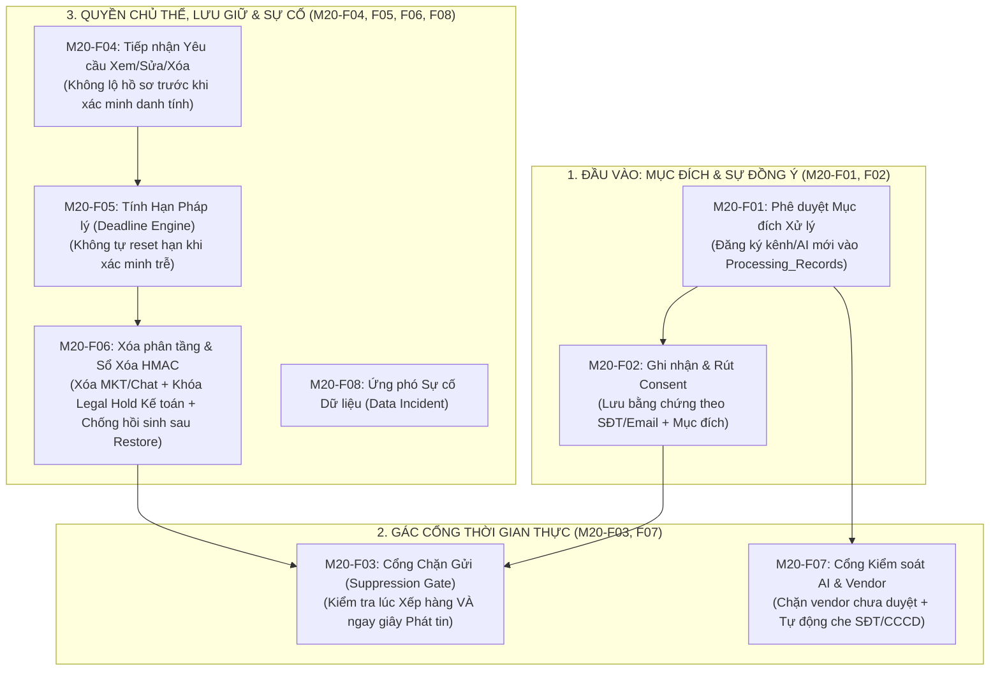
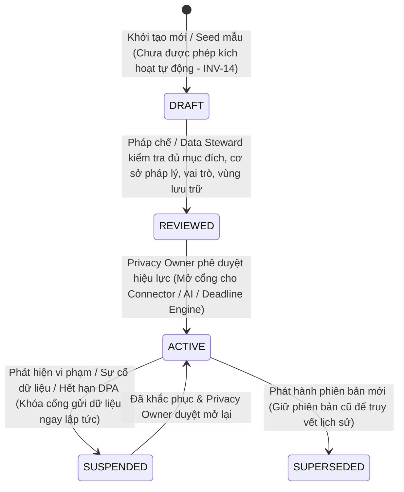
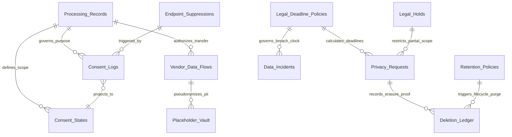

# M20 — Quản trị Dữ liệu Cá nhân, Consent, Suppression & Quyền Chủ thể

Đặc tả chi tiết cấp Module & Chức năng (`Per-Module & Per-Function Spec`) cho **M20**, dẫn xuất từ [CRM_MASTER_BRD_SRS_HOP_NHAT.md](../../00-master/CRM_MASTER_BRD_SRS_HOP_NHAT.md) (`v1.9`). Tài liệu thuộc giai đoạn `Documentation-Only`; chưa có mã nguồn ứng dụng, chưa chạy migration DB và mọi ca kiểm thử đều ở trạng thái `Not Run`.

---

## 1. Manifest

- **Baseline nguồn:** [CRM_MASTER_BRD_SRS_HOP_NHAT.md](../../00-master/CRM_MASTER_BRD_SRS_HOP_NHAT.md), Phiên bản `1.9`, `SHA-256: b6a3279f328e96e1e97d845e209be7a326516a0dba5e3a033d88e1f2162e421c`.
- **Mục nguồn trong Master v1.9:**
  - Mục `6.2` (`Bảo vệ dữ liệu & Download Gateway`, dòng `3114–3123`)
  - Mục `6.3` (`ĐẶC TẢ MODULE M20` & `Khung pháp lý Việt Nam — Luật 91/2025/QH15 & NĐ 356/2025/NĐ-CP`, dòng `3124–3175`)
  - Mục `6.4` (`Lưu giữ, xóa và legal hold`, dòng `3176–3181`)
  - Mục `4.11` (`UC11 — Rút consent và yêu cầu xóa`, dòng `2213–2225`)
  - Mục `3.1.2` (`FR02`), `3.4.1` (`FR09`), `3.5.3` (`FR13`), `3.12.5` (`FR34`), `3.12.8` (`FR37`), `3.15` (`M21-F02/F13`), `3.16` (`M22-F27`)
  - Mục `5.13` (`ENTITY-L2784`, `ENTITY-L2785`), `5.14` (`Consent_Logs` index), `5.18` (`ENTITY-L2885`, `ENTITY-L2893`)
  - Chương `9` & Phụ lục `A/F` (`U01`, `U15`, `U21`, `INT17`, `INT26`, `RV11`, `RV16`, `RV17`, `OC14`, `OC17`, `OC22`, `CX-U15`, `CX-U20`, `SEC05`, `SEC-U05`, `NFR06`, `O03`, `O06`).
- **Status:** `Reviewed` (Đã chốt qua cổng `/grill-me` 3 quyết định kiến trúc Tầng 1 và tích hợp mô tả luồng hoạt động chi tiết từng chức năng `M20-F01..08` ngày `16/11/2026`).
- **Domain Owner & Vai trò chịu trách nhiệm:**
  - **Accountable Business Role:** Privacy Owner / Pháp chế & Chủ dự án (`Owner`).
  - **Operational Executors:** Data Steward (`M01`), Integration Operator (`M19`), Finance/Legal Approver (xác nhận `Legal_Hold` chứng từ `M08/M09`).
- **Ranh giới *Single Source of Truth* (`INV-01`, `INV-02`, `INV-07`, `INV-14`, `INV-22..25`):**
  - **`M20` sở hữu độc quyền (`Owned Entities`):** `Processing_Records`, `Consent_Logs`, `Consent_States`, `Endpoint_Suppressions`, `Privacy_Requests`, `Legal_Deadline_Policies`, `Retention_Policies`, `Legal_Holds`, `Deletion_Ledger`, `Vendor_Data_Flows`, `Placeholder_Vault`, `Data_Incidents`.
  - **`M20` vs `M01` (Định danh & Hợp nhất CDP):** `M01` sở hữu `Contacts`, `Accounts`, `Contact_Points` và quy trình gộp/tách hồ sơ (`Merge/Unmerge`). `M20` gắn `Endpoint_Suppressions` và `Consent_Logs` trực tiếp vào điểm liên hệ vật lý đã chuẩn hóa (`endpoint_lookup_hash + channel + purpose_code`), đảm bảo thao tác `Merge`, `Undo Merge` hoặc `Import` lại ở `M01` **không bao giờ làm mở rộng sai sự đồng ý hoặc làm sống lại điểm liên hệ đã bị chặn (`M20-AC01`, `U01`, `CX-U20`)**.
  - **`M20` vs `M03 / M04 / M12 / M19` (Các kênh gửi tin):** `M03` (Inbox), `M04` (Journey), `M12` (Khảo sát VoC) và `M19` (Outbox Dispatch) không tự lưu bảng chặn gửi riêng mà bắt buộc gọi cổng `EvaluateOutboundCompliance` của `M20` ở cả lúc xếp hàng (`Enqueue`) và ngay trước giây phát tin (`Authoritative Dispatch Recheck` — `U15`, `OC17`, `RV17`).
  - **`M20` vs `M08 / M09` (Hợp đồng & Kế toán):** `M20` không được xóa vật lý các Hợp đồng (`M08`) hay Chứng từ thu/Hóa đơn (`M09`) đang trong thời hạn lưu trữ luật định; thay vào đó `M20` gắn `Legal_Holds` và chuyển các bản ghi đó sang chế độ cô lập `RESTRICTED_LEGAL_HOLD` (`M20-AC03`).
  - **`M20` vs `M06` (Trợ lý AI):** `M06` không được gửi trực tiếp văn bản thô ra mô hình AI ngoài mà phải đi qua `EvaluateVendorAndAiTransfer` của `M20-F07` để kiểm tra hồ sơ vendor và thay thế PII bằng placeholder (`6.3` dòng `3174`, `RV17`).
- **Public Contracts cung cấp (`02-specs/contracts/`):**
  - [M20-SUPPRESSION-PRIVACY-GATE.md](../contracts/M20-SUPPRESSION-PRIVACY-GATE.md) — Hợp đồng Kép (`EvaluateOutboundCompliance`, `EvaluateVendorAndAiTransfer`, `VerifyPostRestoreComplianceGate`) và 4 Domain Events (`M20.EndpointSuppressed`, `M20.SubjectErasureExecuted`, `M20.LegalHoldChanged`, `M20.DataIncidentEscalated`).
- **Core vs Industry-Pack Boundary:** Toàn bộ `M20-F01..08` thuộc **Platform Core (`P0`, bắt buộc từ `SL00/SL02` trở đi)** theo nguyên tắc *"không hoãn trách nhiệm bảo vệ dữ liệu vì chưa xây privacy engine đồ sộ"* (`6.3` dòng `3128`).
- **Read first:** [INVARIANTS.md](../../01-architecture/INVARIANTS.md), [INDEX.md](../../01-architecture/INDEX.md), [M14-ORG-ACCESS-DELEGATION.md](M14-ORG-ACCESS-DELEGATION.md), [M20-SUPPRESSION-PRIVACY-GATE.md](../contracts/M20-SUPPRESSION-PRIVACY-GATE.md).
- **Allowed write paths (Giai đoạn hiện tại):** Chỉ cập nhật tài liệu trong `02-specs/` và `03-planning/`; chưa mở `application_write_scope`.

---

## 2. Requirement trace

### 2.1. Danh mục 14 ID sở hữu trực tiếp bởi `M20` (`owner == M20` trong `requirements.json`)

| ID nguồn | Source anchor/line | Ý nghĩa | Owner/consumer | Priority | Applicability | Test | Evidence |
|---|---|---|---|---|---|---|---|
| `M20-F01` | Master `6.2/6.3` (dòng `3132`) | Phê duyệt mục đích xử lý dữ liệu (`Processing_Records`) cho từng connector/tính năng mới; thiếu cơ sở/owner thì giữ `Draft` | Owner: `M20` / Consumers: `M06`, `M14`, `M19`, `M21` | `P0` | Mọi connector/tính năng xử lý PII (`SL00+`) | `M20-AC03`, `UC14`, `RV17` | Not Run |
| `M20-F02` | Master `6.2/6.3` (dòng `3133`) | Cấp và rút lại sự đồng ý (`Consent_Logs`, `Consent_States`) theo endpoint/mục đích/kênh; rút quyền commit suppression trước khi xác nhận | Owner: `M20` / Consumers: `M01`, `M03`, `M04`, `M12` | `P0` | Mọi release (`SL00/SL02+`) | `M20-AC01`, `U01`, `U15`, `CX-U20` | Not Run |
| `M20-F03` | Master `6.2/6.3` (dòng `3134`) | Kiểm tra chặn gửi bắt buộc (`Endpoint_Suppressions`) ngay trước lúc phát tin; phân biệt `unsubscribe / hard-bounce / complaint`; import không hồi sinh quyền | Owner: `M20` / Consumers: `M03`, `M04`, `M12`, `M19` | `P0` | Mọi kênh gửi ra ngoài (`SL02+`) | `M20-AC01`, `SEC-U05`, `U15`, `OC17` | Not Run |
| `M20-F04` | Master `6.2/6.3` (dòng `3135`) | Tiếp nhận yêu cầu quyền chủ thể dữ liệu (`Privacy_Requests`); không lộ hồ sơ trước xác minh; không tùy tiện reset mốc `valid_request_received_at` | Owner: `M20` / Consumers: `M01`, `M03`, `M16`, `M22` | `P0` | Mọi release (`SL00+`) | `M20-AC02`, `UC11`, `RV16` | Not Run |
| `M20-F05` | Master `6.2/6.3` (dòng `3136`) | Tính hạn xử lý nghĩa vụ pháp lý theo đúng loại quyền, vai trò (`Controller/Processor`) và `Legal_Policy` đã duyệt `Active` | Owner: `M20` / Consumers: `M16`, `M20-F04/06` | `P0` | Mọi yêu cầu chủ thể & sự cố (`SL00+`) | `M20-AC02`, `RV16` | Not Run |
| `M20-F06` | Master `6.2/6.3` (dòng `3137`) | Lưu giữ, xóa/ẩn danh theo vòng đời (`Retention_Policies`), cô lập phần có `Legal_Hold`, và áp lại `Deletion_Ledger` khi restore backup | Owner: `M20` / Consumers: `M01–M24` | `P0` | Mọi release (`SL00+`) | `M20-AC03`, `INT26`, `NFR06` | Not Run |
| `M20-F07` | Master `6.2/6.3` (dòng `3138`) | Kiểm soát chuyển dữ liệu cho Vendor/AI/Xuyên biên giới (`Vendor_Data_Flows`, `AI Data Gateway`); `no-train` không đồng nghĩa `zero-retention` | Owner: `M20` / Consumers: `M06`, `M19`, `M21` | `P0` | Khi bật Connector ngoài / AI (`SL02/SL07`) | `M20-AC03`, `RV17`, `U21` | Not Run |
| `M20-F08` | Master `6.2/6.3` (dòng `3139`) | Quản lý sự cố dữ liệu cá nhân (`Data_Incidents`): cô lập, bảo toàn bằng chứng và tính mốc nghĩa vụ thông báo từ thời điểm phát hiện (`awareness_at`) | Owner: `M20` / Consumers: `M11`, `M14`, `M16`, `M23` | `P0` | Mọi release (`SL00+`) | `M20-AC02`, `RV16` | Not Run |
| `M20-AC01` | Master `6.2/6.3` (dòng `3147`) | Tiêu chí nghiệm thu: `Revoke / Merge / Import` vẫn chặn đúng `endpoint/purpose` trên `Consent_Logs` và `Outbound_Intents` | Owner: `M20` / Consumers: `M01`, `M04`, `M19` | `P0` | Mọi release (`SL00/SL02+`) | `U15`, `SEC-U05`, `CX-U20` | Not Run |
| `M20-AC02` | Master `6.2/6.3` (dòng `3147`) | Tiêu chí nghiệm thu: Loại quyền/vai trò dùng đúng `Legal_Policy` đã duyệt; bước xác minh danh tính không làm reset hạn pháp lý | Owner: `M20` / Consumers: `M16`, `M20` | `P0` | Mọi release (`SL00+`) | `RV16`, `UC11` | Not Run |
| `M20-AC03` | Master `6.2/6.3` (dòng `3147`) | Tiêu chí nghiệm thu: `Legal_Hold` một phần, xóa/restore backup (`Deletion_Ledger`) và cổng kiểm duyệt Vendor/AI giữ đúng phạm vi | Owner: `M20` / Consumers: `M06`, `M08`, `M09`, `M19`, `M23` | `P0` | Mọi release (`SL00+`) | `INT26`, `RV17` | Not Run |
| `UC11` | Master `4.11` (dòng `2213`) | Use Case rút consent và yêu cầu xóa dữ liệu cá nhân (chặn marketing tức thì $\rightarrow$ rà `Legal_Hold` $\rightarrow$ xóa/ẩn danh $\rightarrow$ lưu `Deletion_Ledger`) | Owner: `M20` / Consumers: `M01`, `M03`, `M04`, `M08`, `M09`, `M19` | `P0` | Mọi release (`SL00+`) | `U15`, `INT26`, `M20-AC01..03` | Not Run |
| `SEC05` | Master Phụ lục `F` (dòng `4689`) | Kiểm soát bảo mật: Xử lý `Unsubscribe / Hard-Bounce / Spam-Complaint`, không hồi sinh khi import và kiểm tra xác thực đầu gửi (`SPF/DKIM/DMARC`) | Owner: `M20` (cùng `M03/M04`) / Consumers: `M12`, `M19` | `P0` | Mọi kênh gửi tin (`SL02+`) | `SEC-U05` | Not Run |
| `SEC-U05` | Master `9.14` (dòng `3825`) | Ca kiểm thử bảo mật: Hủy đăng ký qua body/header/provider khi journey đang đợi; hard-bounce/complaint trùng rồi import lại vẫn bị chặn | Owner: `M20` / Consumers: `M03`, `M04`, `M19` | `P0` | Mọi release (`SL02+`) | `SEC-U05` | Not Run |

---

### 2.2. Truy vết Mở rộng từ Nhóm `221 missing_owner`, `PLATFORM`, Module Liên kết & `entities-contracts.json` (`Rule 1`)

| ID nguồn | Source anchor/line | Ý nghĩa trong ngữ cảnh `M20` | Vai trò của `M20` | Priority | Applicability | Test | Evidence |
|---|---|---|---|---|---|---|---|
| `FR02` | Master `3.1.2` (dòng `471`) | Lưu lịch sử đồng ý (`Consent`) theo từng mục đích/kênh và chống mở rộng consent khi gộp hồ sơ | `Primary Owner` (`M20-F02`) phối hợp `M01` | `P0` | Từ `SL00/SL02` | `U01`, `U15`, `M20-AC01` | Not Run |
| `FR09` | Master `3.4.1` (dòng `633`) | Hành trình tự động (`Journey`) kiểm tra lại consent và suppression trước từng bước gửi | `Compliance Gate Provider` cho `M04` | `P0` | Từ `SL06` | `U15`, `INT17`, `OC17` | Not Run |
| `FR13` | Master `3.5.3` (dòng `737`) | Quản trị rủi ro AI, làm mờ PII và kiểm duyệt nhà cung cấp mô hình | `AI Privacy Gate Owner` (`M20-F07`) cho `M06` | `P0` | Khi bật `M06` (`SL07`) | `U21`, `RV17`, `M20-AC03` | Not Run |
| `FR34` | Master `3.12.5` (dòng `1318`) | Chính sách gửi tin đa kênh, kiểm tra lại suppression tại thời điểm phát tin thực tế | `Authoritative Gate Owner` (`M20-F03`) cho `M03/M19` | `P0` | Từ `SL02` | `SEC-U05`, `U15`, `RV17` | Not Run |
| `FR37` | Master `3.12.8` (dòng `1363`) | Bảo vệ tệp nhạy cảm và xóa đồng bộ trên Search, Cache, File, AI Vector | `Retention & Purge Coordinator` (`M20-F06`) cùng `M14` | `P0` | Từ `SL00` | `INT26`, `SEC-U03` | Not Run |
| `U01` | Master `9.5` (dòng `3544`) | Gộp (`Merge`) 2 Contact có trạng thái consent khác nhau: không tự phép cộng (`OR`) mở rộng consent sang endpoint đã từ chối | `Co-Owner` (`M20-F02`) cùng `M01` | `P0` | Từ `SL02` | `U01`, `CX-U20` | Not Run |
| `U15` | Master `9.5` (dòng `3558`) | Khách rút consent khi `Journey` đang ở bước chờ (`Wait`): chặn bước gửi tiếp theo và ghi nhật ký lan truyền | `Primary Owner` (`M20-F02/03`) | `P0` | Từ `SL02/SL06` | `U15`, `OC17`, `INT17` | Not Run |
| `U21` | Master `9.5` (dòng `3564`) | Gọi trợ lý AI trên hội thoại có chứa PII nhạy cảm: bắt buộc qua cổng che dữ liệu và kiểm tra policy vendor | `Primary Gate Owner` (`M20-F07`) cùng `M06` | `P0` | Khi bật `M06` (`SL07`) | `U21`, `RV17` | Not Run |
| `INT17` | Master `9.10` (dòng `3639`) | Rút consent sau khi lệnh gửi đã xếp hàng (`Enqueued`): Worker kiểm tra lại tại `M20-F03` và hủy phát tin | `Primary Owner` (`M20-F03`) cùng `M04/M19` | `P0` | Từ `SL02` | `INT17`, `U15` | Not Run |
| `INT26` | Master `9.10` (dòng `3648`) | Khôi phục bản sao lưu (`Restore Backup`) chụp trước thời điểm khách rút consent/yêu cầu xóa: áp lại `Deletion_Ledger` & `Endpoint_Suppressions` trước khi mở gửi tin | `Primary Owner` (`M20-F06`) | `P0` | Mọi release (`SL00+`) | `INT26`, `M20-AC03` | Not Run |
| `RV11` | Master `9.13` (dòng `3793`) | Sự kiện đọc tin, trạng thái kỹ thuật hoặc form spam chưa xác minh không được tự động tạo `Contact` hay cấp `Marketing Consent` | `Policy Owner` (`M20-F02`) cùng `M01/M19` | `P0` | Từ `SL02` | `RV11`, `OC22` | Not Run |
| `RV16` | Master `9.13` (dòng `3798`) | Nhiều loại `Privacy_Request`, xác minh danh tính trễ và sự cố rò rỉ xác nhận muộn: tính hạn đúng căn cứ, không tự reset hạn khi `Verified/Confirmed` | `Primary Owner` (`M20-F04/05/08`) | `P0` | Mọi release (`SL00+`) | `RV16`, `M20-AC02` | Not Run |
| `RV17` | Master `9.13` (dòng `3799`) | Revoke commit khi intent đang queue/in-flight; vendor AI có `No-Train` nhưng vẫn lưu log $\rightarrow$ chặn gửi mới, không tuyên bố `ZDR` giả | `Primary Owner` (`M20-F03/07`) | `P0` | Từ `SL02/SL07` | `RV17`, `M20-AC03` | Not Run |
| `OC17` | Master `9.9` (dòng `3606`) | Khách rút `Marketing Consent` khi đang có cả tin quảng cáo chờ gửi và `Ticket` hỗ trợ đang mở $\rightarrow$ chặn quảng cáo nhưng giữ nguyên xử lý `Ticket` | `Primary Owner` (`M20-F03`) | `P0` | Từ `SL02/SL04` | `OC17`, `U15` | Not Run |
| `OC22` | Master `9.9` (dòng `3611`) | Form đăng ký bị spam/replay hoặc email chưa xác minh $\rightarrow$ chống trùng và không tự bật `Marketing Consent` | `Primary Owner` (`M20-F02`) cùng `M02/M19` | `P0` | Từ `SL02` | `OC22`, `RV11` | Not Run |
| `CX-U15` | Master `9.12` (dòng `3766`) | Khách hàng từ chối liên hệ lại (`Refused Callback`) trong quá trình phục hồi trải nghiệm (`M12`) $\rightarrow$ ghi nhận vào `Endpoint_Suppressions` để không gọi tiếp | `Suppression Owner` (`M20-F03`) cho `M12` | `P0` | Từ `SL04` | `CX-U15` | Not Run |
| `CX-U20` | Master `9.12` (dòng `3771`) | Consent bị rút sau khi enqueue và Contact vừa `Merge` rồi `Undo Merge` $\rightarrow$ lệnh chặn vẫn giữ nguyên hiệu lực trên điểm liên hệ | `Primary Owner` (`M20-F02/03`) | `P0` | Từ `SL02` | `CX-U20`, `M20-AC01` | Not Run |
| `M21-F13` / `M22-F27` | Master `3.15` & `3.16` | Lưu giữ, thu hồi, xóa/ẩn danh và `Legal_Hold` cho dữ liệu đối tác (`M21`) và dữ liệu nhân sự (`M22`) | `Shared Retention & Privacy Engine` (`M20-F04/06`) | `P0` | Khi bật `M21` (`SL08`) / `M22` (`SL09`) | `P-T35..38`, `H-T47` | Not Run |
| `NFR06` | Master `7.1` (dòng `3276`) | Tuân thủ bảo vệ dữ liệu cá nhân, kiểm soát lưu giữ, xóa/ẩn danh và khôi phục an toàn | `Primary Owner` (`M20`) | `P0` | Mọi release (`SL00+`) | `M20-AC01..03`, `INT26` | Not Run |
| `O03` / `O06` | Master `A.6` (dòng `4211, 4214`) | Chỉ định người giữ vai trò `Privacy Owner` (`O03`) và phạm vi xử lý dữ liệu khách cuối trong `CLIENT workspace` (`O06`) | `Policy Owner` (`M20`) | `P0` | Cấu hình trước Go-live | Kiểm tra `Fail-Closed` khi chưa cấu hình | Not Run |
| `ENTITY-L2784`, `ENTITY-L2785`, `ENTITY-L2885`, `ENTITY-L2893` | Master `5.13` & `5.18` | Khai báo các bảng `Consent_State`, `Processing_Records`, `Privacy_Requests`, `Retention_Policies`, `Policy_Versions`, `Email_Delivery_Events`, `Endpoint_Suppressions` | `Schema Owner` (`M20`) | `P0` | Tách bảng chi tiết tại Mục `4. Data/API` | Kiểm tra schema & FK composite | Not Run |

---

## 3. Hành vi

### 3.0A. Tổng quan Cơ chế Hoạt động của Module `M20` (`Executive & Business Walkthrough`)

Trong toàn bộ hệ thống CRM, nếu `M14` là *"Trạm kiểm soát nhân viên nội bộ ai được xem gì"*, thì **`M20` là "Trạm Kiểm soát Pháp lý Dữ liệu Cá nhân & Chống Làm phiền Khách hàng"**. `M20` đảm bảo doanh nghiệp tuân thủ Luật Bảo vệ dữ liệu cá nhân của Việt Nam (`Luật số 91/2025/QH15` và `Nghị định 356/2025/NĐ-CP`) đồng thời bảo vệ uy tín thương hiệu qua **4 vòng kiểm soát khép kín**:

1. **Vòng 1 — Kiểm soát Đầu vào & Mục đích sử dụng (`M20-F01` & `M20-F02`):** Trước khi bật một kênh thu thập dữ liệu mới hoặc tính năng AI mới, phải đăng ký rõ thu thập dữ liệu gì, để làm gì và ai chịu trách nhiệm (`Processing_Records`). Khi khách hàng đồng ý nhận tin hoặc rút lại sự đồng ý (`Consent`), hệ thống lưu bằng chứng bất biến gắn với từng điểm liên hệ vật lý (SĐT, Email, Zalo ID) và từng mục đích cụ thể.
2. **Vòng 2 — Gác cổng Chặn gửi Ra ngoài & Chặn gửi sang AI (`M20-F03` & `M20-F07`):** Mọi tin nhắn tiếp thị/khảo sát/chăm sóc trước khi rời hệ thống đều phải hỏi `M20-F03` ở cả 2 thời điểm: **lúc xếp hàng (`Enqueue`)** và **ngay giây phát tin thực tế (`Authoritative Dispatch`)**. Tương tự, mọi dữ liệu trước khi gửi sang công cụ AI bên thứ ba (`M06`) đều phải qua `M20-F07` để kiểm tra hồ sơ nhà cung cấp và tự động che SĐT/CCCD/Số tài khoản ngân hàng.
3. **Vòng 3 — Xử lý Yêu cầu của Khách hàng & Xóa/Ẩn danh theo Vòng đời (`M20-F04`, `M20-F05`, `M20-F06`):** Khi khách hàng yêu cầu xem, sửa hoặc xóa dữ liệu cá nhân của họ (`UC11`), `M20` tính hạn xử lý theo đúng quy định pháp luật, xóa sạch phần dữ liệu tiếp thị/hội thoại/AI, nhưng **tự động giữ lại và khóa cô lập (`RESTRICTED_LEGAL_HOLD`) các Hợp đồng/Hóa đơn đang phải lưu theo luật Kế toán/Thuế**, đồng thời ghi mã băm `HMAC-SHA256` vào **Sổ chứng cứ xóa (`Deletion_Ledger`)** để nếu hệ thống có khôi phục từ bản sao lưu (backup) cũ thì dữ liệu đã xóa cũng không bao giờ "sống lại".
4. **Vòng 4 — Ứng phó Sự cố Dữ liệu Cá nhân (`M20-F08`):** Khi phát hiện nguy cơ lộ lọt dữ liệu, hệ thống bấm giờ pháp lý ngay từ thời điểm phát hiện (`awareness_at`), cô lập nguồn rò rỉ, giữ nguyên bằng chứng và tạo công việc điều phối khắc phục.

---

### 3.0B. Mô hình Máy trạng thái Cốt lõi (`Core State Machines`)

#### A. Vòng đời Yêu cầu Quyền Chủ thể Dữ liệu (`Privacy_Requests.status` — `UC11`, `M20-F04..06`)

```mermaid
stateDiagram-v2
    [*] --> RECEIVED : Command ReceivePrivacyRequest (Khóa mốc received_at)
    RECEIVED --> VALIDATING_IDENTITY : Command StartIdentityVerification (Chưa tiết lộ hồ sơ; yêu cầu xác minh tối thiểu)
    VALIDATING_IDENTITY --> REJECTED_UNVERIFIED : Quá hạn xác minh / Giả mạo danh tính (Ghi lý do, giữ audit)
    VALIDATING_IDENTITY --> IN_PROGRESS : Command ConfirmIdentityAndScope (Khóa valid_request_received_at; KHÔNG reset hạn gốc tùy tiện)
    IN_PROGRESS --> EXTENDED_WITH_NOTICE : Command ExtendRequestWithNotice (Có gửi thông báo gia hạn hợp lệ theo Legal Policy)
    IN_PROGRESS --> COMPLETED : Command CompleteRequest (100% phạm vi đã xóa/ẩn danh hoặc cung cấp trích xuất)
    EXTENDED_WITH_NOTICE --> COMPLETED : Command CompleteRequest
    IN_PROGRESS --> PARTIALLY_COMPLETED_LEGAL_HOLD : Command CompleteWithLegalHold (Xóa phần MKT/Chat; cô lập phần Hợp đồng/Thuế có Legal Hold)
    EXTENDED_WITH_NOTICE --> PARTIALLY_COMPLETED_LEGAL_HOLD : Command CompleteWithLegalHold
    IN_PROGRESS --> REFUSED_BY_LAW : Command RefuseRequestWithLegalBasis (Có căn cứ pháp luật rõ ràng & người duyệt)
```

#### B. Vòng đời Hồ sơ Xử lý Dữ liệu (`Processing_Records.status`) & Chính sách Pháp lý (`Legal_Deadline_Policies.status`)

---

### 3.1. `M20-F01` — Phê duyệt Mục đích Xử lý Dữ liệu (`Processing_Records` & `UC14`)

- **Mục tiêu & Phạm vi:** Đảm bảo không một kênh thu thập dữ liệu mới (`M19`), một tính năng AI mới (`M06`), hay một không gian khách hàng mới (`CLIENT Workspace` ở `M14` / `M21`) nào được phép xử lý dữ liệu cá nhân nếu chưa khai báo rõ mục đích, cơ sở pháp lý và người chịu trách nhiệm (`6.3` dòng `3132, 3159`).
- **Tác nhân & Kích hoạt:** `Privacy Owner` hoặc `Compliance Officer` thực hiện lệnh `CreateProcessingRecord`, `ReviewProcessingRecord`, `ApproveProcessingRecord`.
- **Tiền điều kiện & Đầu vào:** Có đầy đủ `purpose_code`, `title`, `data_role` (`CONTROLLER` khi Agency tự thu thập khách hàng cho mình, hoặc `PROCESSOR` khi xử lý dữ liệu theo chỉ dẫn của khách hàng doanh nghiệp), `data_classes[]`, `legal_basis` (`CONSENT`, `CONTRACT_PERFORMANCE`, `LEGAL_OBLIGATION`...), `retention_policy_id` và `owner_user_id`.
- **Mô tả Nghiệp vụ & Cơ chế Hoạt động Từng bước (`Step-by-Step Operational Flow`):**
  1. **Khai báo trước khi bật tính năng:** Khi đội kỹ thuật muốn nối một Fanpage mới, bật tính năng ghi âm cuộc gọi, bật trợ lý AI tóm tắt hội thoại (`M06`), hoặc mở một `CLIENT Workspace` mới cho đối tác (`UC14`), hệ thống tạo một bản ghi trong sổ đăng ký xử lý dữ liệu (`Processing_Records`) ở trạng thái `DRAFT`.
  2. **Phân biệt rõ vai trò "Dữ liệu của Công ty" vs "Dữ liệu làm thuê cho Khách hàng":** `M20-F01` bắt buộc chọn rõ trong trường hợp này công ty đóng vai trò là **Bên Kiểm soát Dữ liệu (`CONTROLLER` — dữ liệu khách hàng của chính Agency)** hay **Bên Xử lý Dữ liệu theo chỉ dẫn (`PROCESSOR` — dữ liệu người mua cuối của Đối tác đưa vào để làm báo cáo `M21`)**. Với vai trò `PROCESSOR`, chỉ có sự đồng ý (`Consent`) đơn lẻ là không đủ mà bắt buộc phải gắn kèm tham chiếu Thỏa thuận Xử lý Dữ liệu (`DPA / Contract Ref`).
  3. **Chốt chặn kích hoạt (`Fail-Closed` theo `INV-14`):** Chừng nào bản ghi `Processing_Records` còn ở trạng thái `DRAFT` (thiếu người chịu trách nhiệm hoặc chưa được `Privacy Owner` bấm duyệt sang `ACTIVE`), thì Connector đó hoặc tính năng AI đó bị khóa cứng không thể bật chạy trên môi trường thật.
- **Quy tắc Hành vi (Chuẩn EARS):**
  1. `[MASTER]` **Ubiquitous (`6.3` dòng `3132, 3141`):** Mỗi bản ghi `Processing_Records` trong `M20-F01` phải lưu bắt buộc: `purpose_code`, vai trò xử lý (`CONTROLLER` hoặc `PROCESSOR`), phạm vi `workspace_id`, danh mục loại dữ liệu (`data_classes`), nguồn thu thập, cơ sở pháp lý (`legal_basis`), danh sách bên nhận/vendor (`recipients`), vùng lưu trữ (`processing_region`), `owner_user_id` và `effective_version`.
  2. `[MASTER]` **Unwanted/Error (`6.3` dòng `3132`, `INV-14`, `RV20`):** Nếu một `Processing_Record` chưa có `owner_user_id`, chưa xác định rõ cơ sở pháp lý/vai trò/phạm vi, hoặc đang ở trạng thái `DRAFT`, `M20-F01` phải chặn chuyển sang `ACTIVE` và trả lỗi `PRIVACY_PURPOSE_UNAPPROVED` khi bất kỳ connector (`M19`), tính năng AI (`M06`) hoặc `CLIENT workspace` (`UC14`) nào yêu cầu kích hoạt.
  3. `[MASTER]` **Ubiquitous (`6.3` dòng `3132, 3155`):** Đối với dữ liệu xử lý thay khách hàng trong `CLIENT workspace` (`data_role = 'PROCESSOR'`), `M20-F01` phải yêu cầu gắn kèm tham chiếu hợp đồng/DPA hợp lệ (`dpa_contract_ref`); tuyệt đối không dùng bản ghi `Consent` tiếp thị của Agency để thay thế cho thỏa thuận xử lý dữ liệu theo chỉ dẫn khách hàng.
- **Xử lý Đồng thời, Idempotency & Side Effects:**
  - Mọi thay đổi trên `Processing_Records` tạo phiên bản mới (`version_no + 1`), ghi `Audit_Logs` và không ghi đè lịch sử phiên bản đã áp dụng trước đó.

---

### 3.2. `M20-F02` — Cấp và Rút lại Sự đồng ý (`Consent_Logs` & `Consent_States` — Quyết định `/grill-me` #1)

- **Mục tiêu & Phạm vi:** Lưu vết bằng chứng khách hàng đồng ý (`Grant`) hoặc rút lại sự đồng ý (`Revoke`) theo từng điểm liên hệ vật lý (`SĐT / Email / Zalo ID`), từng kênh và từng mục đích; đảm bảo thao tác gộp hồ sơ (`Merge`) không bao giờ làm mở rộng khống sự đồng ý (`FR02`, `FR09`, `M20-AC01`, `U01`).
- **Tác nhân & Kích hoạt:** Khách hàng tương tác qua Form/Link/Tin nhắn, nhân viên CSKH/Sales cập nhật kèm bằng chứng, hoặc Webhook từ kênh ngoài gọi lệnh `RecordConsentGrant`, `RevokeConsent`.
- **Mô tả Nghiệp vụ & Cơ chế Hoạt động Từng bước (`Step-by-Step Operational Flow`):**
  1. **Khi khách hàng Cấp sự đồng ý (`Grant Consent`):**
     - Không bao giờ chấp nhận ô "Đồng ý nhận quảng cáo" được tích chọn sẵn mặc định (`Pre-checked box`) hoặc form bị spam chưa xác minh (`OC22`, `RV11`).
     - Hệ thống ghi một dòng bất biến vào nhật ký `Consent_Logs` (gồm: điểm liên hệ chuẩn hóa `endpoint_lookup_hash`, kênh `EMAIL/SMS/ZALO...`, mục đích `MARKETING_PROMO / SURVEY_VOC...`, phiên bản nội dung thông báo mà khách đã đọc `notice_version`, đường dẫn bằng chứng `evidence_ref` và thời gian `occurred_at`), sau đó cập nhật bảng trạng thái hiện hành `Consent_States`.
  2. **Khi khách hàng Rút sự đồng ý (`Revoke Consent`):**
     - Ngay khi nhận yêu cầu rút sự đồng ý hợp lệ, `M20-F02` bắt buộc **ghi vào danh sách chặn `Endpoint_Suppressions` và cập nhật `Consent_States` trong cùng 1 giao dịch cơ sở dữ liệu TRƯỚC KHI trả lời xác nhận thành công cho khách hàng** (`6.3` dòng `3133, 3172`).
     - Đồng thời phát sự kiện `M20.EndpointSuppressed` để module Hành trình tự động (`M04`) và Hàng đợi gửi tin (`M19`) hủy ngay các tin nhắn quảng cáo đang xếp hàng chờ gửi cho người đó (`U15`).
  3. **Chống mở rộng sai sự đồng ý khi Gộp hồ sơ (`No OR-Merge Rule` — `U01`, `CX-U20`):**
     - Ví dụ: Hồ sơ `Contact 1` (dùng `Email A` — đã đồng ý nhận quảng cáo) được gộp (`Merge` ở `M01`) với Hồ sơ `Contact 2` (dùng `Email B` — đã bấm Hủy đăng ký).
     - Vì `M20-F02` gắn trạng thái đồng ý trực tiếp vào từng điểm liên hệ vật lý (`Email A` và `Email B` độc lập nhau), nên sau khi gộp chung về 1 hồ sơ khách hàng: `Email A` vẫn nhận tin bình thường, còn **`Email B` vẫn tiếp tục bị chặn tuyệt đối** (hệ thống cấm dùng phép cộng `OR` để biến toàn bộ các email/SĐT của khách thành "Đã đồng ý"). Ngay cả khi nhân viên bấm "Hoàn tác gộp" (`Undo Merge`), lệnh chặn trên `Email B` vẫn giữ nguyên không suy suyển (`CX-U20`).
- **Quy tắc Hành vi (Chuẩn EARS):**
  1. `[MASTER]` **Ubiquitous (`6.3` dòng `3133, 3160`, `5.15` dòng `2806`):** Mỗi lần cấp sự đồng ý (`Grant`), `M20-F02` phải lưu đầy đủ `endpoint_lookup_hash`, `channel`, `purpose_code`, `notice_version`, `source_type` và `evidence_ref` vào `Consent_Logs`; tuyệt đối không được thiết lập `consent = true` mặc định khi import file Excel hoặc từ checkbox tích sẵn.
  2. `[MASTER]` **Event-Driven (`6.3` dòng `3133, 3172`, `UC11`):** Khi nhận lệnh `RevokeConsent` đã xác minh vừa đủ, `M20-F02` phải ghi nhận vào `Consent_Logs`, chuyển `Consent_States.status = 'REVOKED'` và **commit bản ghi chặn vào `Endpoint_Suppressions` nguyên tử trong cùng transaction trước khi trả phản hồi thành công**.
  3. `[MASTER]` + `[PROPOSED]` **Ubiquitous (`6.3` dòng `3133`, `M20-AC01`, `U01`, `CX-U20`, Quyết định `/grill-me` #1):** Khi `M01` thực hiện gộp (`Merge`) hoặc tách hoàn tác (`Undo Merge`) các `Contacts`, `M20-F02` phải giữ nguyên trạng thái `Consent_States` và `Endpoint_Suppressions` gắn theo từng `(workspace_id, channel, endpoint_lookup_hash, purpose_code)` độc lập; **tuyệt đối không thực hiện phép gộp `OR` để mở rộng sự đồng ý từ endpoint này sang endpoint khác hoặc từ mục đích dịch vụ sang mục đích quảng cáo**.
  4. `[MASTER]` **Unwanted/Error (`RV11`, `OC22`, `6.3` dòng `3172`):** Nếu sự kiện đầu vào chỉ là webhook báo đã đọc tin, sự kiện kỹ thuật, form nghi ngờ spam/replay hoặc yêu cầu rút consent giả mạo chưa qua xác minh tối thiểu, `M20-F02` không được tự động kích hoạt hoặc thay đổi `Consent_States` hiện hành.
- **Xử lý Đồng thời, Idempotency & Side Effects:**
  - `Consent_Logs` là bảng chỉ ghi thêm (`append-only`). `Consent_States` là bảng chiếu (`projection`) tính từ sự kiện có `occurred_at` hợp lệ mới nhất trên từng `(workspace_id, channel, endpoint_lookup_hash, purpose_code)`.

---

### 3.3. `M20-F03` — Kiểm tra Chặn gửi Bắt buộc (`Endpoint_Suppressions` & `Authoritative Dispatch Gate` — Quyết định `/grill-me` #1 & #3)

- **Mục tiêu & Phạm vi:** Là chốt chặn bắt buộc trước mọi lệnh phát tin ra ngoài (`M03`, `M04`, `M12`, `M19`), đảm bảo khách hàng đã hủy đăng ký (`Unsubscribe`), từ chối gọi lại (`Refused Callback`) hoặc địa chỉ bị lỗi cứng (`Hard-Bounce` / `Spam-Complaint`) không bao giờ bị gửi tin làm phiền, kể cả khi dữ liệu vừa được import lại (`FR34`, `SEC05`, `M20-AC01`, `SEC-U05`).
- **Tác nhân & Kích hoạt:**
  - Luồng cập nhật danh sách chặn: Webhook từ nhà cung cấp email/SMS/Zalo (`Email_Delivery_Events`), link `One-Click Unsubscribe`, lệnh `RevokeConsent` (`M20-F02`), hoặc kết quả từ chối gọi lại từ `M12-F06` (`CX-U15`).
  - Luồng kiểm tra chặn gửi: Các module gọi hàm `EvaluateOutboundCompliance` trong [Hợp đồng M20-SUPPRESSION-PRIVACY-GATE](../contracts/M20-SUPPRESSION-PRIVACY-GATE.md).
- **Mô tả Nghiệp vụ & Cơ chế Hoạt động Từng bước (`Step-by-Step Operational Flow`):**
  1. **Kiểm tra 2 lần ("Kép") để không lọt tin nhắn đang nằm trong hàng đợi (`Dual-Stage Check`):**
     - **Lần 1 — Lúc đưa vào hàng đợi (`Enqueue`):** Khi nhân viên hoặc chiến dịch tự động (`M04`) lên lịch gửi tin lúc 8h00 sáng, hệ thống hỏi `M20-F03`. Nếu địa chỉ đó đang nằm trong danh sách chặn $\rightarrow$ từ chối đưa vào hàng đợi ngay.
     - **Lần 2 — Ngay giây phát tin thực tế (`Authoritative Dispatch Recheck`):** Giả sử lúc 8h00 sáng khách chưa hủy đăng ký nên tin nhắn được xếp vào hàng đợi hẹn 10h00 sáng mới gửi. Đến 9h30 sáng, khách bấm *Hủy đăng ký (Unsubscribe)*. Đúng 10h00 sáng khi Worker của `M19-F05` chuẩn bị đẩy tin ra nhà mạng, Worker bắt buộc hỏi lại `M20-F03` lần thứ hai. `M20-F03` phát hiện khách đã rút quyền lúc 9h30 nên **chặn đứng ngay lập tức**, không chờ tác vụ dọn dẹp định kỳ (`U15`, `INT17`, `RV17`).
  2. **Phân biệt rõ Lý do chặn và Mục đích gửi (`OC17`, `SEC05`, `CX-U15`):**
     - Nếu khách bấm **`Unsubscribe` (Hủy nhận quảng cáo)**: Hệ thống chặn toàn bộ tin Quảng cáo (`MARKETING_PROMO`) và Khảo sát (`SURVEY_VOC`), nhưng **vẫn cho phép gửi các thông báo dịch vụ hợp lệ (`SERVICE_NOTIFICATION`)** như trả lời Ticket hỗ trợ mà khách đang hỏi dở, gửi biên lai thu tiền hoặc nhắc lịch nghiệm thu hợp đồng (`OC17`).
     - Nếu khách báo **`Refused Callback` (Từ chối liên hệ lại khi CSKH xử lý khiếu nại ở `M12`)**: Hệ thống khóa không cho gọi/nhắn khảo sát hay tiếp thị lại (`CX-U15`).
     - Nếu địa chỉ bị **`Hard-Bounce` (Email không tồn tại / SĐT không có thực)**: Hệ thống chặn mọi lệnh gửi tự động trên kênh đó để bảo vệ uy tín tên miền gửi mail của công ty cho tới khi khách hàng cung cấp và xác minh địa chỉ mới (`SEC05`).
  3. **Import lại file Excel không làm "sống lại" quyền gửi (`SEC-U05`, `M20-AC01`):** Khi nhân viên Marketing tải lên một file Excel danh sách khách hàng cũ có chứa những email/SĐT từng bấm `Unsubscribe` hoặc từng bị `Hard-Bounce`, bảng `Endpoint_Suppressions` luôn giữ quyền ưu tiên cao nhất — thao tác import tuyệt đối không thể xóa hoặc ghi đè làm mở lại quyền gửi tin cho các địa chỉ này.
- **Quy tắc Hành vi (Chuẩn EARS):**
  1. `[MASTER]` **Ubiquitous (`6.3` dòng `3134, 3172`, `5.18` dòng `2893`, `FR34`):** Trước khi phát bất kỳ thông điệp nào ra kênh ngoài, `M19-F05` bắt buộc gọi `M20-F03` (`EvaluateOutboundCompliance` với `check_stage = 'DISPATCH_AUTHORITATIVE'`) để kiểm tra trạng thái hiện hành của `Endpoint_Suppressions` và `Consent_States`; tuyệt đối không chỉ dựa vào `policy_snapshot` chụp lúc đưa vào hàng đợi.
  2. `[MASTER]` **Ubiquitous (`6.3` dòng `3134`, `5.18` dòng `2893`, `SEC05`):** `M20-F03` phải lưu trữ và xử lý tách biệt ngữ nghĩa của từng nguyên nhân chặn trong `Endpoint_Suppressions`: `UNSUBSCRIBE`, `CONSENT_REVOKED`, `HARD_BOUNCE`, `SOFT_BOUNCE_COOLDOWN`, `SPAM_COMPLAINT`, `REFUSED_CALLBACK`, và `MANUAL_DNC`.
  3. `[MASTER]` **Unwanted/Error (`6.3` dòng `3134, 3145`, `SEC05`, `SEC-U05`, `M20-AC01`):** Nếu một tác vụ Import dữ liệu (`M01/M02/M21`), đồng bộ connector (`M19`) hoặc người dùng thuộc vai trò `Marketing` cố gắng xóa, tắt hoặc ghi đè một bản ghi `Endpoint_Suppressions` đang `ACTIVE`, `M20-F03` phải từ chối thao tác với mã lỗi `SUPPRESSION_IMMUTABLE_BY_IMPORT_OR_MARKETING`.
  4. `[MASTER]` **Event-Driven (`OC17`, `U15`, `6.3` dòng `3165`):** Khi một điểm liên hệ bị chặn với phạm vi `purpose_code = 'MARKETING_PROMO'`, `M20-F03` phải chặn mọi `Outbound_Intents` quảng cáo và dừng các bước tiếp thị trong `Journey_Instances` (`M04`), nhưng **không được tự động đóng hoặc chặn phản hồi trên các `Tickets` hỗ trợ dịch vụ (`M11`) hoặc nghĩa vụ hợp đồng (`M08/M09`) đang mở của khách hàng đó**.
  5. `[MASTER]` **Event-Driven (`SEC05`, `SEC-U05`):** Khi xử lý yêu cầu hủy đăng ký qua đường dẫn email (`Unsubscribe Link` hoặc `List-Unsubscribe Header`), `M20-F03` phải thực thi chặn ngay lập tức mà **không bắt buộc khách hàng phải đăng nhập tài khoản** và **không hiển thị lộ thông tin hồ sơ nội bộ của khách hàng trên trang xác nhận hủy đăng ký**.
- **Xử lý Đồng thời, Idempotency & Side Effects:**
  - Sự kiện `Email_Delivery_Events` và webhook trạng thái kênh được khử trùng lặp theo `(connection_id, provider_event_id)` trước khi cập nhật `Endpoint_Suppressions`.

---

### 3.4. `M20-F04` — Tiếp nhận Yêu cầu Quyền Chủ thể Dữ liệu (`Privacy_Requests` Intake & Verification — `UC11`)

- **Mục tiêu & Phạm vi:** Cung cấp kênh tiếp nhận chính thức cho chủ thể dữ liệu (khách hàng, người liên hệ, ứng viên/nhân sự `M22`) gửi yêu cầu Xem trích xuất (`ACCESS`), Chỉnh sửa (`RECTIFY`), Rút sự đồng ý (`WITHDRAW_CONSENT`), Hạn chế xử lý (`RESTRICT`) hoặc Xóa dữ liệu (`ERASE`) mà không làm lộ dữ liệu cho kẻ mạo danh trước khi xác minh danh tính (`6.3` dòng `3135, 3170`, `UC11`).
- **Tác nhân & Kích hoạt:** Chủ thể dữ liệu gửi yêu cầu qua biểu mẫu/kênh hỗ trợ hoặc nhân viên tiếp nhận tạo phiếu qua lệnh `ReceivePrivacyRequest`, `VerifyPrivacyRequestSubject`.
- **Mô tả Nghiệp vụ & Cơ chế Hoạt động Từng bước (`Step-by-Step Operational Flow`):**
  1. **Tiếp nhận mọi yêu cầu kể cả khi chưa rõ danh tính đầy đủ:** Ngay khi nhận được yêu cầu (ví dụ một người nhắn tin hoặc gửi form yêu cầu *"Xóa toàn bộ dữ liệu số điện thoại 090xxx của tôi"*), hệ thống lập tức tạo hồ sơ `Privacy_Requests` ở trạng thái `RECEIVED`, ghi nhận thời điểm tiếp nhận gốc (`received_at`) và gán người phụ trách (`owner_id` thuộc nhóm Privacy/Steward) để không bao giờ bị trôi việc.
  2. **Xác minh danh tính "Vừa đủ" và Chống lộ hồ sơ trước xác minh (`No Pre-Verification Disclosure`):**
     - Trước khi hoàn tất bước xác minh người gửi đúng là chủ nhân của SĐT/Email đó (ví dụ qua mã OTP hoặc đối chiếu thông tin giao dịch tối thiểu), hệ thống chuyển ca sang `VALIDATING_IDENTITY` và **tuyệt đối không tiết lộ trong câu trả lời rằng "Trong hệ thống của chúng tôi đang có hồ sơ ông Nguyễn Văn A, địa chỉ X, hợp đồng Y"**, tránh việc kẻ xấu dò thông tin khách hàng.
  3. **Bảo vệ mốc thời gian pháp lý (`No Arbitrary Clock Reset` — `M20-AC02`, `RV16`):**
     - Hệ thống lưu tách biệt 3 mốc: lúc nhận đầu tiên (`received_at`), lúc người yêu cầu cung cấp đủ thông tin hợp lệ theo thủ tục (`valid_request_received_at`), và lúc nhân viên bấm xác nhận xong (`verified_at`).
     - Nếu người yêu cầu đã gửi đủ thông tin hợp lệ từ ngày thứ 1, nhưng nhân viên nội bộ để trễ đến ngày thứ 3 mới vào bấm nút xác minh (`verified_at`), thì đồng hồ tính hạn pháp lý vẫn phải tính từ mốc `valid_request_received_at` (ngày thứ 1) chứ **nhân viên không thể lợi dụng thao tác bấm xác minh muộn để tự ý "reset" kéo dài thời hạn xử lý (`RV16`)**.
- **Quy tắc Hành vi (Chuẩn EARS):**
  1. `[MASTER]` **Event-Driven (`6.3` dòng `3135, 3141, 3170`):** Khi nhận bất kỳ yêu cầu quyền chủ thể nào (kể cả khi hệ thống chưa định danh được đầy đủ `contact_id`), `M20-F04` phải tạo ngay bản ghi `Privacy_Requests` có `request_type`, `received_at`, `owner_id` và lịch sử trạng thái.
  2. `[MASTER]` **Unwanted/Error (`6.3` dòng `3135, 3172`, `UC11`):** Trong khi `Privacy_Requests.status` đang ở `RECEIVED` hoặc `VALIDATING_IDENTITY` (chưa hoàn tất xác minh danh tính vừa đủ), `M20-F04` phải chặn mọi thao tác xuất trả dữ liệu hồ sơ cho người yêu cầu và không được tự động thay đổi/xóa dữ liệu gốc dựa trên yêu cầu chưa xác thực.
  3. `[MASTER]` **Ubiquitous (`6.3` dòng `3135, 3170`, `M20-AC02`, `RV16`):** `M20-F04` phải lưu tách biệt `received_at`, `valid_request_received_at` và `verified_at`; thao tác xác minh nội bộ (`verified_at`) hoặc chuyển giao người phụ trách **tuyệt đối không được tự động ghi đè làm reset `valid_request_received_at` để kéo dài hạn pháp lý**.
- **Xử lý Đồng thời, Idempotency & Side Effects:**
  - Nếu yêu cầu thiếu thông tin tối thiểu để định danh, `M20-F04` tự động phát lệnh sang `M16` tạo `Task` nhắc nhân viên liên hệ lấy bổ sung thông tin và giữ nguyên lịch sử mốc thời gian ban đầu.

---

### 3.5. `M20-F05` — Tính Hạn Xử lý Nghĩa vụ Pháp lý (`Legal Deadline & Obligation Engine`)

- **Mục tiêu & Phạm vi:** Tính toán chính xác thời hạn phản hồi (`response_due_at`), thời hạn thực thi (`action_due_at`) và quản lý việc gia hạn có thông báo (`extension`) cho từng loại yêu cầu chủ thể dữ liệu và sự cố theo đúng quy định pháp luật hiện hành đã được phê duyệt trong `Legal_Deadline_Policies` (`6.3` dòng `3136, 3141, 3170`, `M20-AC02`, `RV16`).
- **Tác nhân & Kích hoạt:** Tự động kích hoạt khi `Privacy_Requests` hoặc `Data_Incidents` được tạo/cập nhật mốc hợp lệ; hoặc `Privacy Owner` gọi lệnh `AssignLegalObligations`, `ExtendDeadlineWithNotice`.
- **Mô tả Nghiệp vụ & Cơ chế Hoạt động Từng bước (`Step-by-Step Operational Flow`):**
  1. **Không dùng một con số "72 giờ" cứng nhắc cho mọi trường hợp:** Trong thực tế pháp lý (`Luật 91/2025/QH15` & `NĐ 356/2025/NĐ-CP`), hạn xử lý yêu cầu *Rút sự đồng ý*, yêu cầu *Xem dữ liệu*, yêu cầu *Xóa dữ liệu* hay nghĩa vụ *Thông báo sự cố rò rỉ* có quy tắc tính khác nhau, đồng thời phụ thuộc vào việc công ty đang là *Bên Kiểm soát (`Controller`)* hay *Bên Xử lý thuê (`Processor`)* và tính theo *Ngày làm việc* hay *Giờ lịch*.
  2. **Tra cứu Chính sách Pháp lý Đã Duyệt (`Active Legal Policy`):** `M20-F05` tra cứu bảng `Legal_Deadline_Policies` (chỉ lấy phiên bản đã được Pháp chế/Privacy Owner duyệt `ACTIVE`, có ghi rõ điều khoản luật nguồn, múi giờ `Asia/Ho_Chi_Minh` và lịch làm việc chuẩn từ `M23-F10`) để tính riêng 2 mốc:
     - `response_due_at`: Hạn phải phản hồi thông báo tiếp nhận cho khách.
     - `action_due_at`: Hạn phải hoàn tất việc xóa/sửa/trích xuất dữ liệu.
  3. **Chế độ An toàn khi chưa cấu hình Policy tự động (`6.3` dòng `3149`):** Nếu một loại yêu cầu đặc thù chưa có rule tính hạn ở trạng thái `ACTIVE`, hệ thống **tuyệt đối không tự bịa ra một hạn ngầm định sai luật**, mà đánh dấu cờ `MANUAL_DEADLINE_REQUIRED` và giao việc ngay cho `Privacy Owner` nhập hạn xử lý thủ công kèm căn cứ pháp lý (không bao giờ hoãn việc xử lý cho khách chỉ vì phần mềm chưa cấu hình xong công thức tự động).
- **Quy tắc Hành vi (Chuẩn EARS):**
  1. `[MASTER]` **Ubiquitous (`6.3` dòng `3136, 3141, 3170`, `M20-AC02`):** Khi tính hạn cho `Privacy_Requests` hoặc `Data_Incidents`, `M20-F05` chỉ được áp dụng các quy tắc trong `Legal_Deadline_Policies` đã ở trạng thái `ACTIVE` (có lưu rõ điều khoản nguồn `exact_legal_source`, nhánh vai trò `CONTROLLER | PROCESSOR`, mốc kích hoạt `trigger_field`, đơn vị tính `HOURS | BUSINESS_DAYS | CALENDAR_DAYS` và `approved_by`); đồng thời phải tách biệt `response_due_at` và `action_due_at`.
  2. `[MASTER]` **State-Driven (`6.3` dòng `3141, 3149`, `INV-14`):** Trong khi một loại yêu cầu pháp lý chưa có `Legal_Deadline_Policy` ở trạng thái `ACTIVE` (đang ở `DRAFT`), `M20-F05` phải chặn tính năng tự động đóng/tự động gán hạn mặc định, nhưng **bắt buộc cho phép `Privacy Owner` tiếp nhận hồ sơ, gán hạn thủ công có ghi nhận căn cứ pháp lý và xử lý bình thường**.
  3. `[MASTER]` **Event-Driven (`6.3` dòng `3143`):** Khi cần gia hạn thời gian xử lý (`ExtendDeadlineWithNotice`), `M20-F05` phải kiểm tra điều khoản pháp lý cho phép gia hạn, bắt buộc nhập lý do gia hạn, đính kèm bằng chứng đã gửi thông báo gia hạn cho chủ thể dữ liệu (`extension_notice_evidence_ref`) và giữ nguyên mốc hạn gốc ban đầu trong lịch sử để đối chiếu kiểm toán.

---

### 3.6. `M20-F06` — Lưu giữ, Xóa/Ẩn danh theo Vòng đời, `Legal Hold` & Sổ Chứng cứ Xóa (`Deletion_Ledger` — Quyết định `/grill-me` #2)

- **Mục tiêu & Phạm vi:** Quản lý thời hạn lưu trữ dữ liệu (`Retention_Policies`), thực thi xóa hoặc ẩn danh dữ liệu khi hết hạn hoặc khi yêu cầu xóa (`UC11`) được duyệt, cô lập an toàn phần dữ liệu đang vướng nghĩa vụ pháp lý/kế toán (`Legal_Holds`), và chống hồi sinh dữ liệu đã xóa khi khôi phục sao lưu (`6.4`, `M20-AC03`, `INT26`, `NFR06`).
- **Tác nhân & Kích hoạt:** `Privacy Owner` duyệt thực thi yêu cầu xóa (`ExecuteSubjectErasure`), `Finance/Legal Approver` đặt/gỡ `Legal_Hold` (`PlaceLegalHold`, `ReleaseLegalHold`), hoặc Worker định kỳ chạy `RunRetentionLifecycleSweep` và `VerifyPostRestoreComplianceGate`.
- **Mô tả Nghiệp vụ & Cơ chế Hoạt động Từng bước (`Step-by-Step Operational Flow`):**
  1. **Kiểm tra `Legal Hold` từng phần trước khi xóa (`Partial Legal Hold Check`):**
     - Khi lệnh xóa dữ liệu của khách hàng X được kích hoạt (hoặc khi dữ liệu đến hạn xóa tự động như: *Lead không tương tác sau 180 ngày, file ghi âm sau 90 ngày, payload tích hợp thô sau 30 ngày* theo đề xuất vận hành tại `6.4`), `M20-F06` quét toàn bộ các miền dữ liệu liên quan đến khách hàng X.
     - Nếu khách hàng X đang có **Hợp đồng (`M08`), Hóa đơn/Chứng từ thu tiền (`M09`)** còn trong thời hạn lưu trữ kế toán/thuế hoặc đang có **Tranh chấp/Khiếu nại pháp lý (`Legal_Holds`)**: hệ thống **không từ chối toàn bộ yêu cầu xóa**, nhưng cũng **không xóa làm mất chứng từ kế toán**.
  2. **Thực thi Xóa Phân tầng & Cô lập Chứng từ (`Selective Purge + Restricted Legal Hold` — Quyết định `/grill-me` #2):**
     - **Phần được phép xóa (Marketing, Lead, Tin nhắn chat thông thường, Ghi chú bán hàng, File đính kèm ngoài hợp đồng, Chỉ mục tìm kiếm `Search Index`, Bộ nhớ đệm `Cache`, Vector AI `M06`):** Hệ thống xóa vật lý hoặc hủy khóa mã hóa PII (`Crypto-shredding`), đồng thời bắn sự kiện `M20.SubjectErasureExecuted` để các kho tìm kiếm, cache và AI xóa đồng bộ ngay lập tức (`6.4` dòng `3180`).
     - **Phần bắt buộc giữ theo luật (`M08` Hợp đồng, `M09` Chứng từ thu/Hóa đơn, Hồ sơ nhân sự/bảng lương bắt buộc lưu ở `M22-F27`):** Hệ thống chuyển các bản ghi này sang chế độ **`RESTRICTED_LEGAL_HOLD`**:
       - Khóa hoàn toàn quyền truy cập của nhân viên Sales, Marketing, CSKH thông thường (chỉ vai trò `Finance / Legal / Privacy` mới xem được chứng từ gốc phục vụ kiểm toán/thuế).
       - Cấm tuyệt đối việc dùng lại thông tin trong chứng từ này để gửi quảng cáo hay chăm sóc lại.
       - Trên các báo cáo tổng hợp chung, tên khách hàng được thay bằng mã ẩn danh `REDACTED-SUBJECT-#<8-ký-tự-hash>`.
     - Hồ sơ yêu cầu xóa (`Privacy_Requests`) được đóng ở trạng thái `PARTIALLY_COMPLETED_LEGAL_HOLD` kèm giải thích rõ phần nào đã xóa hoàn toàn, phần nào đang được lưu giữ hạn chế theo căn cứ pháp luật nào (`6.3` dòng `3161`).
  3. **Ghi Sổ Chứng cứ Xóa bằng Mã băm (`HMAC Deletion_Ledger`) & Chống "Sống lại" khi Restore Backup (`INT26`):**
     - Để chứng minh đã xóa và để phòng trường hợp hệ thống bị sự cố phải khôi phục lại từ bản sao lưu (`Backup`) chụp tuần trước, `M20-F06` ghi một dòng vào bảng `Deletion_Ledger` nằm ở kho lưu trữ độc lập.
     - **Tuyệt đối không lưu lại SĐT hay Email thô vào `Deletion_Ledger`** (vì nếu lưu thô thì chính sổ xóa lại làm lộ thông tin cá nhân!), mà chỉ lưu mã băm một chiều `subject_hmac_sha256` và `endpoint_hmac_sha256`.
     - Khi quản trị viên khôi phục hệ thống từ một bản Backup cũ (`INT26`), trước khi mở lại cổng cho nhân viên dùng hoặc bật lại Worker gửi tin, hệ thống bắt buộc chạy hàm `VerifyPostRestoreComplianceGate`: đối chiếu toàn bộ dữ liệu vừa khôi phục với `Deletion_Ledger` và `Endpoint_Suppressions` để **tự động xóa/ẩn danh và chặn gửi lại toàn bộ những người đã yêu cầu xóa/rút consent trong khoảng thời gian sau bản backup**.
- **Quy tắc Hành vi (Chuẩn EARS):**
  1. `[MASTER]` **Ubiquitous (`6.3` dòng `3141`, `6.4` dòng `3178`):** Mỗi bản ghi `Retention_Policies` và `Legal_Holds` trong `M20-F06` phải có phạm vi đối tượng (`object_scope`), lý do/cơ sở pháp lý (`legal_basis`), ngày rà soát lại (`review_due_at`) và người có thẩm quyền phê duyệt (`authority_user_id`); **tuyệt đối không dùng một cờ `legal_hold = true` vô thời hạn không có người chịu trách nhiệm**.
  2. `[MASTER]` + `[PROPOSED]` **Event-Driven (`6.3` dòng `3137`, `6.4` dòng `3180`, `UC11`, `M20-AC03`, Quyết định `/grill-me` #2):** Khi thực thi lệnh xóa dữ liệu cho một chủ thể có một phần dữ liệu đang gắn `Legal_Holds` hợp lệ (như chứng từ kế toán `M09` hoặc hợp đồng `M08`), `M20-F06` phải:
     - Xóa/ẩn danh triệt để toàn bộ phần dữ liệu không vướng `Legal_Hold` trên cả Primary DB, Cache, Search Index (`M24`), AI Vector (`M06`), File Storage và Connector Queue (`M19`);
     - Chuyển riêng phần dữ liệu vướng `Legal_Hold` sang chế độ cô lập `RESTRICTED_LEGAL_HOLD` (chặn truy cập của Sales/Marketing/CSKH và khóa vĩnh viễn mọi mục đích tiếp thị).
  3. `[MASTER]` + `[PROPOSED]` **Ubiquitous (`6.4` dòng `3180`, `INT26`, `M20-AC03`, Quyết định `/grill-me` #2):** Mỗi lần hoàn tất xóa/ẩn danh chủ thể dữ liệu, `M20-F06` phải ghi bằng chứng vào `Deletion_Ledger` dưới dạng mã băm một chiều `HMAC-SHA256` (`subject_hmac_sha256`, `endpoint_hmac_sha256`, `erased_scopes`, `executed_at`) mà không lưu PII thô; sau bất kỳ thao tác khôi phục sao lưu (`Restore Backup`) nào, hệ thống bắt buộc chạy lại `Deletion_Ledger` và `Endpoint_Suppressions` trước khi mở cổng truy cập và trước khi bật lại `Outbound Dispatch` (`INT26`).

---

### 3.7. `M20-F07` — Kiểm soát Chuyển Dữ liệu cho Vendor, AI và Xuyên biên giới (`Vendor & AI Privacy Gate` — Quyết định `/grill-me` #3)

- **Mục tiêu & Phạm vi:** Đảm bảo dữ liệu khách hàng và dữ liệu nội bộ không tự động rời khỏi hệ thống sang các nhà cung cấp đám mây, công cụ AI bên thứ ba (`M06`) hoặc đối tác tích hợp (`M19`) nếu chưa qua kiểm duyệt điều kiện bảo mật/lưu trữ và chưa được làm mờ PII (`6.3` dòng `3138, 3162, 3163, 3174`, `FR13`, `M20-AC03`, `RV17`, `U21`).
- **Tác nhân & Kích hoạt:** `Privacy Owner` cấu hình `Vendor_Data_Flows`; `AI Data Gateway` (`M06`) và `External Connector` (`M19`) gọi đồng bộ hàm `EvaluateVendorAndAiTransfer` trước khi gửi dữ liệu ra ngoài.
- **Mô tả Nghiệp vụ & Cơ chế Hoạt động Từng bước (`Step-by-Step Operational Flow`):**
  1. **Đăng ký & Kiểm duyệt Hồ sơ Nhà cung cấp (`Vendor_Data_Flows`):** Mỗi nhà cung cấp bên ngoài (ví dụ: OpenAI/Gemini/Anthropic cho `M06`, nền tảng gửi Email/SMS cho `M19`, công cụ phân tích đám mây) phải được khai báo trong bảng `Vendor_Data_Flows`: dữ liệu nào được phép gửi sang, máy chủ đặt ở quốc gia/vùng nào (`processing_region`), thời hạn nhà cung cấp lưu giữ log là bao lâu (`vendor_log_retention_days`), đã ký thỏa thuận bảo mật/DPA chưa và có phương án dự phòng khi tắt vendor không.
  2. **Không đánh đồng "Không dùng để dạy AI (`No-Train`)" với "Không lưu giữ dữ liệu (`Zero Retention`)" (`RV17`):** Nhiều nhà cung cấp AI cam kết không dùng dữ liệu API của khách hàng để huấn luyện mô hình (`No-Train`), nhưng họ vẫn lưu lại nội dung prompt trong nhật ký hệ thống (log) suốt 30 ngày để kiểm tra lỗi. `M20-F07` tách bạch hoàn toàn 2 tiêu chí này: nếu chính sách của Workspace yêu cầu không lưu dữ liệu ở nước ngoài/bên thứ ba (`Zero-Data-Retention`), thì dù vendor có cờ `No-Train = true` nhưng `vendor_log_retention_days > 0`, cổng `M20-F07` vẫn **chặn không cho gửi dữ liệu nhạy cảm sang vendor đó (`RV17`)**.
  3. **Làm mờ PII tự động trước khi gửi sang AI (`Pseudonymization & Redaction`):**
     - Các trường tối mật như **Số CCCD/CMND, Số tài khoản ngân hàng, Bảng lương (`M22`), Mật khẩu/Token** bị chặn cứng, không bao giờ được gửi ra AI ngoài.
     - Với nội dung hội thoại cần AI tóm tắt hoặc gợi ý câu trả lời (`M06`), `M20-F07` tự động quét và thay thế Tên người, Số điện thoại, Email bằng các mã giữ chỗ tạm thời (`[PII_PERSON_1]`, `[PII_PHONE_1]`, `[PII_EMAIL_1]`) trước khi gửi đi, và chỉ giải mã ngược lại trên màn hình của nhân viên có quyền xem.
- **Quy tắc Hành vi (Chuẩn EARS):**
  1. `[MASTER]` **Unwanted/Error (`6.3` dòng `3138, 3174`, `M20-AC03`):** Khi `M06` hoặc `M19` gọi `EvaluateVendorAndAiTransfer`, nếu nhà cung cấp (`vendor_code`), tính năng (`feature_code`), vùng xử lý (`region`) hoặc thời hạn lưu trữ (`retention`) chưa được phê duyệt `APPROVED` trong `Vendor_Data_Flows` và `Processing_Records`, `M20-F07` phải chặn toàn bộ dữ liệu rời hệ thống (`VENDOR_TRANSFER_POLICY_BLOCKED`) và chuyển tác vụ về chế độ xử lý thủ công không dùng AI/cloud ngoài.
  2. `[MASTER]` **Ubiquitous (`6.3` dòng `3138, 3174`, `RV17`):** `M20-F07` phải lưu và kiểm tra tách biệt 4 thuộc tính của nhà cung cấp AI/Cloud: (a) `training_opt_out` (`No-Train`), (b) `zero_data_retention` (`ZDR` / `vendor_log_retention_days`), (c) `processing_region` / `subprocessors`, và (d) `cross_border_transfer_basis`; **tuyệt đối không được suy diễn `training_opt_out = true` thành `zero_data_retention = true`**.
  3. `[MASTER]` **Ubiquitous (`6.3` dòng `3174`, `U21`):** Trước khi dữ liệu văn bản được phép chuyển qua `AI Data Gateway`, `M20-F07` phải áp dụng chính sách tối thiểu hóa dữ liệu (`minimization`), chặn cứng các trường `CCCD/CMND`, `tài khoản ngân hàng`, `bảng lương` và thực hiện thay thế PII bằng placeholder có kiểm soát quyền đọc và thời hạn sống (`TTL`) trên bảng ánh xạ `Placeholder_Vault`.

---

### 3.8. `M20-F08` — Quản lý Sự cố Dữ liệu Cá nhân (`Data_Incidents` & Breach Notification Clock)

- **Mục tiêu & Phạm vi:** Cung cấp quy trình phản ứng tức thời khi phát hiện nguy cơ hoặc sự cố lộ lọt, mất mát hay truy cập trái phép dữ liệu cá nhân: cô lập nguồn rò rỉ, bảo toàn bằng chứng và tính mốc thời gian nghĩa vụ thông báo pháp lý ngay từ thời điểm phát hiện (`awareness_at`) (`6.3` dòng `3139, 3164, 3170`, `RV16`).
- **Tác nhân & Kích hoạt:** Cảnh báo bảo mật từ `M23-F08` / `M14-F04` hoặc nhân viên/quản trị viên báo cáo sự cố qua lệnh `ReportDataIncident`, `AssessDataIncident`, `ConfirmDataIncident`.
- **Mô tả Nghiệp vụ & Cơ chế Hoạt động Từng bước (`Step-by-Step Operational Flow`):**
  1. **Bấm giờ pháp lý ngay từ lúc "Phát hiện (`Awareness`)", không chờ đến lúc "Xác nhận xong (`Confirmed`)" (`RV16`):**
     - Khi có dấu hiệu sự cố dữ liệu cá nhân (ví dụ: lộ token kết nối kênh ngoài, nhân viên tải xuất bất thường, hoặc gửi nhầm file dữ liệu khách hàng), hệ thống tạo ngay hồ sơ `Data_Incidents` và khóa mốc thời gian phát hiện đầu tiên (`detected_at` / `awareness_at`).
     - Theo quy định pháp luật bảo vệ dữ liệu cá nhân, thời hạn phải đánh giá và thông báo cho cơ quan chức năng/chủ thể liên quan chạy từ lúc biết về sự cố (`awareness_at`). Do đó, khi đội kỹ thuật điều tra xong và bấm chuyển trạng thái sang `CONFIRMED` (`confirmed_at`), hệ thống **giữ nguyên mốc đồng hồ pháp lý tính từ `awareness_at` chứ không tự động reset lại đồng hồ từ lúc bấm `Confirmed` (`RV16`)**.
  2. **Cô lập tức thì & Bảo toàn bằng chứng (`Contain & Preserve Evidence`):**
     - Ngay khi mở hồ sơ sự cố, `M20-F08` phát sự kiện `M20.DataIncidentEscalated` để phối hợp với `M14`/`M23` khóa tạm thời tài khoản/token hoặc ngắt kết nối `Channel_Connection` bị nghi ngờ, đồng thời khóa bất biến (`Legal_Hold`) toàn bộ nhật ký `Audit_Logs` và payload liên quan để làm bằng chứng điều tra.
     - Tạo ngay chuỗi công việc khẩn cấp (`S1 Escalation` qua `M11-F07` và `M16`) giao cho `Privacy Owner` và `Security Lead` đánh giá phạm vi ảnh hưởng (những loại dữ liệu nào, bao nhiêu hồ sơ bị ảnh hưởng) và thực hiện nghĩa vụ thông báo theo hạn định.
- **Quy tắc Hành vi (Chuẩn EARS):**
  1. `[MASTER]` **Event-Driven (`6.3` dòng `3139, 3170`):** Ngay khi nhận lệnh `ReportDataIncident` hoặc cảnh báo rò rỉ dữ liệu xác thực, `M20-F08` phải khởi tạo bản ghi `Data_Incidents` lưu tách biệt 3 mốc thời gian `detected_at`, `awareness_at` và `confirmed_at`, kích hoạt cô lập phạm vi ảnh hưởng, gắn `Legal_Hold` lên nhật ký bằng chứng liên quan và đánh giá nghĩa vụ thông báo ngay lập tức.
  2. `[MASTER]` **Ubiquitous (`6.3` dòng `3139, 3170`, `M20-AC02`, `RV16`):** Khi bản ghi `Data_Incidents` được chuyển sang trạng thái `CONFIRMED`, `M20-F08` **tuyệt đối không được tự động đặt lại (`reset`) mốc tính thời hạn nghĩa vụ pháp lý về `confirmed_at`**, mà phải giữ nguyên mốc gốc theo `awareness_at` và quy tắc của `Legal_Deadline_Policies`.

---

## 4. Data/API

### 4.1. Sơ đồ ERD Logic Đã Tách Bảng Độc lập (`Unbundled Logical ERD — Rule 3 / GAP-04`)

---

### 4.2. Từ điển Bảng & Cột Logic (`Unbundled Table Dictionary`)

> **Quy ước kế thừa Mục `5.1` (`[MASTER]`):** Mọi bảng dưới đây mặc định kế thừa các cột chuẩn: `id uuid PK NOT NULL`, `tenant_id uuid NOT NULL`, `workspace_id uuid NOT NULL`, `created_at timestamptz NOT NULL DEFAULT now()`, `updated_at timestamptz NOT NULL DEFAULT now()`, `created_by uuid NOT NULL`, `updated_by uuid NOT NULL`, `row_version bigint NOT NULL DEFAULT 1`, `archived_at timestamptz NULL`, và ràng buộc `UNIQUE (tenant_id, workspace_id, id)` để làm đích cho composite FK.

| Tên bảng độc lập | Nguồn truy vết Master | Các cột chuyên biệt & Kiểu dữ liệu | Ràng buộc & Quy tắc toàn vẹn (`Constraints & Indexes`) |
|---|---|---|---|
| `Processing_Records` | `[MASTER]` `6.3`, `5.13` (`ENTITY-L2784`) | `purpose_code varchar(60) NN`, `title varchar(255) NN`, `data_role varchar(20) NN` (`CONTROLLER \| PROCESSOR`), `legal_basis varchar(40) NN`, `data_classes jsonb NN`, `collection_sources jsonb NN`, `recipients_or_vendors jsonb NN`, `processing_region varchar(60) NN`, `dpa_contract_ref uuid NULL`, `retention_policy_id uuid FK NULL`, `owner_user_id uuid FK NN`, `version_no int NN`, `status varchar(20) NN` (`DRAFT \| REVIEWED \| ACTIVE \| SUSPENDED \| SUPERSEDED`), `approved_by uuid FK NULL`, `effective_from timestamptz NULL` | `UNIQUE (tenant_id, workspace_id, purpose_code, version_no)`. Nếu `data_role = 'PROCESSOR'` và `status = 'ACTIVE'` thì `dpa_contract_ref IS NOT NULL` (`M20-F01`). |
| `Consent_Logs` | `[MASTER]` `6.3`, `5.14` (dòng `2792`) | `contact_id uuid FK NULL`, `channel varchar(30) NN`, `endpoint_lookup_hash char(64) NN`, `endpoint_masked varchar(120) NN`, `purpose_code varchar(60) NN`, `action varchar(16) NN` (`GRANT \| REVOKE`), `legal_basis varchar(40) NN`, `notice_version varchar(50) NN`, `source_type varchar(40) NN`, `evidence_ref text NN`, `actor_type varchar(20) NN`, `occurred_at timestamptz NN`, `received_at timestamptz NN` | **Append-only** (cấm `UPDATE/DELETE`). `INDEX (tenant_id, workspace_id, endpoint_lookup_hash, purpose_code, channel, occurred_at DESC)`. |
| `Consent_States` | `[MASTER]` `6.3`, `5.13` (`ENTITY-L2784`) | `contact_id uuid FK NULL`, `channel varchar(30) NN`, `endpoint_lookup_hash char(64) NN`, `purpose_code varchar(60) NN`, `status varchar(20) NN` (`GRANTED \| REVOKED \| UNKNOWN`), `last_log_id uuid FK Consent_Logs NN`, `notice_version varchar(50) NN`, `effective_occurred_at timestamptz NN`, `state_version bigint NN` | `UNIQUE (tenant_id, workspace_id, channel, endpoint_lookup_hash, purpose_code)`. Projection từ `Consent_Logs`; không tự phép cộng `OR` khi `Merge` Contact (`U01`, `CX-U20`). |
| `Endpoint_Suppressions` | `[MASTER]` `5.18` (`ENTITY-L2893`), `SEC05` | `channel varchar(30) NN`, `endpoint_lookup_hash char(64) NN`, `endpoint_masked varchar(120) NN`, `purpose_scope varchar(40) NN` (`ALL_NON_TRANSACTIONAL \| MARKETING_PROMO \| SURVEY_VOC \| ALL_AUTOMATED`), `reason_code varchar(40) NN` (`UNSUBSCRIBE \| CONSENT_REVOKED \| HARD_BOUNCE \| SOFT_BOUNCE_COOLDOWN \| SPAM_COMPLAINT \| REFUSED_CALLBACK \| MANUAL_DNC`), `source_event_id text NULL`, `evidence_ref text NULL`, `status varchar(20) NN` (`ACTIVE \| RELEASED_BY_VERIFIED_PROOF`), `effective_at timestamptz NN`, `expires_at timestamptz NULL`, `released_at timestamptz NULL`, `released_by uuid FK NULL` | `INDEX (tenant_id, workspace_id, channel, endpoint_lookup_hash, status)`. Gắn trực tiếp vào `endpoint_lookup_hash`; bất biến trước các thao tác Import/Marketing (`SEC-U05`). |
| `Privacy_Requests` | `[MASTER]` `6.3`, `5.13` (`ENTITY-L2785`), `UC11` | `request_code varchar(40) NN`, `subject_type varchar(20) NN` (`CONTACT \| EMPLOYEE \| PARTNER_BUYER \| UNKNOWN`), `subject_id uuid NULL`, `endpoint_lookup_hash char(64) NN`, `request_type varchar(30) NN` (`ACCESS \| RECTIFY \| ERASE \| RESTRICT \| WITHDRAW_CONSENT`), `data_role varchar(20) NN` (`CONTROLLER \| PROCESSOR`), `status varchar(40) NN` (`RECEIVED \| VALIDATING_IDENTITY \| IN_PROGRESS \| EXTENDED_WITH_NOTICE \| COMPLETED \| PARTIALLY_COMPLETED_LEGAL_HOLD \| REFUSED_BY_LAW \| REJECTED_UNVERIFIED`), `received_at timestamptz NN`, `valid_request_received_at timestamptz NULL`, `verified_at timestamptz NULL`, `verification_evidence_ref text NULL`, `legal_policy_version_id uuid FK NULL`, `response_due_at timestamptz NULL`, `action_due_at timestamptz NULL`, `extension_reason text NULL`, `extension_notice_ref text NULL`, `owner_user_id uuid FK NN`, `resolution_summary text NULL`, `retained_legal_hold_reason text NULL` | `UNIQUE (tenant_id, workspace_id, request_code)`. `CHECK (verified_at IS NULL OR valid_request_received_at IS NOT NULL)`. Không tự reset `valid_request_received_at` khi cập nhật `verified_at` (`RV16`). |
| `Legal_Deadline_Policies` | `[MASTER]` `6.3`, `5.18` (`ENTITY-L2885`) | `policy_code varchar(60) NN`, `obligation_category varchar(30) NN` (`PRIVACY_REQUEST \| DATA_INCIDENT`), `request_or_incident_type varchar(40) NN`, `data_role varchar(20) NN` (`CONTROLLER \| PROCESSOR`), `exact_legal_source text NN`, `trigger_timestamp_field varchar(40) NN` (`valid_request_received_at \| awareness_at`), `response_sla_value int NN`, `action_sla_value int NN`, `time_unit varchar(20) NN` (`HOURS \| BUSINESS_DAYS \| CALENDAR_DAYS`), `timezone varchar(64) NN DEFAULT 'Asia/Ho_Chi_Minh'`, `max_extension_value int NULL`, `status varchar(20) NN` (`DRAFT \| REVIEWED \| ACTIVE \| SUPERSEDED`), `owner_user_id uuid FK NN`, `approved_by uuid FK NULL`, `version_no int NN` | Không tự kích hoạt khi đang ở `DRAFT` (`INV-14`, `M20-F05`). |
| `Retention_Policies` | `[MASTER]` `6.4`, `5.13` (`ENTITY-L2785`) | `data_domain varchar(50) NN` (`INACTIVE_LEAD \| CALL_RECORDING \| RAW_WEBHOOK_PAYLOAD \| SECURITY_AUDIT_LOG \| CONTRACT_ACCOUNTING \| PARTNER_DATASET \| HRM_RECORD`), `retention_days int NN`, `expiry_action varchar(30) NN` (`ANONYMIZE \| HARD_DELETE \| ARCHIVE_RESTRICTED`), `legal_basis text NN`, `owner_user_id uuid FK NN`, `status varchar(20) NN` (`DRAFT \| ACTIVE`) | Đề xuất vận hành tại `6.4` (`180 / 90 / 30 / 180` ngày) phải được `Privacy Owner` duyệt `ACTIVE` trước khi chạy purge tự động. |
| `Legal_Holds` | `[MASTER]` `6.3`, `6.4`, `5.13` (`ENTITY-L2785`) | `hold_code varchar(40) NN`, `target_scope_type varchar(30) NN` (`CONTACT \| ACCOUNT \| CONTRACT \| PAYMENT \| TICKET \| INCIDENT \| EMPLOYEE`), `target_id uuid NN`, `hold_reason text NN`, `legal_basis text NN`, `status varchar(20) NN` (`ACTIVE \| RELEASED`), `authority_user_id uuid FK NN`, `review_due_at timestamptz NN`, `released_at timestamptz NULL`, `released_by uuid FK NULL` | `CHECK (review_due_at > created_at)`. Cấm tạo `Legal_Hold` không có `authority_user_id` hoặc không có `review_due_at` (`6.3` dòng `3141`). |
| `Deletion_Ledger` | `[MASTER]` `6.3`, `6.4` (`UC11`, `INT26`) + `[PROPOSED]` | `privacy_request_id uuid FK NULL`, `subject_hmac_sha256 char(64) NN`, `endpoint_hmac_hashes jsonb NN`, `erased_scopes jsonb NN`, `retained_legal_hold_scopes jsonb NULL`, `hmac_key_version varchar(30) NN`, `executed_by uuid FK NN`, `executed_at timestamptz NN`, `last_reapplied_after_restore_at timestamptz NULL` | **Append-only & lưu ở kho độc lập với bản backup ứng dụng thông thường**. Tuyệt đối không lưu PII thô; dùng để áp lại lệnh xóa sau khi Restore Backup (`INT26`, `M20-AC03`). |
| `Vendor_Data_Flows` | `[MASTER]` `6.3` (`M20-F07`) + `[PROPOSED]` | `vendor_code varchar(50) NN`, `vendor_name varchar(255) NN`, `feature_code varchar(60) NN`, `processing_record_id uuid FK NN`, `allowed_data_classes jsonb NN`, `prohibited_data_classes jsonb NN`, `processing_region varchar(60) NN`, `subprocessors jsonb NULL`, `training_opt_out boolean NN DEFAULT false`, `zero_data_retention boolean NN DEFAULT false`, `vendor_log_retention_days int NN`, `cross_border_basis text NULL`, `dpa_signed_ref text NULL`, `fallback_manual_mode text NN`, `status varchar(20) NN` (`DRAFT \| APPROVED \| SUSPENDED`), `approved_by uuid FK NULL` | Tách biệt rõ `training_opt_out` và `zero_data_retention` (`RV17`). |
| `Placeholder_Vault` | `[MASTER]` `6.3` (dòng `3174`) + `[PROPOSED]` | `session_correlation_id uuid NN`, `actor_id uuid FK NN`, `placeholder_token varchar(40) NN` (ví dụ `[PII_PHONE_1]`), `original_value_encrypted bytea NN`, `data_class varchar(30) NN`, `expires_at timestamptz NN` | TTL ngắn (mặc định `<= 24 giờ`); kiểm tra quyền `M14-F04` của `actor_id` khi giải mã ngược (`6.3` dòng `3174`). |
| `Data_Incidents` | `[MASTER]` `6.3` (`M20-F08`) + `[PROPOSED]` | `incident_code varchar(40) NN`, `severity varchar(10) NN` (`S1 \| S2 \| S3`), `status varchar(30) NN` (`DETECTED \| CONTAINED_ASSESSING \| CONFIRMED \| NOTIFIED \| CLOSED`), `detected_at timestamptz NN`, `awareness_at timestamptz NN`, `confirmed_at timestamptz NULL`, `affected_data_classes jsonb NN`, `estimated_subjects_count int NULL`, `containment_actions jsonb NULL`, `evidence_hold_id uuid FK Legal_Holds NULL`, `notification_due_at timestamptz NULL`, `owner_user_id uuid FK NN` | `CHECK (awareness_at >= detected_at)`. Chuyển sang `CONFIRMED` không được làm thay đổi `awareness_at` hoặc `notification_due_at` (`RV16`). |

---

### 4.3. Bảng Tham số Cấu hình & Chính sách (`Policy/Config Parameters — Safe Default / Fail-Closed` theo `Rule 4` & `INV-14`)

| Mã tham số / GAP | Tên biến cấu hình trong `Policy_Versions` | Kiểu dữ liệu | Giá trị Mặc định An toàn (`Safe Default / Fail-Closed`) khi chưa cấu hình | Vai trò có quyền Phê duyệt (`Active`) |
|---|---|---|---|---|
| `O03` / `GAP-06` | `privacy_owner_user_ids` | `uuid[] NULL` | Nếu chưa cấu hình người giữ vai trò `Privacy Owner`: **Chặn (`Fail-Closed`) việc tự động kích hoạt `Processing_Records` mới, `Vendor_Data_Flows` mới và xóa tự động**, nhưng vẫn mở cổng tiếp nhận `Privacy_Requests` (`M20-F04`) và gán thẳng về `Owner / CEO` xử lý thủ công (`6.3` dòng `3149`). `[OPEN-GAP: GAP-06]` | `Owner / CEO` |
| `O06` | `client_workspace_dpa_enforcement` | `boolean` (mặc định `true`) | Luôn `true`: Khi mở `CLIENT workspace` (`UC14`) có xử lý dữ liệu khách cuối, bắt buộc phải có `Processing_Records` (`data_role = 'PROCESSOR'`) kèm `dpa_contract_ref` đã duyệt `ACTIVE`; nếu chưa có chỉ cho phép chế độ báo cáo tổng hợp `SUMMARY / NONE` (`M21-F03/04`). | `Privacy Owner` + `Owner` |
| `M20-F05` Policy | `legal_deadline_policy_matrix` | `jsonb` (`Legal_Deadline_Policies`) | Khởi tạo ở trạng thái `DRAFT` (tham chiếu Luật 91/2025/QH15 & NĐ 356/2025/NĐ-CP). Khi đang `DRAFT`, hệ thống **không tự gán mốc 72h giả định** mà buộc `Privacy Owner` xác nhận hạn xử lý trên từng ca (`6.3` dòng `3141, 3149`). `[OPEN-GAP: GAP-M20-01]` | `Privacy Owner` / Pháp chế |
| `M20-F06` Policy | `default_retention_days_by_domain` | `jsonb` (`Retention_Policies`) | Lưu giá trị đề xuất từ Master `6.4` (`inactive_lead: 180`, `call_recording: 90`, `raw_webhook_payload: 30`, `security_log: 180` ngày) ở trạng thái `DRAFT`; worker xóa định kỳ chỉ chạy trên các miền đã được `Privacy Owner` chuyển sang `ACTIVE`. `[OPEN-GAP: GAP-M20-02]` | `Privacy Owner` + `Finance Lead` |
| `M20-F03` Policy | `soft_bounce_cooldown_and_max_retries` | `int` (mặc định `max_retries = 3`, `cooldown_hours = 24`) | Sau 3 lần `Soft-Bounce` liên tiếp, tự động tạm khóa gửi tiếp thị trên endpoint đó và yêu cầu kiểm tra lại (`SEC-U05`). | `Ops Lead` + `Privacy Owner` |

---

### 4.4. Hợp đồng API Nội bộ & Liên Module (`Commands, Queries & Public Contracts`)

- **Public Cross-Module Contract:** Đã tách thành tệp độc lập tại [02-specs/contracts/M20-SUPPRESSION-PRIVACY-GATE.md](../contracts/M20-SUPPRESSION-PRIVACY-GATE.md) (bao gồm `EvaluateOutboundCompliance`, `EvaluateVendorAndAiTransfer`, `VerifyPostRestoreComplianceGate` và 4 sự kiện Outbox).
- **Bảng Command & Query Nội bộ của `M20`:**

| Command / Query Endpoint | Actor được phép | Kiểm tra Tiền điều kiện & Guard (`CAS / Authority`) | Kết quả Thành công & Mã lỗi chính |
|---|---|---|---|
| `POST /v1/privacy/processing-records/{id}/approve` (`ApproveProcessing` — `M20-F01`) | `Privacy Owner` | Kiểm tra đủ `purpose_code`, `data_role`, `legal_basis`, `owner_user_id`, và `dpa_contract_ref` (nếu `PROCESSOR`) | `200 OK` (`status = 'ACTIVE'`); `422 INCOMPLETE_PROCESSING_RECORD` |
| `POST /v1/privacy/consents` (`RecordOrRevokeConsent` — `M20-F02`) | Chủ thể dữ liệu, `CSKH/Sales` (kèm evidence), `Webhook` | `Idempotency-Key`; nếu `REVOKE` phải ghi `Endpoint_Suppressions` nguyên tử trong cùng transaction trước khi trả `200 OK` | `200 OK` + phát `M20.EndpointSuppressed` (nếu `REVOKE`); `422 MISSING_CONSENT_EVIDENCE` |
| `POST /v1/privacy/unsubscribe` (`PublicOneClickUnsubscribe` — `M20-F03`, `SEC05`) | Khách hàng qua signed token link / header (không cần login) | Xác minh chữ ký token hủy đăng ký; **không trả thông tin hồ sơ khách hàng ra màn hình** | `200 OK` (Ghi `Endpoint_Suppressions` tức thì + phát `M20.EndpointSuppressed`) |
| `POST /v1/privacy/requests` (`ReceivePrivacyRequest` — `M20-F04`, `UC11`) | Chủ thể dữ liệu, `Data Steward`, `Privacy Owner` | Ghi nhận ngay cả khi chưa định danh đầy đủ; khóa mốc `received_at`; gán `owner_user_id` | `201 Created` (`status = 'RECEIVED'`) |
| `POST /v1/privacy/requests/{id}/verify` (`VerifyPrivacyRequest` — `M20-F04/05`) | `Data Steward`, `Privacy Owner` | Kiểm tra `verification_evidence_ref`; khóa `valid_request_received_at` (không reset nếu đã có) và tính `response_due_at / action_due_at` | `200 OK` (`status = 'IN_PROGRESS'`); `409 CONFLICT_VERSION` |
| `POST /v1/privacy/requests/{id}/execute-erasure` (`ExecuteErasure` — `M20-F06`, `UC11`) | `Privacy Owner` (Quyền riêng biệt, không suy từ CRUD thường) | Kiểm tra `Legal_Holds`; xóa phần không vướng hold, chuyển phần có hold sang `RESTRICTED_LEGAL_HOLD`, ghi `Deletion_Ledger` (HMAC) | `200 OK` (`COMPLETED` hoặc `PARTIALLY_COMPLETED_LEGAL_HOLD`) + phát `M20.SubjectErasureExecuted` |
| `POST /v1/privacy/legal-holds` (`PlaceOrReleaseLegalHold` — `M20-F06`) | `Privacy Owner`, `Finance Lead`, `Legal Approver` | Bắt buộc có `legal_basis`, `authority_user_id` và `review_due_at` hữu hạn | `201 Created` + phát `M20.LegalHoldChanged` |
| `POST /v1/privacy/incidents` (`ReportDataIncident` — `M20-F08`) | `Security/Privacy Owner`, `System Alert` | Khóa mốc `detected_at` và `awareness_at`; tự động gắn `Legal_Hold` cho bằng chứng liên quan | `201 Created` + phát `M20.DataIncidentEscalated` |

---

## 5. UI/operations

### 5.1. Danh mục Màn hình & Trạng thái Giao diện (`4 Standard UI States`)

1. **Màn hình Sổ đăng ký Mục đích Xử lý (`Processing_Records` — `M20-F01`) & Kiểm duyệt Vendor/AI (`Vendor_Data_Flows` — `M20-F07`):**
   - Hiển thị danh sách toàn bộ Connector (`M19`), tính năng AI (`M06`) và `CLIENT Workspace` (`M14/M21`) kèm nhãn vai trò `Controller` vs `Processor`, trạng thái `DRAFT / REVIEWED / ACTIVE / SUSPENDED`, và hai cột tách biệt rõ: `No-Train` vs `Zero-Data-Retention (Log Retention Days)`.
   - **Empty / Warning State:** Nếu một tính năng AI hoặc Connector đang ở trạng thái `DRAFT`, hiển thị banner cảnh báo đỏ: *"Chưa được Privacy Owner phê duyệt mục đích xử lý — Tính năng đang khóa an toàn (Fail-Closed)"*.
2. **Màn hình Tra cứu Consent & Danh sách Chặn (`Consent & Endpoint Suppressions` — `M20-F02/03`):**
   - Cho phép tra cứu theo SĐT/Email để xem lịch sử `Consent_Logs` và lý do đang bị chặn (`UNSUBSCRIBE`, `HARD_BOUNCE`, `SPAM_COMPLAINT`, `REFUSED_CALLBACK`).
   - **Phân quyền UI nghiêm ngặt (`6.3` dòng `3145`):** Nhân viên `Marketing` chỉ được xem trạng thái chặn, nút sửa/xóa `Suppression` bị khóa cứng và ẩn hoàn toàn.
3. **Màn hình Quản lý Yêu cầu Chủ thể Dữ liệu (`Privacy Requests Queue` — `M20-F04/05/06` & `UC11`):**
   - Hiển thị rõ 2 đồng hồ đếm ngược độc lập: `Hạn phản hồi (Response Due)` và `Hạn thực thi (Action Due)`. Nếu `Legal_Deadline_Policy` của loại yêu cầu đó đang ở `DRAFT`, hiển thị hộp thoại bắt buộc `Privacy Owner` nhập hạn thủ công kèm căn cứ pháp lý.
   - Khi thực thi lệnh xóa (`Execute Erasure`), hiển thị bảng đối chiếu trực quan: **Nhóm dữ liệu sẽ xóa vĩnh viễn** (Lead, Chat, AI, Search) bên cạnh **Nhóm dữ liệu được giữ lại hạn chế do vướng `Legal_Hold`** (Hợp đồng `M08`, Chứng từ thu `M09`).
4. **Màn hình Ứng phó Sự cố Dữ liệu (`Data Incidents` — `M20-F08`):**
   - Hiển thị đồng hồ pháp lý tính từ đúng mốc `awareness_at` (không bị nhảy lại khi bấm `Confirm`), danh sách hành động cô lập tức thời và liên kết tới hồ sơ bằng chứng đã khóa `Legal_Hold`.

### 5.2. Vận hành, Giám sát, Nhật ký & Runbook (`Observability & Operations`)

- **Metrics & Cảnh báo vận hành (`Alerts`):**
  - `m20_outbound_gate_latency_ms` (`p95`, `p99`): Độ trễ hàm `EvaluateOutboundCompliance` tại thời điểm phát tin.
  - `m20_suppression_propagation_lag_ms`: Thời gian từ lúc commit `Revoke/Unsubscribe` đến khi toàn bộ `Outbound_Intents` đang xếp hàng bị hủy (`SLO <= 5 giây` cho dọn dẹp hàng đợi; `0 giây` tại chốt chặn `DISPATCH_AUTHORITATIVE`).
  - `m20_privacy_request_due_breach_risk`: Cảnh báo cho `Privacy Owner` và `CEO` trước 24 giờ khi một `Privacy_Request` hoặc `Data_Incident` sắp chạm mốc `response_due_at` hoặc `action_due_at`.
  - `m20_unapproved_vendor_egress_blocked_total`: Số lần hệ thống chặn yêu cầu gửi dữ liệu sang AI/Vendor chưa được duyệt.
- **Runbook xử lý sự cố:**
  - **Tình huống 1 — Sau khi Khôi phục Hệ thống từ Bản sao lưu (`Post-Backup Restore Runbook` — `INT26`):** Hệ thống tự động khởi động ở chế độ `MAINTENANCE_COMPLIANCE_LOCK` (tắt toàn bộ `M19` Outbox Worker và chặn truy cập người dùng thường) $\rightarrow$ Chạy `VerifyPostRestoreComplianceGate` để áp lại 100% bản ghi từ `Deletion_Ledger` và `Endpoint_Suppressions` $\rightarrow$ Kiểm tra `pending_reapply_count == 0` $\rightarrow$ Mở lại lưu lượng.
  - **Tình huống 2 — Phát hiện rò rỉ Token kênh ngoài hoặc gửi nhầm dữ liệu:** Tạo ngay `Data_Incident` (`M20-F08`) $\rightarrow$ Hệ thống tự động khóa `Legal_Hold` trên log bằng chứng, bắn sự kiện ngắt kết nối tại `M19`/`M23` và khởi chạy đồng hồ đánh giá nghĩa vụ thông báo từ `awareness_at`.

---

## 6. Migration và gate

### 6.1. Chiến lược Migration, Cutover & Khôi phục (`Expand -> Migrate -> Contract`)

1. **Quy tắc Import & Cutover dữ liệu lịch sử (`5.15` dòng `2806`, `SEC05`):**
   - Khi chuyển đổi dữ liệu từ hệ thống cũ hoặc file Excel vào CRM: **bắt buộc import danh sách chặn (`Endpoint_Suppressions` — các số/email đã hủy đăng ký, bounce, khiếu nại) TRƯỚC KHI import danh sách `Contacts / Leads` và trước khi bật bất kỳ kênh gửi tin nào**.
   - Tuyệt đối **không được gán mặc định `consent = true`** cho danh sách khách hàng cũ nếu không có nguồn/bằng chứng hợp lệ (`5.15` dòng `2806`).
2. **Bảo vệ Kho lưu trữ `Deletion_Ledger` & `Endpoint_Suppressions`:**
   - Hai bảng `Deletion_Ledger` và `Endpoint_Suppressions` phải được cấu hình sao lưu liên tục (WAL archiving / kho lưu trữ độc lập) tách khỏi snapshot DB thông thường để khi khôi phục DB về một thời điểm trong quá khứ (`Point-in-Time Recovery`), hệ thống luôn có danh sách xóa và danh sách chặn mới nhất để áp lại (`INT26`).

---

### 6.2. Ma trận Kiểm thử & Cổng Nghiệm thu (`Test Applicability Matrix`)

> **Trạng thái kiểm chứng hiện tại:** Toàn bộ ca kiểm thử ứng dụng dưới đây đều ở trạng thái **`Not Run`** (chưa có mã nguồn ứng dụng và chưa chạy DB/UAT thật theo `INV-16`).

| Mã Test | Yêu cầu / Chức năng | Kịch bản kiểm thử & Tiêu chí Đậu (`Expected Outcome`) | Cấp độ / Slice kích hoạt | Applicability | Status / Evidence |
|---|---|---|---|---|---|
| `M20-AC01` | `FR02`, `FR09`, `FR34`, `M20-F02`, `M20-F03` | Khách rút consent, sau đó hồ sơ bị `Merge` rồi `Undo Merge` hoặc được `Import` đè lại từ file Excel $\rightarrow$ Hệ thống vẫn chặn đúng `endpoint + purpose` trên `Consent_States` và `Outbound_Intents` | `P0` / `SL00–02` | Applicable (`SL00+`) | `Not Run` |
| `M20-AC02` | `UC11`, `M20-F04`, `M20-F05`, `M20-F08` | Tạo yêu cầu quyền chủ thể theo từng loại quyền và vai trò (`Controller/Processor`); thử xác minh danh tính muộn hoặc bấm `Confirmed` sự cố muộn $\rightarrow$ Hệ thống áp đúng `Legal_Policy` đã duyệt và không tự reset hạn pháp lý | `P0` / `SL00` | Applicable (`SL00+`) | `Not Run` |
| `M20-AC03` | `FR13`, `FR37`, `UC11`, `M20-F01`, `M20-F06`, `M20-F07` | Khách yêu cầu xóa khi đang có Hợp đồng/Hóa đơn vướng `Legal_Hold`; sau đó thử Restore Backup cũ và thử gọi AI/Vendor chưa duyệt $\rightarrow$ Xóa sạch phần ngoài hold, cô lập phần có hold, áp lại `Deletion_Ledger` sau restore và chặn vendor ngoài phạm vi | `P0` / `SL00` | Applicable (`SL00+`) | `Not Run` |
| `SEC-U05` | `SEC05`, `M20-F03` | Khách bấm `Unsubscribe` qua link/header khi `Journey` đang đợi; phát sinh `Hard-Bounce / Complaint` trùng rồi import lại danh sách $\rightarrow$ Không đòi login/không lộ hồ sơ khi unsubscribe; chặn gửi tiếp thị và không tự hồi sinh endpoint khi import | `P0` / `SL02` | Applicable (`SL02+`) | `Not Run` |
| `U01` | `FR02`, `M20-F02` | Gộp (`Merge`) 2 Contact có trạng thái consent khác nhau trên 2 endpoint $\rightarrow$ Giữ nguyên consent theo từng endpoint, không tự dùng phép `OR` mở rộng consent | `P0` / `SL02` | Applicable (`SL02+`) | `Not Run` |
| `U15` / `INT17` | `UC11`, `FR09`, `M20-F02`, `M20-F03` | Rút consent sau khi bước gửi `Journey` đã vào hàng đợi chờ (`Enqueued`) $\rightarrow$ Chốt chặn `DISPATCH_AUTHORITATIVE` tại `M20-F03` hủy phát tin ngay và ghi propagation log | `P0` / `SL02–06` | Applicable (`SL02+`) | `Not Run` |
| `U21` | `FR13`, `M20-F07` | Gọi trợ lý AI (`M06`) trên hội thoại chứa SĐT, Email, CCCD, Số tài khoản $\rightarrow$ Chặn trường cấm và thay thế PII bằng placeholder có kiểm quyền | `P0` / `SL07` | Applicable khi bật `M06` | `Not Run` |
| `INT26` | `UC11`, `NFR06`, `M20-F06` | Restore một bản backup chụp trước khi khách rút consent và yêu cầu xóa $\rightarrow$ Hệ thống chạy `VerifyPostRestoreComplianceGate` áp lại `Deletion_Ledger` và `Endpoint_Suppressions` trước khi mở outbound | `P0` / `SL00` | Applicable (`SL00+`) | `Not Run` |
| `RV11` / `OC22` | `M20-F02` | Sự kiện đọc tin, webhook kỹ thuật hoặc form đăng ký bị spam/email chưa xác minh $\rightarrow$ Không tự động tạo Contact chính thức và không tự bật `Marketing Consent` | `P0` / `SL02` | Applicable (`SL02+`) | `Not Run` |
| `RV16` | `M20-F04`, `M20-F05`, `M20-F08` | Xác minh danh tính `Privacy_Request` trễ hoặc xác nhận `Data_Incident` muộn $\rightarrow$ Hạn xử lý và hạn thông báo giữ nguyên theo `valid_request_received_at` / `awareness_at` | `P0` / `SL00` | Applicable (`SL00+`) | `Not Run` |
| `RV17` | `M20-F03`, `M20-F07` | Revoke commit khi intent đang queue/in-flight; vendor AI có cờ `No-Train` nhưng vẫn lưu log 30 ngày $\rightarrow$ Chặn gửi mới, đối soát in-flight, và không coi `No-Train` là `Zero-Data-Retention` | `P0` / `SL02–07` | Applicable (`SL02+`) | `Not Run` |
| `OC17` | `M20-F03` | Khách rút `Marketing Consent` trong khi đang có một `Ticket` hỗ trợ kỹ thuật (`M11`) đang mở $\rightarrow$ Chặn tin quảng cáo nhưng phản hồi xử lý `Ticket` vẫn gửi bình thường | `P0` / `SL02–04` | Applicable (`SL02+`) | `Not Run` |
| `CX-U15` | `M20-F03`, `M12-F06` | Khách hàng từ chối liên hệ lại (`Refused Callback`) trong quy trình phục hồi CSKH $\rightarrow$ Ghi nhận vào `Endpoint_Suppressions` và chặn gọi lại | `P0` / `SL04` | Applicable (`SL04+`) | `Not Run` |
| `CX-U20` | `M20-F02`, `M20-F03` | Rút consent sau khi enqueue, đồng thời Contact vừa `Merge` rồi `Undo Merge` $\rightarrow$ Cổng gửi vẫn chặn đúng endpoint và mục đích | `P0` / `SL02` | Applicable (`SL02+`) | `Not Run` |
