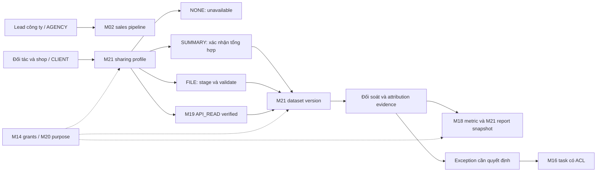
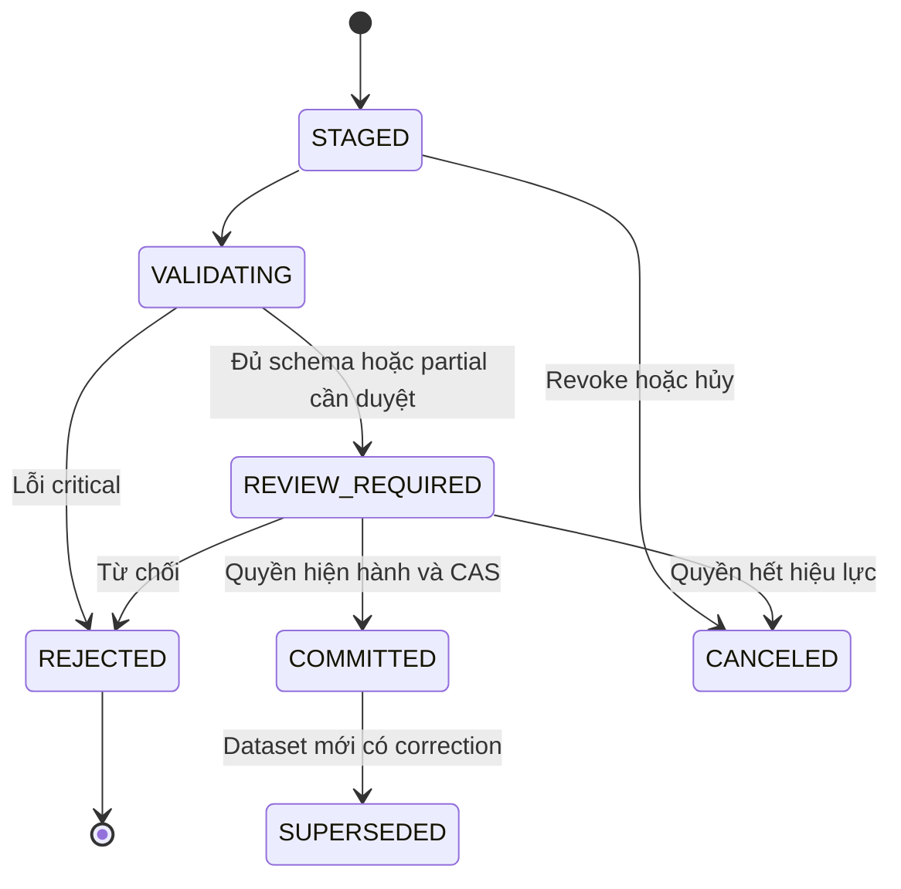

# M21 — Kết quả kinh doanh đối tác và chia sẻ dữ liệu theo mức

CR-PARTNER-RESULTS-20261018. Baseline đích Master 1.8; ngày 18/10/2026. Đây là bản đặc tả triển khai dẫn xuất từ các mục Master ghi dưới đây; Master là nguồn nghiệp vụ chuẩn. Trạng thái: đặc tả thiết kế đã tích hợp theo yêu cầu chủ dự án, chưa có code/DDL/provider/UAT đã chạy. Hash baseline được đồng bộ trong manifest/registry.

Owner nghiệp vụ: Account/Client Services owner; reviewer số liệu: Analytics/Finance theo chỉ số; owner kỹ thuật: Integration/Data lead. Các chức danh là trách nhiệm cần chỉ định người, không phải đã có nhân sự nhận việc. Read first: ../../01-architecture/INVARIANTS.md, ../../01-architecture/INDEX.md và các nguồn Master; đọc M08/M14/M18/M19/M20/M16 khi liên quan. Write scope ứng dụng chỉ xác định sau chọn repo/stack; không cấp quyền sửa toàn bộ migrations mặc định.

<!-- MASTER:3.15 -->
<a id="module-m21"></a>

### 3.15 FR41 / M21 — Kết quả kinh doanh đối tác và chia sẻ dữ liệu theo mức

#### 3.15.1 Mục tiêu, dữ kiện và ranh giới

**FR41 Kết quả kinh doanh đối tác:** quản lý mức dữ liệu được chia sẻ, thu nhận kết quả có nguồn, đối soát và phát hành báo cáo dịch vụ; đối tác không cấp API vẫn dùng được quy trình. M21 sở hữu data-sharing profile, source coverage, import/attestation/reconciliation/report snapshot; M19 sở hữu connection/credential/delivery, M18 sở hữu định nghĩa metric, M14/M20 kiểm quyền/mục đích và M16 sở hữu task ngoại lệ.

Lead B2C chưa phân loại là lead của chính công ty chủ dự án, chưa phải khách đã mua; thuộc AGENCY workspace/M02 và đo conversion sau khi có outcome thật. Đơn TikTok Shop/Shopee/Facebook là đơn của đối tác dùng dịch vụ qua công ty; đối tác đang dùng Pancake. Dữ kiện volume cũ 100 lead/50 khách không còn là baseline hiện hành. Chuỗi “500–100” và “2000–5000 ngàn đơn” chưa được chuẩn hóa hoàn toàn; kịch bản tham chiếu tạm là 2.000–5.000 đơn/tháng, chưa rõ mỗi đối tác hay tổng. Không nhân thêm 1.000, không chốt 500–1.000 lead hoặc conversion khi chưa xác nhận.

M21 phục vụ quyết định: chiến dịch nào cần kiểm lại, thiếu dữ liệu ở đâu, đối tác cần bổ sung bằng chứng gì, kết quả báo cáo đã được xác nhận đến mức nào. Không tự điều hành tồn kho, fulfillment, refund hoặc gửi tin cho người mua; các thao tác đó cần change request riêng nếu hợp đồng sau này giao trách nhiệm. Không tạo Contact cho mọi order; aggregate-only không đòi PII hoặc cấp API.

Ba lớp dữ liệu: AGENCY Account/Contract/agency receivable; CLIENT workspace kết quả của đối tác; published report summary sang account team qua bridge/grant rõ. Shop không mặc định là tenant/branch; một CLIENT workspace có thể có nhiều shop cùng controller/scope, nhưng không gộp đối tác khác vì dùng chung Pancake. Link báo cáo không tự cấp đọc raw orders hoặc agency finance.

Đầu ra P0 của module gồm profile, NONE/SUMMARY/FILE, metric dictionary/mapping cơ bản, provenance, approval/correction, quyền, report và audit. API_READ và order drill-down P1 sau PoC; có thể đưa vào release sớm bằng CR đủ quyền/capability. Không dùng nhãn P1 để hoãn controls khi API đã bật. Task ngoại lệ bật khi có owner/rule; không phải một task cho mỗi đơn.

#### 3.15.2 Mức chia sẻ và trạng thái độc lập

| Chế độ | Đầu vào | Kết quả khả dụng | Điều kiện / giới hạn |
| --- | --- | --- | --- |
| NONE | Không có số liệu đối tác | Dashboard công việc/dịch vụ; outcome unavailable | Không chặn lead, hợp đồng, invoice/thu phí hoặc giao việc hiện hữu; KPI cần outcome hiển thị chưa có dữ liệu |
| SUMMARY | Tổng hợp đối tác nhập/xác nhận theo kỳ | KPI đúng grain/phạm vi có dữ liệu | Tách partner-reported và evidence; không suy chi tiết đơn hoặc attribution |
| FILE | CSV/XLSX được cấp quyền | Tổng hợp hoặc order snapshot tùy file | Dry-run, mapping version, validate, quarantine, approve; file không cần API |
| API_READ | API/poll/webhook nếu được verified | Projection chỉ đọc và coverage theo nguồn | Shop/account/scopes verified, revoke/recovery/quota có kiểm; không mặc định sản phẩm Pancake nào cũng có webhook |

Mode là mức tối đa profile được phép nhận, không phải trạng thái chất lượng. API_READ profile có thể cho phép fallback FILE/SUMMARY theo source precedence đã duyệt; fallback không tự bật và không cộng trùng nguồn. NONE không có source active; thay mode không tự xóa lịch sử hoặc tạo grant mới.

Profile lifecycle DRAFT→REVIEWED→ACTIVE→SUSPENDED/REVOKED→CLOSED; NONE có thể ACTIVE để ghi nhận đối tác không chia sẻ. Kết nối healthy/degraded/reauthorization là trạng thái M19 riêng. Chất lượng record tách ba chiều: provenance API_OBSERVED/FILE_IMPORTED/PARTNER_REPORTED; verification UNVERIFIED/RECONCILED/DISPUTED; coverage COMPLETE/PARTIAL/UNKNOWN và freshness FRESH/STALE theo watermark/source SLA. Đủ ba chiều mới được chọn làm final report; partner confirmation không tự là xác minh độc lập.

#### 3.15.3 Danh mục chức năng và truy vết

| ID | Chức năng, actor, input/output và guard | Pha | UC | Rule | Tests |
| --- | --- | --- | --- | --- | --- |
| M21-F01 | AM khai báo đối tác/shop/workspace, phạm vi báo cáo và chế độ; tạo profile có version | P0 | UC-P01 | BR-P01/02 | P-T01/02/03 |
| M21-F02 | Owner duyệt scope/mục đích/thời hạn; grant tách khỏi credential; revoke kiểm hiện hành | P0 | UC-P01/08 | BR-P02/03 | P-T04/05/06 |
| M21-F03 | AM dùng NONE, khai báo unavailable và phương án báo cáo; không fake zero | P0 | UC-P02 | BR-P04 | P-T01/07 |
| M21-F04 | Partner/AM nhập tổng hợp kỳ/chỉ số/source evidence; submit rồi confirm/correct version | P0 | UC-P03 | BR-P05/06/07 | P-T08/09/10 |
| M21-F05 | Analyst upload FILE; scan/dry-run/errors/approve; job lớn có kết quả và checkpoint | P0 | UC-P04 | BR-P08/09 | P-T11/12/13/14/15 |
| M21-F06 | Integration operator đọc API theo quyền/capability, lưu durable source và recovery | P1 có điều kiện | UC-P05 | BR-P03/08/10 | P-T16/17/18/19/20 |
| M21-F07 | Data steward version source namespace/shop/order mapping và raw→canonical status; không gộp mù | P0 khi nhận nguồn tương ứng | UC-P04/05 | BR-P08/11/12 | P-T13/14/21/22 |
| M21-F08 | Analyst đối soát cùng grain/period/currency/status basis; chọn nguồn hoặc ghi dispute | P0 | UC-P06 | BR-P06/09/13 | P-T23/24/25 |
| M21-F09 | Analyst liên kết campaign outcome có evidence/model version; giữ Unknown; không tự claim causality | P0 cơ bản | UC-P06 | BR-P14 | P-T26/27 |
| M21-F10 | AM/Analytics phát hành snapshot có source versions và uncertainty; publish theo grant | P0 | UC-P07 | BR-P04/07/15 | P-T28/29/30 |
| M21-F11 | Người có order-detail grant xem projection chỉ đọc; field minimization, không tạo lead/khách agency | P1 | UC-P05/07 | BR-P01/02/11 | P-T02/06/31 |
| M21-F12 | AM xác nhận exception/action; M16 tạo task đúng scope và dedup business key | P0 khi rule bật | UC-P09 | BR-P16/17 | P-T32/33/34 |
| M21-F13 | Privacy/Ops xử lý expiry, revoke, retention, purge/hold và transfer đúng authority | P0 | UC-P08 | BR-P03/18/19 | P-T05/35/36/37 |
| M21-F14 | QA/Analytics đối soát export, coverage, logs và restore; owner xác nhận profile release | P0 | UC-P10 | BR-P15/19/20 | P-T30/38/39/40 |

M21-F05 không bắt phải hỗ trợ mọi template XLSX; danh sách format/template version được bật có kiểm. FILE P0 có thể bắt đầu bằng CSV có schema rõ, XLSX bật sau cùng controls; UI công bố format thực hỗ trợ. Order-detail FILE không bắt buộc trước báo cáo summary FILE.

#### 3.15.4 Quy tắc nghiệp vụ

**BR-P01:** lead công ty, người mua/đơn đối tác và agency revenue là các grain khác nhau; không cộng đơn đối tác vào pipeline công ty hoặc thu phí agency bằng GMV trừ công thức hợp đồng được duyệt riêng.

**BR-P02:** quyền data chia theo profile/workspace/shop/field/action và hiệu lực. Account team có quyền xem báo cáo không tự xem raw order/PII; partner portal chỉ thấy scope được publish. Profile và source mapping phải khớp account qua bridge được phép.

**BR-P03:** ingestion, import commit, query/export và job queued kiểm current authority/purpose; expired/revoked dừng fetch/commit/publish mới. Job đã tải dở được quarantine/cancel theo policy, không commit bằng grant đã hết. Historical retention có cơ sở độc lập, revoke không tự delete mọi evidence.

**BR-P04:** không dữ liệu là NULL/unavailable với reason và coverage, không là số 0. 0 chỉ hợp lệ khi nguồn xác nhận 0 trên phạm vi đầy đủ. Metric cần mẫu số thiếu/0 trả undefined, không 0% hoặc Infinity. NONE không làm hỏng module nghiệp vụ khác.

**BR-P05:** mọi metric có metric_code/formula_version/unit/grain/currency/time basis/status basis/timezone/source. Kỳ [start,end), end>start; timestamp và date-only phải có basis rõ, không gộp ngày tạo đơn với ngày giao/settlement.

**BR-P06:** cùng shop/kỳ/grain có thể nhiều observation, nhưng effective dataset/report chỉ chọn một source version theo precedence/coverage. Summary và detail không cộng nhau nếu cùng phạm vi; overlap một phần cần partition/dedup có chứng minh hoặc đánh dấu conflict, không chia tỷ lệ tùy ý.

**BR-P07:** số liệu đã confirm/report phát hành bất biến. Correction tạo version mới có lý do/evidence/supersedes; không tự thay report đã gửi. Revoke hoặc purge có thể vô hiệu quyền truy cập; không vì immutable mà giữ PII vĩnh viễn.

**BR-P08:** external IDs namespace theo provider/account/shop/object type; event ID và order ID không đồng nhất. Cùng source event/revision replay một effect; cùng key khác payload không im lặng overwrite. Pancake ID và marketplace order ID cần crosswalk có evidence, thiếu mapping giữ unresolved và không coi hai bản là hai đơn chắc chắn.

**BR-P09:** import two-phase stage→validate→review→atomic publish dataset version; dataset chưa commit không vào report. Preview lỗi từng row; sửa file tạo batch mới. Cho phép PARTIAL chỉ khi owner chấp nhận rõ excluded rows/coverage; không bỏ dòng lỗi rồi báo complete.

**BR-P10:** checkpoint advance sau durable processing page; webhook ACK sau durable raw event. Out-of-order dùng source revision/updated_at đáng tin và backfill reconciliation; thiếu ordering evidence giữ conflict, không chọn message đến cuối làm sự thật. Historical import không phát campaign automation hoặc task storm.

**BR-P11:** raw order/payment/fulfillment/refund status giữ riêng, mapping versioned. Đơn giao không tự là thanh toán/settlement; return order enum không đồng nhất sales order enum. Tên/điện thoại bị che không là khóa merge người.

**BR-P12:** amounts parse Decimal, finite/range/precision/quantum/currency allowlist theo Master 5.1. Refund/cancel và số âm theo metric schema; không blanket reject âm cho adjustment hợp lệ. Cấm sum đa currency hoặc tự FX khi chưa có policy và tỷ giá snapshot.

**BR-P13:** reconciliation chỉ so metric tương thích và cùng scope/cutoff, nêu delta absolute/relative, tolerance có policy version; thiếu policy hiện ReviewRequired, không default chấp nhận. Không sửa chứng từ sàn/Pancake/ERP để khớp báo cáo CRM.

**BR-P14:** attribution CONFIRMED/INFERRED/UNKNOWN có evidence/model/window/version. Tổng credit mỗi order/outcome/model không vượt 1; Unknown nhận phần thiếu. Trùng tên/cùng kỳ không chứng minh campaign tạo đơn. Gross sales/spend có thể là blended efficiency theo định nghĩa; không gọi ROAS attributable nếu thiếu numerator được quy thuộc đúng.

**BR-P15:** published report snapshot giữ selected dataset version, metric version, as_of, coverage/freshness/dispute/attestation và audience. Partial/stale có thể phát hành bằng explicit approval kèm nhãn; critical dispute không được ghi verified. Export áp cùng ACL, grant và watermark; không leak title/count/file qua share link.

**BR-P16:** task chỉ tạo cho exception có business owner/threshold/episode/rule version; unique effect theo source case/episode/action. Đơn bình thường không tạo task. Reopen exception mở episode rõ, không xóa history; thay mode không tự sinh lại mọi task lịch sử.

**BR-P17:** task giữ scope tối thiểu, deep link kiểm quyền; recipient không đủ quyền thì không nhận snippet. Task Done không tự xác nhận số liệu, giải quyết dispute hoặc nghiệm thu dịch vụ; M21 quyết định closure bằng evidence riêng.

**BR-P18:** API_READ mặc định read-only tại adapter/allowlisted operation và credential khi provider hỗ trợ; nếu token provider có quyền rộng hơn phải ghi risk, vault/egress/tool policy chặn write. Không tự dùng API create/refund/cancel/order update chỉ vì SDK có endpoint.

**BR-P19:** retention theo loại raw/staged/aggregate/report/audit có policy/hold và deletion propagation. Profile switch/revoke giữ audit và ngăn quyền đọc trái grant; backup restore áp deletion ledger và không tái fetch bằng authorization cũ. Không có retention được duyệt thì chưa nhận dữ liệu live tương ứng; fixture không PII vẫn dùng.

**BR-P20:** UI, API, job và export cùng feature/applicability gate. Test trạng thái trung thực; connector demo/mock pass không là proof quyền đối tác. Bộ core NONE/SUMMARY/FILE chạy được trước API, không yêu cầu account Pancake để vượt gate core.

#### 3.15.5 Màn hình, field validation và thông báo

| Màn hình | Fields/action chính | Validation và lỗi người dùng |
| --- | --- | --- |
| Partner Data Profile | Account, CLIENT workspace, shop IDs/channel, owner, mode, effective_from/to, purpose, allowed metrics/fields, recipients, review | Scope server verified; end>start; không có quyền: PARTNER_SCOPE_FORBIDDEN; hết hạn: SHARING_EXPIRED; mode NONE không yêu cầu token |
| Data Availability | Mode, lần nhận mới nhất, covered period, missing periods, provenance/verification/freshness | Chưa có dữ liệu: “Đối tác chưa cung cấp số liệu kỳ này”; token lỗi khác “Đang lỗi kết nối”; không hiện 0 |
| Summary Entry | metric/version, shop/channel, period, timezone, currency, value nullable, missing reason, evidence | Schema/grain tương thích; value missing cần reason; không duplicate active observation; METRIC_BASIS_MISMATCH |
| Import Wizard | Template version, file hash, source shop, period/columns/mapping, preview/errors, approve | Malware/formula/macro không chạy; CSV/XLSX được bật; FILE_UNSUPPORTED, ROW_INVALID, DUPLICATE_SOURCE_KEY; lỗi giữ batch không publish |
| Reconciliation | Left/right dataset version, common basis, delta, status, owner, decision/reason | Không so khác currency/grain; RECONCILIATION_INCOMPATIBLE; thiếu tolerance: “Cần duyệt tiêu chí đối soát” |
| Client Performance | Chỉ số/denominator, source, as-of, selected source, uncertainty, exceptions | ACL count/drill-down; không đủ data: “Chưa đủ dữ liệu để tính”; stale hiển thị thời điểm |
| Report Review/Publish | Frozen preview/hash, audience, coverage caveat, approval/correction version | expected_version; publish grant hiện hành; REPORT_VERSION_CONFLICT; không đổi nguồn sau approve |
| Connection Health | Capability checked_at, mapping, errors/backlog/cursor metadata, pause/reconcile | Secret không plaintext; chỉ verified capability được bật; CONNECTOR_CAPABILITY_UNVERIFIED |

Limits thiết kế đề xuất cho review: display name 1..255 ký tự, decision reason 1..1000, external ID <=255, evidence asset ID UUID, cursor page size 1..100 default50. File max20MiB/50.000 rows mỗi batch là profile test ban đầu, cần pin parser/format/limits trước enable; vượt giới hạn reject trước xử lý, không truncate im lặng. Chưa có form/DDL code nên chưa xác nhận latency/limit thực tế.

#### 3.15.6 Sơ đồ context và xử lý





```mermaid
sequenceDiagram
  actor Analyst
  participant API as M21 API
  participant DB as PostgreSQL
  participant Worker as M19 Worker
  actor Reviewer
  Analyst->>API: Upload metadata và source scope
  API->>DB: Kiểm profile/grant, stage batch
  Worker->>DB: Lease batch, kiểm quyền, validate rows
  Worker->>DB: Lưu preview/errors và proposed dataset
  Reviewer->>API: Commit(batch, hash, expected_version)
  API->>DB: Recheck current authority và transaction
  alt Valid và không conflict
    API->>DB: Dataset version + audit/outbox nguyên tử
    API-->>Reviewer: Committed; chưa tự publish report
  else Revoked hoặc stale
    API-->>Reviewer: 403/409; giữ dữ liệu khỏi report
  end
```

<!-- MASTER:4.24 -->
### 4.24 UC-P01–10 — Kết quả kinh doanh đối tác

| ID | Actor / trigger / precondition | Main flow và postcondition | Alternative / exception |
| --- | --- | --- | --- |
| UC-P01 | AM + data owner; bắt đầu dịch vụ; có account/workspace bridge | Khai báo shop/mode/purpose/metric/hiệu lực → preview quyền → owner review → activate profile version; audit | Đối tác không cấp quyền chọn NONE; account/shop mismatch reject; API scope chưa verified giữ pending |
| UC-P02 | AM mở báo cáo; profile NONE hoặc kỳ chưa có data | Hiện dịch vụ/công việc và outcome unavailable/reason → ghi đề nghị bổ sung nếu hợp đồng yêu cầu | Không chặn lead/hợp đồng/thu phí; thiếu data không tự kết luận dịch vụ kém hoặc 0 đơn |
| UC-P03 | Partner reporter/AM; SUMMARY được phép | Nhập kỳ/basis/value/evidence → validate → submit → người có quyền confirm → observation version; sau đó analyst chọn vào dataset | Partner confirmation không tự independent verification; sửa sau confirm tạo correction; grant hết hạn reject |
| UC-P04 | Analyst; FILE được phép và source thuộc profile | Upload → scan/hash → mapping/version → dry-run → xem lỗi/coverage → reviewer commit dataset nguyên tử → reconciliation | Exact replay không double effect; file mới sửa lỗi tạo batch mới; partial cần approve exclusions; parser crash resume không duplicate |
| UC-P05 | Integration operator/worker; API_READ verified | Resolve shop mapping → fetch/poll hoặc event verified → durable intake → validate/dedup/reduce → commit data/checkpoint → coverage/health | 401/403 suspend fetch; 429 backoff; status lạ quarantine; cursor advance không được bỏ page; read-only guard chặn write |
| UC-P06 | Analyst + reviewer; có dataset phiên bản | Chọn scope/basis đồng nhất → so tổng/line/source → kiểm overlap/attribution evidence → accept source hoặc dispute → audit decision | Khác kỳ/currency reject compare; thiếu match giữ Unknown; dispute không sửa nguồn, task xử lý có thể mở |
| UC-P07 | AM + report approver; metric/dataset có quyền | Chọn frozen dataset/metric version → preview caveat/audience → CAS approve/publish → snapshot và share grant | Partial/stale cần explicit approval/nhãn; missing numerator không tính ROAS; source mới không âm thầm sửa bản cũ; correction tạo report mới |
| UC-P08 | Privacy/data owner; expiry/revoke/offboarding | Preview phạm vi ảnh hưởng → revoke grants/disable jobs/mapping hiện hành → queued jobs recheck → retention/hold xử lý → audit | Switch API→FILE không reset grant hoặc tự chọn nguồn trùng; NONE chỉ dừng intake, không tự xóa lawful history; nguồn khôi phục không hồi quyền cũ |
| UC-P09 | AM/Ops/rule worker; exception có owner/rule | Upsert case theo episode → kiểm scope recipient → M16 create/link bằng business key → theo dõi evidence → M21 close/reopen case | Trùng event một task; historical không tạo storm; Task Done chưa chứng minh reconciliation resolved; người thiếu quyền không nhận snippet |
| UC-P10 | QA/Analytics/Ops; publish/export/restore | Đối chiếu fixture/source/version → kiểm ACL/count/export → export snapshot có manifest/hash → restore drill và reconcile → giữ evidence | Revoked user không tải mới; export file sạch formula injection; restore áp deletion/suppression và feature gates, không tự replay mọi send/fetch |

Postcondition chung: command thất bại không phát side effect thành công; mutation/audit/outbox commit cùng transaction khi cần publish; bất đồng bộ trả job/status rõ. Không dùng source payload/CSV cell để tự quyết tenant/workspace. Flow success ở đây là expected, chưa thực thi.

<!-- MASTER:5.21 -->
### 5.21 Dữ liệu, API và migration M21

Tất cả entity scoped theo 5.1 có id UUID, tenant_id/workspace_id NN, created_at/actor; mutable dùng row_version bigint>0. Đây là dictionary thiết kế để chuyển thành DDL/OpenAPI; không là migration đã chạy. Existing M14 grants, M19 connection/jobs/audit/outbox và M18 metric definitions được tái sử dụng qua public contracts, không tạo bảng alias thay thế.

| Bảng logic | Trường chính / kiểu / nullability | Keys, constraints và lifecycle |
| --- | --- | --- |
| Partner_Data_Profiles | account_id uuid NN via bridge; mode enum NN; status enum NN; owner_id uuid NN; purpose_ref/version text NN; effective_from timestamptz NN; effective_to timestamptz NULL; policy_version uuid NN; revision int NN | UNIQUE(scope,id), active version selection theo hiệu lực; không overlap active profile cho cùng reporting scope; account/workspace relation authorized; NONE không cần connection |
| Partner_Source_Bindings | profile_id uuid NN; provider/product text NN; external_account_id/shop_id text NN; connection_id uuid NULL; source_kind enum NN; scope_fingerprint text NN; mapping_version uuid NN; allowed_fields/metrics versioned schema; precedence_policy_ref uuid NN | Scoped FK profile/connection; verified external ownership qua M19; grant/expiry không chứa token plaintext; UNIQUE active source namespace-owner policy, không clone scope sang đối tác khác |
| Partner_Metric_Observations | dataset_version_id uuid NN; metric_definition_version uuid NN; grain/dimension_hash text NN; period_start/end timestamptz NN; timezone/basis/status_basis text NN; currency char(3) NULL theo metric; value numeric NULL; missing_reason text NULL; provenance enum NN; verification enum NN; evidence_ref uuid NULL | UNIQUE(dataset_version,metric,dimensions,period,basis,currency normalized); NULL currency cho counts cần unique semantics rõ khi ra DDL; finite/quantum/range; value NULL cần reason; dimension có schema, không freeform JSON chứa PII |
| Partner_Import_Batches | source_binding_id uuid NN; file_asset_id uuid NN; file_sha256 char(64) NN; template/mapping/schema versions NN; status enum NN; total/valid/error int NN; expected_coverage json schema NN; approved_by/at NULL trước commit; dataset_version_id uuid NULL; operation_key/hash text NN | Scoped idempotency; file hash là evidence, không duy nhất thay source key; exact duplicate job theo operation/source scope; approval CAS; batch partial publish ghi excluded rows rõ |
| Partner_Import_Row_Errors | batch_id uuid NN; row_number int NN; field/code text NN; redacted_reason text NN; row_key_hash text NULL | UNIQUE(batch,row,field,code); không lưu full PII row trong lỗi; retention stage riêng |
| Partner_Dataset_Versions | binding_id uuid NN; revision int NN; source_run_ref uuid NULL; coverage_from/to timestamptz NN; coverage enum NN; source_as_of/ingested_at timestamptz NN; status enum NN; supersedes_id uuid NULL; hash char(64) NN; selected_basis/version NN; verified_by/at NULL | UNIQUE(binding,revision); revision/hash bất biến sau commit; partial/rejected không thành complete; active selection publish atomic; source/definition fingerprint cố định |
| Partner_Order_Snapshots | binding_id/dataset_version_id uuid NN; source_object_id text NN; source_revision text NULL; source_updated_at timestamptz NULL; marketplace_order_id text NULL; raw_status/name text NN; canonical_status text NN; status_mapping_version uuid NN; order_created_at timestamptz NN; amount/currency NULL theo quyền; snapshot_hash NN | Projection chỉ đọc; UNIQUE(binding,source_object,source_revision/hash) theo adapter; current pointer update có ordering guard; absence trong page không tự delete; buyer PII không bắt buộc |
| Partner_Order_Identity_Links | left/right_binding/source_order keys NN; match_basis/evidence/version NN; status Proposed/Verified/Rejected NN; authority actor/time NULL trước Verified | Chỉ verified crosswalk dùng dedup cross-source; conflict giữ unresolved; scoped FK snapshots/keys; không merge theo tên/amount gần nhau |
| Partner_Reconciliation_Cases | left/right_dataset_id uuid NN; metric/basis/grain fingerprint NN; delta numeric NULL; currency NULL; tolerance_policy_version uuid NULL; status Open/ReviewRequired/Resolved/Disputed NN; decision_reason/evidence/actor/time conditional NN | Không compare khác basis/currency; quyết định CAS; không tự sửa source; resolved evidence bất biến, reopen episode mới |
| Partner_Attribution_Links | dataset/order_outcome_ref NN; campaign_ref uuid NULL; evidence_ref uuid NULL; model/window/version NN; class CONFIRMED/INFERRED/UNKNOWN NN; credit numeric NN finite 0..1 | Campaign link qua scoped bridge; sum credit<=1 theo outcome/model bằng transaction lock/constraint design; NULL campaign cho Unknown; không FK tenant-only để bypass workspace |
| Partner_Report_Snapshots | profile/version/report_revision NN; selected_dataset/metric-version manifest NN; as_of/cutoff/timezone NN; status Draft/Reviewed/Published/Superseded/Withdrawn NN; hash NN; approved_by/at NULL trước review; published_by/at NULL trước publish; audience_grant_ref uuid NN; supersedes_id uuid NULL | Snapshot published immutable; freeze selection; không join live values làm thay bản cũ; revoked share không truy cập mới; artifact sạch PII theo audience |
| Partner_Exception_Cases | binding/scope NN; rule_version NN; business_key text NN; episode int NN; state Open/Resolved/Suppressed NN; owner_id uuid NN; linked_task_id uuid NULL; reason/evidence NN | UNIQUE(scope,business_key,episode); create task qua M16 contract/outbox idempotent; không FK tùy tiện cross-scope; task done không tự close case |

Retention theo loại được cấu hình qua M20, không lập bảng legal basis song song. Partner confirmation dùng immutable decision/audit record có actor, authority, time, evidence hash, dataset/observation version; không lấy checkbox đơn giản làm bằng chứng đối tác ký. Báo cáo chỉ aggregate được cấp có thể publish bridge về AGENCY nhưng raw CLIENT rows vẫn bị chặn.

Index dự kiến: (tenant,workspace,profile,status,effective_from), binding/provider/shop ownership; observations(scope,metric,period,dimension_hash,dataset), order(scope,binding,external_key), batches(scope,status,created_at,id), cases(scope,owner,status,opened_at,id), reports(scope,profile,cutoff,revision). Chốt composite FK, unique NULL semantics, exclusion/locks chống overlap và query plans trong physical review. Raw source payload vào object storage encrypted/quarantined qua asset policy; content access grant riêng, không trả URL public.

#### API contract M21

Mọi mutation nhận operation/idempotency key và expected_version theo loại; recheck grants trước cả replay response. Error envelope {code,message,field_errors,correlation_id}; không raw SQL/detail ngoài quyền. 403/404 theo non-disclosure policy, 409 key/version/source conflict, 422 schema/business invalid, 202 job bất đồng bộ, 429 limit. Filter scope luôn xác minh server.

| Endpoint | Request/guard | Response / semantics |
| --- | --- | --- |
| POST /v1/partner-data-profiles | account/workspace bridge, mode, scope, policy, owner, operation key | 201 Draft; NONE không yêu cầu credential |
| POST /v1/partner-data-profiles/{id}/activate | expected_version, current reviewer authority, purpose/effectivity | 200 Active hoặc 422 thiếu config; API mode thêm verified capability |
| POST /v1/partner-data-profiles/{id}/change-mode | proposed_mode, source precedence/coverage impact, reason, expected_version | 200 version mới hoặc 202 kế hoạch; không đổi lịch sử/report cũ |
| POST /v1/partner-data-profiles/{id}/revoke | reason, effective_at, expected_version, authority | 200/202 tùy cleanup; write/access authorization revoke hiệu lực không chờ purge |
| GET /v1/partner-data-profiles/{id}/availability | read grant, period/filter | 200 mode/coverage/freshness/reasons; NONE không là connector error |
| POST /v1/partner-observations | metric/version, dimensions, period/basis/value/missing_reason/evidence | 201 staged observation; validate compatible schema |
| POST /v1/partner-observations/{id}/confirm | exact version/hash, attestor identity/authority, reason/evidence | 200 partner-confirmed provenance; chưa tự Reconciled |
| POST /v1/partner-imports | verified scoped asset hash, template/mapping/source, coverage, key | 202 batch + status URL; scan/validate job, không publish |
| GET /v1/partner-imports/{id} | import-view grant | 200 counts/errors preview redacted, dataset not active |
| POST /v1/partner-imports/{id}/commit | batch/hash/version, reviewer, explicit partial acceptance if applicable | 200/202; final atomic dataset publication, failed job báo state thật |
| POST /v1/partner-source-bindings/{id}/sync | operator, range/checkpoint, verified API_READ | 202 job; range cap/lease; cấm write operation tới provider |
| POST /v1/partner-reconciliation-cases | compatible dataset IDs/basis/key | 201 Open/ReviewRequired; không auto tolerances |
| POST /v1/partner-reconciliation-cases/{id}/decisions | exact versions, evidence, decision/reason, authority | 200 CAS; source không sửa |
| GET /v1/partner-results | authorized profile/shop/period/metric + selected dataset | 200 values + metadata; NULL có reason; không sum overlapping sources |
| GET /v1/partner-order-snapshots | order-detail capability/grant + scoped cursor | 200 read-only projection không PII mặc định; capability off deny |
| POST /v1/partner-reports | selected immutable datasets/metric versions, audience, as_of, key | 201 Draft frozen manifest |
| POST /v1/partner-reports/{id}/publish | exact hash/version, approver, current audience grant, caveat acceptance | 200 Published; không tạo agency invoice/paid effect |
| POST /v1/partner-reports/{id}/corrections | supersedes/ref, reason, datasets/version, key | 201 report revision mới; giữ bản trước |
| POST /v1/partner-reports/{id}/exports | approved format, scope, key; recheck at download | 202 export job; sanitized formula cells, access-controlled artifact |

Contract events version1 đề xuất: PartnerDatasetCommitted, PartnerDataCoverageChanged, PartnerSharingRevoked, PartnerReportPublished, PartnerExceptionOpened. Envelope tenant/workspace/profile/source binding, aggregate/version, event ID namespace, occurred/received time, schema version, correlation/causation và payload tối thiểu. Consumer M18/M16 dedup bằng event/business key; fixture legacy event cho tương thích. Không nhét phone/address/order payload đầy đủ vào event mặc định.

#### Migration và cutover

Expand chỉ tạo capability thực dùng; dùng foundation M14/M18/M19/M20 trước FK. Import file lịch sử vào staging, map account/shop/workspace, metric basis/currency và source IDs; dry-run row counts, totals, unknowns và grant coverage. Phân loại dataset theo source_as_of/received; không đẩy historical thành live task/campaign conversion.

Cutover chọn một nguồn active cho mỗi reporting partition, freeze file run/cutoff và đối soát API overlap nếu có. Bật profile NONE/SUMMARY trước; FILE sau scan/template; API sau PoC quyền cụ thể. Quay lại FILE/NONE cần quyết định source precedence và coverage; không fallback bằng cách cộng cả hai. Rollback app giữ dữ liệu đã commit, reconcile trước trả nguồn ghi; purge retention qua job có checkpoint/hold. Không có constraint nợ được phép mở link write path trái scope.

<!-- MASTER:6.7 -->
### 6.7 Quyền, dữ liệu và trách nhiệm M21

| Actor | Quyền được cấp có điều kiện | Không mặc định |
| --- | --- | --- |
| AM/account owner | Profile draft, xem summary/report của account có grant; đề nghị data | Xem raw order/buyer PII, credential hoặc tự attestation thay đối tác |
| Analyst/importer | Stage/dry-run/mapping trong scope | Tự commit/publish mọi dataset hoặc ghi lại source |
| Dataset reviewer | Commit/correct đúng dataset version, tolerance/authority | Mở thêm shop/metric/field ngoài profile |
| Partner reporter/approver | Gửi/confirm số liệu của chính scope; xem bản đã publish cho mình | Agency margin/commission, đối tác khác, quyền xuyên workspace |
| Integration operator | Connection health/reconcile/run metadata | Nội dung nhạy cảm/token plaintext/refund/cancel order |
| Report approver | Publish đúng manifest/audience, approve caveats | Biến partner-reported thành verified hoặc agency revenue |
| Privacy/data owner | Purpose/expiry/retention/revoke theo authority | Xóa evidence có hold hoặc giữ mọi PII vô hạn |
| Service principal | Operation cụ thể theo profile/grant hiện hành | Bypass RLS, tiếp tục fetch sau revoke vì job đã enqueue |

Năng lực create/stage/commit/publish/export/see-order-detail/manage-credential tách nhau. Với pilot một người có thể kiêm role theo policy và ghi audit; đội nhiều người áp separation theo risk, không tự dựng self-approval vô điều kiện. File/upload/download/report share/search/count/cache cùng grants; raw fields chỉ thu khi cần mục đích đã cho phép. Client data không chuyển thành audience marketing của agency do mua dịch vụ hoặc có chung số điện thoại.

NONE là lựa chọn hợp lệ của đối tác, không phát sinh lách quyền hoặc tự scrape/cookie/session. File/summary vẫn cần người có quyền chia sẻ trong phạm vi thỏa thuận; không có API không đồng nghĩa có quyền nhận mọi file. Hết grant dừng access mới theo policy; historical artifacts giữ/lọc/purge theo retention/hold. Các nghĩa vụ pháp lý dùng khung M20 hiện hành, chưa coi đặc tả này là ý kiến pháp lý riêng.

<!-- MASTER:7.8 -->
### 7.8 NFR, vận hành và tải M21

| ID | SLI/target thiết kế đề xuất | Xác minh và applicability |
| --- | --- | --- |
| P-NFR01 | Summary/result list p95<=2s, API không chờ network provider; cursor50 | Dataset đại diện/role/cache rõ; chưa đo; NONE không bị provider outage |
| P-NFR02 | Async import có job progress/errors; fixture20MiB/50.000rows validate trong 10 phút trên cấu hình test đã ghi | Target PoC, pin parser/limits trước enable; retry không double publish |
| P-NFR03 | Same event replay10 lần, same import retry, race commit không duplicate effect | DB/worker concurrency, dataset atomic; P-T13/15/18/25 |
| P-NFR04 | Zero cross-client/field/count/file leak trong bộ test âm; runtime role missing scope fail-closed | P-T02/06/30/31/36; không test bằng DB owner thay app role |
| P-NFR05 | Freshness theo source-specific sync schedule/coverage watermark; alert khi breach policy | Thiếu lịch không hiện real-time/healthy; 2.000–5.000 đơn chưa là peak forecast |
| P-NFR06 | Quota/rate limits, payload/row caps, finite parsing, malware và formula safety | Provider-specific backoff; CSV export neutralize =,+,-,@ và tab/control leading theo context; không sửa số âm hợp lệ thành text sai trong dữ liệu nghiệp vụ |
| P-NFR07 | Restore giữ grant revocation/deletion/dataset/report hashes; RPO/RTO theo NFR06 profile được duyệt | Không replay fetch bằng credential đã revoke; drill có evidence, không tự chọn pilot thấp hơn |
| P-NFR08 | Metrics ingest lag, coverage gaps, import failures, disputes, stale reports, exception tasks; logs redact | Mỗi alert có owner/runbook; NONE không spam connector-failure alert |

Test profile sizing dùng số shop, event/order, peak campaign, backfill, file rows, concurrent reviewers và retention đo thực tế. 2.000–5.000 đơn/tháng tạm tương đương khoảng67–167 đơn/ngày theo30ngày, không suy QPS hoặc SLO từ trung bình. Tách queue sync/import/report để lỗi đối tác không chiếm worker tiền/lead. Không mặc định nâng microservices hoặc triển khai inventory vì volume đối tác.

<!-- MASTER:8.6 -->
### 8.6 Dashboard kết quả đối tác và ranh giới đo lường

| Chỉ số | Grain/công thức và caveat | Người quyết định |
| --- | --- | --- |
| Data coverage | Scope/kỳ có dữ liệu hợp lệ / scope/kỳ dự kiến theo thỏa thuận; thiếu mẫu số hiện Unknown | AM theo dõi nghĩa vụ chia sẻ, không phạt đối tác không có nghĩa vụ |
| Orders by status | Count distinct canonical source order theo shop và chosen time/status basis; partial ghi observed count | Analyst; không cộng file summary và API detail cùng partition |
| Gross/net outcome value | Theo metric policy và refund/cancel/tax/ship treatment đã duyệt; currency riêng | Client + Analytics; không tự coi GMV là agency revenue |
| Cancellation/return/refund rate | Numerator/denominator cùng cohort/basis, nêu ngày chốt và đơn còn pending; không default cùng công thức | AM/Client Ops; flag upstream data gap |
| Attributable ROAS | Eligible attributed value / matched ad spend cùng scope/window/currency; spend0 hoặc numerator thiếu → undefined | CMO; blended ratio đặt tên riêng, không claim causality |
| Exception age | Tuổi case đang mở theo episode/due; task done chưa resolved không rơi khỏi danh sách | Service owner |
| Partner-reported vs reconciled | Hiển thị provenance/verification/source_as_of/coverage/dispute rõ | Report approver |

Dashboard công ty giữ lead mới/chưa phân loại, qualified/conversion cohort và doanh thu dịch vụ trong AGENCY riêng. Không lấy2.000–5.000 đơn đối tác chia lead công ty; customer acquisition của agency khác consumer order của khách. Mọi card có metric_version, scope, source, as_of, selected_dataset_version và caveat. Báo cáo “chưa dữ liệu” vẫn có tiến độ dịch vụ/work evidence, không báo hiệu quả doanh thu đã xác minh.

<!-- MASTER:9.17 -->
### 9.17 UAT, traceability và rollout M21

Tất cả test dưới đây là **Not Run**. Test severity Critical/High/Medium mô tả rủi ro; delivery priority P0/P1 không miễn control khi capability bật. NONE/SUMMARY/FILE core phải kiểm trước enable; API_READ/order detail kiểm khi bật. N/A chỉ sau profile và evidence không có code/job/role/flag cho đường sử dụng tương ứng.

| ID | Kịch bản | Expected result | Severity / applicability |
| --- | --- | --- | --- |
| P-T01 | Đối tác chọn NONE, không token | Lead/hợp đồng/task/thu phí công ty vẫn dùng; outcome unavailable, không0 | Critical / core |
| P-T02 | User khách A dùng profile/shop ID khách B | Không leak qua API/count/report/asset hoặc error | Critical / core |
| P-T03 | Profile account-workspace bridge không hợp lệ | Reject activate/import; không tự mở workspace | Critical / core |
| P-T04 | User không authority tự activate hoặc mở field PII | Deny; profile version/grant cũ nguyên vẹn | Critical / core |
| P-T05 | Revoke sau enqueue trước import commit/fetch/publish | Job dừng/quarantine; không access/commit mới trái quyền | Critical / core và API khi bật |
| P-T06 | Chỉ summary/report grant nhưng gọi order/raw/file | Deny; không auto-grant do account membership | Critical / core và detail khi bật |
| P-T07 | Thiếu số liệu hoặc mẫu số0 | Null/reason/undefined; không0%/Infinity hay missing=0 | High / core |
| P-T08 | Summary sai kỳ/timezone/basis/currency | Validate/reject; không gộp các metric khác basis | High / summary |
| P-T09 | Partner confirm số liệu tự khai | Partner-reported/confirmed, chưa independent verified | High / summary |
| P-T10 | Sửa observation đã confirm | Revision mới; lịch sử và report cũ không bị overwrite | High / summary |
| P-T11 | File không hỗ trợ/macro/malware/zip bomb | Reject/quarantine theo parser limits; không execute | Critical / file |
| P-T12 | Row NaN/Infinity/wrong currency/invalid ID/date | Row errors có field/code; không âm thầm round/drop | Critical / file |
| P-T13 | Same batch/operation retry10 lần | Một committed dataset/effect, key khác body conflict | Critical / file |
| P-T14 | Một order qua Pancake và sàn/file thiếu crosswalk | Không sum kép; unresolved identity/conflict hiển thị | High / overlapping sources |
| P-T15 | Worker crash giữa validate và commit dataset | Không partial publication; resume theo checkpoint, totals đúng | Critical / file |
| P-T16 | API account scope/quyền hoặc product chưa verified | Không Active API_READ; core FILE/NONE vẫn dùng | Critical / API |
| P-T17 | Credential API có quyền write nhưng adapter read-only | Attempt create/refund/cancel/update bị chặn bởi operation allowlist | Critical / API |
| P-T18 | Webhook duplicate/out-of-order, cùng ID khác shop | Dedup đúng namespace; không lùi state; scope không va | Critical / API event khi bật |
| P-T19 | Poll page đã tải nhưng commit lỗi, restart | Cursor không vượt page chưa bền; không mất/nhân effect | Critical / API poll |
| P-T20 | Provider401/429/outage | Reauth/backoff/coverage gap rõ; lead/finance độc lập vẫn dùng | High / API |
| P-T21 | Sales order và return order cùng numeric status | Mapping theo entity/type/version; không dùng chung enum mù | High / order detail |
| P-T22 | Cùng tên/điện thoại che, nhiều buyer | Không merge thành một người hoặc tạo agency customer giả | Critical / order detail |
| P-T23 | Summary+detail overlap hoàn toàn hoặc một phần | Chọn dataset/partition rõ; không cộng hai nguồn | Critical / core |
| P-T24 | Tolerance thiếu hoặc hai dataset khác currency/basis | ReviewRequired/incompatible; không auto-resolve | High / reconciliation |
| P-T25 | Hai reviewer commit/resolve cùng expected_version | Một transition thắng; người còn lại409; một effect | Critical / core |
| P-T26 | Không campaign evidence, chỉ cùng ngày/nguồn chung | Attribution Unknown; không claim toàn bộ shop orders | High / attribution |
| P-T27 | Attribution nhiều campaign vượt tổng credit1 | Transaction reject hoặc điều chỉnh theo model đã duyệt; không double revenue | Critical / attribution |
| P-T28 | Báo cáo partial/stale/disputed | Nhãn/caveat và approval đúng; không hiện verified/complete trái evidence | High / reports |
| P-T29 | API/file mới cập nhật sau report publish | Report cũ giữ hash/value/version; correction explicit | High / reports |
| P-T30 | User bị revoke dùng link export/file cũ | Request tải mới bị chặn; audience policy áp cả report/count | Critical / core |
| P-T31 | Detail off nhưng dùng direct API/job | Deny/no path; không chỉ ẩn nút | Critical / core |
| P-T32 | Một exception event replay nhiều lần | Một case/episode và một task đúng scope | High / exceptions |
| P-T33 | Task recipient thiếu source grant | Không snippet/PII leak; sanitized task chỉ qua approval riêng | Critical / exceptions |
| P-T34 | Mark task Done trong khi dispute chưa có evidence | Reconciliation/case chưa autoResolved; owner tiếp tục theo dõi | High / exceptions |
| P-T35 | API_READ→FILE→NONE rồi reconnect | History giữ; source precedence không sum trùng; không hồi grant cũ | Critical / mode change |
| P-T36 | AM được report summary nhưng không raw CLIENT/agency finance | Cross-workspace publish đúng fields; không truy ngược tài liệu ngoài quyền | Critical / core |
| P-T37 | Retention purge có legal hold và backup restore | Hold phần hợp lệ; purge phần còn lại; deletion/grant ledger áp sau restore | Critical / retention |
| P-T38 | CSV export có công thức, report log có PII/token | Export render an toàn; log redact; raw không công khai | Critical / export |
| P-T39 | Dataset20MiB/50k rows, nhiều reviewer và backlog | Đo profile target P-NFR; không mất dữ liệu, timeout/status rõ | High / file perf |
| P-T40 | Partner từ chối data, đối soát export và restore toàn flow | AM làm được báo cáo giới hạn đúng; không biến unavailable thành0; restore/hash đúng | High / core UAT |

Ma trận FR41→M21-F01–14→UC-P01–10→BR-P01–20→data/API→P-T01–40 có detail ở3.15.3/5.21; P-NFR01–08 bổ sung control ngang. Accountable business owner ký expected/actual/build/fixture/evidence, QA ghi status. Core controls không được deferred nếu core bật; API chưa bật không đòi credential để nghiệm thu NONE/SUMMARY/FILE. P-T11/12/15/39 chỉ áp format/limit đã bật nhưng anti-execution, validation và atomic publish không được miễn.

Rollout: một đối tác NONE và một dataset SUMMARY có xác nhận → FILE có mapping/dry-run/approval → report/correction/ACL → API_READ một account được cấp → detail/exception theo nhu cầu. Có thể cùng đối tác chuyển mode theo version. Pilot không cần nhập mọi dữ liệu cá nhân người mua. Chốt lịch và effort mới theo scope, không giữ cam kết90ngày cũ bằng cách bỏ controls.

Definition of Ready: owner/recipient, profile mode/purpose/authority, metric/basis/timezone/currency, source precedence, retention, template/schema và role matrix của slice rõ; API còn thiếu chỉ chặn API. Definition of Done release: tests áp dụng chạy đạt, import/report đối soát đúng fixture, không leak, rollback/restore/runbook/alert owner, người dùng pilot hoàn thành flow và báo cáo được uncertainty; chưa có biên bản thực hiện trong tài liệu này.

<!-- MASTER:A.8 -->
### A.8 Quyết định và tham số M21 — CR-PARTNER-RESULTS-20261018

Quyết định thiết kế đã hợp nhất: lead B2C công ty và đơn đối tác tách scope; đối tác giữ Pancake; M21 tích hợp kết quả theo mức, NONE hợp lệ; không thay OMS; không coi GMV đối tác là doanh thu agency; dataset/report versioned, read-only API mặc định và nguồn/mức xác minh công khai. Đây là chấp thuận tài liệu chức năng, chưa phê duyệt policy thực tế, license/API account, ngân sách hoặc go-live.

| ID | Tham số/đầu vào còn mở | Hành vi khi thiếu / owner |
| --- | --- | --- |
| P-O01 | Chuẩn hóa số lead B2C và đơn/kỳ; tổng hay mỗi đối tác, số shop, peak | Không forecast conversion/QPS hoặc cam kết sizing; BA + chủ dự án |
| P-O02 | Người có authority chia sẻ/xác nhận, scope theo đối tác/shop/field và hiệu lực | Profile draft/NONE; chưa ingest live trái quyền; AM + data owner |
| P-O03 | Sản phẩm Pancake/POS/CRM, app/account/scopes, nguồn nào thực có từng kênh | API pending; FILE/SUMMARY chỉ trong phạm vi được cho phép; Integration owner |
| P-O04 | Metric dictionary/basis/refund/tax/ship/currency/cutoff và tolerance | Metric/dataset chưa cấu hình không publish kết quả tính; vẫn báo unavailable/work progress; Analytics + client |
| P-O05 | Template/schema/mapping, source precedence và crosswalk | Quarantine/dry-run, không sum overlapping data; Data steward |
| P-O06 | Retention/evidence/hold/audience/download policy | Chưa thu loại data live tương ứng; fixture vẫn dùng; Privacy + owner |
| P-O07 | Freshness schedule/alert recipient, volume/perf/budget/nhân sự | Không ghi real-time hoặc hứa capacity/go-live; Ops + chủ dự án |
| P-O08 | Exception rule/threshold/owner/closure criteria và commission dùng kết quả nếu có | Không auto-create task hoặc tính phí/commission từ outcome chưa duyệt; Service owner + Finance |

Không phải mọi mục mở chặn core: NONE không cần API hoặc metric values; SUMMARY cần metric và người xác nhận; FILE thêm template/scan/precedence; API thêm verified capability/current grants. Thiếu dữ liệu đối tác không chặn intake lead/hợp đồng/giao việc/thu phí hiện hữu; nghĩa vụ phụ thuộc outcome xử lý theo hợp đồng, không tự coi khách đã đáp ứng hoặc vi phạm.

<!-- END:MASTER -->

## Nguồn đối chiếu và giới hạn

- [Pancake POS — Giới thiệu Open API](https://docs.pancake.biz/pos/st-f13/st-p1?lang=vi): tài liệu chính thức mô tả truy cập shop data qua Open API. Chưa có PoC/quyền tài khoản đối tác; không đồng nhất POS, CRM và Work.
- [Pancake POS — trạng thái đơn](https://docs.pancake.biz/pos/st-f13/st-p3?lang=vi): giữ status/status_name và phân biệt đơn bán/đơn hoàn khi mapping.
- [HubSpot — Shopify data sync](https://knowledge.hubspot.com/integrations/connect-hubspot-and-shopify-via-data-sync): ví dụ CRM nhận commerce data; không là bằng chứng quyền Pancake hiện có hoặc yêu cầu sao chép toàn bộ thiết kế HubSpot.

Nguồn công khai kiểm ngày18/10/2026. M21 là thiết kế đề xuất cho CRM này; mô hình NONE/SUMMARY/FILE/API_READ không được trình bày như chức năng có sẵn của Pancake.
