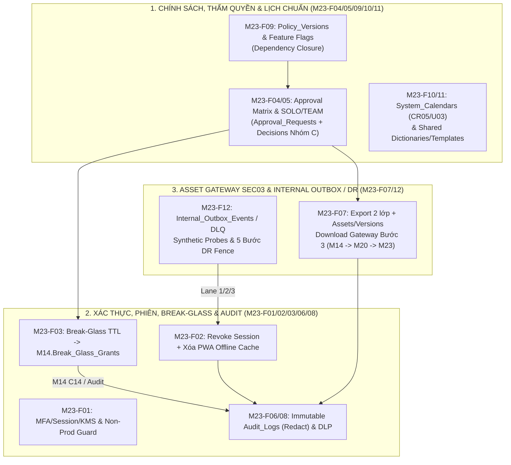
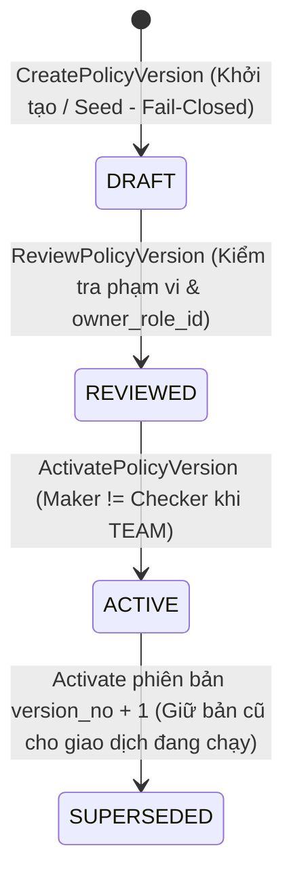
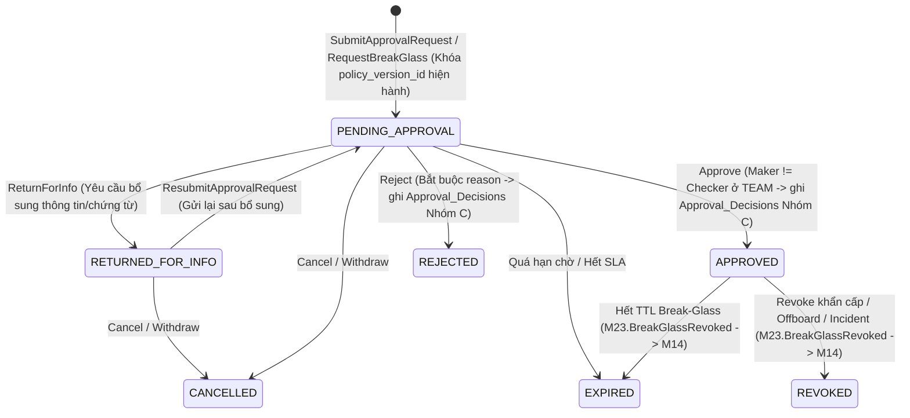
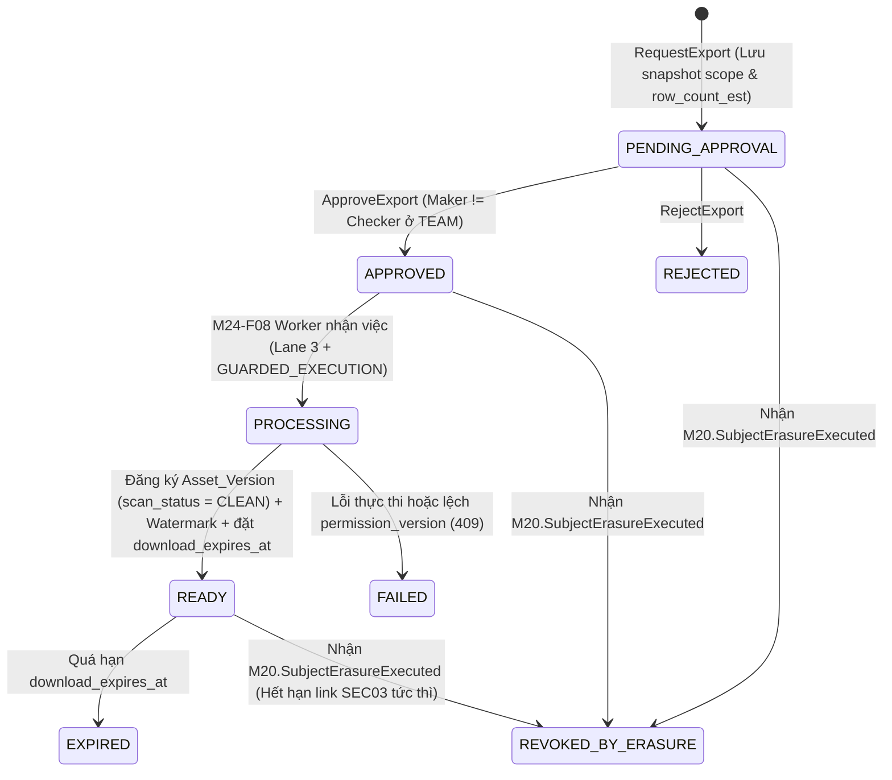
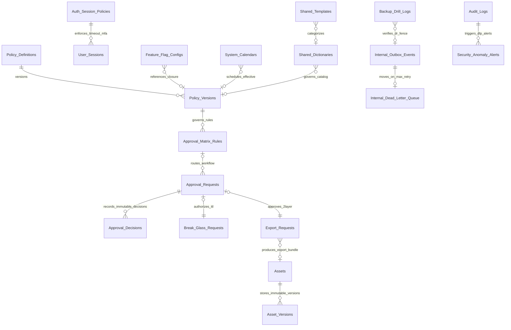

# M23 — Quản trị Hệ thống, Bảo mật Vận hành & Nền tảng Cấu hình

Đặc tả chi tiết cấp Module & Chức năng (`Per-Module & Per-Function Spec`) cho **M23** (`[PROPOSED]` Mở rộng Nền tảng từ Master `v1.9` — chuẩn hóa theo `CR-20261116-WAVE1-5-HARDENING`), dẫn xuất từ [CRM_MASTER_BRD_SRS_HOP_NHAT.md](../../00-master/CRM_MASTER_BRD_SRS_HOP_NHAT.md) (`v1.9`). Tài liệu thuộc giai đoạn `Documentation-Only`; chưa có mã nguồn ứng dụng, chưa chạy migration DB và mọi ca kiểm thử đều ở trạng thái `Not Run`.

---

## 1. Manifest

- **Baseline nguồn:** [CRM_MASTER_BRD_SRS_HOP_NHAT.md](../../00-master/CRM_MASTER_BRD_SRS_HOP_NHAT.md), Phiên bản `1.9`, `SHA-256: b6a3279f328e96e1e97d845e209be7a326516a0dba5e3a033d88e1f2162e421c`.
- **Mục nguồn trong Master v1.9:**
  - Mục `2.3` (`Lõi dùng chung và gói ngành`), `3.2/3.6/3.7.1/3.9/3.10.1/3.10.2/3.14/3.16` (Danh mục, Ma trận duyệt, Lịch làm việc)
  - Chương `5`: `5.1` (`11 cột gốc + legal_entity_id` thành **12 cột chuẩn `Nhóm A`**, `L2487–2553`), `5.13` (`ENTITY-L2783` `Assets, Asset_Versions, Approvals`; `ENTITY-L2787` `Audit_Logs`), `5.18` (`ENTITY-L2885` `Policy_Definitions, Policy_Versions`), `5.19` (`Gate triển khai vật lý & dependency closure`)
  - Chương `6`: `6.1` (`Solo vs Team`, phân tách thẩm quyền cấp quyền, `Tech Admin` không đọc dữ liệu kinh doanh/lương, `L3085–3113`), `6.2` (`MFA/Session`, mã hóa đường truyền/storage/backup & KMS secret manager, kiểm tra tệp/malware & `Download Gateway`, Export 2 lớp + watermark + `CSV` safe, DLP/cảnh báo, Audit Log redact PII & tách quyền xóa khỏi Admin ứng dụng, `L3114–3123`)
  - Chương `7`: `7.1` (`NFR05`, `NFR06`, `NFR07`, `NFR10`, `NFR11`, `NFR12`, `L3275–3282`), `7.2` (`Synthetic user-journey SLI probes`, tách riêng bảo trì có kế hoạch & phụ thuộc đối tác, circuit breaker/bulkhead, `L3284–3289`), `7.3` (`DRP` PITR + versioning + runbook khôi phục & `Deletion_Ledger`, `L3290–3295`), `7.4` (`PWA offline MVP` dùng `client_operation_id`, hết phiên xóa cache nhạy cảm, không offline export, `L3296–3301`), `7.5` (`Tách dev/staging/prod`, dữ liệu test ẩn danh, CI secret/dependency scan, **Non-Prod Send Guard**, `L3302–3305`)
  - Chương `9` & Phụ lục `A/E/F`: `CR05` *(phần `calendar`)*, `U03`, `U16`, `U17`, `U21`, `INT23`, `INT26`, `OC19`, `CEO-U26`, `SEC03`, `SEC06`, `SEC-U03`, `SEC-U06`, `O03`, `O08`, `W-O03`.
- **Status:** `Reviewed; CR-20261117-M23-ERASURE-ALIGNMENT` *(Bản nâng chuẩn Wave 1.5 theo [CR-20261116-WAVE1-5-HARDENING](../changes/archive/CR-20261116-WAVE1-5-HARDENING.md) và đồng bộ ranh giới `privacy_erasure_system_role` theo [CR-20261117-M23-ERASURE-ALIGNMENT](../changes/archive/CR-20261117-M23-ERASURE-ALIGNMENT.md) — đủ 6 phần `MODULE-SPEC.md`, EARS, `20` bảng tách rời `1 bảng = 1 dòng` & hợp đồng `C23`, vượt Re-Audit Wave 1.5; `GAP-15..17` giữ Fail-Closed trước khi sinh DDL/Code; mọi ca kiểm thử ở trạng thái `Not Run`)*
- **Approved_Scope:** `Wave 1.5 M23 System Admin, Approvals, Calendars, Assets & Internal Outbox (M23-F01..12, C23)`
- **Approved_By:** `Chủ dự án`
- **Decision_Ref:** `CR-20261116-WAVE1-5-HARDENING; CR-20261116-SKILL-TEMPLATE-ALIGN; CR-20261117-M23-ERASURE-ALIGNMENT`
- **Approved_At:** `2026-11-17`
- **Domain Owner & Vai trò chịu trách nhiệm:**
  - **Accountable Business Role:** Owner / CEO (phê duyệt chế độ `SOLO_PILOT` $\leftrightarrow$ `TEAM`, Ma trận thẩm quyền), Privacy/Security Approver (phê duyệt Break-glass, Export PII, DLP).
  - **Technical Owner & Reviewer:** Platform / Security Lead & SRE Lead (quản trị hạ tầng cấu hình, `Assets` Registry, KMS/Encryption, `Internal_Outbox_Events`/DLQ, SLI probes & Diễn tập DR).
- **Ranh giới *Single Source of Truth* (`INV-01`, `INV-02`, `INV-06`, `INV-13`, `INV-14`, `INV-22..25`, `ADR-002..009`):**
  - **`M23` sở hữu độc quyền (`20 Bảng Tách rời` — `19` bảng cốt lõi + `User_Sessions`):** `Policy_Definitions`, `Policy_Versions` (`ENTITY-L2885`), `Audit_Logs` (`ENTITY-L2787` `Nhóm C`), `Assets` (`ENTITY-L2783`), `Asset_Versions`, `Approval_Matrix_Rules`, `Approval_Requests`, `Approval_Decisions` (`ENTITY-L2783.Approvals` `Nhóm C`), `Auth_Session_Policies`, `User_Sessions`, `Break_Glass_Requests`, `Export_Requests`, `Security_Anomaly_Alerts`, `Feature_Flag_Configs`, `System_Calendars`, `Shared_Dictionaries`, `Shared_Templates`, `Internal_Outbox_Events`, `Internal_Dead_Letter_Queue`, `Backup_Drill_Logs` (`Nhóm C`). *(Đã **BỎ** `Tenant_Operating_Modes` khỏi owned entities của `M23` theo `ADR-003`: `M14.Tenants.operating_mode` là SSoT runtime; `M23-F05` giữ quy trình `Approval_Requests` + `Audit_Logs` và phát `M23.TenantOperatingModeChanged` $\rightarrow$ `M14.SetTenantOperatingMode`).*
  - **`M23` vs `M14` (ACL, Break-Glass, Operating Mode & `Security_Revocation_Ledger`):** `M14` là **cổng kiểm tra quyền thực thi duy nhất (`INV-23`)**, sở hữu `Users`, `Roles`, `Role_Bindings`, `Principal_Permission_Versions`, **runtime `Break_Glass_Grants`**, `Tenants.operating_mode` và PITR #6 `M14.Security_Revocation_Ledger`. `M23-F03` quản lý workflow `Break_Glass_Requests` (`Maker != Checker` khi `TEAM`, TTL) rồi gọi `M14.ApplyBreakGlassGrant` / `RevokeBreakGlassGrant`. `M23-F02` theo dõi phiên và thu hồi session/PWA cache khi offboard/suspend/incident/DR.
  - **`M23` vs `M20` (Privacy, Erasure, Multi-`Legal_Hold` & Restore Gate):** `M20` sở hữu `Processing_Records`, `Consent_Logs/State`, `Endpoint_Suppressions`, `Privacy_Requests`, `Legal_Deadline_Policies`, `Retention_Policies`, `Legal_Holds`, `Deletion_Ledger`, `Data_Incidents`. `M23` sở hữu khung `Policy_Definitions`/`Policy_Versions` và hạ tầng `Assets`/`Asset_Versions`; khi `M20` phát `M20.SubjectErasureExecuted` (`erased_subject_refs[]`), `M23` thu hồi `Export_Requests`, ẩn danh/xóa `Assets` không vướng `active_legal_hold_ids`, và scrub `Internal_Outbox_Events`/`DLQ`. Trong chuỗi Restore DR, `M23-F12` khóa toàn hệ thống và bắt buộc chạy `M20.VerifyPostRestoreComplianceGate` **TRƯỚC** khi replay `Internal_Outbox_Events`.
  - **`M23` vs `M19` (Dual Outbox & DLQ — `ADR-005`):** `M19` sở hữu tích hợp, `Inbound_Events`, `Outbound_Intents` và `Adapter_Dead_Letter_Queue` cho **hệ thống bên ngoài**; `M23-F12` sở hữu **`Internal_Outbox_Events` và `Internal_Dead_Letter_Queue` dùng chung cho toàn bộ sự kiện liên module nội bộ (`M14.*`, `M16.*`, `M20.*`, `M23.*`, `M24.*`)**.
  - **`M23` vs `M16` (`Approval_Requests`/`Decisions` vs `Acceptances`, `Assets` & `System_Calendars` — `ADR-009`):** `Approval_Requests` + `Approval_Decisions` (`Nhóm C`) là **Sổ duyệt nội bộ dùng chung** (bao phủ `M16.Project_Change_Requests`, `Self-Review Override`, `M07/M08/M10/M15/M17/M22/M23`), tách biệt tuyệt đối khỏi **`M16.Acceptances`** (nghiệm thu khách hàng bên ngoài). `M16` chỉ giữ tham chiếu `Task_Assets` & `Deliverable_Asset_Refs` trỏ tới `M23.Assets`/`Asset_Versions`. `M16-F07` đọc lịch chuẩn `M23-F10.System_Calendars` để tính giờ công khả dụng sau khi `M14-F07` đã trừ phép `M22`.
  - **`M23` vs `M24` (Export, Notification & Cache):** Export dữ liệu lớn đi qua chuỗi thống nhất `M18-F10` / màn hình nguồn $\rightarrow$ `M23-F07` (Duyệt 2 lớp + Watermark) $\rightarrow$ `M24-F08` (Worker nền trên `LANE_3`) $\rightarrow$ `Download Gateway SEC03` (Bước 1 `M14` $\rightarrow$ Bước 2 `M20` $\rightarrow$ Bước 3 `M23-F07`, cấm trả Storage URL thô `INV-24`). `M23-F12` đẩy event sang `M24-F05` (`Internal_Notifications`) và `M24-F06` (`Read_Model_Projections`).
- **Public Contracts cung cấp (`02-specs/contracts/`):**
  - [M23-PLATFORM-GOVERNANCE-OUTBOX.md](../contracts/M23-PLATFORM-GOVERNANCE-OUTBOX.md) (`C23` — **6 cổng** / **7 cặp Input-Output trên 6 nhóm JSON Schema**: `PublishInternalOutboxEvent`, `EvaluateApprovalMatrix`, `RecordApprovalDecision`, `ComputeBusinessCalendarShift`, `RegisterAssetAndDownloadGateway`, `LookupPolicyVersion`, **6 Published Events bắt buộc** + Subscribed Events).
- **Core vs Industry-Pack Boundary:** `M23-F01..07`, `M23-F09..12` thuộc **Platform Core (`P0`, triển khai từ `SL00` và mở rộng dần qua `SL01–SL05`)**; `M23-F08` (DLP/Anomaly tự động) là **`P1` (`SL07`)** nhưng vẫn giữ bảng log cảnh báo an ninh cơ bản từ `SL00`.
- **Read first:** [INVARIANTS.md](../../01-architecture/INVARIANTS.md), [INDEX.md](../../01-architecture/INDEX.md), [M23-PLATFORM-GOVERNANCE-OUTBOX.md](../contracts/M23-PLATFORM-GOVERNANCE-OUTBOX.md), [M24-PERFORMANCE-AND-PRODUCTIVITY.md](M24-PERFORMANCE-AND-PRODUCTIVITY.md).
- **Read on demand:** [ADR-002](../../01-architecture/decisions/ADR-002-ORG-ISOLATION-RLS-AND-SCOPE-FILTER.md) .. [ADR-009](../../01-architecture/decisions/ADR-009-M16-WORK-PROJECTS-TASK-CORE-BOUNDARIES.md), [M14-PRINCIPAL-ACCESS-DECISION.md](../contracts/M14-PRINCIPAL-ACCESS-DECISION.md), [M20-SUPPRESSION-PRIVACY-GATE.md](../contracts/M20-SUPPRESSION-PRIVACY-GATE.md), [GAPS.md](../../03-planning/GAPS.md).
- **Allowed write paths (Giai đoạn hiện tại):** Chỉ cập nhật tài liệu trong `02-specs/` (`Documentation-Only`); chưa mở `application_write_scope`.

---

## 2. Requirement trace

### 2.1. Danh mục 12 Chức năng Đề xuất Sở hữu bởi `M23` (`M23-F01..12`)

| ID nguồn | Source anchor/line | Ý nghĩa | Owner/consumer | Hành vi / Contract | Priority | Applicability | Test | Evidence |
|---|---|---|---|---|---|---|---|---|
| `M23-F01` | Master `6.2` (`L3116`), `7.5` (`L3304`) + `[PROPOSED]` | Chính sách đăng nhập, MFA bắt buộc vai trò rủi ro, Session/IP policy, KMS/Storage/Backup Encryption & DevSecOps CI Guard | Owner: `M23` / Consumers: All (`M01–M24`) | `### 3.1 M23-F01` | `P0` | Mọi tenant (`SL00+`) | `S-T01`, `S-T09` | Not Run |
| `M23-F02` | Master `6.1/6.2`, `7.4` (`L3300`), `M14-F06` + `[PROPOSED]` | Quản lý phiên hoạt động, thu hồi phiên khẩn cấp có chọn lọc & ép xóa PWA offline cache (`client_operation_id`) | Owner: `M23` / Consumers: `M14`, `M20`, PWA | `### 3.2 M23-F02` | `P0` | Mọi tenant (`SL00+`) | `S-T02`, `S-T10`, `U16` | Not Run |
| `M23-F03` | Master `6.1` (`L3103, 3112`) + `[PROPOSED]` | Quy trình xin–duyệt–thu hồi quyền khẩn cấp `Break-glass` có TTL ngắn (`GAP-15`), `Maker != Checker` & bàn giao `PENDING_APPROVAL` | Owner: `M23` / Consumers: `M14`, Support | `### 3.3 M23-F03` | `P0` | Mọi tenant (`SL00+`) | `S-T01`, `S-T03`, `SEC-U06` | Not Run |
| `M23-F04` | Master `3.6/3.9/3.10/3.14/5.13` (`ENTITY-L2783`) + `[PROPOSED]` (`ADR-009`) | Ma trận Thẩm quyền (`Approval_Matrix_Rules`) & Sổ duyệt nội bộ dùng chung (`Approval_Requests` + `Approval_Decisions` `Nhóm C`) | Owner: `M23` / Consumers: `M07/08/10/15/16/17/22/23` | `### 3.4 M23-F04`, `C23` | `P0` | Từ `SL01/SL04+` | `S-T01`, `S-T11` | Not Run |
| `M23-F05` | Master `6.1` (`L3089, 3112`) + `[PROPOSED]` (`ADR-003`) | Quản trị chuyển chế độ `SOLO_PILOT` $\leftrightarrow$ `TEAM` (`GAP-15`), khóa `Maker == Checker`, đồng bộ `M14.SetTenantOperatingMode` | Owner: `M23` / Consumers: `M14`, `M23` | `### 3.5 M23-F05` | `P0` | Mọi tenant (`SL00+`) | `S-T01`, `SEC-U06` | Not Run |
| `M23-F06` | Master `5.13` (`ENTITY-L2787`), `6.2` (`L3120`) + `[PROPOSED]` (`ADR-004`) | Trung tâm điều tra `Immutable Audit Log` (`Nhóm C`), Redact-Before-Insert, cấm Tech Admin xóa/sửa & hỗ trợ `Legal_Hold` | Owner: `M23` / Consumers: All (`M01–M24`) | `### 3.6 M23-F06` | `P0` | Mọi tenant (`SL00+`) | `S-T08`, `NFR11` | Not Run |
| `M23-F07` | Master `5.13` (`ENTITY-L2783`), `6.2` (`L3118, 3122`), `SEC03`, `NFR12` + `[PROPOSED]` | Duyệt Export 2 lớp + Watermark + Portability (`NFR12`), quản trị `Assets`/`Asset_Versions` & Bước 3 `Download Gateway SEC03` | Owner: `M23` / Consumers: `M01–M24`, `M24-F08` | `### 3.7 M23-F07`, `C23` | `P0` | Khi bật File/Export (`SL00/01+`) | `S-T03`, `S-T06`, `S-T08`, `SEC-U03` | Not Run |
| `M23-F08` | Master `6.2` (`L3118`) + `[PROPOSED]` | Giám sát bất thường truy cập & cảnh báo DLP (`GAP-17`: bulk export, 403/404 scan, SSRF, prompt injection) | Owner: `M23` / Consumers: `M14`, `M19`, `M20`, `M23-F02` | `### 3.8 M23-F08` | `P1` | Mọi tenant (`SL07` tự động đầy đủ) | `S-T12` | Not Run |
| `M23-F09` | Master `2.3`, `5.18` (`ENTITY-L2885`), `5.19`, `7.5` + `[PROPOSED]` | Quản trị `Policy_Definitions` / `Policy_Versions` (`INV-14`) & `Feature_Flag_Configs` kèm kiểm tra Dependency Closure | Owner: `M23` / Consumers: All (`M01–M24`) | `### 3.9 M23-F09`, `C23` | `P0` | Mọi tenant (`SL00+`) | `S-T07`, `RV20` | Not Run |
| `M23-F10` | Master `3.7.1`, `3.14`, `3.16`, `CR05`, `U03` + `[PROPOSED]` | Lịch làm việc chuẩn, Ca, Ngày lễ, Múi giờ & `Quiet Hours` (`System_Calendars`, `GAP-16`) + `ComputeBusinessCalendarShift` | Owner: `M23` / Consumers: `M02/04/11/13/16/22/24` | `### 3.10 M23-F10`, `C23` | `P0` | Mọi tenant (`SL00+`) | `S-T04`, `U03` | Not Run |
| `M23-F11` | Master `3.2/3.6/3.9`, `5.1` (`L2548`) + `[PROPOSED]` | Từ điển Danh mục (`Shared_Dictionaries` — `archive-only`) & Thư viện Mẫu Dùng chung (`Shared_Templates`, `GAP-16`) | Owner: `M23` / Consumers: `M02/03/07/11/15/16/24` | `### 3.11 M23-F11` | `P0` | Mọi tenant (`SL00+`) | `S-T08`, `S-T13` | Not Run |
| `M23-F12` | Master `7.2–7.3`, `7.6`, `NFR05/06`, `U21` + `[PROPOSED]` (`ADR-005/007`) | Platform Health Console, Synthetic SLI Probes (`7.2`), `Internal_Outbox_Events` / `DLQ` & 5 bước `DR Startup Fence` (`Backup_Drill_Logs`) | Owner: `M23` / Consumers: `M14/16/18/19/20/24` | `### 3.12 M23-F12`, `C23` | `P0` | Mọi tenant (`SL00+`) | `S-T05`, `S-T06`, `S-T14`, `U21` | Not Run |

### 2.2. Truy vết Yêu cầu Master v1.9 & Liên Module (`CR05`, `U03`, `SEC*`, `NFR*`, `7.2–7.5`, `GAP-15..17`)

| ID / Mục nguồn | Source anchor/line | Ý nghĩa trong ngữ cảnh `M23` | Vai trò của `M23` | Hành vi / Contract | Priority | Applicability | Test | Evidence |
|---|---|---|---|---|---|---|---|---|
| `CR05` *(phần `calendar`)* & `U03` | Master `E.3` (`L4593`), `9.5` (`L3546`) | Lịch làm việc chuẩn, ngày nghỉ lễ & tính toán chuyển ca kế tiếp (`NextShiftStart`/`AddBusinessMinutes`): Lead `18:00` thứ Sáu $\rightarrow$ deadline tính từ đầu ca kế tiếp | `Calendar SSoT Provider` (`M23-F10` / `C23`) | `### 3.10 M23-F10`, `C23 §2.3` | `P0` | Mọi luồng SLA/Nhắc việc (`SL01+`) | `S-T04`, `U03` | Not Run |
| `SEC03` & `SEC-U03` & `U16` | Master Phụ lục `F` (`L4687`), `6.2` (`L3122`), `9.5` (`L3559`), `9.14` (`L3823`) | `Download Gateway`: `M23-F07` sở hữu registry `Assets`/`Asset_Versions` và thực thi **Bước 3** (expiry TTL, `no-store`, watermark, `AssetDownloaded` audit, chặn `GET/Range` sau revoke/hết hạn) | `Platform Asset Registry & Gateway Step 3 Owner` (`ADR-006`) | `### 3.7 M23-F07`, `C23 §2.4` | `P0` | Mọi tải tệp nhạy cảm (`SL00+`) | `S-T03`, `SEC-U03`, `U16` | Not Run |
| `SEC06` & `SEC-U06` | Master Phụ lục `F` (`L4690`), `6.1` (`L3112`), `9.14` (`L3826`) | Chặn tự nâng quyền/tự duyệt khi `TEAM`, kiểm `Maker != Checker` và trần TTL Break-glass (`M23-F03/04/05`) | `Governance & Dual-Control Enforcer` (`INV-22`) | `### 3.3–3.5`, `C23 §2.2` | `P0` | Mọi tenant (`SL00+`) | `S-T01`, `SEC-U06` | Not Run |
| `NFR05` & `7.2` (`SLI / Maintenance`) | Master `7.1` (`L3275`), `7.2` (`L3284–3289`) | SLO `99,9%/tháng`; định nghĩa SLI bằng **Synthetic User-Journey Probes**, tách riêng bảo trì có kế hoạch (`Planned Maintenance Isolation`) & lỗi đối tác ngoài (không giấu khỏi tổng trải nghiệm) | `Observability & Probe Owner` (`M23-F12`) | `### 3.12 M23-F12`, `Mục 5.2` | `P0` | Mọi tenant (`SL00+`) | `S-T14` | Not Run |
| `NFR06`, `U21`, `INT26`, `OC19`, `CEO-U26`, `7.3` | Master `7.1` (`L3276`), `7.3` (`L3290–3295`), `9.5` (`L3564`), `9.10` (`L3648`) | Production `RPO <= 15p`, `RTO <= 4h` (pilot `24h/8h` được chấp nhận rõ); kho backup tách quyền Admin ứng dụng; thực thi **5 bước `DR Startup Fence` đã đảo** & ghi `Backup_Drill_Logs` | `DR Fence Orchestrator` (`M23-F12`, `ADR-007`) | `### 3.12 M23-F12`, `Mục 5.2` | `P0` | Mọi tenant (`SL00+`) | `S-T05`, `U21`, `INT26` | Not Run |
| `NFR07` | Master `7.1` (`L3277`) | `0` truy cập chéo tenant/workspace trên API, File Gateway, Export, Search, Cache, Storage (cấm public bucket/presigned URL thô) | `Storage & Gateway Isolation Owner` | `### 3.1–3.12`, `C23` | `P0` | Mọi tenant (`SL00+`) | `S-T03`, `U17` | Not Run |
| `NFR10`, `NFR11`, `NFR12` | Master `7.1` (`L3280–3282`) | `NFR10`: WCAG AA & bàn phím trên mọi màn hình quản trị; `NFR11`: `correlation_id` xuyên suốt, log/audit redact PII/secret; `NFR12`: Portability export mở kèm `Shared_Dictionaries`, `Assets`, `external_ids` | `Platform Core Owner` (`M23-F06/07/11/12`) | `### 3.1–3.12`, `C23` | `P0` | Mọi tenant (`SL00+`) | `S-T08`, `S-T13` | Not Run |
| `6.2` (`Encryption & KMS`) | Master `6.2` (`L3116`) | Mã hóa đường truyền (TLS), mã hóa Storage & Backup (AES-256/KMS), quản lý vòng đời khóa & xoay khóa `HMAC` (`hmac_key_version`) trong Secret Manager | `Security Crypto & KMS Policy Owner` (`M23-F01`) | `### 3.1 M23-F01`, `Mục 5.2` | `P0` | Mọi tenant (`SL00+`) | `S-T09` | Not Run |
| `7.4` (`PWA Offline Cache`) | Master `7.4` (`L3296–3301`) | Đồng bộ offline MVP bằng `client_operation_id`; **hết phiên hoặc bị thu hồi phiên (`M23-F02`) bắt buộc xóa sạch cache nhạy cảm offline**, cấm cache PII diện rộng & offline export | `Session & Client Wipe Enforcer` (`M23-F02`) | `### 3.2 M23-F02`, `Mục 5.1` | `P0` | Khi bật PWA/Offline (`SL01+`) | `S-T02`, `S-T10` | Not Run |
| `7.5` (`DevSecOps & Non-Prod`) | Master `7.5` (`L3302–3305`) | Tách môi trường `dev/staging/prod`, dữ liệu test ẩn danh (`Anonymized Test Data`), CI/CD secret & dependency scan, **Non-Prod Send Guard** chặn gửi tin thật/phát sinh phí thật | `Release & Environment Guard Owner` (`M23-F01/09`) | `### 3.1 M23-F01`, `Mục 5.2` | `P0` | Mọi môi trường CI/CD & Non-Prod | `S-T09` | Not Run |
| `5.1`, `5.13` (`L2783/2787`), `5.18` (`L2885`) | Master Chương `5` | 12 cột kế thừa chuẩn `Nhóm A` (`branch_id`, `legal_entity_id`, `business_line_id`...), tách `Assets` & `Asset_Versions` & `Approval_Requests/Decisions` (`L2783`), `Audit_Logs` (`L2787`), `Policy_Definitions/Versions` (`L2885`) | `Schema & Platform Ledger Owner` (`ADR-004`) | `Mục 4.2`, `Mục 4.1` | `P0` | Mọi slice (`SL00+`) | `S-T01..S-T14` | Not Run |
| `GAP-15`, `GAP-16`, `GAP-17` | [GAPS.md](../../03-planning/GAPS.md) | Tham số mở: ngưỡng chuyển `TEAM` & trần TTL Break-glass (`GAP-15`); bộ từ điển/mẫu & khung `Quiet Hours` (`GAP-16`); ngưỡng định lượng cảnh báo DLP (`GAP-17`) | `Open Config Parameter Owner` (`4.3`) | `Mục 4.3` | `P0/P1` | Chốt trước đóng spec `SL00`/`SL07` | `S-T01`, `S-T04`, `S-T07`, `[OPEN-GAP: GAP-15, GAP-16, GAP-17]` | Not Run |

---

## 3. Hành vi

### 3.0A. Tổng quan Cơ chế Hoạt động của Module `M23` (`Executive & Business Walkthrough`)

Trong toàn bộ hệ sinh thái CRM (`M01–M24`), **`M23` đóng vai trò "Bộ khung Quản trị Vận hành, Bảo mật & Hạ tầng Nền tảng Dùng chung"**. Nếu `M14` quyết định *ai được làm gì trên dữ liệu nào*, và `M20` quyết định *dữ liệu nào hợp pháp về quyền riêng tư*, thì **`M23` cung cấp cơ chế để bộ máy đó vận hành an toàn, có kiểm soát và không thể bị lạm quyền**:

1. **Trụ cột A — Xác thực, Phiên, Bảo mật Mật mã & Quyền Khẩn cấp (`M23-F01..03`):** Ép MFA, bảo vệ khóa KMS/Storage/Backup, tách biệt môi trường `Non-Prod`, theo dõi và cắt phiên kèm xóa cache PWA offline đúng tình huống rủi ro (`OFFBOARD`, `SUSPEND`, `SECURITY_INCIDENT`, `DR`), và quản lý quy trình xin–duyệt quyền khẩn cấp `Break-glass` có TTL ngắn ghi runtime sang `M14`.
2. **Trụ cột B — Ma trận Thẩm quyền & Phân tách `Maker != Checker` (`M23-F04..05`):** Tập trung toàn bộ quy tắc phê duyệt đa cấp (`Approval_Matrix_Rules`) và Sổ duyệt nội bộ dùng chung (`Approval_Requests` + `Approval_Decisions` `Nhóm C`) cho thương mại, tài chính, thay đổi dự án (`M16`), nhân sự và bảo mật; tự động siết `Maker != Checker` khi chuyển từ `SOLO_PILOT` sang `TEAM`.
3. **Trụ cột C — Audit Bất biến, Kho Tài sản `Assets` / Export 2 lớp & DLP (`M23-F06..08`):** Lưu vết `Audit_Logs` (`Nhóm C`) đã che PII trước khi ghi và cấm Admin ứng dụng xóa; quản lý kho tệp dùng chung `Assets` / `Asset_Versions` (`ENTITY-L2783`) gắn `active_legal_hold_ids[]` và thực thi **Bước 3 `Download Gateway SEC03`** (watermark, `no-store`, TTL, audit); giám sát bất thường DLP (`M23-F08`).
4. **Trụ cột D — Chính sách Phiên bản, Lịch chuẩn, Từ điển & Outbox/DR (`M23-F09..12`):** Quản lý `Policy_Definitions/Versions` (`ENTITY-L2885`), `Feature Flags` có kiểm tra dependency closure, lịch chuẩn & `Quiet Hours` (`System_Calendars`), danh mục/mẫu dùng chung (`Shared_Dictionaries/Templates`), **Internal Outbox/DLQ (`Internal_Outbox_Events` — tách biệt khỏi `M19`)**, Synthetic SLI Probes và điều phối **5 bước `DR Startup Fence`**.

---

### 3.0B. Mô hình Máy trạng thái Cốt lõi (`Core State Machines`)

#### A. Vòng đời Phiên bản Chính sách (`Policy_Versions.status` — `ENTITY-L2885`, `INV-14`)

#### B. Vòng đời Phê duyệt Nội bộ & Break-Glass (`Approval_Requests.status`, `Break_Glass_Requests.status`)

#### C. Vòng đời Export & Tài sản Dùng chung (`Export_Requests.status` & `Asset_Versions.scan_status`)

---

### 3.1. `M23-F01` — Chính sách Đăng nhập, MFA, Mã hóa Lưu trữ/KMS & An toàn Môi trường CI/CD

- **Mục tiêu & Phạm vi:** Thiết lập chính sách xác thực theo vai trò (`Auth_Session_Policies`), bắt buộc MFA cho nhóm đặc quyền, quy định chuẩn mã hóa đường truyền/storage/backup & quản trị khóa trong KMS/Secret Manager (`6.2`), hỗ trợ quản trị phiên bản khóa HMAC (`ADR-007`), và cưỡng chế phân tách môi trường `dev/staging/prod`, dữ liệu test ẩn danh & **Non-Prod Send Guard** (`7.5`).
- **Tác nhân & Kích hoạt:** `Technical Admin` (soạn/đề xuất), `Security Approver / Owner` (duyệt kích hoạt), CI/CD Pipeline & Environment Bootstrap.
- **Tiền điều kiện & Đầu vào bắt buộc:**
  - `tenant_id` trích từ verified server context; đối với `Auth_Session_Policies`: `role_scope` (`EXEC | TECH_ADMIN | FINANCE | PRIVACY | MANAGER | ALL`), `mfa_required` (`true` bắt buộc cho quản lý, Admin, kế toán `6.2`), `idle_timeout_minutes` (`> 0`), `absolute_timeout_hours` (`> 0`), `max_concurrent_sessions` (`>= 1`), `ip_allowlist` (CIDR optional), `expected_version`, `Idempotency-Key`.
  - Đối với khóa & môi trường: `environment_tier` (`DEV | STAGING | PRODUCTION`), khóa mã hóa lưu trong KMS/Secret Manager (tách khỏi PostgreSQL backup).
- **Mô tả Nghiệp vụ & Cơ chế Hoạt động Từng bước (`Step-by-Step Operational Flow`):**
  1. **Chính sách MFA & Phiên An toàn (`6.2 L3116`):** Quản trị viên tạo `Auth_Session_Policies` gắn `mfa_required = true` cho `Owner/Manager/Admin/Finance/Privacy`. Nếu thiếu cấu hình, hệ thống áp chế độ mặc định an toàn (`Fail-Closed`: chặn đăng nhập đặc quyền không có MFA).
  2. **Mã hóa Storage/Backup & KMS Key Management (`6.2 L3116`, `ADR-005/007`):** Mọi bucket Object Storage (`Assets`), DB backup PITR, OAuth secrets (`M19`) và khóa `HMAC` (`M20.Deletion_Ledger`) bắt buộc mã hóa bằng KMS envelope tách biệt khỏi DB dump; khóa `HMAC` cũ chuyển sang trạng thái `VERIFY_ONLY` khi xoay khóa (`GAP-M20-03`).
  3. **Bảo vệ Môi trường Non-Prod & CI/CD (`7.5 L3304`) — Ví dụ Thực tế:** Khi nhân bản snapshot Production về Staging để test tải, pipeline tự động chạy bước **Anonymized Test Data** (che SĐT, Email, tên khách thật thành dữ liệu giả lập) và kích hoạt **Non-Prod Send Guard** ở mức tầng cấu hình: mọi lời gọi từ `M19` hoặc `M24-F05` ra SMTP/ZNS/SMS/Payment thật trên `DEV/STAGING` bị chặn đứng tại Gateway sandbox (chỉ ghi sink nội bộ, không bao giờ gửi tin thật hay tốn phí thật tới khách hàng). Đồng thời CI chạy quét secret trong mã nguồn và lỗ hổng dependency trước khi build.
- **Quy tắc Hành vi (Chuẩn EARS):**
  1. `[MASTER]` **Ubiquitous (`6.2 L3116`):** `M23-F01` phải bắt buộc xác thực đa yếu tố (`MFA`) đối với các vai trò quản lý, `TECH_ADMIN` và `FINANCE` (kế toán), áp dụng `idle_timeout_minutes` và `absolute_timeout_hours` theo `Auth_Session_Policies` `ACTIVE`, và fail-closed đối với quyền đặc quyền nếu thiếu chính sách hợp lệ.
  2. `[MASTER]` + `[PROPOSED]` **Ubiquitous (`6.2 L3116`, `ADR-005`, `ADR-007`):** Hệ thống phải cưỡng chế mã hóa TLS trên đường truyền, mã hóa Storage/Object Storage (cấm public bucket) và Backup PITR, bảo vệ toàn bộ secret/signing key/HMAC key trong KMS/Secret Manager tách khỏi PostgreSQL dump và hỗ trợ nhiều `hmac_key_version` ở chế độ `VERIFY_ONLY`.
  3. `[MASTER]` **Ubiquitous (`7.5 L3304`):** Hệ thống phải tách biệt tuyệt đối môi trường `dev`, `staging`, `production`; bắt buộc dùng dữ liệu ẩn danh ở `dev/staging`, chạy CI/CD quét secret/dependency trước phát hành, và kích hoạt `Non-Prod Send Guard` chặn 100% thao tác gửi tin thật cho khách hoặc gọi API phát sinh phí thật từ môi trường kiểm thử.
- **Xử lý Đồng thời, Idempotency & Side Effects:**
  - Cập nhật `Auth_Session_Policies` dùng `expected_version` (`409 CONFLICT_VERSION`), ghi `Audit_Logs` (`M23-F06`); thay đổi yêu cầu `Maker != Checker` khi `TEAM`.

---

### 3.2. `M23-F02` — Theo dõi Phiên Hoạt động, Thu hồi Khẩn cấp & Xóa Cache PWA Offline

- **Mục tiêu & Phạm vi:** Hiển thị danh sách phiên đăng nhập (`User_Sessions` — ẩn tuyệt đối raw JWT/refresh token), thu hồi phiên có chọn lọc theo đúng ranh giới `M14`/`M20`/`DR`, và cưỡng chế xóa sạch bộ nhớ đệm nhạy cảm offline trên PWA (`client_operation_id` — `7.4 L3300`).
- **Tác nhân & Kích hoạt:** `Security Admin / Owner` (gọi `RevokeSession` / `RevokeAllUserSessions`), hoặc tự động từ sự kiện `M14.UserOffboardingLocked`, `M14.PermissionVersionBumped`, `M20.DataIncidentEscalated`, `M23.BreakGlassRevoked`, hoặc quy trình `DR Startup Fence` (`M23-F12`).
- **Tiền điều kiện & Đầu vào bắt buộc:**
  - Đối với lệnh thủ công: `actor_id` có quyền `SECURITY_SESSION_MANAGE` qua `M14`, `target_user_id` hoặc `session_id`, `revoke_reason` (`NN`), `Idempotency-Key`.
  - Đối với event-driven: event hợp lệ từ `Internal_Outbox_Events` mang `correlation_id`, `case_type` (khi `UserOffboardingLocked`) hoặc `reason` (khi `PermissionVersionBumped`).
- **Mô tả Nghiệp vụ & Cơ chế Hoạt động Từng bước (`Step-by-Step Operational Flow`):**
  1. **Hiển thị Phiên An toàn:** Bảng `User_Sessions` chỉ lưu `session_token_hash`, `device_fingerprint_masked`, `ip_masked`, `pwa_offline_cache_epoch`, `last_active_at`, `expires_at` — không bao giờ trả token thô ra UI hay Audit Log.
  2. **Quy tắc Thu hồi Phiên Chính xác (Không đá nhầm `BRANCH_TRANSFER`):**
     - **TH1 (`M14.UserOffboardingLocked`):** Chỉ thu hồi toàn bộ active sessions của `user_id` khi **`case_type = 'OFFBOARD'`**. Nếu `case_type IN ('BRANCH_TRANSFER', 'ROLE_CHANGE')`, tài khoản vẫn `ACTIVE` (`M14-F06`); hệ thống giữ phiên hiện tại nhưng tăng `pwa_offline_cache_epoch` để làm mới ACL & cache nhánh cũ mà không khóa tài khoản.
     - **TH2 (`M14.PermissionVersionBumped` & DR Rollback Guard):** Chỉ thu hồi session khi **`reason IN ('OFFBOARD', 'SUSPEND', 'SECURITY_INCIDENT', 'DR_ACL_EPOCH_JUMP')`** (hoặc thu hồi session Break-glass khi `BREAK_GLASS_EXPIRED`); khi `M14`/`M24-F06` phát hiện `client_version > db_version` (`ADR-003`), lập tức trả `401 AUTH_UNAUTHENTICATED_OR_SESSION_REVOKED`, phát `Security_Anomaly_Alerts` (`alert_code = 'DR_VERSION_ROLLBACK_SUSPECTED'`), thu hồi phiên và ép xóa PWA offline cache.
     - **TH3 (`M20.DataIncidentEscalated` / `DR Startup Fence`):** Khi sự cố `S1/S2` ảnh hưởng `affected_actor_ids[]` hoặc khi chạy **Bước 2 `DR Startup Fence`** sau khôi phục backup, xóa trắng **100% active sessions** toàn hệ thống (`DR`) hoặc của các actor liên quan.
  3. **Xóa PWA Offline Cache (`7.4 L3300`) — Ví dụ Thực tế:** Nhân viên Sales dùng ứng dụng PWA ngoài thị trường lưu nháp 2 ghi chú cuộc gặp (`client_operation_id`). Lúc 14:00, nhân sự này bị `OFFBOARD` hoặc phiên hết hạn timeout. Ngay khi `User_Sessions.status = 'REVOKED'` (hoặc `EXPIRED`), server trả `401 AUTH_UNAUTHENTICATED_OR_SESSION_REVOKED` kèm header/chỉ thị `X-CRM-Wipe-Offline-Cache: true`; PWA client lập tức xóa toàn bộ IndexedDB/cache nhạy cảm offline (chỉ cho phép giữ tối đa trạng thái báo lỗi cần đăng nhập lại, cấm đồng bộ bản nháp cũ sau khi đã thu hồi quyền `W-T40`).
- **Quy tắc Hành vi (Chuẩn EARS):**
  1. `[MASTER]` + `[PROPOSED]` **Event-Driven (`6.2`, `M14-F06`, `CR-20261116-WAVE1-5-HARDENING`):** `M23-F02` phải thu hồi ngay lập tức mọi phiên hoạt động của người dùng chỉ khi: (a) nhận `M14.UserOffboardingLocked` với `case_type = 'OFFBOARD'`, (b) nhận `M14.PermissionVersionBumped` với `reason IN ('OFFBOARD', 'SUSPEND', 'SECURITY_INCIDENT', 'DR_ACL_EPOCH_JUMP')`, (c) nhận `M20.DataIncidentEscalated` / lệnh thu hồi khẩn cấp, hoặc (d) thực thi `DR Startup Fence` (`100%` sessions toàn hệ thống); đồng thời bảo đảm không đá đăng xuất vô cớ khi `BRANCH_TRANSFER` hoặc cấp thêm quyền thường.
  2. `[MASTER]` **Ubiquitous (`7.4 L3300`):** Khi phiên PWA hết hạn hoặc bị thu hồi qua `M23-F02`, hệ thống phải phát tín hiệu bắt buộc client PWA xóa sạch bộ nhớ đệm nhạy cảm offline và các tác vụ chờ gắn `client_operation_id`, đồng thời cấm tuyệt đối việc cache PII diện rộng hoặc xuất dữ liệu offline trên thiết bị cá nhân.
  3. `[MASTER]` **Ubiquitous (`6.2 L3120`, `NFR11`):** Màn hình và API danh sách phiên của `M23-F02` không được lưu hay hiển thị plaintext JWT, session secret hoặc refresh token.
- **Xử lý Đồng thời, Idempotency & Side Effects:**
  - Tiêu thụ idempotent event từ `M14`/`M20`; ghi `Audit_Logs` (`M23-F06`); đồng bộ trạng thái chặn ngay với `Download Gateway SEC03` (`M14` live check + session validation).

---

### 3.3. `M23-F03` — Quy trình Xin, Duyệt & Thu hồi Quyền Khẩn cấp `Break-Glass` Có TTL

- **Mục tiêu & Phạm vi:** Quản trị vòng đời chứng từ yêu cầu quyền khẩn cấp (`Break_Glass_Requests`) có giới hạn thời gian ngắn (`ttl_minutes`), phạm vi hẹp và lý do gắn ticket sự cố (`incident_ticket_id`), đồng bộ runtime grant sang `M14.Break_Glass_Grants` (`ADR-003`) và bàn giao các phiếu đang `PENDING_APPROVAL` khi người duyệt nghỉ việc/chuyển bộ phận.
- **Tác nhân & Kích hoạt:** `Technical Admin / Support` (`RequestBreakGlass`), `Security Approver / Owner` (`ApproveBreakGlass`, `RevokeBreakGlass`), Scheduler hết hạn TTL, `M14` Offboarding Event.
- **Tiền điều kiện & Đầu vào bắt buộc:**
  - `user_id` (`ACTIVE`), `principal_type` (`USER | SERVICE_PRINCIPAL`), `target_workspace_id` / `target_workspace_ids[]`, `branch_id` (`uuid | null`), `incident_ticket_id` (`NN`), `scope_resource_types[]` (mảng không rỗng, **loại trừ mặc định `PAYROLL` / ví tài chính `M22/M09` trừ khi `hr_payroll_explicitly_approved = true` được `CEO/Finance` phê duyệt tường minh**), `specific_resource_ids[]` (`uuid[] | null`), `allowed_actions[]` (chỉ đọc/khắc phục cần thiết), `operating_mode` (`SOLO_PILOT | TEAM`), `ttl_minutes` (`> 0` và `<= max_break_glass_ttl_minutes` — đề xuất `120–240` phút `[OPEN-GAP: GAP-15]`), `reason` (`NN`), `Idempotency-Key`.
- **Mô tả Nghiệp vụ & Cơ chế Hoạt động Từng bước (`Step-by-Step Operational Flow`):**
  1. **Tạo Yêu cầu (`PENDING_APPROVAL`):** Kỹ thuật viên tạo `Break_Glass_Requests` (`Nhóm B-Gov`) gắn `principal_type`, `target_workspace_id`/`target_workspace_ids[]`, `branch_id`, `specific_resource_ids[]`, `hr_payroll_explicitly_approved`, `operating_mode`, `incident_ticket_id` và `ttl_minutes = 120`. Nếu yêu cầu tự mở sang bảng lương `M22` hoặc ví tài chính mà `hr_payroll_explicitly_approved = false` (thiếu phê duyệt `Owner/Finance`), hệ thống chặn ngay ở bước tiền kiểm.
  2. **Duyệt Theo Chế độ `SOLO_PILOT` vs `TEAM` (`INV-22`, `ADR-003`):**
     - Khi `M14.Tenants.operating_mode = 'TEAM'`: chặn tuyệt đối `approver_id == requested_by` (`403 SELF_APPROVAL_FORBIDDEN_IN_TEAM_MODE`, `SEC-U06`).
     - Khi `operating_mode = 'SOLO_PILOT'`: cho phép `Owner` tự duyệt có gắn cờ `self_approved_in_pilot_mode = true`, áp dụng TTL ngắn và bắn cảnh báo tức thì về Owner/CEO qua `M24-F05` (`INV-22`).
     - Lưu quyết định bất biến vào `M23-F04.Approval_Decisions` (`Nhóm C`), phát `M23.BreakGlassApproved` (đủ `principal_type`, `branch_id`, `specific_resource_ids[]`, `hr_payroll_explicitly_approved`, `operating_mode`) và gọi `M14.ApplyBreakGlassGrant` để ghi `M14.Break_Glass_Grants` + bump `permission_version`.
  3. **Hết hạn TTL, Thu hồi & Bàn giao `PENDING_APPROVAL`:** Khi chạm `ttl_expires_at` hoặc có lệnh `RevokeBreakGlass`, `M23-F03` phát `M23.BreakGlassRevoked`, gọi `M14.RevokeBreakGlassGrant` và ép `M23-F02` hủy session Break-glass tương ứng. Nếu người duyệt được chỉ định (`assigned_approver_id`) bị `M14.UserOffboardingLocked`, chuyển phiếu `PENDING_APPROVAL` sang `default_custodian_id` (tuyệt đối không auto-approve).
- **Quy tắc Hành vi (Chuẩn EARS):**
  1. `[MASTER]` + `[PROPOSED]` **Precondition (`6.1 L3103, 3112`, `SEC-U06`, `GAP-15`):** Mọi yêu cầu `Break_Glass_Requests` (`Nhóm B-Gov`) bắt buộc khai báo `principal_type`, `target_workspace_id` / `target_workspace_ids[]`, `branch_id`, `specific_resource_ids[]`, `hr_payroll_explicitly_approved`, `operating_mode`, `incident_ticket_id`, `scope_resource_types[]`, `allowed_actions[]`, `reason`, và `ttl_minutes` không vượt ngưỡng trần đã duyệt (`[OPEN-GAP: GAP-15]`); tự kéo dài TTL quá trần hoặc thiếu `incident_ticket_id` bị từ chối `403/422`.
  2. `[MASTER]` + `[PROPOSED]` **State-Driven (`INV-22`, `6.1 L3112`):** Khi `M14.Tenants.operating_mode = 'TEAM'`, `M23-F03` phải từ chối tự phê duyệt (`Maker == Checker`) với mã `403 SELF_APPROVAL_FORBIDDEN_IN_TEAM_MODE`; trong khi ở `SOLO_PILOT`, phải gắn `self_approved_in_pilot_mode = true` và phát cảnh báo tức thì về `Owner/CEO`.
  3. `[PROPOSED]` **Event-Driven (`ADR-003`, `INV-23`):** Ngay khi duyệt thành công hoặc thu hồi/hết hạn TTL, `M23-F03` phải phát `M23.BreakGlassApproved` / `M23.BreakGlassRevoked` và đồng bộ sang `M14.ApplyBreakGlassGrant` / `RevokeBreakGlassGrant` để cập nhật SSoT `M14.Break_Glass_Grants`; hết TTL phải tự động thu hồi mọi phiên và link tải phát sinh từ grant đó.
  4. `[PROPOSED]` **Event-Driven (`M14-F06`):** Khi nhận `M14.UserOffboardingLocked` hoặc `M14.WorkHandoverAssigned`, `M23-F03` phải chuyển giao toàn bộ `Break_Glass_Requests` đang `PENDING_APPROVAL` do nhân sự đó phụ trách duyệt sang `default_custodian_id` / `to_recipient_id`, và thu hồi ngay nếu chính `user_id` xin Break-glass bị khóa.
- **Xử lý Đồng thời, Idempotency & Side Effects:**
  - Dùng `Idempotency-Key` & `expected_version` CAS khi duyệt/thu hồi; không đè `Entity/Legal DENY` tại `M14` (`ADR-002`); ghi `Audit_Logs` (`M23-F06`).

---

### 3.4. `M23-F04` — Ma trận Thẩm quyền Tập trung & Sổ Duyệt Nội bộ Dùng chung (`Approval_Matrix_Rules`, `Approval_Requests`, `Approval_Decisions`)

- **Mục tiêu & Phạm vi:** Cung cấp bộ quy tắc phân tầng thẩm quyền theo ngữ cảnh (`Approval_Matrix_Rules`) và Sổ duyệt nội bộ dùng chung (**`Approval_Requests` `Nhóm A` + `Approval_Decisions` `Nhóm C` `ENTITY-L2783.Approvals`**) cho toàn hệ thống (`M07`, `M08`, `M10`, `M15`, `M16`, `M17`, `M22`, `M23`), bảo đảm **tách biệt khỏi `M16.Acceptances`** (nghiệm thu khách hàng), giữ nguyên phiên bản luật tại lúc trình (`INV-14`), và xử lý bàn giao `PENDING_APPROVAL` khi offboard (`M14-F06`).
- **Tác nhân & Kích hoạt:** `Owner/CEO`, `Finance Lead`, `Delivery/Ops Lead` (cấu hình rule); các module nguồn (`M07..M23`) gọi `EvaluateApprovalMatrix` & khởi tạo `Approval_Requests`; Approver gọi `RecordApprovalDecision`; `M14` Offboarding Event.
- **Tiền điều kiện & Đầu vào bắt buộc:**
  - Cấu hình `Approval_Matrix_Rules`: `domain_module`, `action_type`, `legal_entity_id` (nullable), `branch_id` (nullable), `currency` (theo allowlist Finance `5.1`), `threshold_min / threshold_max` (số hữu hạn, cấm `NaN/Infinity`), `approver_chain[]`, `sla_hours`, `version_no`, `effective_from`, `owner_role_id`.
  - Tạo/duyệt phiếu `Approval_Requests`: `target_resource_type`, `target_resource_id`, `locked_policy_version_id`, `current_approver_id`, `expected_version`, `reason`, `Idempotency-Key`.
- **Mô tả Nghiệp vụ & Cơ chế Hoạt động Từng bước (`Step-by-Step Operational Flow`):**
  1. **Đánh giá Ma trận & Khóa Phiên bản Luật (`INV-14`):** Khi `M16` phát `M16.ProjectChangeRequestRaised` (tăng chi phí hoặc dời `committed_due_at`) hoặc `M07` có báo giá giảm giá vượt ngưỡng, caller gọi `C23.EvaluateApprovalMatrix`. Nếu chưa có rule `ACTIVE` khớp phạm vi, trả `POLICY_MISSING_FAIL_CLOSED` (chặn tự duyệt). Khi khởi tạo `Approval_Requests`, hệ thống **khóa cứng `locked_policy_version_id`**: nếu Admin sửa ma trận sau thời điểm trình, hồ sơ đang chờ vẫn chạy theo bản luật cũ lúc trình (`INV-14`).
  2. **Ghi `Approval_Decisions` Bất biến (`Nhóm C`, `ENTITY-L2783`):** Mỗi bước duyệt/từ chối ghi 1 dòng bất biến vào `Approval_Decisions` (`Nhóm C`, cấm `UPDATE/DELETE`) kèm `decision`, `reason`, `evidence_asset_id`, `self_approved_in_pilot_mode` và kiểm `Maker != Checker` khi `TEAM`. Khẳng định: **`Approval_Decisions` phục vụ phê duyệt nội bộ**; việc khách hàng ký nghiệm thu deliverable trên Portal đi qua **`M16.Acceptances`** (`ADR-009`).
  3. **Bàn giao `PENDING_APPROVAL` khi Offboard (`M14-F06` hạng mục #8) — Ví dụ Thực tế:** Trưởng phòng Delivery đang giữ `3` phiếu `Approval_Requests` ở trạng thái `PENDING_APPROVAL` (1 `M16.Project_Change_Requests` và 2 `M07` Quote Discount). Khi `M14` khóa bàn giao người này (`M14.UserOffboardingLocked`), `M23-F04` tự động liệt kê cả `3` phiếu sang Custodian (Branch Manager / Owner) trong `Offboarding_Checklist_Items` và cập nhật `current_approver_id` khi `M14.WorkHandoverAssigned (CONFIRMED)` — **tuyệt đối không tự duyệt bỏ qua bước**.
- **Quy tắc Hành vi (Chuẩn EARS):**
  1. `[MASTER]` + `[PROPOSED]` **Ubiquitous (`INV-14`, `5.18 L2885`, `ADR-009`):** Mọi `Approval_Matrix_Rules` phải có `owner_role_id`, `version_no`, `effective_from` và vòng đời `DRAFT -> REVIEWED -> ACTIVE -> SUPERSEDED`; mọi `Approval_Requests` phải khóa `locked_policy_version_id` tại thời điểm trình để thay đổi luật sau đó không làm biến dạng giao dịch đang chờ duyệt.
  2. `[MASTER]` + `[PROPOSED]` **Unwanted/Error (`INV-14`, `6.1`):** Nếu `EvaluateApprovalMatrix` không tìm thấy quy tắc `ACTIVE` phù hợp cho ngưỡng tiền, thay đổi `M16.Project_Change_Requests` hoặc ngoại lệ `Self-Review Override`, hệ thống phải trả trạng thái `POLICY_MISSING_FAIL_CLOSED` và chặn mọi thao tác phê duyệt tự động.
  3. `[PROPOSED]` **Ubiquitous (`ENTITY-L2783`, `ADR-004`, `CR-20261116-WAVE1-5-HARDENING`):** `M23-F04` phải lưu mọi quyết định phê duyệt nội bộ vào bảng append-only `Approval_Decisions` (`Nhóm C`) tách biệt hoàn toàn khỏi `M16.Acceptances`, và áp dụng `Maker != Checker` bắt buộc trong chế độ `TEAM`.
  4. `[MASTER]` + `[PROPOSED]` **Event-Driven (`UC12`, `CX-U21`, `M14-F06`):** Khi nhận `M14.UserOffboardingLocked` hoặc `M14.WorkHandoverAssigned`, `M23-F04` phải rà và chuyển giao toàn bộ `Approval_Requests` ở trạng thái `PENDING_APPROVAL` của người bị khóa sang `default_custodian_id` / `to_recipient_id` hợp lệ, giữ nguyên lịch sử `Approval_Decisions` cũ.
- **Xử lý Đồng thời, Idempotency & Side Effects:**
  - `RecordApprovalDecision` dùng CAS `expected_request_version` (`409 APPROVAL_VERSION_CONFLICT`) + `Idempotency-Key`; phát `M23.ApprovalDecisionRecorded` qua `Internal_Outbox_Events` (`Lane 2`) và ghi `Audit_Logs` (`M23-F06`).

---

### 3.5. `M23-F05` — Quản trị Chế độ Vận hành `SOLO_PILOT` $\leftrightarrow$ `TEAM` & Khóa `Maker–Checker`

- **Mục tiêu & Phạm vi:** Điều phối quy trình nâng/hạ chế độ vận hành của Tenant (`SOLO_PILOT` $\leftrightarrow$ `TEAM`), không sở hữu bảng trùng lặp `Tenant_Operating_Modes` mà lưu hồ sơ duyệt tại `Approval_Requests` + `Audit_Logs`, sau đó đồng bộ sang SSoT runtime **`M14.Tenants.operating_mode`** (`ADR-003`).
- **Tác nhân & Kích hoạt:** `Owner / CEO` (gọi `RequestOperatingModeChange` / `ApproveOperatingModeChange`).
- **Tiền điều kiện & Đầu vào bắt buộc:**
  - `tenant_id` (`M14.Tenants` tồn tại), `target_mode` (`SOLO_PILOT | TEAM`), `reason` (`NN`), `expected_tenant_version`, `Idempotency-Key`.
  - Kiểm tra số lượng quản lý có thẩm quyền đang `ACTIVE` (`eligible_approvers_count`) theo chính sách `[OPEN-GAP: GAP-15]` (đề xuất $\ge 3$ quản lý trước khi bật `TEAM`).
- **Mô tả Nghiệp vụ & Cơ chế Hoạt động Từng bước (`Step-by-Step Operational Flow`):**
  1. **Chế độ `SOLO_PILOT` (Khởi đầu tinh gọn `6.1 L3089`):** Khi công ty chưa đủ nhân sự quản lý độc lập (`< team_mode_min_approvers`), `M14.Tenants.operating_mode = 'SOLO_PILOT'`. Chủ dự án/người ủy quyền được phép thực hiện thao tác nhạy cảm kèm lý do bắt buộc, TTL ngắn, gắn cờ `self_approved_in_pilot_mode = true` trên `Approval_Decisions`/`Break_Glass_Requests` và gửi cảnh báo tức thì về `Owner/CEO`.
  2. **Nâng cấp `SOLO_PILOT -> TEAM` (`INV-22`):** `M23-F05` xác minh số quản lý độc lập hợp lệ đạt ngưỡng `GAP-15`, tạo `Approval_Requests`, ghi `Approval_Decisions` & `Audit_Logs`, phát `M23.TenantOperatingModeChanged` và gọi `M14.SetTenantOperatingMode('TEAM')`. Ngay thời điểm này, mọi luồng `M23-F03` (Break-glass), `M23-F04` (Approval Matrix), `M23-F07` (Export PII) và `M14-F02` (Admin gán quyền nhạy cảm) **tự động khóa cứng `Maker == Checker`**.
  3. **Hạ cấp có kiểm soát `TEAM -> SOLO_PILOT` (`ADR-003`):** Bắt buộc **`Maker != Checker`** với tối thiểu **`2` người có thẩm quyền độc lập xác nhận** qua `Approval_Requests` + `Approval_Decisions` (bao gồm phê duyệt của `Owner / CEO`), kèm lý do kiểm toán bắt buộc và bắn cảnh báo khẩn cấp mức `CRITICAL` tức thì tới `Owner / CEO` qua `Security_Anomaly_Alerts`, `M24-F05` và `Audit_Logs` — **nghiêm cấm `1` cá nhân tự hạ cấp hệ thống từ `TEAM` về `SOLO_PILOT`**.
- **Quy tắc Hành vi (Chuẩn EARS):**
  1. `[PROPOSED]` **Ubiquitous (`ADR-003`, `CR-20261116-WAVE1-5-HARDENING`):** `M23-F05` không được tạo bảng `Tenant_Operating_Modes` song song; mọi hồ sơ yêu cầu & phê duyệt chuyển chế độ phải ghi vào `Approval_Requests` (`Nhóm A`) + `Audit_Logs` (`Nhóm C`), sau đó gọi `M14.SetTenantOperatingMode` cập nhật trực tiếp SSoT `M14.Tenants.operating_mode`.
  2. `[MASTER]` + `[PROPOSED]` **State-Driven (`6.1 L3089, 3112`, `INV-22`, `GAP-15`, `ADR-003`):** Trong chế độ `SOLO_PILOT`, hệ thống phải cho phép chủ dự án kiêm nhiệm có gắn cờ audit `self_approved_in_pilot_mode = true`, TTL ngắn và cảnh báo tức thì về Owner/CEO; ngay khi chuyển sang `TEAM`, hệ thống phải tự động khóa hoàn toàn thao tác tự duyệt (`Maker == Checker`) trên `M23-F03`, `M23-F04`, `M23-F07` và `M14-F02`; khi hạ cấp **`TEAM -> SOLO_PILOT`**, bắt buộc cưỡng chế **`Maker != Checker`** (`>= 2` người duyệt độc lập gồm `Owner / CEO`) và phát cảnh báo khẩn cấp tức thì.
  3. `[PROPOSED]` **Unwanted/Error (`GAP-15`):** Nếu thực hiện nâng cấp sang `TEAM` khi số quản lý có thẩm quyền `ACTIVE` chưa đạt ngưỡng `team_mode_min_approvers` (đề xuất $\ge 3$), `M23-F05` phải từ chối kích hoạt hoặc yêu cầu chỉ định bổ sung người phê duyệt trước khi mở `TEAM`.
- **Xử lý Đồng thời, Idempotency & Side Effects:**
  - Dùng `expected_tenant_version` CAS + `Idempotency-Key`; phát `M23.TenantOperatingModeChanged` qua `Internal_Outbox_Events`.

---

### 3.6. `M23-F06` — Trung tâm Điều tra `Immutable Audit Log` (`Audit_Logs` `ENTITY-L2787`)

- **Mục tiêu & Phạm vi:** Quản trị Sổ kiểm toán bất biến dùng chung toàn hệ thống `M01–M24` (`ADR-004`), áp dụng **Redact-Before-Insert** (`6.2 L3120`, `NFR11`), tách quyền xóa/sửa khỏi Technical Admin, và bảo vệ qua kho PITR/WAL độc lập (`ADR-007`).
- **Tác nhân & Kích hoạt:** Mọi module (`M01–M24`) ghi qua Shared Audit Port; `Security Auditor / Privacy Owner` truy vấn điều tra qua `GET /admin/v1/audit-logs`.
- **Tiền điều kiện & Đầu vào bắt buộc:**
  - Mọi lệnh ghi qua Shared Audit Port: `tenant_id` (`NN`), `workspace_id` (nullable cho sự kiện cấp Tenant), `actor_id` (`NN`), `actor_type`, `impersonator_or_breakglass_id` (nếu dùng `BREAK_GLASS`), `delegated_from_id` (nếu `DELEGATED`), `action`, `target_type`, `target_id`, `before_redacted`, `after_redacted`, `reason`, `correlation_id` (`NN`), `client_ip_masked`, `occurred_at` (`UTC`).
  - Truy vấn điều tra / xuất audit: phải qua `M14.EvaluateAccessDecision(resource_type = 'AUDIT_LOG', action = 'VIEW_AUDIT')` + `M14.CompileScopeFilter`.
- **Mô tả Nghiệp vụ & Cơ chế Hoạt động Từng bước (`Step-by-Step Operational Flow`):**
  1. **Redact-Before-Insert (`6.2 L3120`, `NFR11`, `CR-20261116-WAVE1-5-HARDENING` Nhánh #4):** Trước khi thực thi lệnh `INSERT` vào `Audit_Logs`, Shared Audit Port tự động chạy bộ lọc che dữ liệu nhạy cảm: loại bỏ/che `CCCD/CMND`, số tài khoản ngân hàng cá nhân/pháp nhân, OAuth `access_token/refresh_token`, mật khẩu, trường lương chi tiết (`M22`) và nội dung tin nhắn thô (`before_redacted` / `after_redacted` chỉ giữ khóa thay đổi hoặc giá trị đã mask). Vì đã redact trước khi ghi, `Audit_Logs` (`Nhóm C`) không trở thành kho rò rỉ PII khi có yêu cầu `SubjectErasureExecuted`.
  2. **Khóa Bất biến Tại Tầng DB Role (`6.2 L3120`, `ADR-004`):** `Audit_Logs` thuộc `Nhóm C`: không có cột `updated_at`, `updated_by`, `row_version`, `archived_at`; cả `app_runtime_role`, `worker_runtime_role` lẫn tài khoản `TECH_ADMIN` đều **bị tước quyền `UPDATE` và `DELETE`**.
  3. **Bảo vệ PITR Độc lập & `Legal_Hold` (`ADR-003`, `ADR-007`):** `Audit_Logs` nằm trong cụm **6 bảng PITR/WAL độc lập toàn nền tảng** (cùng 4 bảng `M20`: `Deletion_Ledger`, `Endpoint_Suppressions`, `Consent_Logs`, `Legal_Holds`, và bảng thứ 6 **`M14.Security_Revocation_Ledger`**). Khi có `M20.LegalHoldChanged`, `active_legal_hold_ids[]` chặn purge định kỳ sau thời hạn retention (`6.4`).
- **Quy tắc Hành vi (Chuẩn EARS):**
  1. `[MASTER]` + `[PROPOSED]` **Ubiquitous (`5.13 ENTITY-L2787`, `6.2 L3120`, `NFR11`, `ADR-004`):** Mọi thay đổi quyền, chính sách, phê duyệt, tài chính, sự cố và tải tệp nhạy cảm phải được ghi nhận vào `Audit_Logs` (`Nhóm C` Append-Only) kèm `actor_id`, `delegated_from_id` / `break_glass_grant_id`, `action`, `target_type`, `target_id`, `before_redacted`, `after_redacted`, `reason`, `correlation_id` và `client_ip_masked`, và **bắt buộc thực hiện `Redact-Before-Insert`** để không ghi tràn CCCD, số tài khoản, lương hay token bí mật vào log.
  2. `[MASTER]` **Unwanted/Error (`6.2 L3120`, `INV-13`):** Hệ thống phải tước bỏ hoàn toàn quyền `UPDATE` và `DELETE` trên `Audit_Logs` đối với cả `app_runtime_role`, `worker_runtime_role` và vai trò `TECH_ADMIN`; mọi nỗ lực xóa/sửa bản ghi audit đều bị từ chối ở tầng DB và kích hoạt cảnh báo an ninh về `M23-F08`.
  3. `[MASTER]` + `[PROPOSED]` **Ubiquitous (`6.4`, `ADR-007`):** `Audit_Logs` phải được cấu hình lưu trữ PITR/WAL độc lập và không được phép purge khi còn nằm trong thời hạn `M20.Retention_Policies` hoặc có `active_legal_hold_ids` khác rỗng.
- **Xử lý Đồng thời, Idempotency & Side Effects:**
  - `INSERT` thuần append-only không tranh chấp lock cập nhật; xuất điều tra audit log bắt buộc đi qua luồng `M23-F07` (Export 2 lớp) & `Download Gateway SEC03`.

---

### 3.7. `M23-F07` — Hàng đợi Duyệt Export 2 Lớp, Quản trị `Assets`/`Asset_Versions` & `Download Gateway SEC03` Bước 3

- **Mục tiêu & Phạm vi:** Quản lý trọn vẹn chuỗi phê duyệt Export dữ liệu (`Export_Requests`), đóng gói tính di chuyển dữ liệu (`NFR12`), sở hữu hạ tầng bảng **`Assets` & `Asset_Versions` (`ENTITY-L2783`)** với mảng `active_legal_hold_ids uuid[]` (Multi-`Legal_Hold`), thực thi **Bước 3 `Download Gateway SEC03`** (`ADR-006`: expiry TTL, `Cache-Control: no-store`, watermark, `AssetDownloaded` audit), và xử lý `M20.SubjectErasureExecuted` (`erased_subject_refs[]`).
- **Tác nhân & Kích hoạt:** Người yêu cầu Export (`M18-F10`, màn hình nguồn), `Approver` (`Maker != Checker`), Worker nền `M24-F08`, các module upload/đính kèm `Assets` (`M03/07/08/15/16/19/22`), `Download Gateway SEC03`, và sự kiện từ `M14`/`M20`.
- **Tiền điều kiện & Đầu vào bắt buộc:**
  - `RequestExport`: `requester_id`, `workspace_id`, `dataset_scope`, `row_count_est`, `contains_pii`, `purpose` (`NN`), `export_format` (`CSV | XLSX | JSON_PORTABILITY`), `Idempotency-Key`.
  - `RegisterAssetVersion`: `asset_domain` (`CRM_ATTACHMENT | CALL_RECORDING | EXPORT_BUNDLE | HRM_EMPLOYEE_DOCUMENT | CONTRACT_OR_FINANCE_DOC`), `owner_resource_type`, `owner_resource_id`, `visibility_scope`, `object_key` (private bucket), `content_sha256` (`char(64) NN`), `mime_type` (verified magic bytes), `size_bytes`.
- **Mô tả Nghiệp vụ & Cơ chế Hoạt động Từng bước (`Step-by-Step Operational Flow`):**
  1. **Duyệt Export 2 Lớp & Đẩy Nền (`INV-24`, `6.2 L3118`):** Mọi yêu cầu export danh sách PII, tài chính hoặc vượt ngưỡng dòng đều tạo `Export_Requests (PENDING_APPROVAL)`. Nếu ở chế độ `TEAM`, chặn `approver_id == requester_id` (`Maker != Checker`). Sau khi duyệt `APPROVED`, `M23-F07` giao cho **`M24-F08`** chạy nền (`LANE_3`, kiểm lại `GUARDED_EXECUTION`, thoát công thức CSV `=,+,-,@`). Khi xong, `M24-F08` đăng ký bản ghi `Assets` (`EXPORT_BUNDLE`) + `Asset_Versions (scan_status = CLEAN)` và cập nhật `Export_Requests (asset_id, asset_version_id, watermark_hash, download_expires_at, status = READY)`.
  2. **Quản trị `Assets` & `Asset_Versions` (`ENTITY-L2783`) & Cổng `Download Gateway SEC03` (`ADR-006`):**
     - Mọi tệp upload mới lưu vào `Asset_Versions (scan_status = PENDING)`; chỉ sau khi Antivirus/Scanner xác nhận `CLEAN`, `Assets.current_clean_version_id` mới trỏ tới `asset_version_id` đó. Không bao giờ trả raw S3/Object Storage presigned URL cho trình duyệt (`INV-24`).
     - Mọi request tải `GET` hoặc `HTTP Range/Resume` qua Gateway đi qua đúng **3 bước khép kín (`ADR-006`)**:
       - *Bước 1 (`M14.EvaluateAccessDecision`):* Kiểm `session` sống, `Users.status = ACTIVE`, `expected_permission_version` (thu hồi/offboard $\rightarrow$ `401/403` ngay `SEC-U03`).
       - *Bước 2 (`M20.EvaluateAssetDownloadPrivacyGate`):* Kiểm `scan_status = CLEAN`, chưa bị `SubjectErasure`, kiểm `active_legal_hold_ids`, retention & bảo mật HR `6.8` (`ENTITY-L3031`).
       - *Bước 3 (`M23-F07` — `C23.RegisterAssetAndDownloadGateway`):* Kiểm `now() <= download_expires_at` (`410 EXPORT_LINK_EXPIRED`), kiểm khớp `content_sha256`, đính header `Cache-Control: no-store, no-cache, must-revalidate, private`, gắn watermark (`actor_id`, `request_id`, `exported_at`) khi `requires_watermark = true`, và ghi sự kiện `AssetDownloaded` vào `Audit_Logs`.
  3. **Xử lý `M20.SubjectErasureExecuted` (`erased_subject_refs[]`) & `M20.LegalHoldChanged` & `NFR12`:**
     - Khi nhận `M20.SubjectErasureExecuted`: tra cứu mọi `Export_Requests` chứa `erased_subject_refs[]` / `subject_hmac_sha256` $\rightarrow$ chuyển ngay `REVOKED_BY_ERASURE` (cắt tải dù link còn TTL); với `Assets`, nếu `active_legal_hold_ids = '{}'` (mảng rỗng) thì đánh dấu `erased_at = now()` và lệnh xóa object vật lý; nếu `active_legal_hold_ids` khác rỗng thì giữ lại ở chế độ cô lập (`M20.LegalHoldChanged` cập nhật mảng `active_legal_hold_ids[]` hỗ trợ nhiều Hold đồng thời!).
     - Khi xuất gói di chuyển dữ liệu (`NFR12`), `M23-F07` đóng gói dữ liệu được phép kèm `Shared_Dictionaries`, `Assets` sạch (`CLEAN`) và `external_ids` để kiểm thử nhập lại sang môi trường độc lập.
- **Quy tắc Hành vi (Chuẩn EARS):**
  1. `[MASTER]` + `[PROPOSED]` **State-Driven (`6.2 L3118`, `INV-22`, `INV-24`):** Mọi thao tác export chứa PII, dữ liệu tài chính hoặc vượt ngưỡng dòng phải tạo `Export_Requests (PENDING_APPROVAL)` và bắt buộc `Maker != Checker` khi `operating_mode = 'TEAM'`; sau khi `M24-F08` kết xuất xong mới gán `asset_id`, `asset_version_id`, `watermark_hash` và `download_expires_at` TTL ngắn.
  2. `[MASTER]` + `[PROPOSED]` **Ubiquitous (`5.13 ENTITY-L2783`, `6.2 L3122`, `SEC03`, `ADR-006`):** `M23-F07` phải tách riêng `Assets` (`Nhóm A`, có `asset_domain`, `owner_resource_type/id`, `visibility_scope`, `account_id`, `subject_hmac_sha256`, `active_legal_hold_ids uuid[]`, `retention_expires_at`, `erased_at`, `current_clean_version_id`) và `Asset_Versions` (`version_no`, `object_key`, `content_sha256`, `scan_status`, `approved_hash`, `mime_type`, `size_bytes`, `is_client_published`); chặn trả raw Storage presigned URL và bắt buộc mọi request `GET/Range` đi qua đủ 3 bước `Download Gateway SEC03` (`M14 -> M20 -> M23-F07`) kèm `Cache-Control: no-store`.
  3. `[PROPOSED]` **Event-Driven (`CR-20261116-WAVE1-5-HARDENING` Nhánh #4, `M20.SubjectErasureExecuted`, `M20.LegalHoldChanged`):** Khi nhận `M20.SubjectErasureExecuted` (`erased_subject_refs[]`), `M23-F07` phải thu hồi ngay mọi `Export_Requests` liên quan (`REVOKED_BY_ERASURE`), và xóa/ẩn danh mọi `Assets` khớp đối tượng bị xóa có `active_legal_hold_ids = '{}'` (giữ nguyên các bản ghi còn `active_legal_hold_ids` khác rỗng); khi nhận `M14.UserOffboardingLocked`, phải chuyển `Export_Requests` đang `PENDING_APPROVAL` chờ người nghỉ duyệt sang Custodian và thu hồi quyền tải của requester bị `OFFBOARD`.
  4. `[MASTER]` **Optional/Capability (`NFR12`):** Khi thực hiện xuất dữ liệu di chuyển (`Portability Export`), `M23-F07` phải xuất kèm dữ liệu được phép, `Shared_Dictionaries`, `Assets` sạch (`CLEAN`) và `external_ids` ở định dạng mở chuẩn hóa.
- **Xử lý Đồng thời, Idempotency & Side Effects:**
  - `Export_Requests` & `Assets` dùng CAS `expected_version`; `Asset_Versions` dùng `UNIQUE (tenant_id, workspace_id, asset_id, version_no)`; mọi lượt tải & thu hồi ghi `Audit_Logs` (`M23-F06`).

---

### 3.8. `M23-F08` — Giám sát Bất thường Truy cập & Cảnh báo DLP (`Security_Anomaly_Alerts`)

- **Mục tiêu & Phạm vi:** Tập hợp tín hiệu bất thường từ `M14`, `M19`, `M20`, `M23-F02/06/07` để phát hiện sớm hành vi rà quét ID (`403/404`), tự nâng quyền trái phép (`SEC-U06`), thử SSRF (`SEC-U04`), prompt injection (`U22`), xuất/tải hàng loạt bất thường (`6.2 L3118`), tạo `Security_Anomaly_Alerts` và hỗ trợ khóa phiên khẩn cấp.
- **Tác nhân & Kích hoạt:** Event streams từ `M14`, `M19`, `M20`, `M23-F02/06/07`; `Security Owner` xử lý alert (`OPEN -> ACKNOWLEDGED -> CONTAINED -> RESOLVED / FALSE_POSITIVE`).
- **Tiền điều kiện & Đầu vào bắt buộc:**
  - Cấu hình ngưỡng cảnh báo DLP (`dlp_anomaly_thresholds`, `[OPEN-GAP: GAP-17]`) ở trạng thái `ACTIVE` (nếu thiếu cấu hình tự động, vẫn ghi nhận các cảnh báo bảo mật cứng như `SEC-U06`, `SEC-U04`, `DataIncidentEscalated` mà không suy đoán số ngưỡng tuỳ tiện); `correlation_id`, `actor_id` / `source_ip_masked`.
- **Mô tả Nghiệp vụ & Cơ chế Hoạt động Từng bước (`Step-by-Step Operational Flow`):**
  1. **Thu thập Tín hiệu Không Lưu PII Thô:** Nhận cảnh báo `m14_self_elevation_attempt_total`, `m14_cross_workspace_probe_total`, `m19_ssrf_egress_blocked_total`, `m20_prompt_injection_blocked_total`, bất thường `Export_Requests` / `AssetDownloaded`, `User_Sessions` đăng nhập từ IP/vị trí lạ ngoài giờ.
  2. **Tạo Cảnh báo & Hỗ trợ Khoanh vùng:** Tạo `Security_Anomaly_Alerts` (có suppression cửa sổ chống spam alert lặp). Nếu mức `CRITICAL`, đề xuất `Security Owner` bấm 1 nút kích hoạt `M23-F02` thu hồi phiên và mở `M20.Data_Incidents` (`M20-F08`) để giữ mốc `awareness_at`.
  3. **Giới hạn Minh bạch (`6.2 L3118`):** Tài liệu xác nhận rõ DLP chỉ là lớp phát hiện hỗ trợ kiểm soát hậu kiểm, **không thay thế kiểm quyền thực thi `M14` và không tự tuyên bố chặn được camera hay trí nhớ con người**.
- **Quy tắc Hành vi (Chuẩn EARS):**
  1. `[MASTER]` + `[PROPOSED]` **Event-Driven (`6.2 L3118`, `GAP-17`, `ADR-003`):** Khi nhận các sự kiện vi phạm bảo mật cứng (`AUTH_CROSS_WORKSPACE_BLOCKED`, `AUTH_INSUFFICIENT_GRANT_AUTHORITY`, `EGRESS_SSRF_BLOCKED`, `AI_PROMPT_TOOL_POLICY_BLOCKED`, `DR_VERSION_ROLLBACK_SUSPECTED` khi `client_version > db_version`, `M20.DataIncidentEscalated`, hoặc hạ `TEAM -> SOLO_PILOT`), hoặc vượt ngưỡng định lượng đã phê duyệt (`[OPEN-GAP: GAP-17]`), `M23-F08` phải tạo `Security_Anomaly_Alerts` (đã redact PII) và gửi thông báo có runbook cho `Security Owner`.
  2. `[MASTER]` **Ubiquitous (`6.2 L3118`):** `M23-F08` không được phép thay thế lớp chặn truy cập đồng bộ tại `M14-F04` hoặc `Download Gateway SEC03`, và phải ghi nhận đầy đủ trạng thái điều tra (`OPEN -> ACKNOWLEDGED -> CONTAINED -> RESOLVED`) kèm `Audit_Logs`.
- **Xử lý Đồng thời, Idempotency & Side Effects:**
  - Gom nhóm cảnh báo theo `(tenant_id, alert_code, actor_id, time_bucket)` tránh bão alert; xử lý alert kiểm `expected_version`.

---

### 3.9. `M23-F09` — Quản trị `Feature Flags`, Gói ngành, Release Profile & `Policy_Definitions/Versions`

- **Mục tiêu & Phạm vi:** Là **Sổ gốc Cấu hình & Cổng Bật/Tắt Năng lực Toàn Nền tảng** (`Policy_Definitions`, `Policy_Versions` `ENTITY-L2885`, `Feature_Flag_Configs`), bảo đảm quy tắc **Dependency Closure (`5.19`, `RV20`, `INV-14`)** trước khi bật bất kỳ tính năng hay gói ngành nào (`M04`, `M06`, `M14-F08`, `M16 P1/P2`, `M18 P1`, `M21 API_READ`, `M22 HR-B/C`), và phát sự kiện `M23.FeatureFlagUpdated`.
- **Tác nhân & Kích hoạt:** `Technical Admin` (chuẩn bị `DRAFT`), `Product Owner / Ops / Security / Finance Approver` (duyệt `ACTIVE` / toggle flag).
- **Tiền điều kiện & Đầu vào bắt buộc:**
  - `Policy_Definitions` + `Policy_Versions`: `policy_code`, `domain_module`, `scope_type` (`TENANT | WORKSPACE`), `owner_role_id` (`NN` trước khi `ACTIVE`), `config_payload`, `effective_from`, `expected_version`.
  - `Feature_Flag_Configs`: `flag_key` (chuẩn hóa thống nhất toàn hệ thống: e.g. `M16_RESOURCE_CAPACITY_P1`, `M16_TIMESHEET_P1`, `M16_GANTT_P1`, `M16_PORTFOLIO_P1`, `M16_GOALS_OKR_P2`, `M16_AI_WORK_ASSIST_P2`, `ENABLE_M14_SCORECARD_P2`, `M21_API_READ_P1`, `M22_HR_C_PAYROLL`, `M06_AI_COPILOT`...), `scope_type` (`TENANT | WORKSPACE`), `scope_id`, `state` (`OFF | SHADOW | PILOT | ON`), `dependencies[]`, `reason` (`NN`), `Idempotency-Key`.
- **Mô tả Nghiệp vụ & Cơ chế Hoạt động Từng bước (`Step-by-Step Operational Flow`):**
  1. **Quản lý Vòng đời Chính sách (`ENTITY-L2885`, `INV-14`):** Seed HTML/mặc định chỉ ở `DRAFT`. Thiếu `owner_role_id` hoặc chưa duyệt `ACTIVE`, `C23.LookupPolicyVersion` trả `POLICY_MISSING_FAIL_CLOSED` để chặn thao tác phụ thuộc (`INV-14`). Khi kích hoạt bản `version_no + 1`, bản cũ tự chuyển `SUPERSEDED` (giữ nguyên cho hồ sơ đang chạy).
  2. **Kiểm tra Dependency Closure (`RV20`, `5.19`) — Ví dụ Thực tế:** Tech Admin cố bật `M21_API_READ_P1 = ON` trên `CLIENT workspace`. `M23-F09` kiểm tra danh sách `dependencies[]`: phát hiện chưa có `M19 Channel_Connection (READ_ONLY_PARTNER_SYNC) ACTIVE` và chưa có `M20.Processing_Records (PROCESSOR + dpa_contract_ref) ACTIVE` $\rightarrow$ từ chối `422 FEATURE_FLAG_DEPENDENCY_UNMET`, giữ nguyên cờ ở `OFF`. Tương tự, chặn bật `M22_HR_C_PAYROLL` nếu chưa chốt `HRPolicyVersion` và chưa khóa `HR-A`; khi tắt cờ, phát **`M23.FeatureFlagUpdated`** (`flag_key`, `scope_type`, `scope_id`, `state`) để các module đóng đồng thời cả UI lẫn API/Worker (`RV20`).
- **Quy tắc Hành vi (Chuẩn EARS):**
  1. `[MASTER]` + `[PROPOSED]` **Ubiquitous (`5.18 ENTITY-L2885`, `INV-14`):** `M23-F09` phải tách biệt `Policy_Definitions` và `Policy_Versions` (`1 bảng = 1 dòng`); mọi `Policy_Versions` bắt buộc có `owner_role_id`, `version_no`, `effective_from` và vòng đời `DRAFT -> REVIEWED -> ACTIVE -> SUPERSEDED`, đồng thời fail-closed (`POLICY_MISSING_FAIL_CLOSED`) khi chưa `ACTIVE`.
  2. `[MASTER]` + `[PROPOSED]` **Precondition (`2.3`, `5.19`, `7.5`, `RV20`):** Trước khi chuyển bất kỳ `Feature_Flag_Configs.state` nào sang `PILOT` hoặc `ON`, `M23-F09` phải xác minh 100% điều kiện tiên quyết trong `dependencies[]` (bao gồm kết nối `M19`, `M20.Processing_Records`, policy liên quan và phê duyệt thẩm quyền); nếu thiếu, chặn `422 FEATURE_FLAG_DEPENDENCY_UNMET`.
  3. `[PROPOSED]` **Event-Driven (`RV20`, `CR-20261116-WAVE1-5-HARDENING`):** Khi thay đổi trạng thái `Feature_Flag_Configs`, `M23-F09` phải phát ngay `M23.FeatureFlagUpdated` (đủ `flag_key`, `scope_type`, `scope_id`, `state`) qua `Internal_Outbox_Events` để tất cả các module áp dụng `Feature Flag Closure` ở cả giao diện lẫn API/Worker.
- **Xử lý Đồng thời, Idempotency & Side Effects:**
  - Dùng `expected_version` CAS + `Idempotency-Key`; ghi `Audit_Logs` (`M23-F06`); hỗ trợ rollback app không tự rollback dữ liệu (`INV-15`).

---

### 3.10. `M23-F10` — Quản lý Lịch Làm việc Chuẩn, Ca, Ngày lễ & `Quiet Hours` (`System_Calendars`, `CR05`, `U03`)

- **Mục tiêu & Phạm vi:** Là **SSoT duy nhất cho Lịch làm việc chuẩn, Ca làm việc, Ngày nghỉ lễ và Khung giờ yên tĩnh (`Quiet Hours`)** (`INV-23`), phục vụ `M02` Lead SLA (`U03`), `M11` Ticket SLA (`CR05`), `M04` Journey send window, `M13` Lịch hẹn, `M16` Nhắc việc/Recurrence/Capacity (`W-O03`), `M22-F07` Phân ca nhân viên, và `M24-F05` Smart Notification Digest.
- **Tác nhân & Kích hoạt:** `Ops Lead` (cấu hình/duyệt `System_Calendars`); các module consumer gọi `C23.ComputeBusinessCalendarShift`.
- **Tiền điều kiện & Đầu vào bắt buộc:**
  - `System_Calendars`: `calendar_code`, `timezone` (`Asia/Ho_Chi_Minh` mặc định, DB vẫn lưu chuẩn `UTC` `5.1`), `working_days` (`[1,2,3,4,5]` / T2–T6 hoặc T7 sáng), `shifts` (mảng `{start_hhmm, end_hhmm}` không chồng lấn), `holidays` (mảng ngày nghỉ quốc gia/công ty theo năm), `quiet_hours` (`{start_hhmm, end_hhmm, weekend_quiet}` — `[OPEN-GAP: GAP-16]`), `effective_from`, `branch_id` / `legal_entity_id` (nullable nếu áp dụng toàn Tenant), `status` (`DRAFT | ACTIVE | ARCHIVED`), `expected_version`.
- **Mô tả Nghiệp vụ & Cơ chế Hoạt động Từng bước (`Step-by-Step Operational Flow`):**
  1. **Quản trị Phiên bản Lịch & Chống Sửa Ngược Quá khứ:** Mọi thay đổi lịch nghỉ lễ/ca làm việc tạo phiên bản mới theo `effective_from` để không làm biến dạng các mốc SLA lịch sử đã tính trước đó. Nếu chưa có `System_Calendars ACTIVE`, chế độ business-day fail-closed (`CALENDAR_NOT_CONFIGURED` / cảnh báo theo `W-O03` `GAP-07`).
  2. **Tính Chuyển Ca Kế tiếp (`ComputeBusinessCalendarShift` — `CR05`, `U03`) — Ví dụ Thực tế:** Lead B2B đổ vào hệ thống lúc **`18:00` thứ Sáu** (`11:00 UTC`), trong khi `System_Calendars` quy định ca làm việc `08:30–17:30` từ thứ Hai đến thứ Sáu (và thứ Hai tới là ngày lễ 02/09 trong `holidays[]`). Khi `M02` (hoặc `M11` cho Ticket) gọi `ComputeBusinessCalendarShift(operation='ADD_BUSINESS_MINUTES', start_at_utc='2026-08-28T11:00:00Z', minutes_delta=30)`, hàm tự động bỏ qua tối thứ Sáu, cuối tuần T7/CN và ngày lễ thứ Hai $\rightarrow$ chốt `next_shift_start_utc` là **`08:30` thứ Ba (`01:30 UTC`)** và hạn SLA 30 phút là **`09:00` thứ Ba (`U03`, `CR05`)**!
  3. **Liên thông Capacity `M16-F07` & `M22-F07` & `Quiet Hours` (`M24-F05`):** `M22-F07` kế thừa lịch chuẩn này để gán ca cho nhân viên (`INV-23`); `M16-F07` lấy tổng giờ công chuẩn từ `M23-F10` (phối hợp `M14-F07` vốn đã trừ phép `M22`, không trừ 2 lần phép `M22`!) và trừ tiếp slot cố định `M13` để ra `net_available_minutes`; `M24-F05` & `M04` kiểm `is_within_quiet_hours` để hoãn thông báo không khẩn cấp qua giờ nghỉ.
- **Quy tắc Hành vi (Chuẩn EARS):**
  1. `[MASTER]` + `[PROPOSED]` **Ubiquitous (`5.1`, `3.7.1`, `3.14`, `3.16`, `CR05`, `INV-23`):** `M23-F10` phải lưu toàn bộ mốc thời gian nội bộ ở `UTC` và quản lý `System_Calendars` với đầy đủ `timezone`, `working_days`, `shifts`, `holidays`, `quiet_hours`, `effective_from`; `M22-F07` kế thừa từ lịch này và không được hard-code ngày công/lễ trong mã nguồn domain (`W-O03`).
  2. `[MASTER]` **Event-Driven (`U03`, `CR05`, `C23`):** Khi nhận yêu cầu `ComputeBusinessCalendarShift` cho các sự kiện phát sinh ngoài giờ hành chính, cuối tuần hoặc ngày lễ (ví dụ Lead lúc `18:00` thứ Sáu), `M23-F10` phải tính `next_shift_start_utc` và cộng `minutes_delta` bắt đầu từ ca làm việc hợp lệ kế tiếp theo đúng `timezone` và `holidays[]` đã duyệt.
  3. `[MASTER]` + `[PROPOSED]` **Unwanted/Error (`W-O03`, `GAP-07`, `GAP-16`):** Nếu Tenant/Chi nhánh chưa có `System_Calendars ACTIVE`, hệ thống phải từ chối áp dụng tự động quy tắc SLA/business-day với mã `422 CALENDAR_NOT_CONFIGURED` và giữ lịch `Quiet Hours` ở tham số mở (`[OPEN-GAP: GAP-16]`).
- **Xử lý Đồng thời, Idempotency & Side Effects:**
  - Cập nhật lịch kiểm `expected_version` (`409 CONFLICT_VERSION`); ghi `Audit_Logs` (`M23-F06`); `ComputeBusinessCalendarShift` là hàm thuần đọc tất định.

---

### 3.11. `M23-F11` — Quản trị Từ điển Danh mục (`Shared_Dictionaries`) & Thư viện Mẫu Dùng chung (`Shared_Templates`)

- **Mục tiêu & Phạm vi:** Tập trung hóa các danh mục chuẩn dùng chung (`Won/Lost/OnHold/Cancel/Reject reasons`, mã thuế, `currency` allowlist theo `Master 5.1 L2548`, danh mục đơn vị) và thư viện mẫu thông điệp/tài liệu có phiên bản (`SOW`, `Email`, `ZNS`, `Survey`, nguồn mẫu cho `M24-F04 Quick Replies`), bảo toàn tính toàn vẹn lịch sử (`archive-only`).
- **Tác nhân & Kích hoạt:** `Ops Admin / BA Admin / Finance` (cho `currency/tax`); toàn bộ domain (`M02/03/07/09/11/15/16/24`) đọc theo phiên bản hiệu lực.
- **Tiền điều kiện & Đầu vào bắt buộc:**
  - `Shared_Dictionaries`: `dict_type`, `item_code`, `label_vi`, `metadata_json` (với `CURRENCY_ALLOWLIST` bắt buộc có `minor_unit_exponent`, `rounding_rule`, `erp_mapping_verified = true` theo `5.1 L2548`), `version_no`, `effective_from`, `archived_at` (`NULL` khi active).
  - `Shared_Templates`: `template_code`, `template_category` (`SOW | EMAIL | ZNS | SURVEY | QUICK_REPLY`), `channel_scope`, `body_template`, `variables_schema_json`, `version_no`, `status` (`DRAFT | ACTIVE | ARCHIVED`).
- **Mô tả Nghiệp vụ & Cơ chế Hoạt động Từng bước (`Step-by-Step Operational Flow`):**
  1. **Danh mục Chống Xóa Cứng (`Archive-Only`) & Kiểm soát Tiền tệ (`5.1 L2548`):** Một `Lost Reason` đã gắn vào 500 Deal lịch sử không bao giờ bị `DELETE` (chỉ đặt `archived_at` để ẩn khỏi dropdown tạo mới nhưng vẫn hiển thị đúng trên báo cáo lịch sử `M18`). Riêng `CURRENCY_ALLOWLIST` chỉ được phép kích hoạt thêm mã tiền ngoài `VND` khi Finance xác nhận đã kiểm tra `precision/quantum` và mapping ERP (`5.1 L2548`).
  2. **Quản trị Mẫu Có Phiên bản:** `Shared_Templates` giữ `body_template` và `variables_schema_json`; khi `M24-F04` tạo `Quick_Reply_Presets` hoặc `M07` sinh SOW, hệ thống gắn `template_version_id` để sửa mẫu mới không phá hỏng chứng từ cũ.
- **Quy tắc Hành vi (Chuẩn EARS):**
  1. `[MASTER]` + `[PROPOSED]` **Unwanted/Error (`3.2/3.6/3.9`, `GAP-16`):** `M23-F11` phải cấm hoàn toàn thao tác `DELETE` vật lý đối với mọi mục `Shared_Dictionaries` hoặc phiên bản `Shared_Templates` đã được giao dịch tham chiếu, chỉ cho phép chuyển trạng thái lưu trữ (`archived_at` / `ARCHIVED`).
  2. `[MASTER]` **Precondition (`5.1 L2548`):** Việc kích hoạt mã tiền tệ mới trong `Shared_Dictionaries (dict_type = 'CURRENCY_ALLOWLIST')` phải bị chặn nếu chưa có xác nhận `Finance` về `minor_unit_exponent`, quy tắc làm tròn và ánh xạ ERP đã được kiểm thử schema.
- **Xử lý Đồng thời, Idempotency & Side Effects:**
  - `UNIQUE (tenant_id, dict_type, item_code, version_no)` & `UNIQUE (tenant_id, template_code, version_no)`; cập nhật dùng CAS `expected_version`; ghi `Audit_Logs` và đóng gói kèm trong `NFR12` Portability Export.

---

### 3.12. `M23-F12` — Sức khỏe Hệ thống, Synthetic SLI Probes, `Internal_Outbox_Events` / `DLQ` & `5` Bước `DR Startup Fence`

- **Mục tiêu & Phạm vi:** Vận hành trục sự kiện nội bộ dùng chung (**`Internal_Outbox_Events` + `Internal_Dead_Letter_Queue`** — tách biệt hoàn toàn khỏi `M19` Outbox ngoài theo `ADR-005`), giám sát hiệu năng 3 làn của `M24-F07`, chạy **Synthetic User-Journey SLI Probes** kèm tách riêng bảo trì có kế hoạch (`7.2 L3286`), scrub PII khi nhận `M20.SubjectErasureExecuted`, và điều phối **5 bước `DR Startup Fence` đã đảo** (`CR-20261116-WAVE1-5-HARDENING` Nhánh #3, `ADR-007`, `Master 7.3 L3294`).
- **Tác nhân & Kích hoạt:** Mọi domain (`M14`, `M16`, `M20`, `M22`, `M23`, `M24`) ghi Outbox qua `C23.PublishInternalOutboxEvent`; Outbox Worker các làn; `SRE / Ops Lead` vận hành Console, Replay DLQ & Diễn tập DR (`Backup_Drill_Logs`).
- **Tiền điều kiện & Đầu vào bắt buộc:**
  - `Internal_Outbox_Events`: `lane` (`REALTIME_CRITICAL | STANDARD_INTERACTIVE | HEAVY_BATCH_BACKFILL`), `aggregate_type`, `aggregate_id`, `event_type`, `payload_json`, `status` (`PENDING | LEASED | PUBLISHED | RETRY_WAITING | DEAD_LETTERED | SCRUBBED_ERASED | CANCELLED_BY_DR_GATE`), `lease_owner_id`, `lease_expires_at`, `retry_count`, `next_attempt_at`, `idempotency_key`, `correlation_id`.
  - Replay DLQ / Chạy DR Fence: `Operator` có quyền `PLATFORM_OPS_REPLAY` (`M14 GUARDED_EXECUTION`), `restore_run_id`, `backup_point_in_time`, `hmac_key_versions_available[]`, `reason`.
- **Mô tả Nghiệp vụ & Cơ chế Hoạt động Từng bước (`Step-by-Step Operational Flow`):**
  1. **Outbox Nội bộ Leased & DLQ Có Kiểm Quyền (`ADR-005`, `SL01-T05`):** Mọi module domain ghi event vào `Internal_Outbox_Events` trong cùng transaction nghiệp vụ (`INV-06`). Worker chọn batch theo `lane` bằng `FOR UPDATE SKIP LOCKED`, gán `lease_owner_id` và `lease_expires_at` (`30–60s`); nếu worker chết giữa chừng, hết lease cho phép worker khác nhận lại, còn consumer dedup theo `event_id` / `idempotency_key` (`SL01-T05`). Vượt quá `max_retries` đẩy sang `Internal_Dead_Letter_Queue` chờ operator rà soát và replay an toàn.
  2. **Synthetic User-Journey SLI Probes & Planned Maintenance Isolation (`7.2 L3286`):** Chạy kịch bản tổng hợp định kỳ đo luồng login/read/write/inbox để tính SLI thực tế `99,9%/tháng` (`NFR05`); báo cáo tách bạch cửa sổ **bảo trì có kế hoạch** (`Planned Maintenance`) và lỗi đối tác bên ngoài thành hai lớp rõ ràng, tuyệt đối không âm thầm cắt bỏ sự cố đối tác khỏi trải nghiệm người dùng (`7.2 L3286`, `ONFR06`).
  3. **Scrub PII Trên Outbox/DLQ Khi `M20.SubjectErasureExecuted` (`CR-20261116-WAVE1-5-HARDENING` Nhánh #4):** Khi nhận `M20.SubjectErasureExecuted` (`erased_subject_refs[]`), `M23-F12` quét các bản ghi `Internal_Outbox_Events` (đã/chưa phát hoặc đang retry) và `Internal_Dead_Letter_Queue` chứa tham chiếu đối tượng đã xóa để **scrub sạch PII thô** (thay bằng `[REDACTED-ERASED]`), bảo đảm DLQ không trở thành nơi lưu trữ lậu dữ liệu đã xóa.
  4. **Thực thi Trình tự 5 Bước `DR Startup Fence` Đã Đảo (`CR-20261116-WAVE1-5-HARDENING` Nhánh #3, `ADR-007`, `Master 7.3 L3294`):**
     - **Bước 1 — Khóa Toàn Diện (`MAINTENANCE_COMPLIANCE_LOCK`):** Khóa toàn bộ **3 làn Queue (`M24-F07`: `LANE_1`, `LANE_2`, `LANE_3`)**, toàn bộ **`M19` Workers**, và **`M16` Schedulers (`Recurrence_Rules`, Reminder Worker)**; chặn traffic User thường, chỉ mở kênh Ops/Recovery.
     - **Bước 2 — Đối Soát Bảo Mật `M14` PITR #6, Reset Phiên/Cache, Re-Lock Sự cố & `Time-Only Expiry` (`M14` + `M23-F02` + `M24`):** Chạy `M14` Security Reconciliation từ **PITR #6 `M14.Security_Revocation_Ledger`** để khóa lại mọi User/Grant đã `OFFBOARDED`/`REVOKED`/`SUSPENDED`; nhảy cóc (`leapfrog`) `acl_epoch / permission_version` vượt mốc trước sự cố; **xóa trắng 100% session tại `M23-F02.User_Sessions`**; **xóa trắng 100% `M24-F06.Permission_Cache_Versions` + Redis cache**; **re-lock lại các `Channel_Connections` / `Vendor_Data_Flows` từng bị `Data_Incident` hoặc `REAUTHORIZATION_REQUIRED` trong `RPO`**; và thực thi **`time-only expiry`** cho các timer quá hạn thời gian (`offer_expires_at`, `hold_expires_at`, và đánh dấu `EXPIRED_DR_SKIPPED` cho `M24.Internal_Notifications` quá hạn trước `T_restore`).
     - **Bước 3 — Chạy `M20.VerifyPostRestoreComplianceGate` Trên `6` Bảng PITR & Hủy Intent/Outbox/Notification Vi phạm Compliance (TRƯỚC Replay `M23-F12`):** Gọi `M20.VerifyPostRestoreComplianceGate` (dưới `maintenance_compliance_role` chạy fan-out theo `Tenants -> Workspaces`, xác nhận `security_reconciliation_completed == true`) kiểm đủ **6 bảng PITR/WAL độc lập (`Deletion_Ledger`, `Endpoint_Suppressions`, `Consent_Logs`, `Legal_Holds`, `M23.Audit_Logs` + `M14.Security_Revocation_Ledger` #6)** và `hmac_keys_verified == true`; áp lại 100% erasure/suppression/consent/legal-hold và **hủy toàn bộ intent/outbox/notification quá hạn hoặc vi phạm compliance (`Erasure / Suppression / Revoked Consent / Legal Hold`) trên cả `M19.Outbound_Intents` (`EXPIRED_CANCELLED`), `M23-F12.Internal_Outbox_Events` (`CANCELLED_BY_DR_GATE`), lẫn `M24.Internal_Notifications` (`EXPIRED_DR_SKIPPED`)**, đối soát `pending_reapply_count == 0` **TRƯỚC** khi sang Bước 4 replay `M23-F12` (đồng bộ `Sync_Checkpoints`; Worker phát ngoài `M19` vẫn DỪNG).
     - **Bước 4 — Replay Có Dedup `M23-F12.Internal_Outbox_Events`:** Chỉ sau khi `VerifyPostRestoreComplianceGate` đạt `PASSED`, mới replay `Internal_Outbox_Events` có dedup để khôi phục state/projection nội bộ (bỏ qua mọi thông báo/sự kiện thuộc đối tượng đã xóa hoặc hết hạn — *không xả bão thông báo quá khứ*).
     - **Bước 5 — Đối Soát Counts/Tiền tệ (`U21`), Smoke Test & Ghi `Backup_Drill_Logs` (`Nhóm C`):** Đối soát số lượng/tổng tiền (`M09`/`M14`/`M16`), chạy smoke test đăng nhập/lead/payment/RLS, ghi bản ghi bất biến vào **`Backup_Drill_Logs` (`Nhóm C`)**, sau đó người phụ trách mới cấp lệnh mở khóa từng làn (`Lane 1 -> Lane 2 -> Lane 3`) và mở traffic người dùng.
- **Quy tắc Hành vi (Chuẩn EARS):**
  1. `[PROPOSED]` **Ubiquitous (`INV-06`, `INV-23`, `ADR-005`):** `M23-F12` phải cung cấp bảng `Internal_Outbox_Events` (đủ `lane`, `aggregate_type`, `aggregate_id`, `event_type`, `payload_json`, `status`, `lease_owner_id`, `lease_expires_at`, `retry_count`, `next_attempt_at`, `idempotency_key`, `correlation_id`) và `Internal_Dead_Letter_Queue` độc lập hoàn toàn khỏi `M19` External Outbox/DLQ; bảo đảm cơ chế lease + consumer dedup không nhân đôi effect khi worker crash (`SL01-T05`).
  2. `[MASTER]` **Ubiquitous (`7.2 L3286`, `NFR05`):** `M23-F12` phải vận hành **Synthetic User-Journey SLI Probes** để đo khả dụng `99,9%/tháng`, đồng thời tách biệt số liệu bảo trì có kế hoạch (`Planned Maintenance Isolation`) và lỗi phụ thuộc đối tác ngoài mà không che giấu ảnh hưởng tới trải nghiệm người dùng.
  3. `[PROPOSED]` **Event-Driven (`CR-20261116-WAVE1-5-HARDENING` Nhánh #4):** Khi nhận `M20.SubjectErasureExecuted` (`erased_subject_refs[]`), `M23-F12` phải scrub sạch dữ liệu cá nhân tương ứng còn tồn trong `Internal_Outbox_Events` và `Internal_Dead_Letter_Queue`.
  4. `[MASTER]` + `[PROPOSED]` **State-Driven — 5 Bước `DR Startup Fence` (`7.3 L3294`, `NFR06`, `U21`, `INT26`, `ADR-007`, `CR-20261116-WAVE1-5-HARDENING` Nhánh #3):** Sau mọi thao tác Restore DB từ backup, `M23-F12` phải khóa toàn bộ `3` làn Queue + `M19` Workers + `M16` Schedulers ở `MAINTENANCE_COMPLIANCE_LOCK` và thực thi đúng thứ tự: `(1) Lock all` $\rightarrow$ `(2) M14 Security Reconciliation từ PITR #6 + leapfrog acl_epoch/permission_version + xóa 100% session M23-F02 + xóa 100% cache M24-F06 + re-lock incident + time-only expiry cho timer & notifications quá hạn` $\rightarrow$ `(3) M20.VerifyPostRestoreComplianceGate kiểm 6 bảng PITR/WAL độc lập (Deletion_Ledger, Endpoint_Suppressions, Consent_Logs, Legal_Holds, M23.Audit_Logs + M14.Security_Revocation_Ledger #6) & hủy mọi intent/outbox/notification vi phạm compliance trên M19/M23-F12/M24` $\rightarrow$ `(4) Replay dedup Internal_Outbox_Events` $\rightarrow$ `(5) Đối soát tiền/counts + Smoke test + ghi Backup_Drill_Logs (Nhóm C)` trước khi mở lại hệ thống.
- **Xử lý Đồng thời, Idempotency & Side Effects:**
  - Worker lease dùng `FOR UPDATE SKIP LOCKED` + atomic lease expiry; `Backup_Drill_Logs` là `Nhóm C` Append-Only; Replay DLQ bắt buộc `DRY_RUN` / `expected_version`, `Idempotency-Key`, và ghi `Audit_Logs` (`M23-F06`).

---

## 4. Data/API

### 4.1. Sơ đồ ERD Logic Đã Tách Bảng Độc lập (`Unbundled Logical ERD — Rule 3 / GAP-04`, `ADR-004`)

---

### 4.2. Từ điển Bảng & Cột Logic (`Unbundled Table Dictionary — 1 Bảng = 1 Dòng`, `ADR-004`)

> **Quy ước Kế thừa 4 Biến thể Cột Chuẩn (`ADR-004`, Master `5.1 L2495–2506`, `CR-20261116-WAVE1-5-HARDENING` Nhánh #2):**
> - **`Nhóm A` (`Scoped Business Entity` — Đủ 12 cột chuẩn `5.1`):** `id uuid PK NN`, `tenant_id uuid NN`, `workspace_id uuid NN`, `branch_id uuid NULL`, `legal_entity_id uuid NULL`, `business_line_id uuid NULL`, `created_at timestamptz NN DEFAULT now()`, `updated_at timestamptz NN DEFAULT now()`, `created_by uuid NN`, `updated_by uuid NN`, `row_version bigint NN DEFAULT 1 CHECK (row_version > 0)`, `archived_at timestamptz NULL`, kèm `UNIQUE (tenant_id, workspace_id, id)` cho composite FK. *(Lưu ý: với yêu cầu duyệt cấp Tenant như `M23-F05` đổi chế độ vận hành, `Approval_Requests.workspace_id` neo vào `AGENCY` workspace mặc định của Tenant để giữ nguyên `Nhóm A` `NN`).*
> - **`Nhóm B-Catalog` (`Tenant Catalog Entity` — `5.1 L2491`):** `id uuid PK NN`, `tenant_id uuid NN`, `workspace_id uuid NULL`, `branch_id uuid NULL`, `legal_entity_id uuid NULL`, `business_line_id uuid NULL`, `created_at`, `updated_at`, `created_by`, `updated_by`, `row_version`, `archived_at` + `UNIQUE (tenant_id, id)` — cho phép mọi thành viên hợp lệ trong Tenant đọc danh mục/lịch/mẫu dùng chung theo `M14` RLS.
> - **`Nhóm B-Gov` (`Tenant Governance-Sensitive Entity` — `5.1 L2491` + Tách Nhánh #2):** Cùng bộ 12 cột như `Nhóm B-Catalog`, nhưng **cấm đọc mặc định toàn Tenant**; PostgreSQL `FORCE RLS` & `M14` chỉ cấp quyền đọc/ghi cho vai trò quản trị/an ninh/duyệt/system worker được ủy quyền tường minh (`TECH_ADMIN`, `SECURITY_AUDITOR`, `PRIVACY_OWNER`, `OWNER/CEO`, `worker_runtime_role`).
> - **`Nhóm C` (`Append-Only Immutable Ledger / Event` — `ADR-004`):** `id uuid PK NN`, `tenant_id uuid NN`, `workspace_id uuid NULL` *(hoặc `NN` tùy scope)*, `branch_id uuid NULL`, `legal_entity_id uuid NULL`, `business_line_id uuid NULL`, `occurred_at timestamptz NN`, `received_at timestamptz NN DEFAULT now()`, `created_at timestamptz NN DEFAULT now()`, `created_by uuid NN`, `correlation_id uuid NN` — **tuyệt đối KHÔNG có `updated_at`, `updated_by`, `row_version` hay `archived_at`**, cấm `UPDATE/DELETE` dưới `app_runtime_role`, `worker_runtime_role` và `TECH_ADMIN`.
> - **Ghi chú loại bỏ bảng trùng (`ADR-003`):** **`Tenant_Operating_Modes` đã được BỎ khỏi owned entities của `M23`** (`M14.Tenants.operating_mode` là SSoT runtime; `M23-F05` sử dụng `Approval_Requests` + `Audit_Logs`).

#### Danh mục 20 Bảng Độc lập của `M23` (`1 bảng = 1 dòng`)

| # | Tên bảng độc lập (`M23`) | Nguồn truy vết Master & Tag | Các cột chuyên biệt & Kiểu dữ liệu | Nhóm kế thừa, Ràng buộc & Quy tắc toàn vẹn (`Constraints & Indexes`) |
|---|---|---|---|---|
| 1 | `Policy_Definitions` | `[MASTER]` `5.18` (`ENTITY-L2885`), `ADR-004` | `policy_code varchar(80) NN`, `domain_module varchar(20) NN`, `scope_type varchar(30) NN` (`TENANT \| WORKSPACE \| BRANCH \| LEGAL_ENTITY`), `owner_role_id uuid NN`, `description text NULL` | **`Nhóm B-Gov`.** `UNIQUE (tenant_id, policy_code)`. Tách khỏi `Policy_Versions` (`Rule 3 / GAP-04`). |
| 2 | `Policy_Versions` | `[MASTER]` `5.18` (`ENTITY-L2885`), `INV-14`, `ADR-004` | `policy_definition_id uuid FK NN`, `version_no int NN CHECK (version_no > 0)`, `config_payload jsonb NN`, `status varchar(20) NN` (`DRAFT \| REVIEWED \| ACTIVE \| SUPERSEDED`), `effective_from timestamptz NULL`, `approved_by uuid NULL`, `approved_at timestamptz NULL`, `source_reference text NULL` | **`Nhóm B-Gov`.** Composite FK `(tenant_id, policy_definition_id)` $\rightarrow$ `Policy_Definitions`. `UNIQUE (tenant_id, policy_definition_id, version_no)`. Tối đa 1 bản `ACTIVE` hiệu lực đồng thời trên mỗi `scope`; thiếu `ACTIVE` $\rightarrow$ `Fail-Closed` (`INV-14`). |
| 3 | `Audit_Logs` | `[MASTER]` `5.13` (`ENTITY-L2787`), `6.2 L3120`, `ADR-004/007` | `actor_id uuid NN`, `actor_type varchar(30) NN` (`USER \| SERVICE_PRINCIPAL \| PORTAL_CLIENT \| SYSTEM`), `impersonator_or_breakglass_id uuid NULL`, `delegated_from_id uuid NULL`, `action varchar(80) NN`, `target_type varchar(50) NN`, `target_id uuid NULL`, `before_redacted jsonb NULL`, `after_redacted jsonb NULL`, `reason text NULL`, `client_ip_masked varchar(64) NULL`, `active_legal_hold_ids uuid[] NN DEFAULT '{}'` | **`Nhóm C` (`Append-Only`) + Kho PITR/WAL độc lập (`ADR-007`)**. **Redact-Before-Insert (`NFR11`)**; cấm `UPDATE/DELETE` cho cả `app_runtime_role` và `TECH_ADMIN` (`6.2 L3120`). `INDEX (tenant_id, occurred_at DESC, target_type, target_id)`, `INDEX (tenant_id, correlation_id)`. |
| 4 | `Assets` | `[MASTER]` `5.13` (`ENTITY-L2783`), `SEC03`, `ADR-006/009` | `asset_domain varchar(40) NN` (`CRM_ATTACHMENT \| CALL_RECORDING \| EXPORT_BUNDLE \| HRM_EMPLOYEE_DOCUMENT \| CONTRACT_OR_FINANCE_DOC`), `owner_resource_type varchar(40) NN`, `owner_resource_id uuid NN`, `visibility_scope varchar(20) NN` (`PERSONAL \| TEAM \| WORKSPACE`), `account_id uuid NULL`, `subject_hmac_sha256 char(64) NULL`, `active_legal_hold_ids uuid[] NN DEFAULT '{}'`, `retention_expires_at timestamptz NULL`, `erased_at timestamptz NULL`, `current_clean_version_id uuid NULL` | **`Nhóm A` (`workspace_id NN`).** Shared Platform Asset Registry dùng chung (`M03/07/08/15/16/19/20/22`). `INDEX (tenant_id, workspace_id, owner_resource_type, owner_resource_id)`. `INDEX (tenant_id, subject_hmac_sha256) WHERE subject_hmac_sha256 IS NOT NULL`. Chặn xóa khi `cardinality(active_legal_hold_ids) > 0`; không trả raw storage presigned URL (`SEC03`). |
| 5 | `Asset_Versions` | `[MASTER]` `5.13` (`ENTITY-L2783`), `SEC03`, `ADR-006/009` | `id (asset_version_id) uuid PK NN`, `asset_id uuid FK NN`, `version_no int NN CHECK (version_no > 0)`, `object_key text NN`, `content_sha256 char(64) NN`, `scan_status varchar(20) NN DEFAULT 'PENDING'` (`PENDING \| CLEAN \| INFECTED \| FAILED`), `approved_hash char(64) NULL`, `mime_type varchar(120) NN`, `size_bytes bigint NN CHECK (size_bytes > 0)`, `is_client_published boolean NN DEFAULT false` | **`Nhóm A` (`workspace_id NN`).** Composite FK `(tenant_id, workspace_id, asset_id)` $\rightarrow$ `Assets`. `UNIQUE (tenant_id, workspace_id, asset_id, version_no)`. `approved_hash` khi duyệt/publish bắt buộc `== content_sha256`. Chỉ tải khi `scan_status = 'CLEAN'` (`ADR-006`). |
| 6 | `Approval_Matrix_Rules` | `[PROPOSED]` (`M23-F04`, `ADR-009`) | `policy_version_id uuid FK NULL`, `domain_module varchar(20) NN`, `action_type varchar(60) NN`, `currency char(3) NULL`, `threshold_min numeric(18,2) NULL`, `threshold_max numeric(18,2) NULL`, `schedule_delta_min_days int NULL`, `approver_chain jsonb NN`, `sla_hours int NN CHECK (sla_hours > 0)`, `version_no int NN`, `status varchar(20) NN` (`DRAFT \| REVIEWED \| ACTIVE \| SUPERSEDED`), `effective_from timestamptz NN` | **`Nhóm B-Gov`.** `CHECK (threshold_min IS NULL OR threshold_min NOT IN ('NaN'::numeric, 'Infinity'::numeric, '-Infinity'::numeric))`. `CHECK (threshold_max IS NULL OR threshold_max >= coalesce(threshold_min, 0))`. Bao phủ cả `M16.Project_Change_Requests` & `Self-Review Override`. |
| 7 | `Approval_Requests` | `[MASTER]` `5.13` (`ENTITY-L2783`), `[PROPOSED]` (`M23-F04/05`) | `rule_id uuid FK NULL`, `locked_policy_version_id uuid FK NULL`, `domain_module varchar(20) NN`, `action_type varchar(60) NN`, `target_resource_type varchar(40) NN`, `target_resource_id uuid NN`, `requested_by uuid NN`, `current_approver_id uuid NULL`, `custodian_user_id uuid NULL`, `current_step_no int NN DEFAULT 1`, `total_steps int NN DEFAULT 1`, `status varchar(30) NN` (`PENDING_APPROVAL \| APPROVED \| REJECTED \| RETURNED_FOR_INFO \| CANCELLED \| EXPIRED`), `context_snapshot_redacted jsonb NN`, `due_at timestamptz NULL`, `idempotency_key uuid NN` | **`Nhóm A` (`workspace_id NN`).** `UNIQUE (tenant_id, workspace_id, domain_module, target_resource_type, target_resource_id, idempotency_key)`. Khóa `locked_policy_version_id` lúc trình (`INV-14`); hỗ trợ bàn giao `PENDING_APPROVAL` qua `M14-F06`. |
| 8 | `Approval_Decisions` | `[MASTER]` `5.13` (`ENTITY-L2783.Approvals`), `ADR-004/009` | `approval_request_id uuid FK NN`, `decision_step_no int NN`, `approver_id uuid NN`, `decision varchar(30) NN` (`APPROVED \| REJECTED \| RETURNED_FOR_INFO`), `reason text NN` (**áp dụng `Redact-Before-Insert`**), `evidence_asset_id uuid NULL`, `self_approved_in_pilot_mode boolean NN DEFAULT false`, `idempotency_key uuid NN` | **`Nhóm C` (`Append-Only`).** Sổ duyệt nội bộ dùng chung — **tách biệt khỏi `M16.Acceptances`**. Bắt buộc **`Redact-Before-Insert` trên cột `reason` (`ADR-004`)** (loại/che CCCD, SĐT, số tài khoản, lương, token trước khi ghi vì bảng bất biến vĩnh viễn). Composite FK `(tenant_id, workspace_id, approval_request_id)` $\rightarrow$ `Approval_Requests`. `UNIQUE (tenant_id, workspace_id, approval_request_id, decision_step_no, idempotency_key)`. |
| 9 | `Auth_Session_Policies` | `[MASTER]` `6.2 L3116` + `[PROPOSED]` (`M23-F01`) | `policy_version_id uuid FK NULL`, `role_scope varchar(30) NN`, `mfa_required boolean NN DEFAULT true`, `idle_timeout_minutes int NN CHECK (idle_timeout_minutes > 0)`, `absolute_timeout_hours int NN CHECK (absolute_timeout_hours > 0)`, `max_concurrent_sessions int NN CHECK (max_concurrent_sessions >= 1)`, `ip_allowlist jsonb NULL`, `effective_from timestamptz NN`, `status varchar(20) NN` (`DRAFT \| ACTIVE \| SUPERSEDED`) | **`Nhóm B-Gov`.** Bắt buộc `mfa_required = true` cho `TECH_ADMIN`, `FINANCE`, `MANAGER`, `EXEC` (`6.2`). |
| 10 | `User_Sessions` | `[MASTER]` `6.2`, `7.4 L3300` + `[PROPOSED]` (`M23-F02`) | `user_id uuid NN`, `auth_policy_id uuid FK NULL`, `session_token_hash char(64) NN`, `device_fingerprint_masked varchar(120) NULL`, `client_ip_masked varchar(64) NULL`, `pwa_offline_cache_epoch bigint NN DEFAULT 1`, `is_break_glass_session boolean NN DEFAULT false`, `break_glass_request_id uuid NULL`, `status varchar(20) NN` (`ACTIVE \| REVOKED \| EXPIRED`), `last_active_at timestamptz NN`, `expires_at timestamptz NN`, `revoked_at timestamptz NULL`, `revoked_reason varchar(60) NULL` | **`Nhóm B-Gov` (`workspace_id NULL` vì phiên định danh cấp Tenant).** `UNIQUE (tenant_id, session_token_hash)`. Tuyệt đối không lưu plaintext JWT/refresh token; thu hồi khi `OFFBOARD`, `SUSPEND`, `SECURITY_INCIDENT`, `DR` (`M23-F02`) và ép xóa PWA offline cache (`7.4`). |
| 11 | `Break_Glass_Requests` | `[MASTER]` `6.1` + `[PROPOSED]` (`M23-F03`, `ADR-002/003/004`, `GAP-15`) | `user_id uuid NN`, `principal_type varchar(25) NN DEFAULT 'USER'` (`USER \| SERVICE_PRINCIPAL`), `target_workspace_id uuid NULL`, `target_workspace_ids uuid[] NULL`, `branch_id uuid NULL`, `approval_request_id uuid FK NULL`, `incident_ticket_id varchar(80) NN`, `scope_resource_types jsonb NN`, `specific_resource_ids uuid[] NULL`, `allowed_actions jsonb NN`, `hr_payroll_explicitly_approved boolean NN DEFAULT false`, `operating_mode varchar(20) NN` (`SOLO_PILOT \| TEAM`), `ttl_minutes int NN CHECK (ttl_minutes > 0)`, `requested_by uuid NN`, `assigned_approver_id uuid NULL`, `approved_by uuid NULL`, `self_approved_in_pilot_mode boolean NN DEFAULT false`, `reason text NN`, `status varchar(30) NN` (`PENDING_APPROVAL \| RETURNED_FOR_INFO \| APPROVED \| REJECTED \| CANCELLED \| EXPIRED \| REVOKED`), `ttl_expires_at timestamptz NULL`, `revoked_at timestamptz NULL`, `idempotency_key uuid NN` | **`Nhóm B-Gov` (`workspace_id uuid NULL` — khớp 100% `ADR-002:41` & `ADR-004:35`, chứa `target_workspace_id` hoặc `target_workspace_ids[]`).** `CHECK (target_workspace_id IS NOT NULL OR cardinality(target_workspace_ids) > 0)`. `UNIQUE (tenant_id, idempotency_key)`. Chặn `CLIENT` workspace đọc bản ghi governance `workspace_id IS NULL`. Cấm `Maker == Checker` khi `operating_mode = 'TEAM'` (`INV-22`); khi `APPROVED/REVOKED` đồng bộ đủ `principal_type`, `branch_id`, `specific_resource_ids`, `hr_payroll_explicitly_approved`, `operating_mode` sang SSoT runtime `M14.Break_Glass_Grants` (`Nhóm A`, thực thi **fan-out 1 bản ghi/workspace** cho `target_workspace_ids[]` và thu hồi đồng loạt theo `break_glass_request_id`, `ADR-003`). |
| 12 | `Export_Requests` | `[MASTER]` `6.2 L3118`, `SEC03`, `NFR12` + `[PROPOSED]` (`M23-F07`) | `requester_id uuid NN`, `approval_request_id uuid FK NULL`, `approver_id uuid NULL`, `dataset_scope varchar(80) NN`, `filter_snapshot_json jsonb NN`, `row_count_est int NN CHECK (row_count_est >= 0)`, `contains_pii boolean NN DEFAULT true`, `export_format varchar(20) NN` (`CSV \| XLSX \| JSON_PORTABILITY`), `purpose text NN`, `asset_id uuid FK NULL`, `asset_version_id uuid FK NULL`, `watermark_hash char(64) NULL`, `download_expires_at timestamptz NULL`, `status varchar(30) NN` (`PENDING_APPROVAL \| APPROVED \| PROCESSING \| READY \| REJECTED \| FAILED \| EXPIRED \| REVOKED_BY_ERASURE`), `idempotency_key uuid NN` | **`Nhóm A` (`workspace_id NN`).** Composite FK `(tenant_id, workspace_id, asset_id)` $\rightarrow$ `Assets` & `(..., asset_version_id)` $\rightarrow$ `Asset_Versions`. `UNIQUE (tenant_id, workspace_id, idempotency_key)`. Hỗ trợ `REVOKED_BY_ERASURE` khi nhận `M20.SubjectErasureExecuted`. |
| 13 | `Security_Anomaly_Alerts` | `[MASTER]` `6.2 L3118` + `[PROPOSED]` (`M23-F08`, `GAP-17`) | `alert_code varchar(60) NN`, `severity varchar(16) NN` (`LOW \| MEDIUM \| HIGH \| CRITICAL`), `source_module varchar(16) NN` (`M14 \| M19 \| M20 \| M23 \| M24`), `actor_id uuid NULL`, `source_ip_masked varchar(64) NULL`, `evidence_summary_redacted jsonb NN`, `dedup_bucket_key varchar(120) NN`, `occurrence_count int NN DEFAULT 1`, `status varchar(25) NN` (`OPEN \| ACKNOWLEDGED \| CONTAINED \| RESOLVED \| FALSE_POSITIVE`), `assigned_owner_id uuid NULL`, `linked_incident_id uuid NULL` | **`Nhóm B-Gov`.** `UNIQUE (tenant_id, dedup_bucket_key)` (gom bão cảnh báo). Không lưu PII thô hay secret trong `evidence_summary_redacted` (`NFR11`). |
| 14 | `Feature_Flag_Configs` | `[MASTER]` `2.3`, `5.19`, `7.5`, `RV20` + `[PROPOSED]` (`M23-F09`) | `flag_key varchar(80) NN`, `scope_type varchar(20) NN` (`TENANT \| WORKSPACE`), `scope_id uuid NN`, `state varchar(16) NN` (`OFF \| SHADOW \| PILOT \| ON`), `dependencies jsonb NN DEFAULT '[]'`, `release_profile varchar(30) NN`, `last_change_reason text NN` | **`Nhóm B-Gov`.** `UNIQUE (tenant_id, flag_key, scope_type, scope_id)`. Bắt buộc kiểm dependency closure trước `PILOT/ON`; phát `M23.FeatureFlagUpdated` để `Feature Flag Closure` ở cả UI/API/Worker. |
| 15 | `System_Calendars` | `[MASTER]` `3.7.1`, `3.14`, `3.16`, `CR05`, `U03` + `[PROPOSED]` (`M23-F10`, `GAP-16`) | `calendar_code varchar(50) NN`, `name varchar(255) NN`, `timezone varchar(64) NN DEFAULT 'Asia/Ho_Chi_Minh'`, `working_days jsonb NN`, `shifts jsonb NN`, `holidays jsonb NN`, `quiet_hours jsonb NULL`, `version_no int NN CHECK (version_no > 0)`, `effective_from timestamptz NN`, `is_default boolean NN DEFAULT false`, `status varchar(20) NN` (`DRAFT \| ACTIVE \| ARCHIVED`) | **`Nhóm B-Catalog`.** `UNIQUE (tenant_id, calendar_code, version_no)`. SSoT duy nhất cho `M02/04/11/13/16/22/24` (`INV-23`). |
| 16 | `Shared_Dictionaries` | `[MASTER]` `3.2/3.6/3.9`, `5.1 L2548` + `[PROPOSED]` (`M23-F11`, `GAP-16`) | `dict_type varchar(50) NN` (`WON_REASON \| LOST_REASON \| HOLD_REASON \| CANCEL_REASON \| REJECT_REASON \| TAX_CODE \| CURRENCY_ALLOWLIST`), `item_code varchar(50) NN`, `label_vi varchar(255) NN`, `metadata_json jsonb NN DEFAULT '{}'`, `version_no int NN DEFAULT 1`, `effective_from timestamptz NN`, `is_system boolean NN DEFAULT false` | **`Nhóm B-Catalog`.** `UNIQUE (tenant_id, dict_type, item_code, version_no)`. `archive-only` via `archived_at` (cấm xóa cứng item đã dùng); `CURRENCY_ALLOWLIST` kiểm Finance sign-off (`5.1 L2548`). |
| 17 | `Shared_Templates` | `[MASTER]` `3.3/3.6`, `M24-F04` + `[PROPOSED]` (`M23-F11`, `GAP-16`) | `template_code varchar(60) NN`, `template_category varchar(30) NN` (`SOW \| EMAIL \| ZNS \| SURVEY \| QUICK_REPLY`), `channel_scope varchar(30) NULL`, `title varchar(255) NN`, `body_template text NN`, `variables_schema_json jsonb NN DEFAULT '{}'`, `version_no int NN CHECK (version_no > 0)`, `status varchar(20) NN` (`DRAFT \| ACTIVE \| ARCHIVED`) | **`Nhóm B-Catalog`.** `UNIQUE (tenant_id, template_code, version_no)`. Nguồn phiên bản chuẩn cho `M24-F04.Quick_Reply_Presets` và chứng từ SOW/Email/ZNS. |
| 18 | `Internal_Outbox_Events` | `[PROPOSED]` (`ADR-005`, `INV-06`, `INV-23`, `M23-F12`) | `lane varchar(30) NN` (`REALTIME_CRITICAL \| STANDARD_INTERACTIVE \| HEAVY_BATCH_BACKFILL`), `aggregate_type varchar(40) NN`, `aggregate_id uuid NN`, `event_type varchar(100) NN`, `schema_version varchar(16) NN`, `payload_json jsonb NN`, `status varchar(25) NN DEFAULT 'PENDING'` (`PENDING \| LEASED \| PUBLISHED \| RETRY_WAITING \| DEAD_LETTERED \| SCRUBBED_ERASED \| CANCELLED_BY_DR_GATE`), `lease_owner_id varchar(80) NULL`, `lease_expires_at timestamptz NULL`, `retry_count int NN DEFAULT 0`, `next_attempt_at timestamptz NN DEFAULT now()`, `idempotency_key varchar(255) NN`, `correlation_id uuid NN` | **`Nhóm B-Gov` (`workspace_id NULL` hỗ trợ cả Tenant-wide & Workspace-scoped).** `UNIQUE (tenant_id, idempotency_key)`. `INDEX (lane, status, next_attempt_at) WHERE status IN ('PENDING','RETRY_WAITING','LEASED')`. Tách biệt tuyệt đối khỏi `M19` External Outbox; scrub PII khi nhận `M20.SubjectErasureExecuted`. |
| 19 | `Internal_Dead_Letter_Queue` | `[PROPOSED]` (`ADR-005`, `M23-F12`) | `outbox_event_id uuid FK NN`, `lane varchar(30) NN`, `event_type varchar(100) NN`, `payload_redacted_json jsonb NN`, `failure_reason_code varchar(80) NN`, `failure_detail_redacted text NULL`, `retry_count int NN`, `failed_at timestamptz NN`, `status varchar(25) NN` (`OPEN \| REPLAY_SCHEDULED \| RESOLVED \| SCRUBBED_ERASED`), `resolved_by uuid NULL`, `resolved_at timestamptz NULL` | **`Nhóm B-Gov`.** `UNIQUE (tenant_id, outbox_event_id)`. Tách khỏi `M19.Adapter_Dead_Letter_Queue`; replay kiểm quyền `M14` + `Idempotency-Key`; scrub PII theo `M20.SubjectErasureExecuted`. |
| 20 | `Backup_Drill_Logs` | `[MASTER]` `7.3`, `NFR06`, `U21` + `[PROPOSED]` (`ADR-007`, `M23-F12`) | `restore_run_id uuid NN`, `drill_type varchar(30) NN` (`QUARTERLY_DRILL \| REAL_INCIDENT_RECOVERY`), `backup_point_in_time timestamptz NN`, `rpo_measured_seconds int NN`, `rto_measured_seconds int NN`, `m14_reconciliation_passed boolean NN`, `m20_gate_status varchar(20) NN` (`PASSED \| BLOCKED`), `pending_reapply_count int NN`, `hmac_keys_verified boolean NN`, `finance_count_reconcile_passed boolean NN`, `smoke_test_passed boolean NN`, `executed_by uuid NN`, `approved_reopen_by uuid NULL` | **`Nhóm C` (`Append-Only`).** `UNIQUE (tenant_id, restore_run_id)`. Chỉ ghi hoàn tất khi `pending_reapply_count == 0`, `hmac_keys_verified == true`, `m20_gate_status = 'PASSED'` và hoàn tất đủ 5 bước `DR Startup Fence`. |

---

### 4.3. Bảng Tham số Cấu hình & Chính sách (`Policy/Config Parameters — Safe Default / Fail-Closed` theo `Rule 4` & `INV-14`)

| Mã tham số / GAP | Tên biến cấu hình trong `M23.Policy_Versions` | Kiểu dữ liệu | Giá trị Mặc định An toàn (`Safe Default / Fail-Closed`) khi chưa cấu hình `[PROPOSED]` | Vai trò Phê duyệt (`Active`) |
|---|---|---|---|---|
| `GAP-15` / `O03` | `team_mode_min_approvers` | `int` (đề xuất `[PROPOSED] >= 3` quản lý có thẩm quyền) `[OPEN-GAP: GAP-15]` | Mặc định giữ `M14.Tenants.operating_mode = 'SOLO_PILOT'` kèm audit kiêm nhiệm & cảnh báo tức thì về Owner/CEO; từ chối nâng `TEAM` nếu số người duyệt hợp lệ chưa đạt ngưỡng đã duyệt. | `Owner / CEO` + `Security Lead` |
| `GAP-15` / `M23-F03` | `max_break_glass_ttl_minutes` | `int` (đề xuất `[PROPOSED]` `120–240` phút) `[OPEN-GAP: GAP-15]` | Áp dụng `Safe Default = 120 phút` (trần tối đa 240 phút khi sự cố S1); thiếu policy `ACTIVE` thì từ chối cấp Break-glass tự động (`POLICY_MISSING_FAIL_CLOSED`). | `Owner / CEO` + `Security Approver` |
| `GAP-16` / `M23-F10` | `default_quiet_hours_and_holiday_calendar` | `jsonb` (`quiet_hours`, `holidays`, `shifts`) `[OPEN-GAP: GAP-16]` | `Quiet Hours` mặc định đề xuất `21:00–08:00` (`Asia/Ho_Chi_Minh`); khi chưa duyệt `System_Calendars ACTIVE`, chặn áp quy tắc business-day tự động (`422 CALENDAR_NOT_CONFIGURED`, `W-O03`). | `Ops Lead` + `HR/BA Lead` |
| `GAP-16` / `M23-F11` | `shared_dictionary_and_template_baseline` | `jsonb` (`won/lost/hold/cancel`, `tax`, `currency`, `ZNS/Email`) `[OPEN-GAP: GAP-16]` | Mặc định chỉ mở `currency = ['VND']`; các danh mục/mẫu ngành khác giữ `DRAFT` cho tới khi `Ops/Finance/BA` ký duyệt `ACTIVE` (`5.1 L2548`). | `Ops Lead` + `Finance Lead` |
| `GAP-17` / `M23-F08` | `dlp_anomaly_thresholds` | `jsonb` (`max_exports_per_hour`, `max_export_rows_auto`, `403_burst_per_5m`, `offhours_login_alert`) `[OPEN-GAP: GAP-17]` | Khi chưa chốt ngưỡng định lượng ở `SL07`, mọi yêu cầu Export PII/nhạy cảm **đều đi qua duyệt 2 lớp `M23-F07`** (`Fail-Closed`) và vẫn bật cảnh báo cứng cho `SEC-U06`/`SEC-U04`/`DataIncidentEscalated`. | `Security Owner` + `Tech Lead` |
| `M23-F07` / `6.2` | `export_download_link_ttl_minutes` & `export_max_rows_unapproved` | `int` (đề xuất `[PROPOSED]` `15–60` phút TTL, `0` dòng PII không duyệt) | Mọi export chứa PII hoặc vượt ngưỡng đều bắt buộc qua `PENDING_APPROVAL`; link Gateway chỉ sống ngắn hạn và không bao giờ dùng public URL. | `Privacy Owner` + `Security Lead` |

---

### 4.4. Hợp đồng API Nội bộ & Liên Module (`Commands, Queries & Public Contracts`)

- **Public Cross-Module Contract:** [M23-PLATFORM-GOVERNANCE-OUTBOX.md](../contracts/M23-PLATFORM-GOVERNANCE-OUTBOX.md) (`C23` — **6 cổng** / **7 cặp Input-Output trên 6 nhóm JSON Schema**: `PublishInternalOutboxEvent`, `EvaluateApprovalMatrix`, `RecordApprovalDecision`, `ComputeBusinessCalendarShift`, `RegisterAssetAndDownloadGateway`, `LookupPolicyVersion`, **6 Published Events** bắt buộc & `8` Subscribed Event Streams).
- **Chuẩn Error Envelope Thống nhất:** `{ "code": "string", "message": "string", "field_errors": [{"field": "string", "reason": "string"}], "correlation_id": "uuid" }` (không lộ SQL/schema nội bộ).

| Command / Query Endpoint (`/admin/v1`) | Actor được phép | Kiểm tra Tiền điều kiện, `CAS` & Guard | Kết quả Thành công & Mã lỗi chính |
|---|---|---|---|
| `POST /admin/v1/auth-policies` & `.../activate` (`M23-F01`) | `Technical Admin` (Draft), `Security Approver / Owner` (Active) | `M14` (`GUARDED_EXECUTION`), `expected_version`, `Idempotency-Key`; bắt buộc `mfa_required = true` cho role rủi ro | `200/201`; `403 SELF_APPROVAL_FORBIDDEN_IN_TEAM_MODE` |
| `GET /admin/v1/sessions`, `POST /admin/v1/sessions/{id}/revoke`, `POST /admin/v1/users/{id}/revoke-all-sessions` (`M23-F02`) | `Security Admin / Owner`, hoặc Handler từ `M14`/`M20` | `M14` (`GUARDED_EXECUTION`), `reason` bắt buộc; ẩn token thật; trả header/signal `X-CRM-Wipe-Offline-Cache` | `200 OK` + ghi `Audit_Logs`; `404 RESOURCE_NOT_FOUND_OR_DENIED` |
| `POST /admin/v1/break-glass/requests`, `.../approve`, `.../revoke` (`M23-F03`) | `Support/Tech` (tạo), `Security Approver / Owner` (duyệt/thu hồi) | `M14` (`GUARDED_EXECUTION`), `incident_ticket_id`, `ttl_minutes <= max`, `Maker != Checker` khi `TEAM`, `expected_version` | `200/201` + `M23.BreakGlassApproved`/`Revoked` $\rightarrow$ `M14.Apply/RevokeBreakGlassGrant`; `403 SELF_APPROVAL_FORBIDDEN_IN_TEAM_MODE` |
| `POST /admin/v1/approval-matrix/versions`, `.../activate`, `POST /admin/v1/approvals/{id}/decisions` (`M23-F04`) | `Owner/Finance/Ops` (Rule), `Assigned Approver` (Decision) | `M14` (`GUARDED_EXECUTION`), `expected_version`, `Maker != Checker` khi `TEAM`, khóa `locked_policy_version_id` | `200/201` + ghi `Approval_Decisions` (`Nhóm C`) + `M23.ApprovalDecisionRecorded`; `409 APPROVAL_VERSION_CONFLICT` |
| `POST /admin/v1/tenant/operating-mode` (`M23-F05`) | `Owner / CEO` | Kiểm `team_mode_min_approvers` (`GAP-15`), ghi `Approval_Requests` + `Audit_Logs`, `expected_version` | `200 OK` + `M23.TenantOperatingModeChanged` $\rightarrow$ `M14.SetTenantOperatingMode`; `422` nếu thiếu người duyệt |
| `GET /admin/v1/audit-logs` (`M23-F06`) | `Security Auditor / Privacy Owner` | `M14` (`AUDIT_LOG`, `VIEW_AUDIT`) + `CompileScopeFilter`; cấm tuyệt đối endpoint `PUT/PATCH/DELETE` | `200 OK` (cursor paginated, redacted); `403 AUTH_RBAC_FORBIDDEN` |
| `POST /admin/v1/exports`, `.../approve`, `.../reject`, `POST /admin/v1/assets/versions`, `GET /admin/v1/gateway/assets/{id}/download` (`M23-F07`) | Requester, Approver, `M24-F08`, `Download Gateway SEC03` | Export 2 lớp (`Maker != Checker` khi `TEAM`); Download chạy 3 bước (`M14` $\rightarrow$ `M20` $\rightarrow$ `M23-F07` expiry/no-store/watermark), hỗ trợ `Range` | `200/201/206` (`Cache-Control: no-store`); `401/403`, `410 EXPORT_LINK_EXPIRED`, `422 ASSET_NOT_CLEAN` |
| `GET /admin/v1/dlp-alerts`, `POST /admin/v1/dlp-alerts/{id}/acknowledge\|contain` (`M23-F08`) | `Security Owner` | `M14` (`GUARDED_EXECUTION`), `expected_version`; hỗ trợ kích hoạt thu hồi phiên `M23-F02` | `200 OK` |
| `POST /admin/v1/policies`, `.../activate`, `POST /admin/v1/feature-flags/{key}/toggle` (`M23-F09`) | `Technical Admin` (Draft), `PO/Ops/Owner` (Active/Toggle) | Kiểm `owner_role_id`, kiểm **Dependency Closure**, `expected_version`, `Idempotency-Key` | `200/201` + `M23.FeatureFlagUpdated`; `422 FEATURE_FLAG_DEPENDENCY_UNMET` |
| `POST /admin/v1/calendars`, `POST /admin/v1/calendars/compute-shift`, `POST /admin/v1/dictionaries`, `POST /admin/v1/templates` (`M23-F10/11`) | `Ops Lead`, `BA/Finance`, Internal Consumers | `M14` (`GUARDED_EXECUTION`), `expected_version`; từ điển `archive-only`, `CURRENCY_ALLOWLIST` kiểm Finance | `200/201`; `422 CALENDAR_NOT_CONFIGURED` |
| `GET /admin/v1/ops/health`, `POST /admin/v1/dlq/{job_id}/replay`, `POST /admin/v1/dr/execute-fence-step` (`M23-F12`) | `SRE / Platform Ops Lead` | `M14` (`GUARDED_EXECUTION`), replay có `Idempotency-Key`; DR Fence cưỡng chế đúng thứ tự 5 bước | `200/202` + ghi `Backup_Drill_Logs` (`Nhóm C`) |

---

## 5. UI/operations

### 5.1. Danh mục Màn hình, 4 Trạng thái Chuẩn, Accessibility & Metric Freshness

1. **Màn hình An ninh Phiên & `Break-Glass Center` (`M23-F01/02/03`):**
   - Hiển thị danh sách phiên theo `user_id` (ẩn token, chỉ hiện IP rút gọn/thiết bị/`pwa_offline_cache_epoch`), form xin Break-glass có đếm ngược TTL và danh sách chờ duyệt `Maker != Checker`.
   - **4 Trạng thái UI:** `Empty` (*"Không có yêu cầu Break-glass mở"*); `Loading` (skeleton bảng phiên); `Error` (`403 SELF_APPROVAL_FORBIDDEN_IN_TEAM_MODE` giải thích rõ chế độ `TEAM` cấm tự duyệt); `Conflict / Permission Denied` (`409` khi phiên/phiếu vừa hết hạn, người dùng thường bị ẩn tab quản trị).
2. **Màn hình Ma trận Thẩm quyền, Chế độ `SOLO/TEAM` & Hộp thư Duyệt Nội bộ (`M23-F04/05`):**
   - Ma trận phân tầng `domain_module x threshold x approver_chain`, thanh chuyển đổi `SOLO_PILOT <-> TEAM` (hiển thị số quản lý đủ thẩm quyền hiện có so với `GAP-15`), và danh sách `Approval_Requests`.
   - **4 Trạng thái UI:** Khi thiếu rule cho ngưỡng tiền/tình huống $\rightarrow$ banner đỏ **`Policy Missing — Chặn phê duyệt tự động (Fail-Closed)`** (`INV-14`); `Loading` khi tính preview chuỗi duyệt; `Error` (`409 APPROVAL_VERSION_CONFLICT` giữ lý do đã nhập); `Permission Denied` (ẩn nút duyệt với người không nằm trong chain).
3. **Màn hình `Immutable Audit & DLP Explorer` (`M23-F06/08`) & `Export Approval Queue / Asset Registry` (`M23-F07`):**
   - Bộ lọc log theo `correlation_id`, `actor_id`, `action`, `target_type` (mặc định redacted); bảng `Export_Requests` kèm nút `Approve / Reject` (2 lớp) và trạng thái `READY / EXPIRED / REVOKED_BY_ERASURE`; bảng `Assets` / `Asset_Versions` hiện `current_clean_version_id`, `Asset_Versions.scan_status`, và `active_legal_hold_ids` count.
   - **4 Trạng thái UI:** `Empty` (0 bản ghi khớp bộ lọc); `Loading` (spinner truy vấn index thời gian); `Error` (`410 EXPORT_LINK_EXPIRED` hoặc `ASSET_QUARANTINED`); `Permission Denied` (từ chối nút xóa log kể cả với `TECH_ADMIN`, cấm xem `Assets` ngoài `M14`/`M20` gate).
4. **Màn hình `Policy/Feature Flags`, `System Calendars`, `Shared Dictionaries/Templates` & `Platform Ops / DR Console` (`M23-F09..12`):**
   - Hiển thị đồ thị phụ thuộc Dependency Closure cho Feature Flags, lịch tuần/ngày nghỉ lễ/`Quiet Hours`, trạng thái **3 làn Queue (`Lane 1/2/3`)**, `Internal_Dead_Letter_Queue`, SLI Probes tách biệt `Planned Maintenance`, và checklist **5 bước DR Startup Fence**.
   - **4 Trạng thái UI:** `Empty` (0 DLQ item); `Loading` (skeleton biểu đồ độ trễ làn); `Error` (`422 FEATURE_FLAG_DEPENDENCY_UNMET` liệt kê chính xác điều kiện còn thiếu); `Permission Denied` (chỉ `SRE/Ops Lead` mở được bảng replay DLQ / DR Fence).
- **Accessibility (`NFR10`):** Toàn bộ bảng phân quyền, lịch làm việc, hàng đợi duyệt và checklist DR hỗ trợ đầy đủ điều hướng bàn phím (`Tab / Enter / Escape`), gắn `aria-label` rõ ràng cho trạng thái (`DRAFT / ACTIVE / CLEAN / INFECTED / PENDING_APPROVAL / REVOKED`), đạt tương phản tối thiểu WCAG `AA`, không chỉ phân biệt bằng màu sắc.
- **Metric Freshness (`Độ tươi dữ liệu`):**
  - `User_Sessions`, `Break_Glass_Requests`, `Feature_Flag_Configs`, `Asset_Versions.scan_status`: **Thời gian thực (`0ms` stale qua Primary DB cho thao tác nhạy cảm / Gateway `SEC03`)**.
  - `Synthetic SLI Probes` & `Queue Lag (Lane 1/2/3)`: Cập nhật mỗi `<= 30–60 giây` kèm timestamp `last_probed_at` và tách nhãn `Planned Maintenance` vs `Partner Outage`.

---

### 5.2. Vận hành, Giám sát, Bảo mật Mật mã, DR 5 Bước & Xử lý Lỗi Tích hợp

- **Metrics & Cảnh báo Vận hành (`Alerts` — `NFR11` ẩn PII/secret):**
  - `m23_synthetic_journey_sli_availability`: Đo SLI hành trình lõi (`NFR05: 99,9%/tháng`), tách biệt chỉ số `planned_maintenance_window` và `external_provider_outage` (`7.2 L3286`).
  - `m23_internal_outbox_oldest_pending_age_ms` (tách `lane = 1 | 2 | 3`) & `m23_internal_dlq_open_count`: Cảnh báo ngay cho `SRE / Ops` khi backlog vượt ngưỡng.
  - `m23_break_glass_active_count` & `m23_pilot_self_approval_alert_total`: Cảnh báo tức thì về `Owner/CEO` khi phát sinh self-approval ở `SOLO_PILOT` hoặc hạ mode `TEAM -> SOLO_PILOT` (`INV-22`).
  - `m23_dlp_anomaly_alert_total` & `m23_audit_tamper_attempt_total`: Cảnh báo P0 khi có hành vi cố `UPDATE/DELETE` trên `Audit_Logs` (`6.2 L3120`) hoặc vượt ngưỡng `GAP-17`.
- **Bảo mật Storage, KMS & Môi trường Non-Prod (`6.2 L3116`, `7.5 L3304`):**
  - Lưu trữ `Assets` trên private Object Storage bật mã hóa KMS + Bucket Versioning; bản sao Backup DB/Object nằm tách Account/miền lỗi, quyền truy cập Backup không đồng nhất với `TECH_ADMIN` ứng dụng (`7.3 L3292`).
  - Pipeline CI/CD chạy secret scan, dependency vulnerability scan và kiểm tra `Non-Prod Send Guard` trước mỗi bản phát hành.
- **Runbook 5 Bước `DR Startup Fence` (`Master 7.3 L3294`, `ADR-007`, `NFR06` `RPO<=15p/RTO<=4h`, `U21`):**
  1. **Bước 1 (`LOCK`):** Đặt hệ thống vào `MAINTENANCE_COMPLIANCE_LOCK` — khóa toàn bộ `3` làn Queue (`M24-F07`), khóa `M19` Workers và `M16` Schedulers (`Recurrence_Rules` & Reminders), chặn traffic User.
  2. **Bước 2 (`M14 RECONCILE + SESSION/CACHE WIPE + RE-LOCK + TIME-ONLY EXPIRY`):** Chạy `M14` Security Reconciliation từ **PITR #6 `M14.Security_Revocation_Ledger`**, nhảy cóc `acl_epoch / permission_version`, xóa trắng **100% `M23-F02.User_Sessions`**, xóa trắng **100% `M24-F06.Permission_Cache_Versions` + Redis**, **re-lock lại `Channel_Connections` / `Vendor_Data_Flows` bị `Data_Incident` trong `RPO`**, và thực thi **`time-only expiry`** cho các timer quá hạn thời gian (`offer_expires_at`, `hold_expires_at`, đánh dấu hết hạn `M24.Internal_Notifications` quá hạn trước `T_restore`).
  3. **Bước 3 (`M20 GATE 6 BẢNG PITR + HỦY VI PHẠM COMPLIANCE` — Trước replay `M23-F12`):** Chạy `M20.VerifyPostRestoreComplianceGate` (dưới `maintenance_compliance_role` fan-out `Tenants -> Workspaces`, kiểm `security_reconciliation_completed == true`) từ **6 bảng PITR/WAL độc lập (`Deletion_Ledger`, `Endpoint_Suppressions`, `Consent_Logs`, `Legal_Holds`, `M23.Audit_Logs` + `M14.Security_Revocation_Ledger` #6)**, xác minh `hmac_keys_verified == true` & áp lại 100% erasure/suppression/consent/legal-hold, đồng thời **hủy mọi intent/outbox/notification quá hạn hoặc vi phạm compliance trên cả `M19.Outbound_Intents` (`EXPIRED_CANCELLED`), `M23-F12.Internal_Outbox_Events` (`CANCELLED_BY_DR_GATE`), lẫn `M24.Internal_Notifications` (`EXPIRED_DR_SKIPPED`)**, đối soát `pending_reapply_count == 0` & `Sync_Checkpoints` trước Bước 4 replay `M23-F12`.
  4. **Bước 4 (`REPLAY M23-F12`):** Replay có dedup `Internal_Outbox_Events` để khôi phục projection nội bộ (loại bỏ sự kiện/thông báo thuộc đối tượng đã xóa hoặc hết hạn).
  5. **Bước 5 (`VERIFY + BACKUP_DRILL_LOGS`):** Đối soát tổng tiền/counts (`U21`), chạy smoke test login/lead/payment/RLS, ghi `Backup_Drill_Logs` (`Nhóm C`), sau đó người phụ trách mở lại lần lượt `Lane 1 -> Lane 2 -> Lane 3` và traffic User.
- **Phân định Trách nhiệm khi Tích hợp Lỗi (`Integration Failure Ownership`):**
  - Lỗi đồng bộ `Break-glass` hoặc `Operating Mode` sang `M14`: Retry idempotent trên `Internal_Outbox_Events` (`Lane 1/2`), `M14` giữ trạng thái an toàn hiện hành (`Fail-Closed`).
  - Lỗi `Antivirus Scanner` khi upload `Assets`: Giữ `Asset_Versions.scan_status = 'PENDING'` (hoặc `FAILED`), `Download Gateway SEC03` & `M16-F03` tự động chặn tải/publish (`W-T14`, `INT24`).
  - Lỗi xử lý consumer trên `Internal_Dead_Letter_Queue`: `M23-F12` cảnh báo tới Owner của domain consumer tương ứng (`M14/M16/M18/M20/M24`) để sửa và replay từ DLQ có kiểm quyền.

---

## 6. Migration và gate

### 6.1. Chiến lược Migration (`SL00 -> SL07`), PG Roles, Constraint Debt & Feature Flag Closure

1. **Tách Bạch PostgreSQL Roles & `FORCE ROW LEVEL SECURITY` (`INV-13`, `ADR-002/004/005`):**
   - Tách cứng các PG roles không có đặc quyền vượt RLS: `migration_owner_role` (chỉ CI/CD chạy DDL), `app_runtime_role` & `worker_runtime_role` (**`NOBYPASSRLS` / `NOSUPERUSER`**, áp dụng `M14.BindDbTransactionContext` đủ **`6` GUC `SET LOCAL`**, bổ sung `app.current_workspace_type` + `correlation_id`), **`privacy_erasure_system_role`** `[PROPOSED]` (**`NOBYPASSRLS` / `NOSUPERUSER`**, là role chuyên biệt duy nhất được phép scrub có kiểm soát nội dung PII trên `M16.Task_Submissions.result_text` theo từng `deletion_ledger_id` idempotent bằng điều kiện `WHERE cardinality(active_legal_hold_ids) = 0 AND NOT (redacted_deletion_ledger_ids @> ARRAY[$deletion_ledger_id]::uuid[])` ngoài `Legal_Hold`; cho phép nhiều lệnh xóa khác nhau xử lý nối tiếp trên cùng bản ghi, **cấm dùng** `privacy_redacted_at IS NULL` làm khóa một lần — `privacy_redacted_at` chỉ là dấu thời gian lần xử lý mới nhất; nối thêm vào `redacted_deletion_ledger_ids`, tăng `privacy_redaction_count`, giữ nguyên bất biến `content_sha256` gốc và cập nhật `redacted_content_sha256` kèm dấu vết `M20.Deletion_Ledger` & `Audit_Logs`; không mở quyền sửa nội dung thông thường cho user, `app_runtime_role` hoặc `worker_runtime_role`, và **không** mở rộng ngoại lệ này sang các bảng bất biến `Nhóm C` khác như `Audit_Logs`, `Approval_Decisions`, `Backup_Drill_Logs` theo `ADR-004`, `ADR-005` & `INV-27`), và **`maintenance_compliance_role`** (**`NOBYPASSRLS` / `NOSUPERUSER` / `NOINHERIT`**, **chỉ** chạy fan-out DR Gate `M20.VerifyPostRestoreComplianceGate` theo `Tenants -> Workspaces` dưới `BindDbTransactionContext(workspace_type = 'SYSTEM', acting_mode = 'SYSTEM_WORKER')` trong trạng thái `MAINTENANCE_COMPLIANCE_LOCK` theo `ADR-005`).
   - Trên **`Audit_Logs`**, **`Approval_Decisions`**, **`Backup_Drill_Logs`** (`Nhóm C`): **tước vĩnh viễn quyền `UPDATE` và `DELETE`** ở mức PostgreSQL `GRANT/REVOKE` đối với mọi runtime role & `TECH_ADMIN` (`6.2 L3120`).
   - Cấu hình luồng WAL/PITR độc lập bảo vệ `Audit_Logs` cùng 4 bảng `M20` và `M14.Security_Revocation_Ledger` (`ADR-007`).
2. **Lộ trình Triển khai (`SL00` Foundation $\rightarrow$ `SL07`):**
   - **`SL00` (Foundation Core):** `Policy_Definitions`, `Policy_Versions`, `Audit_Logs`, `Auth_Session_Policies`, `User_Sessions`, `Feature_Flag_Configs`, `System_Calendars`, `Internal_Outbox_Events`, `Internal_Dead_Letter_Queue`, `Backup_Drill_Logs`, và khung `Approval_Matrix_Rules` / `Approval_Requests` / `Approval_Decisions` cho `M23-F05`/`F03`.
   - **`SL01–SL04`:** Mở rộng `Assets`, `Asset_Versions`, `Shared_Dictionaries`, `Shared_Templates`, `Export_Requests`, và các rule `Approval_Matrix_Rules` cho `M07/08/15/16/17`.
   - **`SL05–SL07`:** Bật `Security_Anomaly_Alerts` (tự động DLP nâng cao theo ngưỡng `GAP-17`) và tích hợp đầy đủ `M09/M10/M22` vào Ma trận Thẩm quyền.
3. **Upgrade Path (`Expand -> Migrate -> Contract` — `INV-15`):**
   - Nếu có dữ liệu pilot cũ chứa `Tenant_Operating_Modes` rời hoặc `Approvals` gộp chung, thực hiện *Expand* đối chiếu/di chuyển dữ liệu chế độ sang `M14.Tenants.operating_mode` và phân tách `Assets` vs `Asset_Versions` vs `Approval_Requests/Decisions`, *Migrate* kiểm 100% `content_sha256` và `active_legal_hold_ids`, sau đó *Contract* gỡ bảng trùng cũ.
4. **Constraint Debt & Feature Flag Closure (`INV-14`, `RV20`):**
   - Mọi tham số mở `GAP-15`, `GAP-16`, `GAP-17` được giữ ở trạng thái `DRAFT` / `Safe Default Fail-Closed` trong `Policy_Versions` cho tới khi Stakeholder ký duyệt `ACTIVE`. Tắt Feature Flag đóng cả UI lẫn API/Worker tương ứng.

---

### 6.2. Ma trận Kiểm thử & Cổng Nghiệm thu (`10-Column Test Applicability Matrix`)

> **Tuyên bố Trạng thái Trung thực (`INV-16`, `AGENTS.md`):** Tài liệu đang ở giai đoạn `Documentation-Only`, chưa có mã nguồn ứng dụng hay pipeline CI/CD chạy thật. Mọi hàng dưới đây có `Build = N/A (Docs-Only)`, `Actual = Not Run / No Repo` và `Status / Evidence = Not Run`.

| Mã Test | Severity | Yêu cầu / Chức năng | Kịch bản kiểm thử & Tiêu chí Đậu (`Expected Outcome`) | Fixture | Cấp độ / Slice kích hoạt | Applicability | Build | Actual | Status / Evidence |
|---|---|---|---|---|---|---|---|---|---|
| `S-T01` / `SEC-U06` | Blocker | `M23-F03/04/05`, `SEC06`, `SEC-U06`, `INV-22` | Ở chế độ `TEAM`, user tự duyệt `Break_Glass_Requests`, `Approval_Requests`, `Export_Requests` hoặc hạ cấp chế độ $\rightarrow$ Chặn `403 SELF_APPROVAL_FORBIDDEN_IN_TEAM_MODE`; ở `SOLO_PILOT` gắn cờ + cảnh báo Owner | `Fixture-M23-MC-01` | API + Security (`SL00+`) | Áp dụng mọi bản | `N/A (Docs-Only)` | `Not Run / No Repo` | `Not Run` |
| `S-T02` | Blocker | `M23-F02`, `7.4`, `U16`, `M14-F06` | `M14.UserOffboardingLocked` (`OFFBOARD`) & `PermissionVersionBumped` (`OFFBOARD/SUSPEND/SECURITY_INCIDENT`) cắt session tức thì + ép xóa PWA cache (`client_operation_id`); `BRANCH_TRANSFER` giữ phiên `ACTIVE` | `Fixture-M23-SESS-02` | Integration + PWA (`SL00+`) | Áp dụng mọi bản | `N/A (Docs-Only)` | `Not Run / No Repo` | `Not Run` |
| `S-T03` / `SEC-U03` / `U16` / `U17` | Blocker | `M23-F07`, `SEC03`, `SEC-U03`, `NFR07`, `INV-24` | Tải `Assets` (`GET` & `HTTP Range/Resume`) qua `Download Gateway SEC03` khi `INFECTED`, quá `download_expires_at` (`410`), sai `permission_version` (`401/403`), hoặc truy cập trực tiếp Object Storage $\rightarrow$ Bị chặn 100%, header `Cache-Control: no-store`, ghi `Audit_Logs` | `Fixture-M23-GW-03` | Security + Gateway (`SL00+`) | Áp dụng mọi bản | `N/A (Docs-Only)` | `Not Run / No Repo` | `Not Run` |
| `S-T04` / `U03` | Critical | `M23-F10`, `CR05`, `U03`, `GAP-16` | Lead tạo lúc `18:00` thứ Sáu trước kỳ nghỉ lễ trong `System_Calendars` $\rightarrow$ `ComputeBusinessCalendarShift` tính `next_shift_start_utc` sang `08:30` ngày làm việc kế tiếp sau lễ; thiếu lịch `ACTIVE` chặn `422` | `Fixture-M23-CAL-04` | Unit + API (`SL00+`) | Áp dụng mọi bản | `N/A (Docs-Only)` | `Not Run / No Repo` | `Not Run` |
| `S-T05` / `U21` / `INT26` | Blocker | `M23-F12`, `7.3`, `NFR06`, `U21`, `INT26`, `OC19`, `CEO-U26` | Khôi phục snapshot DB trước lệnh `Offboard`, `Erasure`, `Revoke` & còn intent cũ $\rightarrow$ Thực thi đủ **5 bước `DR Startup Fence` đã đảo** (`Lock 3 lanes + M16` $\rightarrow$ `Bước 2: M14 PITR #6 + leapfrog acl_epoch + wipe sessions/cache + re-lock incident + time-only expiry` $\rightarrow$ `Bước 3: M20 Gate 6 bảng PITR/WAL độc lập & hủy intent/outbox/notification vi phạm compliance` $\rightarrow$ `Bước 4: Replay M23-F12` $\rightarrow$ `Bước 5: Reconcile + Backup_Drill_Logs`), `pending_reapply_count == 0` | `Fixture-M23-DR-05` | DR Drill Integration (`SL00+`) | Áp dụng mọi bản | `N/A (Docs-Only)` | `Not Run / No Repo` | `Not Run` |
| `S-T06` | Critical | `M23-F07/12`, `M20.SubjectErasureExecuted`, Multi-`Legal_Hold` | Nhận `M20.SubjectErasureExecuted` (`erased_subject_refs[]`) $\rightarrow$ Thu hồi `Export_Requests` (`REVOKED_BY_ERASURE`), xóa `Assets` có `active_legal_hold_ids = '{}'`, giữ `Assets` đang bị multi-hold, scrub PII trên `Internal_Outbox_Events` & `DLQ` | `Fixture-M23-ERS-06` | Cross-Module (`SL00+`) | Áp dụng mọi bản | `N/A (Docs-Only)` | `Not Run / No Repo` | `Not Run` |
| `S-T07` / `RV20` | Critical | `M23-F09`, `INV-14`, `RV20`, `5.19` | Bật `M21_API_READ_P1` khi thiếu `M19` connection/`M20` Processing Record $\rightarrow$ Chặn `422 FEATURE_FLAG_DEPENDENCY_UNMET`; tắt cờ phát `M23.FeatureFlagUpdated` đóng cả UI lẫn API/Worker; `Policy_Versions DRAFT` fail-closed | `Fixture-M23-FLG-07` | API + Integration (`SL00+`) | Áp dụng mọi bản | `N/A (Docs-Only)` | `Not Run / No Repo` | `Not Run` |
| `S-T08` / `NFR11` | Critical | `M23-F06/07/11`, `6.2 L3120`, `NFR11`, `NFR12` | `TECH_ADMIN`, `app_runtime_role`, `worker_runtime_role` hoặc `privacy_erasure_system_role` chạy `UPDATE/DELETE` trên bảng `Nhóm C` (`Audit_Logs` / `Approval_Decisions` / `Backup_Drill_Logs`) $\rightarrow$ Bị DB từ chối + alert DLP (ngoại lệ scrub có kiểm soát theo `deletion_ledger_id` chỉ áp dụng cho `M16.Task_Submissions`); ghi log có CCCD/token bị redact trước insert; Portability export `NFR12` nhập lại thành công | `Fixture-M23-AUD-08` | DB Security + Export (`SL00+`) | Áp dụng mọi bản | `N/A (Docs-Only)` | `Not Run / No Repo` | `Not Run` |
| `S-T09` | Critical | `M23-F01`, `6.2 L3116`, `7.5` | Manager/Admin/Kế toán thiếu MFA bị chặn; xoay khóa `HMAC` giữ khóa cũ `VERIFY_ONLY`; môi trường `Staging` thử gửi ZNS/Email ra provider thật $\rightarrow$ `Non-Prod Send Guard` chặn 100%; dữ liệu staging đã ẩn danh | `Fixture-M23-ENV-09` | Security + CI/CD (`SL00+`) | Áp dụng mọi bản | `N/A (Docs-Only)` | `Not Run / No Repo` | `Not Run` |
| `S-T10` | High | `M23-F03`, `GAP-15` | Tạo `Break_Glass_Requests` vượt trần TTL hoặc không có `incident_ticket_id` hoặc nhắm mặc định `M22_PAYROLL` $\rightarrow$ Từ chối `403/422`; hết TTL tự thu hồi grant `M14` và đóng session | `Fixture-M23-BG-10` | Integration (`SL00+`) | Áp dụng mọi bản | `N/A (Docs-Only)` | `Not Run / No Repo` | `Not Run` |
| `S-T11` | High | `M23-F03/04/07`, `M14-F06`, `CX-U21` | Người duyệt đang giữ `Break_Glass_Requests`, `Approval_Requests`, `Export_Requests` ở `PENDING_APPROVAL` bị `M14.UserOffboardingLocked` $\rightarrow$ Chuyển toàn bộ sang Custodian, sau đó `WorkHandoverAssigned` giao recipient, 0 auto-approve | `Fixture-M23-OFFB-11` | Cross-Module (`SL00+`) | Áp dụng mọi bản | `N/A (Docs-Only)` | `Not Run / No Repo` | `Not Run` |
| `S-T12` | Medium | `M23-F08`, `6.2`, `GAP-17` | Kích hoạt burst `403/404`, `SEC-U06`, `SEC-U04`, prompt injection `U22`, hoặc export hàng loạt $\rightarrow$ Gom cảnh báo vào `Security_Anomaly_Alerts` không lưu PII thô và có runbook xử lý | `Fixture-M23-DLP-12` | Security (`SL00/SL07`) | Bắt buộc alert cứng từ `SL00`, DLP ngưỡng tại `SL07` | `N/A (Docs-Only)` | `Not Run / No Repo` | `Not Run` |
| `S-T13` | High | `M23-F11`, `5.1 L2548` | Thử `DELETE` mục `Shared_Dictionaries` đã gắn Deal hoặc bật `USD` trong `CURRENCY_ALLOWLIST` khi chưa kiểm Finance/ERP mapping $\rightarrow$ Bị chặn `422` (`archive-only`) | `Fixture-M23-CAT-13` | API (`SL00+`) | Áp dụng mọi bản | `N/A (Docs-Only)` | `Not Run / No Repo` | `Not Run` |
| `S-T14` | High | `M23-F12`, `7.2`, `NFR05`, `SL01-T05` | Worker `Internal_Outbox_Events` crash sau khi xử lý trước ACK $\rightarrow$ Hết lease worker khác nhận lại nhưng consumer dedup không nhân đôi effect (`SL01-T05`); Synthetic SLI Probe tách bạch cửa sổ `Planned Maintenance` | `Fixture-M23-OUT-14` | Fault Injection (`SL00+`) | Áp dụng mọi bản | `N/A (Docs-Only)` | `Not Run / No Repo` | `Not Run` |
