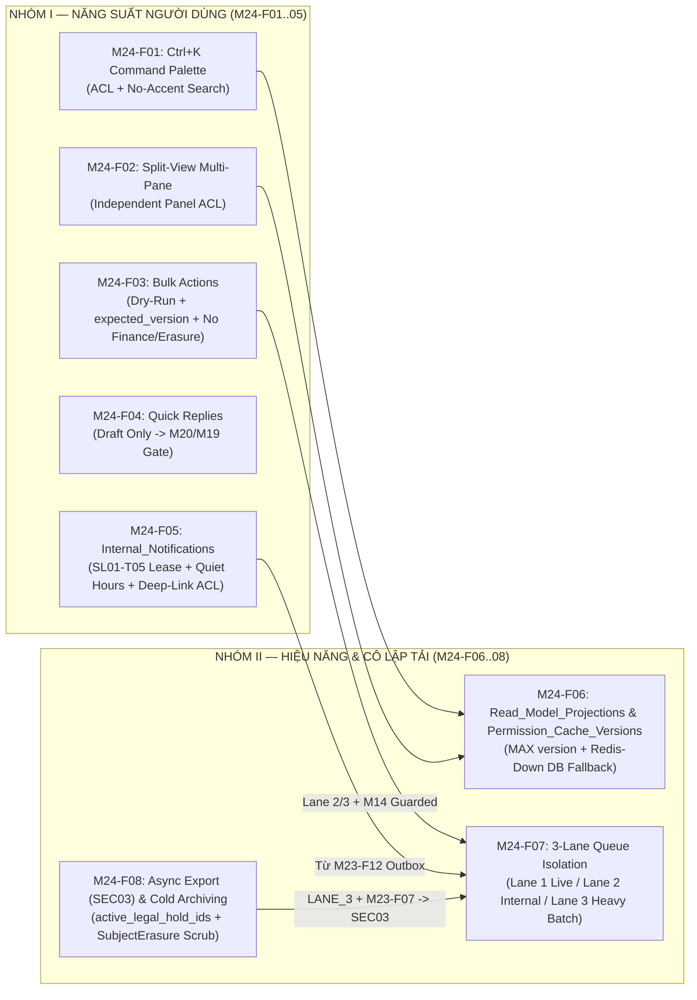
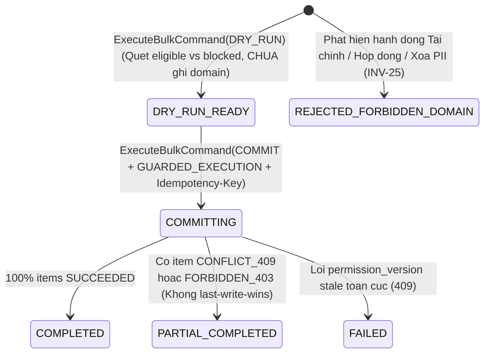
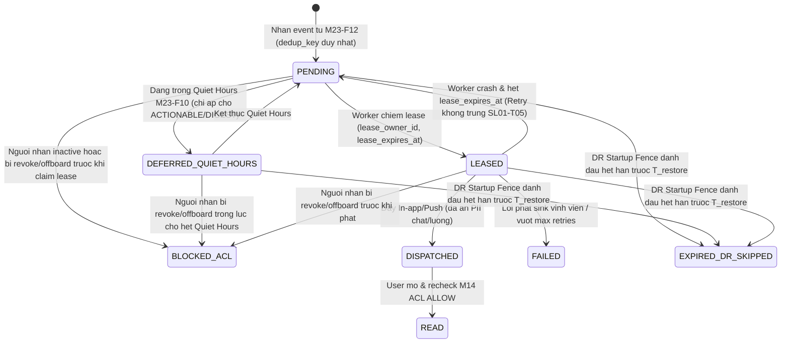
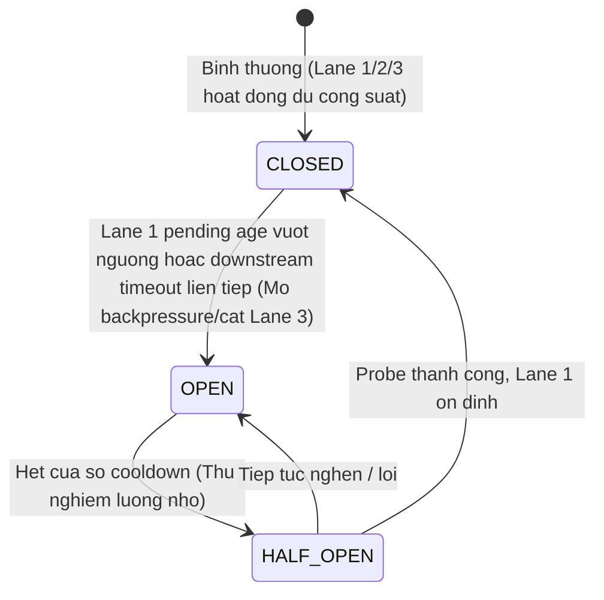
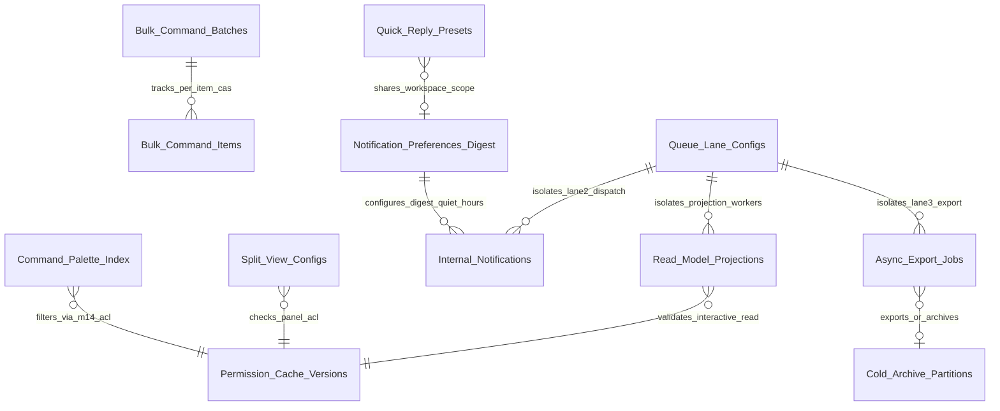

# M24 — Lớp Tăng Hiệu năng Hệ thống & Hiệu suất Người dùng

Đặc tả chi tiết cấp Module & Chức năng (`Per-Module & Per-Function Spec`) cho **M24** (`[PROPOSED]` Mở rộng Nền tảng từ Master `v1.9` — chuẩn hóa theo `CR-20261116-WAVE1-5-HARDENING`), dẫn xuất từ [CRM_MASTER_BRD_SRS_HOP_NHAT.md](../../00-master/CRM_MASTER_BRD_SRS_HOP_NHAT.md) (`v1.9`). Tài liệu thuộc giai đoạn `Documentation-Only`; chưa có mã nguồn ứng dụng, chưa chạy benchmark/migration DB và mọi ca kiểm thử đều ở trạng thái `Not Run`.

---

## 1. Manifest

- **Baseline nguồn:** [CRM_MASTER_BRD_SRS_HOP_NHAT.md](../../00-master/CRM_MASTER_BRD_SRS_HOP_NHAT.md), Phiên bản `1.9`, `SHA-256: b6a3279f328e96e1e97d845e209be7a326516a0dba5e3a033d88e1f2162e421c`.
- **Mục nguồn trong Master v1.9:**
  - Chương `3`: `3.3` (`Omnichannel Inbox`), `3.10` (`Work Management`), `3.14` (`Task Core W-F03/04/05`)
  - Chương `5`: `5.1` (`11 cột gốc + legal_entity_id` thành **12 cột chuẩn `Nhóm A`**, `L2487–2553`), `5.14` (`Index & RLS ngoài SQL: search, cache, storage, vector`, `L2796`)
  - Chương `6`: `6.1` (`Deny-wins`, cache/index có `permission_version` & `revoke propagation`, `L3106`), `6.2` (`Export backend`, thoát công thức CSV, che dữ liệu autocomplete/notification/log, `Download Gateway`, `L3118–3122`), `6.4` (`Retention & Legal Hold`, `L3176–3181`), `6.6` (`Bảo mật thông báo công việc & recheck deep-link`, `L3196–3225`), `6.8` (`Ẩn tuyệt đối dữ liệu HR/lương`, `L3243–3260`)
  - Chương `7`: `7.1` (**`NFR01`**, **`NFR02`**, **`NFR03`**, **`NFR04`**, **`NFR05`**, **`NFR06`**, **`NFR07`**, **`NFR09`**, **`NFR10`**, **`NFR11`**, **`NFR12`**, `L3265–3283`), `7.2` (`Circuit breaker & Bulkhead`, `L3288`), `7.4` (`Tìm kiếm tiếng Việt có/không dấu, mask SĐT, PWA`, `L3298`), `7.6` (`ONFR01–04`, `L3310–3316`), `7.7` (`Profile 50 concurrent users, 100.000 tasks, 1M events, p95 <= 1s, nhắc hạn <= 60s, deep-link recheck ACL`, `L3321–3339`), `7.8` (`P-NFR06` CSV neutralize `=,+,-,@` & tab/control leading)
  - Chương `9`: `U16`, `U17`, `U21`, `U24`, `INT23`, `INT26`, `CEO-U18`, `SL01-T05`.
- **Status:** `Reviewed; CR-20261116-SKILL-TEMPLATE-ALIGN` *(Bản nâng chuẩn Wave 1.5 theo [CR-20261116-WAVE1-5-HARDENING](../changes/archive/CR-20261116-WAVE1-5-HARDENING.md) — đủ 6 phần `MODULE-SPEC.md`, EARS, `12` bảng tách rời `1 bảng = 1 dòng` gồm đủ `10` bảng chuẩn hóa + `2` bảng `F08`, & hợp đồng `C24`, vượt Re-Audit Wave 1.5; `GAP-02`/`GAP-18` giữ Fail-Closed trước khi sinh DDL/Code; mọi ca kiểm thử ở trạng thái `Not Run`)*
- **Approved_Scope:** `Wave 1.5 M24 Performance, Bulk Actions, Internal Notifications, Cache & 3-Lane Queue (M24-F01..08, C24)`
- **Approved_By:** `Chủ dự án`
- **Decision_Ref:** `CR-20261116-WAVE1-5-HARDENING; CR-20261116-SKILL-TEMPLATE-ALIGN`
- **Approved_At:** `2026-11-16`
- **Domain Owner & Vai trò chịu trách nhiệm:**
  - **Accountable Business Role:** Product UX Lead (năng suất thao tác `M24-F01..05`, `NFR09`, `U24`).
  - **Technical Owner & Reviewer:** Tech Lead / Platform Architect & SRE Lead (Read Model, `Permission_Cache_Versions`, cô lập 3 làn Queue `M24-F07`, Async Export & Archiving `M24-F08`, `NFR01–07`).
- **Ranh giới *Single Source of Truth* (`INV-02`, `INV-03`, `INV-04`, `INV-05`, `INV-06`, `INV-23..25`, `ADR-003..007`):**
  - **`M24` sở hữu độc quyền (`12 Bảng Tách rời` — `10` bảng cốt lõi + `2` bảng `F08`):** `Command_Palette_Index`, `Split_View_Configs`, `Bulk_Command_Batches`, `Bulk_Command_Items`, `Quick_Reply_Presets`, `Notification_Preferences_Digest`, **`Internal_Notifications`** *(thay thế tên ma `notification_intents`)*, `Permission_Cache_Versions`, `Read_Model_Projections`, `Queue_Lane_Configs`, `Async_Export_Jobs`, `Cold_Archive_Partitions`.
  - **`M24` KHÔNG sở hữu quyền hay dữ liệu nghiệp vụ gốc (`INV-03`, `INV-04`, `INV-25`, `ADR-003`):**
    - `Permission_Cache_Versions` chỉ là **bản chiếu Read-Model** từ SSoT **`M14.Principal_Permission_Versions`**, cập nhật đơn điệu theo `MAX(permission_version)` để miễn nhiễm out-of-order; khi Redis/Cache sập, `M24-F06` fallback thẳng về Primary DB `M14` (`INV-25`); mọi tác vụ `GUARDED_EXECUTION` (`M24-F03` Bulk, `M24-F08` Export, `M19` Worker, `Download Gateway SEC03`) kiểm trực tiếp Primary DB `M14` (`409 AUTH_PERMISSION_VERSION_STALE` / `401/403`).
    - `Read_Model_Projections` và `Command_Palette_Index` chỉ là projection chỉ đọc, **cấm biến thành nguồn ghi nghiệp vụ (`INV-03`)** và luôn mang `source_event_version` + `last_refreshed_at`.
  - **`M24` vs `M23` (Export 2 lớp, Lịch/Mẫu, Outbox & DR Fence — `INV-23`, `INV-24`):**
    - `M24-F04` (`Quick_Reply_Presets`) lấy nguồn mẫu từ `M23-F11.Shared_Templates`; chỉ đổ nội dung nháp vào composer, gửi thật vẫn qua `M20-F03` & `M19-F03`.
    - `M24-F05` (`Internal_Notifications`) nhận event từ `M23-F12.Internal_Outbox_Events` (`Lane 2`), tôn trọng `M23-F10.System_Calendars.quiet_hours`, dùng lease dedup `SL01-T05`, ẩn tuyệt đối PII chat & lương `M22`, và recheck ACL `M14` khi mở deep-link.
    - `M24-F08` (**Async Export**) chỉ chạy nền sau khi `M23-F07` duyệt `Export_Requests` (2 lớp + Watermark), đăng ký tệp vào `M23.Assets`/`Asset_Versions` (`EXPORT_BUNDLE`), và phát qua **`Download Gateway SEC03`** (`INV-24`, `ADR-006`).
    - Khi **`DR Startup Fence`** (`M23-F12`, `ADR-007`), `M24` khóa toàn bộ 3 làn Queue, **xóa trắng 100% `Permission_Cache_Versions` + Redis**, và **đánh dấu hết hạn (`EXPIRED_DR_SKIPPED`) toàn bộ `Internal_Notifications` cũ trước `T_restore`**.
  - **`M24` vs `M20` (Erasure & Multi-`Legal_Hold`):** `M24` tiêu thụ `M20.SubjectErasureExecuted` (`erased_subject_refs[]`) để scrub `Command_Palette_Index`, `Read_Model_Projections`, `Notification_Preferences_Digest`, `Internal_Notifications` & `Cold_Archive_Partitions`; `M24-F08` Archiving/Purge kiểm tra cứng mảng `active_legal_hold_ids uuid[]` (không xóa khi có Hold) và đối soát qua `M20.VerifyPostRestoreComplianceGate`.
- **Public Contracts cung cấp (`02-specs/contracts/`):**
  - [M24-PRODUCTIVITY-CACHE-QUEUE.md](../contracts/M24-PRODUCTIVITY-CACHE-QUEUE.md) (`C24` — `ExecuteDryRunAndCommitBulkCommand`, `EnqueueInternalNotificationDispatch`, `QueryOrInvalidatePermissionCache`, `EnqueueQueueLaneTask`, 3 Published Events & 14+ Subscribed Event Streams gồm đủ sự kiện `M14`, `M16`, `M20`, `M23`).
- **Core vs Industry-Pack Boundary:** `M24-F05/06/07` là **Platform Core (`P0`, `SL00–SL02+`)**; `M24-F01/02/03/04` mở dần từ `SL01–SL06` (`P0/P1`); `M24-F08` (`Async Export & Cold Archiving`) kích hoạt đầy đủ từ `SL04–SL07` (`P1`).
- **Read first:** [INVARIANTS.md](../../01-architecture/INVARIANTS.md), [INDEX.md](../../01-architecture/INDEX.md), [M24-PRODUCTIVITY-CACHE-QUEUE.md](../contracts/M24-PRODUCTIVITY-CACHE-QUEUE.md), [M23-SYSTEM-ADMIN-SECURITY-OPS.md](M23-SYSTEM-ADMIN-SECURITY-OPS.md).
- **Read on demand:** [ADR-002](../../01-architecture/decisions/ADR-002-ORG-ISOLATION-RLS-AND-SCOPE-FILTER.md) .. [ADR-007](../../01-architecture/decisions/ADR-007-PRIVACY-CANONICAL-HASH-LEGAL-HOLD-AND-DR-FENCE.md), [M14-PRINCIPAL-ACCESS-DECISION.md](../contracts/M14-PRINCIPAL-ACCESS-DECISION.md), [M16-TASK-CORE-COMMANDS.md](../contracts/M16-TASK-CORE-COMMANDS.md), [M20-SUPPRESSION-PRIVACY-GATE.md](../contracts/M20-SUPPRESSION-PRIVACY-GATE.md), [GAPS.md](../../03-planning/GAPS.md).
- **Allowed write paths (Giai đoạn hiện tại):** Chỉ cập nhật tài liệu trong `02-specs/` (`Documentation-Only`); chưa mở `application_write_scope`.

---

## 2. Requirement trace

### 2.1. Danh mục 8 Chức năng Đề xuất Sở hữu bởi `M24` (`M24-F01..08`)

| ID nguồn | Source anchor/line | Ý nghĩa | Owner/consumer | Hành vi / Contract | Priority | Applicability | Test | Evidence |
|---|---|---|---|---|---|---|---|---|
| `M24-F01` | Master `7.1 NFR09`, `7.4` (`L3298`), `U24` + `[PROPOSED]` | `Command Palette (Ctrl+K)` & Phím tắt tác vụ nhanh (`<= 3` thao tác, tìm tiếng Việt có/không dấu, lọc ACL/che PII) | Owner: `M24` / Consumers: `M01–M22` | `### 3.1 M24-F01` | `P0/P1` | Từ `SL01–SL03` | `PF-T01`, `NFR09`, `U24` | Not Run |
| `M24-F02` | Master `3.3`, `3.10`, `3.14`, `7.1 NFR02` + `[PROPOSED]` | `Split-View Workspace` đa khung (`Inbox + 360 + Task/Deal`), kiểm ACL từng panel (`INV-02`) & tối ưu tải 4G (`NFR02 <= 2s`) | Owner: `M24` / Consumers: `M01/02/03/11/16` | `### 3.2 M24-F02` | `P1` | Từ `SL02–SL04` | `PF-T02`, `NFR02` | Not Run |
| `M24-F03` | Master `6.1/6.2`, `INV-09`, `INV-25` + `[PROPOSED]` | `Bulk Actions` có `Dry-run Preview`, `expected_version`, `GUARDED_EXECUTION`, `Audit_Logs`; cấm tuyệt đối cho Tài chính/Hợp đồng/Erasure | Owner: `M24` / Consumers: `M02/03/11/13/16` | `### 3.3 M24-F03`, `C24` | `P1` | Từ `SL03–SL06` | `PF-T03`, `INT23` | Not Run |
| `M24-F04` | Master `3.3`, `M03-F04`, `M20`, `M23-F11` + `[PROPOSED]` | Thư viện `Quick Replies / Macro` đa kênh (`Quick_Reply_Presets`); chỉ chèn nháp, gửi vẫn qua `M20-F03` & `M19-F03` | Owner: `M24` / Consumers: `M03`, `M11` | `### 3.4 M24-F04` | `P0/P1` | Từ `SL02–SL04` | `PF-T04` | Not Run |
| `M24-F05` | Master `6.6`, `6.8`, `7.7` (`L3328, 3338`), `SL01-T05` + `[PROPOSED]` | `Smart Notification Center` (`Internal_Notifications`), `Digest` & `Quiet Hours` (`M23-F10`), lease dedup `SL01-T05`, ẩn PII chat/lương, recheck ACL | Owner: `M24` / Consumers: `M01–M23` | `### 3.5 M24-F05`, `C24` | `P0` | Từ `SL01–SL06` | `PF-T05`, `SL01-T05` | Not Run |
| `M24-F06` | Master `6.1`, `7.1 NFR01–03`, `INV-03/04/06/25` + `[PROPOSED]` | `Read Model Projections` (`source_event_version`) & `Permission_Cache_Versions` (đơn điệu `MAX()`, fallback DB khi Redis sập, tiêu thụ đủ sự kiện `M16`) | Owner: `M24` / Consumers: `M01–M23` | `### 3.6 M24-F06`, `C24` | `P0` | Từ `SL00–SL07` | `PF-T06`, `NFR01`, `NFR02` | Not Run |
| `M24-F07` | Master `7.2` (`L3288`), `7.6`, `7.8`, `ADR-005` + `[PROPOSED]` | `Queue Priority Isolation` (`LANE_1..3`), Backpressure & Circuit Breaker (`GAP-18`) bảo vệ luồng Live Webhook & Tiền | Owner: `M24` / Consumers: `M16/18/19/21/22/23` | `### 3.7 M24-F07`, `C24` | `P0` | Từ `SL00–SL07` | `PF-T07`, `NFR03`, `ONFR02` | Not Run |
| `M24-F08` | Master `6.2`, `6.4`, `7.8 P-NFR06`, `INV-24` + `[PROPOSED]` | `Unified Async Export` (sau `M23-F07` qua `SEC03`, thoát CSV) & `Lifecycle Archiving/Partitioning` (tôn trọng `active_legal_hold_ids`, scrub `SubjectErasureExecuted`) | Owner: `M24` / Consumers: `M18/19/20/23` | `### 3.8 M24-F08` | `P1` | Từ `SL04–SL07` | `PF-T08`, `U21`, `CEO-U18` | Not Run |

### 2.2. Truy vết Yêu cầu Master v1.9, NFR Hiệu năng & Liên Module (`NFR01–12`, `ONFR*`, `7.7`, `GAP-18`)

| ID / Mục nguồn | Source anchor/line | Ý nghĩa trong ngữ cảnh `M24` | Vai trò của `M24` | Hành vi / Contract | Priority | Applicability | Test | Evidence |
|---|---|---|---|---|---|---|---|---|
| `NFR01` | Master `7.1` (`L3271`) | `P95 API nội bộ đọc/ghi <= 800 ms` trên dữ liệu `100.000 contacts` và `1 triệu activities` (loại thời gian API ngoài báo riêng) | `Performance & Read-Model Enabler` (`M24-F06`) | `### 3.1–3.8`, `C24` | `P0` | Benchmark trước mở rộng (`SL02+`) | `PF-T06`, `NFR01` | Not Run |
| `NFR02` | Master `7.1` (`L3272`) | **`P95 mở danh sách Lead <= 2 giây trên mạng 4G mô phỏng`**; ghi rõ thiết bị, RTT, bandwidth | `Frontend Bundle & Read-Model Optimizer` (`M24-F02/06`) | `### 3.2/3.6`, `Mục 5.2` | `P0` | Benchmark `SL02/SL03+` | `PF-T02`, `PF-T06`, `NFR02` | Not Run |
| `NFR03` | Master `7.1` (`L3273`) | `50 phiên hoạt động`, `10 req/s` duy trì `30 phút`, burst `50 req/s` trong `5 phút`; lỗi nội bộ `< 1%`, không mất ghi | `3-Lane Queue & Backpressure Owner` (`M24-F07`) | `### 3.7 M24-F07`, `C24 §2.4` | `P0` | Load profile mục tiêu (`SL00+`) | `PF-T07`, `NFR03` | Not Run |
| `NFR04`, `ONFR01..04` | Master `7.1` (`L3274`), `7.6` (`L3312–3315`) | Webhook ACK `p95 <= 2s` (`ONFR02 <= 1s` nội bộ), Inbox hiển thị `<= 5s`, backlog bình thường `< 60s`, chịu burst `50 event/s` `60s` | `Lane 1 Isolation & Projection Enabler` (`M24-F06/07`) | `### 3.7 M24-F07`, `C24 §2.4` | `P0` | Từ `SL02` | `PF-T07`, `ONFR01..04` | Not Run |
| `NFR06`, `U21`, `INT26`, `CEO-U18`, `INT23` | Master `7.1` (`L3276`), `9.5` (`L3564`), `9.10` (`L3645, 3648`), `9.12` (`L3705`) | DR Restore xóa trắng 100% `Permission_Cache_Versions` + hủy `Internal_Notifications` quá khứ trước `T_restore`; `Async Export` & `Bulk` kiểm `GUARDED_EXECUTION` chống revoke ngầm | `Cache Reset & Guarded Execution Enforcer` (`ADR-003/007`) | `### 3.1–3.8`, `C24` | `P0` | Từ `SL00+` | `PF-T08`, `U21`, `INT23` | Not Run |
| `NFR07` | Master `7.1` (`L3277`) | `0` truy cập chéo tenant/workspace trên Search (`Command_Palette_Index`), Cache, Read Model, Notification & Async Export | `Zero Cross-Tenant Leak Enforcer` (`M14` + `M24`) | `### 3.1–3.8`, `C24` | `P0` | Mọi release (`SL00+`) | `PF-T01..08`, `U17` | Not Run |
| `NFR09` & `U24` | Master `7.1` (`L3279`), `9.5` (`L3568`) | Tạo `Next Action`, ghi kết quả gọi, mở khách từ task trong `<= 3 thao tác điều hướng`; `>= 90%` pilot hoàn thành không trợ giúp | `UX Productivity Owner` (`M24-F01/02/04`) | `### 3.1 M24-F01`, `Mục 5.1` | `P0` | Từ `SL01–SL03` | `PF-T01`, `U24` | Not Run |
| `NFR10` & `NFR11` | Master `7.1` (`L3280–3281`) | `NFR10`: Thao tác bàn phím đầy đủ trên Command Palette/Split-View/Notification, WCAG AA; `NFR11`: Correlation & cấm PII/secret trong log/push | `UI A11y & Notification Redaction Owner` (`M24-F01..05`) | `### 3.1–3.8`, `C24` | `P0` | Mọi release (`SL00+`) | `PF-T01`, `PF-T05` | Not Run |
| `P-NFR06` & `NFR12` | Master `7.8` (`L3349`), `7.1` (`L3282`) | CSV export neutralize `=,+,-,@` và tab/control leading theo context mà không làm hỏng số âm hợp lệ; hỗ trợ export nền quy mô lớn | `Async Export Sanitizer` (`M24-F08`) | `### 3.8 M24-F08`, `Mục 5.2` | `P0/P1` | Khi bật Export (`SL04+`) | `PF-T08`, `P-NFR06` | Not Run |
| `7.7` (`Task Core NFR`) & `SL01-T05` | Master `7.7` (`L3323–3339`), [SL01](../slices/SL01-INTERNAL-WORK.md) (`L163`) | Profile `50` user, `100k` task, `1M` event; Board `p95 <= 1s`, reminder `p95 <= 60s`; lease dedup `SL01-T05`; tiêu thụ đủ sự kiện `M16` | `Task Projection & Notification Delivery` (`M24-F05/06`) | `### 3.1–3.8`, `C24` | `P0` | Từ `SL01+` | `PF-T05`, `PF-T06`, `SL01-T05` | Not Run |
| `GAP-18` | [GAPS.md](../../03-planning/GAPS.md) | Chưa chốt công nghệ Read Model/Search/Queue (`M24-F01/06/07/08`) và chu kỳ Archiving trước khi chọn stack thật (`GAP-02`) | `Platform Architecture Open Parameter` (`4.3`) | `Mục 4.3` | `P0/P1` | Chốt trước benchmark & code | `PF-T07`, `[OPEN-GAP: GAP-18]` | Not Run |

---

## 3. Hành vi

### 3.0A. Tổng quan Cơ chế Hoạt động của Module `M24` (`Executive & Business Walkthrough`)

Nếu `M23` là "Bộ khung An toàn & Cấu hình Nền tảng", thì **`M24` là "Động cơ Tăng tốc Thao tác Người dùng & Cô lập Tải Hệ thống"**, giải quyết bài toán hai mặt trong vận hành CRM thực tế: nhân viên xử lý việc hằng ngày dưới `3` thao tác (`NFR09`), còn hệ thống vẫn mượt mà ở `4G <= 2s` (`NFR02`) ngay cả khi chạy chiến dịch hoặc xuất dữ liệu nặng (`ADR-005`):

1. **Nhóm I — Hiệu suất Thao tác Người dùng (`M24-F01..05`):**
   - **`Ctrl+K` Command Palette (`M24-F01`)** tìm kiếm tiếng Việt có/không dấu qua `Command_Palette_Index` (luôn lọc `M14.CompileScopeFilter` để không lộ số lượng hay PII ngoài quyền).
   - **`Split-View Workspace` (`M24-F02`)** ghép Inbox + Hồ sơ 360 + Task/Deal trên 1 màn hình nhưng mỗi panel kiểm quyền độc lập (`INV-02`).
   - **`Bulk Actions` (`M24-F03`)** luôn đi qua **Dry-run Preview** + `expected_version` + `GUARDED_EXECUTION`, và bị **khóa cứng** khỏi mọi nghiệp vụ tài chính, ký hợp đồng hay xóa dữ liệu cá nhân (`INV-25`).
   - **`Quick Replies / Macro` (`M24-F04`)** đọc mẫu phiên bản từ `M23-F11` điền nháp nhanh, giữ nguyên cổng gửi `M20-F03` & `M19-F03`.
   - **`Smart Notification Center` (`M24-F05`)** dùng bảng **`Internal_Notifications`** với lease dedup `SL01-T05`, ẩn PII chat/lương, tôn trọng `Quiet Hours` (`M23-F10`), và luôn ép recheck ACL `M14` khi mở deep-link.
2. **Nhóm II — Hiệu năng Hệ thống & Tối ưu Tải (`M24-F06..08`):**
   - **`Read Model & Permission Cache` (`M24-F06`):** Duy trì `Read_Model_Projections` (`source_event_version`) và bản chiếu `Permission_Cache_Versions` (chỉ giữ `MAX(permission_version)`, fallback về Primary DB `M14` khi Redis/Cache sập `INV-25`).
   - **`Queue Priority Isolation` (`M24-F07`):** Cô lập **3 làn (`LANE_1`, `LANE_2`, `LANE_3`)** cùng backpressure/circuit breaker (`GAP-18`) bảo vệ tuyệt đối luồng webhook live và thanh toán.
   - **`Unified Async Export & Cold Archiving` (`M24-F08`):** Chạy xuất báo cáo nền sau `M23-F07` qua `Download Gateway SEC03`, phân vùng dữ liệu lạnh `Cold_Archive_Partitions` tôn trọng `active_legal_hold_ids[]` và scrub sạch khi nhận `M20.SubjectErasureExecuted`.

---

### 3.0B. Mô hình Máy trạng thái Cốt lõi (`Core State Machines`)

#### A. Vòng đời Lệnh Hàng loạt (`Bulk_Command_Batches.status` — `M24-F03`)

#### B. Vòng đời Thông báo Nội bộ (`Internal_Notifications.status` — `M24-F05`, `SL01-T05`)

#### C. Vòng đời Mạch Bảo vệ Làn Hàng đợi (`Queue_Lane_Configs.circuit_breaker_state` — `M24-F07`, `GAP-18`)

---

### 3.1. `M24-F01` — `Command Palette (Ctrl+K)` & Phím tắt Tác vụ Nhanh (`NFR09`, `U24`)

- **Mục tiêu & Phạm vi:** Giúp người dùng tìm nhanh đối tượng (`Contact`, `Lead`, `Deal`, `Ticket`, `Task`, `Contract`) bằng tiếng Việt có/không dấu và thực thi các tác vụ phổ biến (`Tạo Next Action`, `Ghi kết quả gọi`, `Mở khách từ Task`) trong **tối đa `3` thao tác điều hướng (`NFR09`, `U24`)**, đồng thời khóa tuyệt đối rò rỉ dữ liệu ngoài quyền qua autocomplete/count (`6.2`, `NFR07`).
- **Tác nhân & Kích hoạt:** Mọi người dùng `ACTIVE` bấm `Ctrl+K` / `Cmd+K` hoặc dùng phím tắt trên giao diện web/PWA (`GET /productivity/v1/command-search`).
- **Tiền điều kiện & Đầu vào bắt buộc:**
  - Phiên `ACTIVE` qua `M14.EvaluateAccessDecision(INTERACTIVE_READ)`; `query_text` (`>= 1` ký tự), `entity_types[]`, `limit` (`<= 20`), `correlation_id`.
  - Mọi truy vấn vào `Command_Palette_Index` bắt buộc nối ghép điều kiện `M14.CompileScopeFilter` trước phân trang/đếm (`INV-02`).
- **Mô tả Nghiệp vụ & Cơ chế Hoạt động Từng bước (`Step-by-Step Operational Flow`):**
  1. **Tìm kiếm Có/Không dấu & Mask PII (`7.4 L3298`):** Nhân viên gõ `"nguyen van a"` hoặc `"0909"` vào `Ctrl+K`. Backend chuẩn hóa chuỗi không dấu tiếng Việt, chạy query trên `Command_Palette_Index` đã gắn `M14.CompileScopeFilter`: các bản ghi `PERSONAL` hoặc thuộc chi nhánh/workspace khác bị loại bỏ 100% ở DB (**không trả `total_count` của tập ngoài quyền**), SĐT hiển thị dạng che (`0909***123` theo `field_policy` của `M14`).
  2. **Thực thi Nhanh $\le 3$ Thao tác (`NFR09`, `U24`) — Ví dụ Thực tế:** Khi đang xem một `Task` nhắc gọi khách (`M16`), nhân viên chỉ cần: (1) bấm phím tắt `C` / mở `Ctrl+K` $\rightarrow$ chọn *"Ghi kết quả cuộc gọi & tạo Next Action"*, (2) nhập tóm tắt + chọn hạn mới, (3) bấm `Enter` lưu $\rightarrow$ hoàn tất trong đúng `2–3` thao tác mà không phải nhảy qua 5 màn hình rời rạc.
- **Quy tắc Hành vi (Chuẩn EARS):**
  1. `[MASTER]` + `[PROPOSED]` **Ubiquitous (`7.1 NFR09`, `7.4 L3298`, `U24`):** `M24-F01` phải hỗ trợ tìm kiếm tiếng Việt có dấu và không dấu qua `Command_Palette_Index` và cho phép hoàn thành các thao tác tạo Next Action, ghi kết quả cuộc gọi, mở hồ sơ khách hàng từ Task trong tối đa `3` thao tác điều hướng.
  2. `[MASTER]` + `[PROPOSED]` **Unwanted/Error (`6.2 L3118`, `NFR07`, `W-T36`, `INV-02`):** Mọi kết quả autocomplete, snippet và bộ đếm trả về từ `M24-F01` bắt buộc áp dụng `M14.CompileScopeFilter` và `field_policy` trước khi phản hồi; cấm tuyệt đối hiển thị `title`, SĐT thô hay số lượng bản ghi mà người gọi không có quyền truy cập.
- **Xử lý Đồng thời, Idempotency & Side Effects:**
  - `Command_Palette_Index` cập nhật bất đồng bộ qua `M23-F12` và bị scrub ngay khi nhận `M20.SubjectErasureExecuted` (`erased_subject_refs[]`).

---

### 3.2. `M24-F02` — `Split-View Workspace` Đa khung & Tối ưu Mở Danh sách `4G` (`NFR02`)

- **Mục tiêu & Phạm vi:** Hiển thị đồng thời 3 khung làm việc trên một màn hình (`Hàng đợi trái` $\rightarrow$ `Khung xử lý Inbox/Task giữa` $\rightarrow$ `Hồ sơ 360 + Deal/Ticket/Task liên quan bên phải`) lưu cấu hình cá nhân trong `Split_View_Configs`, áp kiểm quyền độc lập từng panel (`INV-02`), và tối ưu gói dữ liệu + cursor pagination để đạt **`NFR02` (`P95 mở danh sách Lead <= 2 giây trên mạng 4G mô phỏng`)**.
- **Tác nhân & Kích hoạt:** Agent CSKH (`M03`), Sales (`M02`), Delivery/Ops (`M16`) mở màn hình Split-View (`GET/PUT /productivity/v1/split-view-configs`).
- **Tiền điều kiện & Đầu vào bắt buộc:**
  - Phiên `ACTIVE`; `workspace_id`, `layout_code` (`INBOX_360 | LEAD_DEAL_360 | TASK_CONTEXT_360`), `panel_preferences_json`, `expected_version`.
  - Mỗi panel truy xuất qua endpoint riêng biệt của domain tương ứng kèm `M14.EvaluateAccessDecision` / `CompileScopeFilter`.
- **Mô tả Nghiệp vụ & Cơ chế Hoạt động Từng bước (`Step-by-Step Operational Flow`):**
  1. **Kiểm Quyền Độc lập Từng Panel (`INV-02`, `6.1`):** Agent CSKH mở được hội thoại Zalo ở khung giữa (`M03`), nhưng khi khung phải tải khối Hợp đồng/Công nợ (`M08/M09`) hoặc bảng lương (`M22`), API của panel đó kiểm `M14` riêng: nếu thiếu grant, **chỉ panel tương ứng hiển thị trạng thái `Permission Denied`**, tuyệt đối không lấy quyền đọc hội thoại làm vé thông hành mở dữ liệu tài chính.
  2. **Tối ưu Truy vấn Đạt `NFR02` Trên Mạng `4G` Mô phỏng (`7.1 L3272`):** Danh sách bên trái đọc từ `Read_Model_Projections` với cursor pagination cố định (`50` dòng + tie-break `id`), trường payload tối giản (không đính kèm toàn bộ timeline/attachments nặng), nén HTTP (`Brotli/Gzip`), và prefetch có kiểm soát — bảo đảm mục tiêu thiết kế **`p95 <= 2 giây`** trên cấu hình `4G` mô phỏng được ghi rõ thiết bị, RTT và bandwidth (`4.3` & `6.2`).
- **Quy tắc Hành vi (Chuẩn EARS):**
  1. `[PROPOSED]` **Ubiquitous (`INV-02`, `6.1`, `M24-F02`):** `M24-F02` phải tách biệt lời gọi tải dữ liệu và kiểm quyền `M14` cho từng panel trong `Split_View_Configs`; quyền mở hội thoại/task ở khung giữa tuyệt đối không được tự mở dữ liệu hợp đồng, tài chính hay lương ở khung bên phải.
  2. `[MASTER]` **Ubiquitous (`7.1 NFR02`):** Danh sách khởi tạo và chuyển trang trong `Split-View` / List View phải dùng Read Model tối giản trường + phân trang cursor cố định để hướng tới ngưỡng mục tiêu kiểm tải `p95 <= 2 giây` trên mạng `4G` mô phỏng (có khai báo rõ hồ sơ thiết bị, RTT và bandwidth).
- **Xử lý Đồng thời, Idempotency & Side Effects:**
  - Lưu `Split_View_Configs` dùng `expected_version`; thay đổi layout không tác động dữ liệu nghiệp vụ gốc.

---

### 3.3. `M24-F03` — `Bulk Actions` Có `Dry-run`, `expected_version` & Khóa Miền Nhạy cảm (`INV-25`)

- **Mục tiêu & Phạm vi:** Cho phép người dùng thao tác hàng loạt an toàn (`gán owner`, `gắn/gỡ thẻ`, `đổi hạn`, `snooze`, `đóng tác vụ không liên quan tiền`) thông qua quy trình bắt buộc **`DRY_RUN -> COMMIT`**, kiểm tra `GUARDED_EXECUTION` + `expected_row_version` trên từng item, ghi `Bulk_Command_Batches` & `Bulk_Command_Items`, và **cấm tuyệt đối dùng Bulk Action cho duyệt tài chính, ký hợp đồng hay xóa PII (`INV-25`)**.
- **Tác nhân & Kích hoạt:** `Sales Manager`, `Team Lead`, `Ops Admin` gọi `C24.ExecuteDryRunAndCommitBulkCommand`.
- **Tiền điều kiện & Đầu vào bắt buộc:**
  - `mode` (`DRY_RUN | COMMIT`), `expected_permission_version` (`NN` cho `GUARDED_EXECUTION`), `domain_module` (`M02 | M03 | M11 | M13 | M16`), `command_type` (thuộc allowlist an toàn), `items[]` (mỗi phần tử bắt buộc có `resource_type`, `resource_id`, `expected_row_version`), `reason` (`NN`), `Idempotency-Key`.
  - Bắt buộc đã chạy `DRY_RUN` tạo `dry_run_batch_id` hợp lệ trước khi gọi `COMMIT`.
- **Mô tả Nghiệp vụ & Cơ chế Hoạt động Từng bước (`Step-by-Step Operational Flow`):**
  1. **Chặn Cứng Miền Nhạy cảm (`INV-25`):** Ngay đầu hàm, nếu caller cố truyền `APPROVE_PAYMENT`, `PAYOUT_COMMISSION`, `SIGN_CONTRACT`, `APPROVE_PAYROLL`, `ERASE_PII` hoặc nhắm vào `M08/M09/M10/M17/M20/M22`, hệ thống từ chối ngay **`403 BULK_ACTION_FORBIDDEN_FOR_SENSITIVE_DOMAIN`**.
  2. **Bước 1 — `DRY_RUN` Preview:** Quét danh sách `items[]`, kiểm `M14` quyền trên từng bản ghi và điều kiện state machine nguồn (ví dụ Task đã `DONE` không đổi owner) $\rightarrow$ trả báo cáo chính xác bao nhiêu dòng `PREVIEW_ELIGIBLE` và bao nhiêu dòng `PREVIEW_BLOCKED` (kèm `error_code` từng dòng) mà chưa sửa DB.
  3. **Bước 2 — `COMMIT` Theo Chunk & `GUARDED_EXECUTION`:** Khi bấm `COMMIT`, `M24-F03` kiểm `M14.EvaluateAccessDecision(GUARDED_EXECUTION, expected_permission_version)` (nếu quyền vừa bị thu hồi $\rightarrow$ `409 AUTH_PERMISSION_VERSION_STALE` dừng toàn bộ batch `CEO-U18`). Các dòng hợp lệ chạy theo chunk nhỏ qua command chuẩn của module nguồn kèm `expected_row_version`: dòng nào vừa bị người khác sửa trước đó sẽ trả riêng `CONFLICT_409` trên `Bulk_Command_Items` (tuyệt đối không last-write-wins), toàn bộ lô ghi 1 dấu vết kiểm toán vào `M23-F06.Audit_Logs`.
- **Quy tắc Hành vi (Chuẩn EARS):**
  1. `[MASTER]` + `[PROPOSED]` **Unwanted/Error (`6.1/6.2`, `INV-25`):** `M24-F03` phải từ chối ngay với mã `403 BULK_ACTION_FORBIDDEN_FOR_SENSITIVE_DOMAIN` mọi lệnh Bulk tác động tới phê duyệt tài chính/chi tiền/hoa hồng (`M09/M10/M17/M22`), ký/duyệt hợp đồng (`M08`), hoặc xóa dữ liệu cá nhân (`M20`).
  2. `[MASTER]` + `[PROPOSED]` **Precondition (`INV-09`, `INV-25`, `CEO-U18`):** Mọi lệnh `COMMIT` của `M24-F03` bắt buộc phải qua bước `DRY_RUN` trước (`422 DRY_RUN_REQUIRED` nếu thiếu `dry_run_batch_id`), chạy kiểm quyền `M14.EvaluateAccessDecision(execution_mode = 'GUARDED_EXECUTION')` với `expected_permission_version`, và kiểm `expected_row_version` trên từng `Bulk_Command_Items`.
  3. `[PROPOSED]` **Ubiquitous (`6.2`, `NFR11`):** Mọi giao dịch `COMMIT` thành công hoặc thất bại từng phần phải lưu vết từng dòng trong `Bulk_Command_Items` và ghi `M23-F06.Audit_Logs` kèm `actor_id`, `reason`, `correlation_id`.
- **Xử lý Đồng thời, Idempotency & Side Effects:**
  - Chống trùng batch bằng `UNIQUE (tenant_id, workspace_id, actor_id, idempotency_key)`; chạy batch lớn trên `LANE_2`/`LANE_3` (`M24-F07`) và phát `M24.BulkCommandBatchCompleted`.

---

### 3.4. `M24-F04` — Thư viện `Quick Replies / Macro` Đa kênh (`Quick_Reply_Presets`)

- **Mục tiêu & Phạm vi:** Tăng tốc soạn thảo phản hồi trên Omnichannel Inbox (`M03`) và Ticket (`M11`) thông qua các mẫu phản hồi nhanh (`Quick_Reply_Presets`) gắn với phiên bản mẫu chuẩn tại `M23-F11.Shared_Templates`, tự điền biến ngữ cảnh hợp lệ mà không bao giờ bỏ qua cổng kiểm duyệt gửi tin `M20-F03` và năng lực kênh `M19-F03`.
- **Tác nhân & Kích hoạt:** `Agent CSKH`, `Sales`, `Team Lead` tạo/dùng preset (`GET /productivity/v1/quick-replies`, gõ phím tắt `/macro`).
- **Tiền điều kiện & Đầu vào bắt buộc:**
  - Phiên `ACTIVE` trong `workspace_id`; `preset_code`, `shortcut_key`, `channel_scope` (`ALL | EMAIL | SMS | ZALO | FACEBOOK | TIKTOK | TELEGRAM`), `shared_template_version_id` (tùy chọn trỏ `M23-F11.Shared_Templates`), `body_template`, `expected_version`.
  - Biến ngữ cảnh (`{{contact_name}}`, `{{ticket_code}}`, `{{appointment_time}}`) chỉ nạp từ các trường actor được phép đọc qua `M14 field_policy`.
- **Mô tả Nghiệp vụ & Cơ chế Hoạt động Từng bước (`Step-by-Step Operational Flow`):**
  1. **Chèn Nháp Có Lọc Quyền Biến:** Agent gõ `/hen` trong khung trả lời Ticket. `M24-F04` nạp `Quick_Reply_Presets` (khớp `channel_scope`), kiểm `M14` để chắc chắn không tự điền trường nhạy cảm bị `masked/forbidden` vào nội dung nháp, rồi đổ văn bản vào ô soạn thảo để nhân sự rà soát.
  2. **Không Gửi Tắt Bỏ Qua Cổng Pháp lý:** Nút **Gửi** trên UI/API vẫn chạy nguyên luồng chuẩn `M03-F04` $\rightarrow$ `M20-F03.EvaluateOutboundCompliance` (kiểm Consent & Suppression) $\rightarrow$ `M19-F03/F05` (kiểm `Connection_Capabilities` & cửa sổ 24h/ZBS).
- **Quy tắc Hành vi (Chuẩn EARS):**
  1. `[PROPOSED]` **Ubiquitous (`3.3`, `M03-F04`, `M20-F03`):** `M24-F04` chỉ được phép chèn nội dung mẫu `Quick_Reply_Presets` vào khung soạn thảo nháp (`composer draft`) sau khi kiểm `M14 field_policy` cho các biến ngữ cảnh; **nghiêm cấm tự động gửi thông điệp bỏ qua `M20.EvaluateOutboundCompliance` hoặc `M19.Connection_Capabilities`**.
  2. `[PROPOSED]` **Ubiquitous (`M23-F11`):** Mọi `Quick_Reply_Presets` kế thừa mẫu chuẩn hệ thống phải gắn chặt `shared_template_version_id` để thay đổi mẫu gốc không âm thầm biến đổi mẫu đã phát hành.
- **Xử lý Đồng thời, Idempotency & Side Effects:**
  - `UNIQUE (tenant_id, workspace_id, preset_code)`; cập nhật dùng CAS `expected_version`.

---

### 3.5. `M24-F05` — `Smart Notification Center`, `Digest` & `Quiet Hours` (`Internal_Notifications`, `SL01-T05`)

- **Mục tiêu & Phạm vi:** Tiếp nhận sự kiện nội bộ từ `M23-F12.Internal_Outbox_Events` (`Lane 2`) để phân phối thông báo đa mức ưu tiên (`URGENT | ACTIONABLE | DIGEST`) qua bảng **`Internal_Notifications`** *(thay thế tên ma `notification_intents`)*, bảo đảm chống trùng tuyệt đối khi worker crash (`SL01-T05` lease dedup), **ẩn tuyệt đối PII chat/lương (`6.6`, `6.8`)**, tôn trọng lịch `Quiet Hours` (`M23-F10`), và **recheck ACL `M14` khi người dùng bấm deep-link (`7.7 L3338`)**.
- **Tác nhân & Kích hoạt:** `M23-F12` Outbox Worker gọi `C24.EnqueueInternalNotificationDispatch`; Notification Worker quét `Internal_Notifications`; Người dùng đọc/cấu hình `Notification_Preferences_Digest`.
- **Tiền điều kiện & Đầu vào bắt buộc:**
  - `Notification_Preferences_Digest`: `user_id`, `channel_preferences_json`, `digest_frequency` (`REALTIME | HOURLY | DAILY_SUMMARY`), `respect_m23_calendar_id`.
  - `Internal_Notifications`: `notification_id` (`id` PK), `recipient_id`, `source_event_id`, `priority_tier` (`URGENT | ACTIONABLE | DIGEST`), `title_redacted`, `deep_link_ref`, `lease_owner_id`, `lease_expires_at`, `dedup_key`, `status`, `expires_at`.
- **Mô tả Nghiệp vụ & Cơ chế Hoạt động Từng bước (`Step-by-Step Operational Flow`):**
  1. **Lease Dedup Chống Trùng Khi Crash (`SL01-T05`):** Khi `M23-F12` giao sự kiện `M16.TaskCreated` hoặc `M23.BreakGlassApproved`, `M24-F05` chèn vào `Internal_Notifications` với **`UNIQUE NULLS NOT DISTINCT (tenant_id, workspace_id, dedup_key)`** (chống trùng tuyệt đối ngay cả khi `workspace_id IS NULL` thuộc `Nhóm B-Gov`). Worker phát push lấy job bằng `FOR UPDATE SKIP LOCKED`, gán `lease_owner_id` và `lease_expires_at` (`60s`). Nếu worker sập sau khi đẩy sang sink hỗ trợ dedup nhưng trước lúc ghi DB `DISPATCHED`, hết lease worker khác nhận lại nhưng truyền nguyên `notification_id` / `dedup_key` nên người dùng không bao giờ nhận thông báo lặp (`SL01-T05`).
  2. **Ẩn Tuyệt đối PII Chat & Dữ liệu Lương (`6.6`, `6.8`, `NFR11`):** Tiêu đề push/email ngoài chỉ ghi thông tin trung tính kiểu *"Bạn được giao xử lý Ticket #TK-209"* hoặc *"Có 1 phiếu phê duyệt mới"* — **cấm đưa nội dung tin nhắn khách hàng, SĐT/CCCD, tên task `PERSONAL` (`W-T36`), số tiền lương hay lý do nghỉ phép `M22` vào payload thông báo**.
  3. **Tôn trọng `Quiet Hours` & Recheck ACL Khi Mở Deep-Link (`7.7 L3338`, `M23-F10`):** Các tin `ACTIONABLE` / `DIGEST` rơi vào khung `Quiet Hours` của `M23-F10.System_Calendars` được hoãn tới `next_shift_start_utc` (`DEFERRED_QUIET_HOURS`). Khi người dùng bấm deep-link từ email/push để mở hồ sơ, màn hình đích bắt buộc xác thực lại session và gọi `M14.EvaluateAccessDecision`: nếu quyền đã bị thu hồi trước lúc bấm $\rightarrow$ từ chối `403/404` ngay (`W-T07`).
  4. **DR Restore Notification Expiry:** Khi chạy **Bước 2 `DR Startup Fence`**, thực thi `time-only expiry` đánh dấu `EXPIRED_DR_SKIPPED` các `Internal_Notifications` quá hạn thời gian tạo trước `T_restore`; sau đó tại **Bước 3 (`M20.VerifyPostRestoreComplianceGate` TRƯỚC khi replay `M23-F12`)**, hủy nốt toàn bộ thông báo dính xóa dữ liệu, rút consent hoặc `Legal_Hold` (`EXPIRED_DR_SKIPPED`) để tuyệt đối không xả bão hay rò thông báo sau hồi phục.
- **Quy tắc Hành vi (Chuẩn EARS):**
  1. `[MASTER]` + `[PROPOSED]` **Ubiquitous (`SL01-T05`, `ADR-005`, `CR-20261116-WAVE1-5-HARDENING`):** `M24-F05` phải sử dụng bảng `Internal_Notifications` (`notification_id`, `recipient_id`, `lease_owner_id`, `lease_expires_at`, `dedup_key`, `status`) thay cho tên cũ `notification_intents`, bảo đảm **`UNIQUE NULLS NOT DISTINCT (tenant_id, workspace_id, dedup_key)`** (chống trùng kể cả khi `workspace_id IS NULL`) và cơ chế lease để khởi động lại/retry sau crash không gửi trùng thông báo.
  2. `[MASTER]` **Unwanted/Error (`6.6`, `6.8`, `NFR11`, `W-T36`):** Mọi payload `Internal_Notifications` (đặc biệt qua email/push ngoài) bị cấm tuyệt đối chứa nội dung PII chat nhạy cảm, SĐT/CCCD, tiêu đề task `PERSONAL`, mức lương hoặc lý do nghỉ phép cá nhân `M22`; đồng thời luôn ẩn nội dung nếu recipient đã mất quyền trước lúc phát.
  3. `[MASTER]` + `[PROPOSED]` **Event-Driven (`7.7 L3338`, `M23-F10`, `INV-02`):** `M24-F05` phải hoãn các thông báo `ACTIONABLE` và `DIGEST` rơi vào `Quiet Hours` theo `M23-F10.System_Calendars`, và bắt buộc recheck phiên + quyền hiện hành qua `M14.EvaluateAccessDecision` mỗi khi người dùng mở liên kết sâu (`deep_link_ref`).
- **Xử lý Đồng thời, Idempotency & Side Effects:**
  - Chống trùng cứng qua `dedup_key`; `Notification_Preferences_Digest` hỗ trợ scrub khi nhận `M20.SubjectErasureExecuted` hoặc xóa khi offboard.

---

### 3.6. `M24-F06` — `Read Model Projections` & `Permission-Aware Cache` (`Permission_Cache_Versions`, `M16` Events)

- **Mục tiêu & Phạm vi:** Duy trì các bảng chiếu đọc tối ưu (`Read_Model_Projections`: `Customer 360 Timeline`, `Team Board Kanban Counts`, `My Work Summary`, `BI Widgets M18`, `Portfolio Load`) cập nhật bất đồng bộ có thứ tự bằng `source_event_version`, và vận hành lớp đệm phiên bản quyền **`Permission_Cache_Versions`** phản chiếu từ SSoT `M14.Principal_Permission_Versions` (`ADR-003`, `INV-25`).
- **Tác nhân & Kích hoạt:** `M23-F12` Outbox Worker tiêu thụ sự kiện từ `M14`, `M16`, `M19`, `M20`, `M23`; các màn hình đọc & API gọi `C24.QueryOrInvalidatePermissionCache` và đọc `Read_Model_Projections`.
- **Tiền điều kiện & Đầu vào bắt buộc:**
  - `Permission_Cache_Versions`: `(tenant_id, principal_type, principal_id)`, `permission_version`, `acl_epoch`, `cache_status`.
  - `Read_Model_Projections`: `(tenant_id, workspace_id, projection_name, entity_type, entity_id)`, `source_event_version` (`bigint NN`), `payload_json`, `last_refreshed_at`, `active_legal_hold_ids uuid[]`.
- **Mô tả Nghiệp vụ & Cơ chế Hoạt động Từng bước (`Step-by-Step Operational Flow`):**
  1. **Xử lý `M14.PermissionVersionBumped (principal_type)` Lệch Thứ tự (`MAX(permission_version)`):** Giả sử hai sự kiện `M14.PermissionVersionBumped` cho cùng `(USER, user_A)` bị giao lệch thứ tự: event `v12` tới trước, `v10` tới sau. Câu lệnh cập nhật `Permission_Cache_Versions` luôn dùng điều kiện **`WHERE :incoming_version > permission_version`** (hoặc `GREATEST(permission_version, :incoming_version)`): giữ nguyên **`MAX = 12`**, bỏ qua `v10` để **tuyệt đối không bao giờ thụt lùi version làm hồi sinh quyền cũ**.
  2. **Fallback Về Primary DB `M14` Khi Redis/Cache Sập & Kiểm Rollback `401` (`INV-25`, `ADR-003`):** Nếu cụm Redis hoặc bảng cache gặp lỗi kết nối/timeout khi đọc (`INTERACTIVE_READ`), `M24-F06` không trả lỗi mù hay cho phép đọc vượt quyền bằng cache cũ: lập tức trả `cache_status = 'REDIS_UNAVAILABLE_DB_FALLBACK'`, `requires_primary_db_reload = true` để gọi thẳng Primary DB **`M14.Principal_Permission_Versions`** đánh giá quyền thực tại. Riêng với luồng kiểm rollback DR **`client_permission_version > db_version -> BLOCK_DR_ROLLBACK_401`**, hệ thống **KHÔNG chỉ đọc bảng cache `M24.Permission_Cache_Versions`** (vốn có thể trống sau DR wipe hoặc trễ đồng bộ), mà bắt buộc nhận `authoritative_db_version` từ **`M14.Principal_Permission_Versions` (Primary DB)** — hoặc đọc fallback trực tiếp Primary DB `M14` khi cache miss / sau DR wipe — mới quyết định trả `BLOCK_DR_ROLLBACK_401` (`requires_session_revoke_401 = true`, cắt phiên `M23-F02`). Mọi tác vụ `GUARDED_EXECUTION` (`M24-F03`, `M24-F08`, `M19`, `SEC03`) luôn bỏ qua cache, đọc thẳng Primary DB `M14`.
  3. **DR Restore Wipe 100% Cache (`CR-20261116-WAVE1-5-HARDENING` Nhánh #3):** Trong Bước 2 `DR Startup Fence` (`M23-F12`), `M24-F06` xóa sạch 100% bản ghi `Permission_Cache_Versions` và flush toàn bộ Redis namespace quyền để buộc mọi request sau khi mở lại nạp trực tiếp phiên bản đã `leapfrog` từ Primary DB `M14`.
  4. **Tiêu thụ Đầy đủ `10` Sự kiện `M16` (`C16`, `INV-05`):**
     - Nhóm Task Core (`4`): `M16.TaskCreated`, `M16.TaskDeadlineOrAssignmentChanged`, `M16.TaskLifecycleOrStageChanged` *(gồm chuyển trạng thái `REOPEN` tương ứng `Task_Events.TaskReopened`)*, `M16.TaskCompleted` (`My Work` / `Team Board` — tôn trọng `INV-05` không đổi trạng thái Deliverable/Ticket/Paid).
     - Nhóm Project, Deliverable & Client-Wait (`6`): `M16.ProjectInitialized`, `M16.DeliverablePublishedForReview` *(tên sự kiện chuẩn trong `C16` / `ADR-009` khi Deliverable sẵn sàng review `CLIENT_REVIEW`)*, `M16.DeliverableReworkRequested`, `M16.DeliverableRevisionBatchOpened`, `M16.DeliverableAccepted`, `M16.ClientWaitIntervalRecorded`.
     - Mọi bản ghi `Read_Model_Projections` kiểm **`incoming_event_version > source_event_version`** chống ghi đè ngược và hiển thị `last_refreshed_at` (`không dán nhãn Realtime`).
- **Quy tắc Hành vi (Chuẩn EARS):**
  1. `[PROPOSED]` **Ubiquitous (`ADR-003`, `INV-25`, `CR-20261116-WAVE1-5-HARDENING`):** `Permission_Cache_Versions` (`principal_type`, `principal_id`, `permission_version`) chỉ là bản chiếu đọc của `M14.Principal_Permission_Versions`; khi nhận `M14.PermissionVersionBumped` (kể cả đến lệch thứ tự), `M24-F06` chỉ cập nhật đơn điệu theo `MAX(permission_version)` (`WHERE incoming > current`).
  2. `[PROPOSED]` **Unwanted/Error (`INV-25`, `ADR-003`):** Khi Redis hoặc `Permission_Cache_Versions` không khả dụng hoặc hết đồng bộ, `M24-F06` phải fallback ngay về Primary DB `M14` cho luồng `INTERACTIVE_READ` (trả `REDIS_UNAVAILABLE_DB_FALLBACK`); luồng kiểm rollback `client_permission_version > db_version -> BLOCK_DR_ROLLBACK_401` bắt buộc đối chiếu `authoritative_db_version` từ Primary DB `M14.Principal_Permission_Versions` (đọc thẳng Primary DB `M14` khi cache miss/sau DR wipe); mọi luồng `GUARDED_EXECUTION` bị cấm tin vào cache.
  3. `[PROPOSED]` **State-Driven (`ADR-007`, `CR-20261116-WAVE1-5-HARDENING`):** Khi thực thi `DR Startup Fence`, `M24-F06` bắt buộc xóa trắng `100%` dữ liệu `Permission_Cache_Versions` và cache bộ nhớ trước khi hệ thống tiếp nhận request trở lại.
  4. `[MASTER]` + `[PROPOSED]` **Event-Driven (`INV-03`, `INV-04`, `INV-05`, `C16`):** `M24-F06` phải tiêu thụ đầy đủ **`10` sự kiện `M16`** (`TaskCreated`, `TaskDeadlineOrAssignmentChanged`, `TaskLifecycleOrStageChanged` [gồm `REOPEN` / `TaskReopened`], `TaskCompleted`, `ProjectInitialized`, `DeliverablePublishedForReview`, `DeliverableReworkRequested`, `DeliverableRevisionBatchOpened`, `DeliverableAccepted`, `ClientWaitIntervalRecorded`) để cập nhật `Read_Model_Projections` theo điều kiện đơn điệu `source_event_version`, luôn hiển thị `last_refreshed_at` và không biến projection thành nguồn ghi.
- **Xử lý Đồng thời, Idempotency & Side Effects:**
  - Cập nhật projection bằng `INSERT ... ON CONFLICT ... DO UPDATE WHERE EXCLUDED.source_event_version > Read_Model_Projections.source_event_version`; luôn áp `M14.CompileScopeFilter` khi đọc projection.

---

### 3.7. `M24-F07` — `Queue Priority Isolation` (3 Làn Cô lập) & `Backpressure / Circuit Breaker` (`GAP-18`)

- **Mục tiêu & Phạm vi:** Thực thi mô hình **Bulkhead 3 làn hàng đợi độc lập (`ADR-005`, `7.2 L3288`, `7.6`, `7.8`)** qua cấu hình `Queue_Lane_Configs` (`GAP-18`), ngăn tuyệt đối tác vụ nặng (`Backfill 30 ngày`, `Remote Fetch theo giới hạn remote_fetch_max_bytes cấu hình động từ M23.Policy_Versions [Safe Default GAP-M19-02]`, `Bulk Campaign`, `BI/P&L`, `Async Export`) làm nghẽn hoặc chết đói luồng Webhook Live (`ONFR02 <= 1s`) hay giao dịch tài chính `M09`.
- **Tác nhân & Kích hoạt:** Mọi module đẩy job nền qua `C24.EnqueueQueueLaneTask`; Queue Supervisor & SRE Lead cấu hình `Queue_Lane_Configs`.
- **Tiền điều kiện & Đầu vào bắt buộc:**
  - `Queue_Lane_Configs`: `lane_code` (`LANE_1_REALTIME_CRITICAL | LANE_2_STANDARD_INTERACTIVE | LANE_3_HEAVY_BATCH_BACKFILL`), `worker_pool_id` (tách rời connection pool & worker process), `max_concurrency`, `backpressure_lag_threshold_ms`, `circuit_breaker_state`, `rate_limit_per_min`, `policy_version_id` (`[OPEN-GAP: GAP-18]`).
- **Mô tả Nghiệp vụ & Cơ chế Hoạt động Từng bước (`Step-by-Step Operational Flow`):**
  1. **Phân bổ Đúng Làn (`ADR-005`):**
     - **`LANE_1_REALTIME_CRITICAL`:** `M19-F04` Live Webhook Ingest (`ONFR02 p95 <= 1s`), trả lời trực tiếp Agent Inbox (`M03`, `ONFR01 <= 5s`), ghi nhận giao dịch tiền `M09`, đồng hồ SLA `M11`, thu hồi phiên/quyền khẩn cấp `M23-F02`/`M14`.
     - **`LANE_2_STANDARD_INTERACTIVE`:** `M23-F12.Internal_Outbox_Events`, thông báo/nhắc việc `M24-F05` (`7.7 <= 60s`), cập nhật `Command_Palette_Index` / `Read_Model_Projections` (`M24-F06`), giao nhận Task `SL01`, gửi transactional đơn lẻ.
     - **`LANE_3_HEAVY_BATCH_BACKFILL`:** `M19-F06` Backfill nhiều ngày, `M19-F08` Replay & Remote Fetch (`giới hạn remote_fetch_max_bytes cấu hình động từ M23.Policy_Versions [Safe Default GAP-M19-02]` theo `ADR-006`), gửi chiến dịch hàng loạt (`M04`), Import Excel lớn (`M21/M22`), AI Co-Pilot (`M06`), tổng hợp BI/P&L (`M18`), **`M24-F08` Async Export & Cold Archiving**.
  2. **Backpressure & Circuit Breaker (`7.2 L3288`, `GAP-18`) — Ví dụ Thực tế:** Lúc 10:00, Marketing chạy chiến dịch 50.000 tin (`LANE_3`) đồng thời `M19-F06` chạy backfill 30 ngày khiến DB CPU đạt 75% và `oldest_pending_age` của `LANE_1` chạm ngưỡng `500ms`. Queue Supervisor kích hoạt backpressure: tự động giảm `max_concurrency` của `LANE_3` xuống `25%` (`THROTTLED_DEFERRED`) và mở Circuit Breaker (`OPEN`) nếu provider AI/đối tác ngoài chậm liên tiếp, giúp `LANE_1` giữ vững `ACK p95 <= 1s` (`ONFR02`) và `LANE_2` không rơi mất sự kiện nội bộ.
- **Quy tắc Hành vi (Chuẩn EARS):**
  1. `[MASTER]` + `[PROPOSED]` **Ubiquitous (`7.2 L3288`, `7.8`, `ADR-005`, `GAP-18`):** `M24-F07` phải tách biệt hoàn toàn worker pool và DB connection pool cho 3 làn `LANE_1_REALTIME_CRITICAL`, `LANE_2_STANDARD_INTERACTIVE` và `LANE_3_HEAVY_BATCH_BACKFILL`; nghiêm cấm `LANE_3` dùng chung pool tài nguyên với `LANE_1`.
  2. `[MASTER]` + `[PROPOSED]` **State-Driven (`7.2 L3288`, `ONFR02`, `GAP-18`):** Khi `oldest_pending_age` của `LANE_1` vượt ngưỡng cấu hình hoặc tỷ lệ lỗi/timeout nhà cung cấp ngoài vượt ngưỡng mạch, `M24-F07` phải kích hoạt tự động cơ chế backpressure làm chậm/xếp lại `LANE_3` (`THROTTLED_DEFERRED`) và chuyển `circuit_breaker_state = 'OPEN'` kèm phát `M24.QueueBackpressureStateChanged` tới `M23-F12`.
- **Xử lý Đồng thời, Idempotency & Side Effects:**
  - Tách queue storage/topic theo `lane_code`; `UNIQUE (tenant_id, lane_code, idempotency_key)`.

---

### 3.8. `M24-F08` — `Unified Async Export` & `Lifecycle Archiving/Partitioning` (`Legal_Hold`, `SubjectErasureExecuted`)

- **Mục tiêu & Phạm vi:** Thực thi mọi tác vụ kết xuất dữ liệu lớn chạy nền (`Async_Export_Jobs`) sau khi được `M23-F07` phê duyệt 2 lớp, bảo vệ tính đúng quyền (`GUARDED_EXECUTION` `CEO-U18`), chống tiêm công thức CSV (`P-NFR06`), đẩy kết quả qua `Download Gateway SEC03` (`INV-24`), đồng thời quản trị phân vùng thời gian và chuyển kho lạnh (`Cold_Archive_Partitions`) tuân thủ tuyệt đối mảng **`active_legal_hold_ids[]`** và sự kiện xóa **`M20.SubjectErasureExecuted` (`erased_subject_refs[]`)**.
- **Tác nhân & Kích hoạt:** `M23-F07` kích hoạt job sau khi `Export_Requests.status = 'APPROVED'`; Archiving/Purge Scheduler định kỳ (`LANE_3`); `M20` Events (`SubjectErasureExecuted`, `LegalHoldChanged`, `VerifyPostRestoreComplianceGate`).
- **Tiền điều kiện & Đầu vào bắt buộc:**
  - `Async_Export_Jobs`: `export_request_id` (`M23.Export_Requests.status == 'APPROVED'`), `actor_id`, `expected_permission_version` (`NN` cho `GUARDED_EXECUTION`), `export_format`, `dataset_scope`.
  - `Cold_Archive_Partitions`: `source_table` (`Activities | Inbound_Events | Audit_Logs | Task_Events | ...`), `partition_range_start`, `partition_range_end`, `retention_policy_id` (bắt buộc `M20.Retention_Policies.status == 'ACTIVE'` — `GAP-M20-02`), `active_legal_hold_ids uuid[]`.
- **Mô tả Nghiệp vụ & Cơ chế Hoạt động Từng bước (`Step-by-Step Operational Flow`):**
  1. **Async Export An toàn (`INV-24`, `CEO-U18`, `P-NFR06`):** Worker trên `LANE_3` nhận `Export_Requests`. Trước khi truy vấn dữ liệu và trước mỗi chunk lớn, worker gọi `M14.EvaluateAccessDecision` + `M14.CompileScopeFilter` ở chế độ **`GUARDED_EXECUTION` với `expected_permission_version`**. Nếu quyền của người yêu cầu vừa bị thu hồi giữa chừng $\rightarrow$ hủy job ngay với `409 AUTH_PERMISSION_VERSION_STALE` (`CEO-U18`, `INT23`). Khi ghi CSV/XLSX, trung hòa các ký tự đầu dòng nguy hiểm (`=`, `+`, `-`, `@`, `\t`, `\r`) theo ngữ cảnh (`P-NFR06` — **không làm biến dạng số âm hợp lệ** trong cột số học!), rồi đăng ký `Assets` + `Asset_Versions` tại `M23-F07` để phát qua **`Download Gateway SEC03`**.
  2. **Archiving / Purge Tôn trọng `active_legal_hold_ids[]` (`6.4`, `ADR-007`):** Dữ liệu cũ (như `Inbound_Events` / raw payload 30 ngày `GAP-M19-08`, `Activities`, `Audit_Logs`) được tách phân vùng theo thời gian sang tầng lưu trữ lạnh (`Cold_Archive_Partitions`). Worker `Purge` chỉ chạy trên miền đã có `M20.Retention_Policies = 'ACTIVE'` và **bắt buộc bỏ qua / cô lập mọi bản ghi hoặc phân vùng có `cardinality(active_legal_hold_ids) > 0`**.
  3. **Scrub Đồng bộ Khi Nhận `M20.SubjectErasureExecuted` (`erased_subject_refs[]`):** Khi nhận sự kiện xóa chủ thể từ `M20`, `M24-F08` & `M24-F06` đồng loạt scrub toàn bộ dữ liệu định danh khớp `erased_subject_refs[]` / `subject_hmac_sha256` nằm tại:
     - `Command_Palette_Index`
     - `Read_Model_Projections`
     - `Notification_Preferences_Digest` & `Internal_Notifications`
     - **`Cold_Archive_Partitions`** *(chuyển thành `REDACTED-SUBJECT-#...` hoặc tái đóng gói phân vùng lạnh loại bỏ PII nếu không vướng `active_legal_hold_ids`)*!
     Cơ chế đối soát lại sau Restore bảo đảm qua `M20.VerifyPostRestoreComplianceGate` (`ADR-007`).
- **Quy tắc Hành vi (Chuẩn EARS):**
  1. `[MASTER]` + `[PROPOSED]` **Precondition (`6.2 L3118`, `INV-24`, `CEO-U18`, `INT23`):** `M24-F08` chỉ được phép thực thi `Async_Export_Jobs` cho các `Export_Requests` đã được `M23-F07` duyệt (`APPROVED`), bắt buộc chạy `M14.EvaluateAccessDecision` & `CompileScopeFilter` chế độ `GUARDED_EXECUTION` với `expected_permission_version` (hủy ngay `409` nếu bị thu hồi), và chỉ trả tệp qua `M23.Assets` + `Download Gateway SEC03`.
  2. `[MASTER]` **Ubiquitous (`7.8 P-NFR06`, `6.2 L3118`):** Khi kết xuất tệp CSV/bảng tính, `M24-F08` phải thoát/trung hòa tiền tố công thức nguy hiểm (`=`, `+`, `-`, `@`, tab/control leading) theo đúng ngữ cảnh mà không làm sai lệch số âm hợp lệ trong dữ liệu số học.
  3. `[MASTER]` + `[PROPOSED]` **Unwanted/Error (`6.4`, `ADR-007`, `CR-20261116-WAVE1-5-HARDENING` Nhánh #4):** Tiến trình Archiving và Purge của `M24-F08` bị cấm tuyệt đối xóa bất kỳ phân vùng hoặc bản ghi nào có `active_legal_hold_ids` khác rỗng hoặc thuộc miền `M20.Retention_Policies` chưa duyệt `ACTIVE`.
  4. `[MASTER]` + `[PROPOSED]` **Event-Driven (`6.3/6.4`, `M20.SubjectErasureExecuted`, `CR-20261116-WAVE1-5-HARDENING`):** Khi nhận `M20.SubjectErasureExecuted` (`erased_subject_refs[]`), `M24-F08` và `M24-F06` phải thực hiện scrub/ẩn danh sạch PII tương ứng trên `Command_Palette_Index`, `Read_Model_Projections`, `Notification_Preferences_Digest`, `Internal_Notifications` và `Cold_Archive_Partitions` (ngoại trừ phần đang giữ `active_legal_hold_ids`).
- **Xử lý Đồng thời, Idempotency & Side Effects:**
  - `Async_Export_Jobs` chạy ở `LANE_3` có `UNIQUE (tenant_id, workspace_id, export_request_id)`; phát `M24.AsyncExportJobCompleted` về `M23-F07` & `M24-F05`; ghi `Audit_Logs` (`M23-F06`).

---

## 4. Data/API

### 4.1. Sơ đồ ERD Logic Đã Tách Bảng Độc lập (`Unbundled Logical ERD — Rule 3 / GAP-04`, `ADR-004`)

---

### 4.2. Từ điển Bảng & Cột Logic (`Unbundled Table Dictionary — 1 Bảng = 1 Dòng`, `ADR-004`)

> **Quy ước Kế thừa 4 Biến thể Cột Chuẩn (`ADR-004`, Master `5.1 L2495–2506`, `CR-20261116-WAVE1-5-HARDENING` Nhánh #2):**
> - **`Nhóm A` (`Scoped Business Entity` — Đủ 12 cột chuẩn `5.1`):** `id uuid PK NN`, `tenant_id uuid NN`, `workspace_id uuid NN`, `branch_id uuid NULL`, `legal_entity_id uuid NULL`, `business_line_id uuid NULL`, `created_at timestamptz NN DEFAULT now()`, `updated_at timestamptz NN DEFAULT now()`, `created_by uuid NN`, `updated_by uuid NN`, `row_version bigint NN DEFAULT 1 CHECK (row_version > 0)`, `archived_at timestamptz NULL`, kèm `UNIQUE (tenant_id, workspace_id, id)` cho composite FK.
> - **`Nhóm B-Catalog` (`Tenant Catalog Entity` — `5.1 L2491`):** `id uuid PK NN`, `tenant_id uuid NN`, `workspace_id uuid NULL`, `branch_id uuid NULL`, `legal_entity_id uuid NULL`, `business_line_id uuid NULL`, `created_at`, `updated_at`, `created_by`, `updated_by`, `row_version`, `archived_at` + `UNIQUE (tenant_id, id)`.
> - **`Nhóm B-Gov` (`Tenant Governance-Sensitive Entity` — `5.1 L2491` + Tách Nhánh #2):** Cùng bộ 12 cột như `Nhóm B-Catalog` (`workspace_id uuid NULL`), nhưng `FORCE RLS` & `M14` giới hạn truy cập chặt theo `recipient_id` / `SRE` / `System Worker` / `Privacy Owner`.
> - **`Nhóm C` (`Append-Only Immutable Ledger / Event`):** Không áp dụng tại `M24` (toàn bộ audit bất biến của `M24` ghi sang `M23.Audit_Logs` `Nhóm C`).
> - **Đính chính tên bảng (`CR-20261116-WAVE1-5-HARDENING`):** Sử dụng tên chuẩn **`Internal_Notifications`** (`notification_id`, `recipient_id`, `lease_owner_id`, `lease_expires_at`, `dedup_key`, `status`), thay thế hoàn toàn tên ma `notification_intents`.

#### Danh mục 12 Bảng Độc lập của `M24` (`10` bảng cốt lõi + `2` bảng `F08`, `1 bảng = 1 dòng`)

| # | Tên bảng độc lập (`M24`) | Nguồn truy vết Master & Tag | Các cột chuyên biệt & Kiểu dữ liệu | Nhóm kế thừa, Ràng buộc & Quy tắc toàn vẹn (`Constraints & Indexes`) |
|---|---|---|---|---|
| 1 | `Command_Palette_Index` | `[MASTER]` `7.1 NFR09`, `7.4 L3298` + `[PROPOSED]` (`M24-F01`) | `entity_type varchar(40) NN` (`CONTACT \| LEAD \| DEAL \| TICKET \| TASK \| CONTRACT \| ACCOUNT`), `entity_id uuid NN`, `title_normalized text NN`, `search_tokens_ascii text NN`, `subtitle_masked varchar(255) NULL`, `owner_id uuid NULL`, `visibility_scope varchar(20) NN DEFAULT 'WORKSPACE'`, `account_id uuid NULL`, `subject_hmac_sha256 char(64) NULL`, `active_legal_hold_ids uuid[] NN DEFAULT '{}'`, `source_event_version bigint NN` | **`Nhóm A` (`workspace_id NN`).** `UNIQUE (tenant_id, workspace_id, entity_type, entity_id)`. Hỗ trợ tìm tiếng Việt có/không dấu; luôn nối `M14.CompileScopeFilter` trước phân trang/count; scrub ngay khi nhận `M20.SubjectErasureExecuted` (`erased_subject_refs[]`). |
| 2 | `Split_View_Configs` | `[MASTER]` `3.3`, `3.10`, `3.14` + `[PROPOSED]` (`M24-F02`) | `user_id uuid NN`, `layout_code varchar(40) NN` (`INBOX_360 \| LEAD_DEAL_360 \| TASK_CONTEXT_360`), `left_pane_filters_json jsonb NN DEFAULT '{}'`, `right_pane_widgets_json jsonb NN DEFAULT '[]'`, `independent_panel_acl_enforced boolean NN DEFAULT true`, `is_default boolean NN DEFAULT false` | **`Nhóm A` (`workspace_id NN`).** `UNIQUE (tenant_id, workspace_id, user_id, layout_code)`. Bắt buộc kiểm quyền `M14` độc lập trên từng panel (`INV-02`). |
| 3 | `Bulk_Command_Batches` | `[MASTER]` `6.1/6.2`, `INV-09/25` + `[PROPOSED]` (`M24-F03`) | `actor_id uuid NN`, `domain_module varchar(16) NN` (`M02 \| M03 \| M11 \| M13 \| M16`), `command_type varchar(50) NN`, `expected_permission_version bigint NN`, `dry_run_summary_json jsonb NN`, `total_items int NN CHECK (total_items >= 0)`, `eligible_count int NN DEFAULT 0`, `blocked_count int NN DEFAULT 0`, `succeeded_count int NN DEFAULT 0`, `conflict_count int NN DEFAULT 0`, `status varchar(30) NN` (`DRY_RUN_READY \| COMMITTING \| COMPLETED \| PARTIAL_COMPLETED \| REJECTED_FORBIDDEN_DOMAIN \| FAILED`), `reason text NN`, `idempotency_key uuid NN` | **`Nhóm A` (`workspace_id NN`).** `UNIQUE (tenant_id, workspace_id, actor_id, idempotency_key)`. Cấm tuyệt đối dùng cho duyệt tài chính/hợp đồng/xóa PII (`INV-25`); kiểm `GUARDED_EXECUTION` với `M14` (`CEO-U18`). |
| 4 | `Bulk_Command_Items` | `[PROPOSED]` (`M24-F03`, `INV-09/25`) | `batch_id uuid FK NN`, `target_resource_type varchar(40) NN`, `target_resource_id uuid NN`, `expected_row_version bigint NN`, `item_status varchar(25) NN` (`PREVIEW_ELIGIBLE \| PREVIEW_BLOCKED \| SUCCEEDED \| CONFLICT_409 \| FORBIDDEN_403 \| FAILED`), `error_code varchar(60) NULL`, `processed_at timestamptz NULL` | **`Nhóm A` (`workspace_id NN`).** Composite FK `(tenant_id, workspace_id, batch_id)` $\rightarrow$ `Bulk_Command_Batches`. `UNIQUE (tenant_id, workspace_id, batch_id, target_resource_type, target_resource_id)`. Tách dòng khỏi `Bulk_Command_Batches` (`Rule 3 / GAP-04`). |
| 5 | `Quick_Reply_Presets` | `[MASTER]` `3.3`, `M03-F04` + `[PROPOSED]` (`M24-F04`) | `preset_code varchar(50) NN`, `title varchar(120) NN`, `shortcut_key varchar(30) NULL`, `channel_scope varchar(20) NN` (`ALL \| EMAIL \| SMS \| ZALO \| FACEBOOK \| TIKTOK \| TELEGRAM`), `shared_template_version_id uuid NULL` (ref `M23-F11`), `body_template text NN`, `variable_keys jsonb NN DEFAULT '[]'`, `owner_user_id uuid NULL`, `is_shared_workspace boolean NN DEFAULT true` | **`Nhóm A` (`workspace_id NN`).** `UNIQUE (tenant_id, workspace_id, preset_code)`. Chỉ chèn vào khung nháp, gửi vẫn qua `M20-F03` & `M19-F03`. |
| 6 | `Notification_Preferences_Digest` | `[MASTER]` `6.6`, `7.7` + `[PROPOSED]` (`M24-F05`) | `user_id uuid NN`, `channel_preferences_json jsonb NN` (`in_app`, `web_push`, `email_digest`), `digest_frequency varchar(20) NN DEFAULT 'HOURLY'` (`REALTIME \| HOURLY \| DAILY_SUMMARY`), `respect_m23_calendar_id uuid NULL`, `quiet_hours_override_allowed boolean NN DEFAULT false`, `subject_hmac_sha256 char(64) NULL` | **`Nhóm A` (`workspace_id NN`).** `UNIQUE (tenant_id, workspace_id, user_id)`. Scrub/vô hiệu khi nhận `M20.SubjectErasureExecuted` hoặc `M14.UserOffboardingLocked (OFFBOARD)`. |
| 7 | `Internal_Notifications` | `[MASTER]` `6.6`, `6.8`, `7.7`, `SL01-T05` + `[PROPOSED]` (`M24-F05`) | `id (notification_id) uuid PK NN`, `recipient_id uuid NN`, `source_module varchar(16) NN`, `source_event_id uuid NN`, `source_resource_type varchar(40) NN`, `source_resource_id uuid NN`, `priority_tier varchar(16) NN` (`URGENT \| ACTIONABLE \| DIGEST`), `title_redacted varchar(180) NN`, `deep_link_ref text NN`, `lease_owner_id varchar(80) NULL`, `lease_expires_at timestamptz NULL`, `dedup_key varchar(255) NN`, `status varchar(25) NN DEFAULT 'PENDING'` (`PENDING \| DEFERRED_QUIET_HOURS \| LEASED \| DISPATCHED \| READ \| BLOCKED_ACL \| EXPIRED_DR_SKIPPED \| FAILED`), `retry_count int NN DEFAULT 0`, `next_attempt_at timestamptz NN DEFAULT now()`, `expires_at timestamptz NN`, `read_at timestamptz NULL` | **`Nhóm B-Gov` (`workspace_id uuid NULL` — khớp `C24`, hỗ trợ cả thông báo cấp Workspace lẫn thông báo vận hành cấp Tenant).** Thay thế tên ma `notification_intents`. **`UNIQUE NULLS NOT DISTINCT (tenant_id, workspace_id, dedup_key)`** (`SL01-T05` chống trùng tuyệt đối kể cả khi `workspace_id IS NULL` & khi worker crash). `INDEX (status, next_attempt_at, lease_expires_at)`. RLS ép `recipient_id = current_principal_id` (hoặc `worker_runtime_role`). Trạng thái `BLOCKED_ACL` ánh xạ thống nhất với `BLOCKED_RECIPIENT_INACTIVE` ở `C24`. Ẩn tuyệt đối PII chat/lương (`6.6/6.8`); đánh dấu `EXPIRED_DR_SKIPPED` cho các bản ghi trước `T_restore` khi DR; recheck ACL `M14` khi click `deep_link_ref`. |
| 8 | `Permission_Cache_Versions` | `[PROPOSED]` (`ADR-003`, `INV-25`, `M24-F06`) | `principal_type varchar(30) NN` (`USER \| SERVICE_PRINCIPAL \| PORTAL_CLIENT`), `principal_id uuid NN`, `permission_version bigint NN`, `acl_epoch bigint NN DEFAULT 1`, `cache_status varchar(20) NN DEFAULT 'VALID'` (`VALID \| INVALIDATED`), `synced_at timestamptz NN` | **`Nhóm B-Gov` (`workspace_id NULL` vì cache định danh cấp Tenant).** `UNIQUE (tenant_id, principal_type, principal_id)`. Bản chiếu đọc từ `M14.Principal_Permission_Versions`: cập nhật đơn điệu chỉ giữ `MAX(permission_version)`; khi Redis sập fallback Primary DB `M14`; xóa trắng 100% khi DR Restore. |
| 9 | `Read_Model_Projections` | `[MASTER]` `7.1 NFR01–02`, `INV-03/04` + `[PROPOSED]` (`M24-F06`) | `projection_name varchar(60) NN` (`CUSTOMER_360_TIMELINE \| TEAM_BOARD_COUNTS \| MY_WORK_SUMMARY \| LEAD_LIST_VIEW \| BI_KPI_WIDGET \| PORTFOLIO_LOAD`), `entity_type varchar(40) NN`, `entity_id uuid NN`, `source_event_version bigint NN`, `payload_json jsonb NN`, `subject_hmac_sha256 char(64) NULL`, `active_legal_hold_ids uuid[] NN DEFAULT '{}'`, `last_refreshed_at timestamptz NN` | **`Nhóm A` (`workspace_id NN`).** `UNIQUE (tenant_id, workspace_id, projection_name, entity_type, entity_id)`. Cập nhật đơn điệu `WHERE incoming_event_version > source_event_version`; cấm làm nguồn ghi (`INV-03`); scrub theo `M20.SubjectErasureExecuted` (`erased_subject_refs[]`). |
| 10 | `Queue_Lane_Configs` | `[MASTER]` `7.2`, `7.6`, `7.8` + `[PROPOSED]` (`ADR-005`, `GAP-18`, `M24-F07`) | `lane_code varchar(35) NN` (`LANE_1_REALTIME_CRITICAL \| LANE_2_STANDARD_INTERACTIVE \| LANE_3_HEAVY_BATCH_BACKFILL`), `worker_pool_id varchar(60) NN`, `max_concurrency int NN CHECK (max_concurrency > 0)`, `backpressure_lag_threshold_ms int NN CHECK (backpressure_lag_threshold_ms > 0)`, `circuit_breaker_state varchar(16) NN DEFAULT 'CLOSED'` (`CLOSED \| OPEN \| HALF_OPEN`), `rate_limit_per_min int NN CHECK (rate_limit_per_min > 0)`, `throttle_ratio numeric(4,2) NN DEFAULT 1.00`, `policy_version_id uuid NULL` | **`Nhóm B-Gov`.** `UNIQUE (tenant_id, lane_code)`. Cô lập 3 làn bảo vệ `LANE_1` (Webhook/Tiền) khỏi bão `LANE_3` (Backfill/Export/AI) theo `GAP-18`. |
| 11 | `Async_Export_Jobs` | `[MASTER]` `6.2 L3118`, `7.8 P-NFR06` + `[PROPOSED]` (`INV-24`, `M24-F08`) | `export_request_id uuid NN` (ref `M23.Export_Requests`), `actor_id uuid NN`, `expected_permission_version bigint NN`, `export_format varchar(20) NN` (`CSV \| XLSX \| JSON_PORTABILITY`), `row_count int NN DEFAULT 0`, `csv_formula_neutralized boolean NN DEFAULT true`, `asset_id uuid NULL`, `asset_version_id uuid NULL`, `status varchar(30) NN` (`QUEUED \| PROCESSING \| READY \| BLOCKED_STALE_PERMISSION \| FAILED`), `started_at timestamptz NULL`, `completed_at timestamptz NULL` | **`Nhóm A` (`workspace_id NN`).** `UNIQUE (tenant_id, workspace_id, export_request_id)`. Chạy trên `LANE_3` sau `M23-F07` duyệt 2 lớp; kiểm `GUARDED_EXECUTION` chống revoke ngầm (`CEO-U18`); phát kết quả qua `Download Gateway SEC03` (`INV-24`). |
| 12 | `Cold_Archive_Partitions` | `[MASTER]` `6.4`, `7.3` + `[PROPOSED]` (`ADR-007`, `M24-F08`) | `source_table varchar(60) NN`, `partition_key varchar(40) NN`, `partition_range_start timestamptz NN`, `partition_range_end timestamptz NN`, `retention_policy_id uuid NULL` (`M20.Retention_Policies ACTIVE`), `active_legal_hold_ids uuid[] NN DEFAULT '{}'`, `storage_object_key text NN`, `content_sha256 char(64) NN`, `record_count bigint NN CHECK (record_count >= 0)`, `erasure_scrubbed_at timestamptz NULL`, `status varchar(25) NN` (`ACTIVE_ARCHIVE \| HELD_LEGAL_LOCK \| SCRUBBED_REPACKED \| PURGED`) | **`Nhóm B-Gov` (`workspace_id NULL` cho phép partition cấp Tenant hoặc Workspace).** `UNIQUE (tenant_id, source_table, partition_key)`. `CHECK (partition_range_end > partition_range_start)`. Cấm `PURGED` khi `cardinality(active_legal_hold_ids) > 0`; tiêu thụ `M20.SubjectErasureExecuted` để scrub PII trong phân vùng lạnh. |

---

### 4.3. Bảng Tham số Cấu hình & Chính sách (`Policy/Config Parameters — Safe Default / Fail-Closed` theo `Rule 4` & `INV-14`)

| Mã tham số / GAP | Tên biến cấu hình trong `M23.Policy_Versions` / `Queue_Lane_Configs` | Kiểu dữ liệu | Giá trị Mặc định An toàn (`Safe Default / Fail-Closed`) khi chưa cấu hình `[PROPOSED]` | Vai trò Phê duyệt (`Active`) |
|---|---|---|---|---|
| `GAP-18` / `M24-F07` | `queue_lane_isolation_and_backpressure_policy` | `jsonb` (`lane_concurrency`, `lane1_lag_threshold_ms`, `circuit_error_threshold`) `[OPEN-GAP: GAP-18]` | Luôn cô lập cứng 3 pool riêng biệt (`LANE_1/2/3`); khi `lane1_oldest_pending_age > 500ms` tự động hạ `LANE_3` về `25%` hoặc `THROTTLED_DEFERRED` cho tới khi chốt công nghệ Queue ở `GAP-02`. | `Tech Lead` + `SRE Lead` |
| `GAP-18` / `M24-F08` | `cold_archiving_partition_cycle_days` | `int` (ví dụ `90` ngày chuyển lạnh; purge theo `M20.Retention_Policies`) `[OPEN-GAP: GAP-18]` | Không tự động purge phân vùng lạnh khi `M20.Retention_Policies` chưa `ACTIVE` (`GAP-M20-02`) hoặc còn `active_legal_hold_ids` khác rỗng (`Fail-Closed`). | `Tech Lead` + `Privacy Owner` |
| `NFR02` / `M24-F02/06` | `nfr02_4g_benchmark_profile` | `jsonb` (`device_profile`, `rtt_ms`, `bandwidth_kbps`, `page_size`) | Hồ sơ kiểm tải đề xuất cho `NFR02`: thiết bị mid-tier mobile / desktop browser throttle `Fast 4G` (`RTT = 150ms`, `Downlink = 1.6–4 Mbps`, `Uplink = 750 Kbps`, `cursor_limit = 50`), mục tiêu `p95 <= 2000ms` (chưa đo thực tế). | `Tech Lead` + `QA Lead` |
| `M24-F03` / `INV-25` | `bulk_command_max_batch_size` & `chunk_size` | `int` (`max_items = 1000`, `chunk_size = 100`) | Chặn `COMMIT` nếu thiếu `DRY_RUN` hoặc chứa hành động tài chính/hợp đồng/xóa PII; chia chunk nhỏ để tránh lock DB kéo dài (`INV-06`). | `Tech Lead` + `Ops Lead` |
| `M24-F05` / `SL01-T05` | `notification_lease_ttl_seconds` & `digest_flush_cron` | `int` (`lease_ttl = 60s`, `hourly / daily`) | Áp dụng lease tối thiểu `60s` + `dedup_key`; hoãn thông báo ngoài `Quiet Hours` của `M23-F10` (trừ mức `URGENT` bảo mật/SLA S1). | `Product UX Lead` + `Ops Lead` |

---

### 4.4. Hợp đồng API Nội bộ & Liên Module (`Commands, Queries & Public Contracts`)

- **Public Cross-Module Contract:** [M24-PRODUCTIVITY-CACHE-QUEUE.md](../contracts/M24-PRODUCTIVITY-CACHE-QUEUE.md) (`C24` — `ExecuteDryRunAndCommitBulkCommand`, `EnqueueInternalNotificationDispatch`, `QueryOrInvalidatePermissionCache`, `EnqueueQueueLaneTask`, 3 Published Events & 14+ Subscribed Event Streams).
- **Chuẩn Error Envelope Thống nhất:** `{ "code": "string", "message": "string", "field_errors": [{"field": "string", "reason": "string"}], "correlation_id": "uuid" }` (non-disclosure `404` khi ngoài scope `U17`).

| Command / Query Endpoint (`/productivity/v1`) | Actor được phép | Kiểm tra Tiền điều kiện, `CAS` & Guard | Kết quả Thành công & Mã lỗi chính |
|---|---|---|---|
| `GET /productivity/v1/command-search` (`M24-F01`) | Mọi User `ACTIVE` | `M14.CompileScopeFilter` (`INTERACTIVE_READ`) + `field_policy` (mask SĐT, ẩn count ngoài quyền), chuẩn hóa không dấu tiếng Việt | `200 OK` (tối đa `20` item/nhóm) |
| `GET/PUT /productivity/v1/split-view-configs` (`M24-F02`) | Mọi User `ACTIVE` | `M14` (`INTERACTIVE_READ`), `expected_version` khi lưu; dữ liệu từng panel gọi endpoint nguồn kiểm ACL độc lập | `200 OK`; `409 CONFLICT_VERSION` |
| `POST /productivity/v1/bulk-commands/dry-run` & `POST .../commit` (`M24-F03`) | `Manager`, `Team Lead`, `Ops Admin` | Chặn tài chính/hợp đồng/erasure (`403 BULK_ACTION_FORBIDDEN_FOR_SENSITIVE_DOMAIN`); `COMMIT` yêu cầu `dry_run_batch_id`, `GUARDED_EXECUTION`, `expected_row_version[]`, `Idempotency-Key` | `200/202` + `M24.BulkCommandBatchCompleted`; `422 DRY_RUN_REQUIRED`; `409 AUTH_PERMISSION_VERSION_STALE` |
| `GET/POST /productivity/v1/quick-replies` (`M24-F04`) | `Agent`, `Sales`, `Team Lead` | `M14` (`INTERACTIVE_READ` / `UPDATE`), `expected_version`; kiểm `field_policy` khi điền biến; không bỏ qua `M20-F03`/`M19-F03` khi gửi | `200/201`; `409 CONFLICT_VERSION` |
| `GET /productivity/v1/notifications`, `POST .../{id}/read`, `PUT /productivity/v1/notifications/preferences` (`M24-F05`) | Mọi User `ACTIVE` (chỉ bản thân) | `Internal_Notifications` chỉ trả `recipient_id == principal_id`; mở `deep_link_ref` ép recheck `M14.EvaluateAccessDecision` | `200 OK`; `403/404` khi mở deep-link đã bị thu hồi quyền |
| `GET /productivity/v1/projections/{name}`, `Internal: QueryOrInvalidatePermissionCache` (`M24-F06`) | All Modules / Internal Cache | `M14.CompileScopeFilter`; cập nhật cache giữ `MAX(permission_version)` & fallback Primary DB `M14` khi Redis sập; trả `last_refreshed_at` | `200 OK` (`REDIS_UNAVAILABLE_DB_FALLBACK` nếu mất cache) |
| `GET /productivity/v1/queue-lanes`, `Internal: EnqueueQueueLaneTask` (`M24-F07`) | `SRE/Ops`, Internal Services | Tách 3 làn `LANE_1..3`; tự động throttle `LANE_3` khi `LANE_1` trễ hoặc circuit breaker mở (`GAP-18`) | `200/202`; `429 QUEUE_LANE_BACKPRESSURE_THROTTLED` / `503 QUEUE_CIRCUIT_OPEN` |
| `GET /productivity/v1/async-jobs/{id}`, `Internal: RunAsyncExport / RunArchivePurge` (`M24-F08`) | Requester (`READ`), `M24` Worker (`LANE_3`) | Yêu cầu `M23.Export_Requests = APPROVED`; kiểm `GUARDED_EXECUTION` (`expected_permission_version`); thoát CSV `P-NFR06`; archival chặn khi `active_legal_hold_ids <> '{}'` | `200/202` + `M23.Assets` + `SEC03` Gateway ref; `409 AUTH_PERMISSION_VERSION_STALE` |

---

## 5. UI/operations

### 5.1. Danh mục Màn hình, 4 Trạng thái Chuẩn, Accessibility & Metric Freshness

1. **`Command Palette (Ctrl+K)` & Phím tắt (`M24-F01`):**
   - **4 Trạng thái UI:** `Empty` (gợi ý các lệnh nhanh hay dùng theo vai trò khi chưa gõ); `Loading` (skeleton nhanh `< 150ms`); `Error` (thông báo fallback mở tìm kiếm danh sách chuẩn kèm `correlation_id`); `Permission Denied` (im lặng ẩn các kết quả ngoài quyền, không hiện số lượng bị ẩn `NFR07`).
2. **`Split-View Workspace` Đa khung (`M24-F02`):**
   - **4 Trạng thái UI:** `Empty` (*"Hàng đợi hiện trống"*); `Loading` (skeleton độc lập từng panel theo `NFR02`); `Error` (lỗi ở panel 360 không làm sập panel hội thoại giữa); `Permission Denied` (panel hợp đồng/công nợ/lương hiển thị *"Không có quyền xem khối này"* độc lập với hội thoại `INV-02`).
3. **Hộp thoại `Bulk Actions` (`M24-F03`) & Trình chọn `Quick Replies` (`M24-F04`):**
   - **4 Trạng thái UI:** Bắt buộc màn hình `Dry-Run Summary` hiển thị rõ `Sẵn sàng (X)` vs `Bị chặn (Y + lý do)`; `Loading` thanh tiến trình chunk theo `batch_id`; `Error` (`403 BULK_ACTION_FORBIDDEN_FOR_SENSITIVE_DOMAIN` hoặc liệt kê các dòng `CONFLICT_409` để tải lại); `Permission Denied` (ẩn nút Bulk với vai trò không được phép).
4. **`Smart Notification Center` (`M24-F05`) & Theo dõi `Async Jobs` (`M24-F08`):**
   - **4 Trạng thái UI:** `Empty` (*"Không có thông báo mới"*); `Loading` (skeleton card thông báo/tiến trình export); `Error` (khi bấm deep-link bị thu hồi quyền hiển thị `403/404` an toàn, không lộ nội dung cũ); `Permission Denied` (chỉ người tạo `Export_Request` đã duyệt mới thấy nút tải qua `Download Gateway SEC03`).
- **Accessibility (`NFR10`):** `Ctrl+K` điều hướng hoàn toàn bằng phím mũi tên/`Enter`/`Escape` kèm `aria-activedescendant`; `Split-View` có skip-links chuyển vùng (`F6` / Landmark); badge trạng thái thông báo/export gắn đủ nhãn chữ + icon + `aria-live="polite"`, đạt WCAG `AA`.
- **Metric Freshness (`Độ tươi dữ liệu`):**
  - `Permission_Cache_Versions`: Đồng bộ `<= 1 giây` sau `M14.PermissionVersionBumped`; `0ms` stale tại `GUARDED_EXECUTION` hoặc khi Redis sập fallback Primary DB `M14`.
  - `Read_Model_Projections`: Bắt buộc gắn timestamp `last_refreshed_at` và trạng thái độ trễ (`FRESH | LAG_SYNCING`), **không được dán nhãn `"Realtime"`** cho bảng chiếu bất đồng bộ (`Master 8.1`).

---

### 5.2. Vận hành, Giám sát, Hồ sơ Benchmark `NFR02`, Lưu trữ & DR Reset

- **Metrics & Cảnh báo Vận hành (`Alerts` — `NFR11`):**
  - `m24_api_latency_ms` (`p95 <= 800ms` mục tiêu `NFR01`) & `m24_4g_list_open_latency_ms` (`p95 <= 2000ms` mục tiêu `NFR02`).
  - `m24_queue_oldest_pending_age_ms` (tách `LANE_1`, `LANE_2`, `LANE_3`) & `m24_lane3_backpressure_activations_total` (`GAP-18`).
  - `m24_permission_cache_miss_or_redis_fallback_total` & `m24_permission_cache_out_of_order_ignored_total`: Giám sát tần suất fallback Primary DB `M14` khi Redis trục trặc và số lần chặn out-of-order.
  - `m24_internal_notification_dispatch_lag_ms` (`p95 <= 60s` `7.7 L3328`) & `m24_internal_notification_dedup_hits_total`.
  - `m24_async_export_stale_permission_aborted_total` (`CEO-U18`).
- **Hồ sơ Benchmark `NFR01 / NFR02 / NFR03 / 7.7` (Kế hoạch — Chưa đo do `Documentation-Only`):**
  - **`NFR01`:** `100.000 contacts`, `1.000.000 activities`, API đọc/ghi nội bộ `p95 <= 800ms`.
  - **`NFR02`:** Danh sách Lead trên mạng `4G` mô phỏng (`RTT = 150ms`, `Bandwidth Down 1.6–4 Mbps / Up 750 Kbps`, thiết bị mobile/desktop mid-tier), `p95 <= 2 giây`.
  - **`NFR03` / `7.7`:** `50` phiên đồng thời, `10 req/s` (`30p`), burst `50 req/s` (`5p`), `100.000` tasks, `1.000.000` task events, lỗi nội bộ `< 1%`.
- **DR Reset & Lưu trữ (`ADR-007`, `CR-20261116-WAVE1-5-HARDENING`):**
  - Trong **Bước 2 `DR Startup Fence` (`M23-F12` + `M14`)**: xóa trắng **100% `Permission_Cache_Versions` + Redis**, thực thi `time-only expiry` (`EXPIRED_DR_SKIPPED`) các `Internal_Notifications` quá hạn thời gian; tiếp đó tại **Bước 3 (`M20.VerifyPostRestoreComplianceGate` TRƯỚC khi replay `M23-F12`)**: hủy mọi `Internal_Notifications` còn lại vi phạm erasure/suppression/consent/hold (`EXPIRED_DR_SKIPPED`).
  - Mọi phân vùng lạnh `Cold_Archive_Partitions` kiểm cứng `active_legal_hold_ids` và qua cổng `M20.VerifyPostRestoreComplianceGate`.
- **Phân định Trách nhiệm khi Tích hợp Lỗi (`Integration Failure Ownership`):**
  - **Redis / Cache `M24-F06` sập:** `M24-F06` tự động fallback sang Primary DB `M14` (`INV-25`, bảo toàn an ninh 100%, chỉ tăng tải đọc DB tạm thời); SRE Lead khôi phục Redis và kích hoạt làm ấm lại cache.
  - **Projection `Read_Model_Projections` trễ hoặc lỗi deserialization sự kiện `M16`:** Đẩy vào `M23-F12.Internal_Dead_Letter_Queue`, hiển thị `last_refreshed_at` cũ trên UI (không giả dữ liệu xanh); đội `M24` + `M16` sửa upcaster và replay từ DLQ.
  - **Nghẽn `LANE_3` (`M19` Backfill / `M24-F08` Export / `M18` BI):** `M24-F07` tự bóp tải `LANE_3` để bảo vệ `LANE_1` (`M19-F04` / `M09`); Owner của job nặng điều chỉnh cửa sổ chạy thấp điểm.

---

## 6. Migration và gate

### 6.1. Chiến lược Migration (`SL00 -> SL07`), PG Roles, Constraint Debt & Feature Flag Closure

1. **Tách Bạch PostgreSQL Roles & `FORCE ROW LEVEL SECURITY` (`INV-13`, `ADR-002/004/005`):**
   - Toàn bộ 12 bảng của `M24` cài đặt `ENABLE/FORCE ROW LEVEL SECURITY` dùng **`6` GUC `SET LOCAL`** (bổ sung `app.current_workspace_type` theo `C14` & `ADR-002`) qua `M14.BindDbTransactionContext` dưới `app_runtime_role` và `worker_runtime_role` (không `BYPASSRLS`).
   - Dữ liệu `Command_Palette_Index`, `Read_Model_Projections`, và Redis cache key luôn gắn tiền tố `(tenant_id, workspace_id)` để bảo đảm `NFR07` (`5.14 L2796`: RLS SQL không tự bảo vệ kho search/cache).
2. **Lộ trình Triển khai theo Slice (`SL00 -> SL07`):**
   - **`SL00–SL02` (Lõi Scale & Cache):** `Permission_Cache_Versions`, `Queue_Lane_Configs` (`LANE_1..3`), `Read_Model_Projections` cơ bản (`Lead`, `Inbox`, `My Work`), `Internal_Notifications` (`M24-F05`), `Quick_Reply_Presets` (`M24-F04`).
   - **`SL01–SL04`:** `Command_Palette_Index` (`M24-F01`), `Split_View_Configs` (`M24-F02`), bổ sung đầy đủ projection cho `10` sự kiện `M16` (`TaskCreated`..`ClientWaitIntervalRecorded`).
   - **`SL03–SL07`:** `Bulk_Command_Batches` & `Bulk_Command_Items` (`M24-F03`), `Async_Export_Jobs` & `Cold_Archive_Partitions` (`M24-F08`).
3. **Upgrade Path (`Expand -> Migrate -> Contract` — `INV-15`):**
   - Nếu tồn tại schema nháp cũ dùng tên `notification_intents`, `Bulk_Job_Batches`, `Quick_Reply_Templates`, hoặc `Priority_Queue_Pools`, bước *Expand* tạo 12 bảng chuẩn mới (bao gồm `Internal_Notifications` & tách `Bulk_Command_Batches`/`Bulk_Command_Items`), *Migrate* đối soát chuyển dữ liệu chưa hết hạn (giữ nguyên `dedup_key`), sau đó *Contract* gỡ bảng tạm cũ.
4. **Constraint Debt & Feature Flag Closure (`GAP-02`, `GAP-18`, `RV20`):**
   - Lựa chọn công nghệ cụ thể cho Search/Cache/Queue (`Redis`, `PostgreSQL GIN/pg_trgm`, `BullMQ`/`PG Boss`...) giữ ở **`[OPEN-GAP: GAP-18]`** & **`[OPEN-GAP: GAP-02]`** cho tới khi hoàn tất ADR công nghệ. Tắt cờ tại `M23-F09` đóng cả giao diện lẫn API/Worker tương ứng.

---

### 6.2. Ma trận Kiểm thử & Cổng Nghiệm thu (`10-Column Test Applicability Matrix`)

> **Tuyên bố Trạng thái Trung thực (`INV-16`, `AGENTS.md`):** Tài liệu đang ở giai đoạn `Documentation-Only`, chưa có mã nguồn ứng dụng, chưa triển khai stack thật hay chạy benchmark. Mọi hàng dưới đây có `Build = N/A (Docs-Only)`, `Actual = Not Run / No Repo` và `Status / Evidence = Not Run`.

| Mã Test | Severity | Yêu cầu / Chức năng | Kịch bản kiểm thử & Tiêu chí Đậu (`Expected Outcome`) | Fixture | Cấp độ / Slice kích hoạt | Applicability | Build | Actual | Status / Evidence |
|---|---|---|---|---|---|---|---|---|---|
| `PF-T01` / `NFR09` / `U24` / `U17` | Critical | `M24-F01`, `NFR07`, `NFR09`, `U24` | User gõ `Ctrl+K` tìm tiếng Việt có/không dấu qua `Command_Palette_Index` $\rightarrow$ Ẩn 100% task `PERSONAL`/hồ sơ khác workspace (kể cả count), che SĐT theo `M14`; hoàn tất `Next Action` / `Call Result` trong `<= 3` thao tác (`>= 90%` pilot đạt) | `Fixture-M24-CMD-01` | API + UI + A11y (`SL01–03+`) | Áp dụng từ `SL01` | `N/A (Docs-Only)` | `Not Run / No Repo` | `Not Run` |
| `PF-T02` / `NFR02` | Blocker | `M24-F02`, **`NFR02`**, `INV-02` | Mở danh sách Lead & `Split-View` trên mạng `4G` mô phỏng (`RTT 150ms`, `Downlink 1.6 Mbps`, `device profile` ghi rõ) $\rightarrow$ **`p95 <= 2 giây`**; panel Hợp đồng/Lương kiểm ACL độc lập trả `Permission Denied` khi thiếu grant | `Fixture-M24-4G-02` | Load + Security UI (`SL02–04+`) | Áp dụng từ `SL02` | `N/A (Docs-Only)` | `Not Run / No Repo` | `Not Run` |
| `PF-T03` / `INT23` / `CEO-U18` | Blocker | `M24-F03`, `INV-09`, `INV-25`, `CEO-U18` | Chạy Bulk `COMMIT` chưa có `DRY_RUN` (`422`), Bulk duyệt tài chính/ký hợp đồng/xóa PII (`403 BULK_ACTION_FORBIDDEN_FOR_SENSITIVE_DOMAIN`), hoặc quyền bị thu hồi trước commit (`409`); dòng conflict version giữ nguyên `CONFLICT_409` không ghi đè | `Fixture-M24-BULK-03` | API + Concurrency (`SL03–06+`) | Áp dụng khi bật Bulk | `N/A (Docs-Only)` | `Not Run / No Repo` | `Not Run` |
| `PF-T04` | High | `M24-F04`, `M20-F03`, `M19-F03` | Chèn `Quick_Reply_Presets` (tham chiếu `M23-F11.Shared_Templates`) tới khách đang nằm trong `M20.Endpoint_Suppressions` hoặc trường bị `M14 forbidden` $\rightarrow$ Không điền trường cấm và vẫn bị `M20-F03` chặn lúc gửi | `Fixture-M24-QR-04` | Integration (`SL02–04+`) | Áp dụng từ `SL02` | `N/A (Docs-Only)` | `Not Run / No Repo` | `Not Run` |
| `PF-T05` / `SL01-T05` | Blocker | `M24-F05`, `SL01-T05`, `6.6`, `6.8`, `7.7` | Worker `Internal_Notifications` crash sau dispatch trước DB commit $\rightarrow$ Hết lease worker khác nhận lại không gửi trùng (`dedup_key`); payload ẩn PII chat/lương; tôn trọng `Quiet Hours`; user bị revoke click deep-link bị chặn `403/404` | `Fixture-M24-NTF-05` | Fault Injection + Security (`SL01+`) | Áp dụng mọi bản từ `SL01` | `N/A (Docs-Only)` | `Not Run / No Repo` | `Not Run` |
| `PF-T06` / `NFR01` / `NFR02` | Blocker | `M24-F06`, `ADR-003`, `INV-25`, `NFR01` | Nhận `M14.PermissionVersionBumped` lệch thứ tự (`v12` rồi `v10`) $\rightarrow$ `Permission_Cache_Versions` giữ `MAX = 12`; kiểm rollback `client_permission_version > authoritative_db_version` đọc từ Primary DB `M14.Principal_Permission_Versions` (kể cả sau DR wipe/cache miss) trả `401 BLOCK_DR_ROLLBACK_401`; tắt Redis đột ngột $\rightarrow$ `INTERACTIVE_READ` fallback thẳng Primary DB `M14`, `GUARDED_EXECUTION` vẫn fail-closed; `NFR01 p95 <= 800ms` (`100k contacts / 1M activities`) | `Fixture-M24-CACHE-06` | Fault Injection + Load (`SL00+`) | Áp dụng mọi bản | `N/A (Docs-Only)` | `Not Run / No Repo` | `Not Run` |
| `PF-T07` / `NFR03` / `ONFR01..04` | Blocker | `M24-F07`, `NFR03`, `ONFR02`, `ADR-005`, `GAP-18` | Xả tải bão `LANE_3` (`M19` Backfill + `M24-F08` Export + `M18` BI) đồng thời với burst `50 req/s` (`NFR03`) $\rightarrow$ Backpressure/Circuit Breaker bóp `LANE_3`, bảo đảm `LANE_1` Webhook Live giữ `ACK p95 <= 1s` (`ONFR02`) và lỗi nội bộ `< 1%` | `Fixture-M24-LANE-07` | Chaos + Load (`SL00–07`) | Áp dụng mọi bản | `N/A (Docs-Only)` | `Not Run / No Repo` | `Not Run` |
| `PF-T08` / `P-NFR06` / `U21` / `CEO-U18` | Blocker | `M24-F08`, `INV-24`, `P-NFR06`, `CEO-U18`, `INT23` | `Async_Export_Jobs` kiểm `GUARDED_EXECUTION` bị `409` khi user vừa bị revoke; CSV chứa `=CMD(...)` được escape nhưng số âm `-1500.00` giữ nguyên; tệp chỉ tải qua `Download Gateway SEC03` sau duyệt `M23-F07` | `Fixture-M24-EXP-08` | Security + Integration (`SL04–07`) | Áp dụng khi bật Export | `N/A (Docs-Only)` | `Not Run / No Repo` | `Not Run` |
| `PF-T09` | Blocker | `M24-F05/06`, `M16` Events, `INV-05` | Phát đủ **`10` sự kiện `M16`** (`TaskCreated`, `TaskDeadlineOrAssignmentChanged`, `TaskLifecycleOrStageChanged` [gồm `REOPEN`/`TaskReopened`], `TaskCompleted`, `ProjectInitialized`, `DeliverablePublishedForReview`, `DeliverableReworkRequested`, `DeliverableRevisionBatchOpened`, `DeliverableAccepted`, `ClientWaitIntervalRecorded`) kể cả lệch thứ tự $\rightarrow$ `Read_Model_Projections` giữ `source_event_version` cao nhất và `TaskCompleted` không đổi trạng thái `Deliverable/Ticket/Paid` | `Fixture-M24-M16-09` | Cross-Module (`SL01/SL04+`) | Áp dụng từ `SL01` | `N/A (Docs-Only)` | `Not Run / No Repo` | `Not Run` |
| `PF-T10` | Blocker | `M24-F06/08`, `U21`, `INT26`, `ADR-007` | Sau DR Restore snapshot cũ: kiểm chứng `Permission_Cache_Versions` bị xóa trắng `100%` và toàn bộ `Internal_Notifications` trước `T_restore` chuyển `EXPIRED_DR_SKIPPED` (0 bão thông báo quá khứ) | `Fixture-M24-DR-10` | DR Drill Integration (`SL00+`) | Áp dụng mọi bản | `N/A (Docs-Only)` | `Not Run / No Repo` | `Not Run` |
| `PF-T11` | Critical | `M24-F08`, `M20.SubjectErasureExecuted`, Multi-`Legal_Hold` | Job `Cold_Archive_Partitions` purge gặp bản ghi có `active_legal_hold_ids <> '{}'` $\rightarrow$ Giữ nguyên, cấm xóa; nhận `M20.SubjectErasureExecuted` (`erased_subject_refs[]`) $\rightarrow$ Scrub sạch PII ở `Command_Palette_Index`, `Read_Model_Projections`, `Notification_Preferences_Digest`, `Internal_Notifications` và phân vùng lạnh không vướng hold | `Fixture-M24-ERS-11` | Cross-Module Privacy (`SL04–07`) | Áp dụng từ `SL04` | `N/A (Docs-Only)` | `Not Run / No Repo` | `Not Run` |
