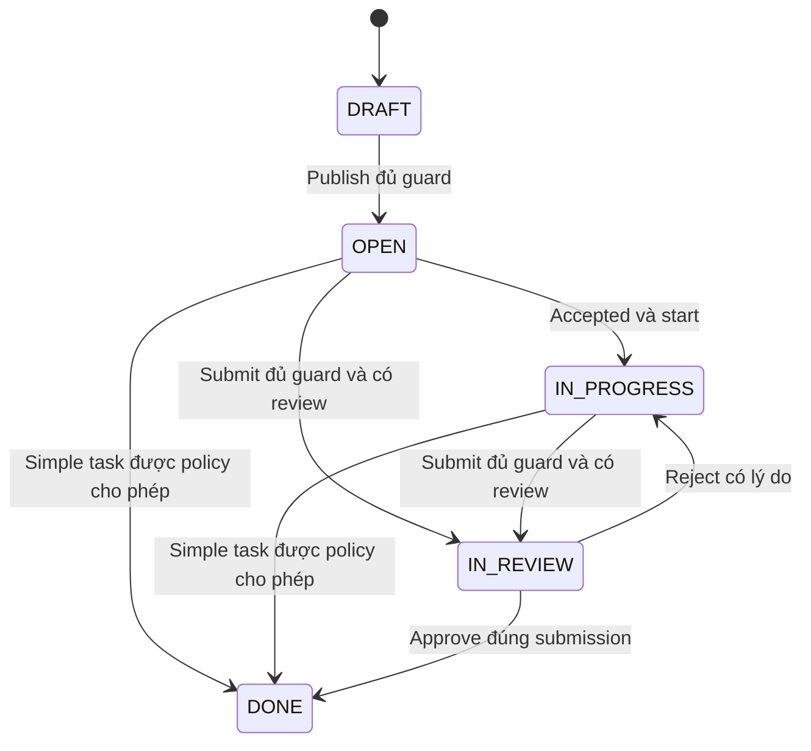
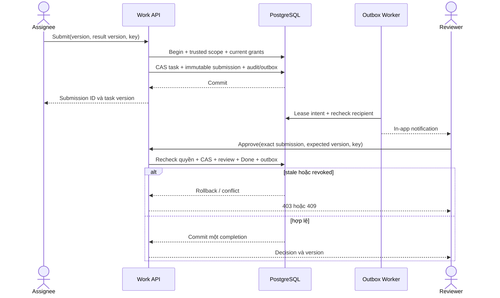

# SL01 — Giao việc nội bộ, nhận việc và duyệt kết quả

Trạng thái: đề xuất pilot đủ để review; physical design và policy còn gap. Không phải tính năng đã triển khai. Baseline 1.9/hash ở ../../03-planning/README.md. Nguồn: FR25/M16, 3.14, UC-W01/02/03/05/08 tại 4.23, schema/API 5.20, quyền 6.6, NFR 7.7 và W-T tại 9.16.

## 1. Giá trị và ranh giới

Người giao biết ai chịu trách nhiệm; người làm nhận việc và nộp một phiên bản kết quả; reviewer duyệt đúng bản; My Work phản ánh trạng thái có quyền xem. Pilot kiểm cả người dùng cá nhân và một team, không cần Contact/Account/Contract/Project giả.

Owner nghiệp vụ M16. M14 cung cấp principal/membership/grants; M20 cung cấp retention/purpose/visibility controls; M19 cung cấp outbox dispatch infrastructure. M18 chỉ nhận dữ kiện/projection, không đổi task. Vai trò nhân sự cụ thể còn GAP-05.

In scope đề xuất: PERSONAL và INTERNAL; một assignee hoặc queue hợp lệ; draft/open, offer/accept/decline/claim; start, text result, submit/review; My Work và team list; audit, outbox notification nội bộ. Result text được sanitize; file upload chưa enable. Queue không có manager không được dùng. Team board drag/drop, thay hạn, broadcast, comments/mentions, recurrence, dependencies và dự án theo mốc sau; vẫn giữ toàn bộ yêu cầu P0 ở registry.

Capabilities off: CRM context links, client publish, external email/push, file upload, PMS sync, automated offer expiry/reminder khi thiếu policy, finance/acceptance integration. UI và API phải cùng kiểm flag; không chỉ ẩn menu. Đây là profile đề xuất, cần PO chốt trước enable thực.

## 2. Actor và quyền

| Action | Actor hợp lệ | Guard bắt buộc |
|---|---|---|
| Tạo personal | Member active | Workspace grant; requester/assignee=self; visibility private |
| Tạo/giao internal | Creator có quyền tạo/giao | Workspace/team authority; người nhận active; due và completion criteria đủ |
| Offer accept/decline | Đúng người được offer | Offer active + expected_version + grant còn hiệu lực |
| Queue claim | Member có queue grant | Task chưa assigned; queue manager tồn tại; một transaction thắng |
| Start/update result/submit | Assignee accepted | Task scope, lifecycle, version; không dựa UI cached grant |
| Approve/reject | Reviewer được chỉ định | Review grant, đúng submission/version; không self-review khi cần tách người |
| Xem My Work/team/count | Member/manager có grant | Áp ACL trước pagination/count; manager không tự thấy private |
| Gửi notification | Service principal giới hạn | Resolve recipient, quyền hiện hành, payload tối thiểu |

Admin cấu hình không tự có quyền đọc nội dung. App role và worker role tách quyền migration; integration tests phải dùng runtime role. Quyền task không cấp quyền tài nguyên khác. Fixture có ít nhất hai tenant, hai workspace cùng tenant, personal task và team task, user bị revoke, watcher và reviewer.

## 3. Dữ liệu đầu vào và trạng thái

Giữ fields/limits từ 3.14.4: title trim 1..255; description tùy chọn tối đa 20.000; work_type; workspace_id đã xác minh; requester; assignee XOR queue khi giao; due bắt buộc khi giao chính thức; completion_criteria bắt buộc cho delegated/review; reviewer khi review_required; row_version. Giá trị thiếu không tự biến thành consent/grant. Priority NORMAL; URGENT cần reason/authority.

Trong SL01, project_id/parent/dependency/CRM link/file chưa được nhận ở API nếu capability off. PERSONAL autoaccepted có audit; internal dùng offer/accept theo A.7. Simple task không review phải được policy cho phép và UI nói rõ; internal review mode không activate khi thiếu reviewer hợp lệ.

Lifecycle giữ canonical DRAFT/OPEN/IN_PROGRESS/IN_REVIEW/DONE/CANCELED. SL01 chỉ bật các transition bên dưới; cancel/reopen sẽ có command riêng ở mốc hoàn thiện W-F07, không giả đã hỗ trợ cả namespace.

Assignment có lifecycle riêng UNASSIGNED→OFFERED→ACCEPTED; decline kết thúc offer và về queue có manager, không cancel task. Không suy task đã InProgress chỉ vì assignment accepted. Blocked/overdue là thuộc tính riêng; nếu chưa có command quản blocker thì không expose field để bypass guard. InReview vẫn có thể quá hạn; không xóa due baseline.

## 4. Luồng chính và ngoại lệ

1. Creator mở form, chọn workspace và personal/internal; server cung cấp đích giao và reviewer có quyền.
2. Creator nhập mục tiêu, tiêu chí, due; preview audience. Create draft hoặc publish là thao tác rõ; publish không đủ guard trả lỗi không phát notification.
3. Create/publish kiểm idempotency, quyền và version; commit task + assignment/history + audit/outbox nguyên tử. Response trả ID/version.
4. Worker dispatch notification nội bộ sau commit; notification lỗi không rollback task. Người nhận bị revoke không nhận snippet.
5. Assignee accept hoặc decline có lý do. Queue member claim dùng CAS/lock; hai người tranh một task chỉ một người thắng, người còn lại conflict.
6. Assignee start và soạn result text. Submit kiểm role, state, expected_version, policy và evidence. Snapshot result/version/hash bất biến.
7. Review_required → InReview; reviewer nhận việc duyệt. Reviewer approve đúng submission → Done; reject có lý do → InProgress và giữ lịch sử.
8. Simple mode hợp lệ → Done khi submit đủ điều kiện. Completion ghi domain event, không phát client acceptance, paid hoặc request-resolved event.
9. My Work cập nhật có ACL; lỗi projection/retry có thể hiện pending freshness, không sửa giao dịch để làm UI xanh.

Ngoại lệ bắt buộc: grant bị thu hồi giữa mở form và submit; assignee/reviewer suspended; same key/different body; stale version; result đổi khi đang approve; double approve; worker crash trước/sau dispatch. Reviewer mất quyền giữ pending và chuyển luồng xử lý quản lý, không autoapprove. Fallback reviewer phải có authority, không tự lấy bất kỳ Admin nào.

## 5. Contract command đề xuất

Các endpoint đã có ở Master 5.20 được giữ. Endpoint bổ sung đánh dấu Proposed, chưa phải baseline API đã duyệt. Payload exact JSON schema/enum/error envelope phải chốt ở GAP-04/13 trước viết code.

| Command / endpoint | Nguồn | Request logic | Response/error |
|---|---|---|---|
| Create `POST /v1/tasks` | 5.20 | Fields + Idempotency-Key; create mode phải chốt schema | 201; cùng key/body trả cùng resource, khác body 409 |
| Publish draft `POST /v1/tasks/{id}/publish` | Proposed | expected_version, đích giao/review/due | 200 hoặc 403/409/422; không status PATCH |
| Claim/accept `POST /v1/tasks/{id}/claim`, `/accept` | 5.20 | expected_version; offer/queue hiện hành | 200, concurrent loser 409 |
| Decline `POST /v1/tasks/{id}/decline` | 5.20 | expected_version, reason | 200 về queue có manager; authority thiếu chặn |
| Start `POST /v1/tasks/{id}/start` | Proposed | expected_version | 200 khi accepted, không blocker |
| Result draft `PUT /v1/tasks/{id}/result-draft` | Proposed | expected_version, text | 200 version mới; InReview không ghi đè submission |
| Submit `POST /v1/tasks/{id}/submissions` | 5.20 | expected_version, result version/evidence, operation key | 201; immutable snapshot; 403/409/422 |
| Review `POST /v1/submissions/{id}/reviews` | 5.20 | exact submission version, expected task version, decision/reason, key | Decision replay cùng effect; stale 409 |
| My/team `GET /v1/work/my`, `/team/{id}` | 5.20 | filters + cursor scope | 200; cursor tie-break id; không leak count |

Mọi replay vẫn kiểm quyền hiện hành trước trả dữ liệu. Đề xuất key scope gồm tenant/workspace/principal/command/key + request hash; TTL và retention phải chốt theo replay window, không tự default 24h. Current state conflict khác malformed input. Error policy 403/404 phải thống nhất với việc không tiết lộ tồn tại; không trả raw SQL DETAIL.

Submission đang InReview không được mutate. Muốn đổi kết quả phải có withdraw/new submission flow được thiết kế; SL01 có thể chặn edit ở InReview và dùng reject→rework→submit lại, nhưng cần người có quyền và giữ history. Không dùng cách sửa nội dung snapshot rồi tăng version âm thầm.

## 6. Data contract và migration cần review

| Logical entity | Owner | Constraints cần thiết kế |
|---|---|---|
| Tasks | M16 | UUID, tenant/workspace FK, lifecycle, work_type, due snapshot, row_version; scope không lấy body làm authority |
| Task_Assignments | M16 | History; một active assignment cho task; target user/queue rõ; accepted/offered dates |
| Task_Submissions / Reviews | M16 | Chuẩn hóa tên vật lý; FK task/submission cùng scope; immutable result version/hash; unique decision/effect theo command |
| Task_Events | M16 | Actor/source/reason/version; append history; retention có policy |
| Queue/grants/membership | M14 phối hợp M16 | Phân biệt queue task với lead assignment; chốt shared queue hay riêng bằng ADR |
| Outbox/dedup/idempotency | M19 infrastructure, M16 payload | Atomic writes, leased processing, consumer effect key, retry status; cleanup không mất khả năng dedup cần thiết |
| Notification projection | Owner đề xuất M16 | Recipient grant hiện tại; dispatch state khác assignment accepted |

Không tạo Contract/Project chỉ để FK chạy. Tên grouped `Task_Submissions / Reviews` không được tự coi hai bảng với tên viết tắt đã chuẩn. Physical package phải chỉ rõ columns/types/nullability/unique/index/FK/RLS policies, error mapping, clean install, upgrade và lock plan.

Thứ tự migration đề xuất: foundation scope/principals/grants → task → assignment/submission/review/events + constraints → outbox/read indexes. Tạo target trước khi FK cần nó. Không nhận CRM link tương lai chưa có constraint chỉ vì field nullable. Index My Work theo scope/assignee/lifecycle/due/id cần kiểm query plan với dataset 7.7, không chỉ copy tên index vào spec.

RLS context resolve từ auth/service mapping, set transaction-local trên cùng connection. Test missing/forged scope, pool reuse và update scope. Worker không nhận quyền rộng vô điều kiện; notification lấy current recipient grants. Chính sách retention/audit phải giữ đủ bằng chứng nhưng không coi append-only là giữ PII vô hạn.

## 7. Transaction và cạnh tranh

Lựa chọn CAS hay lock chốt trong physical design; không chỉ đọc rồi ghi không điều kiện. Constraint phải bảo vệ invariant khi API có lỗi. Không giữ transaction mở trong khi gọi network. Outbox at-least-once có thể phát lại; consumer key bảo vệ notification intent/effect. Khi có external provider ở slice sau, dedup nội bộ không tự chứng minh gửi exactly-once ngoài hệ thống.

## 8. UI và vận hành

My Work có Được giao/Tôi giao/Chờ tôi duyệt; nhóm overdue/today/upcoming/no due, scope selector rõ. Team list có queue/unassigned/awaiting acceptance/InReview; không hiển thị private theo quan hệ cấp trên. Task detail có tiêu chí, người làm/reviewer, due, result version và history; action dựa guard backend.

Loading/empty/error/conflict có thông báo và hành động tải lại; không đánh dấu Done lạc quan trước server commit. Keyboard flow tương đương thao tác chuột; không chỉ dùng màu. Notification sink phục vụ test, chưa gửi email thật. Metrics tối thiểu: queue age, review age, conflict, denied requests, outbox lag/retry và completed_by_episode; không KPI hóa bằng task count thuần.

Theo 7.7, mục tiêu list/mutation p95<=1s và dataset mở rộng là thiết kế đề xuất, chưa đo. SL01 cần ghi dataset/roles/cache/network trong evidence; không dùng fixture vài task để kết luận đạt tải 100.000 task. Alert owner phải có người nhận trước enable live.

## 9. Test applicability cho toàn W-T01–40

Tất cả hiện **Not Run**. Bảng này là kế hoạch, chưa gán N/A vì capability off chưa có code/evidence để chứng minh.

| Nhóm | Mã | Phần kiểm trong SL01 / điều kiện phần còn lại |
|---|---|---|
| Core bắt buộc | W-T01/03/04/06/07/09/15/16/17/34/36 | Personal, concurrency, replay, decline, revoke, watcher, review, notify recovery, ACL; timeout tự động W-T06 bổ sung khi timer bật |
| Negative gate có giới hạn | W-T02/08/10/14/18/37/38/40 | API từ chối CRM link/mention/board bypass/file/offline không hỗ trợ; test event Done không phát acceptance/paid; chưa thay kiểm tích hợp đầy đủ các ca này |
| Mở rộng Work P0 | W-T05/11/12/13/19/20/21/22/23/24/25/27/29/35/39 | Broadcast, due change, reminders, graph, recurrence, offboarding đầy đủ, KPI và workflow migration ở SL06; revoke path SL01 vẫn bắt buộc |
| P1/conditional | W-T26/28/30/31/32/33 | Completion/catch-up nâng cao, capacity, PMS: chỉ khi bật capability tương ứng; giữ guards của phần đang dùng |

W-T18 đầy đủ đòi tích hợp deliverable/finance ở SL04/05; SL01 chỉ kiểm không phát side effect trái nghĩa. W-T36 phải thử list/count/notification và các surface đang bật; search/export/file tắt phải chứng minh không truy cập được, không chỉ bỏ test.

Test bổ sung dẫn xuất (không đổi ID Master):

| ID | Setup/action | Kết quả bắt buộc |
|---|---|---|
| SL01-T01 | Missing tenant và giả workspace trong payload | Fail-closed, không đọc/ghi dữ liệu ngoài grant |
| SL01-T02 | Transaction A rollback rồi pooled connection dùng B | B không thừa scope A |
| SL01-T03 | Hai actor claim đồng thời có barrier | Một assignment active, một winner; history/outbox không nhân effect |
| SL01-T04 | DB fail trước commit create | Không task mồ côi/notification; retry cùng key cho kết quả nhất quán |
| SL01-T05 | Worker crash sau dispatch rồi lease hết hạn | Retry không nhân notification effect ở sink hỗ trợ dedup |
| SL01-T06 | Revoke reviewer sau mở màn hình | API reject dù UI còn nút; snapshot không bị đổi |
| SL01-T07 | Reject v1, submit v2 rồi approve v1 | Conflict; không duyệt nhầm v2 |
| SL01-T08 | Manager mở team list/count có private task | Không lộ title/count ngoài policy |
| SL01-T09 | Same key khác body, và replay sau revoke | 409 với payload mismatch nếu có quyền; revoke không trả dữ liệu trái quyền |
| SL01-T10 | Clean migration và upgrade dataset | Constraints/data bảo toàn; restore/reconcile được kiểm |
| SL01-UAT01 | Creator→assignee→reviewer thao tác UI | Giao/nhận/nộp/duyệt, nhìn đúng trạng thái và audit |
| SL01-UAT02 | Reviewer reject và user nộp lại | Giữ bản cũ; chỉ bản mới được duyệt; error rõ |

## 10. Ready / Done và quyết định còn mở

Ready: chốt profile SL01, GAP-02/04/05/06/13; schema và API/permissions reviewed; fixtures/expected outcomes có owner; code repo và commands thực xác định. Policy thiếu chỉ cho phép fixture/dev, chưa enable live tương ứng.

Done milestone: tests SL01 áp dụng đạt với log/build/fixture; UI UAT được chủ nghiệp vụ xác nhận; capability off có evidence; migration/restore đạt; runbook/alert owner có người nhận. Không coi Done milestone là toàn M16 hoặc P0 CRM Done.

Quyết định cần trước code: framework/auth provider; tên bảng queue/submission/review; publish/start/result API; self-review policy theo loại; reviewer fallback; idempotency retention; notification storage/dispatch; scope và lịch diễn tập restore. Đề xuất mặc định thiết kế vẫn theo A.7, không tự phê duyệt người hay ngưỡng vận hành.
