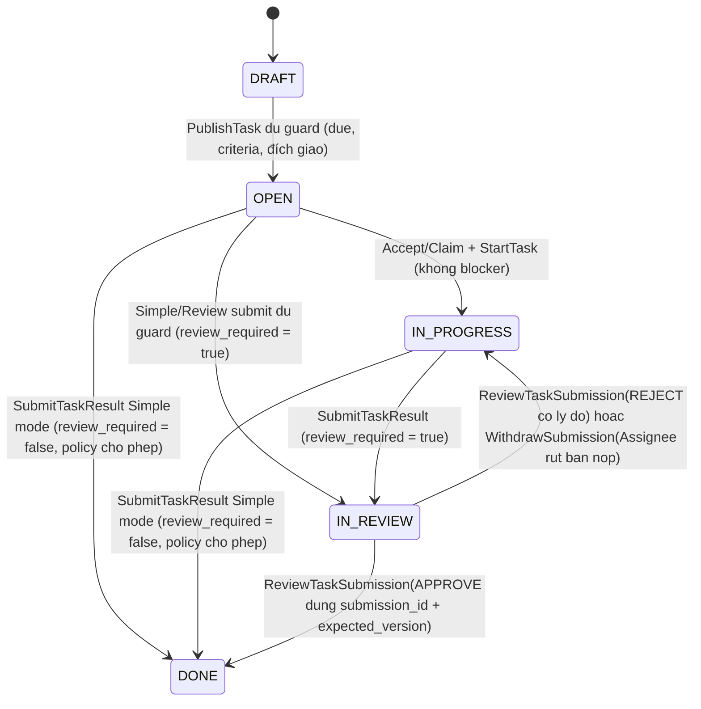
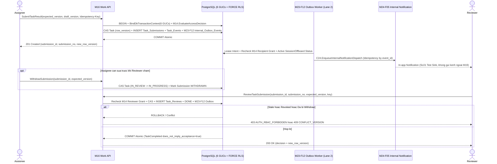

# SL01 — Giao việc nội bộ, nhận việc và duyệt kết quả (`Internal Work Pilot`)

> **Tuyên bố Trạng thái (`Documentation-Only`):** Đặc tả lát cắt chuẩn hóa `Wave 1.5` (`CR-20261116-WAVE1-5-HARDENING`), liên thông đồng bộ với [M16-WORK-PROJECTS-TASK-CORE.md](../modules/M16-WORK-PROJECTS-TASK-CORE.md), [C16](../contracts/M16-TASK-CORE-COMMANDS.md), [C14](../contracts/M14-PRINCIPAL-ACCESS-DECISION.md), [C20](../contracts/M20-SUPPRESSION-PRIVACY-GATE.md), [C23](../contracts/M23-PLATFORM-GOVERNANCE-OUTBOX.md) và [C24](../contracts/M24-PRODUCTIVITY-CACHE-QUEUE.md). Chưa có mã nguồn ứng dụng; toàn bộ ca kiểm thử hiện ở trạng thái **`Not Run`**.

---

## 1. Manifest

| Hạng mục | Giá trị Chuẩn hóa (`Wave 1.5`) |
|---|---|
| **Slice ID & Tên** | `SL01` — Giao việc nội bộ, nhận việc và duyệt kết quả (`Internal Work Pilot`) |
| **Baseline** | [CRM_MASTER_BRD_SRS_HOP_NHAT.md](../../00-master/CRM_MASTER_BRD_SRS_HOP_NHAT.md) (`v1.9`, `SHA-256: b6a3279f328e96e1e97d845e209be7a326516a0dba5e3a033d88e1f2162e421c`) |
| **Status** | `Reviewed` |
| **Approved_Scope** | `Wave 1.5 Internal Work Pilot (SL01 Task Core Text-Only Subset)` |
| **Approved_By** | `Chủ dự án` |
| **Decision_Ref** | `CR-20261116-SKILL-TEMPLATE-ALIGN` |
| **Approved_At** | `2026-11-16` |
| **Truy vết Master v1.9** | `FR25` (`M16`), `3.14` (`W-F01–14`), `UC-W01/02/03/05/08` (`4.23`), Schema/API (`5.20`), Phân quyền (`6.6`), Hiệu năng (`7.7`), Test Catalog (`W-T01–40` tại `9.16`) & Baseline SHA-256 ở [03-planning/README.md](../../03-planning/README.md) |
| **Module Owner** | [M16-WORK-PROJECTS-TASK-CORE.md](../modules/M16-WORK-PROJECTS-TASK-CORE.md) (Task Core, Assignment, Queue, Submission, Review) |
| **Dependencies & ADRs** | [M14-ORG-ACCESS-DELEGATION.md](../modules/M14-ORG-ACCESS-DELEGATION.md) ([C14](../contracts/M14-PRINCIPAL-ACCESS-DECISION.md)), [M20-PRIVACY-CONSENT-RETENTION.md](../modules/M20-PRIVACY-CONSENT-RETENTION.md) ([C20](../contracts/M20-SUPPRESSION-PRIVACY-GATE.md)), [M23-SYSTEM-ADMIN-SECURITY-OPS.md](../modules/M23-SYSTEM-ADMIN-SECURITY-OPS.md) ([C23](../contracts/M23-PLATFORM-GOVERNANCE-OUTBOX.md)), [M24-PERFORMANCE-AND-PRODUCTIVITY.md](../modules/M24-PERFORMANCE-AND-PRODUCTIVITY.md) ([C24](../contracts/M24-PRODUCTIVITY-CACHE-QUEUE.md)), [ADR-002..009](../../01-architecture/INDEX.md) |
| **Capability Flags** | `SL01_INTERNAL_WORK = ON` (Pilot); `PROJECT/DELIVERABLE/ACCEPTANCE = OFF`, `M01–M15 CRM Links = OFF`, `M19 External Adapter = OFF`, `M18 BI Write-back = Read-Only Projection Only` |
| **Ghi chú Tiến hóa** | Chuẩn hóa tên bảng `M16.Tasks`, `M16.Task_Assignments`, `M16.Task_Participants`, `M16.Task_Submissions`, `M16.Task_Reviews`, `M16.Work_Queues` (`queue_manager_user_id NOT NULL`), thêm `WithdrawSubmission` (`IN_REVIEW -> IN_PROGRESS`), chuyển hạ tầng outbox/thông báo sang `M23-F12` + `M24-F05/F06` |

---

## 2. Phạm vi và Ranh giới SL01

### 2.1. Giá trị Kinh doanh & Ranh giới Sở hữu (`SSoT`)

1. **Giá trị cốt lõi (`M16` Pilot):** Người giao biết chính xác ai chịu trách nhiệm; người làm nhận việc (`Accept`/`Claim`), soạn nháp và nộp một phiên bản kết quả bất biến (`Task_Submissions`); reviewer duyệt đúng phiên bản (`Task_Reviews`); `My Work` / `Team Work` phản ánh đúng trạng thái có quyền xem. Pilot kiểm cả người dùng cá nhân (`PERSONAL`) lẫn một team nội bộ (`TEAM`), **không cần tạo `Contact`, `Account`, `Contract` hay `Project` giả** (`W-T01`).
2. **Ranh giới Liên Module Đã Chốt (`ADR-002`, `ADR-005`, `ADR-009`):**
   - **`M16` (Owner duy nhất):** Sở hữu `Tasks`, `Task_Assignments`, `Task_Participants`, `Task_Submissions`, `Task_Reviews`, `Work_Queues` (`queue_manager_user_id NOT NULL`), `Task_Events`, và state machine `DRAFT -> OPEN -> IN_PROGRESS -> IN_REVIEW -> DONE`.
   - **`M14` ([C14](../contracts/M14-PRINCIPAL-ACCESS-DECISION.md)):** Cung cấp `Principals`/`Users`/`Memberships`/`Roles`, bộ **6 GUC `SET LOCAL app.current_*`** (`BindDbTransactionContext`) + `FORCE RLS`, và `Entity-Mapped CompileScopeFilter` (tra `Tasks.visibility`, `Task_Participants`, `reviewer_id`, `assignee_user_id/requester_id`, `active_legal_hold_ids uuid[]`) để chặn Manager xem lén việc `PERSONAL` (`W-O04`, `INV-02`).
   - **`M20` ([C20](../contracts/M20-SUPPRESSION-PRIVACY-GATE.md)):** Cung cấp kiểm soát `active_legal_hold_ids[]` (`M20.LegalHoldChanged` hỗ trợ cấp `TASK`), retention chính sách, và xóa/ẩn danh có kiểm soát đa lần theo từng `deletion_ledger_id` cho `Task_Submissions.result_text` (`redacted_deletion_ledger_ids[]`, `privacy_redacted_at`, `redacted_content_sha256`, giữ nguyên `content_sha256` gốc nếu không vướng Hold khi nhận `M20.SubjectErasureExecuted`).
   - **`M23-F12` ([C23](../contracts/M23-PLATFORM-GOVERNANCE-OUTBOX.md), `ADR-005`):** Cung cấp bảng `Internal_Outbox_Events` (`Lane 2`) cho mọi domain event và notification intent nội bộ **trong cùng DB transaction** với lệnh đột biến `M16`. *(Thay thế hoàn toàn tham chiếu nhầm cũ sang `M19` — `M19` chỉ phục vụ kênh/adapter tích hợp ngoài `INV-23`)*.
   - **`M24-F05/F06` ([C24](../contracts/M24-PRODUCTIVITY-CACHE-QUEUE.md), `ADR-003`):** `M23-F12` Worker chuyển giao thông báo nội bộ qua `C24.EnqueueInternalNotificationDispatch` (`M24.Internal_Notifications` + sink kiểm thử ở `SL01`); `M24-F06` giữ cache version quyền (`Permission_Cache_Versions`) bị vô hiệu tức thì khi nhận `M14.PermissionVersionBumped`.
   - **`M18`:** Chỉ tiêu thụ event read-only (`M16.TaskCreated`, `M16.TaskCompleted`); không bao giờ mutate task hoặc tự coi task `Done` là doanh thu/nghiệm thu (`W-T18`).

### 2.2. Ngoài Phạm vi Tạm thời ở `SL01` (`Capability Off`)

- Chưa kích hoạt `project_id` bắt buộc, `Deliverables`/`Acceptances`/`Client Portal`, `Task_Links` sang CRM (`Deal/Ticket/Order/Account`), upload file ra CDN thật (chờ `Shared Asset Registry M23-F07` + `SEC03` khi bật slice tương ứng), `Recurrence_Rules (AFTER_COMPLETION)`, hay kênh gửi Email/Zalo/SMS thật (`M19`). Khi các flag này `OFF`, API `SL01` phải từ chối tường minh (`403/422 CAPABILITY_DISABLED`) thay vì bỏ qua âm thầm (`RV20`, `W-T02/08/14/37/38/40`).

---

## 3. Actor, Quyền hạn & Trạng thái Lifecycle

### 3.1. Ma trận Actor & Guard Thực thi (`C14` + `C16`)

| Action | Actor hợp lệ | Guard bắt buộc (`M14` + `M16`) |
|---|---|---|
| Tạo `PERSONAL` task | Member `ACTIVE` | Workspace grant hợp lệ; `requester_id = assignee_user_id = principal_id`; `visibility = 'PERSONAL'`; **tự ghi `Audit_Logs`** (`PERSONAL` auto-accepted) |
| Tạo / Publish `TEAM` internal task | Creator có quyền tạo/giao (`CREATE`) | `M14.EvaluateAccessDecision` + `GUARDED_EXECUTION`; `assignee XOR work_queue_id` khớp context; người nhận/queue hợp lệ; `due_at` & `completion_criteria` đủ |
| Offer `Accept` / `Decline` | Đúng `offered_to_user_id` | Offer `ACTIVE` (chưa hết hạn), `expected_version`, grant hiện hành; `Decline` bắt buộc lý do & trả task về `Work_Queues` (`queue_manager_user_id NOT NULL`) |
| `ClaimFromQueue` | Thành viên thuộc `Work_Queues` | Task chưa có assignee (`UNASSIGNED`), `queue_manager_user_id NOT NULL`, CAS/lock 1 winner (`409` cho loser) |
| `StartTask` / `SaveResultDraft` / `SubmitTaskResult` | `assignee_user_id` (`ACCEPTED`) | Đúng scope & `expected_version`, không blocker chặn cứng, `asset_version_ids[]` (nếu có ở slice sau) phải `CLEAN` tại `M23-F07` |
| **`WithdrawSubmission`** | `assignee_user_id` | Task ở `IN_REVIEW`, đúng `submission_id` & `expected_version`; chuyển `IN_REVIEW -> IN_PROGRESS`, đánh dấu `WITHDRAWN` thay vì ghi đè snapshot cũ |
| `ReviewTaskSubmission` (`APPROVE` / `REJECT`) | `reviewer_id` được chỉ định | Quyền duyệt `APPROVE`, khớp chính xác `submission_id` + `submission_no` + `expected_version`; kiểm `reviewer_id != assignee_user_id` khi bật tách biệt duyệt |
| Xem `My Work` / `Team` / `Count` | Member / Manager có grant | Đánh giá `M14.CompileScopeFilter` (`Entity-Mapped`: `Tasks.visibility`, `Task_Participants`, `reviewer_id`, `active_legal_hold_ids[]`) trước khi paginate/`count` |
| Điều phối Outbox & Notification | `Service Principal` `M23-F12` / `M24` | Chạy trong transaction có đủ **6 GUC `SET LOCAL`**, kiểm lại quyền + trạng thái `OFFBOARDING_LOCKED/SUSPENDED` của người nhận trước khi dispatch snippet |

> **Kỷ luật Vai trò & Pool Kết nối (`RV15`, `INV-13`):** `TECH_ADMIN` không tự có quyền đọc nội dung task/submission. `app_runtime_role` và `worker_runtime_role` tách khỏi `migration_owner_role`, tuyệt đối không có `BYPASSRLS`. Mọi request và job nền đều gắn đủ 6 GUC `SET LOCAL app.current_*` (`tenant_id`, `workspace_id`, `workspace_type`, `principal_id`, `permission_version`, `acting_mode`). Fixture kiểm thử tối thiểu: `>= 2` tenants, `>= 2` workspaces cùng tenant, task `PERSONAL` vs `TEAM`, `Work_Queues`, user bị thu hồi quyền giữa phiên, `Task_Participants` (watcher) và `reviewer_id`.

### 3.2. Sơ đồ Trạng thái Task & Assignment (`SL01` Subset + `WithdrawSubmission`)

Lifecycle chuẩn hóa giữ 6 trạng thái canonical `DRAFT / OPEN / IN_PROGRESS / IN_REVIEW / DONE / CANCELED` (`SL01` bật chuyển tiếp cốt lõi kèm `WithdrawSubmission`; `CANCEL` / `REOPEN` chuẩn hóa theo `W-F07` ở `M16`):

- **Assignment Lifecycle Độc lập:** `UNASSIGNED -> OFFERED -> ACCEPTED` (hoặc `DECLINED` / `EXPIRED -> UNASSIGNED` về lại `Work_Queues` có `queue_manager_user_id NOT NULL`). Tuyệt đối không suy diễn `ACCEPTED == IN_PROGRESS`, không xóa `effective_due_at` khi vào `IN_REVIEW`, và không tự động đóng blocker khi chưa có command gỡ blocker.

---

## 4. Dữ liệu đầu vào, Bảng Chuẩn hóa & Policy GAP

### 4.1. Ràng buộc Trường Đầu vào (`Master 3.14.4` & `BR-W01`)

- `title`: `trim` độ dài `1..255` ký tự (`NN`); `description`: tùy chọn tối đa `20.000` ký tự; `work_type`, `workspace_id` (xác minh từ session/token qua `C14`), `requester_id`, `assignee_user_id XOR work_queue_id` khi publish chính thức (riêng `Work_Queues` bắt buộc có **`queue_manager_user_id NOT NULL`** ngay lúc tạo theo `ADR-009` / `BR-W01`), `due_at` bắt buộc khi giao chính thức, `completion_criteria` bắt buộc cho `DELEGATED` / `review_required = true`, `reviewer_id` bắt buộc khi `review_required = true`, `row_version` (`bigint`). Priority mặc định `NORMAL`; nâng `URGENT` cần lý do và thẩm quyền.

### 4.2. Ánh xạ Thực thể & Phạm vi Sở hữu (`ADR-004`, `ADR-005`, `ADR-009`)

| Thực thể / Logical Entity | Module SSoT | Quy chuẩn Ràng buộc Đã Chốt (`Wave 1.5`) |
|---|---|---|
| `M16.Tasks` (`Nhóm A`) | `M16` | UUID PK, `(tenant_id, workspace_id)` FK, `lifecycle_status`, `work_type`, `visibility` (`PRIVATE \| TEAM \| PROJECT \| EXPLICIT` — ánh xạ `PRIVATE`/`EXPLICIT` vào `PERSONAL` trên `C14`), `due_at`, `active_legal_hold_ids uuid[] DEFAULT '{}'`, `row_version` |
| `M16.Task_Assignments` (`Nhóm A`) | `M16` | Lịch sử offer/accept/decline/claim; tối đa 1 active assignment per task; `offered_to_user_id` hoặc `work_queue_id` |
| `M16.Task_Participants` (`Nhóm A`) | `M16` | Phân biệt `PARTICIPANT_ROLE` (`WATCHER \| COLLABORATOR`); dùng cho `Entity-Mapped CompileScopeFilter` của `C14` |
| `M16.Task_Submissions` (`Nhóm A`) | `M16` | Bản nộp bất biến theo `(task_id, submission_no)` kèm `content_sha256` gốc & `submission_status` (`SUBMITTED \| WITHDRAWN \| APPROVED \| REJECTED`); hỗ trợ scrub đa lần có kiểm soát theo từng `deletion_ledger_id` (`redacted_deletion_ledger_ids[]`, `privacy_redaction_count`, `privacy_redacted_at`, `redacted_content_sha256`) khi `M20.SubjectErasureExecuted` không vướng Hold |
| `M16.Task_Reviews` (`Nhóm A`) | `M16` | Tham chiếu chính xác `submission_id`, `decision` (`APPROVED \| REJECTED`), `reviewer_id`, `reason`; unique idempotency key chống double-approve |
| `M16.Work_Queues` (`Nhóm A`) | **`M16`** (`ADR-009`) | Tách hoàn toàn khỏi `M02` Lead Queue & `M03` Inbox; bắt buộc **`queue_manager_user_id NOT NULL`** ngay khi khởi tạo (`BR-W01`, `W-O01`) làm chốt chặn Custodian & Escalation |
| `M16.Task_Events` (`Nhóm C` Append-Only) | `M16` | Ghi lịch sử thay đổi (`actor_id`, `source`, `reason`, `row_version`); `Redact-Before-Insert` bảo vệ log |
| `M23-F12.Internal_Outbox_Events` | **`M23-F12`** (`ADR-005`) | Atomic write **cùng DB transaction** với `M16`; xử lý tại `Lane 2` với leased claim & consumer dedup; tách biệt tuyệt đối khỏi External Outbox `M19` |
| `M24.Internal_Notifications` | **`M24-F05`** (`C24`) | Nhận intent từ `M23-F12` qua `C24.EnqueueInternalNotificationDispatch`; kiểm tra `current_grants` + `OFFBOARDING_LOCKED/SUSPENDED` trước khi phát ra sink UI |

> **Trật tự Migration Đề xuất (`Expand -> Migrate -> Contract`):** Foundation (`M14` Principals/Scopes/Grants, `M23` Policies/Outbox, `M24` Notification/Cache) $\rightarrow$ `M16.Work_Queues` $\rightarrow$ `M16.Tasks` & `M16.Task_Participants` $\rightarrow$ `M16.Task_Assignments`, `M16.Task_Submissions`, `M16.Task_Reviews`, `M16.Task_Events` $\rightarrow$ Read Indexes (`My Work` theo `(tenant_id, workspace_id, assignee_user_id, lifecycle_status, due_at, id)` cần đo EXPLAIN ở dataset `7.7`). Không tạo FK giả sang `CRM/Contracts/Projects` ở `SL01`.

---

## 5. Luồng Nghiệp vụ, Command Contract & Transaction (`C16`, `C23`, `C24`)

### 5.1. Luồng Chính & Ngoại lệ Bắt buộc (`E2E Flow`)

1. Creator mở form, chọn workspace (`workspace_type`) và chế độ `PERSONAL` hoặc `TEAM`; server truy vấn `M14` cấp danh sách người nhận/`Work_Queues` (`queue_manager_user_id NOT NULL`) & `reviewer` có quyền.
2. Creator tạo `DRAFT` (`POST /v1/tasks`) hoặc `PublishTask` (`POST /v1/tasks/{id}/publish`); `PublishTask` kiểm tra `Idempotency-Key`, `expected_version`, đủ `due_at`/`completion_criteria`/đích giao rồi mới commit + phát `Internal_Outbox_Events` (`M23-F12`).
3. `M23-F12` Worker (`Lane 2`) lease intent, gọi `C14.EvaluateAccessDecision` xác minh người nhận chưa bị revoke/offboard, rồi gọi `C24.EnqueueInternalNotificationDispatch` phát thông báo nội bộ (lỗi notification không rollback transaction `M16`).
4. Assignee `AcceptTaskOffer` / `DeclineTaskOffer` (có lý do, trả về `Work_Queues` có Manager) hoặc Queue Member gọi `ClaimFromQueue` (CAS 1 winner, concurrent loser nhận `409 Conflict`).
5. Assignee gọi `StartTask`, lưu nháp qua `SaveResultDraft` (`PUT /v1/tasks/{id}/result-draft`) mà **không sửa đè `Task_Submissions` đã nộp**, rồi gọi `SubmitTaskResult` (`POST /v1/tasks/{id}/submissions`) kiểm quyền, state, `expected_version` và ghi snapshot bất biến + `content_sha256`.
6. Nếu `review_required = true`: task vào `IN_REVIEW`. Trường hợp assignee phát hiện thiếu sót trước khi reviewer chấm, gọi **`WithdrawSubmission`** (`POST /v1/tasks/{id}/submissions/{submission_id}/withdraw`) đưa task về `IN_PROGRESS` và đánh dấu bản cũ `WITHDRAWN` (giữ nguyên lịch sử). Reviewer gọi `ReviewTaskSubmission` (`POST /v1/submissions/{id}/reviews`) kèm chính xác `submission_id` & `expected_version`: `APPROVE` $\rightarrow$ `DONE` (phát `M16.TaskCompleted` mang cờ `does_not_imply_acceptance: true`, `INV-05`), `REJECT` có lý do $\rightarrow$ `IN_PROGRESS`.
7. Trường hợp `review_required = false` & Policy `review_required_by_type` (`W-O02`) cho phép `Simple Mode`: `SubmitTaskResult` chuyển thẳng `DONE` nhưng tuyệt đối không phát sự kiện nghiệm thu khách hàng hay thu tiền (`W-T18`).
8. **Ngoại lệ Bắt buộc Kiểm tra:** Mất grant giữa mở form và submit; assignee/reviewer chuyển `SUSPENDED/OFFBOARDING_LOCKED` (`M14.UserOffboardingLocked` giữ pending & chuyển custodian); same `Idempotency-Key` khác payload (`409`); stale `expected_version`; double approve; assignee rút bài khi reviewer vừa mở duyệt; worker crash trước/sau dispatch `M24-F05`. Backup reviewer phải có thẩm quyền hợp lệ, không fallback bừa sang `TECH_ADMIN` hay Admin khác scope.

### 5.2. Hợp đồng Command Trọng yếu (`Đồng bộ C16`)

| Command / Endpoint | Nguồn Chuẩn | Kiểm tra Request & Guard | Response & Error Chính (`Non-Disclosure`) |
|---|---|---|---|
| `CreateTaskByBusinessKey` (`POST /v1/tasks`) | `5.20` & [C16](../contracts/M16-TASK-CORE-COMMANDS.md) | `tenant_id` từ GUC, `Idempotency-Key` + `request_hash`, `PERSONAL` khóa `requester = assignee = actor` | `201 Created`; same key/body trả kết quả cũ (nếu còn quyền); same key/diff body `409` |
| `PublishTask` (`POST /v1/tasks/{id}/publish`) | `[PROPOSED]` (`C16`) | `expected_version`, kiểm `due_at`, `completion_criteria`, `assignee XOR queue` (`queue_manager_user_id NOT NULL`), `reviewer` | `200 OK`; `403/404/409/422` (cấm `PATCH /status` `W-T10`) |
| `ClaimFromQueue` / `AcceptTaskOffer` (`POST /v1/tasks/{id}/claim`, `/accept`) | `5.20` (`C16`) | `expected_version`, kiểm offer active hoặc queue membership hợp lệ, CAS 1 winner | `200 OK`; concurrent loser nhận `409 CONFLICT_VERSION` |
| `DeclineTaskOffer` (`POST /v1/tasks/{id}/decline`) | `5.20` (`C16`) | `expected_version`, `decline_reason` bắt buộc; trả task về `Work_Queues` có Manager | `200 OK`; thiếu thẩm quyền/offer hết hạn `403/409/422` |
| `StartTask` (`POST /v1/tasks/{id}/start`) | `[PROPOSED]` (`C16`) | `expected_version`, `ACCEPTED`, không có blocker active (`INV-04`) | `200 OK`; còn blocker hoặc sai state `409/422` |
| `SaveResultDraft` (`PUT /v1/tasks/{id}/result-draft`) | `[PROPOSED]` (`C16`) | `expected_version`, `draft_text`; chỉ sửa nháp ở `OPEN`/`IN_PROGRESS` | `200 OK` + draft version; chặn ở `IN_REVIEW`/`DONE` (`409`) |
| `SubmitTaskResult` (`POST /v1/tasks/{id}/submissions`) | `5.20` (`C16`) | `expected_version`, `draft_version`, `Idempotency-Key`, ghi immutable `Task_Submissions` + `content_sha256` | `201 Created`; `403/409/422`; chuyển `IN_REVIEW` hoặc `DONE` (Simple mode) |
| **`WithdrawSubmission`** (`POST /v1/tasks/{id}/submissions/{submission_id}/withdraw`) | `[PROPOSED]` (`C16`) | `assignee_user_id`, task đang `IN_REVIEW`, `expected_version`, `submission_id` | `200 OK`; chuyển `Task_Submissions -> WITHDRAWN` & `Tasks -> IN_PROGRESS`; `409` nếu reviewer vừa chấm |
| `ReviewTaskSubmission` (`POST /v1/submissions/{id}/reviews`) | `5.20` (`C16`) | `submission_id` + `submission_no`, `expected_task_version`, `decision`, `reason` (khi Reject), `Idempotency-Key`, kiểm `Maker != Checker` | `200 OK` (idempotent effect); stale `409`; mất quyền duyệt `403` |
| `GET /v1/work/my`, `/team/{id}` (`C14 CompileScopeFilter`) | `5.20` (`C14/C16`) | Filters + `Entity-Mapped CompileScopeFilter` (`PERSONAL` isolate) + Keyset Cursor `(due_at, id)` | `200 OK`; không lộ tổng count hoặc tiêu đề ngoài ACL |

### 5.3. Chuỗi Transaction & Outbox Đồng thời (`CAS + M23-F12 + M24-F05`)

---

## 6. Giao diện UI, Vận hành & Chỉ số SL01

1. **Giao diện `My Work` & `Team Work` (`4 Trạng thái Chuẩn + Accessibility`):**
   - `My Work` phân nhóm *Được giao / Tôi giao / Chờ tôi duyệt*, lọc *Overdue / Today / Upcoming / No Due* kèm `Scope Selector` rõ ràng.
   - `Team List` hiển thị `Work_Queues` (`queue_manager_user_id`), chưa giao (`Unassigned`), chờ nhận (`Offered`), và `InReview`; tuyệt đối không rò task `PERSONAL` hay số lượng private của thành viên (`W-O04`).
   - Hỗ trợ đủ 4 trạng thái `Empty / Loading / Error / Conflict & Permission Denied`; không cập nhật `Done` lạc quan trên UI trước khi server commit; điều hướng bàn phím đầy đủ, WCAG `AA` kèm badge chữ (không chỉ dùng màu).
2. **Vận hành & Chỉ số (`Observability` & `Master 7.7`):**
   - Metrics tối thiểu: `queue_age_seconds`, `review_age_seconds`, `cas_conflict_total`, `acl_denied_total`, `internal_outbox_lag_ms`, và `completed_by_episode` (tuyệt đối không KPI hóa bằng số click/task thuần `3.10.3`).
   - Ngưỡng `p95 <= 1s` (`Master 7.7`) là **mục tiêu thiết kế đề xuất** — mọi báo cáo hiệu năng tương lai phải ghi rõ dataset thử nghiệm (không dùng fixture 10 task để suy ra tải `100.000` task), cấu hình DB Pool và danh sách Alert Owner có người trực thực tế trước khi bật live.

---

## 9. Test applicability cho toàn W-T01–40

Tất cả hiện **Not Run** (`Actual = Not Run / No Repo`, `Build = N/A (Docs-Only)` theo `AGENTS.md`). Bảng này là kế hoạch kiểm thử theo phạm vi lát cắt, chưa gán `N/A` khi chưa có phần mềm và bằng chứng capability-off thực tế.

| Nhóm | Mã | Phần kiểm trong SL01 / điều kiện phần còn lại | Status |
|---|---|---|---|
| Core bắt buộc | W-T01/03/04/06/07/09/15/16/17/34/36 | Personal, concurrency, replay, decline về `Work_Queues` có Manager, revoke, watcher (`Task_Participants`), review + `WithdrawSubmission`, notify recovery qua `M23-F12`/`M24-F05`, Entity-Mapped ACL; timeout tự động W-T06 bổ sung khi timer bật | `Not Run` |
| Negative gate có giới hạn | W-T02/08/10/14/18/37/38/40 | API từ chối CRM link/mention/board bypass/file/offline không hỗ trợ; test event `M16.TaskCompleted` không phát acceptance/paid; chưa thay kiểm tích hợp đầy đủ các ca này | `Not Run` |
| Mở rộng Work P0 | W-T05/11/12/13/19/20/21/22/23/24/25/27/29/35/39 | Broadcast, due change, reminders, graph, recurrence, offboarding đầy đủ (`13` nhóm), KPI và workflow migration ở `SL04–SL06`; revoke path `SL01` vẫn bắt buộc | `Not Run` |
| P1/conditional | W-T26/28/30/31/32/33 | Completion/catch-up nâng cao, capacity (`M14-F07` -> `M16-F07`), PMS sync (`M19`): chỉ khi bật capability tương ứng; giữ guards của phần đang dùng | `Not Run` |

W-T18 đầy đủ đòi tích hợp deliverable/finance ở SL04/05; SL01 chỉ kiểm không phát side effect trái nghĩa. W-T36 phải thử list/count/notification và các surface đang bật; search/export/file tắt phải chứng minh không truy cập được, không chỉ bỏ test.

Test bổ sung dẫn xuất (không đổi ID Master — toàn bộ `Status = Not Run`):

| ID | Setup/action | Kết quả bắt buộc | Status |
|---|---|---|---|
| `SL01-T01` | Missing `tenant_id` / thiếu 6 GUC `SET LOCAL` hoặc giả `workspace_id` trong payload | `Fail-Closed` (`401/403/404`), không đọc/ghi dữ liệu ngoài grant | `Not Run` |
| `SL01-T02` | Transaction A rollback rồi PG pooled connection dùng lại cho B | B không thừa GUC scope hay dữ liệu của A (`RV15`) | `Not Run` |
| `SL01-T03` | Hai actor `ClaimFromQueue` đồng thời trên `Work_Queues` (`queue_manager_user_id NOT NULL`) | Đúng 1 `Task_Assignments` `ACTIVE`, 1 winner (`200`), loser `409`; không nhân đôi `M23-F12` outbox | `Not Run` |
| `SL01-T04` | DB fail trước commit `CreateTaskByBusinessKey` / `PublishTask` | Không task mồ côi hoặc notification; retry cùng `Idempotency-Key` cho kết quả nhất quán | `Not Run` |
| `SL01-T05` | `M23-F12` Worker crash sau dispatch sang `M24-F05` rồi lease hết hạn | Retry qua `C24.EnqueueInternalNotificationDispatch` không nhân đôi notification (`Internal_Notifications`) | `Not Run` |
| `SL01-T06` | Revoke quyền reviewer (`M14` bump `permission_version`) sau khi reviewer mở màn hình | `GUARDED_EXECUTION` reject `403/409` dù UI còn nút; snapshot `Task_Submissions` giữ nguyên | `Not Run` |
| `SL01-T07` | Reject v1, Assignee submit v2 rồi Reviewer cố `Approve` v1; hoặc Assignee gọi `WithdrawSubmission` hợp lệ (`200 OK` -> `IN_PROGRESS`), hoặc đua đồng thời `WithdrawSubmission` và `Review` | Rút hợp lệ trước duyệt thành công; duyệt v1 / sửa trực tiếp không rút / đua rút-duyệt trả `409 CONFLICT_VERSION`; chỉ bản active mới nhất được duyệt | `Not Run` |
| `SL01-T08` | Manager mở team list/count có lẫn `PERSONAL` task chưa chia sẻ của thành viên | `Entity-Mapped CompileScopeFilter` chặn hoàn toàn; không lộ title hay count (`W-O04`) | `Not Run` |
| `SL01-T09` | Replay cùng `Idempotency-Key` khác payload, và replay sau khi bị revoke | Trả `409` khi payload mismatch; khi đã bị revoke trả `403` không leak dữ liệu cũ | `Not Run` |
| `SL01-T10` | Clean install (`SL01`) và Upgrade backfill queue/submissions + DR Restore | Constraints (`queue_manager_user_id NOT NULL`, unique submission) bảo toàn; DR Gate `M20`/`M23-F12` chặn gửi thông báo stale | `Not Run` |
| `SL01-T11` | `WithdrawSubmission` trước khi Reviewer chấm, và tạo `Work_Queues` thiếu `queue_manager_user_id` | `WithdrawSubmission` chuyển `IN_REVIEW -> IN_PROGRESS` giữ history; tạo `Work_Queues` thiếu Manager bị chặn `422` (`ADR-009`) | `Not Run` |
| `SL01-UAT01` | Creator $\rightarrow$ Assignee $\rightarrow$ Reviewer thao tác UI đủ 4 trạng thái | Giao/nhận/nộp/duyệt qua `My Work`, hiển thị đúng trạng thái và `Task_Events` audit | `Not Run` |
| `SL01-UAT02` | Reviewer `Reject` hoặc Assignee `WithdrawSubmission` rồi nộp lại `v2` | Giữ nguyên `v1` bất biến; chỉ `v2` được duyệt `DONE`; error/conflict rõ ràng | `Not Run` |

---

## 10. Gate Ready / Done và Danh sách GAP mở

### 10.1. Cổng Sẵn sàng (`Ready Gate` trước khi chuyển Giai đoạn Code)

1. **Đã chốt về mặt Kiến trúc tại `Wave 1.5`:** Hợp đồng Public Contracts ([C14](../contracts/M14-PRINCIPAL-ACCESS-DECISION.md), [C16](../contracts/M16-TASK-CORE-COMMANDS.md), [C20](../contracts/M20-SUPPRESSION-PRIVACY-GATE.md), [C23](../contracts/M23-PLATFORM-GOVERNANCE-OUTBOX.md), [C24](../contracts/M24-PRODUCTIVITY-CACHE-QUEUE.md)), tách chuẩn tên bảng (`M16.Tasks`, `M16.Task_Assignments`, `M16.Task_Participants`, `M16.Task_Submissions`, `M16.Task_Reviews`, `M16.Work_Queues` với `queue_manager_user_id NOT NULL`), phân định `M23-F12` Internal Outbox (`Lane 2`) + `M24-F05` Internal Notifications (`ADR-005`), và luồng `WithdrawSubmission` (`SL01-T11`).
2. **Còn mở Cần Chủ dự án Chốt trước Implementation (`Open Policy & Physical Gates` — Xem chi tiết tại [GAPS.md](../../03-planning/GAPS.md)):**
   - **Ma trận Policy `W-O01` (`[OPEN-GAP: W-O01 / GAP-07]`):** Chốt giá trị `offer_timeout_minutes` (hiện **`NULL / Fail-Closed`**: không tự động hết hạn offer trước khi cấu hình policy hợp lệ, ngoại trừ giữ `Work_Queues.queue_manager_user_id NOT NULL` ngay lúc tạo).
   - **Ma trận Policy `W-O02`:** Chính sách `review_required_by_type` và ngoại lệ `allow_self_review` cho `SOLO_PILOT` vs `TEAM` (`GAP-05`, `GAP-13`).
   - **Ma trận Policy `W-O03` & Idempotency Retention (`GAP-02` / `GAP-06` / `[OPEN-GAP: GAP-M16-05]`):** Giờ làm việc/quiet hours fallback khi user chưa gắn `System_Calendars`, ngưỡng `task_idempotency_retention_window_hours` (`[PROPOSED]: 72 giờ` theo `GAP-M16-05`), và mức tối thiểu dữ liệu fixture + lịch diễn tập DR `SL01`.
   - **Physical DDL & Benchmark Plan (`GAP-04` / `GAP-13`):** Hoàn tất DDL vật lý (`types`, `nullable`, `FK`, `CHECK`, `RLS SQL`, `composite indexes`) và query plan dataset theo `Master 7.7` trước khi sinh migration.

### 10.2. Tiêu chí Done Milestone (`Khi Chuyển sang Giai đoạn Code Sau này`)

- Toàn bộ ca `SL01` (`W-T01..40` áp dụng + `SL01-T01..11` + `SL01-UAT01/02`) có log chạy thực trên app runtime role (`Not Run` tại tài liệu hiện tại), UI UAT được chủ nghiệp vụ ký nhận, capability `OFF` (`CRM links / CRM files / External M19`) có negative-test evidence thực tế, clean install + DR restore gate (`M20`/`M23-F12`) đạt, và Runbook + Alert Owner có người chịu trách nhiệm. **Không đồng nhất `Done SL01` với `Done toàn bộ M16` hay `P0 CRM Done`.**
