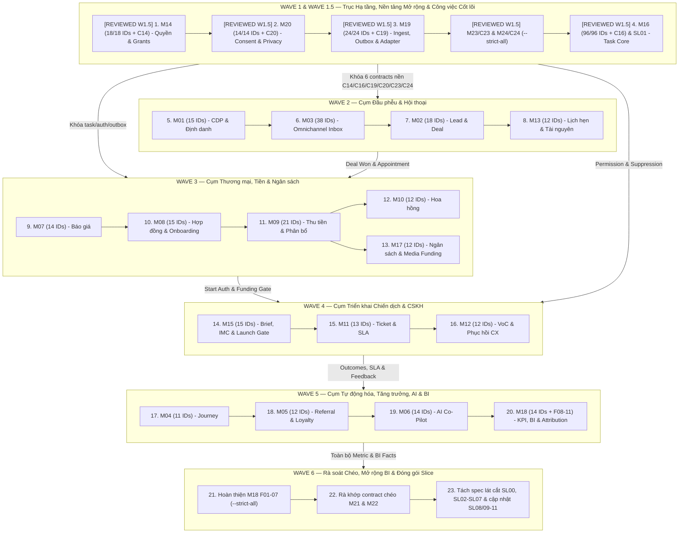

# Kế hoạch Ưu tiên Bóc tách Đặc tả Chi tiết (`M01–M24` & `SL00–SL07`)

> **Trạng thái thực thi:** `Đã hoàn tất Wave 1, Wave 1.5 & Vá 5 điểm rà soát độc lập Wave 1 (CR-20261116-WAVE1-REVIEW-FIXES Applied & Archived: W1-01..W1-05 resolved, lease_token fencing + Reaper 8 nhánh + Per-Erasure Task_Submissions + verify_module_spec.py cross-doc semantic checks) — Sẵn sàng mở Wave 2: M01` (cập nhật `16/11/2026`; `application_tests: "Not Run"`).  
> **Nguồn chuẩn & công cụ:** [CRM_MASTER_BRD_SRS_HOP_NHAT.md](../00-master/CRM_MASTER_BRD_SRS_HOP_NHAT.md) (`v1.9`, `SHA-256: b6a3279f328e96e1e97d845e209be7a326516a0dba5e3a033d88e1f2162e421c`), [FUNCTION-CATALOG.md](../02-specs/FUNCTION-CATALOG.md) (`224` chức năng `M01–M24`), [requirements.json](trace/requirements.json), [module-spec-validation.json](evidence/module-spec-validation.json) và skill [crm-ba-spec](../.agents/skills/crm-ba-spec/SKILL.md).

---

## 1. Chiến lược & Nguyên tắc Bóc tách (`Hybrid Hub-First theo Cụm`)

1. **Khóa trục hạ tầng nhiều phụ thuộc nhất trước (`Wave 1`):** Bóc tách và đóng băng hợp đồng quyền (`M14`), chặn gửi/privacy (`M20`), ingest/outbox (`M19`) và lõi công việc (`M16`) ngay đầu để mọi cụm nghiệp vụ đi sau tham chiếu trực tiếp mà không phải sửa ngược.
2. **Bóc tách theo cụm liên kết đôi chặt nhất (`Wave 2` $\rightarrow$ `Wave 5`):** Gom các module thường xuyên trao đổi state/event với nhau thành cùng một Wave.
3. **Khóa `Public Contracts` & Cổng `Verify` cuối mỗi Wave:** Kết thúc một module/Wave phải hoàn thiện đủ 6 mục chuẩn [MODULE-SPEC.md](../02-specs/templates/MODULE-SPEC.md) (EARS + `[MASTER]`/`[PROPOSED]`/`[OPEN-GAP]` + `erDiagram`/`stateDiagram-v2`), tách `public contracts/` vào `02-specs/contracts/` theo mẫu [CONTRACT.md](../02-specs/templates/CONTRACT.md) và vượt qua toàn bộ 4 script ở `05-tools/` trước khi chuyển Wave kế tiếp.
4. **4 Quy ước Nền đã chốt qua `/grill-me` (15/11/2026):**
   - **Truy vết mở rộng (`GAP-03`):** Bao phủ cả 100% ID `owner == Mxx` lẫn các ID liên quan trong nhóm `221 missing_owner` / `PLATFORM` (`U*`, `INT*`, `RV*`, `OC*`, `DB*`, `CEO/CMO/CX/SEC/WF-U*`, `NFR*`, `O*`, `ENTITY-L*`), phân biệt rõ `Primary Owner` vs `Consumer`.
   - **Độ sâu `Per-Function` (`Mxx-Fyy`):** Trong Mục `3. Hành vi` của mỗi file `02-specs/modules/Mxx-*.md`, tách tiểu mục `### 3.x Mxx-Fyy` cho 100% chức năng của module với đủ 6 phần con chuẩn hóa (`Mục tiêu`, `Tác nhân`, `Tiền điều kiện`, `Luồng từng bước`, `Đồng thời/Side effects`, `Ngoại lệ & EARS`).
   - **Tách bảng gộp (`GAP-04`) theo [ADR-004](../01-architecture/decisions/ADR-004-SHARED-PLATFORM-TABLES-AND-BASE-SCHEMA.md):** Trong Mục `4. Data/API`, tách rời các khai báo bảng gộp ở Master `5.13/5.18/5.20` thành **1 bảng = 1 dòng**, phân loại rõ `Nhóm A` (`12` cột chuẩn gồm `legal_entity_id`), `Nhóm B-Catalog`, `Nhóm B-Governance-Sensitive`, hoặc `Nhóm C Append-Only` (cấm `updated_at/updated_by/row_version/archived_at`), kèm mã `ENTITY-Lxxxx`.
   - **Phân loại 7 Trường GAP & Tách `Safe Default` khỏi `Gate` (`INV-14`):** Mọi tham số mở (`O01–08`, `W-O*`, `GAP-*`) đăng ký đủ 7 trường phân loại tại `GAPS.md` & bảng `4.3` (rạch ròi `Chặn thiết kế?` vs `Chặn triển khai?` vs `Chặn kích hoạt?`); không tự bịa số kinh doanh làm `Safe Default`. Chạy cuốn chiếu **từng module một (4 pha/module)**.

---

## 2. Bản đồ Phụ thuộc & Thứ tự 6 Wave



---

## 3. Lộ trình Chi tiết 24 Module & Public Contracts từng Wave

| Thứ tự | Wave | Module | Fan-In | Owned IDs | Trạng thái hiện tại | Tệp đặc tả đích (`02-specs/modules/`) | Public Contracts cần khóa cuối Wave (`02-specs/contracts/`) |
|---:|---|---|---:|---:|---|---|---|
| 1 | Wave 1 / 1.5 | `M14` — Tổ chức, Nhóm & Quyền | 17 | 18 | `Reviewed` (`18/18` IDs — Wave 1.5 Fresh-Context Verified `ADR-002..009`) | [M14-ORG-ACCESS-DELEGATION.md](../02-specs/modules/M14-ORG-ACCESS-DELEGATION.md) | [M14-PRINCIPAL-ACCESS-DECISION.md](../02-specs/contracts/M14-PRINCIPAL-ACCESS-DECISION.md) |
| 2 | Wave 1 / 1.5 | `M20` — Consent, Suppression & Privacy | 15 | 14 | `Reviewed` (`14/14` IDs — Wave 1.5 Fresh-Context Verified `ADR-004..008`) | [M20-PRIVACY-CONSENT-RETENTION.md](../02-specs/modules/M20-PRIVACY-CONSENT-RETENTION.md) | [M20-SUPPRESSION-PRIVACY-GATE.md](../02-specs/contracts/M20-SUPPRESSION-PRIVACY-GATE.md) |
| 3 | Wave 1 / 1.5 | `M19` — Tích hợp, Ingest & Outbox | 16 | 24 | `Reviewed` (`24/24` IDs — Wave 1.5 Fresh-Context Verified `ADR-004..008`) | [M19-INTEGRATION-ADAPTERS-OUTBOX.md](../02-specs/modules/M19-INTEGRATION-ADAPTERS-OUTBOX.md) | [M19-DURABLE-INGEST-OUTBOX.md](../02-specs/contracts/M19-DURABLE-INGEST-OUTBOX.md) |
| 4 | Wave 1 / 1.5 | `M16` — Công việc, Dự án & Task Core | 18 | 96 | `Reviewed` (`96/96` IDs — Wave 1.5 Verified `ADR-009` + `SL01`; mở `W-O01..07`) | [M16-WORK-PROJECTS-TASK-CORE.md](../02-specs/modules/M16-WORK-PROJECTS-TASK-CORE.md) | [M16-TASK-CORE-COMMANDS.md](../02-specs/contracts/M16-TASK-CORE-COMMANDS.md) |
| 4b | **Wave 1.5** | **`M23` & `M24` — Nền tảng Quản trị, Outbox, Cache & Queue (`--strict-all`)** | — | 12 / 8 *(đề xuất)* | **`Reviewed`** (`--strict-all` + Fresh-Context Verified; mở `GAP-02/15..18`) | [M23](../02-specs/modules/M23-SYSTEM-ADMIN-SECURITY-OPS.md), [M24](../02-specs/modules/M24-PERFORMANCE-AND-PRODUCTIVITY.md) | [M23-PLATFORM-GOVERNANCE-OUTBOX.md](../02-specs/contracts/M23-PLATFORM-GOVERNANCE-OUTBOX.md), [M24-PRODUCTIVITY-CACHE-QUEUE.md](../02-specs/contracts/M24-PRODUCTIVITY-CACHE-QUEUE.md) |
| 4c | **Wave 1.5** | **`SL01` — Pilot Work Nội bộ (`--strict-all`)** | — | — | **`Reviewed`** (`--strict-all` + `verify_delivery_plan` + Fresh-Context Verified) | [SL01-INTERNAL-WORK.md](../02-specs/slices/SL01-INTERNAL-WORK.md) *(slices/)* | Tham chiếu `C14`, `C16`, `C20`, `C23`, `C24` |
| 5 | Wave 2 | `M01` — CDP & Hồ sơ khách hàng 360 | 12 | 15 | Chờ Wave 1 | `M01-CDP-IDENTITY-MERGE.md` | `M01-IDENTITY-PROFILE-EVENTS.md` |
| 6 | Wave 2 | `M03` — Omnichannel Inbox | 15 | 38 | Chờ Wave 1 | `M03-OMNICHANNEL-INBOX.md` | `M03-INBOX-TRIAGE-HANDOFF.md` |
| 7 | Wave 2 | `M02` — Lead & Deal | 14 | 18 | Chờ Wave 1 | `M02-LEAD-DEAL-PIPELINE.md` | `M02-DEAL-WON-HANDOFF.md` |
| 8 | Wave 2 | `M13` — Lịch hẹn & Tài nguyên | 4 | 12 | Chờ Wave 1 | `M13-APPOINTMENTS-RESOURCES.md` | — |
| 9 | Wave 3 | `M07` — Danh mục & Báo giá | 8 | 14 | Chờ Wave 2 | `M07-CATALOG-QUOTING.md` | `M07-M08-COMMERCIAL-COMMITMENT.md` *(cùng M08)* |
| 10 | Wave 3 | `M08` — Hợp đồng & Onboarding | 13 | 15 | Chờ Wave 2 | `M08-CONTRACTS-ONBOARDING.md` | `M08-START-AUTHORIZATION.md` |
| 11 | Wave 3 | `M09` — Nghĩa vụ thu, Tiền & Đối soát | 13 | 21 | Chờ Wave 2 | `M09-AR-RECEIPTS-RECONCILIATION.md` | `M09-ALLOCATION-REFUND-EVENTS.md` |
| 12 | Wave 3 | `M10` — Hoa hồng & Chi trả | 7 | 12 | Chờ Wave 2 | `M10-COMMISSIONS-PAYOUTS.md` | `M10-COMMISSION-PAYOUT-ROUTE.md` |
| 13 | Wave 3 | `M17` — Ngân sách, Chi phí & Funding | 7 | 12 | Chờ Wave 2 | `M17-BUDGETS-MEDIA-FUNDING.md` | — |
| 14 | Wave 4 | `M15` — Brief, Chiến lược, IMC & Launch | 10 | 15 | Chờ Wave 3 | `M15-BRIEF-IMC-LAUNCH.md` | — |
| 15 | Wave 4 | `M11` — Ticket & SLA | 10 | 13 | Chờ Wave 3 | `M11-TICKETS-SLA.md` | `M11-M12-SLA-CX-FEEDBACK.md` *(cùng M12)* |
| 16 | Wave 4 | `M12` — Voice of Customer & Phục hồi CX | 9 | 12 | Chờ Wave 3 | `M12-VOC-CX-RECOVERY.md` | — |
| 17 | Wave 5 | `M04` — Journey & Nhắc việc | 9 | 11 | Chờ Wave 4 | `M04-JOURNEY-AUTOMATION.md` | — |
| 18 | Wave 5 | `M05` — Referral & Loyalty | 2 | 12 | Chờ Wave 4 | `M05-REFERRAL-LOYALTY.md` | — |
| 19 | Wave 5 | `M06` — AI Co-Pilot có kiểm soát | 5 | 14 | Chờ Wave 4 | `M06-AI-COPILOT-GOVERNED.md` | — |
| 20 | Wave 5 | `M18` — Từ điển KPI, BI & Attribution *(+ F08–11)* | 15 | 14 *(+4)* | Đang có `9/14` IDs | [M18-BI-REPORTING-EXPANSION.md](../02-specs/modules/M18-BI-REPORTING-EXPANSION.md) | `M18-METRIC-FACTS-EXPORT.md` |
| 21 | Wave 6 | `M21` & `M22` — Rà khớp contract chéo (`C14/C16/C19/C20/C23/C24`) | 6 / 8 | 101 / 135 | `complete_id_mentions` | [M21](../02-specs/modules/M21-PARTNER-BUSINESS-RESULTS.md), [M22](../02-specs/modules/M22-HUMAN-RESOURCES.md) | — |
| 22 | Wave 6 | Tách 7 Slice Specs còn thiếu (`02-specs/slices/`) & kiểm chuẩn cuối | — | — | Chờ Wave 1–5 *(SL01 đã xong ở Wave 1.5)* | `SL00`, `SL02`, `SL03`, `SL04`, `SL05`, `SL06`, `SL07` | Đồng bộ thêm `SL08`, `SL09–11` |

---

## 4. Definition of Done (DoD) bắt buộc trước khi qua Wave kế tiếp

1. Thực hiện đủ **Pha 1 (Grounding) $\rightarrow$ Pha 2 (Hỏi chặn Tầng 1 qua công cụ hỏi tương tác hoặc hỏi trực tiếp, ghi `[OPEN-GAP]` Tầng 2 đủ 7 trường vào [GAPS.md](GAPS.md)) $\rightarrow$ Pha 3 (EARS + Data/API + `contracts/`) $\rightarrow$ Pha 4 (Analyze & Verify)** theo [module-workflow.md](../.agents/skills/crm-ba-spec/references/module-workflow.md).
2. Cập nhật [02-specs/README.md](../02-specs/README.md) và [PROGRESS.md](agent/PROGRESS.md).
3. Chạy tái sinh registry (`--build-registry` nếu có thêm/sửa module, contract hoặc ADR) và đủ 4 lệnh kiểm chứng toàn kho từ `D:\AI Agent\CRM` (theo `SKILL.md` Mục 4):
   ```powershell
   python 05-tools/build_module_context.py --build-registry
   python 05-tools/build_delivery_inventory.py
   python 05-tools/verify_delivery_plan.py
   python 05-tools/verify_hrm_integration.py
   python 05-tools/verify_module_spec.py
   ```
   Yêu cầu mọi module đã bóc tách đạt `complete_id_mentions` (Wave 6 chạy thêm `--strict-all` cho `M18`; riêng `M23`, `M24`, `SL01` đã bật kiểm `--strict-all` mặc định từ Wave 1.5), `bad_links: []`, `bad_fences: []`, giữ nguyên `master_unchanged: true` và `application_tests: "Not Run"`.

---

## 5. Nhật ký Kết quả Bóc tách từng Module (`Completed Modules Log`)

### Wave 1 & Wave 1.5 *(Reconciliation & Foundation Hardening — Đã hoàn tất & archive [CR-20261116-WAVE1-5-HARDENING.md](../02-specs/changes/archive/CR-20261116-WAVE1-5-HARDENING.md) & `ADR-002..009`; vượt Fresh-Context Re-Audit & chốt `Reviewed`)*

1. **`M14` — Tổ chức, Chi nhánh, Thành viên, Quyền & Bàn giao Nhân sự (`Wave 1.5 Hardened`):**
   - **Tệp đặc tả Module:** [M14-ORG-ACCESS-DELEGATION.md](../02-specs/modules/M14-ORG-ACCESS-DELEGATION.md) — Đạt `complete_id_mentions` (`18/18` ID sở hữu trực tiếp + toàn bộ ID/thực thể mở rộng); đặc tả EARS cho 8 chức năng `M14-F01..08`, sở hữu **28 bảng logic** (thống nhất cha `Principals` $\rightarrow$ `Users`/`Service_Principals`/`Portal_Clients`, `Principal_Permission_Versions` với `acl_epoch`, `Security_Revocation_Ledger` PITR #6, `Legal_Hold_Scope_Registry`, tách `Policy_Definitions`/`Policy_Versions`/`Audit_Logs` về SSoT `M23` theo `ADR-004`, bổ sung `6`-GUC `SET LOCAL` + `FORCE RLS` theo `ADR-002`), và khóa `GAP-M14-01..06`.
   - **Tệp Hợp đồng Liên Module (`Contract`):** [M14-PRINCIPAL-ACCESS-DECISION.md](../02-specs/contracts/M14-PRINCIPAL-ACCESS-DECISION.md) (`v1.1`) — Hợp đồng `BindDbTransactionContext` (6 GUCs), `ResolveConnectionScopeByWebhookEndpoint` (`M19` Bootstrap `SECURITY DEFINER`), `PORTAL_CLIENT` Write Port (`SECURITY DEFINER`), `EvaluateAccessDecision` (gồm `client_version > db_version -> 401`), `CompileScopeFilter` (`Entity-Mapped SQL Scope Compiler` tách Nhánh Cross-Workspace & Nhánh Tenant-Wide `NULL`), `ApplyBreakGlassGrant`/`RevokeBreakGlassGrant`, `SetTenantOperatingMode`, `InitiateOffboardingOrTransfer` (**13 nhóm open work**), `GetCapacityCostSnapshots`, kèm 4 Published Events & `6` Subscribed Event Streams.
2. **`M20` — Quản trị Dữ liệu Cá nhân, Consent, Suppression & Quyền Chủ thể (`Wave 1.5 Hardened`):**
   - **Tệp đặc tả Module:** [M20-PRIVACY-CONSENT-RETENTION.md](../02-specs/modules/M20-PRIVACY-CONSENT-RETENTION.md) — Đạt `complete_id_mentions` (`14/14` ID sở hữu trực tiếp + toàn bộ ID/thực thể mở rộng); đặc tả EARS cho 8 chức năng `M20-F01..08`, sở hữu **12 bảng logic** (phân tầng `Nhóm A` / `Nhóm B-Catalog` vs `Nhóm B-Gov` [`Retention_Policies` & `Legal_Deadline_Policies` khóa theo `app.current_workspace_type IN ('AGENCY','SYSTEM')`] / `Nhóm C` `Redact-Before-Insert`, multi-hold `active_legal_hold_ids uuid[]`, `hmac_key_version` trên 5 bảng `M20` + `M19.Outbound_Intents`), và khóa `GAP-M20-01..10`.
   - **Tệp Hợp đồng Liên Module (`Contract`):** [M20-SUPPRESSION-PRIVACY-GATE.md](../02-specs/contracts/M20-SUPPRESSION-PRIVACY-GATE.md) (`v1.1`) — Hợp đồng 4 cổng (`EvaluateOutboundCompliance` đa phiên bản HMAC + `TASK_SYNC|SYSTEM_SYNC`, `EvaluateVendorAndAiTransfer` DLP scanner + tách `AI_*` khỏi `M19_EXTERNAL_WEBHOOK`, `VerifyPostRestoreComplianceGate` DR Fence đảo thứ tự kiểm 6 bảng PITR trước replay `M23-F12`, `EvaluateAssetDownloadPrivacyGate` + `active_legal_hold_ids[]`) và 4 Domain Events (gồm `erased_subject_refs[]` & `PROJECT|DELIVERABLE|TASK` Legal Hold).
3. **`M19` — Tích hợp, Ingest & Outbox (`Wave 1.5 Hardened`):**
   - **Tệp đặc tả Module:** [M19-INTEGRATION-ADAPTERS-OUTBOX.md](../02-specs/modules/M19-INTEGRATION-ADAPTERS-OUTBOX.md) — Đạt `complete_id_mentions` (`24/24` ID sở hữu trực tiếp + toàn bộ ID mở rộng); đặc tả 3 máy trạng thái tách rời (gồm `PENDING_AUTHORIZATION/ACTIVE/.../PAUSED -> DISCONNECTED` & `QUEUED -> EXPIRED_CANCELLED`), 8 chức năng `M19-F01..08`, sở hữu **14 bảng logic + phần định tuyến kênh ngoài `Connector_Mappings`** (bổ sung `PMS`/`TASK_SYNC`/`CONFLICT`, partial unique anti-hijack xuyên tenant gồm `PAUSED`, lease 3 cột `Send_Attempts`/`Outbound_Intents` chống kẹt `DISPATCHING`), và khóa `GAP-M19-01..11` (tách `ONFR05` `5 phút` phát hiện khỏi `GAP-M19-11` `15 phút/đợt` chống bão).
   - **Tệp Hợp đồng Public (`Contract`):** [M19-DURABLE-INGEST-OUTBOX.md](../02-specs/contracts/M19-DURABLE-INGEST-OUTBOX.md) (`v1.2`) — Hợp đồng 5 trụ cột (`IngestWebhookEvent` qua `C14.ResolveConnectionScopeByWebhookEndpoint` + `BindDbTransactionContext` 6 GUCs, `EnqueueOutboundIntent` + `DispatchOutboundIntent` gọi `M20.EvaluateVendorAndAiTransfer`, `ExecuteSafeRemoteFetch`, `ReplayConnectionEvents`, `ListOpenIntentsForPrincipal`), 5 Domain Events và các sự kiện tiêu thụ (`M14`/`M20`/`M23`).
4. **`M16` — Công việc, Dự án & Task Core (`Wave 1.5 Hardened`):**
   - **Tệp đặc tả Module:** [M16-WORK-PROJECTS-TASK-CORE.md](../02-specs/modules/M16-WORK-PROJECTS-TASK-CORE.md) — Đạt `complete_id_mentions` (`96/96` ID `owner == M16` + 8 consumer clusters), `21` chức năng `M16-F01..07` & `W-F01..14`, `5` state diagrams (gồm `WithdrawSubmission`), sở hữu **31 bảng logic tách rời** (`Revision_Items` & `Task_Board_Stages`, `Work_Queues.queue_manager_user_id NOT NULL`, `active_legal_hold_ids uuid[]`, `Task_Blockers` 5 loại kèm `RESOURCE`, `Task_Submissions` 1-time scrub `privacy_redacted_at`, `Time_Entries` rate snapshots, `External_Task_Mappings` echo lock) + `1` bảng `[PROPOSED] P2` (`Goal_OKR_Links`) = **`32` bảng**, `6` màn hình + Portal, `50` dòng ma trận test `Not Run`, và khóa `W-O01..07` + `GAP-M16-01..06`.
   - **Tệp Hợp đồng Public (`Contract`) & ADR:** [M16-TASK-CORE-COMMANDS.md](../02-specs/contracts/M16-TASK-CORE-COMMANDS.md) (`CONTRACT-M16-WORK-DELIVERY-v1.0` — `14` JSON Schema cho 3 trụ cột + **`11` Published Events** qua `M23-F12 Lane 2` + `9` Subscribed Events + `PORTAL_CLIENT SECURITY DEFINER` Write Port), [ADR-009](../01-architecture/decisions/ADR-009-M16-WORK-PROJECTS-TASK-CORE-BOUNDARIES.md) & [CR-20261116-M16-ALIGNMENT.md](../02-specs/changes/archive/CR-20261116-M16-ALIGNMENT.md).
5. **`M23`, `M24` & `SL01` — Nền tảng Quản trị, Cache/Queue & Pilot Work (`Wave 1.5 Upgraded — --strict-all`):**
   - **`M23` & `C23`:** [M23-SYSTEM-ADMIN-SECURITY-OPS.md](../02-specs/modules/M23-SYSTEM-ADMIN-SECURITY-OPS.md) & [M23-PLATFORM-GOVERNANCE-OUTBOX.md](../02-specs/contracts/M23-PLATFORM-GOVERNANCE-OUTBOX.md) — Nâng chuẩn đủ 6 phần `MODULE-SPEC` / 12 phần `CONTRACT` (`--strict-all` bật mặc định); chuẩn hóa **`Assets` & `Asset_Versions`** tách riêng + `Download Gateway SEC03`, **`Approval_Requests` (`Nhóm A`) & `Approval_Decisions` (`Nhóm C`)** tại `M23-F04`, `Break_Glass_Requests` (`Nhóm B-Gov` + 5 trường khóa scope), `System_Calendars`, `Internal_Outbox_Events`/`DLQ` (`Lane 2`), và `6` Published / `8` Subscribed Events.
   - **`M24` & `C24`:** [M24-PERFORMANCE-AND-PRODUCTIVITY.md](../02-specs/modules/M24-PERFORMANCE-AND-PRODUCTIVITY.md) & [M24-PRODUCTIVITY-CACHE-QUEUE.md](../02-specs/contracts/M24-PRODUCTIVITY-CACHE-QUEUE.md) — Nâng chuẩn `--strict-all`; đồng bộ `Permission_Cache_Versions` + `acl_epoch` đối chiếu Primary DB `M14` (`BLOCK_DR_ROLLBACK_401`), `Internal_Notifications` (`Nhóm B-Gov` với `UNIQUE NULLS NOT DISTINCT` + `EXPIRED_DR_SKIPPED`), `Bulk_Command_Batches` dry-run, và cô lập queue 3 làn (`M24-F07`).
   - **`SL01`:** [SL01-INTERNAL-WORK.md](../02-specs/slices/SL01-INTERNAL-WORK.md) — Nâng chuẩn `--strict-all` (bảo toàn neo `W-T01..40` cho `verify_delivery_plan.py`), chuyển outbox sang `M23-F12` & `M24-F05`, đồng bộ `WithdrawSubmission`, `Work_Queues.queue_manager_user_id NOT NULL`, `Tasks.visibility`, và `GAP-M16-05`. *(Wave 2 `M01` sẽ mở ngay sau khi hoàn tất Re-Audit đạt `CRITICAL: 0, HIGH: 0` và archive CR Wave 1.5).*
