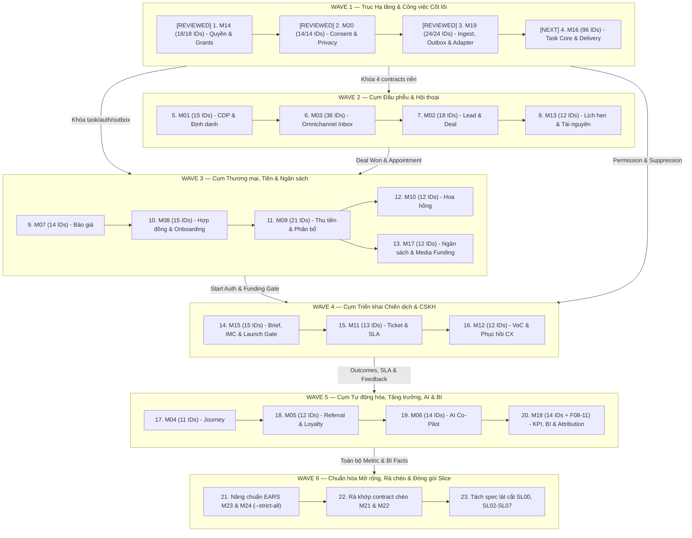

# Kế hoạch Ưu tiên Bóc tách Đặc tả Chi tiết (`M01–M24` & `SL00–SL07`)

> **Trạng thái thực thi:** `Đã hoàn tất đối soát CR-20261116 & chốt Reviewed cho Wave 1: M14, M20 & M19 (3/24) — Tiếp theo: M16` (cập nhật `16/11/2026`).  
> **Nguồn chuẩn & công cụ:** [CRM_MASTER_BRD_SRS_HOP_NHAT.md](../00-master/CRM_MASTER_BRD_SRS_HOP_NHAT.md) (`v1.9`, `SHA-256: b6a3279f328e96e1e97d845e209be7a326516a0dba5e3a033d88e1f2162e421c`), [FUNCTION-CATALOG.md](../02-specs/FUNCTION-CATALOG.md) (`224` chức năng `M01–M24`), [requirements.json](trace/requirements.json), [module-spec-validation.json](evidence/module-spec-validation.json) và skill [crm-ba-spec](../.agents/skills/crm-ba-spec/SKILL.md).

---

## 1. Chiến lược & Nguyên tắc Bóc tách (`Hybrid Hub-First theo Cụm`)

1. **Khóa trục hạ tầng nhiều phụ thuộc nhất trước (`Wave 1`):** Bóc tách và đóng băng hợp đồng quyền (`M14`), chặn gửi/privacy (`M20`), ingest/outbox (`M19`) và lõi công việc (`M16`) ngay đầu để mọi cụm nghiệp vụ đi sau tham chiếu trực tiếp mà không phải sửa ngược.
2. **Bóc tách theo cụm liên kết đôi chặt nhất (`Wave 2` $\rightarrow$ `Wave 5`):** Gom các module thường xuyên trao đổi state/event với nhau thành cùng một Wave.
3. **Khóa `Public Contracts` & Cổng `Verify` cuối mỗi Wave:** Kết thúc một module/Wave phải hoàn thiện đủ 6 mục chuẩn [MODULE-SPEC.md](../02-specs/templates/MODULE-SPEC.md) (EARS + `[MASTER]`/`[PROPOSED]`/`[OPEN-GAP]` + `erDiagram`/`stateDiagram-v2`), tách `public contracts/` vào `02-specs/contracts/` theo mẫu [CONTRACT.md](../02-specs/templates/CONTRACT.md) và vượt qua toàn bộ 4 script ở `05-tools/` trước khi chuyển Wave kế tiếp.
4. **4 Quy ước Nền đã chốt qua `/grill-me` (15/11/2026):**
   - **Truy vết mở rộng (`GAP-03`):** Bao phủ cả 100% ID `owner == Mxx` lẫn các ID liên quan trong nhóm `221 missing_owner` / `PLATFORM` (`U*`, `INT*`, `RV*`, `OC*`, `DB*`, `CEO/CMO/CX/SEC/WF-U*`, `NFR*`, `O*`, `ENTITY-L*`), phân biệt rõ `Primary Owner` vs `Consumer`.
   - **Độ sâu `Per-Function` (`Mxx-Fyy`):** Trong Mục `3. Hành vi` của mỗi file `02-specs/modules/Mxx-*.md`, tách tiểu mục `### 3.x Mxx-Fyy` cho 100% chức năng của module.
   - **Tách bảng gộp (`GAP-04`):** Trong Mục `4. Data/API`, tách rời các khai báo bảng gộp ở Master `5.13/5.18/5.20` thành từng bảng độc lập (kế thừa `11` cột chuẩn Mục `5.1` bổ sung `legal_entity_id` thành `12` cột `Nhóm A` theo `ADR-004` + gắn mã `ENTITY-Lxxxx`).
   - **Bảng `Policy/Config Parameters` (`Fail-Closed` theo `INV-14`) & Nhịp cuốn chiếu:** Thiết kế tham số mở (`O01–08`, `W-O*`, `GAP-*`) thành bảng cấu hình có `Safe Default (Fail-Closed)` để không chặn spec; chạy cuốn chiếu **từng module một (4 pha/module)** bắt đầu từ `M14`.

---

## 2. Bản đồ Phụ thuộc & Thứ tự 6 Wave



---

## 3. Lộ trình Chi tiết 24 Module & Public Contracts từng Wave

| Thứ tự | Wave | Module | Fan-In | Owned IDs | Trạng thái hiện tại | Tệp đặc tả đích (`02-specs/modules/`) | Public Contracts cần khóa cuối Wave (`02-specs/contracts/`) |
|---:|---|---|---:|---:|---|---|---|
| 1 | Wave 1 | `M14` — Tổ chức, Nhóm & Quyền | 17 | 18 | `complete_id_mentions` (`18/18` IDs — Reconciled `ADR-002..008`) | [M14-ORG-ACCESS-DELEGATION.md](../02-specs/modules/M14-ORG-ACCESS-DELEGATION.md) | [M14-PRINCIPAL-ACCESS-DECISION.md](../02-specs/contracts/M14-PRINCIPAL-ACCESS-DECISION.md) |
| 2 | Wave 1 | `M20` — Consent, Suppression & Privacy | 15 | 14 | `complete_id_mentions` (`14/14` IDs — Reconciled `ADR-004..008`) | [M20-PRIVACY-CONSENT-RETENTION.md](../02-specs/modules/M20-PRIVACY-CONSENT-RETENTION.md) | [M20-SUPPRESSION-PRIVACY-GATE.md](../02-specs/contracts/M20-SUPPRESSION-PRIVACY-GATE.md) |
| 3 | Wave 1 | `M19` — Tích hợp, Ingest & Outbox | 16 | 24 | `complete_id_mentions` (`24/24` IDs — Reconciled `ADR-004..008`) | [M19-INTEGRATION-ADAPTERS-OUTBOX.md](../02-specs/modules/M19-INTEGRATION-ADAPTERS-OUTBOX.md) | [M19-DURABLE-INGEST-OUTBOX.md](../02-specs/contracts/M19-DURABLE-INGEST-OUTBOX.md) |
| 4 | Wave 1 | `M16` — Công việc, Dự án & Task Core | 18 | 96 | Chờ lệnh tiếp theo *(có pilot `SL01`)* | `M16-WORK-PROJECTS-TASK-CORE.md` | `M16-TASK-CORE-COMMANDS.md` |
| 5 | Wave 2 | `M01` — CDP & Hồ sơ khách hàng 360 | 12 | 15 | Chờ Wave 1 | `M01-CDP-IDENTITY-MERGE.md` | `M01-IDENTITY-PROFILE-EVENTS.md` |
| 6 | Wave 2 | `M03` — Omnichannel Inbox | 15 | 38 | Chờ Wave 1 | `M03-OMNICHANNEL-INBOX.md` | `M03-INBOX-TRIAGE-HANDOFF.md` |
| 7 | Wave 2 | `M02` — Lead & Deal | 14 | 18 | Chờ Wave 1 | `M02-LEAD-DEAL-PIPELINE.md` | `M02-DEAL-WON-HANDOFF.md` |
| 8 | Wave 2 | `M13` — Lịch hẹn & Tài nguyên | 4 | 12 | Chờ Wave 1 | `M13-APPOINTMENTS-RESOURCES.md` | — |
| 9 | Wave 3 | `M07` — Danh mục & Báo giá | 8 | 14 | Chờ Wave 2 | `M07-CATALOG-QUOTING.md` | `M07-M08-COMMERCIAL-COMMITMENT.md` *(cùng M08)* |
| 10 | Wave 3 | `M08` — Hợp đồng & Onboarding | 13 | 15 | Chờ Wave 2 | `M08-CONTRACTS-ONBOARDING.md` | `M08-START-AUTHORIZATION.md` |
| 11 | Wave 3 | `M09` — Nghĩa vụ thu, Tiền & Đối soát | 13 | 21 | Chờ Wave 2 | `M09-AR-RECEIPTS-RECONCILIATION.md` | `M09-ALLOCATION-REFUND-EVENTS.md` |
| 12 | Wave 3 | `M10` — Hoa hồng & Chi trả | 7 | 12 | Chờ Wave 2 | `M10-COMMISSIONS-PAYOUTS.md` | `M10-COMMISSION-PAYOUT-ROUTE.md` |
| 13 | Wave 3 | `M17` — Ngân sách, Chi phí & Funding | 7 | 12 | Chờ Wave 2 | `M17-BUDGETS-MEDIA-FUNDING.md` | — |
| 14 | Wave 4 | `M15` — Brief, Chiến lược, IMC & Launch | 10 | 15 | Chờ Wave 3 | `M15-BRIEF-IMC-LAUNCH.md` | — |
| 15 | Wave 4 | `M11` — Ticket & SLA | 10 | 13 | Chờ Wave 3 | `M11-TICKETS-SLA.md` | `M11-M12-SLA-CX-FEEDBACK.md` *(cùng M12)* |
| 16 | Wave 4 | `M12` — Voice of Customer & Phục hồi CX | 9 | 12 | Chờ Wave 3 | `M12-VOC-CX-RECOVERY.md` | — |
| 17 | Wave 5 | `M04` — Journey & Nhắc việc | 9 | 11 | Chờ Wave 4 | `M04-JOURNEY-AUTOMATION.md` | — |
| 18 | Wave 5 | `M05` — Referral & Loyalty | 2 | 12 | Chờ Wave 4 | `M05-REFERRAL-LOYALTY.md` | — |
| 19 | Wave 5 | `M06` — AI Co-Pilot có kiểm soát | 5 | 14 | Chờ Wave 4 | `M06-AI-COPILOT-GOVERNED.md` | — |
| 20 | Wave 5 | `M18` — Từ điển KPI, BI & Attribution *(+ F08–11)* | 15 | 14 *(+4)* | Đang có `9/14` IDs | [M18-BI-REPORTING-EXPANSION.md](../02-specs/modules/M18-BI-REPORTING-EXPANSION.md) | `M18-METRIC-FACTS-EXPORT.md` |
| 21 | Wave 6 | `M23` & `M24` — Nâng chuẩn EARS + `--strict-all` | 2 / 2 | 12 / 8 *(đề xuất)* | Đã có bản Draft mở rộng | [M23](../02-specs/modules/M23-SYSTEM-ADMIN-SECURITY-OPS.md), [M24](../02-specs/modules/M24-PERFORMANCE-AND-PRODUCTIVITY.md) | — |
| 22 | Wave 6 | `M21` & `M22` — Rà khớp contract chéo | 6 / 8 | 101 / 135 | `complete_id_mentions` | [M21](../02-specs/modules/M21-PARTNER-BUSINESS-RESULTS.md), [M22](../02-specs/modules/M22-HUMAN-RESOURCES.md) | — |
| 23 | Wave 6 | Tách 7 Slice Specs còn thiếu (`02-specs/slices/`) | — | — | Chờ Wave 1–5 | `SL00`, `SL02`, `SL03`, `SL04`, `SL05`, `SL06`, `SL07` | Đồng bộ thêm `SL01`, `SL08`, `SL09–11` |

---

## 4. Definition of Done (DoD) bắt buộc trước khi qua Wave kế tiếp

1. Thực hiện đủ **Pha 1 (Grounding) $\rightarrow$ Pha 2 (Hỏi chặn Tầng 1 qua `ask_question`, ghi `[OPEN-GAP]` Tầng 2 vào [GAPS.md](GAPS.md)) $\rightarrow$ Pha 3 (EARS + Data/API + `contracts/`) $\rightarrow$ Pha 4 (Analyze & Verify)** theo [module-workflow.md](../.agents/skills/crm-ba-spec/references/module-workflow.md).
2. Cập nhật [02-specs/README.md](../02-specs/README.md) và [PROGRESS.md](agent/PROGRESS.md).
3. Chạy đủ 4 lệnh kiểm chứng từ `D:\AI Agent\CRM`:
   ```powershell
   python 05-tools/build_delivery_inventory.py
   python 05-tools/verify_delivery_plan.py
   python 05-tools/verify_hrm_integration.py
   python 05-tools/verify_module_spec.py
   ```
   Yêu cầu mọi module đã bóc tách đạt `complete_id_mentions` (Wave 6 chạy thêm `--strict-all` cho `M18`, `M23`, `M24`), `bad_links: []`, `bad_fences: []`, giữ nguyên `master_unchanged: true` và `application_tests: "Not Run"`.

---

## 5. Nhật ký Kết quả Bóc tách từng Module (`Completed Modules Log`)

### Wave 1 *(Đã đối soát đồng bộ theo [CR-20261116-WAVE1-RECONCILIATION](../02-specs/changes/archive/CR-20261116-WAVE1-RECONCILIATION.md) & `ADR-002..008`; đã vượt tái kiểm Fresh-Context & chốt `Reviewed`)*

1. **`M14` — Tổ chức, Chi nhánh, Thành viên, Quyền & Bàn giao Nhân sự (`Reviewed`):**
   - **Tệp đặc tả Module:** [M14-ORG-ACCESS-DELEGATION.md](../02-specs/modules/M14-ORG-ACCESS-DELEGATION.md) — Đạt `complete_id_mentions` (`18/18` ID sở hữu trực tiếp + toàn bộ ID/thực thể mở rộng); đặc tả EARS cho 8 chức năng `M14-F01..08`, sở hữu **23 bảng logic** (đã tách `Policy_Definitions`, `Policy_Versions`, `Audit_Logs` về SSoT `M23` theo `ADR-004`, bổ sung đủ cột phạm vi `branch_id/legal_entity_id/business_line_id` + `ADR-002` PostgreSQL RLS 5-GUC `SET LOCAL`), và khóa bảng Tham số Mở (`GAP-M14-01..06`).
   - **Tệp Hợp đồng Liên Module (`Contract`):** [M14-PRINCIPAL-ACCESS-DECISION.md](../02-specs/contracts/M14-PRINCIPAL-ACCESS-DECISION.md) (`v1.1`) — Hợp đồng 3 cổng đồng bộ (`BindDbTransactionContext`, `EvaluateAccessDecision` phân tách `INTERACTIVE_READ` vs `GUARDED_EXECUTION`, `CompileScopeFilter` với AST chuẩn hóa) kết hợp đồng bộ `ApplyBreakGlassGrant` / `RevokeBreakGlassGrant` từ `M23` theo `ADR-002/003` kèm JSON Schema đầy đủ và 4 Domain Events (`M14.PermissionVersionBumped`, `M14.UserOffboardingLocked`, `M14.WorkHandoverAssigned`, `M14.WorkspaceActivated`).
   - **3 Quyết định Kiến trúc cốt lõi:**
     1. *Ủy nhiệm Thay ca (`M14-F05`):* Mô hình `Act-On-Behalf` có tiền kiểm `Membership + Role_Binding` nền tại cùng `Workspace/Branch`, giữ nguyên `owner_id` và quyền hưởng hoa hồng lịch sử.
     2. *Bàn giao Nghỉ việc 2 Pha (`M14-F06` & `UC12`):* Pha 1 cắt phiên/quyền nguyên tử tại `effective_at` (`ADR-003`) và gán tạm `Queue Manager` làm `Custodian` cho 8 nhóm open work; Pha 2 yêu cầu người nhận mới bấm `Accept` (hoặc `Reject` có lý do) trước khi đóng ca sang `OFFBOARDED`.
     3. *Cổng Kiểm tra Quyền Thực thi (`M14-F04`):* Hợp đồng 3 cổng kết hợp binding phiên giao dịch (`SET LOCAL`), đánh giá bản ghi đơn lẻ/Download Gateway (`INTERACTIVE_READ` invalidate cache + đọc Primary DB khi lệch phiên bản; `GUARDED_EXECUTION` fail-closed `409/401`), và đẩy bộ lọc `Predicate AST + SET LOCAL` xuống câu truy vấn gốc.
2. **`M20` — Quản trị Dữ liệu Cá nhân, Consent, Suppression & Quyền Chủ thể (`Reviewed`):**
   - **Tệp đặc tả Module:** [M20-PRIVACY-CONSENT-RETENTION.md](../02-specs/modules/M20-PRIVACY-CONSENT-RETENTION.md) — Đạt `complete_id_mentions` (`14/14` ID sở hữu trực tiếp + toàn bộ ID/thực thể mở rộng); đặc tả EARS cho 8 chức năng `M20-F01..08`, sở hữu **12 bảng logic** (phân loại `Nhóm A/B/C` & cột phạm vi `ADR-004`, khôi phục đầy đủ `Consent_Logs` & endpoint `POST /v1/consents/revoke`), và khóa bảng Tham số Mở (`GAP-M20-01..10`, bỏ giả định `72h` hay cam kết `0s` queue cleanup).
   - **Tệp Hợp đồng Liên Module (`Contract`):** [M20-SUPPRESSION-PRIVACY-GATE.md](../02-specs/contracts/M20-SUPPRESSION-PRIVACY-GATE.md) (`v1.1`) — Hợp đồng 4 cổng (`EvaluateOutboundCompliance`, `EvaluateVendorAndAiTransfer`, `VerifyPostRestoreComplianceGate`, `EvaluateAssetDownloadPrivacyGate`) kèm JSON Schema đầy đủ và 4 Domain Events (`M20.EndpointSuppressed`, `M20.SubjectErasureExecuted`, `M20.LegalHoldChanged`, `M20.DataIncidentEscalated`).
   - **3 Quyết định Kiến trúc cốt lõi:**
     1. *Định danh Suppression & Mục đích gửi (`M20-F02/03`):* Gắn `Endpoint_Suppressions` trực tiếp vào điểm liên hệ vật lý (`endpoint_lookup_hash + channel + purpose_code`) độc lập với `contact_id`; `Unsubscribe` chặn Marketing/Survey nhưng giữ thông báo Dịch vụ/Hợp đồng (`OC17`), còn `Hard-Bounce` chặn mọi gửi tự động trên endpoint đó.
     2. *Xóa phân tầng kết hợp Cô lập `Legal Hold` & Sổ Xóa `HMAC` (`M20-F06` & `UC11`):* Xóa sạch phần Marketing/Chat/Search/AI; phần Hợp đồng/Chứng từ kế toán (`M08/M09`) chuyển sang `RESTRICTED_LEGAL_HOLD`; ghi mã băm `HMAC-SHA256` kèm `hmac_key_version` vào `Deletion_Ledger` lưu PITR/WAL độc lập (`ADR-007`) để tự động xóa lại khi Restore Backup (`INT26`).
     3. *Cổng Kép Gửi tin & Kiểm soát AI/Vendor (`M20-F03/07`):* Kiểm tra `EvaluateOutboundCompliance` bằng cách đọc Primary DB trực tiếp ở `DISPATCH_AUTHORITATIVE`; chặn gửi sang AI/Vendor chưa `ACTIVE` (`No-Train != ZDR` theo `RV17`) và thay thế PII qua `Placeholder_Vault` có TTL ngắn trước khi rời hệ thống.
3. **`M19` — Tích hợp, Ingest & Outbox (`Reviewed`):**
   - **Tệp đặc tả Module:** [M19-INTEGRATION-ADAPTERS-OUTBOX.md](../02-specs/modules/M19-INTEGRATION-ADAPTERS-OUTBOX.md) — Đạt `complete_id_mentions` (`24/24` ID sở hữu trực tiếp + toàn bộ ID mở rộng); đặc tả 3 máy trạng thái tách rời, 8 chức năng `M19-F01..08`, sở hữu **14 bảng logic + phần định tuyến kênh ngoài `Connector_Mappings`** (tổng 15 dòng Từ điển 4.2, gồm `Message_Status_Events`, `Email_Delivery_Events`; tách bạch External Outbox ở `M19` vs Internal Outbox ở `M23-F12` và cô lập 3 làn queue theo `ADR-005`), và khóa bảng Tham số Mở (`GAP-M19-01..10`, gắn `UNVERIFIED_UNTIL_POC` cho Zalo webhook & Meta Tags).
   - **Tệp Hợp đồng Public (`Contract`):** [M19-DURABLE-INGEST-OUTBOX.md](../02-specs/contracts/M19-DURABLE-INGEST-OUTBOX.md) (`v1.1`) — Hợp đồng 5 trụ cột (`IngestWebhookEvent`, `EnqueueOutboundIntent`, `DispatchOutboundIntent`, `ExecuteSafeRemoteFetch`, `ReplayConnectionEvents`) kèm 5 Domain Events (`M19.InboundEventPersisted`, `M19.OutboundDispatchResulted`, `M19.MessageReceiptUpdated`, `M19.ConnectionHealthChanged`, `M19.SyncCoverageGapReported`) và tiêu thụ đồng bộ sự kiện từ `M14/M20/M23`.
   - **3 Quyết định Kiến trúc cốt lõi:**
     1. *Sở hữu kết nối đơn Workspace (`M19-F01` & `SEC02`):* Partial unique lock trên `(tenant_id, provider, provider_namespace, external_account_id)` với các trạng thái đang hoạt động/tạm dừng `ACTIVE/DEGRADED/REAUTHORIZATION_REQUIRED/PAUSED` (không gồm `PENDING_AUTHORIZATION`); chuyển giao theo trình tự 4 bước và giữ lịch sử ở workspace cũ.
     2. *Tách DB Lock & Đóng băng `UNKNOWN_OUTCOME` khi Timeout sau gửi (`M19-F05` & `INT25`):* Cấm giữ DB lock khi gọi mạng (`INV-06`); tách `Lane 1` (live SLA) khỏi `Lane 3` (backfill/replay); đặt `allow_auto_retry = false` cho giao dịch tiền/lương/ZBS phí; timeout sau khi payload có thể đã rời đi đóng băng ở `UNKNOWN_OUTCOME` để đối soát kèm `evidence_ref`.
     3. *Ingest bền vững trước ACK, Backfill/Replay an toàn TTL & Chống SSRF (`M19-F04/F06/F08` & `SEC04`):* Lưu DB `Inbound_Events` trước khi trả `2xx` (`INV-07`); `BACKFILL`/`REPLAY` hủy `Outbound_Intents` hết TTL thay vì xả lũ; tải media từ xa kiểm tra IP sau DNS-resolve, cấm redirect, kiểm MIME `+33%` và `min(product, provider)` (`GAP-M19-02`).
