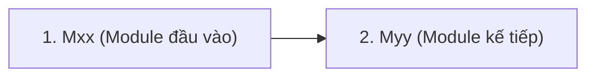

# WAVE-x — Kế hoạch Tổng Triển khai Đặc tả (`Documentation-Only`)

> Khuôn mẫu; dùng để lập `03-planning/waves/WAVE-x-PLAN.md` trước khi mở module đầu tiên của mỗi Wave (`Wave 2..6`). Giữ nguyên giai đoạn **`Documentation-Only`** (`application_tests: "Not Run"`).

---

## 1. Phạm vi, Baseline & Bất biến Kế thừa

- **Wave:** `Wave x — <Tên cụm nghiệp vụ>`
- **Baseline Master v1.9:** [CRM_MASTER_BRD_SRS_HOP_NHAT.md](../../00-master/CRM_MASTER_BRD_SRS_HOP_NHAT.md) (`SHA-256: b6a3279f328e96e1e97d845e209be7a326516a0dba5e3a033d88e1f2162e421c`)
- **Trạng thái Kế hoạch:** `Active` | `Completed` | `On_Hold`
- **Tài liệu Nền tảng Kế thừa:**
  - [DECOMPOSITION-PLAN.md](../DECOMPOSITION-PLAN.md)
  - [INVARIANTS.md](../../01-architecture/INVARIANTS.md) *(khóa cứng `INV-01..28`, đặc biệt `INV-26..28` từ Wave 1 Review)*
  - [CONTRACTS-REGISTRY.md](../../02-specs/CONTRACTS-REGISTRY.md) & các `ADR-*` liên quan trong `01-architecture/decisions/`
- **Danh sách Module thuộc phạm vi Wave:** `Mxx`, `Myy`, ... *(kèm link tới từng `03-planning/modules/Mxx-COMPLETION-PLAN.md` khi khởi tạo)*

---

## 2. Thứ tự Thực thi & Đồ thị Phụ thuộc (`DAG`)

| Thứ tự | Module | Kế hoạch Hoàn thành Riêng | Phụ thuộc Đầu vào (`Upstream`) | Đầu ra Trọng tâm (`Module` + `Contract`) |
|---:|---|---|---|---|
| 1 | `Mxx` | `../modules/Mxx-COMPLETION-PLAN.md` | `C14`, `C19`, `C20`, `C23`, `C24` | `Mxx-*.md`, `Cxx-*.md` |

---

## 3. Hợp đồng Dùng chung & Quy tắc Xử lý Phụ thuộc Chéo

### 3.1. Danh mục Public Contracts cần Khóa trong Wave
| Module Producer | Tệp Contract (`02-specs/contracts/`) | Consumers Chính | Trạng thái Mục tiêu trong Wave |
|---|---|---|---|
| `Mxx` | `Mxx-TEN-CONTRACT.md` | `Myy`, `Mzz` | `Draft (Surface Frozen)` hoặc `Reviewed` |

### 3.2. Chính sách Xử lý Phụ thuộc Chéo & Trạng thái Chốt
1. **Khóa Contract trước tiêu thụ:** Module sau chỉ chạy Pha 3 khi Public Contract dùng chung của module trước đã chốt bề mặt (`Draft (Surface Frozen)` hoặc `Reviewed`).
2. **Khi phát sinh `Backward Contract Drift`:**
   - Nếu contract Wave trước đã `Reviewed`/`Ready`: bắt buộc mở `CR-*` tại `02-specs/changes/`, sửa additive trên `02-specs/contracts/*.md`, chạy `--build-registry` và ghi `- [PENDING-BACKSYNC]: ...` vào [PROGRESS.md](../agent/PROGRESS.md).
   - Nếu là contract trong cùng Wave đang ở `Draft`: cập nhật đồng bộ theo quy tắc Wave Plan trước khi nâng lên `Reviewed`.
3. **Khi phát sinh phụ thuộc nghiệp vụ chưa chốt từ module chưa làm hoặc Chủ dự án:** Không tự suy diễn; ghi chặn vào `Blocking Register` của module đang chạy, chuyển sang phần việc độc lập được phép hoặc module cung cấp phụ thuộc theo đúng quyết định của Kế hoạch Wave này.
4. **Điểm chạm Lát cắt (`SLxx`):** Liệt kê các slice liên quan (`SL02`, `SL03`...) để bảo đảm không bỏ sót luồng End-to-End.

---

## 4. Điều kiện Đóng Wave (`Definition of Done`)

- [ ] 100% module trong Wave hoàn tất `03-planning/modules/Mxx-COMPLETION-PLAN.md` (tối thiểu đạt ngưỡng `Draft Hoàn chỉnh` hoặc `Reviewed` theo chính sách Wave này).
- [ ] Mọi Public Contract dùng chung của Wave đã chốt và đồng bộ trong [CONTRACTS-REGISTRY.md](../../02-specs/CONTRACTS-REGISTRY.md).
- [ ] Đã thực hiện rà soát chéo cụm (`review-change` — `Luồng A`) và xử lý xong các mục `[PENDING-BACKSYNC]` phát sinh trong Wave (nếu có).
- [ ] Toàn bộ `[OPEN-GAP]` mới đã đăng ký đủ `7` trường vào [GAPS.md](../GAPS.md).
- [ ] Đã cập nhật [02-specs/README.md](../../02-specs/README.md), [active-task.json](../agent/active-task.json), [PROGRESS.md](../agent/PROGRESS.md) và đạt đủ `--build-registry` + `4` lệnh kiểm chứng toàn kho `05-tools/` (giữ nguyên **`Documentation-Only`**; `application_tests: "Not Run"`).
