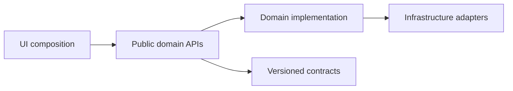

# Đánh giá prompt phân rã đặc tả và lập trình CRM bằng AI

Ngày: 16/10/2026. Trạng thái: đề xuất kiến trúc để quyết định, chưa thay thế baseline hoặc triển khai code.

Đầu vào: prompt đính kèm `4c7f951d-c32f-4255-960d-69245885037c/Pasted text.txt`; Master BRD/SRS 1.7 trong thư mục `tài liệu tham khảo`. Đối chiếu trọng tâm: 2.8, 3.0, 3.13–3.14, 5.1, 5.19–5.20, 6.6, 9.11 và 9.16. Nguồn kỹ thuật chính thức được kiểm tra ngày lập báo cáo; cấu hình công cụ phải kiểm lại theo phiên bản thực cài.

**Khuyến nghị: nên theo hướng chia nhỏ đặc tả và triển khai tăng dần, nhưng không chạy nguyên văn prompt.** Cần thay “cô lập tuyệt đối từng module” bằng “ngữ cảnh đủ cho một lát cắt nghiệp vụ, phạm vi sửa rõ, kiểm chứng tự động”. Giữ Modular Monolith, PostgreSQL và ranh giới core/gói ngành. Chưa có cơ sở gọi bất kỳ quy trình nào là chuẩn tốt nhất cho mọi dự án.

## 1. Kết luận cho người quyết định

Prompt tốt ở ý tưởng quản lý độ phức tạp: ownership, hợp đồng, test gate, migration và lưu trạng thái giữa phiên. Tuy nhiên, nó trộn ba việc khác nhau: tổ chức tài liệu, kiểm soát công cụ AI và bảo đảm kiến trúc runtime. Viết một quy tắc trong prompt không tự tạo ra cơ chế cưỡng chế tương ứng.

Nếu dùng nguyên văn, có thể thu được bộ tài liệu nhìn rất chặt nhưng hệ thống tích hợp muộn, thiếu quyền theo workspace, hợp đồng chỉ đúng ở compile time, và trạng thái “100%” không có bằng chứng. Các từ tuyệt đối làm tăng nguy cơ AI tự lấp chỗ trống để hoàn thành đầu ra.

Phương án phù hợp nhất với dữ kiện hiện có là **Modular Monolith + hợp đồng rõ + lát cắt nghiệp vụ nhỏ chạy xuyên UI/API/DB/worker + ngữ cảnh phân tầng + gate theo rủi ro và bằng chứng**. Đây là đề xuất cho CRM này, không phải kết quả benchmark năng suất đã đo.

| Phương án | Lợi ích | Chi phí/rủi ro | Quyết định |
|---|---|---|---|
| Nạp toàn Master cho mọi thay đổi | Dễ khởi đầu, thấy toàn cảnh | Lặp token, nhiễu, khó biết thay đổi ảnh hưởng gì | Chỉ dùng khi rà soát tổng thể hoặc cần tra cứu |
| Làm nguyên prompt: một module hoàn tất rồi module tiếp | Dễ theo dõi đầu việc | Giấu dependency, phát hiện lỗi tích hợp muộn, đặc tả đồng bộ thủ công | Không khuyến nghị |
| Spec theo domain, thực thi theo lát cắt, đọc dependency khi cần | Có ownership và phản hồi sử dụng sớm | Cần inventory, kiểm boundary và evidence | Khuyến nghị |
| Microservices/multi-agent phức tạp ngay | Có thể tách triển khai theo đội | Tăng vận hành và điều phối trước khi có nhu cầu thực | Chưa có cơ sở áp dụng |

## 2. Các giả định của prompt cần kiểm lại

1. **“Master đã hoàn chỉnh” chưa đúng theo trạng thái tài liệu.** Master 1.7 ghi đây là thiết kế BA, chưa có biên bản UAT đã chạy. Mục 5.19 và 9.11 yêu cầu xuất DDL/API, chốt chính sách và xác minh capability trước release. Không biến mô tả bảng logic thành migration production bằng suy đoán.
2. **Quá nhiều context là rủi ro, không phải định luật cứ đọc Master sẽ sinh lỗi.** Cần đo khả năng truy xuất đúng và đủ, thay vì chỉ đo số token. Anthropic khuyến nghị ngữ cảnh có tín hiệu cao và truy xuất theo nhu cầu; nội dung tối thiểu vẫn phải đủ. [Nguồn](https://www.anthropic.com/engineering/effective-context-engineering-for-ai-agents).
3. **Số nhân sự dùng CRM không tương đương số lập trình viên hoặc tải hệ thống.** Quy mô khoảng 45 người/2 chi nhánh không tự quyết định số package, bảng hay thời gian triển khai. Khối lượng message, attachment, retention và tích hợp mới quyết định nhiều NFR.
4. **TypeScript là lựa chọn kỹ thuật được prompt gợi ý, chưa phải stack đã kiểm chứng.** Chưa thấy `package.json` trong lượt kiểm tra workspace. Chọn framework/ORM/version bằng ADR khi khởi tạo repo, không làm như chúng đã tồn tại.
5. **Danh sách kênh là phạm vi cần chốt.** TikTok/Web Form trong prompt không được tự thay danh mục kênh của Master. Tách nguồn intake và kênh hội thoại hai chiều; mỗi adapter có capability riêng.

## 3. Đánh giá từng yêu cầu

| Yêu cầu trong prompt | Kết luận | Điều chỉnh cụ thể |
|---|---|---|
| Tách `docs/specs/` | Giữ | File ổn định theo domain; index chỉ điều hướng, không chứa bản sao rule |
| Tách core và gói Marketing Agency | Giữ | Task cá nhân/nội bộ thuộc core; deliverable/SOW chuyên ngành qua extension |
| Gộp FK và event thành một DAG tuyệt đối | Sửa bắt buộc | Tách đồ thị import, quan hệ dữ liệu và luồng nghiệp vụ |
| Chỉ được đọc contract mỏng | Sửa | Đọc thêm invariant, quyền, producer/consumer, test hoặc ADR khi cần |
| `.cursorignore / .claudeignore` khóa Grep | Bỏ giả định | Phân biệt lọc context với sandbox và quyền thực |
| Chỉ một spec trong `active_spec/` | Sửa | Một manifest đang hoạt động trỏ tới các nguồn chuẩn; không di chuyển file |
| Trích đầy đủ toàn bộ trường DB | Có điều kiện | Trường thiếu ghi gap/decision, không tự coi là thiết kế đã duyệt |
| Chưa có bảng đích thì để FK sau | Ngoại lệ | Khóa feature và write path, theo dõi constraint debt; ưu tiên migration dependency hợp lệ |
| `packages/contracts/` + `tsc` | Giữ nhưng thiếu | Thêm runtime schema, version, compatibility và test consumer/provider |
| UI slots | Giữ ở mức nhẹ | Registry tĩnh, quyền theo widget, loading/error/empty state; chưa cần plugin runtime |
| Worker truyền đủ scope | Sửa sâu | Scope đáng tin cậy, quyền hiện hành, transaction-local context, đúng DB role |
| ERD/OpenAPI từ code khớp 100% | Sửa | Đây là mô tả hiện trạng; so với intent và kiểm drift, không tự chứng minh nghiệp vụ đúng |
| Finance/Project xong rồi mới Inbox | Không phù hợp | Làm đường tích hợp một kênh sớm để kiểm identity, quyền và delivery |
| Tất cả test xanh trước mọi commit | Sửa | Gate khác nhau cho checkpoint, merge và release |
| UAT 100% qua terminal | Bỏ khẳng định | Tự động hóa phần quan sát được; nghiệm thu nghiệp vụ vẫn có người chịu trách nhiệm |
| Chỉ cần PROGRESS sau `/clear` | Sửa | Đọc thêm trạng thái code, diff, version spec, lệnh/evidence mới nhất |
| Mọi query có tenant và branch | Sai với mô hình hiện tại | Tenant/workspace/branch/legal entity theo loại tài nguyên và grant |

## 4. Những điểm kỹ thuật có thể gây lỗi thực tế

### 4.1. Khóa context không phải khóa truy cập

Tài liệu Cursor nêu terminal và MCP không bị `.cursorignore` ngăn truy cập. Tài liệu Claude Code hiện hành nêu `.claudeignore` không có tác dụng; dùng permission rules, và cũng ghi rõ giới hạn của các rule đối với subprocess. Vì vậy không thể hứa “khóa vật lý Grep” bằng hai file trên. [Cursor](https://cursor.com/docs/reference/ignore-file), [Claude Code](https://code.claude.com/docs/en/permissions).

Đề xuất cho dự án: mặc định nạp manifest nhỏ, để index có thể tìm kiếm, cho phép mở rộng việc đọc có lý do. Kiểm phạm vi sửa bằng diff/path policy và review; bảo vệ secret hoặc thư mục thực sự cấm truy cập bằng cơ chế sandbox phù hợp công cụ. Không che spec quyền hoặc retention chỉ vì đang làm UI.

### 4.2. Ba loại dependency cần ba cách kiểm soát

**Import code:** tổ chức phụ thuộc package theo hướng rõ, cấm import repository/private implementation của domain khác; cho phép gọi public application API. Kiểm bằng lint hoặc kiểm graph trong CI.

**Dữ liệu:** FK mô tả toàn vẹn, không đồng nghĩa dependency import. Chu trình quan hệ không tự là lỗi thiết kế; cần kiểm tính cần thiết, thứ tự migration và lifecycle. Không bỏ FK có ích chỉ để hình vẽ thành DAG.

**Nghiệp vụ/event:** vòng phản hồi có thể hợp lệ: gửi khách duyệt → yêu cầu sửa → làm lại → gửi duyệt. Cần transition guard, dedup, correlation/causation, giới hạn retry và điều kiện kết thúc. Lặp vô hạn mới là lỗi.



Sơ đồ trên chỉ minh họa hướng phụ thuộc code đề xuất; không dùng thay ERD hoặc event flow. Trong monolith, lời gọi đồng bộ và transaction xuyên capability có kiểm soát vẫn hữu ích. Không bắt mọi trao đổi phải qua outbox; dùng outbox khi cần chuyển giao bất đồng bộ tin cậy hoặc side effect ngoài giao dịch.

### 4.3. “Deferred FK” đang dùng sai ý nghĩa

Thêm FK ở một release sau là **trì hoãn tạo constraint**. `DEFERRABLE` là điều khiển thời điểm kiểm constraint trong transaction; vẫn cần bảng được tham chiếu tồn tại. Hai cơ chế không thay thế nhau. Với FK bổ sung vào dữ liệu đã có, PostgreSQL hỗ trợ `NOT VALID` rồi `VALIDATE CONSTRAINT`; ghi mới vẫn chịu constraint sau khi thêm. [ALTER TABLE](https://www.postgresql.org/docs/current/sql-altertable.html).

Áp dụng theo thứ tự ưu tiên:

1. Chưa cần liên kết thì chưa tạo cột hoặc chưa mở feature; không tạo sẵn tất cả bảng tương lai.
2. Nếu lát cắt cần quan hệ, tạo phần schema tối thiểu của cả hai bên theo dependency trước khi cho phép ghi.
3. Nếu bắt buộc triển khai hai bước: constraint-debt registry ghi owner, migration đóng nợ, feature bị khóa và phép kiểm dữ liệu mồ côi. Khóa mọi đường ghi liên kết chưa bảo vệ, kể cả import/worker.
4. Khi có dữ liệu thật: migration mở rộng → kiểm/backfill → thêm và validate constraint → enable feature. Kiểm lock, thời gian chạy và hướng phục hồi; không tự dùng destructive down migration.

Ví dụ `(tenant_id, deal_id)` chỉ đủ cho quan hệ tenant-level phù hợp. Với quan hệ nội workspace theo Master 5.1 phải bảo vệ thêm workspace. Cross-workspace dùng bridge/grant được phê duyệt; không ép mọi quan hệ cùng workspace.

### 4.4. Worker + RLS là bài toán quyền, không chỉ truyền biến

Master 1.7 dùng `workspace_id`, loại AGENCY/CLIENT; `client_workspace_id` là tên cũ phục vụ mapping. Nhét tên cũ vào contract mới tạo hai nguồn scope. `branch_id` có điều kiện, không áp cho mọi bảng.

Worker phải xác định principal, scope và capability từ job/connection mapping đáng tin cậy; không tin tenant do webhook tự khai. Quyền đọc/ghi và consent phải được đánh giá theo thao tác và thời điểm thực thi. Thiếu scope phải từ chối rõ; chọn không có dòng khác với lỗi ghi bị policy chặn.

DB context nên được đặt trong cùng transaction và connection với các query. PostgreSQL `set_config(..., true)` giới hạn cấu hình ở transaction hiện tại; tránh rò scope khi dùng pool. Cấu hình session không phải bằng chứng người dùng có quyền. [Nguồn](https://www.postgresql.org/docs/current/functions-admin.html).

App/worker thông thường không dùng superuser, `BYPASSRLS` hoặc chủ bảng như thể RLS chắc chắn áp dụng. PostgreSQL có ngoại lệ cho các role này; chủ bảng có thể dùng `FORCE ROW LEVEL SECURITY`. Tách quyền migration khỏi runtime và kiểm cả policy đọc/ghi. [Nguồn](https://www.postgresql.org/docs/current/ddl-rowsecurity.html).

Bộ test đề xuất: tenant A/B; workspace cùng tenant; grant hợp lệ/hết hạn; job bị giả scope; quyền bị thu hồi sau enqueue; rollback rồi pool tái sử dụng; UPDATE đổi scope; worker retry. Kiểm thêm ACL file/search/export vì RLS không tự bảo vệ mọi hạ tầng bên ngoài DB.

### 4.5. TypeScript không xác thực payload runtime

Type annotations bị loại khi biên dịch, nên `tsc` không chứng minh JSON webhook hoặc event đã lưu hợp lệ. [TypeScript Handbook](https://www.typescriptlang.org/docs/handbook/2/basic-types.html).

Đề xuất: mỗi contract có owner, schema runtime, version và quy tắc tương thích. Chọn một nguồn cho schema máy đọc được rồi sinh type/OpenAPI khi phù hợp; tránh ba bản viết tay. DTO không phải DB row. Thay đổi field phải kiểm consumer cũ, event đang nằm trong outbox và triển khai lệch phiên bản. Shared kernel chỉ chứa primitive ổn định; contract chia namespace theo provider, không biến thành nơi tập trung mọi nghiệp vụ.

### 4.6. UI slots tốt nhưng không miễn trừ kiểm tích hợp

Khuyến nghị registry tĩnh cho Customer360/Inbox: slot ID, thứ tự, capability, permission predicate, loader và fallback. Mỗi widget tự xử lý lỗi mà không làm hỏng shell; backend vẫn kiểm quyền. Cần kiểm số query và tải tổng để tránh mỗi widget gọi API riêng gây chậm. Cho phép sửa shell có review khi nhu cầu layout thực sự thay đổi; “không bao giờ sửa shell” không phải mục tiêu chất lượng.

### 4.7. Mock không chứng minh tích hợp thật

Local harness nên mô phỏng duplicate, out-of-order, signature sai, rate limit, token hết hạn, mất kết nối và timeout. Sau đó cần sandbox/tài khoản được phép để kiểm scope, webhook và payload thực của kênh đã chọn. Không tuyên bố mọi provider có sandbox đủ khả năng.

Đặc biệt cần phân biệt timeout trước khi gửi với timeout sau khi provider có thể đã nhận. Trường hợp thứ hai vào trạng thái chưa rõ kết quả và đối soát, không retry mù. Với tiền, QR hoặc callback giả chỉ là đầu vào test; chỉ ghi nhận theo evidence/đối soát và policy của Master. Những quy tắc này là đề xuất bảo toàn invariant dự án, không phải xác nhận capability của mọi ngân hàng/kênh.

## 5. Ranh giới module phù hợp Master 1.7

Không đổi tên/gộp 20 module theo tám ví dụ của prompt rồi làm mất ownership. Có thể dùng folder nhóm để dễ đọc, nhưng giữ ID nguồn và owner từng requirement.

| Phạm vi | Module hiện có | Cách tổ chức đề xuất |
|---|---|---|
| Nền tổ chức/quyền/dữ liệu | M14, M20 và platform | Invariant chung; quyền áp từ lát cắt đầu, không chờ làm xong privacy engine |
| Hồ sơ và bán hàng | M01, M02, M07, M08 | Phân biệt contact, demand, deal, quote và contract |
| Giao tiếp và dịch vụ | M03, M11, M12, M13 | Inbox assignment, ticket và booking có lifecycle riêng |
| Công việc và delivery | M16 | Task core dùng chung; project/deliverable chuyên ngành mở rộng có kiểm soát |
| Tài chính | M09, M10, M17 | Payment/allocation, commission và media funding không nhập thành một trạng thái |
| Marketing và tăng trưởng | M04, M05, M15 | Journey, loyalty, strategy có owner và policy riêng |
| Intelligence và tích hợp | M06, M18, M19 | AI, metric definitions và connector boundaries tách biệt |

Các bất biến phải nằm trong context chung ngắn và có link tới Master:

- Tenant, workspace, branch và legal entity là các chiều khác nhau; link không tự cấp quyền đọc.
- Contact merge không mở rộng ACL; thread không bị nhập chỉ vì cùng khách.
- Task Done không đồng nghĩa SLA đạt, deliverable được khách duyệt hoặc tiền đã thu.
- Durable intake trước ACK; ghi nghiệp vụ và outbox trong cùng transaction khi cần publish.
- Unknown send outcome cần reconciliation; replay không tạo effect trùng.
- Scope/capability của release quyết định test áp dụng; không biến Not Run thành Pass.

## 6. Tổ chức ngữ cảnh và tài liệu đề xuất

```text
docs/
  specs/INDEX.md                 # bản đồ + baseline + dependency
  specs/INVARIANTS.md            # quy tắc xuyên domain, dẫn nguồn
  specs/modules/M01-identity.md # tương tự cho M02...M20
  specs/slices/S01-intake.md     # mục tiêu chạy được xuyên module
  trace/requirements.json       # registry máy đọc được
  trace/coverage.csv            # view sinh từ registry
  decisions/ADR-xxxx.md          # quyết định và hệ quả
  agent/active-task.yaml         # con trỏ + write scope + gates
  agent/PROGRESS.md              # trạng thái, không thay evidence
  evidence/<run-id>/             # log, kết quả, version, môi trường
  generated/                    # ERD/OpenAPI hiện trạng, không sửa tay
```

Đây là cấu trúc đề xuất, chưa tạo toàn bộ cây. Master vẫn là baseline nghiệp vụ hiện hành. Module specs là bản triển khai có truy vết; khi muốn chuyển nguồn chuẩn phải có quyết định rõ. Không cho phép Master và module specs cùng chứa hai quy tắc mâu thuẫn mà không biết bản nào có hiệu lực.

Một context pack nên có: mục tiêu lát cắt; phiên bản/hash nguồn; invariant áp dụng; spec module chủ sở hữu; contract liên quan; ca kiểm thử; trạng thái repo và các quyết định chưa chốt. Tài liệu khác truy xuất theo nhu cầu. Không mặc định “một file” là “một đơn vị đủ ngữ cảnh”.

Manifest ví dụ, chỉ minh họa:

```yaml
task: S01-intake-to-assigned-task
baseline: master-1.7
source_hash: TO_BE_COMPUTED
owners: [M01, M03, M14, M16, M19, M20]
read_first:
  - docs/specs/INVARIANTS.md
  - docs/specs/slices/S01-intake.md
read_on_demand: related contracts, policies, tests and ADRs
write_scope: TO_BE_RESOLVED_FROM_IMPLEMENTATION_REPO
migration_scope: new migrations required by this slice only
gates: [scope-isolation, durable-intake, duplicate-replay, task-claim]
excluded_capabilities: [live-outbound, commission-payout]
```

Không cấp mặc định quyền sửa toàn bộ `db/migrations/**`. Migration đã áp dụng giữ nguyên; sửa bằng migration mới. Schema liên module cần review owner liên quan. “Allowed paths” phải được so với diff thực tế, không chỉ tin agent tự khai.

## 7. Đảm bảo không mất yêu cầu khi tách file

Không thể dùng câu “đầy đủ 100%” để thay phương pháp kiểm. Mỗi requirement cần: ID chuẩn; loại; vị trí nguồn; owner duy nhất; consumer; slice; contract/schema liên quan; test; priority; applicability; trạng thái; evidence.

Inventory phải nhận diện cả FR, BR, NFR, UC, UAT, Mxx-Fxx/Mxx-ACxx, W-F, BR-W, UC-W, W-T và quy tắc chưa có ID. Các dải như W-T01–40 phải được đối chiếu danh sách chi tiết; tham chiếu không được đếm thành định nghĩa mới. Bảng logic, alias tên cũ và bảng triển khai cần mapping riêng, không coi mọi danh từ viết hoa là entity.

Kiểm tự động đề xuất:

1. Mỗi định nghĩa nguồn có đúng một owner hoặc gap được ghi rõ.
2. Mỗi tham chiếu trỏ tới ID tồn tại; kiểm duplicate ID và nhầm namespace.
3. NFR xuyên module có owner kiểm soát và danh sách module áp dụng.
4. Requirement chưa triển khai vẫn ở registry với trạng thái Deferred/Not Run; không bị xóa khỏi mẫu số.
5. Báo cáo riêng coverage tài liệu, implementation và verification. Coverage tài liệu 100% không chứng minh phần mềm đúng 100%.
6. Quy tắc chưa có mã giữ nguồn trích/anchor, gán mã mới có dấu vết khi được chuẩn hóa; không âm thầm sửa ID Master.

Công cụ trích xuất giúp phát hiện thiếu và trùng; BA/architect vẫn cần rà logic và các ngoại lệ bằng văn bản. Parser regex đơn thuần không đủ chứng minh hiểu đầy đủ nghiệp vụ.

## 8. Lộ trình thực thi nên đổi như thế nào

Không chốt số tuần khi chưa có stack, người triển khai, tài khoản kênh và dữ liệu mẫu. Chốt theo exit gate. Một lát cắt có thể chạm nhiều module nhưng phạm vi hành vi nhỏ.

| Bước | Kết quả quan sát được | Phụ thuộc/gate trước chuyển bước |
|---|---|---|
| 0. Baseline và inventory | Map ID/owner/gap; scope pilot; ADR stack và nguồn chuẩn | Không mất requirement; quyết định thiếu có owner, chỉ chặn capability liên quan |
| 1. Nền chạy được | App + PostgreSQL + migration + principal/scope + audit + health + CI | Runtime role đúng; isolation fail-closed; clean install và upgrade thử được |
| 2. Intake và task tối thiểu | Một adapter giả lập nhận tin → lưu bền → contact/demand → tạo và nhận việc | Replay không nhân bản; claim đồng thời một kết quả; link giữ đúng quyền |
| 3. Một kênh thật có quyền | Nhận/trả lời thực nghiệm, reconnect, unknown outcome; UI thao tác được | Account/capability xác nhận; policy send, retry/reconcile và quan sát lỗi đạt |
| 4. Sales và công việc | Lead/deal, activity, task cá nhân/team, bàn giao, quyền quản lý | UC bán hàng và tập W-T áp dụng đạt; Task Done không đóng nghĩa vụ khác |
| 5. Thương mại/delivery | Quote/SOW → contract → project/deliverable → acceptance | Version/authority/scope đúng; task nội bộ không bị ép có contract |
| 6. Tiền và hoa hồng | Evidence tiền → allocation → reconciliation; commission khi có policy | Số tiền/history/replay/concurrency đúng; chưa đủ policy không payout |
| 7. Mở rộng có căn cứ | Kênh tiếp theo, automation, workload, BI và AI | Mỗi capability đủ dependency, vận hành và test; không tự bật toàn bộ backlog |

Nếu pilot ưu tiên giao việc nội bộ, làm Task Core tối thiểu trước kênh thật, nhưng vẫn kiểm sớm contract liên kết CRM. Nếu ưu tiên inbox bán hàng, dùng bước 2–3 như bảng. Số liệu/audit tối thiểu phải có từ đầu; dashboard nâng cao và AI có thể sau.

## 9. Thiết kế gate thực dụng

| Gate | Mục tiêu | Bằng chứng |
|---|---|---|
| Checkpoint cá nhân | Lưu tiến độ có thể phục hồi | Diff và ghi rõ hoàn thành/chưa hoàn thành; không gắn nhãn release-ready |
| Merge | Không làm hỏng baseline dùng chung | Lint/typecheck nếu stack hỗ trợ; test thay đổi; migration; boundary; regression bị ảnh hưởng |
| Enable capability | Feature đủ dependency và quyền | Config/flag, contract thực, tests áp dụng, rollback và owner |
| Release/pilot | Người dùng thực hiện được công việc và vận hành được | UAT, isolation/tiền/consent trọng yếu, restore, provider evidence, sign-off |

Mỗi test lưu một trong: Pass, Fail, Not Run, Blocked, Not Applicable. N/A phải có lý do theo capability và người chịu trách nhiệm. Không tính Not Run/N/A là Pass; không hạ mức test trọng yếu để vượt gate. Test lỗi chức năng đang làm cũng không được che bởi “lỗi có sẵn”.

PROGRESS ghi commit hoặc trạng thái chưa commit, spec hash, active slice, lệnh test, run ID, lỗi còn mở, next step và quyết định cần chốt. Phiên mới đối chiếu repo thực tế và smoke check liên quan. Anthropic mô tả tiến độ kết hợp git history và kiểm thử đầu phiên, thay vì chỉ tin bản tóm tắt. [Nguồn](https://www.anthropic.com/engineering/effective-harnesses-for-long-running-agents).

## 10. Lợi ích, chi phí và cách kiểm chứng phương án đề xuất

**Lợi ích kỳ vọng:** giảm đọc lặp; tránh sửa tràn domain; trace được thay đổi; kiểm lỗi tích hợp sớm; một phiên AI có mục tiêu hoàn thành cụ thể; các quyết định quan trọng còn lại sau reset.

**Chi phí thật:** duy trì registry và contract; viết harness; chạy DB/test môi trường đại diện; review semantics; cập nhật ADR. Nếu mỗi việc nhỏ phải cập nhật nhiều bản sao tài liệu, chi phí vượt lợi ích. Vì thế bắt đầu bằng index, invariants, registry tối thiểu và một slice, chỉ tự động hóa thêm khi có lỗi lặp lại.

Thử hai lát cắt đại diện: intake→assigned task, và submit task→review→Done. Ghi thời gian hoàn thành, số lần phải mở thêm context, số lỗi xuyên domain, số lần sửa lại, chi phí token nếu công cụ cung cấp, thời gian test và tỷ lệ yêu cầu có evidence. Không đặt mục tiêu giảm token như một KPI duy nhất; giảm token mà tăng lỗi quyền là thất bại.

Điều kiện tiếp tục mở rộng: người dùng làm được flow; không còn lỗi nghiêm trọng về quyền/dữ liệu; test có thể tái chạy; agent mới tiếp tục được từ artifact; registry không có requirement bị rơi không giải thích. Chưa có thử nghiệm này nên chưa tuyên bố tiết kiệm bao nhiêu phần trăm.

## 11. Năm bài toán cần brainstorm trước code sâu

1. **Quyền xuyên workspace khi bàn giao nhân sự:** ai giữ quyền đọc lịch sử, ai nhận trách nhiệm, job đã enqueue còn được chạy không? Đầu ra: decision table actor/resource/action/scope, cùng test revoke và race.
2. **Một nhu cầu phát sinh nhiều đối tượng:** một tin nhắn có thể tạo ticket, task và deliverable; đối tượng nào sở hữu SLA và ai được đóng? Đầu ra: lifecycle/ownership và chống auto-close sai.
3. **Side effect chưa rõ kết quả:** provider nhận nhưng client timeout, callback trễ hoặc replay; khi nào đối soát, khi nào được thử lại? Đầu ra: state machine và evidence theo từng adapter.
4. **Tiền và nghiệm thu lệch thời điểm:** khách duyệt version cũ, thu trước, hoàn tiền hoặc đổi scope; không suy Task Done thành đủ điều kiện thu/chi. Đầu ra: policy snapshot, adjustment và ledger invariants.
5. **Nguồn dữ liệu thay đổi giữa CRM/PMS/ERP:** ai được ghi task, payment, invoice; sync loop và conflict xử lý thế nào? Đầu ra: ownership matrix từng field/command, mapping IDs và reconciliation queue.

## 12. Quyết định đề nghị

Chấp nhận hướng phân rã và phát triển tăng dần; thay prompt bằng bản hiệu chỉnh kèm theo. Bước triển khai kế tiếp nên là inventory + traceability + context nền + một slice pilot, rồi mới mở rộng module specs. Không yêu cầu AI viết ngay ba file “hoàn chỉnh 100%” khi thiết kế vật lý chưa được chốt.

Báo cáo này chưa đổi Master, chưa tạo rule công cụ, chưa sinh migration và chưa xác nhận test ứng dụng. Đây là kết quả phân tích phương hướng theo yêu cầu hiện tại.

## 13. Rà soát sâu lần hai — prompt gửi lại ngày 16/10/2026

Đã đọc toàn bộ attachment `700eb10a-63d7-48b8-b791-96e0764a2051/Pasted text.txt`. So sánh chuỗi sau khi loại khoảng trắng đầu/cuối cho kết quả giống attachment trước. Vì vậy phần này bổ sung phân tích, không coi đây là phiên bản prompt đã sửa.

### 13.1. Prompt thực sự đang giải quyết bao nhiêu bài toán?

Prompt đồng thời giao sáu trách nhiệm: kiểm toán nguồn; thiết kế domain; thiết kế schema/API; điều phối context; lập kế hoạch phát triển; thiết kế tiêu chuẩn nghiệm thu. Chúng có quan hệ thứ tự. Nếu nguồn còn thiếu, thiết kế schema phải ghi quyết định mới; nếu domain chưa rõ, chưa thể chốt write scope; nếu test chưa có môi trường, chưa thể chứng minh gate.

Một lần trả lời có thể đề xuất cả sáu, nhưng không nên gắn nhãn tất cả đã hoàn chỉnh. Cần phân biệt artifact đã viết, quyết định đã duyệt, code đã tồn tại, test đã chạy và capability đã được bật. Đây là lỗi thiết kế đầu ra của prompt, không đơn thuần là vấn đề model yếu hay context ngắn.

Vai trò “15 năm kinh nghiệm” hữu ích để định hướng độ sâu nhưng không phải cơ chế đảm bảo chất lượng. Chất lượng phải đến từ nguồn, đối chiếu, ví dụ phản chứng, kiểm tự động và bằng chứng nghiệm thu.

### 13.2. Sáu mâu thuẫn nội tại

| Mâu thuẫn | Hệ quả có thể xảy ra | Cách giải quyết |
|---|---|---|
| Cấm sửa domain khác nhưng module Deals phải bổ sung FK lên Activities | Agent sửa bảng ngoài ownership hoặc bỏ constraint | Migration liên domain có owner quan hệ và phạm vi thay đổi cụ thể |
| Chỉ đọc contract mỏng nhưng phải kiểm quyền/side effect xuyên module đầy đủ | Đủ type nhưng thiếu semantics | Contract mô tả quyền, transaction, lỗi, replay và lifecycle; cho tra dependency |
| Cấm copy schema nhưng yêu cầu trích không cắt xén mọi nội dung vào module | Nhiều bản quy tắc bắt đầu trôi | Một bản chuẩn cho từng rule; module ghi applicability và link/hash nguồn |
| Một file active nhưng bắt làm Customer360/Inbox tổng hợp | UI viết được widget nhưng không biết policy tổng hợp | Active slice manifest chứa nhiều nguồn có liên quan |
| Bắt hoàn chỉnh 100% nhưng nguồn thiếu quyết định | AI phải bịa hoặc bỏ qua gap để đáp ứng | Cho phép trạng thái Unresolved, Proposed và Blocked theo capability |
| Zero-overlap nhưng shared contracts thay đổi theo nhu cầu module sau | Hoặc đóng băng contract sai, hoặc phá module đã “xong” | Contract evolution và regression theo consumer; hoàn thành theo version, không vĩnh viễn |

Ví dụ: module thanh toán cần biết acceptance có bị thu hồi hay tạo version mới. Interface chỉ có `accepted: boolean` có thể compile hoàn toàn nhưng không biểu diễn được bằng chứng nghiệm thu theo version. Sai lầm nằm ở mô hình nghiệp vụ trước khi nằm ở code.

### 13.3. Năm thử nghiệm phản chứng cho quy trình

Đây là kịch bản thiết kế kiểm thử đề xuất, chưa chạy trên ứng dụng.

**Tình huống A — Task hoàn tất làm đóng ticket sai.** Người xử lý hoàn tất việc nội bộ “soạn câu trả lời”, nhưng chưa gửi phản hồi khách. Agent chỉ đọc task spec có thể phát event chung `WorkCompleted` rồi consumer đóng SLA. Dữ liệu hợp kiểu, mỗi module unit test đều xanh, nhưng khách vẫn chờ. Cần phân biệt task completion với evidence phản hồi theo request. Kiểm tích hợp: Task Done giữ SLA mở cho đến đúng sự kiện nghiệp vụ.

**Tình huống B — FK cùng tenant nhưng sai workspace.** Task hoặc activity thuộc workspace khách A liên kết đối tượng của khách B trong cùng tenant. FK tenant-only vẫn hợp lệ. Nếu widget suy quyền từ liên kết, có thể lộ dữ liệu. Cần scoped FK hoặc bridge được cấp phép, cộng ACL tài nguyên đích. Test cả insert, sửa link và grant bị thu hồi; không chỉ thử hai tenant khác nhau.

**Tình huống C — Local mock xanh nhưng gửi tin hai lần.** Provider nhận tin rồi kết nối timeout trước khi CRM nhận response. Mock chỉ trả timeout trước khi nhận nên retry test xanh. Khi chạy thật, worker gửi lại và khách nhận trùng. Harness cần mô hình riêng “accepted but response lost”, lưu attempt/evidence và kiểm đường reconcile. Chỉ dùng provider idempotency khi đã xác minh capability của adapter đó.

**Tình huống D — Contract đổi khi còn event cũ.** Module mới đổi event field hoặc enum, tất cả code hiện tại compile. Outbox còn payload phiên bản cũ; consumer mới thất bại hoặc hiểu sai. Cần fixture phiên bản cũ, quy tắc nâng cấp payload/tương thích và kiểm backlog trước release. Typecheck toàn repo chỉ kiểm một ảnh chụp source code.

**Tình huống E — Hai người nhận cùng một việc.** Hai request đọc trạng thái Unassigned rồi cùng ghi assignee. Unit test một request không thấy lỗi; nếu phát notification trước commit, cả hai có thể nhận thông báo thành công. Cần cập nhật có điều kiện hoặc locking phù hợp, xác định người thắng và lỗi cho người còn lại; ghi outbox cùng transaction. Test song song trên DB thật, kiểm một assignment có hiệu lực và side effect tương ứng, không chỉ kiểm HTTP 200.

### 13.4. Contract “mỏng” cần đủ ý nghĩa

Mỏng nên là ít chi tiết implementation, không phải thiếu nghĩa nghiệp vụ. Ví dụ command nhận việc cần những mục sau:

| Thành phần | Nội dung phải quyết định |
|---|---|
| Ý nghĩa | Nhận trách nhiệm thực hiện một task, khác nhận quyền sở hữu khách hàng |
| Actor/scope | User hoặc service principal nào, task ở workspace nào, grant nào áp dụng |
| Preconditions | Task ở trạng thái nhận được, assignee đủ điều kiện, dependency không chặn thao tác này |
| Input | Task ID, expected version và trường hợp cần idempotency key |
| Concurrency | CAS/lock bảo vệ cạnh tranh; người thua nhận conflict có thể hiểu và xử lý |
| Transaction | Assignment/history và outbox được ghi nguyên tử nếu cần thông báo |
| Errors | Phân biệt không đủ quyền, version cũ, đã có người nhận; tránh lộ tài nguyên ngoài quyền |
| Retry | Key có phạm vi theo actor/scope/command; cùng key khác payload xử lý rõ |
| Output | Snapshot/version mới và trạng thái; không trả toàn bộ DB row |
| Audit | Ai, lúc nào, từ nguồn nào, correlation ID; không log secret/nội dung không cần thiết |

DTO TypeScript chỉ biểu đạt một phần bảng này. OpenAPI sinh từ code cũng có thể thiếu phần semantics nếu không được mô tả và kiểm riêng.

### 13.5. Ownership còn thiếu bốn chiều

“Bảng nào của module nào” mới là ownership dữ liệu. Cần bổ sung owner của quyết định nghiệp vụ, owner của command làm thay đổi dữ liệu, owner của projection và owner vận hành khi lỗi.

Ví dụ M16 sở hữu Task, M03 sở hữu conversation/request, dashboard có thể do M18 tổng hợp. M18 không vì có bảng read model mà được quyền đổi task hoặc đóng request. Khi sync lỗi, đội vận hành cần biết ai xử lý queue và ai quyết định nghiệp vụ bị treo. Nếu chỉ chia thư mục code, các trách nhiệm này vẫn chưa được giải quyết.

Core/industry pack cũng cần kiểm theo hành vi: dependency hướng từ pack tới API mở rộng của core; core không import concrete pack. Generic task không buộc tồn tại contract agency. Không cần dựng framework cấu hình mọi trường ngay; extension đơn giản có kiểm thử là đủ cho một pack ban đầu.

### 13.6. Gate cần chống trường hợp “agent tự ra đề rồi tự chấm”

AI có thể viết test phản chiếu chính implementation sai. Bởi vậy cần giữ tiêu chí nghiệp vụ nguồn ổn định và kiểm negative cases độc lập với đường xử lý thuận lợi. Không cho xóa/giảm assertion, đổi expected result hoặc đánh dấu N/A chỉ để làm xanh pipeline mà không giải thích thay đổi yêu cầu.

Điều này không đồng nghĩa mọi thay đổi test đều sai: requirement có thể đổi hợp lệ. Khi đó phải liên kết CR/ADR và chỉ rõ tác động. Evidence cần lưu diff test, lệnh chạy, môi trường và version code; “đã test” trong PROGRESS không thay log.

Với concurrency, test cần phối hợp thời điểm cạnh tranh đủ rõ và kiểm trạng thái cuối, không dựa hoàn toàn vào sleep ngẫu nhiên. Với RLS, phải chạy bằng runtime role thật của ứng dụng; test bằng DB owner có thể không kiểm policy dự định. PostgreSQL mô tả các ngoại lệ owner/superuser/BYPASSRLS tại [Row Security Policies](https://www.postgresql.org/docs/current/ddl-rowsecurity.html).

### 13.7. Ngữ cảnh đầy đủ tối thiểu là gì?

Một task coding có thể coi đủ điều kiện bắt đầu khi agent trả lời được: đang sửa hành vi nào; ID nguồn nào; actor và scope nào; trước/sau trạng thái ra sao; ai sở hữu side effect; lỗi/retry xử lý thế nào; test nào chứng minh; file nào dự kiến sửa. Nếu thiếu một câu trả lời ảnh hưởng tính đúng, phải đọc thêm hoặc ghi gap, không tự suy vì muốn giữ context nhỏ.

Không cần chọn một ngưỡng token cứng cho mọi module. File có thể dài vì nhiều bảng nhưng ít liên quan; một đoạn ngắn về quyền có thể quan trọng hơn toàn bộ schema. Chỉ số hữu ích là tỷ lệ lỗi do thiếu context, số lần làm lại và thời gian có một thay đổi được kiểm chứng.

### 13.8. Cách sửa câu chữ để AI có thể thực hiện đúng

| Câu hiện tại | Câu thay thế đề nghị |
|---|---|
| “Đã hoàn chỉnh về mặt nghiệp vụ và kiến trúc” | “Là baseline hiện hành; kiểm các quyết định thiếu trước khi sinh thiết kế vật lý” |
| “Chỉ dẫn chiếu tới hợp đồng kiểu dữ liệu mỏng” | “Nạp contract và invariant liên quan; cho phép tra producer/consumer khi thiếu semantics” |
| “Tuyệt đối không có phụ thuộc vòng” | “Kiểm cycle trên import graph; phân tích FK graph và event flow riêng” |
| “Đảm bảo truyền đầy đủ tenant, branch, client workspace” | “Resolve scope từ nguồn tin cậy theo schema hiện hành và kiểm quyền runtime” |
| “Pass 100% trước git commit” | “Ghi rõ trạng thái checkpoint; bắt buộc gate tương ứng trước merge/enable/release” |
| “Khớp 100% với code” | “Sinh mô tả hiện trạng, phát hiện drift và đối chiếu với intent đã duyệt” |
| “Tự test tự động 100% trên máy local” | “Kiểm local các tình huống mô phỏng; kiểm capability thật và UAT riêng” |
| “Toàn bộ FR/BR/UC/UAT phân bổ vào file” | “Mỗi yêu cầu có owner, nguồn, applicability, implementation/test/evidence; giữ cả yêu cầu hoãn và NFR” |

### 13.9. Mức sẵn sàng sử dụng

- Dùng làm brief để thảo luận kiến trúc: phù hợp, nếu coi các cơ chế bên trong là đề xuất cần kiểm.
- Dùng nguyên văn để sinh blueprint triển khai chính thức: chưa phù hợp vì còn mâu thuẫn và giả định sai đã nêu.
- Dùng làm luật cưỡng chế AI coding: chưa đủ; cần enforcement thực qua tool permissions, boundary checks, CI và review.
- Dùng sau hiệu chỉnh cho pilot: phù hợp nếu bắt đầu bằng inventory và một lát cắt, đo kết quả rồi mở rộng.

Không gán điểm phần trăm “chất lượng prompt” khi chưa có rubric/benchmark. Quyết định chấp nhận dựa trên việc loại bỏ lỗi chặn: scope sai, giả định công cụ sai, mất traceability và gate không có bằng chứng.
