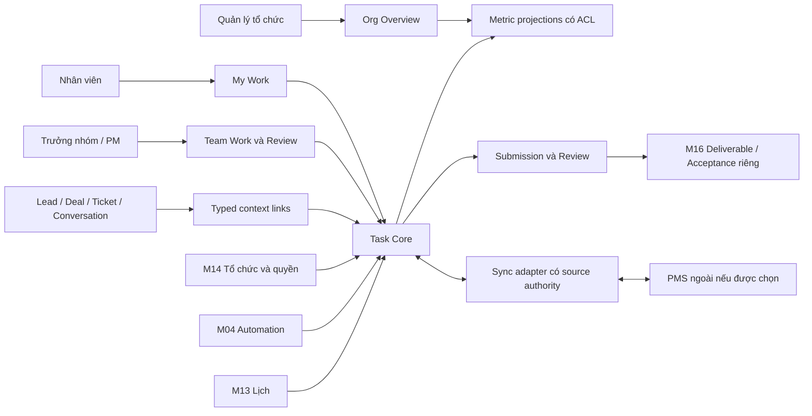
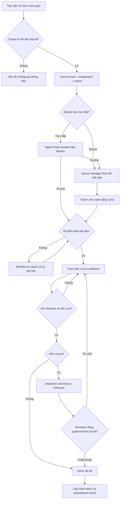
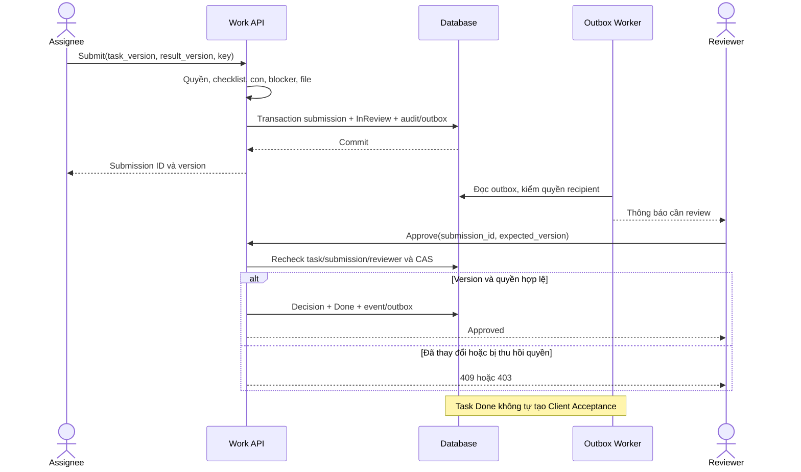
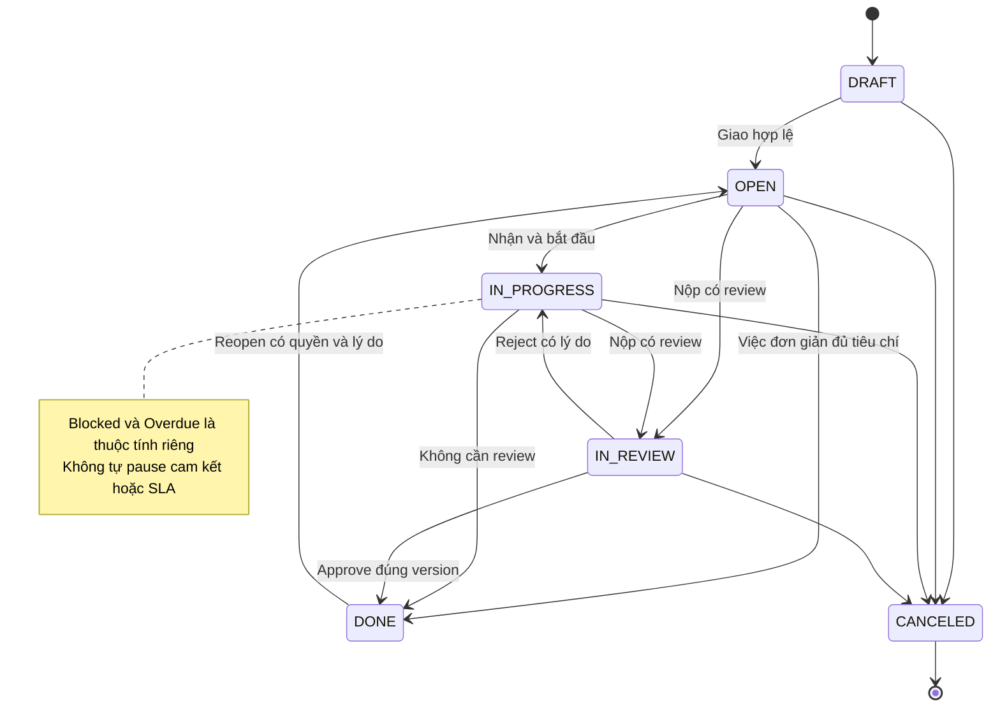
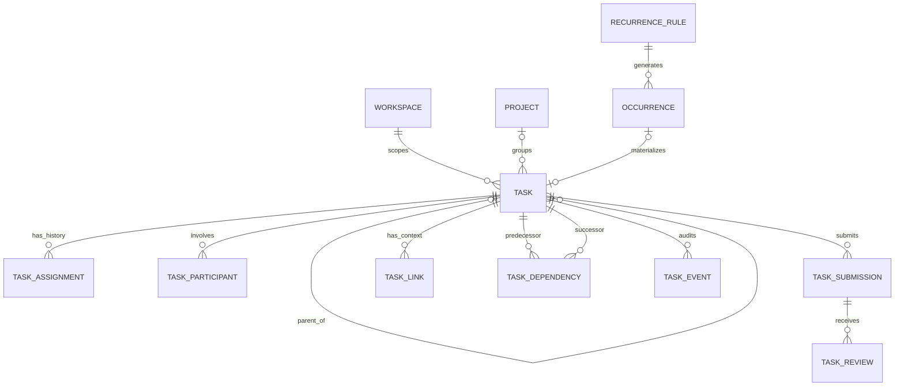

# BÁO CÁO BA — GIAO VIỆC VÀ QUẢN TRỊ CÔNG VIỆC TRONG CRM

**Phạm vi:** cá nhân, đội nhóm, phòng ban, dự án, tổ chức và công việc gắn khách hàng.  
**Ngày nghiên cứu:** 16/10/2026.  
**Đầu vào nội bộ:** Master BRD/SRS CRM 1.6, đặc biệt M02/M04/M13/M14/M16/M18, FR25/27, Chương 5–9.  
**Trạng thái:** báo cáo nghiên cứu và đề xuất thiết kế để review; không phải xác nhận phần mềm đã triển khai hoặc quyết định mua sản phẩm.

**Trạng thái cập nhật 16/10/2026:** theo yêu cầu chủ dự án, các đề xuất Task Core đã được hợp nhất vào Master 1.7 (3.14/4.23/5.20/6.6/7.7/8.5/9.16/A.7 và Phụ lục H). Báo cáo này giữ nội dung nghiên cứu tại thời điểm lập; câu chữ đề xuất/“chưa sửa Master” bên dưới là lịch sử, không thay trạng thái hiện hành. Master là nguồn chuẩn.

## Kết luận điều hành

CRM hiện có nền tảng giao việc nhưng thiên về chăm sóc khách hàng và bàn giao dự án. Để quản lý công việc toàn doanh nghiệp, cần một miền Work Management dùng chung cho việc cá nhân, việc nội bộ, việc CRM và việc dự án. Không nên tạo bốn bảng Task riêng hoặc bắt mọi công việc phải có hợp đồng.

Đề xuất mở rộng **M16 thành Quản lý công việc, dự án và nguồn lực**, giữ M14 sở hữu tổ chức/quyền, M13 sở hữu lịch, M04 sở hữu automation, M18 sở hữu định nghĩa báo cáo. Đây là đề xuất thay đổi phạm vi, chưa tự nâng toàn bộ chức năng P1 thành cam kết P0 trong Master.

Ba nguyên tắc quyết định:

1. Mỗi việc có một người chịu trách nhiệm chính hoặc một hàng chờ có quản lý chịu trách nhiệm tiếp nhận. Người phối hợp không làm mờ trách nhiệm.
2. Hoàn thành thao tác, được duyệt nội bộ, được khách nghiệm thu và được thanh toán là các sự kiện khác nhau.
3. Một Task có một nơi ghi dữ liệu chuẩn. Giao diện hợp nhất nhiều công cụ không đồng nghĩa nhiều hệ thống được ghi đè cùng trường.

MVP nên tập trung tạo/giao/nhận việc, My Work, Team Board, deadline, phối hợp, review, blocker, lịch sử và báo cáo vận hành. Capacity theo giờ, Gantt phức tạp, danh mục dự án và mục tiêu chiến lược chỉ mở khi dữ liệu và nhu cầu đủ rõ.

## Phương pháp và cách đọc

- Nghiên cứu bảy hệ sinh thái: Pancake, Bitrix24, HubSpot, Salesforce, Zoho, Odoo và Microsoft Dynamics 365.
- Chỉ dùng tài liệu chính thức cho nhận định sản phẩm. Nguồn được liệt kê và dẫn ngay trong các mục nghiên cứu.
- **Quan sát:** điều tài liệu sản phẩm nêu. **Phân tích BA:** hệ quả nghiệp vụ suy ra. **[Đề xuất bổ sung]:** thiết kế cho CRM này, không phải tính năng đã xác minh của vendor.
- Không có đăng nhập demo, benchmark, test API với tài khoản doanh nghiệp hoặc khảo sát toàn bộ edition. “Chưa xác minh” không đồng nghĩa “sản phẩm không có”. Tính năng trong sản phẩm Projects/Work không tự thuộc gói CRM cùng hãng.
- Một số trang trả nội dung hạn chế/timeout; bằng chứng Odoo dùng tài liệu chính thức được lập chỉ mục, ghi rõ phiên bản ở nguồn. Không suy đoán DB/queue/locking nội bộ từ ảnh giao diện.

# PHẦN A — NGHIÊN CỨU THỊ TRƯỜNG VÀ AUDIT HIỆN TRẠNG

## A.1. Phân biệt các bài toán trước khi so tính năng

| Khái niệm | Câu hỏi nó giải quyết | Ví dụ | Không được đồng nhất với |
| --- | --- | --- | --- |
| Activity | Đã tương tác hoặc cần làm bước liên hệ nào? | Gọi khách, gửi báo giá, hẹn họp | Dự án nhiều người và nhiều đầu ra |
| Task | Ai làm việc gì, khi nào xong, tiêu chí nào? | Chuẩn bị proposal | Ticket phản ánh nhu cầu của khách |
| Checklist | Các bước nhỏ trong một việc | Kiểm logo, kiểm giá, kiểm chính tả | Task có owner/deadline độc lập |
| Subtask | Phần việc cần quản lý độc lập trong task cha | Thiết kế slide proposal | Dependency giữa hai việc độc lập |
| Queue | Nơi giữ việc chờ một người nhận | Nhóm Design nhận yêu cầu mới | Nhãn nhóm/filter hoặc routing tự động |
| Project | Tập hợp công việc có mục tiêu/phạm vi | Triển khai campaign tháng 11 | Phòng ban hoặc khách hàng |
| Milestone | Mốc kiểm soát kết quả | Duyệt concept trước launch | Checklist đã tick hết |
| Deliverable | Đầu ra phải bàn giao/kiểm phiên bản | Bộ thiết kế v3 | Task Done |
| Portfolio | Nhìn nhiều dự án để ưu tiên nguồn lực | Các dự án của chi nhánh | Danh sách task cộng lại |
| Department / Team | Cơ cấu quản lý / nhóm phối hợp | Marketing / Ekip khách A | Workspace dữ liệu hoặc pháp nhân |

Đặc biệt, “giao cho team” có ba nghĩa khác nhau: một việc vào queue để một người nhận; một việc một owner với nhiều cộng tác viên; nhiều việc độc lập cho từng người. UI phải bắt người giao chọn đúng ý định, không dùng một ô multi-select mơ hồ.

## A.2. Pancake CRM và Pancake Work

**Quan sát:** Pancake CRM có module Nhiệm vụ, khu vực Công việc cá nhân, việc đang mở/quá hạn, phân loại, ưu tiên, người phụ trách/người liên quan, đối tượng CRM liên kết và nhắc việc. Trạng thái có thể cấu hình; một số trạng thái hệ thống không xóa được. [P01 — Nhiệm vụ](https://docs.pancake.biz/crm/st-f2/st-p8?lang=vi).

Pancake Work có bảng Kanban với thẻ/cột và kéo thả tiến độ. Đây là sản phẩm Work trong hệ sinh thái; không dùng bằng chứng này để kết luận toàn bộ chức năng đã có trong CRM Tasks. [P02 — Kanban](https://docs.pancake.biz/pancakework/st-f3/st-p3?lang=vi).

**Phân tích BA:** cách tổ chức này làm điểm bắt đầu công việc gần hồ sơ khách hàng, đồng thời có bề mặt cộng tác riêng. CRM của dự án nên học đường vào My Work và liên kết nhiệm vụ với lead/deal/ticket. Tuy nhiên phải làm rõ mapping trạng thái, notification và quyền khi nối với công cụ Work.

**Cần PoC:** một người nghỉ việc thì task và reminder đi đâu; kéo thả có vượt approval không; comment/file có chia sẻ ra khách không; đồng bộ task giữa CRM và Work có đủ chiều/API hay chỉ thông báo. Chưa có bằng chứng trong các trang đã đọc để xác nhận đầy đủ dependency, effort planning và portfolio của toàn bộ gói CRM.

## A.3. Bitrix24 — giao việc có vai trò và kiểm soát hoàn thành

**Quan sát:** task có creator, một assignee chính, participants và observers. Chọn nhiều assignees khi tạo có thể sinh các task riêng. Có lựa chọn yêu cầu kết quả khi hoàn thành, gửi kết quả để người giao duyệt và cho phép người làm đổi deadline. [B01 — Create a task](https://helpdesk.bitrix24.com/open/25865519/).

Tài liệu phân biệt vai trò tham gia task với quyền sửa/giao việc; quyền của dự án và quyền chung cần xét cùng nhau. [B02 — Task permissions](https://helpdesk.bitrix24.com/open/25908803/). Template hỗ trợ tái sử dụng thông tin và người tham gia. [B03 — Task templates](https://helpdesk.bitrix24.com/open/20883624/).

**Phân tích BA:** đây là mẫu tham khảo phù hợp nhất cho quy trình quản lý giao việc nội bộ của dự án: trách nhiệm chính rõ, phối hợp rõ, giao xong vẫn có bước kiểm kết quả. Không nên sao chép nguyên quy tắc quyền cấp trên sang mô hình agency nhiều workspace; quản lý nhân sự chưa chắc được xem tài liệu của mọi khách.

**Đề xuất áp dụng:** tách `creator_id`, `requester_id`, `assignee_id`, `reviewer_id` và collaborators/watchers. Chỉ thiết lập reviewer bắt buộc cho loại việc cần duyệt; không bắt việc nhắc gọi đơn giản đi qua nhiều bước.

## A.4. HubSpot — tổ chức công việc theo hoạt động CRM

**Quan sát:** task có người phụ trách, ưu tiên, hạn, reminder và liên kết record; cũng tạo được việc không liên kết record. Recurrence có điều kiện seat và cách sinh tiếp được tài liệu mô tả. [H01 — Create tasks](https://knowledge.hubspot.com/tasks/create-tasks?service=content_creation).

Task queue của HubSpot là cơ chế nhóm/lọc/chia sẻ; queue dùng chung cho phép nhiều người xem và hoàn thành tập việc. Workflow/sequence có thể thêm task vào queue khi gói hỗ trợ. [H02 — Task queues](https://knowledge.hubspot.com/tasks/use-task-queues).

**Phân tích BA:** phù hợp thiết kế một màn hình tập trung việc cần làm, tạo follow-up ngay từ record. Tuy nhiên nhãn “queue” không chứng minh đã có reserve capacity hoặc exclusive claim. CRM này phải tự định nghĩa rõ task được chia sẻ khác task chưa có người chịu trách nhiệm.

**Đề xuất áp dụng:** tạo việc ít thao tác; context CRM tùy chọn; saved views là truy vấn, không phải bảng Task thứ hai. Không lấy việc gán queue làm bằng chứng một người đã nhận trách nhiệm.

## A.5. Salesforce — hàng chờ và quyền sở hữu công việc

**Quan sát:** Task có thể nằm trong queue; thông báo/reminder giao việc chỉ phát khi chuyển từ queue sang người dùng cụ thể. Đổi owner của record cha không tự chuyển các task đang ở queue. Giao cho nhiều người tạo assignment riêng. [S01 — Considerations for Using Tasks](https://help.salesforce.com/s/articleView?id=sales.task_considerations.htm&language=en_US&type=5).

Action Plans của các cloud/edition được liệt kê hỗ trợ template giao task vào queue để thành viên nhận ownership; không phải tính năng mặc định mọi Salesforce CRM. [S02 — Action Plan Tasks to Queues](https://help.salesforce.com/s/articleView?id=ind.fsc_action_plans_queues.htm&language=en_US&type=5).

**Phân tích BA:** trách nhiệm queue và trách nhiệm cá nhân là hai giai đoạn. Hệ thống của dự án cần quản lý tuổi việc chưa nhận, người quản queue và escalation riêng; nếu chỉ đợi reminder của assignee thì việc có thể nằm vô hạn ở queue.

**Đề xuất áp dụng:** thêm `queue_entered_at`, `assignment_offered_at`, `accepted_at`, `queue_manager_id`; chuyển account owner không tự viết lại task ownership. Công việc đang xử lý cần workflow bàn giao riêng.

## A.6. Zoho CRM + Zoho Projects — phân tách bán hàng và thực thi

**Quan sát:** Zoho CRM có Tasks/Meetings/Calls và reminder/recurrence. [Z01 — Tasks FAQ](https://help.zoho.com/portal/en/kb/crm/faqs/activity-management/articles/faqs-tasks-module). Zoho Projects cung cấp task/subtask và recurring work. [Z02 — Tasks and subtasks](https://www.zoho.com/projects/task-details.html).

Tích hợp CRM–Projects hỗ trợ tạo/liên kết project, đồng bộ một số trường task và comment hai chiều. Tài liệu nêu giới hạn: đổi hạn vượt lịch strict project hoặc mở subtask khi parent còn đóng có thể bị từ chối. [Z03 — CRM integration](https://help.zoho.com/portal/en/kb/projects/integration/zoho-apps/articles/crm-integration).

**Phân tích BA:** việc hiển thị và sửa task từ CRM không khiến CRM tự trở thành nơi có quyền cuối cùng với mọi quy tắc dự án. Integration phải xử lý trạng thái “đề nghị thay đổi đang chờ hệ nguồn chấp nhận”, không báo thành công giả rồi âm thầm ghi đè lại.

**Đề xuất áp dụng:** nếu dùng PMS ngoài, lưu source system/external ID/version, sync operation và lỗi nghiệp vụ. Một request đổi hạn từ CRM được gửi tới hệ nguồn chuẩn; chỉ cập nhật canonical state khi nguồn chấp nhận hoặc dùng optimistic UI có nhãn pending rõ ràng.

## A.7. Odoo CRM + Project — quản lý thực thi trong hệ sinh thái

**Quan sát:** Odoo Project có task/subtask, dependency, recurring task; dashboard tập hợp milestone, giờ, chi phí và doanh thu theo cấu hình. [O01 — Project](https://www.odoo.com/documentation/19.0/applications/services/project.html), [O02 — Dashboard](https://www.odoo.com/documentation/19.0/applications/services/project/project_management/project_dashboard.html).

Odoo phân biệt stage trên board và status của task. [O03 — Stages/statuses, bản tài liệu 19.0](https://www.odoo.com/documentation/19.0/nl/applications/services/project/tasks/task_stages_statuses.html). Recurrence tạo lần tiếp sau khi việc trước Done/Canceled; một số thành phần như timesheet/comment/subtask không được sao chép. [O04 — Recurring tasks](https://www.odoo.com/documentation/19.0/applications/services/project/tasks/recurring_tasks.html). Dependency chặn successor tới khi predecessor đạt trạng thái đủ điều kiện của sản phẩm. [O05 — Dependencies, saas-19.3](https://www.odoo.com/documentation/saas-19.3/applications/services/project/tasks/task_dependencies.html).

**Phân tích BA:** thiết kế stage tùy chỉnh cần đi cùng lifecycle chuẩn để thống kê không phụ thuộc tên cột. Recurrence “sau khi xong” không thay cho lịch “mỗi thứ Hai” dù việc tuần trước còn mở. Không mặc định Cancelled của predecessor là đã đáp ứng điều kiện nghiệp vụ; phải có waiver riêng khi dùng cho báo giá/QA/launch.

**Đề xuất áp dụng:** stage riêng theo team; canonical lifecycle ổn định; dependency P0 chỉ Finish-to-Start; tiến độ dự án dựa đầu ra được chấp nhận hoặc cách tính có version, không suy từ số thẻ chuyển Done.

## A.8. Dynamics 365 — hoạt động, ownership và danh sách việc tiếp theo

**Quan sát:** Sales có work list/Up next và xử lý hoạt động trong bối cảnh khách; tài liệu phân biệt skip/snooze theo loại hoạt động. [D01 — Work list / Up next](https://learn.microsoft.com/en-us/dynamics365/sales/connect-with-customers). Task API của Dataverse là loại activity, có owner là user/team và liên kết regarding tới đối tượng khác. [D02 — Task EntityType](https://learn.microsoft.com/en-us/power-apps/developer/data-platform/webapi/reference/task?view=dataverse-latest).

**Phân tích BA:** user/team ownership, business unit và record liên quan là các chiều khác nhau. Cần bề mặt “việc tiếp theo” nhất quán nhưng không nên gom task, meeting, ticket và call vào một state machine chung.

**Đề xuất áp dụng:** My Work là projection từ Task và nghĩa vụ CRM, có loại nguồn và command đúng nguồn. Snooze reminder chỉ lùi thông báo; không mặc định dời contractual due hoặc xóa lịch sử trễ.

## A.9. So sánh theo mô hình — không phải bảng xếp hạng mua sắm

| Hệ sinh thái | Mô hình được nguồn thể hiện | Điều đáng học | Điều phải kiểm trước chọn |
| --- | --- | --- | --- |
| Pancake | CRM Tasks + sản phẩm Work | Công việc cá nhân gần hồ sơ khách | API và đồng bộ giữa hai sản phẩm |
| Bitrix24 | CRM cùng Tasks/Projects | Role công việc, review, delegation | Quyền thực tế theo plan/project và isolation |
| HubSpot | CRM activities, task views/queues | Tạo nhanh, follow-up, xử lý danh sách | Queue semantics, seat/workflow entitlement |
| Salesforce | Activity/task ownership, queue; Action Plans theo cloud | Nhận ownership và quy trình dựa template | Edition, behavior thông báo khi task chưa có owner |
| Zoho | CRM + Projects tích hợp | Tách sales khỏi delivery, integration có quy tắc | Field sync, conflict, quyền và license hai bên |
| Odoo | Project trong hệ sinh thái app | Stage/status, dependency, effort/project reporting | Version, module/edition, cấu hình kế toán/planning |
| Dynamics 365 | Activity + user/team ownership + work list | Context và việc tiếp theo, metadata ownership | App/license, security role và tùy biến |

Không dùng dấu “không có” cho Gantt, portfolio, approval hoặc recurrence của một sản phẩm nếu các nguồn đã đọc chưa chứng minh sự vắng mặt. Các điểm trên là trọng tâm học thiết kế; chưa đủ cơ sở chốt tổng chi phí hoặc sản phẩm tốt nhất.

## A.10. Audit tài liệu CRM hiện tại

**Readiness riêng cho quản lý công việc dùng chung: 46/100**, là điểm đánh giá BA, không phải đo hiệu năng hay điểm toàn CRM.

| Trụ cột | Điểm | Căn cứ |
| --- | ---: | --- |
| Phạm vi/actors/quyền | 14/25 | M14 có nền tảng quyền; chưa rõ task cá nhân/nội bộ và project authority |
| Luồng/ngoại lệ | 11/25 | Có assign/replan/review đầu ra; thiếu receive/decline task, recurrence, escalation và lifecycle riêng |
| Data/rules/NFR | 12/30 | FR25 có owner/due/effort; schema Tasks/Time_Entries/Availability gộp quá sơ lược |
| Sơ đồ/truy vết/QA | 9/20 | Có module và AC dự án; chưa đủ trace và test cho task engine dùng chung |

### Critical — chặn baseline Task Engine

| Gap | Hiện trạng | Quyết định cần bổ sung |
| --- | --- | --- |
| A-G01 | M16 yêu cầu contract/SOW/handoff cho project | Tách client delivery, internal project và task standalone |
| A-G02 | Chưa chốt CRM/PMS là nguồn ghi | Source of truth theo loại việc/trường; không hai master |
| A-G03 | Task chưa có lifecycle và approval riêng | Không dùng trạng thái deliverable hoặc ticket thay task |
| A-G04 | Quyền team/cấp trên chưa gắn action Task đầy đủ | Assign, accept, reassign, deadline change, approve, export tách quyền |
| A-G05 | “Giao nhiều người” chưa có semantics | Queue / collaborative task / broadcast copies tách rõ |
| A-G06 | Workload chưa rõ đơn vị và tránh double count | WIP khác effort; parent/child không tính hai lần |
| A-G07 | Recurring/automation thiếu idempotency | Occurrence key, template version, catch-up và offboarding |

### Major và Minor

Major: thiếu My Work dùng chung; task comments/mentions/files; checklist/subtask semantics; gia hạn có audit; yêu cầu nhận việc; task review SLA; deadline snapshot; quan hệ phụ thuộc; migration từ nhắc việc hiện có; bộ API và test cạnh tranh.

Minor: chưa chuẩn hóa thuật ngữ owner/assignee/reviewer; `Done`, `Completed`, `Accepted` dễ nhầm; chưa phân biệt timezone người xem với business calendar; “quá tải”, “đúng hạn”, “tiến độ” chưa có công thức và denominator.

## A.11. Kết luận chọn mô hình cho dự án

**[Đề xuất bổ sung] Chọn task core dùng chung trong CRM hoặc một engine bên ngoài có API đáp ứng; phía người dùng luôn có My Work hợp nhất.** Không chọn vendor chỉ bằng số tính năng.

- Nếu tự xây: ưu tiên một module trong kiến trúc hiện có, database transaction và outbox; không tách microservice task khi chưa có nhu cầu độc lập.
- Nếu mua: Bitrix24 là ứng viên khảo sát workflow giao việc; Zoho CRM + Projects và Odoo là ứng viên khảo sát delivery; Pancake cần chứng minh liên kết CRM–Work; các nền tảng còn lại phù hợp khi đã có hệ sinh thái/license tương ứng.
- Đây là thứ tự PoC theo mẫu nghiệp vụ, không phải khuyến nghị mua hay kết luận về bảo mật/giá.
- Giữ customer-facing SOW/acceptance và request SLA theo Master; Task Engine hỗ trợ thực hiện, không tự thay cam kết nghiệp vụ.

# PHẦN B — ĐỀ XUẤT ĐẶC TẢ ĐÍCH

Toàn bộ phần B là **[Đề xuất bổ sung]** để chủ dự án review. Giá trị số là đề xuất giới hạn sản phẩm, không phải giới hạn vendor.

## B.1. Cấu trúc tổ chức và phân loại việc

`Tenant → Workspace → Team/Project → Task` là một cách điều hướng, không phải cây quyền cố định. Department là quan hệ tổ chức; một nhân viên có thể tham gia nhiều team/project với hiệu lực khác nhau. Branch/pháp nhân không thay workspace.

| Loại việc | Context bắt buộc | Có thể độc lập? | Quyền và điều kiện hoàn thành |
| --- | --- | --- | --- |
| Personal work | Người tạo = người làm; workspace sở hữu dữ liệu | Có | Riêng với người tạo theo policy, không tự hiện trong board team |
| Internal team task | Team/queue hoặc assignee cùng scope | Có | Team grant, owner, deadline nếu giao chính thức; review theo loại |
| CRM follow-up | Link Lead/Deal/Contact/Ticket hoặc request | Có thể tạo trước khi phân loại | Task done không tự đóng Ticket/SLA; cần evidence đúng nghĩa vụ |
| Project task | Project; parent/milestone tùy chọn | Không, nếu loại project task | Quyền dự án và gate; không đòi Contract cho internal project |
| Client deliverable work | Project/SOW/deliverable version khi áp dụng | Không | Hoàn tất nội bộ tách acceptance của khách |

“Personal” trong CRM là công việc cá nhân thuộc môi trường doanh nghiệp, không phải kho riêng cho dữ liệu đời tư. UI phải công bố quản lý có thấy không; thiết kế mặc định không cho quản lý xem chỉ vì quan hệ cấp trên. Chế độ kiểm tra đặc biệt cần quyền/audit theo Master, không hứa riêng tư tuyệt đối trước khi chốt chính sách tổ chức.

## B.2. Actors, RACI và quyền

| Vai trò | Trách nhiệm chính | Không mặc định có quyền |
| --- | --- | --- |
| Requester | Nêu nhu cầu, tiêu chí đầu ra | Duyệt thay người có thẩm quyền |
| Creator | Tạo bản ghi, có thể là automation | Làm người chịu trách nhiệm kết quả |
| Assignee | Chịu trách nhiệm thực hiện chính, báo blocker | Tự đổi hạn cam kết, tự mở quyền file |
| Collaborator | Thực hiện phần việc được phân | Đổi owner hoặc duyệt hoàn thành |
| Reviewer | Kiểm kết quả theo tiêu chí và version | Thay khách nghiệm thu hợp đồng |
| Watcher | Theo dõi và nhận tin theo grant | Sửa nội dung hoặc tự mời người khác |
| Team lead / Project manager | Phân bổ, ưu tiên, xử lý escalations | Xem mọi workspace/finance/private task |
| Org admin | Cấu hình cấu trúc và quyền trong authority | Đọc/sửa toàn bộ công việc nghiệp vụ |
| Worker | Nhắc hạn, lặp việc, đồng bộ | Bỏ qua quyền hiện hành vì đã lập lịch trước |

Trong RACI đơn giản, assignee là R chính, accountable là người giao/quản lý được chỉ định; reviewer có quyền duyệt cụ thể. Không dùng creator_id làm mặc định bất biến cho mọi authority.

| Action | Assignee | Collaborator | Reviewer | Manager có scope | Admin cấu hình |
| --- | --- | --- | --- | --- | --- |
| Xem task/file | Có grant hiện tại | Có grant hiện tại | Có grant hiện tại | Theo grant quản lý | Không mặc định |
| Cập nhật tiến độ/kết quả | Có | Phần được cấp | Nhận xét review | Có theo authority | Không mặc định |
| Giao/chuyển owner | Theo quyền delegate | Không | Không mặc định | Có trong phạm vi cấp | Không mặc định |
| Xin đổi hạn | Có | Đề nghị qua owner | Có cho review due | Có | Không |
| Duyệt đổi hạn | Chỉ task tự quản không cam kết ngoài | Không | Nếu được chỉ định | Có trong authority | Không |
| Submit | Có | Không mặc định | Không | Có nếu được thao tác thay, có audit | Không |
| Approve/reject | Không nếu cần tách người | Không | Có với submission version | Có nếu reviewer/override hợp lệ | Không |
| Cancel/reopen | Theo policy personal | Không | Theo quyền | Có lý do, scope và version | Không |
| Export/config workflow | Quyền riêng | Quyền riêng | Quyền riêng | Quyền riêng | Chỉ config được cấp |

Mọi task link tới CRM record được kiểm quyền riêng ở cả hai phía. Quyền xem task không tự mở hợp đồng/file; quyền xem contact không tự mở mọi task. Notification không đưa tiêu đề nhạy cảm ra email/push cho người đã bị revoke.

## B.3. Lifecycle và invariants

Canonical lifecycle: `DRAFT → OPEN → IN_PROGRESS → IN_REVIEW → DONE`; `CANCELED` là terminal khác Done. Cho phép simple task đi `OPEN/IN_PROGRESS → DONE` nếu không yêu cầu review. Blocked, overdue, assignment pending là thuộc tính riêng.

Assignment lifecycle: `UNASSIGNED → OFFERED → ACCEPTED`; `DECLINED` kết thúc một offer và chuyển việc về queue/manager; chuyển người tạo assignment mới, không sửa lịch sử. Chế độ giao trực tiếp không cần xác nhận là policy rõ, ghi `AUTO_ACCEPTED`, không giả người dùng đã bấm nhận.

| Transition | Actor/guard | Effect |
| --- | --- | --- |
| Draft → Open | Creator có quyền; đủ title/scope/đích giao và due của việc giao chính thức | Assignment/offer + outbox; audit |
| Open → InProgress | Assignee accepted, không hard blocker/dependency chưa đủ | started_at một lần cho episode |
| Open/InProgress → InReview | Assignee; review_required; evidence/checklist đạt | Submission immutable + reviewer snapshot, review_due |
| Open/InProgress → Done | Không review_required; tiêu chí đủ, không blocker chưa miễn trừ | Completion event, giữ due snapshot |
| InReview → Done | Reviewer đúng scope/version, không tự duyệt trái policy | Review decision + completed_at |
| InReview → InProgress | Reviewer reject với lý do | Rework episode; giữ submission cũ |
| Done → Open | Người có quyền reopen, lý do, kiểm parent/dependency | Episode mới; không xóa lần hoàn thành trước |
| Draft/Open/InProgress/InReview → Canceled | Authority + lý do + tác động con/phụ thuộc | Cancellation, không tính thành công |

**BR-W01:** một assignee chính active trên task đang thực hiện; queue giữ việc chưa nhận, có queue manager chịu trách nhiệm. Parent summary không phải assignee tổng hợp của mọi việc con.

**BR-W02:** stage là vị trí trên board, không tự định nghĩa Done. Drag/drop gửi command có guards; đổi tên cột không thay KPI hoặc acceptance.

**BR-W03:** `is_overdue = effective_due_at < now AND lifecycle NOT IN (DONE,CANCELED)`. InReview vẫn có thể overdue. Theo dõi submitted_on_time riêng để phân biệt người thực hiện và thời gian review.

**BR-W04:** due gốc lưu bất biến sau giao; due hiện tại và committed_due tách riêng. Xin gia hạn không tự đổi hạn. Snooze reminder không thay due. Late extension không xóa breach cũ.

**BR-W05:** blocker có reason/type/owner/opened_at/review_at; block không tự pause deadline hoặc SLA. Miễn trừ dependency cần quyền/lý do.

**BR-W06:** task hierarchy không cycle, P0 tối đa ba cấp; dependency P0 Finish-to-Start, cấm self/cycle, cùng workspace và trong scope được phép. Predecessor canceled không mặc định mở successor.

**BR-W07:** parent chỉ Done khi mandatory children Done hoặc được miễn trừ hợp lệ và bản thân đủ tiêu chí. Không tự đóng tất cả con khi kéo cha sang Done. Con reopen khi cha Done phải dùng command reopen family có preview hoặc bị chặn.

**BR-W08:** review gắn result_version/hash; sửa file/nội dung kết quả sau submit phải rút hoặc tạo submission mới, decision cũ không áp phiên bản mới. Self-review chỉ cho personal/simple mode hoặc override được ghi rõ.

**BR-W09:** assignee không có quyền đọc context bắt buộc thì không giao, trừ tạo sanitized task riêng đã được người có quyền duyệt; không mở quyền CRM record ngầm.

**BR-W10:** sửa/delete/transfer phải expected_version; create/bulk/recurrence có idempotency. Task đã phát sinh nghiệp vụ dùng cancel/archive, không hard-delete để giấu lịch sử.

## B.4. Use Case Overview

| ID và tên | Primary / Secondary | Preconditions và trigger | Success / failure |
| --- | --- | --- | --- |
| UC-W01 Tạo và giao việc | Creator/Manager; worker | Quyền tạo trong scope; bấm Create hoặc event template | Task + assignment + audit/outbox; sai input rollback, không notify |
| UC-W02 Nhận hoặc từ chối việc | Assignee/Queue member; router | Offer active hoặc queue grant; Accept/Claim/Decline | Một assignment accepted; conflict 409 hoặc decline có lý do về queue |
| UC-W03 Thực hiện và cộng tác | Assignee/Collaborator; scanner | Có quyền/version; start/comment/checklist/block | Update/evidence/mention đúng grant; lỗi file quarantine, không phát ra ngoài |
| UC-W04 Xin và duyệt đổi hạn/chuyển việc | Assignee/Manager; notifier | Task active; authority và người đích hợp lệ | Decision/assignment history giữ baseline; lỗi giữ owner/due cũ |
| UC-W05 Nộp và duyệt kết quả | Assignee/Reviewer; worker | Evidence, children, dependency, version đạt | Immutable submission rồi approve/reject; stale review 409 |
| UC-W06 Quản lý cha/con và phụ thuộc | Manager/Assignee có quyền; graph validator | Task cùng scope; add dependency/subtask | DAG và parent links hợp lệ; cycle rollback |
| UC-W07 Sinh việc định kỳ/mẫu | Manager; scheduler | Template/rule Active và timezone; đến kỳ | Một occurrence một task/batch; lỗi ghi gap không tự bỏ qua |
| UC-W08 Theo dõi và điều hành | Cá nhân/Lead/CEO; metrics job | Read grants; mở My Work/Team/Portfolio | Projection đúng quyền/freshness; thiếu dữ liệu hiện Unknown |
| UC-W09 Bàn giao khi nghỉ/chuyển đội | Manager/Ops; permission service | Quyết định có effective time; preview open work | Revoke + queue/handoff có audit; orphan về queue quản lý |
| UC-W10 Đồng bộ PMS | Integration owner; connector | Source mapping/version/capability verified; callback/poll | Canonical update hoặc conflict rõ; retry idempotent, không last-write-wins |

Post-condition chung: transaction thành công ghi domain change + audit + outbox; notification được gửi sau commit. Provider/email thông báo lỗi không rollback task đã tạo. Actor/tenant/workspace suy từ session/grant, không tin giá trị client tự gửi.

## B.5. Luồng hoạt động chi tiết

### UC-W01 / UC-W02 — Tạo, giao, nhận

1. [Creator] Chọn personal/team/CRM/project; nhập mục tiêu, đầu ra, due và cách giao: một owner, queue, hoặc tạo bản riêng từng người.
2. [System] Kiểm scope, role, linked record ACL, assignee active, reviewer và thời hạn; preview audience.
3. [Creator] Xác nhận; [System] commit Task/assignment offer/audit/outbox với idempotency key, trả task ID.
4. [Worker] Gửi notification cho người được phép; queue có alert cho queue manager, không chờ có assignee mới báo tuổi việc.
5. [Assignee] Accept hoặc Decline kèm lý do; [Queue member] Claim nếu chưa có owner.
6. [System] CAS task/version và assignment, kiểm lại eligibility; nhận thành công ghi accepted_at. Không có quyền/đã có người nhận thì 403/409.

Alternative 1a: personal tự giao, không yêu cầu accept. 1b: broadcast tạo batch và task độc lập theo từng user, không gọi đó là cộng tác trên một task. Exception 2E: thiếu quyền record hoặc người đã suspended → reject; 3E: double submit → cùng task; 5E: decline/offer timeout → queue có manager, giữ thời điểm giao đầu. Bulk lớn dùng job có kết quả từng item; không giả tất cả thành công khi một phần lỗi.

### UC-W03 / UC-W06 — Thực hiện, phối hợp, phụ thuộc

1. [Assignee] Start; [System] kiểm accepted assignment, hard blockers và dependencies.
2. [Assignee/Collaborator] Thêm comment, file, checklist hoặc kết quả; [System] lưu actor/version, sanitize nội dung và scan file.
3. [Người có quyền] Tạo subtask/edge phụ thuộc; [System] kiểm graph dưới concurrency và commit nếu không cycle.
4. [Assignee] Báo blocked kèm nguyên nhân, người cần hỗ trợ, review_at; [System] thông báo đúng người và giữ due.
5. [Người chịu trách nhiệm blocker] Gỡ blocker; [System] ghi thời gian chờ, kiểm lại eligibility trước bước tiếp.

Alternative 2a: @mention người ngoài task → không tự mở quyền; hiện đề nghị thêm thành viên để người có quyền duyệt. 3a: dependency qua task bị hạn chế quyền → chỉ hiện “Phụ thuộc bị hạn chế truy cập”, không lộ title. Exception 1E: predecessor bị reopen → future start bị chặn, task đã chạy được đánh dấu at-risk và báo manager, không tự xóa work; 3E: đồng thời A→B và B→A → serialization/graph lock làm một request thất bại; 2E: file malware → quarantine, không cho submit dùng file đó.

### UC-W04 — Gia hạn hoặc chuyển người

1. [Assignee] Nêu due mới hoặc người nhận, lý do và tác động.
2. [System] Tạo change request gắn task version/due version; due và owner hiện tại chưa đổi.
3. [Manager có authority] Xem ảnh hưởng milestone, workload, customer promise và chọn duyệt/từ chối.
4. [System] Recheck authority/version/target; lưu decision và áp thay đổi nguyên tử, phát notify.
5. [Người nhận mới] Accept nếu policy yêu cầu; chuyển sau khi nhận hoặc chuyển về queue theo chế độ handoff đã chọn.

Alternative 1a: personal task không cam kết ngoài được tự đổi due, vẫn có history. 3a: vượt committed customer date → phải đi change control của M16/M08, không chỉ duyệt deadline task. Exception 4E: người đích vừa nghỉ/không còn grant → reject, giữ owner cũ; 4E2: hai người duyệt hai ngày khác nhau → chỉ decision khớp version có hiệu lực. Nếu revoke khẩn cấp không thể chờ accept, chuyển open work vào queue quản lý trong cùng kế hoạch bàn giao.

### UC-W05 — Nộp, kiểm, hoàn thành

1. [Assignee] Nộp result/evidence và chọn Submit.
2. [System] Kiểm required checklist, mandatory children, blocker/waiver, version, file clean; snapshot submission.
3. [System] Nếu không review_required thì Done; nếu có thì InReview, tạo review_due và báo reviewer.
4. [Reviewer] Đọc đúng version, approve hoặc reject có lý do.
5. [System] CAS decision; approve → Done, reject → InProgress và rework event; giữ submission cũ.
6. [System] Cập nhật KPI/task downstream; chỉ phát event “task completed”, không tự tạo “client accepted/paid”.

Alternative 3a: reviewer nghỉ việc → reviewer queue/backup theo authority, không tự approve. Exception 2E: còn con bắt buộc chưa xong → chặn với danh sách có quyền xem; 4E: owner sửa kết quả trong lúc review → bắt tạo submission mới, reviewer cũ nhận conflict; 5E: approve lặp → cùng decision, không double complete. Bấm đánh dấu hoàn thành một follow-up “gọi lại” không chứng minh khách đã được liên hệ thành công.

### UC-W07 — Mẫu và định kỳ

1. [Manager] Chọn mode `CALENDAR` hoặc `AFTER_COMPLETION`, timezone, interval, start/end, owner/queue và template version.
2. [System] Preview ba lần sinh tiếp theo, chính sách ngày nghỉ, tháng thiếu ngày và catch-up.
3. [Manager] Activate; [Scheduler] tính occurrence key bằng rule version và kỳ danh nghĩa, không theo thời điểm chạy job.
4. [System] Recheck membership/quyền/context, upsert occurrence + task + outbox atomic.
5. [System] Ghi sinh thành công hoặc failed occurrence có owner xử lý; sửa rule chỉ ảnh hưởng occurrence chưa phát hành.

Calendar tạo kỳ mới ngay cả khi kỳ cũ còn mở, có backlog warning; after-completion chỉ tính sau Done của kỳ trước. Cancel mặc định không kích hoạt lần tiếp; manager chọn resume/skip có audit. Không sao chép result/comment/approval/time entries từ lần cũ.

Ví dụ: báo cáo thứ Hai 09:00 phải dùng CALENDAR; “kiểm tra lại sau 7 ngày kể từ khi sửa xong” dùng AFTER_COMPLETION. Nếu rule ngày 31 gặp tháng ngắn, mặc định đề xuất last-day-of-month và hiển thị preview; không tự đổi timezone. Catch-up mặc định một kỳ gần nhất và ghi các kỳ đã bỏ qua, không đổ hàng nghìn task; việc có nghĩa vụ bắt buộc đủ mỗi kỳ phải chọn catch-up-all có giới hạn/job review.

### UC-W08 / UC-W09 / UC-W10 — Điều hành, bàn giao, đồng bộ

UC-W08: [User] chọn view/filter → [System] áp resource ACL trước count/aggregation → trả dữ liệu có freshness → [Manager] drill-down và thực hiện command phân lại việc, không sửa trực tiếp tổng KPI. Thiếu estimate/availability hiển thị coverage, không suy thành rảnh. Export kiểm quyền và giới hạn riêng.

UC-W09: [Ops] lập danh sách open task, review, template/rule, queue và automation của người sắp nghỉ → [Manager] chỉ định successor/queue → [System] revoke đúng effective time, giữ actor lịch sử, chuyển trách nhiệm còn mở → [Successor] xác nhận handoff. Không chỉ đổi assignee của task mà để recurring rule tiếp tục giao cho người cũ. Không có successor thì manager queue chịu trách nhiệm, không xóa việc.

UC-W10: [Connector] nhận source event → [System] durable receipt/dedup → kiểm external version/mapping/permission → apply nếu hợp lệ, hoặc conflict quarantine → cập nhật checkpoint sau commit. Edit từ CRM tới PMS trả pending_sync cho tới khi source chấp nhận; rejected_due/parent_closed hiện lỗi nghiệp vụ. Outage giữ local request/history, không nhận là task đã đổi thành công ở nguồn. Chuyển source of truth cần kế hoạch freeze/reconcile/import/cutover riêng.

## B.6. Ma trận chức năng và ưu tiên

| ID | Chức năng | Pha đề xuất | Điều kiện nghiệm thu cốt lõi |
| --- | --- | --- | --- |
| WF01 | Task personal/internal/CRM/project | P0 | Không bắt contract cho internal; context ACL độc lập |
| WF02 | Giao một owner, queue, accept/decline | P0 | Một owner active, claim atomic, queue age không mất |
| WF03 | My Work: của tôi/tôi giao/chờ tôi duyệt/theo dõi | P0 | Một task hiện nhiều view nhưng không nhân dữ liệu |
| WF04 | Team list/board, filters/saved views | P0 | Drag/drop qua state guards; ACL áp count |
| WF05 | Deadline, reminder, gia hạn, escalation | P0 | Không xóa breach bằng đổi hạn, notification idempotent |
| WF06 | Comment/@mention/file/result | P0 | Không mở quyền ngầm; file clean; event audit |
| WF07 | Review, reject/rework, reopen/cancel | P0 | Approval đúng version; Done khác Accepted |
| WF08 | Checklist, subtask cơ bản, dependency FS | P0 giới hạn | Không cycle; child chưa đủ thì parent không Done |
| WF09 | Template và calendar recurrence cơ bản | P0 nếu có việc tuần/tháng | Unique occurrence, preview, offboarding |
| WF10 | Effort planning/time entry/availability | P1 | Không đếm parent+child hoặc thời gian trùng |
| WF11 | Gantt/critical path/multiple dependency types | P1 | Có baseline và dữ liệu lịch đủ; không tự dời committed date |
| WF12 | Portfolio/nguồn lực liên phòng ban | P1 | Cross-team scope đúng, thiếu data Unknown |
| WF13 | Goal/OKR và scorecard | P2 | Không suy từ số task Done; công thức/nguồn/phê duyệt |
| WF14 | AI chia việc/tóm tắt/rủi ro | P2, draft trước | Có provenance/review; không tự nâng quyền/gửi/đổi hạn |

P0 ở đây là đề xuất cho **release Work Management**, không tự thay P0 ngân sách và lịch 90 ngày hiện hành. Nếu nguồn lực hạn chế, pilot WF01–07 trước; WF08–09 phải khóa khỏi UI khi chưa triển khai, không giả đã có.

## B.7. Data & UI specification

M: bắt buộc; O: tùy chọn; M*: bắt buộc có điều kiện. Trần dữ liệu là đề xuất baseline để review.

| Field | UI | Kiểu/độ dài | M/O | Default | Validation/nguồn | Mã và thông báo |
| --- | --- | --- | --- | --- | --- | --- |
| title | Textbox | varchar(255) | M | Rỗng | Trim, 1..255 | TASK_TITLE_INVALID: Tiêu đề phải có từ 1 đến 255 ký tự. |
| description | Rich text | text, 20.000 ký tự | O | Rỗng | Sanitize; không remote script | TASK_DESCRIPTION_INVALID: Mô tả vượt giới hạn hoặc chứa nội dung không hợp lệ. |
| work_type | Dropdown | enum PERSONAL/INTERNAL/CRM/PROJECT | M | Theo màn hình | Project bắt buộc khi PROJECT | TASK_CONTEXT_REQUIRED: Vui lòng chọn phạm vi công việc phù hợp. |
| workspace_id | Selector/read-only | UUID | M | Workspace hiện tại | Membership hiện hành server | TASK_SCOPE_FORBIDDEN: Bạn không có quyền thao tác trong phạm vi này. |
| project_id | Dropdown | UUID | M* | NULL | Active project, task creation được phép | PROJECT_UNAVAILABLE: Dự án không còn nhận công việc mới. |
| assignee/queue | User/queue picker | UUID XOR UUID | M* khi giao | Personal=self | Một đích giao; active/grant; nullable ở Draft | ASSIGNMENT_INVALID: Chọn một người phụ trách hoặc một hàng chờ hợp lệ. |
| requester_id | Picker | UUID | M | Creator | Trong scope; authority không suy từ creator | REQUESTER_INVALID: Người yêu cầu không hợp lệ. |
| reviewer_id | Picker | UUID | M* review | NULL | Reviewer active, đủ grant, separation rule | REVIEWER_REQUIRED: Chọn người kiểm duyệt đủ quyền. |
| collaborators/watchers | Multi-select | UUID[], product max 50 mỗi loại | O | [] | Grant kiểm từng người; không auto-share context | PARTICIPANT_FORBIDDEN: Một hoặc nhiều thành viên không đủ quyền tham gia. |
| priority | Dropdown | LOW/NORMAL/HIGH/URGENT | M | NORMAL | URGENT có reason, authority theo team | PRIORITY_REASON_REQUIRED: Nhập lý do ưu tiên khẩn cấp. |
| planned_start/due_at | Date-time | timestamptz | O/M* | NULL | Due>=start; UTC + timezone; import past due được phép có cờ | TASK_DATE_INVALID: Hạn hoàn thành phải bằng hoặc sau thời điểm bắt đầu. |
| committed_due_at | Read-only | timestamptz | O | Context snapshot | Đổi qua change control nguồn | COMMITMENT_CHANGE_REQUIRED: Mốc cam kết cần được duyệt tại nghiệp vụ nguồn. |
| estimate_minutes | Number | integer 1..525600 | O | NULL | Không lấy NULL là 0; áp task leaf/summary policy | ESTIMATE_INVALID: Thời lượng ước tính phải là số phút dương trong giới hạn cho phép. |
| checklist | Checklist editor | item text <=500, tối đa 100 | O | [] | Required flag, actor/time; version | CHECKLIST_INCOMPLETE: Còn bước bắt buộc chưa hoàn tất. |
| parent_task_id | Picker | UUID | O | NULL | Same scope, depth<=3, không cycle | TASK_HIERARCHY_INVALID: Cấu trúc công việc bị vòng lặp hoặc vượt số cấp cho phép. |
| dependency_ids | Picker | UUID[] | O | [] | FS P0; same scope; atomic graph check | DEPENDENCY_CYCLE: Quan hệ phụ thuộc tạo thành vòng lặp. |
| completion_criteria | Textarea | text<=5.000 | M* delegated/review | Rỗng | Điều kiện đủ để reviewer đánh giá | CRITERIA_REQUIRED: Nhập tiêu chí hoàn thành trước khi giao việc. |
| result/attachments | Editor/uploader | text<=20.000; asset UUID[] | M* policy | Rỗng | Clean assets, owned scope, submission hash | RESULT_NOT_READY: Kết quả hoặc tệp chưa đủ điều kiện nộp. |
| change_reason | Textarea | varchar(1000) | M* reassign/deadline/cancel/reopen | Rỗng | 1..1000 trimmed | CHANGE_REASON_REQUIRED: Nhập lý do thay đổi. |
| row_version | Hidden | bigint | M mutation | Version vừa đọc | CAS | TASK_VERSION_CONFLICT: Công việc vừa thay đổi. Vui lòng tải lại. |
| visibility | Selector | PRIVATE/TEAM/PROJECT/EXPLICIT | M | PRIVATE personal; theo scope khác | Không giảm bảo vệ của nguồn link | VISIBILITY_FORBIDDEN: Không thể chia sẻ công việc trong phạm vi đã chọn. |

### Màn hình bắt buộc

1. **My Work:** tabs Được giao/Tôi giao/Chờ tôi duyệt/Theo dõi; nhóm overdue/today/upcoming/no due; chọn workspace rõ; quick create tối thiểu.
2. **Team Work:** list và board, unassigned, awaiting acceptance, blocked, review overdue; workload chỉ hiển thị đúng đơn vị và coverage.
3. **Task detail:** brief, owner và roles, due/history, checklist/subtasks/dependencies, result/review, comments/audit. Action buttons theo quyền và lifecycle.
4. **Manager review:** preview yêu cầu đổi hạn/chuyển người/kết quả; so sánh phiên bản; approve/reject có lý do.
5. **Org overview:** exceptions cần quyết định, rủi ro milestone, tải nhiều nhóm; drill-down được cấp, không mặc định thấy nội dung personal/private.
6. **Automation/template:** preview occurrence, rule version, owner fallback, trạng thái lỗi; quyền activate riêng quyền soạn.

## B.8. Mô hình dữ liệu và API

### Entity đề xuất

| Entity | Nội dung và invariant |
| --- | --- |
| Tasks | tenant/workspace, type, title, requester, project nullable, lifecycle, stage, priority, due/current/baseline, row_version; FK scope đầy đủ |
| Task_Assignments | task/user/queue, offered/accepted/released, reason, effective dates; một active assignment; assignee/queue XOR |
| Task_Participants | user + role + grant source/effective dates; unique active task/user/role; watcher không ngầm có quyền sửa |
| Task_Links | task → typed resource registry có FK thật; relation source/context/fulfills; không dùng text object_type/id không kiểm tồn tại |
| Task_Dependencies | predecessor/successor/type/waiver; unique edge; cấm self/cycle với concurrent writes |
| Task_Checklist_Items | text, required, completed_by/at, version; không tự thành task có lịch độc lập |
| Task_Submissions / Reviews | result version/hash/evidence, reviewer, decision/reason; append history, không ghi đè submission đã review |
| Task_Change_Requests | due/owner/scope change, before/after, requester, approver, status, source version |
| Task_Blockers | type/reason/owner, opened/closed/review_at, external/internal, valid waiver |
| Task_Comments / Assets | actor, visibility, safe content, asset ref, revisions, mentions; access kiểm hiện thời |
| Task_Templates / Versions | immutable active version, role placeholders, checklist, defaults; resolved context khi instantiate |
| Recurrence_Rules / Occurrences | mode, timezone, schedule, version, nominal occurrence, task_id; unique(rule,version,nominal_key) |
| Time_Entries / Allocations | task/user, duration, date/period, remaining estimate, approval; đơn vị phút; không gộp với user availability |
| Task_Events / Outbox | event type, aggregate version, actor/reason, trace, payload đã tối thiểu hóa; notification sau commit |
| External_Task_Mappings | source/external_id/version/last_synced; field authority; sync operation status; unique source ID đúng scope |

Index: `(workspace,assignee,lifecycle,due_at,id)`, `(workspace,team,lifecycle,due_at,id)`, `(project,parent_task_id)`, pending offers/reviews theo due; indexes trên dependency endpoints và occurrences. Tất cả schema là logical design; DDL cần DB/vendor được chọn và migration review, không coi bảng này là đã chạy migration.

Graph concurrency: serialize thay đổi dependency theo graph scope hoặc serializable transaction có retry; chỉ chạy DFS trước INSERT mà không khóa không đủ chặn cycle đồng thời. Kiểm cả hierarchy và dependency semantics của subtree. Mặc định không cho dependency giữa ancestor và descendant để tránh self-deadlock hoàn thành.

### API contract đề xuất

| Endpoint | Guard | Kết quả |
| --- | --- | --- |
| POST /v1/tasks | Permission, scoped context, Idempotency-Key | 201; replay key/body trả cùng task, khác body 409 |
| POST /v1/tasks/{id}/claim hoặc /accept | Active offer/queue grant, expected_version | 200 hoặc 409; chỉ một owner |
| POST /v1/tasks/{id}/decline | Offer đúng người, reason | Queue fallback + audit; không cancel task |
| POST /v1/tasks/{id}/change-requests | Proposed diff, reason, version | 201 pending; due/owner chưa đổi |
| POST /v1/task-change-requests/{id}/decisions | Authority, request/task version | 200 approved/rejected hoặc 409 |
| POST /v1/tasks/{id}/submissions | Evidence, children, blocker, policy | 201; InReview/Done theo policy |
| POST /v1/submissions/{id}/reviews | Reviewer, exact submission version | Decision idempotent; stale 409 |
| POST /v1/tasks/{id}/dependencies | Scope + graph atomic validation | 201 hoặc 422 cycle/invalid |
| POST /v1/tasks/{id}/reopen hoặc /cancel | Authority + impact preview + reason | 200; không xóa history |
| GET /v1/work/my hoặc /team/{id} | Filter/scope/ACL, cursor | 200 projection; không leak counts |

Mutation chặn 403 nếu thiếu quyền; 409 khi state/version conflict; 422 khi dữ liệu/nghiệp vụ không hợp lệ. Job lớn trả 202 + job_id và kết quả từng item. HTTP success của gửi yêu cầu sync không đồng nghĩa PMS đã áp dụng.

## B.9. Capacity và KPI phục vụ quyết định

### Capacity

P0 dùng WIP theo số việc đang làm, phân nhóm loại việc; không so một task “gọi lại 5 phút” với một task “dựng video 2 ngày” bằng số lượng.

P1: `available_minutes = scheduled_work_minutes − approved_unavailable_minutes − fixed_commitments_minutes`, loại khoảng chồng lặp trước khi trừ. `load_ratio = allocated_remaining_minutes_in_period / available_minutes`. Mẫu số 0 hiển thị unavailable, không chia 0; estimate thiếu hiển thị coverage Unknown. Phân bổ theo lịch, không lấy toàn remaining effort đổ vào ngày due.

Parent summary không cộng effort nếu đã tổng hợp children; time entry ghi một task leaf, projection lên parent chỉ đọc. Timesheet không mặc định là chấm công HR, không suy đã làm ít giờ là kém hiệu suất.

### KPI dictionary tối thiểu

| Metric | Định nghĩa | Quyết định / chống làm đẹp số |
| --- | --- | --- |
| Unassigned age | now − queue_entered_at cho việc chưa có assignee | Manager phân bổ; giữ tuổi gốc qua chuyển queue |
| Acceptance latency | accepted_at − offered_at từng assignment | Phát hiện giao sai người/thiếu phản hồi; autoaccepted báo riêng |
| Due-cohort completion rate | Task có due trong kỳ và DONE trước/equal due / task đủ điều kiện có due trong kỳ | Bao gồm task còn mở quá hạn trong mẫu số; canceled báo riêng, không loại tùy ý |
| Submitted on time | Lần nộp đạt format trước due / task cần nộp trong kỳ | Tách khỏi approved on time để thấy review bottleneck |
| First-pass acceptance | Submission đầu được approve / task có decision review đầu | Không lấy task chưa review làm reject hoặc success |
| Review age/latency | Chờ từ submission hiện hành tới decision/now | Reviewer queue và backup |
| Blocked time | Hợp các khoảng blocker active, phân loại internal/external | Không trừ khỏi elapsed mà giấu trễ; không cộng chồng |
| Reopen rate | Task có reopen sau Done / task Done trong cohort đã định | Phân biệt lỗi chất lượng với scope mới |
| WIP | Unique task InProgress/InReview theo scope và type | Không đếm watchers/collaborators như task riêng |
| Estimate coverage | Task có estimate hợp lệ / task cần planning | Thiếu dữ liệu không là nhàn rỗi |
| Milestone reliability | Milestone đạt evidence trước committed_due / milestone tới hạn | Task Done không thay acceptance |

Mỗi metric giữ time basis/calendar/version, filter scope và mẫu số. Due gốc và due hiện hành báo song song; đổi hạn sau khi trễ không hồi tố làm KPI gốc đẹp lên. Không dùng bảng xếp hạng task count làm cơ sở duy nhất đánh giá nhân viên.

## B.10. NFR và vận hành

**[Đề xuất bổ sung]** Profile kiểm thử: 50 người dùng đồng thời, 100.000 task, 1 triệu event/comment, 10 mutation/giây, 1.000 recurrence đến hạn cùng phút. Đây là tải kiểm thử đề xuất cho lộ trình mở rộng, không phải hiện trạng đo được.

| Nhóm | Yêu cầu nghiệm thu |
| --- | --- |
| Hiệu năng | List/board p95<=1s, mutation p95<=1s không gồm scan/sync; phân trang cursor 50 item, có tie-break id |
| Nhắc hạn | p95<=60s sau due của notification khi hệ khỏe; lịch business timezone, quiet hours và escalation exceptions có policy |
| Nhất quán | DB transaction cho assignment/status + audit/outbox; không yêu cầu distributed exactly-once; consumer idempotent |
| Bảo mật | ACL hiện tại cho API/search/count/export/file/notification; không auto-grant do mention/link; permission revocation cập nhật cache |
| Phục hồi | Restart scheduler/outbox không sinh occurrence trùng; DLQ có operator/replay permission; trạng thái partial rõ |
| Thời gian | UTC storage + business timezone; date-only có cutoff/calendar explicit; SLA và task reminder không dùng chung clock tùy tiện |
| Accessibility | Không chỉ phân biệt status bằng màu; thao tác board có đường list/keyboard tương đương |
| Audit | Ai đổi gì, trước/sau, lý do, delegated actor, source system và approval version; retention theo Master |
| Mobile/offline | Draft được phép; approve/reassign/submit phải online và recheck; không ghi last-write-wins khi conflict |
| Observability | Offer/review quá hạn, orphan tasks, recurrence gaps, sync conflicts, notification retry, missing estimates; mỗi alert có owner |

Notification chỉ là nhắc, không là nguồn chuẩn của trạng thái. “Đã gửi push” không đồng nghĩa “nhân viên đã nhận việc”. Action từ email/deep link phải mở session được kiểm quyền lại.

## B.11. Sơ đồ hệ thống và nghiệp vụ

### Context

### Activity — giao, nhận và kiểm kết quả

### Sequence — nộp và duyệt có cạnh tranh

### State — Task

### ER — quan hệ chính

## B.12. Kịch bản xuyên phòng ban cho agency

**Tình huống:** Sales thắng cơ hội thiết kế bộ nhận diện và launch campaign. Khách có lịch khai trương cố định.

1. M08 kiểm hợp đồng/điều kiện kickoff và tạo handoff; sự kiện replay không sinh project lần hai.
2. PM tạo kế hoạch từ template version đã duyệt: nhận brief → concept → design → internal QA → khách duyệt → publish.
3. Một PM accountable, từng task có assignee; Designer và Content là cộng tác viên hoặc subtasks riêng theo đầu ra. Account manager là watcher, không tự duyệt kỹ thuật nếu không được chỉ định.
4. Designer thiếu logo gốc: mở blocker CLIENT_INPUT, AM có việc thu thập asset. Deadline khai trương không tự lùi; manager thấy at-risk.
5. Task QA không bắt đầu khi file chưa clean hoặc concept chưa đủ điều kiện; dependency waive cần người có quyền, có evidence.
6. Designer nộp v2, QA yêu cầu sửa: task rework, history giữ v2. V3 được duyệt nội bộ vẫn chưa là client acceptance.
7. Khách đổi phạm vi sau khi chốt: tạo CR, đánh giá effort/date/cost; không sửa baseline bằng kéo cột.
8. Task publish hoàn thành chỉ tạo sự kiện thực thi. Nghiệm thu, lập hóa đơn và thanh toán đi theo nghiệp vụ gốc, không cascade tùy tiện.
9. Báo cáo tuần thấy: owner workload, thời gian chờ khách, review age, forecast milestone, thiếu estimate; không quy mọi trễ cho Designer.

**Tình huống độc lập:** kế toán nhắc đối soát mỗi thứ Hai và nhân viên tự nhắc chuẩn bị họp. Hai việc không cần contract/project; recurrence của đối soát dùng calendar, personal reminder chỉ nằm My Work theo scope. Điều này là lý do không thể chỉ dùng module delivery hiện tại.

## B.13. Kế hoạch áp dụng vào Master và các quyết định PO

| Vị trí Master | Thay đổi đề xuất | Lý do |
| --- | --- | --- |
| Danh mục M16 và FR25 | Mở phạm vi task standalone/internal, giữ delivery như một nhóm nghiệp vụ | Không bắt hợp đồng cho mọi việc |
| M14 | Task authority, role công việc, scope quản lý liên đội, bàn giao recurring/reviewer | Không dùng org hierarchy như quyền tuyệt đối |
| M02/M03/M04/M11 | Tạo/link Task Core thay các task rời; source event key; SLA/request giữ độc lập | Một bản ghi công việc, nhiều context |
| M13 | Calendar/reminder dùng chung nhưng due/task khác lịch hẹn | Snooze không đổi cam kết |
| Chương 4 | UC-W01–10 sau khi chốt mã canonical | Dev/QA truy vết đủ vòng đời |
| Chương 5 | Tách Tasks, assignment, participants, review, occurrence, dependencies | Bỏ dòng schema gộp mơ hồ |
| Chương 6 | Quyền action/resource, private scope, link/file/mention restrictions | Không lộ dữ liệu qua công việc |
| Chương 8 | KPI cohort, due baseline/current, review/blocked/capacity coverage | Không đếm thao tác để kết luận năng suất |
| Chương 9 | Pilot Work Management và test cạnh tranh/migration | Không tăng scope P0 mà không cân nguồn lực |

**Đã hợp nhất theo yêu cầu tiếp theo của chủ dự án:** xem Master 1.7. Phạm vi thiết kế đã cập nhật; ngân sách/lịch/UAT vẫn có gate riêng, không mặc định được duyệt cùng việc cập nhật tài liệu.

| Quyết định | Đề xuất mặc định | Tác động nếu chọn khác |
| --- | --- | --- |
| Nơi ghi Task chuẩn | CRM task core cho pilot nếu chưa có PMS; kiểm PoC trước chọn stack | Nếu PMS: cần mapping/sync và license/API |
| Giao nhiều người | Một owner + collaborators; broadcast là command riêng | Multi-owner chung cần thêm trách nhiệm và report semantics |
| Nhận việc | Việc được giao có offer/accept; personal autoaccepted | Direct assign đơn giản hơn nhưng phải ghi rõ chưa có bằng chứng nhận |
| Review | Theo task type; không ép mọi việc | Review mọi việc có thể tạo bottleneck |
| Gia hạn | Delegated task cần authority; personal tự đổi có history | Cho tự đổi cần baseline KPI chống xóa trễ |
| Private tasks | Quyền private explicit, company-data notice | Manager-visible phải công bố, không dùng chữ “riêng tư” sai |
| Client access | Chỉ deliverable/task publish rõ, tách comment nội bộ | Share cả project cần kiểm file/subtask/mentions |
| Recurrence | Calendar cơ bản; completion mode sau nếu có nhu cầu | Không mặc định task Done tạo kỳ tiếp cho mọi loại |
| Nguồn lực | P0 WIP; P1 effort/capacity | Timesheet ngay từ đầu tăng nhập liệu và đào tạo |

## B.14. PoC và build/buy

Chấm trên quy trình thực, không trên demo do vendor chọn. Nhập cùng một bộ dữ liệu giả lập: 3 team, 2 workspace khách, 1 internal project, 30 task, 2 recurring rules, 2 reviewers, một người nghỉ việc và một task hạn chế quyền.

| Nhóm | Trọng số đề xuất | Bằng chứng cần |
| --- | ---: | --- |
| Giao/nhận/review và ngoại lệ | 25 | Thực hiện scenario, lịch sử quyết định, không bypass bằng board |
| Quyền, audit, cô lập dữ liệu | 20 | Cross-workspace/file/search/export tests |
| Kết nối CRM và API/portability | 20 | Task/link/status migration, API limit, source authority, export |
| Trải nghiệm cá nhân/team | 15 | Người pilot tự hoàn thành các việc chính, số bước và lỗi |
| Planning/reporting | 10 | Metric đúng, coverage dữ liệu, parent/child không double count |
| TCO/vận hành | 10 | Báo giá theo user/app/API/storage, admin effort, support/exit |

Mỗi tiêu chí chấm 0–5 dựa bằng chứng; unknown để trống và báo coverage, không tự chấm 0 hoặc 5. Tính tổng chỉ khi đủ coverage tối thiểu do PO chốt. Isolation sai, không xuất được dữ liệu cần thiết, task ownership mơ hồ hoặc không có cách giữ lịch sử là gate fail dù tổng điểm cao.

TCO 36 tháng = triển khai/migration + license/app add-on + integration/API/storage + vận hành/đào tạo + nâng cấp/support + chi phí exit. Chưa có báo giá nên không đưa con số tiết kiệm hoặc ngày công giả thành dự toán được cam kết.

# PHẦN C — TEST SCENARIOS, RỦI RO VÀ ĐIỀU KIỆN NGHIỆM THU

## C.1. Bộ kiểm thử nghiệp vụ và biên

| ID | Kịch bản | Expected result |
| --- | --- | --- |
| W-T01 | Tạo personal task không có khách/project | Hợp lệ; My Work hiển thị, không tạo Account/Contract giả |
| W-T02 | Giao task record khách A cho người chỉ có scope khách B | Reject; không leak title/context qua notification |
| W-T03 | Hai người claim cùng task trong queue | Một accepted assignment; người còn lại 409 |
| W-T04 | Double submit create với cùng key | Một task; key cùng payload replay, khác payload 409 |
| W-T05 | Broadcast cho user trùng trong nhiều nhóm | Dedup người nhận theo batch snapshot; task riêng đúng từng người |
| W-T06 | Decline offer hoặc hết hạn nhận | Về queue có manager, giữ giao lần đầu và reason |
| W-T07 | Revoke assignee sau khi mở form trước submit | Backend chặn thao tác, không dựa UI cached permission |
| W-T08 | @mention người ngoài scope | Không tự grant; không gửi snippet nhạy cảm |
| W-T09 | Watcher sửa owner hoặc deadline bằng API | 403 dù xem được task |
| W-T10 | Kéo card vào cột tên Done nhưng chưa review | Không vượt lifecycle guard; không tự completed |
| W-T11 | Hai approval gia hạn dựa cùng version | Một decision áp dụng; decision còn lại conflict |
| W-T12 | Gia hạn sau deadline đã breach | Due mới có hiệu lực; baseline/breach lịch sử còn nguyên |
| W-T13 | Snooze reminder | Không đổi due/committed_due/SLA |
| W-T14 | Submit thiếu checklist bắt buộc/file chưa clean | 422; không InReview/Done |
| W-T15 | Sửa result khi reviewer đang approve | Submission version guard; không duyệt nhầm bản mới |
| W-T16 | Reviewer tự là assignee ở task cần tách người | Chặn hoặc override explicit có authority/audit |
| W-T17 | Approve callback/job gửi lặp | Một completion effect/notification intent |
| W-T18 | Task Done nhưng client chưa acceptance | Deliverable chưa tự Accepted; chưa kích thanh toán sai |
| W-T19 | Parent Done còn child bắt buộc mở | Chặn; không tự hoàn tất child |
| W-T20 | Reopen child dưới parent Done | Chặn hoặc atomic reopen-family có preview, không âm thầm inconsistency |
| W-T21 | A→B và B→A tạo đồng thời | Không commit cả hai; graph không cycle |
| W-T22 | Cancel predecessor | Successor không tự được phép bắt đầu nếu chưa có waiver |
| W-T23 | Reopen predecessor khi successor đã InProgress | Cảnh báo at-risk, giữ work history, không xóa tiến độ |
| W-T24 | Scheduler chạy lại cùng occurrence sau crash | Một task/occurrence; không double notify |
| W-T25 | Calendar recurrence khi tuần trước chưa xong | Kỳ mới theo policy, báo backlog; không mất kỳ |
| W-T26 | Completion recurrence khi kỳ trước bị canceled | Không tự tạo kỳ mới mặc định; cần quyết định resume |
| W-T27 | Lịch ngày 31, leap year, timezone/DST khác | Preview và materialization thống nhất với policy |
| W-T28 | Scheduler gián đoạn 100 kỳ | Catch-up theo rule, ghi missed occurrences; không tạo storm vô kiểm soát |
| W-T29 | Assignee nghỉ việc còn task/review/template | Revoke, chuyển queue/successor cả các rule tương lai; actor cũ giữ |
| W-T30 | Capacity có parent summary và subtasks | Không tính effort hai lần; NULL estimate hiện unknown |
| W-T31 | Available minutes bằng 0 | Unavailable, không chia 0 hoặc giả capacity vô hạn |
| W-T32 | PMS từ chối due mới/parent closed | Pending chuyển failed/conflict rõ; CRM không báo đã áp dụng |
| W-T33 | Sync echo hai chiều cùng phiên bản | Một effect, không vòng lặp update/task duplicate |
| W-T34 | Notification service down sau Task commit | Task vẫn tồn tại; retry thông báo idempotent |
| W-T35 | Task chưa Done nhưng quá due trong kỳ báo cáo | Nằm mẫu số due cohort; không biến mất vì chỉ đếm task hoàn thành |
| W-T36 | Private task trong dashboard/search/export team | Không lộ title/count/attachment ngoài chính sách đã chốt |
| W-T37 | Comment XSS/file giả MIME | Render an toàn/quarantine; không thực thi mã hoặc gửi file bẩn |
| W-T38 | Source record bị archive/delete giữa create/link | Kiểm FK/version; không dangling link; task giữ tombstone context theo retention |
| W-T39 | Đổi workflow/stage đang có task active | Mapping/version/migration có preview; không đổi nghĩa completed lịch sử |
| W-T40 | Offline draft cũ sync sau đổi owner | Conflict/permission check, không last-write-wins |

## C.2. Rủi ro vận hành và kiểm soát

| Rủi ro | Biểu hiện sớm | Kiểm soát thiết kế |
| --- | --- | --- |
| Task bị bỏ quên trong queue | Unassigned age tăng nhưng reminder cá nhân bằng 0 | Queue manager, acceptance deadline, escalation |
| Quá nhiều notification | Người dùng tắt tất cả thông báo | Digest cho thay đổi thường; real-time cho giao việc/review/escalation; preferences có policy |
| Càng chia nhỏ càng KPI cao | Task count tăng, milestone vẫn trễ | Due cohort, quality, milestone evidence; không thưởng theo count thuần |
| Review thành nút thắt | InReview age cao | Reviewer queue/capacity/backup và submitted-on-time riêng |
| Cấp quyền ngầm qua cộng tác | Mention/file link lộ khách khác | Resource ACL và preview audience; sharing command riêng |
| Tự động hóa sinh việc vô hạn | Recurrence backlog, task duplicate | Occurrence unique, catch-up cap, rule owner và circuit breaker |
| Hai nguồn ghi đè | Status nhảy ngược, deadline mất | Source authority theo field, version/conflict, không last-write-wins |
| Thay scope không kiểm tác động | Nhiều task mới nhưng baseline giữ xanh | CR, reforecast, explicit impact lên cam kết/resource/cost |

## C.3. Definition of Ready và Definition of Done

**Ready để Dev bắt đầu:** PO chốt scope release, nơi ghi task chuẩn, quyền private/team, mode giao/nhận, review, due change, recurrence, parent/dependency và source mapping. BA chốt field/error/API/state matrix và trace; QA có fixture/expected outcomes. Các tham số chưa chốt phải có hành vi safe default rõ, không để Dev tự đoán.

**Done để phát hành:** core flow và W-T tests thuộc scope chạy đạt; tenant/workspace/file isolation đạt; concurrency/recurrence recovery đạt; dashboard được đối soát bằng dataset có expected metrics; migration/rollback đã diễn tập; người pilot làm được công việc chính; tài liệu vận hành và owner alert đầy đủ. Không ghi Passed chỉ vì báo cáo này đã được viết.

## C.4. Truy vết quyết định

| Nhu cầu | Chức năng / UC | Rule / dữ liệu | Test |
| --- | --- | --- | --- |
| Việc cá nhân/nội bộ không cần hợp đồng | WF01/03, W01/08 | work_type/context/visibility | T01/36 |
| Giao và nhận rõ trách nhiệm | WF02, W01/02/09 | BR01, assignments/offers | T03/05/06/29 |
| Kiểm soát hạn và bàn giao | WF05, W04 | BR03/04, change requests | T11/12/13 |
| Cộng tác an toàn | WF06, W03 | BR09, participants/comments/assets | T02/07/08/09/37 |
| Duyệt đúng kết quả | WF07, W05 | BR08, submissions/reviews | T14/15/16/17/18 |
| Cấu trúc và dependency | WF08, W06 | BR06/07, graph | T19/20/21/22/23 |
| Việc định kỳ ổn định | WF09, W07 | Rule/occurrence/version | T24/25/26/27/28 |
| Điều hành bằng số đúng | WF10/12, W08 | KPI/cohort/effort coverage | T30/31/35 |
| Tích hợp không ghi đè | W10 | External mappings/operation | T32/33/38/40 |

## Danh mục nguồn và mức chắc chắn

Các ID dưới là nguồn của quan sát, không chứng nhận thiết kế đề xuất. Nguồn chính thức được đối chiếu ngày 16/10/2026; phiên bản/gói có thể thay đổi khi triển khai.

| ID | Nguồn | Phạm vi bằng chứng |
| --- | --- | --- |
| P01 | [Pancake CRM Tasks](https://docs.pancake.biz/crm/st-f2/st-p8?lang=vi) | Module và hành vi nhiệm vụ; nội dung lập chỉ mục, open page trả body hạn chế |
| P02 | [Pancake Work Kanban](https://docs.pancake.biz/pancakework/st-f3/st-p3?lang=vi) | Board Work; không tự thuộc CRM Tasks |
| B01 | [Bitrix24 Create a task](https://helpdesk.bitrix24.com/open/25865519/) | Role, task riêng cho nhiều assignees, tùy chọn review/deadline |
| B02 | [Bitrix24 Task permissions](https://helpdesk.bitrix24.com/open/25908803/) | Quyền task/project; plan cần kiểm |
| B03 | [Bitrix24 Templates](https://helpdesk.bitrix24.com/open/20883624/) | Template nhiệm vụ |
| H01 | [HubSpot Create tasks](https://knowledge.hubspot.com/tasks/create-tasks?service=content_creation) | Task fields, record optional, recurrence/seat |
| H02 | [HubSpot Task queues](https://knowledge.hubspot.com/tasks/use-task-queues) | Group/share semantics; workflow subscription |
| S01 | [Salesforce Task considerations](https://help.salesforce.com/s/articleView?id=sales.task_considerations.htm&language=en_US&type=5) | Queue ownership/notifications và task assignment |
| S02 | [Salesforce Action Plans queues](https://help.salesforce.com/s/articleView?id=ind.fsc_action_plans_queues.htm&language=en_US&type=5) | Cloud/edition-specific feature |
| Z01 | [Zoho CRM Tasks FAQ](https://help.zoho.com/portal/en/kb/crm/faqs/activity-management/articles/faqs-tasks-module) | Tasks và hoạt động CRM |
| Z02 | [Zoho Projects Tasks](https://www.zoho.com/projects/task-details.html) | Tasks/subtasks/recurrence ở Projects |
| Z03 | [Zoho CRM–Projects integration](https://help.zoho.com/portal/en/kb/projects/integration/zoho-apps/articles/crm-integration) | Fields sync và giới hạn thực thi |
| O01 | [Odoo 19 Project](https://www.odoo.com/documentation/19.0/applications/services/project.html) | Phạm vi module Project |
| O02 | [Odoo 19 Dashboard](https://www.odoo.com/documentation/19.0/applications/services/project/project_management/project_dashboard.html) | Dashboard, milestone/effort/financial context |
| O03 | [Odoo 19 stages/statuses](https://www.odoo.com/documentation/19.0/nl/applications/services/project/tasks/task_stages_statuses.html) | Tách stage và status; bản chính thức tiếng Hà Lan, English open timeout |
| O04 | [Odoo 19 recurrence](https://www.odoo.com/documentation/19.0/applications/services/project/tasks/recurring_tasks.html) | Trigger/copy behavior qua nội dung chính thức được lập chỉ mục |
| O05 | [Odoo saas-19.3 dependencies](https://www.odoo.com/documentation/saas-19.3/applications/services/project/tasks/task_dependencies.html) | Dependency guard; không mặc định mọi phiên bản giống nhau |
| D01 | [Dynamics Sales work list](https://learn.microsoft.com/en-us/dynamics365/sales/connect-with-customers) | Up next/skip/snooze; license/security role cần kiểm |
| D02 | [Dataverse Task API](https://learn.microsoft.com/en-us/power-apps/developer/data-platform/webapi/reference/task?view=dataverse-latest) | Activity model, user/team owner và context references |

**Kết luận bàn giao:** đã có cơ sở nghiệp vụ để review một Task Core dùng chung và lập backlog. Chưa có căn cứ để khẳng định vendor nào thắng PoC, tổng chi phí cụ thể, lịch triển khai chắc chắn hoặc các kiểm thử đã chạy đạt. Bước baseline tiếp theo là chốt các quyết định tại B.13 rồi hợp nhất thay đổi vào Master theo một CR có tác động phạm vi/ngân sách.
