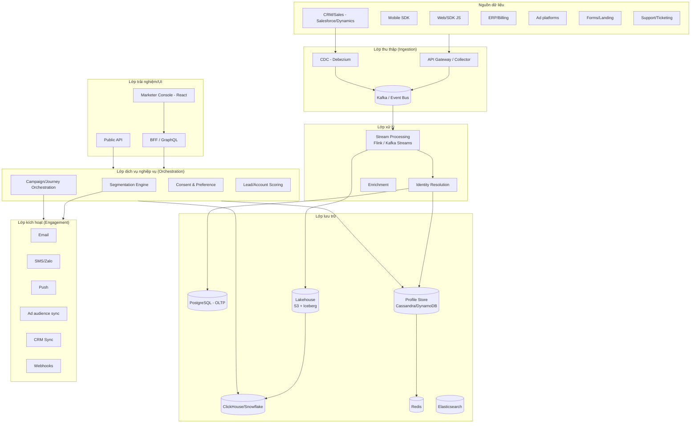
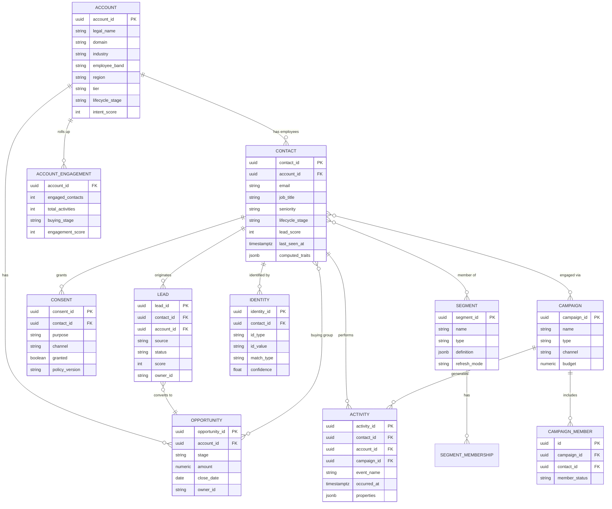

# Nghiên cứu & Thiết kế Hệ thống CRM Marketing cho Doanh nghiệp lớn (Enterprise B2B / Dịch vụ)

> **Mục tiêu tài liệu:** Cung cấp bản thiết kế tham chiếu đầy đủ để **tự xây dựng (build custom)** một hệ thống CRM Marketing chuẩn enterprise, đủ linh hoạt và có đầy đủ công cụ để CMO ra quyết định.
> **Phạm vi:** Doanh nghiệp lớn, lĩnh vực B2B / dịch vụ. Trọng tâm: **tính năng nghiệp vụ** và **tích hợp & quy trình**, theo hướng **build từ đầu**.
> **Bối cảnh:** 2026. **Ngày lập:** 2026-07-02.

---

## Mục lục

1. [Tóm tắt điều hành (Executive Summary)](#1-tóm-tắt-điều-hành)
2. [Nguyên tắc thiết kế & định hướng kiến trúc](#2-nguyên-tắc-thiết-kế--định-hướng-kiến-trúc)
3. [Kiến trúc tham chiếu tổng thể](#3-kiến-trúc-tham-chiếu-tổng-thể)
4. [Mô hình dữ liệu (Data Model) & Customer 360](#4-mô-hình-dữ-liệu--customer-360)
5. [Nhóm tính năng nghiệp vụ cốt lõi](#5-nhóm-tính-năng-nghiệp-vụ-cốt-lõi)
6. [Tích hợp & Martech Stack](#6-tích-hợp--martech-stack)
7. [Quy trình Marketing-to-Sales (Lead Lifecycle)](#7-quy-trình-marketing-to-sales)
8. [Quy trình ABM (Account-Based Marketing)](#8-quy-trình-abm)
9. [Data Governance, Bảo mật & Tuân thủ](#9-data-governance-bảo-mật--tuân-thủ)
10. [Công cụ ra quyết định cho CMO](#10-công-cụ-ra-quyết-định-cho-cmo)
11. [Tech stack, đội ngũ & lộ trình triển khai](#11-tech-stack-đội-ngũ--lộ-trình-triển-khai)
12. [Anti-patterns & bài học](#12-anti-patterns--bài-học)
13. [Nguồn tham khảo](#13-nguồn-tham-khảo)

---

## 1. Tóm tắt điều hành

Một hệ thống CRM Marketing enterprise B2B "chuẩn chỉ" không phải là một phần mềm đơn khối, mà là một **nền tảng phân lớp** (composable) gồm bốn tầng: dữ liệu (data), điều phối (orchestration), tương tác (engagement) và phân tích (analytics). Khi tự xây, giá trị khác biệt tập trung ở tầng **điều phối** và **dữ liệu hợp nhất**, trong khi các năng lực phổ thông (gửi email, phân phối quảng cáo, quản lý consent) nên tận dụng dịch vụ sẵn có.

Bảy khuyến nghị chiến lược cho CMO khi quyết định tự build:

1. **Nền tảng dữ liệu đi trước tính năng.** Unified profile lấy **account làm trung tâm** (account-centric), event store bất biến, data warehouse/lakehouse và consent layer là điều kiện tiên quyết. Không có nền này, mọi tính năng phía trên đều mong manh.
2. **Kiến trúc composable / warehouse-native** thay vì monolith — dễ thay thế từng phần, tránh khóa nhà cung cấp, tận dụng warehouse doanh nghiệp đã có.
3. **Tự xây phần khác biệt hóa, tận dụng phần phổ thông.** Identity resolution, deliverability (ESP), consent management platform, durable workflow engine nên dùng sẵn; logic scoring/segmentation/attribution đặc thù ngành mới đáng tự xây.
4. **Governance là tính năng lõi, không phải phụ lục.** Định nghĩa KPI thống nhất, consent enforcement và data lineage phải nằm trong kiến trúc.
5. **Đo lường theo doanh thu và tính gia tăng (incrementality)**, không theo hoạt động bề nổi. Trang bị holdout/experiment ngay từ đầu.
6. **AI theo lộ trình rủi ro tăng dần:** predictive scoring → GenAI hỗ trợ nội dung → next-best-action → agentic có giám sát.
7. **Journey orchestration là hạng mục kỹ thuật khó nhất** — đầu tư đúng vào độ tin cậy (idempotency, state management, observability) hoặc dựng trên một workflow engine trưởng thành.

---

## 2. Nguyên tắc thiết kế & định hướng kiến trúc

Năm nguyên tắc chi phối mọi quyết định thiết kế:

1. **Warehouse-first / Composable.** Data warehouse (Snowflake, BigQuery, Databricks Lakehouse) là *source of truth*, không phải CRM hay công cụ marketing. Đây là dịch chuyển lớn nhất giai đoạn 2023-2026: từ "packaged CDP" sang **Composable CDP** (warehouse-native, zero-copy).
2. **API-first.** Mọi năng lực nội bộ (segment, gửi email, chấm điểm lead) đều expose qua API có versioning. Không có tích hợp point-to-point ngầm.
3. **Event-driven làm mặc định, batch cho khối lượng lớn.** Hành vi khách hàng và thay đổi trạng thái đi qua event stream; đồng bộ khối lượng lớn và đối soát đi qua batch.
4. **Idempotency & traceability.** Mọi message có `event_id`/`idempotency_key`; mọi record mang `source_system` + `updated_at` + lineage.
5. **Consent & privacy by design.** Consent là một domain dữ liệu riêng (append-only, có audit trail), không phải một cột phụ. Tuân thủ GDPR/CCPA/PDPA và Nghị định 13/2023/NĐ-CP của Việt Nam.

### Monolith vs Microservices vs Composable — chọn khi nào

| Tiêu chí | Modular Monolith | Microservices | Composable / Headless (MACH) |
|---|---|---|---|
| Độ phức tạp vận hành | Thấp | Cao (service mesh, observability) | Trung bình-cao (nhiều API/vendor) |
| Tốc độ khởi động | Nhanh nhất | Chậm (đầu tư platform) | Trung bình |
| Scale từng phần | Hạn chế | Cao | Cao |
| Phù hợp quy mô đội | 1-3 team | Nhiều team tự chủ | Team nhỏ + tích hợp mạnh |
| Rủi ro | Coupling khi phình to | Distributed complexity | Lock-in từng phần, chi phí license |

**Khuyến nghị cho enterprise B2B tự build:** Bắt đầu bằng **Modular Monolith có ranh giới domain rõ (bounded context)** — đóng gói theo module `Identity/Contact`, `Campaign`, `Segmentation`, `Activation`, `Consent`, `Analytics`. Trích tách microservices **theo áp lực thực tế** (service nào cần scale độc lập như ingestion event, segmentation, email sending thì tách trước). Đây là chiến lược "monolith-first, extract when it hurts". Mô hình **hybrid** (tự build lõi, mua các năng lực phổ thông) là thực tế nhất.

---

## 3. Kiến trúc tham chiếu tổng thể

Hệ thống được tư duy theo bốn tầng chức năng. Mỗi tầng có trách nhiệm rõ ràng và giao tiếp qua API/event, tránh coupling chặt.



### 3.1 Bốn tầng chức năng

**Tầng dữ liệu (Data Layer)** — source of truth. Gồm CDW (Snowflake/BigQuery/Databricks), event store (Kafka + object storage theo mô hình lakehouse), identity graph/MDM, consent store, feature store cho ML.

**Tầng điều phối (Orchestration Layer)** — "bộ não", nơi tập trung giá trị tự build. Gồm segmentation engine, journey/campaign engine, lead & account scoring, lead routing & SLA engine, decisioning/suppression/consent enforcement.

**Tầng tương tác (Engagement Layer)** — các "thiết bị thực thi": email (SendGrid/SES/Mailgun), ads (Google/Meta/LinkedIn), web personalization, in-app, push/SMS, sales engagement. Hệ thống tự build **không** viết lại SMTP hay ad delivery — nó **điều phối** các dịch vụ này qua API.

**Tầng phân tích (Analytics Layer)** — transform bằng dbt, BI (Looker/Tableau/Power BI), attribution & closed-loop reporting, ML models, data quality monitoring.

### 3.2 Kiến trúc hướng sự kiện (Event-Driven Architecture)

**Event bus / streaming.** Apache Kafka là xương sống: throughput cao (triệu event/giây), log có thể replay, phân vùng theo `contact_id`/`account_id` để giữ thứ tự per-key. Lựa chọn managed: Confluent Cloud, AWS MSK, Redpanda. **Schema Registry** (Avro/Protobuf) là bắt buộc để quản trị schema evolution.

**CQRS.** Tách Command (ghi) khỏi Query (đọc). Write side nhận command, validate, ghi OLTP và phát domain event. Read side là các projection tối ưu cho từng use case (profile store cho lookup nhanh, ClickHouse cho analytics, Elasticsearch cho tìm kiếm). Chấp nhận **eventual consistency** (thường dưới 1 giây) — điều hợp lý với martech.

**Event Sourcing (áp dụng có chọn lọc).** Dùng cho các domain cần audit trail đầy đủ: **Consent** (bắt buộc cho GDPR/PDPA — chứng minh consent cấp/thu hồi khi nào), Journey/Campaign state, Identity merge history. Không dùng cho CRUD đơn thuần.

**Các domain event chính trong marketing:**

- *Behavioral / Web-Mobile:* `page_viewed`, `product_viewed`, `search_performed`, `link_clicked`, `video_watched`, `file_downloaded`, `session_started`
- *Acquisition / Conversion:* `form_submitted`, `demo_requested`, `content_gated_unlocked`, `trial_started`
- *Email / Messaging:* `email_sent`, `email_delivered`, `email_opened`, `email_clicked`, `email_bounced`, `email_unsubscribed`
- *Lifecycle / Sales handoff:* `lead_created`, `lead_qualified` (MQL), `sales_accepted_lead` (SAL), `opportunity_created`, `deal_won`, `deal_lost`
- *Identity & Consent:* `identity_resolved`, `profiles_merged`, `consent_granted`, `consent_revoked`, `pii_erasure_requested`

Ví dụ payload event (mỗi event bất biến, có `event_id` idempotency, tách `occurred_at` vs `received_at`, kèm consent snapshot):

```json
{
  "event_id": "evt_01HXY...",
  "event_name": "form_submitted",
  "occurred_at": "2026-07-02T09:15:33.123Z",
  "received_at": "2026-07-02T09:15:33.456Z",
  "source": { "type": "web", "app": "corp-site", "sdk_version": "2.4.0" },
  "identity": {
    "anonymous_id": "anon_9f2c...",
    "contact_id": null,
    "account_domain": "acme.com"
  },
  "context": {
    "utm": { "source": "linkedin", "campaign": "q3-webinar" },
    "consent": { "marketing": true, "policy_version": "v3" }
  },
  "properties": {
    "form_id": "contact-sales",
    "fields": { "company": "ACME", "job_title": "CMO", "employees": "500-1000" }
  }
}
```

### 3.3 Kiến trúc CDP tự build

Bốn năng lực lõi (theo CDP Institute): **Data Collection → Identity → Profile Unification → Activation**, cộng thêm Segmentation.

```mermaid
flowchart LR
  subgraph Ingestion
    A[Collector API<br/>batch + streaming]
    B[Connectors<br/>CRM/ERP/Ads]
    C[Reverse CDC]
  end
  subgraph Identity
    D[Deterministic Match<br/>email/phone/user_id]
    E[Probabilistic<br/>device, fingerprint]
    F[Identity Graph]
  end
  subgraph Unification
    G[Golden Profile Builder<br/>survivorship rules]
    H[Account Rollup B2B]
    I[Computed Traits/Features]
  end
  subgraph Segmentation
    J[Rule-based Segments]
    K[Real-time Triggers]
    L[Predictive/ML scores]
  end
  subgraph Activation
    M[Audience Sync]
    N[Journey Orchestration]
    O[Personalization API]
  end
  Ingestion --> Identity --> Unification --> Segmentation --> Activation
```



**Identity Resolution.** Ưu tiên deterministic (khớp qua email, phone, `user_id`). Probabilistic (device, fingerprint) để gộp anonymous → known. Merge/unmerge phải đảo ngược được (giữ lịch sử merge). B2B thêm tầng: khớp email domain → account (loại trừ domain public), làm giàu firmographic.

**Profile Unification (Golden Profile).** Survivorship rules chọn giá trị theo ưu tiên nguồn + độ mới + độ tin cậy. **Account rollup (B2B):** profile cá nhân cuộn lên account — số contact engaged, tổng activity, buying stage, intent score cấp account.

**Segmentation Engine.** Rule-based (DSL/AST biên dịch xuống SQL cho batch, stream matcher cho real-time), real-time segments (Flink stateful), predictive segments (điểm ML đưa vào profile như computed trait).

### 3.4 Scalability & Performance

Mục tiêu xử lý hàng triệu đến hàng chục triệu event/ngày:

- **Ingestion:** collector stateless, scale ngang sau load balancer, ghi thẳng Kafka.
- **Sharding:** PostgreSQL shard theo `account_id` (Citus); profile store shard theo partition key; ClickHouse distributed table.
- **Caching:** Redis cache profile hot, kết quả segment membership, rate limiting.
- **Reliability:** consumer group + retry topic + dead-letter queue (DLQ); idempotent consumer (dedup theo `event_id`) → effectively-once.
- **Chỉ tiêu tham chiếu:** profile lookup p99 < 50ms; ingestion ack < 100ms; segment real-time cập nhật < 5s.

---

## 4. Mô hình dữ liệu & Customer 360

### 4.1 Nguyên tắc: Account-centric cho B2B

Điểm khác biệt cốt lõi của B2B là quyết định mua do **nhóm mua (buying group / DMU – Decision Making Unit)** đưa ra, không phải cá nhân đơn lẻ. Vì vậy **Account là trung tâm** của mô hình dữ liệu, không phải Contact. Contact thuộc về Account qua domain matching; Opportunity gắn với Account và có nhiều Contact tham gia (buying group). Đây là quyết định thiết kế phải chốt ngay từ đầu vì nó chi phối mọi thứ phía sau (routing, scoring, attribution, reporting).

### 4.2 Sơ đồ quan hệ thực thể (ERD)



Giải thích các quan hệ then chốt: **Account** là trung tâm; **Lead** là "quan tâm chưa qualify", convert thành **Opportunity** với buying group nhiều Contact; **Activity** (event) là bảng lớn nhất, gắn cả `contact_id` và `account_id` (denormalized) để rollup nhanh; **Consent** tách riêng dưới dạng log bất biến theo `purpose` × `channel`; **Segment** lưu định nghĩa và membership.

### 4.3 Schema minh họa

Write model trên PostgreSQL (OLTP):

```sql
-- ACCOUNT (B2B trung tâm)
CREATE TABLE account (
  account_id      UUID PRIMARY KEY DEFAULT gen_random_uuid(),
  legal_name      TEXT NOT NULL,
  domain          CITEXT UNIQUE,
  industry        TEXT,
  employee_band   TEXT,            -- '1-50','51-200','201-1000','1000+'
  region          TEXT,
  tier            TEXT,            -- 'strategic','enterprise','mid'
  lifecycle_stage TEXT DEFAULT 'target',
  intent_score    INT DEFAULT 0,
  created_at      TIMESTAMPTZ NOT NULL DEFAULT now(),
  updated_at      TIMESTAMPTZ NOT NULL DEFAULT now()
);

-- CONTACT
CREATE TABLE contact (
  contact_id      UUID PRIMARY KEY DEFAULT gen_random_uuid(),
  account_id      UUID REFERENCES account(account_id),
  email           CITEXT,
  job_title       TEXT, seniority TEXT,
  lifecycle_stage TEXT DEFAULT 'subscriber', -- subscriber->lead->MQL->SQL->customer
  lead_score      INT DEFAULT 0,
  computed_traits JSONB DEFAULT '{}',
  last_seen_at    TIMESTAMPTZ,
  created_at      TIMESTAMPTZ NOT NULL DEFAULT now()
);

-- CONSENT (append-only, bắt buộc cho tuân thủ)
CREATE TABLE consent (
  consent_id     UUID PRIMARY KEY DEFAULT gen_random_uuid(),
  contact_id     UUID NOT NULL REFERENCES contact(contact_id),
  purpose        TEXT NOT NULL,  -- 'marketing_email','profiling','sms'
  channel        TEXT,
  granted        BOOLEAN NOT NULL,
  policy_version TEXT NOT NULL,
  source         TEXT,           -- 'web_form','preference_center','import'
  occurred_at    TIMESTAMPTZ NOT NULL DEFAULT now()
);
```

Bảng Activity/Event lưu ở ClickHouse (OLAP), không PostgreSQL — vì đây là bảng lớn nhất và phục vụ truy vấn phân tích:

```sql
CREATE TABLE activity_events (
  event_id      UUID,
  event_name    LowCardinality(String),
  contact_id    UUID,
  account_id    UUID,
  occurred_at   DateTime64(3),
  utm_source    LowCardinality(String),
  utm_campaign  String,
  properties    String,          -- JSON
  consent_ok    UInt8
)
ENGINE = MergeTree
PARTITION BY toYYYYMM(occurred_at)
ORDER BY (account_id, contact_id, occurred_at)
TTL occurred_at + INTERVAL 3 YEAR;   -- data retention tự động
```

### 4.4 Customer 360 / Unified Profile

Profile hợp nhất được materialize vào profile store (key-value, đọc nhanh) và phục vụ qua Personalization API:

```json
{
  "contact_id": "c_123",
  "identifiers": { "email": "cmo@acme.com", "crm_id": "003xx", "anonymous_ids": ["anon_9f"] },
  "account": { "account_id": "a_88", "name": "ACME", "tier": "enterprise", "buying_stage": "evaluation" },
  "traits": { "job_title": "CMO", "seniority": "c_level", "region": "APAC" },
  "computed_traits": {
    "lead_score": 82, "engagement_30d": 14, "ltv_predicted": 120000,
    "last_seen_at": "2026-07-01T22:10:00Z", "propensity_to_buy": 0.71
  },
  "segments": ["enterprise-mql", "webinar-q3-attendee"],
  "consent": { "marketing_email": true, "sms": false, "policy_version": "v3" }
}
```

**Account 360** cuộn từ profile cá nhân: danh sách buying group, timeline hoạt động toàn account, intent score, opportunities đang mở.

### 4.5 Lưu trữ dữ liệu (Polyglot Persistence)

| Nhu cầu | Công nghệ | Vai trò |
|---|---|---|
| OLTP (write model, giao dịch) | PostgreSQL | Contact/Account/Campaign/Consent, ACID |
| Profile store (đọc nhanh) | Cassandra / DynamoDB / ScyllaDB | Golden profile, lookup < 10ms |
| OLAP / event analytics | ClickHouse (real-time) hoặc Snowflake/BigQuery | Segmentation, funnel, attribution |
| Lakehouse (lưu trữ thô, ML) | S3/ADLS + Apache Iceberg/Delta | Feature engineering, huấn luyện ML |
| Cache / real-time state | Redis | Session, rate limit, dedup |
| Search / faceted | Elasticsearch/OpenSearch | Tìm kiếm contact/segment |
| Streaming log | Kafka | Event backbone, replay |

Nguyên tắc: **đừng chạy segment query nặng trên PostgreSQL** — đưa event sang ClickHouse. Xu hướng 2025-2026 là kết hợp **ClickHouse cho real-time serving + Iceberg lakehouse cho lưu trữ dài hạn/ML**.

---
