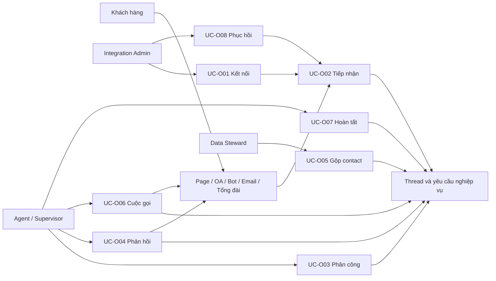
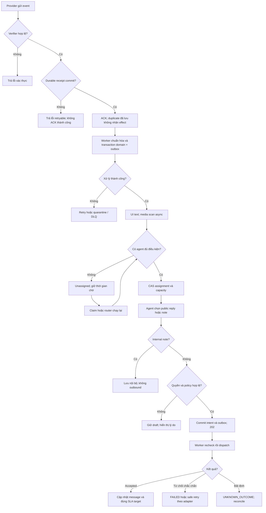
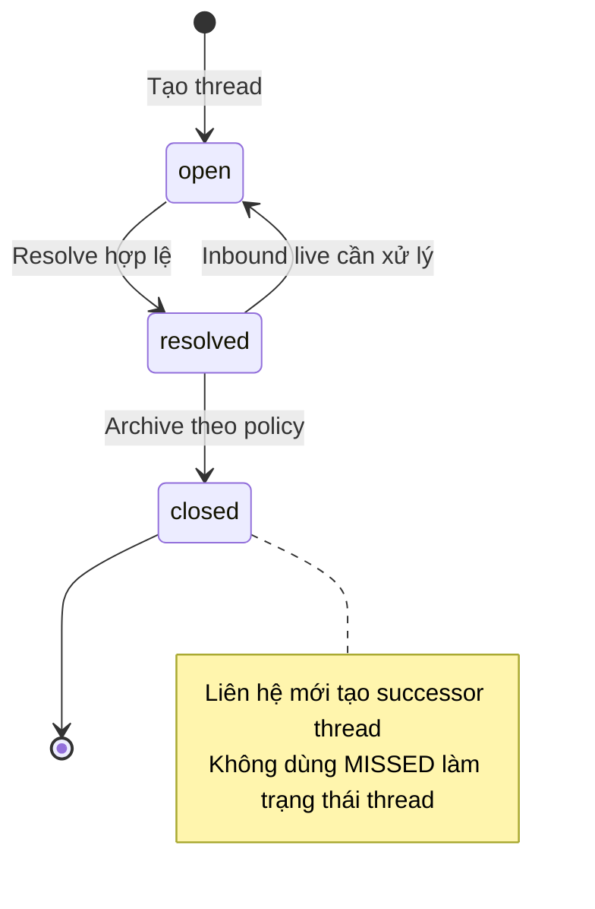
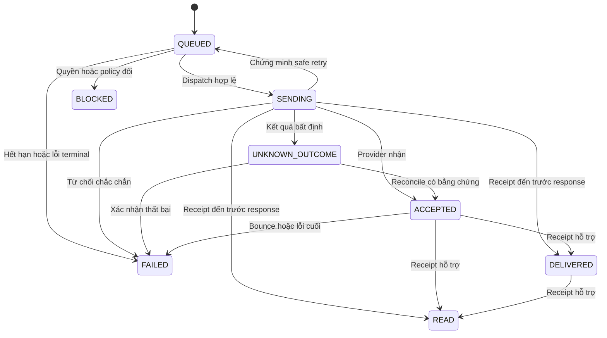

# Kiểm toán và nghiên cứu Omnichannel Hub

Ngày đối chiếu: 16/10/2026. Đầu vào: bản SRS Facebook, Zalo, Telegram, Email, Call do người dùng gửi; đối chiếu Master CRM 1.6 trong workspace.

**Kết luận:** bản gửi có cấu trúc tốt nhưng chưa sẵn sàng phát triển. Rủi ro lớn nằm ở chính sách kênh, định danh, gửi trùng, trạng thái và phân quyền xuyên kênh. Nên học Pancake ở trải nghiệm vận hành theo trang/hội thoại và liên kết CRM; học Zendesk ở điều phối theo năng lực; tham khảo Chatwoot ở gộp contact giữ lịch sử.

Tài liệu này là báo cáo nghiên cứu và bản chi tiết để review, không là Master thứ hai. Các bổ sung áp dụng vào Master được ghi tại mục B.10. Những tham số chưa được doanh nghiệp xác nhận mang nhãn **[Đề xuất bổ sung]**, không phải cấu hình đã được phê duyệt.

Phạm vi bằng chứng: tài liệu sản phẩm và API công khai. Chưa đăng nhập demo, thử gói trả phí, chạy API với tài khoản doanh nghiệp hoặc kiểm tra mã nguồn nội bộ Pancake/Zendesk. Không thể suy từ tính năng UI ra DB, queue, locking hay SLA nội bộ của họ. Nguồn Meta bị HTTP 429; tài liệu webhook Zalo chưa đọc được trong lượt tra cứu này, được ghi rõ là chưa xác minh.

# PHẦN A — BÁO CÁO AUDIT

## A.1. Điểm sẵn sàng: 54/100

Điểm đánh giá chuyên môn đối với **bản người dùng vừa gửi**, không chấm lại ý tưởng ban đầu ở mức 18/100 và không chấm toàn bộ Master.

| Tiêu chí | Điểm | Nhận xét |
| --- | ---: | --- |
| Phạm vi, actors, phân quyền | 13/20 | Có vai trò nhưng gộp nhiều chức năng vào một UC; thiếu account/workspace scope |
| Luồng và ngoại lệ | 14/25 | Có concurrency và timeout; cách ACK/retry còn có thể mất hoặc nhân tin |
| Quy tắc, dữ liệu, chính sách kênh | 12/30 | Có bảng dữ liệu; sai Zalo 48 giờ, thiếu namespace, lẫn trạng thái cuộc gọi |
| Sơ đồ, truy vết và kiểm thử | 10/15 | Có bốn loại sơ đồ; sơ đồ chưa nhất quán thứ tự ACK, policy và retry |
| Vận hành, bảo mật, đo lường | 5/10 | Thiếu kết nối/reconnect, recovery, tải đo NFR và quy tắc lưu giữ |
| **Tổng** | **54/100** | **Chưa Ready for Dev/QA** |

## A.2. Các cách diễn đạt cần sửa

| Nội dung gốc | Vấn đề | Thay bằng |
| --- | --- | --- |
| “Thời gian thực”, “không làm mất gói tin” | Chưa có điểm đo/tải, vượt khả năng kiểm soát provider | Đo từ durable receipt tới UI; phân biệt mất trước gateway và mất sau ACK |
| “Hợp nhất toàn bộ lịch sử” | Có thể hiểu là gộp thread và mở quyền mọi kênh | Tổng hợp timeline có ACL; giữ nguyên connection/thread/recipient |
| “Least-Busy Round-Robin” | Hai thuật toán chưa định nghĩa thứ tự | Chọn tải thấp nhất, hòa thì lâu nhất chưa nhận việc, hòa nữa theo ID |
| “ONLINE hoặc AVAILABLE” | ENUM không đồng nhất | Presence và tải cuộc gọi là hai chiều riêng |
| “Không giới hạn” Telegram/Email/Call | Bỏ qua blocked recipient, hạn mức, quyền và khả năng adapter | Không áp cửa sổ chat giống Messenger; vẫn kiểm eligibility từng kênh |
| “Cấm xóa để Audit” | Không có chính sách retention, redaction, yêu cầu xóa | Không xóa tùy tiện; purge/redact theo chính sách và quyền riêng |
| “Retry 3 lần” | Không phân biệt rejected và chưa biết kết quả | Phân loại safe retry, terminal failure, unknown outcome |

## A.3. Gap analysis

### Critical

| ID | Vị trí bản gốc | Lỗ hổng và tác động | Sửa bắt buộc |
| --- | --- | --- | --- |
| G01 | BR-OMNI-02, 7E1 | Chặn Zalo sau 48h là sai theo hướng dẫn hiện tại: nhầm mốc tính phí với quyền gửi | Tách eligibility và pricing; OpenAPI 7 ngày theo S01; theo dõi qualifying interaction |
| G02 | Main step 2, Activity | ACK trước durable enqueue có thể mất tin khi process chết | Commit durable receipt rồi ACK; queue publish có thể phục hồi |
| G03 | 8E1 | Timeout sau khi provider nhận tin rồi retry tạo tin trùng | UNKNOWN_OUTCOME, reconcile; chỉ retry khi có căn cứ an toàn |
| G04 | 2E1, BR01 | `(channel_type, external_id/message_id)` thiếu tài khoản và phạm vi | Tenant/workspace/connection/provider namespace; Telegram message thêm chat |
| G05 | NFR security | Telegram secret header bị mô tả thành HMAC-SHA256 | Dùng secret token của setWebhook; verifier riêng mỗi connector [S02] |
| G06 | 4a và timeline | Regex điện thoại không chứng minh danh tính; gộp có thể mở lịch sử đội khác | Candidate + evidence + steward review; ACL không mở rộng bởi merge |
| G07 | 4, BR03 | Tìm conversation đang mở theo customer có thể gửi nhầm Page/kênh | Tìm theo connection/thread; liên kết nghiệp vụ là lớp riêng |
| G08 | BR06 | MISSED là kết quả cuộc gọi nhưng đưa vào trạng thái hội thoại | Call session, delivery, waiting party và conversation lifecycle tách riêng |
| G09 | BR05 | FRT bị khởi động lại mỗi lần khách trả lời; chuyển ca và queue chưa rõ | FRT/NRT/resolve/promise riêng theo request; tính từ tin đầu chưa đáp |
| G10 | 6a, BR03 | Tự giữ CC/BCC; gộp theo subject có thể nối nhầm email nhạy cảm | Reply/Reply-all rõ, BCC không kế thừa; subject chỉ gợi ý |
| G11 | 7E1, Activity | Tự chuyển sang Tag/ZNS rồi đi thẳng Send là đường vượt policy | Luồng template độc lập với entitlement, purpose, recipient, chi phí |
| G12 | Scope | Không có quản lý cấp quyền, revoke, hồi phục lịch sử | UC kết nối, health, coverage, replay; capability verified trước bật |

Nguồn xác nhận trực tiếp G01: [Zalo Tin Tư vấn](https://oa.zalo.me/home/documents/guides/tin-tu-van). Nguồn G05: [Telegram setWebhook](https://core.telegram.org/bots/api#setwebhook). Các kết luận còn lại chủ yếu là phân tích tính nhất quán và rủi ro của bản thiết kế, không phải tuyên bố Pancake đang sử dụng một kiến trúc cụ thể.

### Major

- Tiền điều kiện Agent online không áp dụng cho ingest: khách gửi khi toàn bộ nhân viên offline vẫn phải được nhận.
- Chưa tách seen của nhân viên và READ của khách; nhiều kênh không cung cấp đủ delivery/read receipts.
- Chưa xử lý callback delivery đến trước response API, edit/delete, echo tin gửi từ ứng dụng gốc, tin lịch sử.
- Chưa có giới hạn file theo phương thức API, tổng MIME email, scan bất đồng bộ và URL hết hạn.
- Số điện thoại E.164 có tối đa 15 chữ số nhưng dấu `+` cần thêm chỗ: dùng varchar(16); không tự thêm +84 cho mọi khách.
- Lưu draft nhạy cảm vào localStorage vô thời hạn chưa có user scope, TTL hoặc xử lý logout/revoke.
- CDR/recording có thể đến riêng và trễ; không mặc định CDR luôn chứa bản ghi âm sẵn sàng.
- UI có filter ALL chung với các giá trị cụ thể chưa định nghĩa; cursor chỉ ID chưa khớp sort timestamp.
- Chưa phân biệt lỗi kết nối với hết entitlement/gói cước; reconnect không được tự thay đổi quyền workspace.

### Minor

- Chuẩn hóa mã UC, BR, API error; mã lỗi cần ổn định, nội dung bản địa hóa tách riêng.
- Dùng UTC cho lưu trữ; lịch kinh doanh theo Asia/Ho_Chi_Minh, có version và ngày nghỉ.
- Thay biểu tượng/nhãn dễ hiểu trong UI; giữ thuật ngữ kỹ thuật ở đặc tả cho Dev.

## A.4. Pancake và hệ thống tương tự làm thế nào?

Các mô tả quan sát trong bảng chỉ tóm tắt nguồn chính thức. Cột áp dụng là đề xuất cho CRM này.

| Hạng mục | Quan sát có nguồn | Áp dụng vào CRM |
| --- | --- | --- |
| Pancake — inbox | Có quản lý nhiều nền tảng trên một màn hình [S03] | Gom danh sách để thao tác; mỗi thread vẫn giữ nguồn và tài khoản gửi |
| Pancake — xoay vòng | Giới thiệu hỗ trợ tỷ lệ, giờ và trạng thái online [S03] | Routing policy có thứ tự, version, lịch và fallback; không mặc định thuật toán nội bộ |
| Pancake — nhận biết đồng nghiệp | UI có hiển thị người phân công chính, người đang xem và màu trang khi gộp trang [S04] | Owner badge, viewer indicator, account badge; viewer indicator không thay khóa server |
| Pancake — quyền | Quyền có thể cấu hình trên trang/tính năng; một số kết nối Facebook phụ thuộc quyền Trang [S05] | App role phải đi cùng quyền connector/account; quản trị tích hợp không tự có quyền đọc mọi nội dung |
| Pancake — câu trả lời nhanh | Mẫu có phím tắt/chủ đề, chèn hoặc gửi tùy cấu hình [S06] | P0 chèn nháp có preview; template hỗ trợ soạn không phải template được nền tảng duyệt |
| Pancake CRM — gộp | Changelog 16/09/2026 mô tả chọn bản ghi chính và chọn giá trị giữ ở trường khác nhau [S07] | Merge preview, survivor, evidence, field conflict và journal |
| Zendesk — routing | Điều phối email/call/messaging theo availability/capacity; tính năng khác tùy gói [S08] | Giới hạn theo loại công việc, skills/team và eligibility trước tối ưu tải |
| Zendesk — active messaging | Tài liệu phân biệt messaging active/inactive trong tính capacity [S09] | Không dùng duy nhất `status=OPEN` làm số tải; quy định reservation và inactive rõ |
| Chatwoot — contact | Tài liệu mô tả merge contact từ nhiều kênh và giữ lịch sử [S10] | Tách contact với thread, giữ nguồn gốc khi gộp |

Không có đủ bằng chứng trong các trang đã đọc để kết luận Pancake Unified Inbox hỗ trợ đầy đủ Telegram Bot + Email + PSTN/WebRTC theo đúng năm kênh yêu cầu, cùng một gói và cùng mức tính năng. Việc hệ sinh thái có module CRM/call/email không tự chứng minh mọi tính năng nằm trong cùng inbox hoặc API tích hợp công khai. Cần demo/PoC theo tài khoản thật trước quyết định mua.

**Thiết kế phù hợp bối cảnh dự án:** ban đầu một người vận hành, mở rộng khoảng 40 nhân sự. Dùng core CRM và adapter, một nơi quyết định assignment, một nơi quyết định SLA. Nếu mua Pancake làm inbox thì chốt Pancake hay CRM là nguồn chuẩn cho từng trường; không cho hai automation cùng thay owner/status. Không cần chia microservices cho từng kênh khi chưa có nhu cầu tải độc lập.

## A.5. Câu hỏi PO và trạng thái chưa chốt

| ID | Quyết định cần chốt | Phương án đề xuất để review | Khi chưa chốt |
| --- | --- | --- | --- |
| Q01 | Xây inbox hay tích hợp Pancake/Chatwoot? | PoC bằng cùng bộ test; so TCO, API, export, vận hành | Giữ adapter-neutral; chưa chọn vendor |
| Q02 | Những tài khoản Page/OA/Bot/mailbox/hotline nào? | Danh sách account + owner + team + scope | Không bật connector chưa xác minh |
| Q03 | Có Facebook comment/livestream và Telegram group không? | P0 chat 1:1; comment/group là capability riêng | Không tự đưa vào cam kết P0 |
| Q04 | Routing và SLA mục tiêu? | Least load sau scope/skill/shift; sticky nếu còn eligible | Intake hoạt động, queue thủ công; chưa tự công bố SLA cam kết |
| Q05 | Quyền merge và dữ liệu liên chi nhánh? | Agent đề nghị, steward duyệt cùng workspace | Không auto-merge hoặc mở lịch sử chéo |
| Q06 | Nhà cung cấp call, ghi âm và thời hạn lưu? | Adapter tổng đài có call/recording callbacks và CDR API | Chưa cam kết WebRTC/recording; không auto ghi âm |
| Q07 | Giới hạn tin có phí và template? | Budget/role/phê duyệt theo account, purpose | Chặn send phát sinh phí khi chưa cấu hình; vẫn nhận inbound |
| Q08 | Retention và legal hold? | Chính sách riêng message, raw payload, recording, audit | Chưa phát hành production với retention vô thời hạn mặc định |

# PHẦN B — BẢN ĐẶC TẢ CHUẨN HÓA

Toàn bộ phương án triển khai bên dưới là **[Đề xuất bổ sung]**, trừ các ràng buộc được dẫn nguồn hoặc đã có trong Master. Không dùng các con số thử nghiệm làm cam kết của provider.

## B.1. Ranh giới mô hình và capability

1. `Contact`: người/tổ chức liên hệ trong CRM, không phải tài khoản mạng xã hội.
2. `ChannelIdentity`: định danh theo connection và namespace provider, liên kết Contact có evidence.
3. `Conversation`: luồng liên lạc trong một connection/thread; không đổi connection khi merge contact.
4. `BusinessSubject`: yêu cầu hỏi giá/khiếu nại/ticket; N:M với thread; SLA theo nghĩa vụ này.
5. `Message`: nội dung inbound/outbound/internal; delivery status riêng.
6. `CallSession`: một phiên gọi, nhiều legs và bản ghi âm; liên kết request/conversation nhưng vòng đời độc lập.

### Capability contract khi bật connector

| Kênh | Phạm vi dự kiến | Điều kiện cần kiểm | Không tự cam kết |
| --- | --- | --- | --- |
| Facebook Messenger | Page messaging | App quyền thực tế, subscription, sender/recipient scope, policy theo phiên bản | Toàn lịch sử, mọi message tag, mọi loại tương tác đều reset cửa sổ |
| Zalo | OA OpenAPI | Tương tác đủ điều kiện, blocked state, eligibility, pricing/quota, template entitlement [S01] | Zalo cá nhân, gửi bằng số điện thoại khi chỉ có OA user ID |
| Telegram | Bot private chat ở P0 | Bot/chat/update scope, webhook secret, loại tin hỗ trợ [S02] | Bot được nhắn mọi người, đồng bộ hộp thư tài khoản cá nhân, mọi read receipt |
| Email | Mailbox được cấp quyền | MIME, sender, threading, SMTP/provider kết quả, bounce, đồng bộ cursor | SMTP accepted là delivered/read |
| Call | Tổng đài được chọn | Inbound/outbound, callback, recording, transfer, WebRTC được test | Webhook thay giao thức media; heartbeat browser là kết quả call |

Manifest bắt buộc: `provider, account, api_version, capabilities[verified/unsupported/pending/unknown], evidence, checked_at, owner, inbound_verifier, event_key_rule, message_key_rule, eligibility_rule, pricing_rule, media_limits, retry_rule, history_coverage`.

Giới hạn file/text lấy từ manifest theo method; không gán một trần 2.000 ký tự hay 20MB cho mọi kênh. Trần sản phẩm có thể nhỏ hơn trần provider và phải hiển thị rõ.

## B.2. Actors và RBAC

Primary: Agent, Supervisor, Data Steward, Integration Admin. Secondary: khách hàng, provider, worker, scheduler, tổng đài, storage/scanner.

| Thao tác | Agent | Supervisor | Steward | Integration Admin |
| --- | --- | --- | --- | --- |
| Xem thread/note | Được gán hoặc được grant | Trong team được cấp | Chỉ khi được grant | Không mặc định |
| Xem queue/claim | Queue được cấp, còn capacity | Trong team, override có lý do | Không mặc định | Không mặc định |
| Gửi/resolve/transfer | Thread đang có quyền thao tác | Trong team và có quyền tương ứng | Không mặc định | Không mặc định |
| Đề nghị merge | Hồ sơ được phép xem | Có | Có | Không mặc định |
| Duyệt merge | Không | Chỉ nếu có role steward | Có, cùng scope | Không mặc định |
| Nghe/tải recording | Grant riêng; tải tách quyền nghe | Grant riêng | Không mặc định | Không mặc định |
| Kết nối/reconnect/replay | Không | Không mặc định | Không | Theo account được cấp |
| Redact/purge | Không | Không mặc định | Quyền privacy riêng | Không mặc định |

Mọi quyền kiểm tại backend và thời điểm thao tác; timeline, search, số đếm, export, WebSocket và file đều lọc cùng scope. Merge, transfer, chia sẻ contact không tự cấp thêm quyền thread.

## B.3. Danh mục Use Case và điều kiện

| ID / Tên | Primary / Secondary | Pre-condition và Trigger | Thành công / Thất bại |
| --- | --- | --- | --- |
| UC-O01 Kết nối kênh | Integration Admin / provider | Có quyền account; bấm kết nối hoặc reconnect | Lưu connection, secret ref, capability và audit; lỗi giữ pending/reauthorization, không kích hoạt send |
| UC-O02 Tiếp nhận tương tác | Provider / worker | Account mapping và verifier hợp lệ; callback/sync | Durable event + message/status + outbox; lỗi trước commit không ACK thành công, sau commit retry/DLQ |
| UC-O03 Tiếp nhận và chuyển giao việc | Agent/Supervisor / router | Thread open, scope/skill/shift/capacity hợp lệ; claim/autoassign/transfer | Một assignment active + history; xung đột 409, rollback thay đổi assignment |
| UC-O04 Gửi phản hồi | Agent / adapter | Có quyền hiện tại, recipient, capability và policy; nhấn gửi | Intent/outbox bền vững, kết quả accepted/unknown/failed riêng; lỗi validation không tạo send |
| UC-O05 Liên kết và gộp hồ sơ | Steward / Agent | Hai hồ sơ cùng scope và evidence; đề nghị/duyệt merge | Survivor + journal + redirect; conflict rollback, không chuyển thread sang kênh khác |
| UC-O06 Xử lý cuộc gọi | Agent / tổng đài | Call capability verified, thiết bị sẵn sàng; incoming/click-call | Call session/legs/CDR/recording cập nhật độc lập; fail ghi outcome, không giả completed |
| UC-O07 Hoàn tất và mở lại yêu cầu | Agent/Supervisor / customer event | Scope + version + disposition; resolve/new customer message | Lifecycle/episode/audit cập nhật; stale version 409, giữ nghĩa vụ chưa hoàn thành |
| UC-O08 Phục hồi đồng bộ | Integration Admin / worker | Quyền replay, cursor/range; alert/reconnect | Backfill idempotent và coverage thực; lỗi giữ checkpoint và gap |

Không cần Agent online để UC-O02 hoạt động. Cấp quyền microphone chỉ là điều kiện của thao tác gọi trên trình duyệt, không phải tiền điều kiện chung của omnichannel.

## B.4. Operational flows

### UC-O01 — Kết nối kênh

1. [Admin] Chọn provider, account và workspace.
2. [System] Kiểm quyền, namespace ownership; khởi tạo OAuth hoặc lưu secret qua vault theo connector.
3. [Provider] Trả grant/identity; [System] kiểm state, scope và account server-side.
4. [System] Kiểm nhận/gửi/media/history riêng, lưu evidence; chỉ bật capability đã verified.
5. [Admin] Chọn inbox, team, lịch và chính sách; [System] kích hoạt phần đủ điều kiện.

Alternative 4a: receive-only hợp lệ thì nhận tin, UI không có nút gửi. Exception 2E: account thuộc workspace khác → `ACCOUNT_OWNERSHIP_CONFLICT`; 3E: grant sai/hết hạn → không active; 4E: callback thiếu scope → degraded/pending, không làm mất các sự kiện đã nhận bền vững.

### UC-O02 — Nhận và chuẩn hóa

1. [Provider] Gửi sự kiện; [System] xác định connection từ server mapping, xác thực theo adapter.
2. [System] Ghi `Inbound_Events` và khóa event duy nhất trong một durable transaction.
3. [System] Chỉ sau commit mới ACK; trùng đã commit thì ACK không tạo effect mới.
4. [Worker] Đọc pending event, chuẩn hóa sender/thread/message/status; lấy hoặc tạo identity provisional nếu cần.
5. [Worker] Trong transaction: upsert message, cập nhật request/SLA đúng event, ghi outbox, mark processed.
6. [System] Phát UI event; tải media/scan bằng job riêng. Agent thấy placeholder cho file pending.

Alternative 4a: status/edit/delete/echo chỉ cập nhật đối tượng tương ứng, không sinh Lead mới. 4b: chưa xác định yêu cầu thì đưa queue phân loại và giữ thời điểm chờ gốc. 4c: backfill bổ sung lịch sử, không tạo autoresponse/SLA live mới.

Exception 1E: verifier sai → 4xx theo connector; 2E: durable storage lỗi → 5xx, không ACK thành công; 4E: schema lạ → quarantine + alert; 5E: worker crash → replay idempotent; 6E: media hỏng/hết hạn → trạng thái file lỗi, tin text vẫn tồn tại. Không hứa provider luôn retry hoặc phục hồi mọi gap.

### UC-O03 — Gán, claim và transfer

1. [Router] Xác định team bằng account/rule ưu tiên đầu tiên khớp.
2. [System] Lọc theo quyền account, skill, ca, presence, capacity/reservation.
3. [System] Giữ owner hiện tại nếu còn hợp lệ; với việc chưa gán, dùng sticky candidate đủ điều kiện rồi thuật toán tải ở BR06.
4. [System] CAS assignment và reserve slot cùng transaction; ghi lý do/rule version và outbox.
5. [Agent] Tiếp nhận từ queue hoặc [Supervisor/Agent] chọn đích transfer, nhập ghi chú.
6. [System] Recheck đích, version, quyền và capacity; đổi assignment nguyên tử, giữ clock gốc, phát handoff.

Alternative 2a: không có người → unassigned; autoack chỉ nếu policy cho phép và giới hạn chống lặp. 6a: chuyển queue không có agent giữ team đích, assignee null, SLA tiếp tục. Exception 4E: hai router/claim cạnh tranh → một thắng, bên còn lại reload; 6E: đích nghỉ việc/bị khóa → không transfer, giữ owner cũ; 6E2: owner cũ gửi từ tab cũ → backend từ chối nếu quyền gửi đã hết.

### UC-O04 — Gửi tin/Email/ghi chú

1. [Agent] Mở đúng thread, kiểm badge tài khoản và người nhận; chọn Public reply hoặc Internal note.
2. [Agent] Soạn nội dung/file; Email chọn Reply hoặc Reply-all và xem To/CC. BCC mặc định rỗng.
3. [UI] Giữ một idempotency key cho logical submission, gửi payload + expected version.
4. [System] Kiểm quyền, assignment, recipient, body, file clean, policy/quota/chi phí; note chỉ lưu nội bộ.
5. [System] Với public reply, commit message QUEUED + intent + outbox; trả 202 và intent_id.
6. [Worker] Recheck quyền/policy/suppression và hạn intent; tạo attempt, gọi provider ngoài DB transaction.
7. [Provider] Trả kết quả hoặc callback; [System] lưu event/reduce trạng thái, dừng đúng SLA target khi đạt criterion.
8. [UI] Hiển thị đúng queued/accepted/delivered/read/unknown/failed; giữ draft nếu chưa submit thành công.

Alternative 4a: hết eligibility → giữ draft, đưa lựa chọn hợp lệ; gửi template là intent riêng, có mục đích, quyền và phí. Không tự đổi kênh. 4b: note không có outbound intent. 2a: email references hợp lệ nối thread; subject giống chỉ gợi ý. 7a: callback đến trước response API vẫn được correlate và không hạ trạng thái.

Exception 3E: cùng key, payload khác → 409. 4E: attachment còn pending/dirty → chặn. 6E: quyền/token bị revoke → blocked/reauthorization, không retry mù. 6E2: 429 → chỉ retry theo Retry-After nếu semantics bảo đảm request chưa được xử lý; lỗi không rõ sau send → UNKNOWN_OUTCOME. 7E: timeout → reconcile; chỉ human override có quyền, cảnh báo nguy cơ trùng và audit nếu không thể xác định. Không rollback tin đã ra ngoài bằng transaction DB.

### UC-O05 — Gộp contact

1. [System] Phát hiện phone/email candidate; chỉ hiển thị ứng viên trong scope được phép.
2. [Agent] Gửi đề nghị cùng evidence và lý do; [Steward] mở preview hai hồ sơ.
3. [Steward] Chọn survivor, giá trị giữ cho từng field xung đột; xem số thread và liên kết bị ảnh hưởng trong quyền.
4. [System] Kiểm lại version, identity ownership, evidence, phạm vi; merge transaction tạo journal và alias.
5. [System] Đổi liên kết contact, giữ thread/account/message ID; phát invalidate cache/search, hậu kiểm ACL.

Alternative 2a: hotline/email dùng chung → giữ nhiều contact và đánh dấu shared endpoint, không ép merge. Exception 4E: một hồ sơ vừa merge/khóa/xóa → 409 và refresh preview; 4E2: khác workspace → từ chối; 5E: index chưa cập nhật → read path vẫn kiểm ACL hiện tại. Sửa merge sai là workflow riêng dựa journal; không hứa undo đơn giản sau mọi thay đổi tiếp theo.

### UC-O06 — Call

1. [Provider] Báo incoming hoặc [Agent] click-call; [System] tạo session/leg theo provider call ID.
2. [System] Hiển thị caller candidate, không coi Caller ID là bằng chứng danh tính; reserve voice capacity.
3. [Agent] Answer qua SDK/provider đã chọn; [Provider] xác nhận in-progress; hệ thống ghi answered_at.
4. [Agent] Ghi note nội bộ. Transfer tạo leg/assignment riêng theo khả năng provider.
5. [Provider] Gửi terminal status/CDR; [System] tổng hợp answered/no-answer/busy/canceled/failed/completed theo adapter mapping.
6. [Provider/Worker] Recording ready đến riêng: fetch, scan/access gate; [System] kết thúc wrap-up theo policy.

Alternative 2a: số ẩn → anonymous, không ép contact; 5a: missed → tạo callback task gắn nghĩa vụ, không đổi conversation thành MISSED. Exception 3E: từ chối microphone → không reserve vô hạn; 4E: mất browser → presence offline nhưng call state chờ provider/reconcile; 5E: thiếu callback → query CDR nếu hỗ trợ, hiện gap; 6E: recording không có/hỏng → hiển thị unavailable, không giả đã lưu.

Call trạng thái phải ánh xạ từ provider được chọn. Twilio minh họa nhiều kết quả terminal thay vì một trạng thái ANSWERED duy nhất [S12]; đây không phải quyết định chọn Twilio.

### UC-O07 — Resolve/reopen

1. [Agent] Chọn request/thread cần hoàn tất, disposition và note theo loại kết quả.
2. [System] Kiểm quyền, version và nghĩa vụ còn mở; intent đang QUEUED/SENDING/UNKNOWN chặn resolve trừ override có lý do và quyền.
3. [System] Ghi resolved + audit; không đóng các ticket/request khác của cùng contact.
4. [Customer] Gửi tin mới; [System] nối thread nguồn và phân loại tiếp tục yêu cầu cũ hay yêu cầu mới.
5. [System] Mở episode tương ứng, giữ lịch sử breach và assignee nếu đủ điều kiện; nếu chưa rõ thì queue phân loại.

Alternative 4a: closed thread nhận liên hệ mới → thread kế tiếp liên kết thread cũ; có thể tạo request mới. Exception 2E: tin khách đến cùng lúc resolve → CAS chỉ một mutation trên version thắng, bên kia xử lý lại; 4E: sự kiện lịch sử đến muộn → không tự reopen live. Không dùng cửa sổ chính sách gửi 24h làm thời hạn đóng/mở nghiệp vụ.

### UC-O08 — Recovery

1. [System] Cảnh báo queue lag, token, DLQ, unknown send hoặc coverage gap.
2. [Admin] Chọn connection, range, lý do và dry-run.
3. [System] Kiểm quyền/capability, preview số sự kiện có thể replay; không đưa số ước tính thành coverage tuyệt đối.
4. [Admin] Chạy job; [Worker] replay qua cùng dedup/reducer, ghi source_mode=backfill.
5. [System] Cập nhật checkpoint sau commit từng page, lưu kết quả/remaining gap.

Alternative 3a: provider không có history API → đánh dấu gap không thể tự lấp. Exception 4E: cursor hết hạn → full sync chỉ nếu provider hỗ trợ; 4E2: revoke giữa job → dừng phần bị ảnh hưởng, không nâng checkpoint quá dữ liệu đã commit.

## B.5. Business Rules

| ID | Quy tắc xác định được |
| --- | --- |
| BR01 Scope | Identity duy nhất theo tenant/workspace/connection/provider_subject_id; phone/email là thuộc tính có evidence, không khóa toàn cục |
| BR02 Idempotency | Event key và message key riêng. Telegram event dùng update_id theo bot; message key có chat_id + message_id. Status/edit không bị loại vì trùng message_id |
| BR03 Durability | ACK sau durable receipt; worker domain update và outbox atomic. Redis cache chỉ tối ưu, không nguồn bảo đảm duy nhất |
| BR04 Send | Một logical submission một intent; key cùng body trả lại cùng intent, khác body 409; không TTL 60 giây làm hết chống trùng cho intent còn tồn tại |
| BR05 Eligibility | Quyền, recipient, capability, purpose, suppression, qualifying event, quota và phí được kiểm tại enqueue và dispatch. Thiếu rule chặn send tương ứng |
| BR06 Routing | Lọc eligible trước; sticky chỉ khi eligible. Mặc định chọn `active_load/capacity` thấp nhất; hòa chọn `last_assigned_at` cũ nhất, NULL trước; hòa chọn agent_id tăng dần. Claim/reservation atomic |
| BR07 Capacity | Một conversation có nhiều tin chỉ tính một chat slot; reservation cũng tính tải. Call reserved/ringing/in-progress/wrap-up chiếm voice slot. Giới hạn từng loại phải được cấu hình; không mặc định PENDING bằng 0 |
| BR08 SLA | FRT từ first unanswered inbound của request; NRT từ first unanswered inbound của lượt kế. Tin gửi dồn không dời hạn; transfer không reset; bot/note/unknown không dừng human clock |
| BR09 Email | Header In-Reply-To/References trong mailbox/scope là chứng cứ thread, không là bằng chứng quyền truy cập. Provider thread ID có scope được ưu tiên nếu verified. Subject fallback chỉ đề xuất liên kết |
| BR10 Merge | Không auto-merge từ regex. Preview, survivor, field selection, evidence và journal bắt buộc; merge không đổi thread/recipient/assignment hoặc tự chia sẻ dữ liệu |
| BR11 Presence | `availability=available/busy/offline`; voice state riêng idle/reserved/ringing/in_progress/wrap_up. Đăng nhập không tự chứng minh sẵn sàng nghe máy |
| BR12 Media | Text persist trước media completion; file pending/quarantine không tải hoặc gửi. Giới hạn `min(product_limit, verified_provider_method_limit)`; MIME email kiểm tổng kích thước sau encoding |
| BR13 Recovery | Backfill không gửi autoack, tạo Lead hoặc reset SLA live. Echo outbound cập nhật canonical message nếu đủ correlation; không cộng KPI hai lần |
| BR14 Retention | Hạn lưu theo loại dữ liệu và policy version; legal hold giữ theo phạm vi; redact/purge qua quyền riêng và audit tối thiểu |
| BR15 Quick reply | Mẫu chèn nháp mặc định; biến thiếu hoặc vượt giới hạn phải báo lỗi. Mẫu soạn sẵn không cấp quyền gửi ngoài policy |

**Zalo theo nguồn kiểm tra:** hướng dẫn S01 nêu OpenAPI gửi tin tư vấn trong 7 ngày từ tương tác cuối đủ điều kiện; 48 giờ là mốc miễn phí, ngoài mốc có phí; OA Manager có cửa sổ khác. Không dùng điều kiện OA Manager cho CRM qua OpenAPI. Tên sản phẩm template và cơ chế tính phí phải theo manifest/provider hiện hành, không hard-code “sau 48h chỉ ZNS”.

**Messenger:** 24 giờ trong bản đầu vào chỉ là giả định cần kiểm lại bằng policy hiện hành và account entitlement trước activation. Chưa xác minh được danh mục tag/ngoại lệ do trang Meta trả 429. Không cung cấp nút “bypass” chung; policy chưa xác minh thì capability gửi tương ứng chưa được bật.

### Công thức SLA và mục tiêu thử nghiệm

`elapsed = duration([start, completion_or_now] ∩ calendar_open_intervals) − duration(valid_pause_intervals ∩ cùng khoảng)`; wall clock dùng calendar 24/7. Trừ khoảng pause hợp lệ một lần, không trừ chồng lặp. Breach khi elapsed > target; warning khi elapsed >= 0,8 × target và chưa breach. Policy/calendar được snapshot theo episode.

[Đề xuất bổ sung] 5 phút chat, 120 phút email, 20 giây answer call chỉ là mục tiêu pilot để PO duyệt. Call answer tính từ mốc offer tới agent theo provider event; thời gian IVR/queue hiển thị riêng, không bị giấu. Quy tắc completion mặc định đề xuất là provider accepted của phản hồi người thật đúng response target; không đổi tên metric này thành khách đã đọc.

### State transition matrix

| Đối tượng | Từ → Đến | Trigger/guard |
| --- | --- | --- |
| Conversation | create → open | Inbound live hoặc outbound hợp lệ tạo thread |
| Conversation | open → resolved | Resolve có disposition, version và kiểm nghĩa vụ |
| Conversation | resolved → open | Inbound live được phân loại tiếp tục/đòi xử lý, tạo episode phù hợp |
| Conversation | resolved → closed | Policy archive đã cấu hình; lịch sử vẫn đọc theo quyền |
| Conversation | closed → closed | Liên hệ mới tạo successor thread; không sửa thread closed |
| Waiting party | agent/customer/internal/none | Theo nhu cầu đang chờ; không đồng nghĩa lifecycle; pending_internal không tự pause SLA |
| Message | QUEUED → SENDING | Worker lease attempt và dispatch eligibility đạt |
| Message | QUEUED → BLOCKED/FAILED | Policy đổi/intent hết hạn hoặc dữ liệu không còn gửi được |
| Message | SENDING → ACCEPTED/UNKNOWN_OUTCOME/FAILED | Provider nhận / chưa biết / từ chối chắc chắn |
| Message | SENDING → QUEUED | Chỉ chứng minh chưa xử lý và retry an toàn, lên next_attempt_at |
| Message | ACCEPTED → DELIVERED → READ | Chỉ receipt hỗ trợ; có thể bỏ qua mức trung gian theo evidence |
| Message | ACCEPTED → FAILED | Bằng chứng lỗi cuối như bounce; giữ acceptance history |
| Message | UNKNOWN_OUTCOME → ACCEPTED/FAILED | Reconcile có evidence; không tự retry |
| Call | queued/ringing → in_progress → completed | Callback provider; kết quả no_answer/busy/canceled/failed là nhánh terminal riêng |

Status reducer giữ cả lịch sử sự kiện. Receipt READ đến trước ACCEPTED không làm UI lùi về ACCEPTED. “Đã xem nội bộ” là per-agent read marker, không phải customer READ.

## B.6. Data & UI specification

M/O là bắt buộc/tùy chọn; M* là bắt buộc có điều kiện. Các trần sản phẩm trong bảng là đề xuất review.

| Tên trường | UI | Kiểu & tối đa | M/O | Mặc định | Validate & nguồn | Mã / thông báo chính xác |
| --- | --- | --- | --- | --- | --- | --- |
| connection_id | Account selector | UUID | M | Account của thread | Server xác định quyền; không sửa khi reply | ACCOUNT_FORBIDDEN: Bạn không có quyền sử dụng tài khoản này. |
| channel_filter | Multi-select | enum[] | O | [] = tất cả được cấp | Không lưu ALL cùng giá trị khác | FILTER_INVALID: Bộ lọc kênh không hợp lệ. |
| conversation_id | Hidden/badge | UUID | M | Thread đang mở | Đúng workspace/account; không suy từ contact | THREAD_UNAVAILABLE: Hội thoại không còn khả dụng. |
| expected_version | Hidden | bigint >=0 | M với mutation | Version đã đọc | CAS server | VERSION_CONFLICT: Dữ liệu vừa thay đổi. Vui lòng tải lại trước khi tiếp tục. |
| recipient | Read-only badge / Email tags | Provider key text; email max 320 ký tự theo product | M* public | Người tham gia thread | Endpoint đủ điều kiện; không suy từ contact sau merge | RECIPIENT_INVALID: Người nhận không hợp lệ cho kênh này. |
| reply_mode | Segmented control | PUBLIC/INTERNAL | M | PUBLIC | Note không tạo intent | MODE_INVALID: Loại nội dung không hợp lệ. |
| body | Textarea/HTML editor | text; giới hạn theo manifest; Email product 100.000 ký tự | M* nếu không có file clean | Rỗng | Render safe; payload đủ nội dung; kiểm server | CONTENT_INVALID: Nội dung trống hoặc vượt giới hạn {limit}. |
| attachments | Uploader | UUID[]; product tối đa 5 | O | [] | Asset thuộc scope, clean; MIME thật, tổng byte, per-method limits | ATTACHMENT_NOT_READY: Tệp {name} chưa sẵn sàng hoặc không được phép gửi. |
| subject | Textbox | string max 255 ký tự | M* Email outbound | Re của subject gốc, không lặp prefix | Không CR/LF injection; inbound dài vẫn giữ raw trong giới hạn ingest | SUBJECT_INVALID: Tiêu đề phải có từ 1 đến 255 ký tự và không chứa ký tự xuống dòng. |
| To/CC/BCC | Tag input | array email; product tổng 50 recipients | M*/O/O | Reply To hợp lệ; CC/BCC=[] | Reply-all có preview; không lộ BCC; dedup recipients | EMAIL_RECIPIENT_INVALID: Danh sách người nhận không hợp lệ hoặc vượt quá 50 địa chỉ. |
| availability | Dropdown | available/busy/offline | M | offline | Ready action explicit; voice device check riêng | PRESENCE_INVALID: Trạng thái làm việc không hợp lệ. |
| target_agent/team | Dropdown | UUID | M* transfer | Rỗng | Same scope, quyền, skill, capacity | TRANSFER_INVALID: Người hoặc nhóm nhận không đủ điều kiện tiếp nhận. |
| transfer_note | Textarea nội bộ | string max 1.000 | M* transfer | Rỗng | 1..1000 ký tự sau trim | TRANSFER_NOTE_REQUIRED: Nhập lý do bàn giao từ 1 đến 1.000 ký tự. |
| phone | Textbox + country | varchar(16) canonical | O | Rỗng | Parser country context, tối đa 15 chữ số + dấu +; không regex làm evidence | PHONE_INVALID: Số điện thoại không hợp lệ cho quốc gia đã chọn. |
| survivor_id/evidence | Merge dialog | UUID/reference | M* merge | Chưa chọn | Steward, source versions, same scope | MERGE_REVIEW_REQUIRED: Cần chọn hồ sơ chính và bằng chứng trước khi hợp nhất. |
| disposition_id | Dropdown | UUID | M* resolve | Rỗng | Danh mục active, phù hợp request type | DISPOSITION_REQUIRED: Vui lòng chọn kết quả xử lý. |
| idempotency_key | Hidden | UUID | M* send | Sinh một lần/submission | Retry cùng key/body | IDEMPOTENCY_CONFLICT: Yêu cầu gửi này đã được dùng với nội dung khác. |
| policy_status/cost | Banner read-only | enum + amount/currency nullable | M* public | Server tính | Không tự sửa client; unknown không coi free | SEND_POLICY_BLOCKED: Chưa đủ điều kiện gửi qua kênh này. |

Lỗi 403 dùng nội dung không tiết lộ dữ liệu của account/thread không có quyền. 409 claim có thể hiển thị tên assignee chỉ khi người dùng có quyền xem tên đó. Lỗi provider không hiển thị raw payload/token.

### Màn hình vận hành

- Cột trái: filter account/team/assignee/status/unread/tag; saved views lưu điều kiện, không lưu bản sao quyền. Mỗi hàng có source badge, owner, chờ từ lúc nào, SLA gần nhất và connection health.
- Cột giữa: tab từng thread, public/note có màu và label; thông báo người đang xem chỉ advisory; không coi là cơ chế chống gửi đồng thời.
- Cột phải: contact, lead/deal/ticket và timeline đã lọc quyền; nút mở thread giữ account/recipient rõ ràng.
- Thanh soạn: trạng thái được gửi, lý do bị chặn, chi phí dự kiến nếu có, attachment scan, template preview. Mẫu trả lời nhanh chỉ chèn nháp mặc định.
- Dashboard vận hành: unassigned age, FRT/NRT breach, queue lag, send unknown, connection reauth, file quarantine và coverage gap; không cộng autoack vào năng suất người thật.

## B.7. Dữ liệu và hợp đồng API

Tái sử dụng schema Master 5.16–5.17. Không tạo bảng interactions khổng lồ thay tất cả bảng có vòng đời khác nhau.

| Nhóm | Bổ sung/constraint quan trọng |
| --- | --- |
| Inbound_Events | unique(connection,event_key); event type/raw ref/occurred_at/received_at; processing attempt độc lập message delivery |
| Channel_Identities | scoped provider subject; contact nullable; evidence/verification; phone shared được biểu diễn riêng |
| Conversations/Messages | FK connection/thread phải khớp; provider message namespace theo adapter; message edit/status journal riêng |
| Outbound_Intents/Attempts | key, body hash, recipient snapshot, policy version, expires_at, unknown outcome/reconcile deadline |
| AgentCapacityReservations | [Đề xuất] agent, work item, channel class, reserved_at, released_at; unique active work item; reserve cùng CAS assignment |
| CallSessions/CallLegs | [Đề xuất] provider call/leg ID unique trong connection, parent leg, direction, start/answer/end, terminal cause, correlation |
| CallRecordings | [Đề xuất] session/leg, provider recording ID, status, object ref, retention/access policy; nhiều recording một call |
| Merge journal | Survivor/source versions, field decisions/evidence, actor, affected relations, alias; không ghi lại PII vô hạn |

API dùng `/v1/conversations/{id}/messages`, `/claim`, `/transfer`, `/resolve`, `/v1/identity-merge-reviews`, `/v1/connections/{id}/replay`. Send 202 không phải delivered. GET timeline kiểm từng thread/message. Thao tác mutation dùng scope, idempotency phù hợp và expected version; status result có stable error code và trace_id.

## B.8. NFR và vận hành

[Đề xuất bổ sung] Hồ sơ tải pilot để đo: 50 Agent đăng nhập, 10 inbound events/giây duy trì 15 phút, burst 50/giây trong 60 giây, 1 triệu messages trong DB; media 20MB chạy job riêng. Đây là workload kiểm thử, không phải ước tính lưu lượng hiện tại.

| Chỉ tiêu | Mục tiêu/điều kiện nghiệm thu |
| --- | --- |
| ACK | p99 <=500ms từ gateway receive tới durable commit + response, dưới workload đã nêu; lỗi storage không ACK thành công |
| Hiển thị text | p95 <=2s, p99 <=5s từ durable receipt tới UI online; ghi riêng provider delay và thời gian tải media |
| List/thread | p95 <=1s, cursor 20 conversations/30 messages; index phù hợp, payload không gồm file binary |
| Pagination | Conversation `(last_message_at,id)` DESC; message `(occurred_at,id)`; cursor opaque gắn filter/sort/scope; message đến muộn vẫn được UI reconcile |
| Recovery | Fault injection sau ACK/commit/publish không nhân message/assignment; không đánh đồng RPO backup với bảo đảm giao nhận provider |
| Secrets | Vault secret_ref, rotate, least privilege; log bỏ token và nội dung nhạy cảm |
| Webhook | Verifier theo provider; Telegram secret không HMAC; Meta/Zalo verifier chỉ bật sau contract test chính thức |
| Media | Egress allowlist, SSRF/redirect checks, scan, access gateway kiểm quyền mỗi lần tải; không URL công khai dài hạn |
| Draft | Lưu server theo user/thread với ACL/TTL cấu hình; logout/revoke hủy cache client; không lưu localStorage vĩnh viễn |
| Monitoring | Durable backlog age, DLQ, unknown send age, auth failures, reservation leak, recording gap; mỗi alert có owner/runbook |
| Retention | Policy version per data class; chưa chốt retention thì chưa pass production gate |

## B.9. Sơ đồ Mermaid

### Context



### Activity — tiếp nhận và trả lời



### Sequence — bảo đảm không mất ACK và không retry mù

```mermaid
sequenceDiagram
  participant P as Provider
  participant G as Gateway
  participant D as Database
  participant W as Worker
  participant U as Agent UI
  P->>G: Callback
  G->>G: Xác minh theo connector
  G->>D: Commit durable event với unique key
  alt Commit thành công hoặc đã có durable event
    D-->>G: Receipt
    G-->>P: ACK
    W->>D: Đọc pending event
    W->>D: Transaction message + request + outbox + processed
    W-->>U: UI event qua outbox dispatcher
  else Storage lỗi
    G-->>P: Non-success theo adapter
  end
  U->>G: Send với key, version, recipient
  G->>G: RBAC và policy
  G->>D: Transaction intent + message + outbox
  G-->>U: 202 intent_id
  W->>D: Claim intent và tạo attempt
  W->>W: Recheck quyền, window, phí
  W->>P: Send ngoài DB transaction
  alt Provider nhận
    P-->>W: Accepted / message reference
    W->>D: Evidence và trạng thái
  else Từ chối chắc chắn
    P-->>W: Rejection
    W->>D: Failed hoặc lịch retry an toàn
  else Kết quả bất định
    W->>D: UNKNOWN_OUTCOME
    W-->>U: Chờ đối soát; không tự gửi lại
  end
```

### State — conversation



### State — outbound



## B.10. Áp dụng vào Master và rollout

Các phần được bổ sung trực tiếp: FR30 capability/policy evidence; FR31 merge preview; FR32 UI account/owner/viewer/quick reply; FR35 routing/reservation; FR40 email threading; mục 3.12.12 policy Zalo và verifier; mục 9.15 các gate/test nghiên cứu; Phụ lục G bằng chứng. Giữ nguyên mô hình scoped identity, durable ingress, unknown send, request SLA và ACL đã tốt hơn bản người dùng gửi.

Các UC-O là mã làm việc của báo cáo; ánh xạ sang UC17/18/19/20/21/22 của Master, không thay ID Master. O01/O02 → UC17/21; O03 → UC20; O04 → UC19; O05 → UC18; O06 → UC19/22; O07 → UC20/22; O08 → UC21. Trạng thái/schema theo Master là nguồn chuẩn.

**P0:** connector inventory; kênh đã chọn và verified; inbox có scope; receive/send idempotent; claim/transfer; note; reply templates chèn nháp; request SLA; connection health; merge review. **P1:** voice nâng cao, weighted routing, comment/private reply, group và tự động hóa theo rule nếu được PO chọn. Năm kênh vẫn là phạm vi đích; lịch bật từng kênh cần phụ thuộc tài khoản/API thực tế, không tự tuyên bố hoàn thành cả năm.

PoC Pancake/Chatwoot cần thực hiện cùng bộ ca: hai Page cùng khách; revoke quyền; trả lời từ app gốc; timeout sau provider nhận; export lịch sử/media; reconnect mất cursor; contact merge; phân công hai chiều; tổng chi phí theo account/agent/traffic. Nếu API không đủ, giữ chức năng ở inbox vendor và đồng bộ reference vào CRM, thay vì giả lập tính năng không được hỗ trợ.

# PHẦN C — TEST SCENARIOS QUAN TRỌNG

| ID | Kịch bản | Kỳ vọng cụ thể |
| --- | --- | --- |
| OM-R01 | 20 callback cùng key đồng thời | Một durable event và một business effect; mọi ACK chỉ sau durable receipt |
| OM-R02 | Crash sau durable commit, trước queue publish | Pending scanner/outbox phục hồi; message không mất/nhân đôi |
| OM-R03 | Provider nhận tin rồi connection timeout | UNKNOWN_OUTCOME; không gửi lần hai tự động |
| OM-R04 | Cùng idempotency key, nội dung khác | 409; không đổi payload của intent cũ |
| OM-R05 | Hai Page/Bot có cùng numeric ID | Không nhập chéo identity/message; Telegram khác chat không đụng message key |
| OM-R06 | Edited message giữ message_id | Nội dung/version cập nhật; không bị dedup như message mới trùng |
| OM-R07 | READ callback trước API accepted | UI không lùi trạng thái; SLA reducer chỉ complete một lần khi đủ tiêu chí |
| OM-R08 | Telegram đúng secret header, không có HMAC | Verifier đúng vẫn nhận; secret sai bị từ chối |
| OM-R09 | Zalo ở 47h59m, 48h01m, sát/qua 7 ngày | Eligibility/pricing theo policy verified; 48h01m không bị chặn chỉ vì quá 48h; chưa có ngân sách thì chặn send có phí |
| OM-R10 | Mở composer trước hết window, dispatch sau hết window | Worker recheck và block; draft/intent có lý do, không bypass |
| OM-R11 | Hai Agent claim cùng version | Một assignment/reservation thắng, một 409 |
| OM-R12 | Hai router gán hai thread vào slot cuối cùng | Tổng reservation không vượt capacity |
| OM-R13 | Transfer đồng thời owner cũ nhấn gửi | Recheck assignment/quyền; không gửi bằng quyền đã mất |
| OM-R14 | Contact merge trong khi chat và call đang chạy | Không đổi call leg/thread/recipient; ACL vẫn chặn lịch sử không có quyền |
| OM-R15 | Hotline chung hoặc số tái cấp | Candidate có cảnh báo; không auto-merge |
| OM-R16 | Email đổi Subject nhưng giữ References | Nối thread trong đúng mailbox/scope; không dựa subject |
| OM-R17 | Email cùng Subject/người gửi nhưng yêu cầu khác | Không tự gộp; đề nghị liên kết nếu thích hợp |
| OM-R18 | Reply-all, BCC cũ, forward chain | Preview recipients đúng; không kế thừa/lộ BCC; không coi quoted sender là xác minh |
| OM-R19 | Attachment URL redirect vào private network hoặc file nhiễm | Quarantine, không fetch nội bộ/preview/forward |
| OM-R20 | Scan chậm nhưng text hợp lệ | Text hiển thị; file pending; không chặn toàn ingest |
| OM-R21 | 5 tin liên tiếp chưa được trả lời, rồi transfer | NRT từ tin đầu chưa đáp; không dời deadline |
| OM-R22 | Bot autoack hoặc internal note | Human FRT/NRT vẫn chạy |
| OM-R23 | Cùng contact có hỏi giá và complaint | Reply hỏi giá chỉ dừng đúng target; complaint tiếp tục |
| OM-R24 | Browser offline khi call đang in-progress | Presence offline; call state theo provider/reconcile; không giả missed/completed |
| OM-R25 | CDR tới trước recording 2 phút | Call terminal tồn tại; recording pending rồi ready hoặc unavailable |
| OM-R26 | Inbound đến đồng thời Resolve | Version/CAS xử lý nhất quán; không làm mất nghĩa vụ trả lời mới |
| OM-R27 | Backfill 30 ngày sau reconnect | Không autoack/nurture/Lead mới mù; giữ occurred_at và coverage gap thật |
| OM-R28 | Revoke quyền khi đang mở timeline/file | API/search/WebSocket/download đều hậu kiểm; không lộ snippet/count/file |
| OM-R29 | Quick reply thiếu biến hoặc policy hết hạn | Không tự gửi; chỉ báo lỗi/chèn nháp hợp lệ |
| OM-R30 | Filter/page cursor có tin mới hoặc late event | Không lặp bản ghi trong snapshot; UI reconcile thay đổi đúng scope |
| OM-R31 | Connection mất send scope nhưng receive còn | Hiển thị partial/degraded; vẫn nhận phần được phép, chặn send |
| OM-R32 | Redact/purge, còn legal hold có phạm vi | Chỉ xóa phần được phép; tombstone/audit tối thiểu; search/cache không trả nội dung đã xóa |

Nghiệm thu cần lưu: cấu hình API/account/version, request/response đã che bí mật, DB invariant, UI result, thời điểm và trace_id. Đây là **test scenarios đề xuất**, chưa phải các ca đã chạy đạt.

## Nguồn và giới hạn xác minh

| ID | Nguồn chính thức | Dùng để xác nhận |
| --- | --- | --- |
| S01 | [Zalo OA — Tin Tư vấn](https://oa.zalo.me/home/documents/guides/tin-tu-van) | Điều kiện tương tác; OpenAPI 7 ngày; mốc phí 48h; phân biệt OA Manager |
| S02 | [Telegram Bot API](https://core.telegram.org/bots/api#setwebhook) | Secret header; update_id và webhook; không phải HMAC chung |
| S03 | [Pancake — Giới thiệu](https://docs.pancake.biz/pancake/intro?lang=vi) | Inbox đa kênh và tùy chọn xoay vòng; không chứng minh thuật toán nội bộ |
| S04 | [Pancake — Giao diện](https://docs.pancake.biz/pancake/st-f7/st-p4?lang=vi) | Người phân công, người đang xem, màu trang |
| S05 | [Pancake — Phân quyền](https://docs.pancake.biz/pancake/st-f7/st-p8?lang=vi) | Quyền trang/tính năng và liên hệ quyền Facebook |
| S06 | [Pancake — Hỗ trợ trả lời](https://docs.pancake.biz/pancake/st-f7/st-p3?lang=vi) | Câu trả lời nhanh, phím tắt, chèn/gửi |
| S07 | [Pancake CRM — Lịch sử cập nhật](https://docs.pancake.biz/crm/st-f6/st-p1?lang=vi) | Mục 16/09/2026: survivor và field conflict khi merge |
| S08 | [Zendesk — Omnichannel routing](https://support.zendesk.com/hc/en-us/articles/4409149119514-About-omnichannel-routing) | Availability/capacity, channels và khác biệt theo gói |
| S09 | [Zendesk — Active/inactive messaging](https://support.zendesk.com/hc/en-us/articles/7640406656410-Workflow-Using-omnichannel-routing-queues-to-handle-active-and-inactive-messages-differently) | Tải messaging có khái niệm active/inactive |
| S10 | [Chatwoot — Customer context](https://www.chatwoot.com/hc/user-guide/articles/1677237449-lesson-3-b-mastering-core-features) | Contact merge giữ conversation history |
| S11 | [RFC 5322](https://www.rfc-editor.org/rfc/rfc5322) | Message-ID, In-Reply-To, References; chính sách gom luồng an toàn là thiết kế của CRM |
| S12 | [Twilio — Call resource](https://www.twilio.com/docs/voice/api/call-resource) | Ví dụ vòng đời cuộc gọi; không xác nhận nhà cung cấp đã chọn |

Các trang truy cập không đầy đủ: Meta policy/webhooks trả 429; Zalo webhook kỹ thuật không mở được; Pancake API landing chưa trả nội dung đủ để kết luận API từng kênh. Không đưa header/thuật toán Zalo chưa xác minh hoặc tag Meta chưa xác minh vào baseline triển khai. Pricing cụ thể, entitlement/gói cước và SLA nhà cung cấp chưa được xác nhận.
