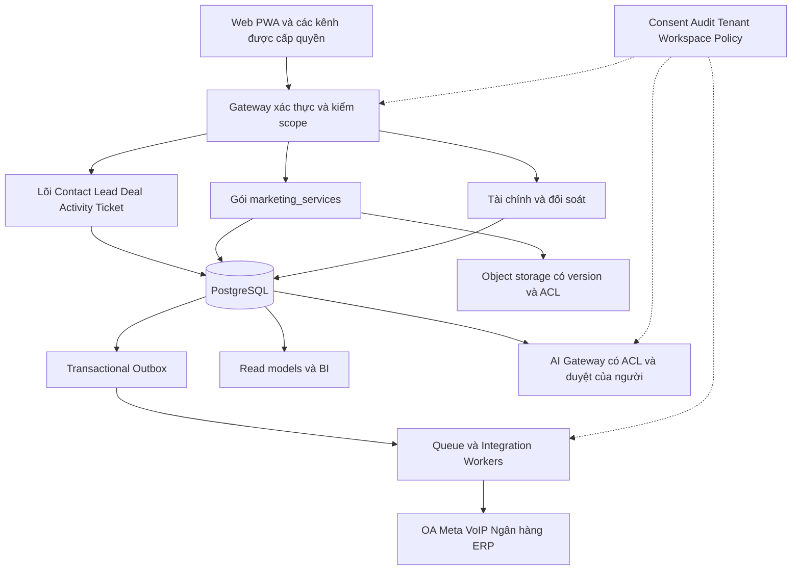
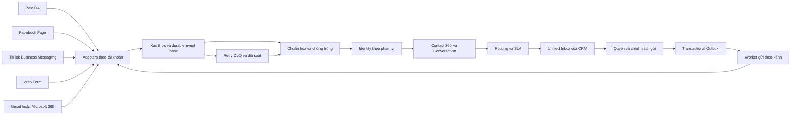
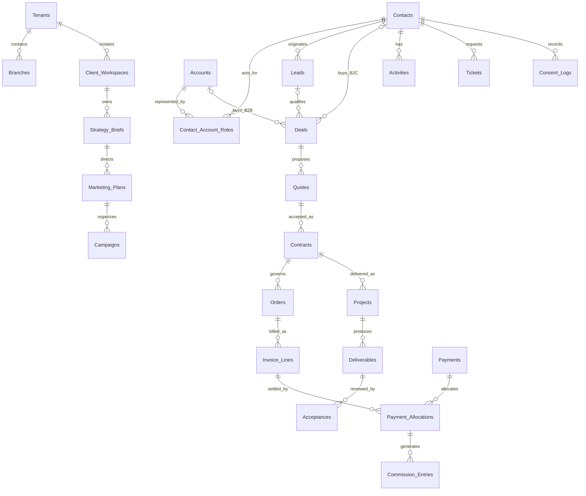

# TÀI LIỆU ĐẶC TẢ NGHIỆP VỤ VÀ KIẾN TRÚC HỆ THỐNG CRM

Dịch vụ marketing B2B và B2C

Master BRD & SRS  
Nền tảng dùng chung và gói nghiệp vụ mở rộng đa ngành

Phiên bản 1.2 — hợp nhất tài liệu, nghiên cứu CRM và Omnichannel năm kênh  
Ngày 15 tháng 10 năm 2026  
Đơn vị sử dụng: Chủ dự án CRM

Phạm vi thiết kế: vận hành cá nhân ban đầu; mở rộng đến 30 Sales, 10 Marketing, ban giám đốc và 2 chi nhánh. Khối lượng đầu vào khoảng 100 lead và 50 khách hàng mỗi tháng, có khả năng tăng trưởng.

Mục đích: làm cơ sở thống nhất nghiệp vụ, lựa chọn giải pháp, lập backlog phát triển, kiểm thử nghiệm thu và dự toán đầu tư. Các ngưỡng KPI, SLA và chi phí được đề xuất để chủ dự án quyết định trước khi triển khai.

**Đọc nhanh:** Phụ lục A ghi 15 điểm được kế thừa và 26 điểm cần sửa, hoãn hoặc bổ sung, với vị trí nguồn và lý do. Phần thân là đặc tả hệ thống đã hợp nhất, không phải bản ghép lại các tài liệu cũ.

## Kiểm soát tài liệu

| Hạng mục | Quy định |
| --- | --- |
| Chủ sở hữu | Chủ dự án CRM; CEO phê duyệt phạm vi và ngân sách khi triển khai đội ngũ. |
| Người đọc | CEO, quản lý kinh doanh, Marketing, BA, kỹ sư, QA, kế toán và người phụ trách bảo vệ dữ liệu. |
| Mốc dữ liệu | Thông tin do chủ dự án cung cấp trong trao đổi; nguồn công khai được tra cứu ngày 15/10/2026. |
| Trạng thái quyết định | Các lựa chọn thiết kế là đề xuất. Chưa có xác nhận nhà cung cấp, giá dịch vụ, ngân sách hoặc mẫu hợp đồng thực tế. |
| Quy ước | P0: bắt buộc cho MVP; P1: sau khi lõi ổn định; P2: chỉ kích hoạt khi có nhu cầu. FR: chức năng; BR: quy tắc; NFR: phi chức năng; UC: luồng; UAT: kiểm thử. |
| Thay đổi | Mỗi thay đổi có mã CR, lý do, chủ sở hữu, tác động dữ liệu/API/chi phí/UAT, người phê duyệt và phiên bản áp dụng. |

**Cập nhật 1.2:** bổ sung kiến trúc hợp nhất Zalo, Facebook, TikTok, Web Form, Email; FR30–40, UC17–22, 24 UAT Omnichannel và nghiên cứu chín sản phẩm/nền tảng. [Đọc nghiên cứu và quyết định](#phu-luc-d).

## Mục lục

Điều hướng đến các chương và phụ lục bên dưới. Bản này hợp nhất nội dung nguồn và bổ sung đặc tả còn thiếu; đánh giá giữ/sửa/hoãn nằm tại Phụ lục A.

- [Chương 1 — Tổng quan chiến lược và mục tiêu dự án](#chuong-1)

- [Chương 2 — Kiến trúc tổng thể và hệ sinh thái tích hợp tại Việt Nam](#chuong-2)

- [Chương 3 — Đặc tả chi tiết các phân hệ nghiệp vụ](#chuong-3)

- [Chương 4 — Use cases và luồng quy trình nghiệp vụ](#chuong-4)

- [Chương 5 — Thiết kế cơ sở dữ liệu và từ điển dữ liệu](#chuong-5)

- [Chương 6 — Phân quyền bảo mật và tuân thủ pháp lý](#chuong-6)

- [Chương 7 — Yêu cầu phi chức năng](#chuong-7)

- [Chương 8 — Hệ thống báo cáo và BI Dashboard](#chuong-8)

- [Chương 9 — Lộ trình 90 ngày quản trị thay đổi và đào tạo](#chuong-9)

- [Chương 10 — Ngân sách đầu tư và hiệu quả đầu tư](#chuong-10)
- [Phụ lục A — Đánh giá tài liệu và lý do](#phu-luc-a)
- [Phụ lục B — Truy vết và mẫu vận hành](#phu-luc-b)
- [Phụ lục C — Nguồn công khai](#phu-luc-c)
- [Phụ lục D — Nghiên cứu CRM và quyết định tích hợp](#phu-luc-d)

<a id="chuong-1"></a>

## CHƯƠNG 1 TỔNG QUAN CHIẾN LƯỢC VÀ MỤC TIÊU DỰ ÁN

### 1.1 Quyết định định hướng

Xây lõi quản lý quan hệ khách hàng cho agency dịch vụ marketing, ưu tiên quản trị từ lead đến hợp đồng, thực thu, bàn giao và gia hạn. B2B quản lý doanh nghiệp, nhiều người liên hệ và vai trò ra quyết định; B2C quản lý người mua cá nhân. Không ép hai mô hình dùng chung một phễu hoặc một bộ tiêu chí qualification.

Ở giai đoạn cá nhân, một người có thể kiêm nhiều vai trò nhưng vẫn ghi lại hành động theo nghiệp vụ. Khi có đội ngũ, kích hoạt phân quyền và phân tách phê duyệt mà không di chuyển khách hàng sang hệ thống mới. Thiết kế khoảng 45 tài khoản để dự trù 40 người đã nêu cộng quản lý và vai trò hỗ trợ; số 45 là giả định ngân sách, không phải số nhân sự được xác nhận.

Tầm nhìn CEO là đo lợi nhuận và dòng tiền theo khách hàng thay vì chỉ nhìn doanh thu ký hợp đồng. Tầm nhìn CMO là nối nguồn lead, chi phí thu hút và chất lượng doanh thu. Tầm nhìn CTO là lõi ổn định, mở rộng có kiểm soát và không để khách hàng của agency bị lẫn với dữ liệu người tiêu dùng do agency xử lý thay khách hàng. BA quản lý tính nhất quán giữa quy tắc, màn hình, dữ liệu và nghiệm thu.

### 1.2 Phạm vi và giả định cần kiểm chứng

| Mã | Nội dung | Cách xử lý |
| --- | --- | --- |
| A01 | 100 lead/tháng; 50 khách/tháng | Phân biệt khách đang phục vụ, khách mới và khách thanh toán. Không suy ra conversion 50% trước khi xác định cohort. |
| A02 | Cá nhân trước và đội ngũ sau | Pilot 1 người, sau đó 5 Sales và 2 Marketing, cuối cùng mở 2 chi nhánh. |
| A03 | Kênh chưa được chỉ định | Đề xuất website/form, email công ty, Zalo OA, Facebook Page và tổng đài; chưa coi là hệ thống đang dùng. |
| A04 | Dịch vụ chưa có bảng giá | Mô hình hỗ trợ retainer, dự án trọn gói, sản xuất nội dung và phí quản lý quảng cáo. |
| A05 | Chưa có CSKH/kế toán/triển khai | Định nghĩa vai trò nghiệp vụ; CEO chỉ định người kiêm nhiệm trước go-live. |
| A06 | Chưa có ngân sách và biên lợi nhuận | Dùng kịch bản minh họa ở chương 10; không cam kết ROI. |

### 1.3 Bài toán và kết quả mong đợi

Ba ưu tiên đề xuất là tránh bỏ sót lead, bảo toàn lịch sử khách khi thay người phụ trách, và kiểm soát hợp đồng đến thực thu đến gia hạn. Đây là giả thuyết nghiệp vụ cần kiểm chứng qua phỏng vấn; chưa phải các nỗi đau được chủ dự án xác nhận.

| Mã BR | Vấn đề cần kiểm soát | Yêu cầu và bằng chứng |
| --- | --- | --- |
| BR01 | Lead không có người xử lý | Tất cả lead hợp lệ có owner hoặc hàng đợi; cảnh báo quá SLA với timestamp. |
| BR02 | Khách phụ thuộc Sales | Lịch sử thuộc tổ chức; bàn giao owner không xóa hoạt động cũ; nguồn Zalo cá nhân khai báo thủ công. |
| BR03 | Bán sai phạm vi dịch vụ | Báo giá khóa phiên bản, số vòng sửa, đầu ra, điều kiện nghiệm thu và phần không bao gồm. |
| BR04 | Lẫn phí dịch vụ và media budget | Dòng hàng có loại SERVICE, MEDIA_PASS_THROUGH, PRODUCTION; tính hoa hồng theo cơ sở được phê duyệt. |
| BR05 | Gián đoạn tái ký | Nhắc trước ngày hết hạn 45/30/15 ngày, gắn health score và người chịu trách nhiệm. |
| BR06 | Mở rộng ngành làm hỏng lõi | Gói ngành có namespace, phiên bản schema và workflow riêng; có kiểm thử hồi quy lõi. |

### 1.4 Ma trận KPI

Baseline được thu trong 14 ngày đầu; mục tiêu dưới đây là đề xuất pilot. Nếu mẫu dưới 30 quan sát, hiển thị cả tử số/mẫu số và không xếp hạng nhân viên bằng tỷ lệ đơn lẻ.

| KPI | Công thức | Mục tiêu và chủ sở hữu |
| --- | --- | --- |
| SLA phản hồi đầu | Lead có lần tiếp cận hợp lệ trong hạn / lead đến hạn | ≥95% trong giờ làm việc; quản lý Sales; đo p50/p95 cùng tỷ lệ. |
| Conversion cohort | Lead mới trong tháng trở thành khách trả tiền trong 90 ngày / lead hợp lệ cùng cohort | Đo baseline trước đặt mức tăng; CMO và Sales cùng ký định nghĩa. |
| Win rate | Deal Won / (Won + Lost) theo ngày đóng | Không dùng deal còn mở ở mẫu số; Sales Director chịu trách nhiệm. |
| CAC | Chi phí thu hút phân bổ / số khách mới trả tiền | Tách paid CAC và fully loaded CAC; chưa có dữ liệu thì hiển thị chưa đủ dữ liệu. |
| LTV đóng góp | Tổng doanh thu dịch vụ trừ chi phí trực tiếp trong vòng đời quan sát của cohort / số khách cohort | Không dùng ngân sách quảng cáo thu hộ; chỉ dự báo sau đủ dữ liệu giữ chân. |
| Tái ký | Hợp đồng tái ký / hợp đồng đến hạn đủ điều kiện | Đo theo số và giá trị; nêu rõ loại trừ hợp đồng một lần. |
| DSO | Phải thu bình quân / doanh thu bán chịu kỳ × số ngày kỳ | Kế toán; kèm tuổi nợ 0–30/31–60/61–90/>90 ngày. |
| Sử dụng CRM | Deal hoạt động có owner và next action đúng hạn / tổng deal hoạt động | ≥95% pilot, hướng tới 100%; loại trừ sự cố đã ghi nhận. |

### 1.5 Nghiên cứu hành vi và cách kiểm chứng

Với dịch vụ marketing, niềm tin được hình thành qua case study, năng lực thực thi, minh bạch số liệu và phản hồi nhanh. B2B thường cần nhiều người duyệt ngân sách, phạm vi và hợp đồng; B2C thường cần gói dễ hiểu, giá rõ và lịch hẹn thuận tiện. Đây là giả thuyết thiết kế, không phải kết quả khảo sát đại diện người tiêu dùng Việt Nam.

Trong 14 ngày, phỏng vấn 5 khách B2B và 5 khách B2C, rà 20 cuộc trao đổi có quyền sử dụng và 10 deal thắng/thua gần nhất. Ghi kênh đầu tiên, kênh ưu tiên, thời gian ra quyết định, lý do mất, mức tin tưởng và trở ngại thanh toán. Không suy rộng kết quả mẫu nhỏ thành tỷ lệ toàn thị trường.

Kiểm chứng ba thử nghiệm: form ngắn so với form đầy đủ; phản hồi 15 phút so với baseline; báo giá có lộ trình và tiêu chí nghiệm thu so với mẫu cũ. Chia ngẫu nhiên khi khả thi, giữ nguyên định nghĩa khách mới, không hứa mức tăng doanh số trước khi đo.

### 1.6 Ranh giới sản phẩm

MVP bao gồm hồ sơ, lead, hoạt động, brief, báo giá, hợp đồng, lịch thu tiền, bàn giao, ticket và báo cáo cơ bản. Tích hợp một nguồn lead và một kênh giao tiếp trước. Mini App, loyalty phức tạp, AI tự hành và sàn thương mại điện tử nằm ở giai đoạn sau. Tài liệu đặc tả toàn bộ đích đến nhưng kế hoạch 90 ngày chỉ cam kết phạm vi MVP đã nghiệm thu.

<a id="chuong-2"></a>

## CHƯƠNG 2 KIẾN TRÚC TỔNG THỂ VÀ HỆ SINH THÁI TÍCH HỢP TẠI VIỆT NAM

### 2.1 Kiến trúc triển khai ban đầu

Đề xuất ứng dụng web responsive/PWA, backend modular monolith và PostgreSQL managed; worker bất đồng bộ xử lý webhook, lịch nhắc và tác vụ tích hợp. Dùng object storage cho hợp đồng và ghi âm, hàng đợi bền vững cho sự kiện. Chưa cần Kafka, Kubernetes hoặc lakehouse với 100 lead/tháng. Backup, quyền truy cập và tính đúng đắn tài chính cần có ngay dù lưu lượng thấp.

Nguồn sự thật phân theo miền: CRM sở hữu lead/deal/hoạt động; ERP sở hữu chứng từ kế toán và công nợ đã hạch toán; ngân hàng/provider sở hữu giao dịch thanh toán xác thực; hệ thống quản lý dự án sở hữu tác vụ giao hàng nếu đã tích hợp. Kho BI là bản chiếu phân tích, không thay thế sổ nghiệp vụ giao dịch.

### 2.2 Sơ đồ kiến trúc và ranh giới microservices

Sơ đồ dưới thể hiện hướng luồng dữ liệu. Các khối nghiệp vụ có thể cùng chạy trong một backend khi pilot; ranh giới API và sự kiện được giữ để tách dịch vụ khi tăng tải.



Hình 1. Kiến trúc logic; Marketing Services Pack là gói nghiệp vụ agency, không sở hữu hồ sơ khách hàng độc lập.

| Miền | Trách nhiệm | Điều kiện tách dịch vụ |
| --- | --- | --- |
| Identity và Consent | Định danh, policy, chứng cứ đồng ý | Dùng chung nhiều sản phẩm, cần vòng phát hành riêng. |
| Lead và Sales | Owner, pipeline, báo giá | Nhóm phát triển riêng và yêu cầu scale độc lập đã đo được. |
| Integration | Token, webhook, retry, mapping | Ưu tiên tách worker sớm để lỗi đối tác không chặn giao diện. |
| Finance | Phân bổ thanh toán, ledger hoa hồng | Cần kiểm soát giao dịch độc lập; giữ một owner ghi sổ. |
| AI Gateway | Redaction, model routing, quota | Không cho mô hình gọi SQL hoặc API tùy ý. |

### 2.3 Lõi dùng chung và gói ngành

Mỗi bản ghi thuộc tenant_id là tổ chức sở hữu dữ liệu. branch_id phân phạm vi chi nhánh trong tổ chức. business_line_id phân ngành hoặc dòng dịch vụ, không thay thế tenant. client_workspace_id dùng cho dữ liệu người tiêu dùng xử lý thay một khách hàng agency; tuyệt đối không mặc định đưa họ thành khách hàng bán dịch vụ của agency.

Core gồm Contact, Account, Lead, Deal, Activity, Ticket, Consent và Audit. Gói marketing_services bổ sung Brief, SOW, Deliverable, Acceptance, Retainer và CampaignAsset. Ngành bán lẻ bổ sung SKU/Inventory/Return; nha khoa bổ sung lịch điều trị và hồ sơ chuyên ngành với kiểm soát riêng. Không thêm hàng trăm cột tùy chọn vào Contacts cho tất cả ngành.

| Thành phần mở rộng | Cơ chế | Điều kiện an toàn |
| --- | --- | --- |
| Custom fields | field_definition theo tenant + entity + namespace | Kiểu dữ liệu, giới hạn, dữ liệu nhạy cảm, kiểm tra server; index chỉ trường được duyệt. |
| Workflow | Định nghĩa có version, trạng thái và transition | Instance cũ giữ version cũ; chuyển phiên bản bằng migration có kiểm thử. |
| Industry pack | Manifest tên, version, dependencies, migrations | Namespace marketing.*, retail.*; không được ghi trực tiếp bảng của pack khác. |
| Feature flag | Theo tenant và vai trò | Tắt tính năng không xóa dữ liệu; API vẫn kiểm quyền. |
| Khách nhiều ngành | Contact có liên kết business_line | Chia sẻ theo mục đích và quyền; không tự chia sẻ consent marketing giữa các ngành. |

Ví dụ thêm ngành giáo dục: đăng ký education.v1, thêm enrollment và course, tạo pipeline tư vấn riêng. Bản ghi Contact vẫn dùng core nhưng enrollment FK có tenant_id; không thay enum stage của pipeline marketing đang chạy. Bộ kiểm thử phải chứng minh một sales giáo dục không thấy SOW của agency nếu chưa được cấp quyền.

### 2.4 Danh mục tích hợp đề xuất

| Hệ thống | Vai trò và dữ liệu | Giai đoạn và điều kiện |
| --- | --- | --- |
| Website/form + email công ty | Thu lead có UTM, consent và nguồn; gửi thư báo giá | P0; chống spam, email domain được cấu hình, mailbox quyền công ty. |
| Zalo OA và ZBS Template Message | Inbox, nhắc lịch, thông báo giao dịch theo mẫu hợp lệ | P0/P1; OA, App, quyền và ngân sách phải được kiểm tra. Tài liệu 2026 dùng ZBS Account [S03](#s03). |
| Zalo Mini App | Đặt lịch, xem tiến độ, điểm và giới thiệu | P2; chỉ xây sau khi chứng minh khách sẽ sử dụng. Không mặc định được lấy số điện thoại. |
| Zalo cá nhân | Nguồn khách do Sales khai báo; chuyển tương tác sang kênh công ty | Không cam kết đọc đồng loạt chat cá nhân. Tích hợp không chính thức không nằm trong baseline. |
| Facebook Page và Lead Ads | Form lead, hội thoại và campaign ID | P1; app review, scope, token và chính sách gửi tin phải được xác minh theo API hiện hành. |
| TikTok Shop và Shopee | Đơn/sản phẩm của khách thuê agency khi có ủy quyền | P2, pack thương mại điện tử riêng; không trộn GMV của khách với doanh thu agency [S07](#s07), [S08](#s08). |
| Stringee hoặc OmiCall | Click-to-call, call ID, trạng thái, ghi âm | P1; chọn qua PoC về webhook, masking, chất lượng và chi phí; không mua cả hai mặc định. |
| Ngân hàng hoặc provider được cấp quyền | Giao dịch nhận tiền, mã đối soát | P0 nhập sao kê có kiểm soát; P1 API. VietQR chỉ hỗ trợ khởi tạo chuyển khoản [S04](#s04). |
| MISA AMIS Kế toán + meInvoice | Khách hàng, hóa đơn, chứng từ và trạng thái công nợ | P1; kiểm đúng API từng sản phẩm, không dùng tài liệu AMIS CRM thay cho kế toán [S05](#s05), [S06](#s06). |
| Công cụ quản lý dự án hiện có | Dự án, milestone, người phụ trách và nghiệm thu | P1; CRM giữ liên kết và trạng thái cần cho chăm sóc, không nhân đôi toàn bộ quản lý task. |
| GHN/GHTK | Giao POSM, quà hoặc vật phẩm | P2 chỉ khi có giao vận thực; không bắt buộc cho dịch vụ số. |

### 2.5 Hợp đồng kỹ thuật tích hợp

Webhook phải xác minh chữ ký theo nhà cung cấp, kiểm timestamp/replay khi được hỗ trợ, ghi durable inbox trước khi trả 2xx. Khóa chống trùng là tenant + connector + external_event_id. Nếu đối tác không cung cấp ID ổn định, tạo hash có tài liệu và kiểm rủi ro va chạm; không dùng riêng thời điểm nhận làm khóa.

Sau commit nghiệp vụ, transactional outbox phát event. Consumer xử lý ít nhất một lần nhưng tác động nghiệp vụ chỉ một lần bằng unique key và transaction. Retry lỗi tạm thời với backoff 1/5/15/60 phút có jitter; lỗi quyền hoặc schema vào hàng đợi xử lý. Không retry mù POST thu tiền, phát hóa đơn hoặc gửi tin có phí khi chưa biết kết quả.

Event nội bộ gồm event_id, tenant_id, aggregate_type, aggregate_id, aggregate_version, occurred_at UTC, schema_version, correlation_id và payload tối thiểu. Không đưa mật khẩu, access token hoặc toàn bộ nội dung chat vào log. Sự kiện đến muộn không được làm trạng thái Paid quay về Pending.

| API nội bộ mẫu | Kiểm tra bắt buộc | Kết quả và lỗi |
| --- | --- | --- |
| POST /v1/leads | Tenant từ token, nguồn, contact method, consent purpose | 201 hoặc trả kết quả cũ theo Idempotency-Key; 422 dữ liệu sai. |
| POST /v1/leads/{id}/claim | RBAC, hàng đợi, capacity, expected_version | 200 một owner; 409 khi người khác đã nhận. |
| POST /v1/quotes/{id}/approve | Quyền, giá, biên lợi nhuận, version | 200 khóa snapshot; 403 nếu tự duyệt ngoài hạn mức. |
| POST /v1/payments/{id}/allocate | Kế toán, số dư chưa phân bổ, hóa đơn cùng tenant | Transaction atomic; 409 nếu giao dịch đã thay đổi. |
| POST /v1/consents/revoke | Xác thực chủ thể phù hợp, purpose và channel | Ghi event rồi chặn gửi; 202 nếu còn tác vụ lan truyền. |

### 2.6 Quản trị credential và lỗi đối tác

Token giữ trong secret manager, mỗi tenant và connector có scope tối thiểu; UI chỉ hiện trạng thái kết nối. Refresh token đồng bộ bằng lock để tránh nhiều worker ghi đè. Khi token hết hạn, connector chuyển Degraded, báo người phụ trách, lưu hàng đợi và cho phép nhập thủ công với provenance. Theo dõi quota, thời gian hết hạn, lỗi 401/403/429, backlog, duplicate và reconciliation mismatch.

### 2.7 Kiến trúc Omnichannel hợp nhất năm kênh

**Quyết định bổ sung ngày 15/10/2026:** CRM là điểm làm việc và hồ sơ nghiệp vụ thống nhất cho Zalo, Facebook, TikTok, Web Form và Email. “Toàn bộ” có nghĩa là toàn bộ dữ liệu thuộc phạm vi tài khoản doanh nghiệp được ủy quyền, được API cho phép và được chính sách lưu giữ cho phép. Không cam kết lấy lịch sử vô hạn, tin nhắn tài khoản cá nhân hoặc dữ liệu nền tảng chưa cấp quyền. Mỗi connector phải công bố khoảng lịch sử đồng bộ, thời điểm cập nhật cuối và phần dữ liệu còn thiếu.

Một Contact có thể có nhiều danh tính kênh, nhiều cuộc hội thoại và nhiều vai trò tại các Account. Hợp nhất hồ sơ không có nghĩa trộn các luồng chat thành một thread hoặc công khai nội dung cho mọi nhân viên. CRM quản lý Contact, Account, Lead, Deal, quyền và consent; nền tảng kênh vẫn là nguồn xác nhận việc tiếp nhận/phát tin. Nếu dùng Chatwoot, chỉ chọn một hệ thống làm chủ trạng thái hội thoại, không cho hai bộ router cùng phân công.



#### Ma trận khả năng và điều kiện kết nối

| Kênh | Dữ liệu đưa vào | Gửi từ CRM | Điều kiện và giới hạn phải kiểm chứng trước cam kết |
| --- | --- | --- | --- |
| Zalo OA | Sự kiện/tin nhắn OA được API cấp; UID trong phạm vi OA; metadata được phép | Qua OA API hoặc template phù hợp sản phẩm/chính sách hiện hành | OA, app và quyền hợp lệ; kiểm tra hạn mức, cửa sổ gửi, loại nội dung, lịch sử, sự kiện thu hồi. Zalo cá nhân không được coi là OA API [R10](#r10) |
| Facebook | Page Messenger; Lead Ads là feed riêng nếu được cấp; comment là loại tương tác riêng | Page Messenger qua quyền và điều kiện gửi tương ứng | Quyền Page/app review, token, webhook; định danh có phạm vi Page. Lead Ads không tự tạo quyền nhắn Messenger; ngoài cửa sổ phải có cơ chế hợp lệ [R11](#r11) |
| TikTok | DM qua Business Messaging API cho Business Account được ủy quyền; Lead Gen và Shop qua connector khác | Chỉ khi account/app thực sự được cấp quyền messaging | API chính thức có tồn tại; chưa xác nhận tài khoản này đủ điều kiện tại Việt Nam. Không lấy API Shop thay cho DM, không suy luận Ads account có quyền inbox [R12](#r12) |
| Web Form | Submission, trường khách tự khai, consent version, UTM/referrer được phép | Form không phải kênh chat hai chiều; tạo task hoặc trả lời bằng email/kênh đã xác minh | Chống spam, kiểm tra server, submission ID; email nhập tay chưa phải email đã xác minh; không tự thêm vào marketing audience |
| Email | Mailbox doanh nghiệp được cấp quyền; thư, thread, attachment theo phạm vi cấu hình | Gmail API/Graph hoặc SMTP OAuth được phê duyệt | Watch/subscription phải gia hạn; webhook có thể chỉ chứa thông báo thay đổi, cần fetch nội dung; shared mailbox cần quyền thích hợp [R13](#r13)[R14](#r14) |

Zalo cá nhân: quy trình chuyển sang OA bằng liên kết/QR, ghi nhận hoạt động thủ công có nguồn và consent; nếu đánh giá nhà cung cấp bridge phải kiểm chứng quyền chính thức và điều khoản, không dùng cookie/session cá nhân như nền móng hệ thống. Với TikTok chưa được duyệt, nhân viên xử lý trong giao diện chính thức, CRM ghi task và đường dẫn tham chiếu; hiển thị “chưa kết nối hai chiều”. Không dùng fallback để giả lập trạng thái đã gửi.

#### Hợp đồng adapter và vòng đời kết nối

Mỗi adapter công bố `capabilities`: receive, send, attachments, delivery_receipt, read_receipt, history_backfill, edit, delete, native_reply_echo. Trạng thái từng capability là `verified`, `unsupported`, `pending_approval` hoặc `unknown`, kèm ngày test, phiên bản API và tài khoản thử. UI dựa trên capability thực tế; không hiện nút reply cho connector chỉ nhận lead.

Lifecycle: `pending_authorization → active → degraded → reauthorization_required → disconnected`. Khi token hết hạn, dừng gửi và cảnh báo người phụ trách; giữ hàng đợi có TTL. Sau cấp quyền lại, kiểm tra lại policy tại thời điểm gửi; không xả hàng loạt tin marketing đã hết hiệu lực. Thu hồi tài khoản không tự xóa dữ liệu cần lưu hợp pháp, nhưng chặn truy cập mới ngay.

Inbound: xác minh theo cơ chế nhà cung cấp, giới hạn kích thước, ghi event bền vững rồi mới ACK trong timeout của kênh. Nếu ghi thất bại, trả lỗi để retry; không ACK trước lưu. Worker parse, chuẩn hóa, deduplicate, resolve identity, cập nhật conversation và tạo routing event trong transaction. Event chứa `tenant_id`, `workspace_id`, `connection_id`, `provider_event_id`, `provider_message_id`, `occurred_at`, `received_at`, `schema_version`, `correlation_id`, `payload_ref`. Tenant/workspace lấy từ connection được xác thực, không tin giá trị do payload khách gửi.

Outbound: lưu ý định gửi và outbox trong cùng transaction; worker kiểm tra quyền, consent/purpose, loại tin, cửa sổ gửi và hạn mức. Mỗi ý định có `client_request_id` duy nhất. Provider nhận thành công mới ghi `provider_message_id`; trạng thái `accepted` không tương đương `delivered` hay `read`. Nếu timeout sau khi provider có thể đã nhận, chuyển `unknown_outcome`; tra cứu/đối soát nếu API hỗ trợ, không retry mù. Không tuyên bố exactly-once xuyên nền tảng; mục tiêu là at-least-once inbound với xử lý idempotent và kiểm soát gửi trùng outbound.

Retry có exponential backoff, jitter, tôn trọng Retry-After, giới hạn tổng thời gian; lỗi quyền/policy không retry như lỗi mạng. DLQ có mã lỗi đã làm sạch, owner, lần thử, nút replay có quyền và audit. Backfill dùng cursor/checkpoint, cùng pipeline chống trùng với realtime, không kích hoạt chiến dịch hoặc SLA mới cho dữ liệu lịch sử. Gmail cần watch renewal và history sync; Microsoft cần quản lý subscription lifecycle. Chi tiết thời hạn lấy từ tài liệu/version đang triển khai, không hardcode chung cho mọi kênh.

### 2.8 Tổ chức code và gói ngành sau đối chiếu CRM tham khảo

Đây là **thiết kế đề xuất của dự án**, không phải cây thư mục được sao chép nguyên trạng từ một CRM. Các bằng chứng ở phụ lục D giải thích vì sao chọn module extension, API/worker riêng và mô hình quan hệ có vai trò.

```text
apps/
  web/                         # Unified Inbox, CRM, quản trị
  api/                         # HTTP, auth, composition root
  worker/                      # inbox/outbox, sync, SLA, jobs
packages/
  domains/
    identity/                  # Contact, identity links, merge review
    sales/                     # Lead, Deal, Quote
    conversations/             # Inbox, Conversation, Message, assignment
    service/                   # Ticket, SLA
    finance/                   # Payment allocation, commission ledger
  contracts/                   # OpenAPI, event schemas, typed clients
  policy/                      # RBAC/ABAC, consent, send eligibility
  connectors/
    zalo-oa/ facebook/ tiktok-business/ web-form/ email/
  industry-packs/
    marketing-services/        # Brief, SOW, deliverables, acceptance
  ui/                          # Thành phần hiển thị dùng chung
  observability/               # Trace, metrics, log redaction
db/migrations/                 # Lịch sử migration theo thứ tự toàn hệ thống
tests/contract/                # Fixtures đã khử dữ liệu cá nhân
tests/integration/             # DB, transaction, webhook replay
tests/e2e/                     # Quyền, gửi tin, UAT trọng yếu
docs/adr/                      # Quyết định và lý do thay đổi
deploy/                        # IaC, runbooks, backup/restore
```

Module có `domain`, `application`, `ports`, `adapters` khi độ phức tạp cần; không ép mọi CRUD nhỏ thành hàng chục lớp. Chỉ import API công khai của domain; CI cấm import vòng và truy cập repository nội bộ domain khác. Domain không gọi trực tiếp SDK Zalo/Meta. Adapter chuyển dữ liệu ngoài thành command/event đã kiểm tra; thư viện `contracts` không chứa nghiệp vụ hay khóa truy cập. Không có thư mục `utils` khổng lồ chứa cả pricing, routing và quyền.

Stack tham chiếu nếu tự xây: TypeScript, React cho web, NestJS cho API, PostgreSQL cho giao dịch, queue worker cho việc nền, object storage cho tệp. Đây là lựa chọn để giảm số ngôn ngữ trong đội, không là kết luận benchmark. Redis/BullMQ chỉ thêm khi cần queue/rate limit và có vận hành; có thể khởi đầu bằng PostgreSQL job queue đáng tin cậy. Không đưa Kafka, Kubernetes, ClickHouse, vector DB hoặc microfrontend vào MVP chỉ vì dự án tham khảo có chúng. AI gateway là adapter; model/version và quyền tool thay đổi độc lập core.

Manifest gói ngành gồm `pack_key`, `version`, `requires_core`, `dependencies`, `owned_entities`, `permissions`, `event_subscriptions`, `migration_ids`, `feature_flags`. Namespace ví dụ `marketing_services.sow`; không cho hai pack cùng sở hữu một field core. Cài pack cần kiểm tra dependency và migration trên bản sao dữ liệu; conflict phải chặn build, không âm thầm “pack nạp sau thắng”. Gỡ pack mặc định vô hiệu chức năng, không DROP dữ liệu. Đây là biện pháp bổ sung vì cơ chế override theo thứ tự của EspoCRM hữu dụng nhưng nếu lạm dụng có thể che thay đổi của pack khác [R02](#r02).

Pipeline phát hành: lint/typecheck → boundary checks → unit domain trọng yếu → migration/integration → connector contract tests → E2E quyền và gửi tin → dependency/license scan → staging → canary → production. Mỗi release ghi commit và schema version. Migration theo expand/migrate/contract; rollback ứng dụng không đồng nghĩa rollback dữ liệu. Chỉ tách service khi có bằng chứng bottleneck, nhu cầu cô lập hoặc ownership riêng, có ADR và số đo trước/sau.

<a id="chuong-3"></a>

## CHƯƠNG 3 ĐẶC TẢ CHI TIẾT CÁC PHÂN HỆ NGHIỆP VỤ

### 3.1 CDP và hồ sơ khách hàng 360 độ

#### 3.1.1 FR01 Hồ sơ và định danh

Hồ sơ hiển thị thông tin pháp nhân/cá nhân, người phụ trách, chi nhánh, nguồn, consent, timeline, deal, hợp đồng, dự án, ticket và công nợ. Người dùng chỉ xem các trường và đối tượng được cấp quyền. B2B có quan hệ contact_account_roles gồm vai trò quyết định, người dùng, tài chính và người ảnh hưởng, ngày hiệu lực và ngày kết thúc.

Chuẩn hóa số điện thoại về E.164 khi xác định được quốc gia; giữ bản gốc và không tự suy quốc gia cho số mơ hồ. Email trim và chuẩn hóa domain; không tự xóa dấu chấm hoặc phần + vì quy tắc khác nhau giữa nhà cung cấp. Tên tiếng Việt giữ dấu; bản không dấu chỉ phục vụ tìm kiếm. Mã số thuế và pháp nhân cần phân biệt trụ sở, chi nhánh và người liên hệ.

#### 3.1.2 FR02 Identity resolution và merge

Ưu tiên mapping external_id đã xác thực theo tenant + channel + channel_account_id. Số điện thoại/email đã xác thực là bằng chứng mạnh nhưng có thể dùng chung hoặc tái cấp; không auto merge khi có xung đột người. Tên giống, địa chỉ giống hoặc cùng công ty chỉ tạo ứng viên. Chỉ auto-link khi định danh đã được xác minh và không có mâu thuẫn; trường hợp khác vào hàng đợi steward.

Merge giữ survivor_id, alias cũ, lý do, chứng cứ, người duyệt, snapshot và danh sách bản ghi liên quan. Trường verified thắng unverified; dữ liệu mới hơn chỉ thắng khi nguồn đủ tin cậy. Không cộng gộp consent thành quyền rộng hơn. Không merge qua tenant hoặc client_workspace; cần chia sẻ hợp lệ bằng quy trình riêng.

Unmerge phục hồi mapping theo snapshot; các hoạt động phát sinh sau merge cần steward phân bổ lại. Không hứa đảo ngược mọi tác động tự động như tin đã gửi. UAT FR02: hai người dùng chung số tổng đài phải tồn tại riêng; một webhook trùng không tạo contact mới.

#### 3.1.3 FR03 Phân nhóm RFM

Với agency, R là số ngày từ lần thanh toán phí dịch vụ gần nhất; F là số kỳ dịch vụ thanh toán hợp lệ trong 12 tháng; M là phí dịch vụ thuần đã thu sau hoàn tiền, không gồm VAT và media thu hộ. Tính cấp Account với B2B, cấp Contact với B2C; không đếm một hóa đơn trả ba đợt thành ba lần mua.

| Nhóm | Điều kiện đề xuất | Hành động |
| --- | --- | --- |
| Khách giá trị cao | R≤30 ngày, F≥6 kỳ, M thuộc nhóm cao được đặt ngưỡng | Account review và kế hoạch gia hạn; không tự giảm giá. |
| Khách mới | Kỳ thanh toán đầu trong 30 ngày | Onboarding, checklist asset và khảo sát sau bàn giao đầu. |
| Có nguy cơ | Retainer còn hiệu lực, quá hạn thanh toán hoặc ít tương tác 30 ngày | Gọi kiểm tra, rà deliverable và ticket trước upsell. |
| Ngủ đông | Không hợp đồng hiệu lực, R>90 ngày | Chỉ kích hoạt lại nếu purpose/channel còn hợp lệ. |

Khi chỉ có khoảng 50 khách, ưu tiên ngưỡng nghiệp vụ và phân nhóm explainable; không ép chia quintile nếu nhiều giá trị bằng nhau. Báo cáo phải thể hiện kỳ tính, threshold version và lý do vào segment.

### 3.2 Quản trị lead và phễu bán hàng

#### 3.2.1 FR04 Hai pipeline có kiểm soát

B2B: New → Contacting → Qualified → Discovery → Proposal → Negotiation → Won/Lost. B2C: New → Contacting → Qualified → Offer → Won/Lost. Nurture là trạng thái quản lý lead trước cơ hội, không dùng làm nơi giấu deal quá hạn. Won yêu cầu hợp đồng/đơn đã được khách chấp thuận theo chính sách; Paid là trạng thái tài chính riêng.

Qualified B2B cần nhu cầu, sản phẩm quan tâm, đầu mối, khả năng ngân sách và thời điểm triển khai; chưa có người duyệt thì ghi Unknown thay vì bịa dữ liệu. B2C cần nhu cầu, phương thức liên hệ, khoảng ngân sách và thời điểm mong muốn. Mỗi transition yêu cầu next action; Lost bắt buộc reason code và ghi chú có kiểm soát.

#### 3.2.2 FR05 Phân lead và SLA thu hồi

Router lọc tenant, business line, chi nhánh phục vụ, kỹ năng, lịch làm việc và capacity trước khi weighted round-robin. Khách đang có owner hợp lệ được ưu tiên continuity nhưng phải kiểm tra quyền và sự sẵn sàng. Một giao dịch DB khóa lead, chọn owner, ghi assignment history và tạo deadline; không chia bằng thao tác đọc rồi ghi không khóa.

Giờ làm việc đề xuất 08:30–17:30 thứ Hai đến thứ Sáu, múi giờ Asia/Ho_Chi_Minh, lịch nghỉ cấu hình. Lead ngoài giờ bắt đầu SLA ở ca tiếp theo. SLA nhận lead 5 phút, tiếp cận đầu 15 phút làm việc; cảnh báo phút 10, xem xét thu hồi phút 15 nếu chưa có hoạt động hợp lệ. Chạy sweeper mỗi phút nên trễ tối đa thêm 60 giây theo thiết kế.

Hoạt động hợp lệ là cuộc gọi có call_id và kết quả, tin gửi thành công qua kênh được phép, hoặc tiếp xúc trực tiếp có biên bản. Chỉ mở màn hình, đổi trạng thái hay ghi “đã gọi” không tự dừng timer. Cuộc gọi không nghe máy được tính nỗ lực nhưng chưa là liên hệ thành công; cần tác vụ gọi lại.

Thu hồi tối đa 2 lần rồi đưa trưởng nhóm; không chuyển vòng vô hạn. Giữ lịch sử owner và cả công lao nguồn khách. Nếu nhà cung cấp gặp sự cố, timer được đánh dấu exception có người duyệt, không chỉnh timestamp gốc. Lead có hẹn theo yêu cầu khách được pause với ngày hẹn và lý do.

#### 3.2.3 FR06 Năng suất và chất lượng dữ liệu

100 lead/tháng chia 30 Sales chỉ khoảng 3,3 lead/người nếu phân đều, nên không mở cả 30 người nhận inbound ngay. Pilot pool 5 người, phân theo capacity và giữ nhóm chuyên ngành; tính toán capacity từ thời gian xử lý thật. Không dùng số lượng thao tác làm KPI duy nhất vì dễ khuyến khích ghi hoạt động rỗng.

### 3.3 Omnichannel Inbox và Zalo tập trung

#### 3.3.1 FR07 Hội thoại thuộc tổ chức

Conversation có channel_account_id, external_thread_id, participants và owner; message có provider_message_id, direction, delivery state và attachment reference. Cho một người trả lời chính trong phiên, có chỉ báo đồng nghiệp đang nhập và chuyển giao có lý do. Gửi tin qua queue để kiểm policy và tránh trùng; trạng thái Accepted khác Delivered và Read.

Thiết kế ưu tiên OA và Page thuộc doanh nghiệp. Khách phát sinh trên Zalo cá nhân được tạo lead, ghi nguồn và xin chuyển sang OA/email/cổng khách khi phù hợp. Không cam kết tự thu hồi lịch sử tài khoản cá nhân, không lấy cookie/session của Sales và không dùng API không chính thức làm điều kiện vận hành cốt lõi.

#### 3.3.2 FR08 Data masking và bàn giao

Sales thấy số che một phần, gọi qua click-to-call khi nhà cung cấp hỗ trợ; quyền reveal cần lý do, TTL 5 phút và audit. API phải trả dữ liệu đã che ngay ở server; không gửi số thật trong JSON rồi chỉ che CSS. Attachment, search index, notifications, CSV và BI áp cùng policy.

Offboarding vô hiệu hóa login và token phiên, thu hồi queue membership, chuyển open lead/deal/ticket, kiểm integration credentials có liên quan, lưu hoạt động lịch sử. Watermark tên người dùng/thời gian giúp truy vết nhưng không ngăn tuyệt đối chụp ảnh màn hình. Ngăn xuất Excel bằng quyền và endpoint; không tuyên bố chống sao chép tuyệt đối.

### 3.4 Marketing automation và Loyalty trên Mini App

#### 3.4.1 FR09 Journey engine

Journey definition chứa version, entry event, filter, wait, action, exit và re-entry policy. Trước mỗi bước gửi phải kiểm consent hiện thời, suppression, kênh, mẫu được duyệt, quota và giờ yên lặng 20:00–08:00 theo chính sách nội bộ. Người dùng rút consent trong lúc chờ thì hủy các bước marketing còn lại; thông báo phục vụ hợp đồng được đánh giá theo mục đích riêng.

| Kịch bản | Trigger và nhánh | Thoát và kiểm soát |
| --- | --- | --- |
| Lead tải tài liệu | Opt-in nội dung; gửi tài liệu; sau 2 ngày đề nghị tư vấn nếu còn quyền | Thoát khi đặt lịch, từ chối, hết quyền hoặc đạt 2 tin/7 ngày theo đề xuất. |
| Báo giá chưa phản hồi | Sau 2 ngày làm việc chưa có quyết định | Tạo task Sales; chỉ gửi follow-up khi phù hợp chính sách kênh. |
| Onboarding | Hợp đồng có hiệu lực và đủ điều kiện khởi động | Xin asset, họp kickoff, thông báo thiếu tài liệu; không gửi yêu cầu mật khẩu quảng cáo qua chat. |
| Gia hạn | Hết hạn sau 45/30/15 ngày | Nếu ticket nghiêm trọng đang mở, chuyển account manager xử lý trước chào bán. |
| Win-back | 90 ngày không hợp đồng hiệu lực | Kiểm consent và loại trừ khách khiếu nại chưa giải quyết. |

#### 3.4.2 FR10 Loyalty và referral

Mini App ưu tiên tra cứu tiến độ, lịch tư vấn và referral; điểm thưởng là tùy chọn P2. Điểm ở ledger append-only: earn, reserve, redeem, expire, reverse. Chỉ earn khi thanh toán đủ điều kiện và qua thời gian kiểm soát hoàn tiền; không sửa trực tiếp balance. Ví dụ 1 điểm/100.000 đồng phí dịch vụ thuần là cấu hình minh họa, cần kiểm tra chi phí trước áp dụng.

Hạng thẻ dựa trên phí dịch vụ thuần 12 tháng, không dựa media spend. Referral có mã, người giới thiệu, khách được giới thiệu, ngày ghi nhận và thời điểm khóa attribution; tự giới thiệu, trùng pháp nhân hoặc contact phải vào kiểm tra. Chỉ thưởng sau khách mới trả tiền, hết thời gian khiếu nại theo chính sách. Hoàn tiền sinh bút toán đảo điểm/thưởng, không xóa dấu vết.

### 3.5 AI Co-Pilot và Agentic CRM

#### 3.5.1 FR11 Tóm tắt cuộc gọi tiếng Việt

Pipeline: cuộc gọi có cơ sở xử lý phù hợp → ghi âm được phép → hàng đợi → STT → che dữ liệu không cần thiết → trích nhu cầu/ngân sách/next action → bản nháp cho Sales duyệt. Lưu call_id, model_version, prompt_version, confidence, tham chiếu timestamp và người duyệt. AI không tự khẳng định ngân sách hoặc cam kết khách nếu câu nói mơ hồ.

Đánh giá bằng tối thiểu 60 cuộc gọi được phép sử dụng, có giọng Bắc/Trung/Nam và điều kiện nhiễu; chấm riêng tên thương hiệu, số tiền, ngày hẹn và phân biệt người nói. Ngưỡng nghiệm thu đề xuất: độ chính xác trường quan trọng ≥95% trên tập kiểm thử; mọi trường số tiền/ngày tháng phải có xác nhận người dùng trước ghi chính thức. Nếu không đạt, chỉ triển khai transcript và summary draft.

#### 3.5.2 FR12 Lead scoring và gợi ý hành động

Khởi đầu bằng rule score 0–100: phù hợp dịch vụ 30, nhu cầu rõ 25, ngân sách 20, thời điểm 15, tương tác 10. Thiếu thông tin không đồng nghĩa khách kém; hiển thị coverage và lý do. Không dùng dữ liệu nhạy cảm hoặc đặc điểm không liên quan để chấm điểm. Với 100 lead/tháng, chưa có cơ sở huấn luyện mô hình dự báo đáng tin nếu chưa tích lũy nhãn và outcome đủ đại diện.

AI gợi ý câu hỏi discovery, nhắc phần SOW còn thiếu, đề xuất tài liệu case study có quyền dùng và draft email. RAG chỉ lấy tài liệu đúng tenant, đúng quyền và phiên bản còn hiệu lực; trả kèm nguồn. Khi không có nguồn, phải nêu thiếu thông tin, không tạo số liệu hiệu quả chiến dịch giả.

#### 3.5.3 FR13 Giới hạn agent tự hành

| Hành động | Quyền AI | Bằng chứng nghiệm thu |
| --- | --- | --- |
| Tóm tắt và tạo task nháp | Cho phép trong quyền của người gọi | Có nguồn và không làm mất bản gốc. |
| Chuyển lead theo router cố định | Worker quy tắc làm; AI chỉ gợi ý | Tái chạy không đổi owner trái policy. |
| Gửi email hoặc tin khách | Cần người duyệt ở MVP | Có preview, recipient, nội dung và audit approval. |
| Giảm giá, hợp đồng, hoàn tiền | Không tự phê duyệt | Tool bị từ chối nếu thiếu approval token đúng hành động. |
| Export, xóa khách, đổi quyền | Cấm agent tự thực hiện | Prompt injection trong file khách không mở quyền [S10](#s10). |

Giới hạn ngân sách theo tenant/ngày, timeout 30 giây cho tác vụ đồng bộ, circuit breaker khi lỗi và nút tắt AI. Không đưa khóa API vào prompt. Không cho nội dung chat/tệp khách trở thành chỉ dẫn hệ thống. Kiểm thử injection, rò rỉ chéo tenant và sự cố nhà cung cấp trước khi dùng dữ liệu thật.

### 3.6 Báo giá đơn hàng hợp đồng công nợ và hoa hồng

#### 3.6.1 FR14 Danh mục dịch vụ và báo giá

Service catalog chứa mã, đơn vị, giá, tax treatment được kế toán xác nhận, chi phí trực tiếp ước tính, SLA triển khai và mẫu SOW. Báo giá phân dòng phí quản lý, sản xuất nội dung, phần mềm mua hộ và media budget; mọi khoản thu hộ cần cấu trúc hợp đồng/kế toán phù hợp. Báo giá có ngày hết hiệu lực, tiền tệ, lịch thanh toán và số phiên bản.

Chính sách phê duyệt đề xuất: giảm ≤5% và biên đóng góp ≥30% do trưởng nhóm duyệt; giảm >5% hoặc biên thấp hơn ngưỡng do giám đốc duyệt. Người tạo không tự duyệt ngoại lệ. Nếu cá nhân vận hành một mình, ghi self-approval rõ để rà soát; khi mở đội ngũ bật four-eyes bắt buộc.

#### 3.6.2 FR15 Hợp đồng và bàn giao dịch vụ marketing

SOW phải nêu mục tiêu, deliverable định lượng, lịch thực hiện, số vòng sửa, tiêu chuẩn nghiệm thu, trách nhiệm cung cấp asset, quyền sở hữu tài sản và phần loại trừ. Không cam kết doanh số khách nếu hợp đồng không có cơ sở đo và phạm vi kiểm soát. Đổi phạm vi tạo change request và phụ lục, không sửa âm thầm hợp đồng đã ký.

Won tạo order và project handoff nháp. Khởi động khi hợp đồng hiệu lực, đủ tiền ứng trước theo điều khoản và người phụ trách nhận bàn giao; có thể cho ngoại lệ chỉ khi giám đốc duyệt. Retainer sinh kỳ dịch vụ riêng để theo dõi nghiệm thu, xuất hóa đơn và nhắc thu. Tài khoản quảng cáo thuộc khách được truy cập bằng phân quyền chính thức, không lưu mật khẩu trong brief.

#### 3.6.3 FR16 Đối soát thanh toán

VietQR chứa thông tin chuyển khoản/mã tham chiếu, không chứng minh tiền đã về. Chỉ ghi nhận payment confirmed khi nhận dữ liệu ngân hàng/provider đã xác thực hoặc sao kê được kế toán kiểm tra. Ảnh chụp chuyển khoản giữ làm attachment tham khảo, không kích hoạt commission.

Khớp ưu tiên tài khoản ảo/mã tham chiếu chính xác + tiền tệ + tài khoản nhận. Nếu thiếu mã, sai số tiền, nhiều hóa đơn cùng số, hoặc người trả thay thì đưa Unmatched. Một payment có nhiều allocations; tổng phân bổ không vượt số tiền còn khả dụng. Thiếu tiền giữ PartiallyPaid; thừa tiền giữ credit chưa phân bổ; không tự ghi thêm doanh thu. Hoàn/đảo giao dịch tạo ledger ngược và kiểm tra kỳ đã khóa.

#### 3.6.4 FR17 Hoa hồng động

Cơ sở đề xuất là phí dịch vụ thuần đủ điều kiện đã thu, sau giảm giá và hoàn tiền, loại VAT/media thu hộ. Khi thanh toán hỗn hợp, phân bổ theo dòng hóa đơn đã duyệt; nếu chưa có cơ sở phân bổ thì pending, không tự coi toàn bộ là phí dịch vụ. Commission preview gần thời gian thực khác khoản đủ điều kiện chi trả cuối kỳ.

Công thức: eligible_base × rate_snapshot × attribution_share × quality_factor. Quality factor chỉ dùng tiêu chí khách quan công bố trước; không áp dụng hồi tố tùy ý. Tổng attribution_share của một deal bằng 1; chính sách và phiên bản khóa theo thỏa thuận tại thời điểm phê duyệt deal. Refund tạo clawback bằng bút toán liên kết khoản gốc, xử lý kỳ chi trả theo quy chế đã được rà soát pháp lý.

Ví dụ cơ sở 20.000.000 đồng, rate 5%, Sales A 70%, Sales B 30%, quality_factor 1: hoa hồng dự kiến 1.000.000 đồng, A 700.000, B 300.000. Khách mới trả 50% phần phí dịch vụ thì base 10.000.000 và hoa hồng 500.000. Tiền media 30.000.000 cùng giao dịch không làm tăng base. Mục tiêu hiển thị preview ≤60 giây sau payment được xác nhận, không tính từ lúc khách quét QR.

### 3.7 CSKH bảo hành dịch vụ và khiếu nại

#### 3.7.1 FR18 Ticket và SLA

Ticket liên kết contact/account, contract/project và deliverable nếu có. Với marketing, “bảo hành” là cam kết sửa lỗi trong phạm vi sản phẩm đã nghiệm thu; không áp dụng bảo hành vật lý nếu không có hàng hóa. Ticket sửa theo yêu cầu mới phải phân biệt lỗi bàn giao và thay đổi phạm vi có tính phí.

| Mức | Ví dụ | Phản hồi và mục tiêu xử lý đề xuất |
| --- | --- | --- |
| P1 | Mất quyền truy cập, rò rỉ tài sản hoặc chiến dịch sai nghiêm trọng | Phản hồi 30 phút giờ hỗ trợ; giảm thiểu 4 giờ; thông báo người trực theo hợp đồng. |
| P2 | Lỗi deliverable ảnh hưởng kế hoạch | Phản hồi 4 giờ làm việc, phương án trong 1 ngày làm việc. |
| P3 | Hỏi đáp hoặc chỉnh sửa thông thường | Phản hồi 1 ngày, lịch xử lý trong 3 ngày làm việc. |

SLA phản hồi và giải quyết là hai timer khác nhau. Chỉ pause giải quyết khi chờ thông tin khách với lý do/timestamp; không pause thời gian phản hồi đầu. Reopen trong 7 ngày do cùng nguyên nhân nối ticket gốc, giữ lịch sử vi phạm. Mốc 24/7 chỉ áp dụng nếu có người trực và hợp đồng hỗ trợ tương ứng.

#### 3.7.2 FR19 CSAT và NPS

CSAT sau đóng ticket: thang 1–5, tỷ lệ điểm 4–5 trên số trả lời; một survey/ticket, không sửa điểm khách. NPS theo chu kỳ 90 ngày với khách đủ thời gian trải nghiệm: phần trăm 9–10 trừ phần trăm 0–6. Hiển thị response rate và cỡ mẫu; không đồng nhất NPS với CSAT hoặc tự suy nguyên nhân từ điểm thấp. Điểm thấp tạo task gọi lại, không ép khách sửa đánh giá.

### 3.8 Thực địa và chi nhánh

#### 3.8.1 FR20 Lịch hẹn và check-in

Agency ưu tiên lịch discovery, kickoff, quay chụp và nghiệm thu tại khách; tài nguyên gồm nhân sự, phòng họp và ekip. Chặn lịch trùng, lưu timezone, địa điểm, contact, mục đích và trạng thái xác nhận. Check-in GPS chỉ tại thời điểm công việc được cho phép; không theo dõi liên tục ngoài ca. Nếu khách từ chối vị trí hoặc GPS sai, cho nhập lý do và bằng chứng thay thế, quản lý xác nhận.

#### 3.8.2 FR21 Phân quyền hai chi nhánh

Chi nhánh A/B có queue, lịch, mục tiêu và quản lý riêng. Account có chủ sở hữu chính và có thể được chia sẻ có thời hạn với chi nhánh khác. Chuyển chi nhánh phải bàn giao deal, ticket và lịch hẹn; công nợ giữ theo pháp nhân hạch toán. POSM và giao vận là extension khi thực sự phát sinh, có phiếu cấp, tồn, giao nhận và đối soát riêng.

### 3.9 Quản trị chiến lược marketing và IMC

#### 3.9.1 FR22 Chuỗi chiến lược đến thực thi

Bổ sung từ D04, mục 3–13: Business Objective → Research/Baseline → Diagnosis → Strategy Brief → Marketing Plan → IMC/Campaign → Delivery → Measurement → Learning. Đây là năng lực đặc thù agency, tránh biến CRM thành danh sách việc và lịch đăng bài. Mỗi tầng có owner, version, trạng thái Draft/Review/Approved/Superseded và liên kết quyết định trước đó.

Strategy Brief chứa business objective, baseline, bằng chứng nghiên cứu, ICP/persona, segment ưu tiên/loại trừ, positioning, value proposition, reason to believe, strategic pillars và KPI tree. Marketing Plan chứa kỳ kế hoạch, funnel, channel mix, budget, capacity, risk và measurement plan. IMC Plan chứa message house, audience, channel role, content matrix, media pacing và launch checklist. Những khẳng định về hiệu quả sản phẩm phải gắn bằng chứng, không để AI tự tạo proof.

Đối với gói nhỏ, cho phép một biểu mẫu gọn liên kết ba lớp nhưng vẫn phân trường và trạng thái. Đối với dự án chiến lược lớn, tách ba bản phê duyệt. Không bắt khách mua một hạng mục thiết kế đơn lẻ phải hoàn thành nghiên cứu thị trường đầy đủ; scope_template quy định mức bắt buộc.

#### 3.9.2 FR23 Điều kiện phê duyệt và launch

Campaign không được chuyển Live nếu chưa có approved scope, budget owner, asset được duyệt đúng version, tracking test, quyền tài khoản kênh và lịch chạy. Khách duyệt creative không có nghĩa đã duyệt tăng ngân sách. Phê duyệt qua email được lưu bản gốc, người xác nhận và version hash; tin nhắn không rõ nội dung phải được xác nhận lại.

Thay đổi message chủ đạo, offer, target audience hoặc ngân sách vượt hạn mức làm hết hiệu lực approval liên quan. Workflow tạo bản revision, giữ bản đã chạy để đo lường. Khi API quảng cáo không hỗ trợ thao tác hoặc chưa được duyệt quyền, CRM tạo task và lưu bằng chứng thao tác thủ công; không giả định mọi kênh đều điều khiển trực tiếp được.

#### 3.9.3 FR24 Nghiên cứu thử nghiệm và học hỏi

Experiment chứa giả thuyết, biến thay đổi, đối tượng, KPI chính, guardrail, cửa sổ đo, ngân sách, cách chia nhóm và stop rule. Đặt trước metric và thời gian kiểm tra; không đổi chỉ số sau khi thấy kết quả. Với mẫu nhỏ, ghi “chưa đủ bằng chứng” và dùng nghiên cứu định tính thay vì khẳng định thắng A/B.

Post-mortem liên kết số liệu, asset, quyết định và kết quả. Learning repository có phạm vi tenant/client, ngày hiệu lực, mức tin cậy, điều kiện áp dụng và người xác nhận. Tái sử dụng bài học không được sao chép dữ liệu hoặc creative của khách A cho khách B khi chưa có quyền.

### 3.10 Quản trị chiến dịch công việc và nguồn lực

#### 3.10.1 FR25 Task và capacity

Giữ tư duy của D02 phần B và D03 phần Work Management: task có owner, reviewer, due_at, estimate_hours, dependency, definition_of_done, liên kết campaign/project/deliverable. Task Done cần đầu ra đã QA hoặc chứng cứ hoàn thành; không chỉ kéo thẻ Kanban. Chặn vòng lặp dependency; task quá hạn tạo escalation thay vì tự sửa deadline.

Capacity tuần = giờ khả dụng sau nghỉ phép và nhiệm vụ cố định. Workload = tổng giờ ước tính việc đã nhận / capacity; trên 100% cảnh báo quản lý, không tự kết luận nhân viên yếu. Time entry có thời gian, task, giờ và người duyệt; không dùng giám sát bàn phím. Khi tích hợp công cụ quản lý dự án, chọn một nguồn ghi task duy nhất và đồng bộ ID/trạng thái.

#### 3.10.2 FR26 Ngân sách và campaign health

Budget line gồm media, production, tool, freelancer và labor allocation; tách agency fee khỏi chi phí chạy chiến dịch của khách. Available = approved budget − actual spent − outstanding commitments. Khi cam kết được hạch toán thành actual, giảm commitment để không đếm hai lần. Đổi ngân sách tạo adjustment được duyệt, không ghi đè số cũ.

Pacing theo kế hoạch flighting; không mặc định chi đều từng ngày cho mọi chiến dịch. Health score dựa trên chỉ số phù hợp objective: lead quality, cost, milestones, tracking completeness; hiển thị từng thành phần và freshness. Dữ liệu stale phải hiện Unknown/Degraded thay vì màu xanh. Cảnh báo CPL vượt ngưỡng là tín hiệu điều tra, không tự dừng kênh khi thiếu dữ liệu hoặc do thay đổi chất lượng lead.

#### 3.10.3 FR27 Hiệu suất và phần HR tối thiểu

Giữ organization, branch, team, membership, availability, delegation và cost rate phục vụ capacity/tính chi phí. Hồ sơ lương, ứng viên, bệnh lý, bảo hiểm, chấm công và tính thuế thu nhập thuộc HRM/Payroll riêng; không đưa vào Customer 360.

Scorecard nhân viên tham khảo D02: output 25%, quality 30%, đúng hạn 20%, impact 25%. Trọng số phải được duyệt theo vai trò và chuẩn hóa mỗi trục về 0–100, không cộng các đơn vị khác nhau. Không so content creator với Sales bằng cùng raw metric. Thiếu dữ liệu thì không xếp hạng; có quyền yêu cầu xem bằng chứng và khiếu nại đánh giá. Loại bỏ dự báo burnout/nghỉ việc bằng AI ở MVP; chỉ cảnh báo workload có bằng chứng.

### 3.11 Quản trị dữ liệu đo lường và attribution

#### 3.11.1 FR28 KPI dictionary và provenance

Mỗi metric có code, tên, định nghĩa, công thức, grain, time_basis, timezone, currency, source, owner, target, direction, exclusions, freshness và version. Một metric có thể dùng ở nhiều ngành nhưng namespace và dimension phải rõ; MQL của agency không được cộng với MQL của khách đang thuê agency.

Tracking plan định nghĩa event, thời điểm phát, khóa chống trùng, trường bắt buộc và cơ sở xử lý. UTM taxonomy do Marketing quản lý, không cho nhập email/số điện thoại vào URL. Open rate email chỉ là tín hiệu tham khảo, không coi là bằng chứng chắc chắn người đọc có nhu cầu. Các trạng thái SAL/MQL/SQL cần định nghĩa và rejection reason để đóng vòng Sales–Marketing.

#### 3.11.2 FR29 Phân bổ doanh thu và giới hạn suy luận

MVP giữ first-touch và last-touch có cửa sổ attribution mặc định đề xuất 90 ngày, luôn có bucket Unknown/Direct. First-touch và last-touch là hai cách nhìn không cộng với nhau. Multi-touch là P2; trọng số trên một outcome phải tổng bằng 1. Marketing-sourced và marketing-influenced có thể chồng lấn, phải tách nhãn, không cộng thành tổng doanh thu.

Attribution mô tả quy tắc gán công lao, không chứng minh tác động nhân quả. Incrementality chỉ báo cáo khi có thiết kế thử nghiệm phù hợp và dữ liệu đủ. Spend từ ad platform có độ trễ, currency và timezone nguồn; quy đổi theo bảng tỷ giá được duyệt, giữ giá trị gốc và rate_date. Không so CPL hôm nay với doanh thu chưa hoàn tất của cùng ngày như ROI cuối kỳ.

### 3.12 Đặc tả Unified Inbox và Customer 360 mở rộng

| Mã | Yêu cầu bắt buộc | Tiêu chí nghiệm thu |
| --- | --- | --- |
| FR30 | Kết nối năm nhóm kênh qua registry và capability matrix | Mỗi tài khoản hiển thị trạng thái, scope, owner, last sync, lịch sử có/thiếu; kênh chưa duyệt không ghi là đã tích hợp |
| FR31 | Hợp nhất danh tính có bằng chứng và phân vùng | Cùng tên/ảnh không tự merge; cùng provider ID ở hai Page/OA không tự coi cùng người; hỗ trợ reject, merge và undo có audit |
| FR32 | Inbox hợp nhất nhưng giữ thread và channel identity | Nhìn thấy nguồn và tài khoản gửi; đổi channel phải chọn conversation khác và kiểm tra quyền; private note không vào outbound |
| FR33 | Inbound chống trùng, xử lý lệch thứ tự và backfill | Gửi lại event không tạo message/lead/SLA lần hai; lịch sử không kích hoạt marketing; status cũ không ghi lùi status mới |
| FR34 | Outbound có policy gate, idempotency và trạng thái bất định | Double-click tạo một send intent; timeout chưa rõ không hiển thị delivered hoặc tự gửi lại |
| FR35 | Phân công theo skill, ca và capacity | Một assignee đang giữ lease; owner Contact/Deal có thể khác assignee Conversation; nghỉ việc bàn giao được |
| FR36 | SLA phản hồi người thật và escalation | Autoack không dừng first-human-response clock; ngoài giờ theo business calendar; chuyển nhóm không reset clock |
| FR37 | Tìm kiếm và hiển thị bảo vệ dữ liệu | Search, preview, attachment, export và AI retrieval đều áp dụng tenant/workspace/row/field policy |
| FR38 | Sync health, replay, đối soát và chất lượng dữ liệu | Operator thấy backlog, event lỗi, cursor, thời gian mất kết nối và coverage; replay có quyền, audit và không nhân đôi hiệu ứng |
| FR39 | Liên kết hội thoại với nghiệp vụ phù hợp | Một complaint tạo Ticket; inquiry mới có thể tạo Lead; không mỗi message tạo Lead/Deal; support không bị tính là lead acquisition |
| FR40 | Email và file an toàn | Không leak BCC, không render script/remote tracking mặc định; file quarantine trước mở; reply-all phải hiển thị người nhận |

#### Identity resolution: quy tắc quyết định

Khóa external identity là `(tenant, workspace, connection, provider_subject_id)`; email/phone chuẩn hóa là thuộc tính có nguồn, độ xác minh và thời hạn, không phải khóa toàn cầu. Không bỏ dấu chấm hoặc phần `+tag` của mọi email theo quy tắc riêng của Gmail; không gộp hotline dùng chung thành một cá nhân. Một người đại diện nhiều công ty được gắn nhiều `Contact_Account_Roles`, gồm buyer, approver, billing, end-user và hiệu lực; hướng quan hệ được khai báo rõ. Mô hình association có nhãn của HubSpot là bằng chứng thiết kế tham khảo [R07](#r07).

Tự liên kết chỉ khi đã có external identity hợp lệ trong đúng phạm vi hoặc có bằng chứng xác minh được phê duyệt. Email/phone trùng nhưng chưa xác minh tạo candidate review; tên, địa chỉ, ảnh, nội dung chat chỉ hỗ trợ tìm kiếm. Trường hợp liên kết qua form/OTP cần purpose phù hợp và audit. Cross-workspace không merge tự động, kể cả cùng email: dữ liệu khách agency A và B phải cách ly.

Merge có preview survivor, source fields, conversation refs, consent và ownership; dữ liệu xung đột lưu provenance. Không “OR consent” để biến sự đồng ý của một kênh thành đồng ý mọi kênh. Undo cần lịch sử các liên kết cũ và xử lý các thay đổi phát sinh sau merge; không chỉ đổi lại tên Contact. Customer timeline truy vấn nhiều thread nhưng vẫn tôn trọng ACL từng thread.

#### Trải nghiệm xử lý cuộc hội thoại

Màn hình ba vùng: hàng đợi và bộ lọc; cuộc hội thoại có nhãn kênh/tài khoản; hồ sơ Contact, vai trò công ty, Deal, Ticket và next action. Nhân viên được lọc “của tôi”, “chưa nhận”, “sắp quá SLA”, chi nhánh, dịch vụ; ô soạn luôn cho biết đang gửi từ OA/Page/mailbox nào. Bản nháp và ghi chú nội bộ có kiểu dữ liệu riêng, không phân biệt chỉ bằng màu. Một người mua có thể hỏi Facebook rồi gửi brief qua email: timeline liên kết sau xác minh, hai conversation vẫn độc lập.

State machine: `new → queued → assigned → open → pending_customer/pending_internal → resolved → reopened`. Chuyển pending cần reason, due_at, next owner; không cho đóng chỉ để né SLA. First-response SLA và resolution SLA là hai clock khác; policy quy định rõ trạng thái nào được pause. Tin mới sau resolved tạo reopen episode hoặc conversation mới theo rule có version, không sửa ngược KPI lịch sử.

Routing ưu tiên workspace/branch/skill rồi ca và capacity, sau đó sticky assignment nếu còn hợp lệ. Claim dùng compare-and-swap/row lock; hai người nhận cùng lúc chỉ một thành công. Chuyển ca cần handoff note, lịch sử assignee và task tiếp theo. Supervisor có override kèm lý do; không tự đổi người sở hữu Deal và hoa hồng chỉ vì người trực inbox trả lời.

AI chỉ đề xuất phân loại, tóm tắt và draft có liên kết message nguồn. Nội dung khách gửi là dữ liệu không đáng tin để ra lệnh cho tool; agent không được export, đổi tài khoản nhận tiền, hứa giá hay gửi chiến dịch chỉ vì trong tin nhắn có yêu cầu. Trước mỗi hành động cần kiểm tra quyền hiện tại và approval tương ứng. Retrieval giới hạn đúng tenant/workspace, không dùng chung bộ nhớ chứa nội dung nhiều khách hàng.

<a id="chuong-4"></a>

## CHƯƠNG 4 USE CASES VÀ LUỒNG QUY TRÌNH NGHIỆP VỤ

Các luồng sau là hợp đồng hành vi end-to-end. “Đậu” là hoàn tất đúng điều kiện; “rớt” là không được chuyển bước, lưu lý do và chuyển hàng đợi xử lý. Mỗi bước thay đổi dữ liệu ghi actor, timestamp, correlation_id và version. Không xóa lịch sử khi retry.

### 4.1 UC01 Tiếp nhận lead đa nguồn

| Thành phần | Đặc tả |
| --- | --- |
| Yêu cầu liên quan | FR01, FR04, FR05 |
| Tác nhân | Marketing, webhook worker, Sales |
| Đầu vào và tiền điều kiện | Form hợp lệ, tenant xác định, nguồn và quyền xử lý được ghi nhận |
| Luồng chính | Nhận payload → kiểm schema/chống spam → durable inbox → chuẩn hóa → tìm định danh → tạo/link lead → router chọn owner → tạo task/SLA → phản hồi nhận thành công |
| Đậu rớt và rẽ nhánh | Đậu: một lead có owner/task. Trùng event: trả kết quả cũ. Thiếu consent marketing: vẫn xử lý yêu cầu tư vấn theo cơ sở phù hợp, chặn nurture. Payload sai: quarantine, không mất dữ liệu thô tối thiểu. |
| Đầu ra và lưu trữ | Lead, contact, assignment, consent evidence; event lead.created |
| Tiêu chí nghiệm thu | Gửi cùng event 3 lần chỉ có 1 lead; hai sự kiện khác cho nhu cầu khác được liên kết nhưng không mất lịch sử. |

### 4.2 UC02 Nhận và thu hồi lead

| Thành phần | Đặc tả |
| --- | --- |
| Yêu cầu liên quan | FR05 |
| Tác nhân | Sales, SLA worker, trưởng nhóm |
| Đầu vào và tiền điều kiện | Lead assigned, deadline theo lịch ca |
| Luồng chính | Sales claim → kiểm expected_version → ghi accepted_at → tiếp cận → ghi activity có chứng cứ → cập nhật next action; sweeper rà deadline |
| Đậu rớt và rẽ nhánh | Đậu: activity hợp lệ đúng hạn. Quá hạn: cảnh báo rồi reassign. Race activity/thu hồi: lock/version chọn một kết quả, giữ log. Hết người: queue và escalation. |
| Đầu ra và lưu trữ | Assignment history, SLA breach, task gọi lại |
| Tiêu chí nghiệm thu | Hai Sales nhận cùng lúc chỉ một người thành công; lead ngoài giờ không bị phạt trước ca. |

### 4.3 UC03 Qualification B2B và B2C

| Thành phần | Đặc tả |
| --- | --- |
| Yêu cầu liên quan | FR04 |
| Tác nhân | Sales và quản lý |
| Đầu vào và tiền điều kiện | Lead có nhu cầu và liên hệ |
| Luồng chính | Discovery → chọn B2B/B2C → thu trường bắt buộc → kiểm trùng deal đang mở → chuyển Qualified → tạo deal và buying group nếu B2B |
| Đậu rớt và rẽ nhánh | Đậu: đủ tiêu chí và next action. Thiếu ngân sách: Unknown + nurture có hạn, không bịa. Không phù hợp: disqualify có reason. Khách từ chối: suppression theo phạm vi. |
| Đầu ra và lưu trữ | Deal hoặc lead nurture/disqualified |
| Tiêu chí nghiệm thu | B2C không bắt mã số thuế công ty; B2B nhiều contact không tạo nhiều doanh nghiệp trùng. |

### 4.4 UC04 Strategy đến campaign launch

| Thành phần | Đặc tả |
| --- | --- |
| Yêu cầu liên quan | FR22, FR23, FR24, FR26 |
| Tác nhân | Strategist, CMO/Manager, khách hàng, người chạy kênh |
| Đầu vào và tiền điều kiện | Brief, SOW, business goal, baseline |
| Luồng chính | Research → diagnosis → strategy approval → plan/budget → IMC/assets → QA/tracking → client approval → go/no-go → launch → theo dõi → post-mortem |
| Đậu rớt và rẽ nhánh | Đậu: đủ gate, đúng phiên bản. Rớt asset hoặc tracking: trả về sửa. Đổi ngân sách: duyệt lại. Thiếu quyền API: task thủ công có chứng cứ. |
| Đầu ra và lưu trữ | Approved strategy/plan/campaign, launch log, learning |
| Tiêu chí nghiệm thu | Không launch bằng bản creative cũ đã bị thay; AI không tự tăng ngân sách. |

### 4.5 UC05 Báo giá và phê duyệt ngoại lệ

| Thành phần | Đặc tả |
| --- | --- |
| Yêu cầu liên quan | FR14 |
| Tác nhân | Sales, trưởng nhóm, giám đốc |
| Đầu vào và tiền điều kiện | Deal qualified, service catalog, brief |
| Luồng chính | Lập quote + SOW → kiểm line type/VAT/cost → tính margin → route approval → khóa version → gửi khách → ghi quyết định |
| Đậu rớt và rẽ nhánh | Đậu: hạn mức và margin hợp lệ. Rớt: người tạo không đủ quyền duyệt, thiếu cost hoặc giá hết hạn. Khách sửa: revision mới, hủy hiệu lực approval cũ tương ứng. |
| Đầu ra và lưu trữ | Quote snapshot và approval trail |
| Tiêu chí nghiệm thu | Giảm giá vượt ngưỡng không gửi như approved; link bản cũ thể hiện superseded. |

### 4.6 UC06 Hợp đồng đến kickoff

| Thành phần | Đặc tả |
| --- | --- |
| Yêu cầu liên quan | FR15 |
| Tác nhân | Sales, người triển khai, kế toán, khách |
| Đầu vào và tiền điều kiện | Báo giá chấp thuận, hợp đồng và chứng cứ ký |
| Luồng chính | Xác thực signer/authority → lưu hợp đồng → Won → order → payment schedule → checklist asset → kiểm điều kiện ứng trước → người nhận handoff xác nhận → kickoff |
| Đậu rớt và rẽ nhánh | Đậu: SOW/tiền/owner đủ. Chưa có tiền: pending start. Ngoại lệ có duyệt: cho chạy nhưng gắn risk. Thiếu asset: chờ khách, không giả vờ hoàn tất. |
| Đầu ra và lưu trữ | Contract, project, milestone, handoff record |
| Tiêu chí nghiệm thu | Won không tự trở thành Paid; một contract chỉ sinh một project từ cùng handoff event. |

### 4.7 UC07 Nhận tiền và tính hoa hồng

| Thành phần | Đặc tả |
| --- | --- |
| Yêu cầu liên quan | FR16, FR17 |
| Tác nhân | Ngân hàng/provider, kế toán, worker |
| Đầu vào và tiền điều kiện | Giao dịch xác thực hoặc sao kê đã kiểm tra |
| Luồng chính | Verify → dedup provider transaction → match reference → kiểm amount/currency → allocate → ledger receipt → commission preview → kế toán duyệt cuối kỳ |
| Đậu rớt và rẽ nhánh | Đậu: exact match và còn số dư. Thiếu/thừa: partial/credit. Mơ hồ: unmatched. Callback timeout: query trạng thái trước replay. |
| Đầu ra và lưu trữ | Payment, allocations, ledger, commission entries |
| Tiêu chí nghiệm thu | Replay 5 lần không cộng hoa hồng; tiền media và VAT không vào cơ sở. |

### 4.8 UC08 Nghiệm thu và thay đổi phạm vi

| Thành phần | Đặc tả |
| --- | --- |
| Yêu cầu liên quan | FR15, FR18, FR25 |
| Tác nhân | Delivery, Account Manager, khách |
| Đầu vào và tiền điều kiện | Deliverable đúng version, checklist QA |
| Luồng chính | QA nội bộ → gửi review → nhận phản hồi → phân loại defect/change → sửa trong vòng cho phép hoặc CR → nghiệm thu → milestone billing |
| Đậu rớt và rẽ nhánh | Đậu: evidence acceptance đúng version. Rớt do lỗi: reopen sửa. Thêm yêu cầu: CR báo giá/duyệt, không tự coi là lỗi miễn phí. |
| Đầu ra và lưu trữ | Acceptance, revision, change request, invoice request |
| Tiêu chí nghiệm thu | Không tự nghiệm thu vì khách im lặng trừ điều khoản hợp đồng hợp lệ và quy trình đã duyệt. |

### 4.9 UC09 Ticket và khảo sát

| Thành phần | Đặc tả |
| --- | --- |
| Yêu cầu liên quan | FR18, FR19 |
| Tác nhân | CSKH/AM, Delivery, khách |
| Đầu vào và tiền điều kiện | Yêu cầu có liên hệ và phạm vi |
| Luồng chính | Tạo ticket → severity → SLA → xác minh → giải quyết → khách xác nhận/đóng theo policy → survey → phân tích điểm |
| Đậu rớt và rẽ nhánh | Đậu: có resolution và evidence. Thiếu thông tin: pause giải quyết có giới hạn. Tái phát: reopen nối ticket. Điểm thấp: task follow-up, không sửa điểm. |
| Đầu ra và lưu trữ | Ticket timeline, SLA facts, CSAT response |
| Tiêu chí nghiệm thu | Pause không xóa thời gian phản hồi; survey gửi một lần dù close event replay. |

### 4.10 UC10 Gia hạn và upsell

| Thành phần | Đặc tả |
| --- | --- |
| Yêu cầu liên quan | FR09, FR15 |
| Tác nhân | AM, Sales, khách |
| Đầu vào và tiền điều kiện | Hợp đồng còn 45 ngày, health data đủ |
| Luồng chính | Rà hiệu quả/deliverables/nợ → review với khách → xác định nhu cầu → renewal deal → báo giá → ký → tạo kỳ mới |
| Đậu rớt và rẽ nhánh | Đậu: ký mới và ghi điều kiện. Rủi ro ticket: ưu tiên khắc phục. Không tái ký: reason và bàn giao tài sản, thu hồi quyền đúng hợp đồng. |
| Đầu ra và lưu trữ | Renewal deal, churn reason, asset return checklist |
| Tiêu chí nghiệm thu | Không gia hạn tự động vì timer nếu hợp đồng không cho phép. |

### 4.11 UC11 Rút consent và yêu cầu xóa

| Thành phần | Đặc tả |
| --- | --- |
| Yêu cầu liên quan | FR01, FR09 |
| Tác nhân | Chủ thể dữ liệu, privacy owner, worker |
| Đầu vào và tiền điều kiện | Yêu cầu được xác thực vừa đủ, xác định tenant/purpose |
| Luồng chính | Ghi yêu cầu → chặn marketing ngay → cập nhật consent log → tìm bản sao/export/provider → đánh giá nghĩa vụ lưu giữ → xóa/ẩn danh hoặc hạn chế → thông báo kết quả |
| Đậu rớt và rẽ nhánh | Đậu: dữ liệu thuộc phạm vi được xử lý và có evidence. Cần giữ chứng từ: hạn chế truy cập, ghi cơ sở/thời hạn. Chưa xác thực: yêu cầu thông tin tối thiểu, không tiết lộ hồ sơ. |
| Đầu ra và lưu trữ | Privacy request, suppression, deletion log |
| Tiêu chí nghiệm thu | Journey đang chờ không gửi tiếp; restore backup tái áp dụng deletion ledger. |

### 4.12 UC12 Bàn giao khi Sales nghỉ việc

| Thành phần | Đặc tả |
| --- | --- |
| Yêu cầu liên quan | FR08, FR21 |
| Tác nhân | Quản lý, Admin, chủ dữ liệu |
| Đầu vào và tiền điều kiện | Nhân sự chuyển vai trò/nghỉ việc đã xác nhận |
| Luồng chính | Khóa phiên đăng nhập → revoke quyền → liệt kê open work → chuyển owner có xác nhận → thông báo khách phù hợp → kiểm quyền tài sản → đóng checklist |
| Đậu rớt và rẽ nhánh | Đậu: không còn open work vô chủ. Không có người nhận: queue quản lý. Tài khoản cá nhân: xử lý theo thỏa thuận, không giả định lấy được lịch sử. |
| Đầu ra và lưu trữ | Access log, reassignment, checklist |
| Tiêu chí nghiệm thu | URL cũ và token cũ không đọc được; lịch sử activity vẫn gắn actor cũ. |

### 4.13 UC13 Hoàn tiền và điều chỉnh hoa hồng

| Thành phần | Đặc tả |
| --- | --- |
| Yêu cầu liên quan | FR16, FR17 |
| Tác nhân | Kế toán, người duyệt tài chính |
| Đầu vào và tiền điều kiện | Yêu cầu refund có hợp đồng, payment gốc và lý do |
| Luồng chính | Kiểm số đã hoàn → phê duyệt → gửi lệnh ở hệ thống có thẩm quyền → chờ xác nhận → reversal allocation → commission negative entry → đối soát |
| Đậu rớt và rẽ nhánh | Đậu: xác nhận thực tế. Provider không rõ: pending investigation. Kỳ đã khóa: bút toán kỳ sau có link, không sửa số đã chốt. |
| Đầu ra và lưu trữ | Refund, reversal ledger, commission adjustment |
| Tiêu chí nghiệm thu | Không hoàn quá số còn được hoàn; replay không đảo hai lần. |

### 4.14 UC14 Mở ngành hoặc client workspace mới

| Thành phần | Đặc tả |
| --- | --- |
| Yêu cầu liên quan | FR22, FR28 và kiến trúc pack |
| Tác nhân | Chủ dự án, Admin, BA, QA |
| Đầu vào và tiền điều kiện | Pack manifest, mục đích xử lý, owner |
| Luồng chính | Tạo workspace → schema migration → policy/feature flag → workflow/KPI template → dữ liệu test → isolation test → enable |
| Đậu rớt và rẽ nhánh | Đậu: không tác động ngành cũ. Mismatch migration: rollback release, không xóa hồ sơ. Contact giống ở khách khác: không auto-merge. |
| Đầu ra và lưu trữ | Pack version, migration log, role bindings |
| Tiêu chí nghiệm thu | Truy cập bằng ID của workspace khác bị chặn ở API, search, export và AI. |

### 4.15 UC15 Import và hợp nhất có kiểm soát

| Thành phần | Đặc tả |
| --- | --- |
| Yêu cầu liên quan | FR02, FR28 |
| Tác nhân | Data steward, Sales, privacy owner |
| Đầu vào và tiền điều kiện | CSV/template, nguồn dữ liệu và cơ sở sử dụng |
| Luồng chính | Upload → quét tệp → dry-run → mapping → chuẩn hóa → duplicate candidates → steward duyệt → commit batch → đối chiếu |
| Đậu rớt và rẽ nhánh | Đậu: báo cáo tổng nguồn = accepted + rejected + duplicate. Sai dòng: file lỗi có mã, không nhập im lặng. Rollback theo batch chỉ khi không có phụ thuộc mới. |
| Đầu ra và lưu trữ | Import batch, mapping, rejects, merge history |
| Tiêu chí nghiệm thu | Không import consent=true mặc định; điện thoại tổng đài không gộp mọi người. |

### 4.16 UC16 Báo cáo chiến dịch và vòng học hỏi

| Thành phần | Đặc tả |
| --- | --- |
| Yêu cầu liên quan | FR24, FR26, FR28, FR29 |
| Tác nhân | Analyst, CMO, khách |
| Đầu vào và tiền điều kiện | Spend, lead, outcome, KPI version, period |
| Luồng chính | Load snapshot → kiểm freshness/duplicates → reconcile → tính chỉ số → giải thích gap → review → publish report version → learning/experiment |
| Đậu rớt và rẽ nhánh | Đậu: số truy về nguồn, đúng client. Thiếu dữ liệu: hiện thiếu, không điền 0. Client dispute: correction version, không ghi đè báo cáo đã gửi. |
| Đầu ra và lưu trữ | Report snapshot, metric facts, learning item |
| Tiêu chí nghiệm thu | Tổng attribution không vượt outcome; GMV khách không cộng doanh thu agency. |

### 4.17 UC17 Nhận tin năm kênh về cùng điểm làm việc

| Thuộc tính | Đặc tả |
| --- | --- |
| Tác nhân và tiền điều kiện | Khách, provider, adapter, worker; connection active và đã xác thực; form có cấu hình workspace server-side |
| Đầu vào | Webhook/message notification/submission với ID, thời điểm, nội dung hoặc tham chiếu nội dung |
| Luồng chính | Xác minh → lưu durable event → ACK → fetch nếu cần → normalize → dedup → identity lookup → lưu Message/Conversation → route → hiện Inbox; tạo Lead chỉ khi intent phù hợp |
| Đậu | Một tin chuẩn hóa xuất hiện đúng workspace, nguồn và người nhận; có audit/correlation ID; SLA bắt đầu theo thời gian quy định |
| Rớt và nhánh | Sai chữ ký: reject; schema lạ: quarantine; token lỗi: dừng fetch và cảnh báo; trùng: no-op; không rõ danh tính: tạo provisional contact, không merge đoán |
| Đầu ra và kiểm tra | Message, conversation, assignment, task nếu cần; replay 10 lần vẫn một hiệu ứng nghiệp vụ |

### 4.18 UC18 Liên kết Facebook, Zalo và Email của cùng khách

| Thuộc tính | Đặc tả |
| --- | --- |
| Tác nhân/đầu vào | Sales đề xuất, data steward duyệt; 3 identities trong cùng workspace và bằng chứng xác minh |
| Luồng chính | Tìm candidate → xem provenance → kiểm tra quyền → preview merge → duyệt → relink identities và refs trong transaction → lưu merge journal |
| Đậu | Timeline một Contact, ba conversation riêng; role công ty giữ nguyên; chỉ đọc phần có quyền |
| Rớt/nhánh | Tên trùng: không đủ; email chung: không merge người; khác workspace: chặn; conflict consent: giữ từng scope; phát hiện sai: undo qua journal |
| Đầu ra | Contact survivor, identity links, audit; không sửa provider ID hoặc tạo quyền gửi mới |

### 4.19 UC19 Trả lời từ CRM và xử lý gửi chưa rõ kết quả

| Thuộc tính | Đặc tả |
| --- | --- |
| Tác nhân/đầu vào | Sales có quyền gửi; conversation cụ thể, body, attachment sạch, client_request_id |
| Luồng chính | Chọn người nhận/kênh → policy gate → lưu send intent/outbox → worker gửi → nhận acknowledgment → cập nhật trạng thái theo event provider |
| Đậu | Provider chấp nhận và có external ID; UI chỉ hiện delivered/read khi có chứng cứ tương ứng |
| Rớt/nhánh | Hết cửa sổ/thiếu quyền: blocked; 429: backoff; timeout sau request: unknown_outcome, tra cứu nếu được; attachment lỗi: không gửi; echo: gắn vào tin đã gửi |
| Đầu ra | Message và send attempts; không nhân đôi khi double-click; thao tác gửi lại bất định phải cảnh báo rủi ro trùng và có audit |

### 4.20 UC20 Chuyển ca, quá SLA và bàn giao khách

| Thuộc tính | Đặc tả |
| --- | --- |
| Tác nhân/đầu vào | Router, Sales, trưởng nhóm; lịch ca, capacity, skill, SLA policy |
| Luồng chính | Queue → atomic claim → timer phản hồi người thật → cảnh báo → escalation/chuyển người có capacity → handoff note → trả lời |
| Đậu | Có người chịu trách nhiệm, không mất tin; lịch sử chuyển người đầy đủ, SLA không bị reset |
| Rớt/nhánh | Không ai trực: queue có owner nhóm/on-call; autoack: không tính hoàn thành SLA; agent nghỉ việc: revoke session và chuyển việc; không tự sửa commission owner |
| Đầu ra | Assignment history, SLA episode, human reply activity và lý do escalation |

### 4.21 UC21 Mất kết nối và phục hồi không gây spam

| Thuộc tính | Đặc tả |
| --- | --- |
| Tác nhân/đầu vào | Operator, connection owner; cursor cuối, lỗi OAuth/subscription hoặc DLQ |
| Luồng chính | Phát hiện degraded → cảnh báo → reauthorize/renew → đọc delta từ checkpoint hoặc backfill được phép → dedup → đối soát → xác nhận healthy |
| Đậu | Dữ liệu phục hồi có nhãn historical; không tái gửi tin hoặc tạo lead/commission; coverage và gap hiển thị |
| Rớt/nhánh | API không cho lịch sử: ghi khoảng thiếu, không báo “đầy đủ”; event độc: quarantine; backlog outbound hết hạn: cancel/blocked theo policy |
| Đầu ra | Sync run, counts và checkpoint; báo cáo khoảng dữ liệu không thể phục hồi |

### 4.22 UC22 Từ yêu cầu trong inbox đến dự án marketing

| Thuộc tính | Đặc tả |
| --- | --- |
| Tác nhân/đầu vào | Sales, strategist, account manager; form/DM/email yêu cầu dịch vụ |
| Luồng chính | Phân loại inquiry → qualify B2B/B2C → xác minh Contact/Account và vai trò duyệt → brief → Deal → SOW/báo giá → ký/đặt cọc → kickoff → deliverables → nghiệm thu → gia hạn |
| Đậu | Mọi bước có owner, next action và liên kết nguồn; revenue chỉ từ nghiệp vụ hợp lệ, không từ lượt chat |
| Rớt/nhánh | Khiếu nại khách cũ: Ticket; yêu cầu ngoài SOW: change request; không đủ fit: nurture có điều kiện hoặc lost reason; nhiều người cùng Account không bị gộp Contact |
| Đầu ra | Chuỗi trace message → lead/deal → contract/project/ticket, giúp tìm lại cam kết khi bàn giao |

<a id="chuong-5"></a>

## CHƯƠNG 5 THIẾT KẾ CƠ SỞ DỮ LIỆU VÀ TỪ ĐIỂN DỮ LIỆU

### 5.1 Nguyên tắc schema

PostgreSQL là lựa chọn thiết kế ban đầu. UUID làm định danh; thời gian dùng timestamptz lưu UTC, hiển thị Asia/Ho_Chi_Minh; tiền numeric(18,2), VND làm tròn 0 chữ số ở bước nghiệp vụ có quy tắc. Không dùng float cho tiền. NN = NOT NULL; NULL là chưa biết/không áp dụng, không thay bằng chuỗi rỗng. PK/FK dưới đây là khóa logic; toàn bộ FK nghiệp vụ phải kiểm cùng tenant và workspace tương ứng.

Mỗi bảng nghiệp vụ mutable có các trường chung trong bảng sau; bảng ledger/log bất biến chỉ dùng id, tenant_id, created_at, created_by và scope cần thiết, không có cập nhật/xóa thường xuyên. Mọi bảng đều có UNIQUE(tenant_id,id) để FK ghép tham chiếu. Schema dưới là baseline thiết kế, chưa phải migration SQL đã chạy.

| Trường chung | Kiểu | Ràng buộc | Ý nghĩa |
| --- | --- | --- | --- |
| id | uuid | PK, NN | ID bản ghi |
| tenant_id | uuid | FK tenants, NN | Tổ chức sở hữu; suy từ session được xác thực |
| branch_id | uuid | FK branches, NULL theo miền | Phạm vi chi nhánh, không thay tenant |
| business_line_id | uuid | FK business_lines | Dòng nghiệp vụ |
| client_workspace_id | uuid | FK client_workspaces, NULL | NULL cho dữ liệu agency; có giá trị cho xử lý thay khách |
| created_at / updated_at | timestamptz | NN, server generated | Ngày tạo/cập nhật; UTC |
| created_by / updated_by | uuid | FK users hoặc service principal | Tác nhân có trách nhiệm |
| version | integer | NN, default 1, >0 | Optimistic lock |
| archived_at | timestamptz | NULL | Archive không đồng nghĩa đã xóa dữ liệu cá nhân |



ERD thể hiện quan hệ chính; mọi quan hệ còn chịu tenant/workspace policy. Với deal B2B bắt buộc Account, deal B2C bắt buộc buyer Contact; không tạo pháp nhân giả. Mỗi hợp đồng có thể có nhiều kỳ/order và mỗi hóa đơn có thể được thanh toán nhiều đợt.

### 5.2 Bảng Leads

| Trường | Kiểu | Khóa và ràng buộc | Mô tả |
| --- | --- | --- | --- |
| contact_id | uuid | FK Contacts, NULL lúc intake | Gắn sau identity resolution |
| account_id | uuid | FK Accounts, NULL | Có thể thiếu với B2C |
| business_model | varchar(8) | NN, B2B/B2C | Xác định bộ qualification |
| source_code | varchar(50) | NN | Nguồn tạo lead |
| source_record_id | varchar(255) | NULL; unique có scope nguồn | Chống trùng sự kiện nguồn |
| campaign_id | uuid | FK Campaigns, NULL | Campaign acquisition đúng workspace |
| status | varchar(24) | NN, state machine | New/Assigned/Contacting/Qualified/Nurture/Disqualified/Converted |
| owner_id | uuid | FK Users, NULL chỉ khi queued | Người phụ trách |
| queue_id | uuid | FK Queues, NULL | CHECK owner hoặc queue khi lead hoạt động |
| received_at | timestamptz | NN | Thời điểm nhận; không sửa |
| sla_due_at | timestamptz | NULL khi chưa assigned | Hạn theo lịch làm việc |
| first_attempt_at | timestamptz | NULL | Lần tiếp cận có chứng cứ |
| score | smallint | NULL hoặc 0..100 | Rule score |
| score_version | varchar(30) | NULL | Phiên bản công thức |
| next_action_at | timestamptz | Bắt buộc cho lead đang chăm sóc | Hạn hành động tiếp theo |
| disqualify_reason | varchar(80) | Bắt buộc khi Disqualified | Mã lý do |

### 5.3 Bảng Contacts

| Trường | Kiểu | Khóa và ràng buộc | Mô tả |
| --- | --- | --- | --- |
| display_name | varchar(255) | NN | Tên giữ dấu, chưa biết được gắn nhãn rõ |
| phone_ciphertext | bytea | NULL, mã hóa trường | Số điện thoại đã chuẩn hóa |
| phone_lookup_hash | bytea | NULL, indexed non-unique | HMAC để tìm ứng viên, không tự merge |
| email_ciphertext | bytea | NULL, mã hóa | Email; không global unique |
| email_lookup_hash | bytea | NULL, indexed non-unique | Tra cứu có kiểm soát |
| preferred_channel | varchar(30) | NULL | Sở thích không thay consent |
| lifecycle_stage | varchar(30) | NN | Subscriber/Lead/Customer/Inactive |
| owner_id | uuid | FK Users | Owner hồ sơ |
| verified_at | timestamptz | NULL | Thông tin xác minh mức hồ sơ; identity có bằng chứng riêng |
| merged_into_id | uuid | FK Contacts, NULL | Không tự tham chiếu; không tạo cycle |
| traits | jsonb | NN default {} | Trường mở rộng qua schema validator |

### 5.4 Bảng Accounts

| Trường | Kiểu | Khóa và ràng buộc | Mô tả |
| --- | --- | --- | --- |
| legal_name | varchar(255) | NN | Pháp nhân/doanh nghiệp B2B |
| tax_id | varchar(40) | NULL; unique tenant + workspace khi xác minh | Không dùng mã thuế giả cho cá nhân |
| domain | varchar(255) | NULL, không unique toàn cục | Chỉ bằng chứng liên kết, không định danh chắc chắn |
| parent_account_id | uuid | FK Accounts, NULL | Kiểm cycle quan hệ mẹ con |
| industry_code | varchar(50) | NULL | Ngành của khách, khác ngành của CRM pack |
| owner_id | uuid | FK Users, NN | Account owner |
| billing_address | text | NULL | Địa chỉ thanh toán |
| lifecycle_stage | varchar(30) | NN | Target/Active/Inactive |
| service_health | smallint | NULL hoặc 0..100 | Có phiên bản và freshness |

### 5.5 Bảng Deals

| Trường | Kiểu | Khóa và ràng buộc | Mô tả |
| --- | --- | --- | --- |
| lead_id | uuid | FK Leads, NULL | Nguồn phát sinh |
| account_id | uuid | FK Accounts, B2B bắt buộc | Đơn vị mua |
| buyer_contact_id | uuid | FK Contacts, B2C bắt buộc | Cá nhân mua hoặc liên hệ chính |
| pipeline_id | uuid | FK Pipelines, NN | Pipeline có business_model |
| stage_id | uuid | FK PipelineStages, NN | Stage thuộc đúng pipeline/version |
| owner_id | uuid | FK Users, NN | Sales chính |
| service_amount | numeric(18,2) | NN >=0 | Giá trị dịch vụ dự kiến không VAT |
| media_amount | numeric(18,2) | NN >=0 default 0 | Media riêng |
| currency | char(3) | NN | VND mặc định |
| expected_close_date | date | NULL | Ngày dự kiến, khác ngày thực |
| closed_at | timestamptz | NULL | Thời điểm Won/Lost |
| lost_reason | varchar(80) | NN khi Lost | Bắt buộc lý do |
| next_action_at | timestamptz | NN khi open | Hạn tiếp theo |
| commission_policy_id | uuid | FK CommissionPolicies, NULL | Snapshot khi phê duyệt |

### 5.6 Bảng Orders

| Trường | Kiểu | Khóa và ràng buộc | Mô tả |
| --- | --- | --- | --- |
| deal_id | uuid | FK Deals, NN | Nguồn bán |
| contract_id | uuid | FK Contracts, NN | Điều khoản chi phối |
| order_no | varchar(50) | NN unique tenant | Mã dễ đọc |
| status | varchar(30) | NN | Draft/Confirmed/InDelivery/Completed/Cancelled |
| currency | char(3) | NN | Không phân bổ chéo tiền tệ trực tiếp |
| subtotal | numeric(18,2) | NN >=0 | Trước thuế sau giảm |
| tax_amount | numeric(18,2) | NN >=0 | Theo chứng từ được duyệt |
| total_amount | numeric(18,2) | NN >=0 | CHECK total = subtotal + tax |
| payment_state | varchar(30) | NN | Unpaid/Partial/Paid/Refunded projection |
| service_start / service_end | date | NULL, end >= start | Kỳ cung cấp |
| external_erp_id | varchar(255) | NULL unique theo connector | Mapping ERP |

### 5.7 Bảng Activities

| Trường | Kiểu | Khóa và ràng buộc | Mô tả |
| --- | --- | --- | --- |
| contact_id | uuid | FK Contacts, NULL | Chủ thể liên quan |
| account_id | uuid | FK Accounts, NULL | Tổ chức liên quan |
| lead_id / deal_id | uuid | FK Leads/Deals, NULL | Quan hệ tường minh |
| campaign_id | uuid | FK Campaigns, NULL | Nguồn campaign |
| actor_id | uuid | FK Users, NN | Người thực hiện/service |
| activity_type | varchar(30) | NN | Call/Email/Meeting/Message/Note |
| occurred_at | timestamptz | NN | Khi hoạt động xảy ra |
| received_at | timestamptz | NN | Khi hệ thống nhận |
| provider_event_id | varchar(255) | NULL unique connector scope | Chống trùng |
| outcome | varchar(50) | NULL | Connected/NoAnswer/Delivered/... |
| evidence_asset_id | uuid | FK Assets, NULL | Recording hoặc tài liệu |
| summary | text | NULL, kiểm quyền | Tóm tắt được người dùng xác nhận |
| ai_draft | jsonb | NULL | Không coi là dữ liệu đã xác minh |

### 5.8 Bảng Tickets

| Trường | Kiểu | Khóa và ràng buộc | Mô tả |
| --- | --- | --- | --- |
| contact_id | uuid | FK Contacts, NN | Người yêu cầu |
| account_id | uuid | FK Accounts, NULL | B2B |
| contract_id / project_id | uuid | FK Contracts/Projects, NULL | Phạm vi phục vụ |
| subject | varchar(255) | NN | Tóm tắt không lộ dữ liệu không cần thiết |
| description | text | NN | Chi tiết kiểm quyền |
| priority | varchar(4) | NN P1/P2/P3 | Theo ma trận |
| status | varchar(30) | NN | Open/InProgress/WaitingCustomer/Resolved/Closed |
| owner_id | uuid | FK Users, NULL khi queued | Người xử lý |
| first_response_due_at | timestamptz | NN | SLA phản hồi |
| resolution_due_at | timestamptz | NN | SLA giải quyết |
| resolved_at | timestamptz | NULL | Có resolution code |
| parent_ticket_id | uuid | FK Tickets, NULL | Reopen/cùng nguyên nhân |
| sla_policy_version | varchar(30) | NN | Đóng băng chính sách tại tạo |

### 5.9 Bảng Consent_Logs

| Trường | Kiểu | Khóa và ràng buộc | Mô tả |
| --- | --- | --- | --- |
| contact_id | uuid | FK Contacts, NN | Chủ thể trong đúng phạm vi |
| purpose_code | varchar(80) | NN | Mục đích cụ thể |
| channel | varchar(30) | NN | Email/Zalo/SMS/... |
| action | varchar(20) | NN Grant/Revoke/Expire | Log bất biến |
| policy_version | varchar(50) | NN | Thông báo đã trình bày |
| occurred_at | timestamptz | NN | Thời điểm hành động |
| received_at | timestamptz | NN | Thời điểm server nhận |
| evidence_asset_id | uuid | FK Assets, NULL có lý do | Bằng chứng được bảo vệ |
| source | varchar(50) | NN | Form/Portal/AgentVerified |
| idempotency_key | varchar(255) | NN unique tenant | Ngăn ghi lại một event |
| supersedes_id | uuid | FK Consent_Logs, NULL | Chuỗi sửa sai có dấu vết |

### 5.10 Bảng Payments

| Trường | Kiểu | Khóa và ràng buộc | Mô tả |
| --- | --- | --- | --- |
| connector_id | uuid | FK Connectors, NN | Nguồn xác thực |
| provider_transaction_id | varchar(255) | NN unique tenant+connector | Khóa chống ghi tiền hai lần |
| amount | numeric(18,2) | NN >0 | Tiền nhận hoặc hoàn theo loại |
| currency | char(3) | NN | Tiền tệ |
| direction | varchar(10) | NN In/Refund | Không ghi tiền âm mơ hồ |
| confirmed_at | timestamptz | NULL | Chỉ có khi xác nhận |
| status | varchar(20) | NN | Pending/Confirmed/Reversed/Unmatched |
| reference | varchar(255) | NULL | Mã đối soát |
| original_payment_id | uuid | FK Payments, NULL | Hoàn/đảo liên kết khoản gốc |

### 5.11 Bảng Payment_Allocations

| Trường | Kiểu | Khóa và ràng buộc | Mô tả |
| --- | --- | --- | --- |
| payment_id | uuid | FK Payments, NN | Giao dịch nguồn |
| invoice_line_id | uuid | FK InvoiceLines, NN | Dòng chứng từ |
| amount | numeric(18,2) | NN >0 | Tổng dưới lock không vượt payment và phải thu |
| entry_type | varchar(20) | NN Allocate/Reverse | Append-only |
| reverses_id | uuid | FK Payment_Allocations, NULL | Đảo đúng dòng gốc |
| idempotency_key | varchar(255) | NN unique tenant | Tái chạy an toàn |

### 5.12 Bảng Commission_Entries

| Trường | Kiểu | Khóa và ràng buộc | Mô tả |
| --- | --- | --- | --- |
| allocation_id | uuid | FK Payment_Allocations, NN | Gốc thực thu |
| user_id | uuid | FK Users, NN | Người hưởng |
| policy_version | varchar(30) | NN | Snapshot |
| base_amount | numeric(18,2) | NN | Cơ sở eligible |
| rate / share / quality_factor | numeric(8,5) | NN, giới hạn theo policy | Rate/share 0..1; factor theo cấu hình duyệt |
| amount | numeric(18,2) | NN | Làm tròn có quy tắc |
| status | varchar(20) | NN | Preview/Approved/Payable/Paid/Reversed |
| reverses_id | uuid | FK Commission_Entries, NULL | Bút toán đảo |
| period_id | uuid | FK FinancePeriods, NULL | Kỳ khóa |
| entry_key | varchar(255) | NN unique tenant | allocation+user+policy+entry_type |

### 5.13 Các bảng mở rộng bắt buộc theo phân hệ

Các bảng dưới dùng trường chung tại 5.1. UUID FK cùng tenant áp dụng cho mọi tên *_id; trường quan hệ không tồn tại chưa được phép tạo bằng JSON tùy ý. Phần mở rộng được triển khai theo priority, không phải tất cả đều bắt buộc trong pilot cá nhân.

| Bảng | Trường chuyên biệt chính | Ràng buộc nghiệp vụ |
| --- | --- | --- |
| Tenants, Branches, Business_Lines | code varchar(50), name varchar(255), status varchar(20) | Code unique trong cha; Branches/Business_Lines FK tenant. |
| Users, Memberships, Role_Bindings | auth_subject varchar(255), role_id uuid, branch_id uuid, valid_until timestamptz | Principal có nhiều binding; không lấy tenant từ request body. |
| Client_Workspaces | client_account_id uuid, controller_name text, processing_scope text | Mỗi workspace chỉ xử lý đúng khách được giao; có DPA/ủy quyền. |
| Contact_Account_Roles | contact_id uuid, account_id uuid, role_code varchar(30), valid_from/to date | Quan hệ nhiều-nhiều; một người có thể đại diện nhiều công ty. |
| Identities | contact_id uuid, channel_account_id uuid, external_id text, verified_at timestamptz | Unique tenant + workspace + channel account + external ID; phone shared không unique. |
| Merge_Events | survivor_id uuid, source_ids jsonb, snapshot_ref text, reason text, approved_by uuid | Append-only; snapshot kiểm quyền; rollback có kiểm tra phụ thuộc. |
| Pipelines, Pipeline_Stages | model varchar(8), definition_version int, stage_code text, transition_rules jsonb | Stage phải thuộc pipeline; không đổi trực tiếp instance đang chạy. |
| Queues, Assignments | queue_id uuid, lead_id uuid, owner_id uuid, from_at/to_at timestamptz, reason text | Chỉ một assignment active cho mỗi lead; partial unique index. |
| Quotes, Quote_Lines | deal_id uuid, revision int, expires_at date, service_id uuid, qty numeric, unit_price numeric, line_type text | Approved snapshot immutable; line_type tách service/media/tax. |
| Contracts, SOW_Versions | quote_id uuid, signer_contact_id uuid, status text, signed_asset_id uuid, sow_version int | Chứng cứ ký và version; ngày kết thúc không trước bắt đầu. |
| Invoice_Lines | order_id uuid, external_invoice_id text, line_type text, net/tax/gross numeric(18,2), currency char(3) | Chứng từ gốc ERP; lịch sử điều chỉnh riêng; không tự hủy pháp lý. |
| Projects, Deliverables, Acceptances | contract_id uuid, owner_id uuid, deliverable_type text, due_at timestamptz, asset_version_id uuid, accepted_by uuid | Acceptance trỏ đúng version và evidence; reject reason bắt buộc. |
| Change_Requests | project_id uuid, scope_delta text, cost_delta numeric, schedule_delta int, status text | Duyệt trước đổi baseline; giữ liên kết phụ lục. |
| Strategy_Briefs | client_workspace_id uuid, goal text, baseline jsonb, diagnosis text, stp jsonb, proof_refs jsonb, status text, revision int | Gói ngành marketing; approved version đóng băng. |
| Marketing_Plans, IMC_Plans | strategy_id uuid, period daterange, funnel jsonb, message_house jsonb, content_matrix jsonb, measurement jsonb | Schema version kiểm tra JSON; không chạy mã tùy ý. |
| Campaigns | plan_id uuid, objective text, owner_id uuid, start/end timestamptz, status text | Phân biệt agency acquisition và client campaign; gate launch. |
| Budget_Lines, Budget_Adjustments | campaign_id uuid, category text, approved/actual/committed numeric, currency char(3), approval_id uuid | Giảm committed khi actual ghi nhận; lưu adjustment ledger. |
| Tasks, Time_Entries, Availability | owner_id uuid, project_id uuid, due_at timestamptz, estimate/actual numeric, reviewer_id uuid | Không dependency cycle; giờ không âm; holiday/calendar riêng. |
| KPI_Definitions, KPI_Targets, Metric_Facts | metric_code text, formula_version int, grain text, source text, period date, value numeric, freshness_at timestamptz | Unique metric + dimension hash + period + version; Null khác 0. |
| Touchpoints, Attribution_Credits | contact_id uuid, campaign_id uuid, occurred_at timestamptz, outcome_id uuid, model_version text, credit numeric | Tổng credit mỗi outcome/model ≤1; Unknown nhận phần thiếu. |
| Experiments, Learning_Items | hypothesis text, metric_id uuid, design jsonb, result text, evidence_refs jsonb, applicability text | Không tự chuyển bài học khách A sang B; version và confidence. |
| Conversations, Messages | channel_account_id uuid, external_thread_id text, provider_message_id text, sent_at timestamptz, delivery_state text | Unique theo provider scope; message lịch sử không sửa nội dung. |
| Journeys, Journey_Instances | definition jsonb, version int, contact_id uuid, current_step text, exit_reason text | Instance giữ version; suppression kiểm lại trước từng action. |
| Loyalty_Ledger, Referrals | contact_id uuid, points numeric, entry_type text, source_payment_id uuid, referrer_id uuid | Không tự giới thiệu; đảo điểm qua ledger, không UPDATE balance tùy ý. |
| Assets, Asset_Versions, Approvals | object_key text, checksum text, mime text, size bigint, status text, approver_id uuid, approved_hash text | Quét malware, URL ký hạn ngắn, approve đúng checksum/version. |
| Consent_State, Processing_Records | contact_id uuid, purpose text, channel text, legal_basis text, evidence_ref text | Consent_State là projection log; cơ sở khác consent được ghi riêng. |
| Privacy_Requests, Retention_Policies | subject_id uuid, type text, due_at timestamptz, legal_hold bool, retention_days int | Mục đích và cơ sở lưu; xóa cả projection theo quy trình. |
| Outbox, Webhook_Inbox, Connector_Mappings | event_id uuid, connector_id uuid, payload jsonb, status text, retry_count int | Unique event scope; encryption/retention cho payload. |
| Audit_Logs, Finance_Periods | actor_id uuid, action text, target_id uuid, correlation_id uuid; start/end date, closed_at timestamptz | Log append-only; kỳ khóa không sửa ledger đã chốt. |

### 5.14 Index transaction và ràng buộc

Index trọng tâm: Leads(tenant_id,owner_id,status,sla_due_at), Activities(tenant_id,contact_id,occurred_at DESC), Deals(tenant_id,pipeline_id,stage_id,owner_id), Tickets(tenant_id,status,resolution_due_at), Consent_Logs(tenant_id,contact_id,purpose_code,channel,occurred_at DESC). Index workspace trên bảng xử lý thay khách. Chỉ thêm index sau xem query plan; tránh đánh index mọi custom field.

Phân bổ tiền và hoa hồng phải chạy trong transaction: khóa payment/invoice balance, kiểm tổng, insert allocation, insert outbox, commit. Unique entry_key ở commission là chốt chống replay. Foreign key ghép tenant_id ngăn liên kết vô tình qua tổ chức. Với workspace NULL, dùng quy tắc unique có NULLS NOT DISTINCT hoặc partial index phù hợp; không giả định unique nullable mặc nhiên chống trùng.

RLS kiểm tenant và phạm vi là lớp bổ sung cho policy ở application. Service DB role không sở hữu bảng, không BYPASSRLS; migration role tách biệt. Với bảng cần ép owner qua policy dùng FORCE ROW LEVEL SECURITY và kiểm thử restore/job theo role thật [S09](#s09). Search, cache, storage key và vector index cũng mang tenant/workspace; RLS trong SQL không tự bảo vệ những kho này.

### 5.15 Migration và lifecycle dữ liệu

Import qua staging, validate, dry-run và báo cáo lỗi trước commit. Giữ source_record_id để chạy lại; không nhập consent bằng default true. Backup mapping/source snapshot có hạn lưu. Export migration phải có metadata về schema và encoding UTF-8, mã hóa khi chuyển.

Áp dụng expand → migrate → contract cho schema: thêm trường tương thích, backfill có checkpoint, kiểm số lượng/checksum, đổi ứng dụng, sau đó mới bỏ trường cũ qua release được duyệt. Không rollback dữ liệu tài chính bằng DROP TABLE. Tài liệu này định nghĩa schema nghiệp vụ; khi phát triển phải xuất DDL/OpenAPI versioned và contract tests tương ứng.

### 5.16 Schema Omnichannel bổ sung

Các bảng dưới bổ sung cho schema Chương 5. UUID là khóa nội bộ; external IDs luôn là text để không mất số 0 đầu hoặc vượt miền số. Mọi bảng có `id uuid PK`, `tenant_id uuid NOT NULL`, `workspace_id uuid NOT NULL`, `created_at timestamptz NOT NULL`. Bảng thay đổi trạng thái có `updated_at`, `row_version bigint`. FK gồm tenant/workspace với khóa đích tương ứng để chặn liên kết chéo phạm vi; không chỉ dựa bộ lọc UI. Tên bảng trong đặc tả được ánh xạ snake_case trong migration.

| Bảng | Trường nghiệp vụ và kiểu | Ràng buộc/ý nghĩa |
| --- | --- | --- |
| Channel_Connections | provider varchar(40); external_account_id text; secret_ref text; capabilities jsonb; scopes jsonb; status varchar(30); api_version text; expires_at timestamptz NULL; last_sync_at timestamptz NULL | Unique tenant/workspace/provider/external_account_id; secret_ref trỏ vault, không lưu token plaintext; capability có checked_at/evidence |
| Channel_Identities | connection_id uuid FK; provider_subject_id text; contact_id uuid FK NULL; verification_status varchar(30); evidence_ref uuid NULL; verified_at timestamptz NULL | Unique tenant/workspace/connection/provider_subject_id; NULL contact trong quarantine/provisional; không unique tên hoặc ảnh |
| Inboxes | name text; connection_id uuid FK; branch_id uuid FK NULL; team_id uuid FK; routing_policy_id uuid FK; status varchar(20) | Một connection có thể nhiều hàng đợi nội bộ; inbound resolver xác định một inbox đích, tránh fanout tạo trùng |
| Conversations | inbox_id uuid FK; channel_identity_id uuid FK; provider_thread_id text NULL; status varchar(30); assignee_id uuid FK NULL; team_id uuid FK; opened_at timestamptz; last_message_at timestamptz NULL; source_mode varchar(20) | Partial unique connection + provider_thread_id khi có thread bền vững; nếu provider không có, lưu session rule/version; source_mode live/backfill/manual |
| Conversation_Participants | conversation_id uuid FK; participant_key text; channel_identity_id uuid FK NULL; role varchar(20); visible_to_customer boolean | Unique conversation/participant_key/role; email To/CC/BCC và agent tách vai trò; không render BCC ra ngoài |
| Messages | conversation_id uuid FK; connection_id uuid FK; provider_message_id text NULL; client_request_id uuid NULL; direction varchar(12); visibility varchar(12); content_type varchar(40); body_ref text NULL; occurred_at timestamptz; received_at timestamptz; delivery_status varchar(25); deleted_at timestamptz NULL | Partial unique connection/provider_message_id; partial unique workspace/client_request_id; private note không có outbound; body mã hóa/ACL; không dùng text content làm dedup key |
| Message_Attachments | message_id uuid FK; object_key text; mime_type text; size_bytes bigint; sha256 char(64); scan_status varchar(20); expires_at timestamptz NULL | size >= 0; allowlist/size policy; signed URL ngắn hạn; chỉ clean mới được tải hoặc forward |
| Message_Status_Events | message_id uuid FK; provider_event_id text; status varchar(30); occurred_at timestamptz; received_at timestamptz; detail jsonb | Append-only; unique connection/event/type; reducer theo transition của provider, không ghi đè trạng thái bằng thứ tự nhận đơn thuần |
| Inbound_Events | connection_id uuid FK; event_key text; event_type text; payload_ref text; occurred_at timestamptz NULL; received_at timestamptz; processing_status varchar(20); attempts int; error_code text NULL | Unique connection/event_key; provider ID ưu tiên; fallback key có version và giữ raw reference; payload retention ngắn có cấu hình |
| Outbound_Intents | message_id uuid FK; idempotency_key uuid; policy_snapshot jsonb; status varchar(25); next_attempt_at timestamptz NULL; expires_at timestamptz; attempt_count int | Unique workspace/idempotency_key; policy_snapshot không thay thế recheck khi gửi; unknown_outcome cần reconcile |
| Send_Attempts | outbound_intent_id uuid FK; attempt_no int; request_ref text; provider_response_ref text NULL; started_at timestamptz; completed_at timestamptz NULL; outcome varchar(25) | Unique intent/attempt_no; log đã bỏ token/PII; không giả định network timeout là rejected |
| Conversation_Assignments | conversation_id uuid FK; assignee_id uuid FK NULL; team_id uuid FK; assigned_at timestamptz; released_at timestamptz NULL; reason text; actor_id uuid FK NULL | Partial unique conversation khi released_at NULL; giữ history chuyển ca; concurrency qua transaction |
| SLA_Episodes | conversation_id uuid FK; policy_version text; clock_type varchar(30); started_at timestamptz; due_at timestamptz; stopped_at timestamptz NULL; pause_intervals jsonb; outcome varchar(20) | first_human_response và resolution là episode khác; chuyển nhóm không tạo clock mới; calendar/timezone có version |
| Sync_Checkpoints | connection_id uuid FK; stream_key text; cursor_encrypted text NULL; coverage_from timestamptz NULL; coverage_to timestamptz NULL; last_success_at timestamptz NULL; gap_reason text NULL | Unique connection/stream_key; advance cursor sau xử lý bền vững toàn page; coverage không giả lập từ thời điểm cài app |
| Identity_Merge_Journal | survivor_id uuid FK; merged_contact_id uuid FK; evidence_ref uuid; before_refs jsonb; actor_id uuid FK; approved_at timestamptz; undone_at timestamptz NULL | Lưu quan hệ trước merge và operation ID; quyền riêng; không lưu vô hạn PII chỉ để hỗ trợ undo |

FK `Messages.connection_id` phải khớp connection của Inbox/Conversation; cưỡng chế bằng composite references hoặc invariant được kiểm thử trong transaction. Khóa unique cho message cần theo namespace thực của provider; nếu provider chỉ đảm bảo ID trong thread thì thêm provider_thread_id vào khóa. Một identity nhiều conversation; một conversation nhiều participant; một Contact nhiều identity. Account không đồng nghĩa Contact, Inbox không đồng nghĩa Channel Connection.

Index tối thiểu: `(tenant_id, workspace_id, assignee_id, status, last_message_at DESC)` trên Conversations; `(conversation_id, occurred_at, id)` trên Messages; pending intents theo next_attempt_at; inbound pending theo received_at. Search index dùng document ACL và xóa đồng bộ; PostgreSQL full-text là điểm xuất phát, chưa cần Elasticsearch khi chưa đo tải. Tệp và raw payload không nhét toàn bộ vào event JSON; chỉ lưu object reference có retention và access check.

### 5.17 Hợp đồng API nội bộ và giao dịch mẫu

| Endpoint đề xuất | Kiểm tra bắt buộc | Kết quả/lỗi |
| --- | --- | --- |
| POST /v1/conversations/{id}/messages | RBAC + workspace + recipient + capability + send policy; Idempotency-Key | 202 queued với intent_id; replay cùng key/body trả cùng intent; khác body trả 409 |
| POST /v1/conversations/{id}/claim | Team membership, capacity, expected row_version | 200 nhận thành công; 409 đã được người khác nhận |
| POST /v1/identity-merge-reviews | Cùng phạm vi, evidence, review permission | 201 review pending; không tự merge chỉ vì API được gọi |
| POST /v1/connections/{id}/replay | Operator role, event range, dry-run preview, reason | Job ID; từng event qua dedup, không bypass quyền/consent |
| GET /v1/contacts/{id}/timeline | Contact access và từng conversation/message access | Cursor pagination; không leak counts/snippet của thread bị cấm |

Ví dụ transaction inbound: insert event guard → upsert identity theo scoped key → insert message theo provider key → update conversation summary → insert domain outbox → mark processed → commit. Nếu unique conflict, đọc bản ghi hiện hữu và xử lý phần status mới nếu đó là event khác; không nuốt tất cả exception như “trùng”. Job retry sau crash phải cho kết quả nhất quán. Giao dịch gọi provider nằm ngoài DB transaction để không giữ lock trong khi chờ mạng.

<a id="chuong-6"></a>

## CHƯƠNG 6 PHÂN QUYỀN BẢO MẬT VÀ TUÂN THỦ PHÁP LÝ

### 6.1 Mô hình quyền

RBAC quyết định hành động, ABAC quyết định phạm vi tenant/branch/team/owner/client workspace và mức nhạy cảm. Quyền Deny thắng Allow khi xung đột. C/R/U/D là tạo/đọc/sửa/archive; xóa vĩnh viễn chỉ qua privacy workflow. X/I là export/import. Quyền phê duyệt là quyền riêng theo loại chứng từ/hạn mức, không suy ra từ U.

CMO không mặc nhiên là quản trị hệ thống hoặc được xem lương; Admin không mặc nhiên được đọc hợp đồng/ghi âm. CEO xem báo cáo toàn tổ chức nhưng không thay người hạch toán để chỉnh khoản thu. Ở chế độ cá nhân có thể kiêm vai nhưng giữ audit và chuyển sang phân tách khi đủ nhân sự.

| Vai trò | Phạm vi | CRM C/R/U/D | Export / Import |
| --- | --- | --- | --- |
| Chủ dự án/CEO | Toàn tenant; nhạy cảm theo nhu cầu | R; C/U qua vai nghiệp vụ; D qua stewardship | X có phê duyệt, watermark và log; I chỉ khi được gán steward |
| Giám đốc kinh doanh | Sales toàn tenant hoặc chi nhánh phụ trách | C/R/U lead/deal; D yêu cầu steward | X tổng hợp; X PII có duyệt; I staging |
| Trưởng nhóm Sales | Nhóm/chi nhánh được giao | C/R/U; reassign trong nhóm; không hard delete | X PII mặc định không; I staging khi cấp |
| Sales | Owner và hồ sơ chia sẻ có hạn | C/R/U phần được giao; không D chính thức | Không X danh sách; không I hàng loạt mặc định |
| CMO/Marketing Manager | Campaign/audience được giao | C/R/U campaign; đọc contact đã mask, không sửa ledger | X aggregate; activation qua connector có policy; I staging |
| Marketing thực thi | Task/asset/campaign tham gia | C/R/U task/asset; R hồ sơ tối thiểu | Không X PII; I asset theo quyền |
| AM/CSKH/Delivery | Khách/dự án được phân | C/R/U ticket/deliverable; R SOW liên quan | X tài liệu được phép cho đúng khách; không X customer list |
| Kế toán | Chứng từ trong tenant được gán | R hợp đồng; C/R/U reconciliation; không U lead | X sổ đối soát được duyệt; I sao kê kiểm soát |
| Data steward/Privacy owner | Phạm vi yêu cầu dữ liệu | Merge/archive/xóa theo workflow; R tối thiểu cần thiết | X/I cho tác vụ có duyệt và thời hạn |
| Admin kỹ thuật | Cấu hình/connector/health | Không C/R/U/D dữ liệu nghiệp vụ mặc định | Không X/I nghiệp vụ; break-glass có TTL và log |
| Khách qua portal | Chính client workspace và project được mời | R tài liệu publish; C feedback; approve đúng vai | Download asset đã chia sẻ, không export hệ thống |

### 6.2 Bảo vệ dữ liệu và chống thất thoát

MFA cho quản lý, Admin, kế toán; session timeout cấu hình, revoke khi nghỉ việc. Mã hóa đường truyền, mã hóa storage/backup, bảo vệ khóa trong secret manager. Tệp upload kiểm MIME thật, kích thước, malware; download dùng URL ký ngắn hạn và kiểm ACL tại lúc cấp. Không public bucket; tên file không là biện pháp bảo mật.

Export thực thi ở backend, giới hạn dòng và purpose; yêu cầu người duyệt khác với người yêu cầu khi có đội ngũ. Gắn user/time/request_id vào tệp, log phạm vi và số dòng, hết hạn link. Che dữ liệu trong preview, autocomplete, notification và log. Không tuyên bố chặn được camera hay người đã có quyền ghi nhớ thông tin. DLP và cảnh báo bất thường hỗ trợ phát hiện, không thay chính sách truy cập.

Audit ghi actor, impersonation nếu có, action, target, trước/sau đã redact, reason, correlation_id, IP theo mục đích hợp lệ. Tách quyền xóa log khỏi Admin ứng dụng; cấu hình immutable storage khi cần. Bản ghi tài chính dùng correction/reversal; consent dùng log grant/revoke. Không ghi tràn dữ liệu cá nhân vào audit chỉ vì yêu cầu truy vết.

### 6.3 Khung pháp lý Việt Nam tại thời điểm nghiên cứu

Luật Bảo vệ dữ liệu cá nhân số 91/2025/QH15 là căn cứ pháp lý năm 2026. Nghị định 356/2025/NĐ-CP có hiệu lực từ 01/01/2026; Điều 42 quy định Nghị định 13/2023/NĐ-CP hết hiệu lực từ cùng ngày. Vì vậy bản này giữ Nghị định 13 làm tham chiếu lịch sử, không coi đó là căn cứ hiện hành duy nhất [S01](#s01), [S02](#s02). Các nghĩa vụ cụ thể phải được đối chiếu với vai trò xử lý dữ liệu của doanh nghiệp trước go-live.

Thiết kế cần quản lý mục đích/cơ sở xử lý, chứng cứ consent khi áp dụng, quyền chủ thể, retention, nhà cung cấp và chuyển dữ liệu xuyên biên giới. Agency phải phân biệt dữ liệu tự thu để bán dịch vụ và dữ liệu xử lý theo chỉ dẫn khách hàng. Không mặc định “dùng cá nhân” hoặc doanh nghiệp nhỏ là miễn mọi nghĩa vụ. Hồ sơ đánh giá tác động và trường hợp ngoại lệ cần được người phụ trách pháp lý kiểm tra theo mô hình thực tế.

| Nhóm kiểm soát | Thực hiện trong CRM | Chứng cứ và người chịu trách nhiệm |
| --- | --- | --- |
| Mục đích xử lý | Purpose registry; bảng Processing_Records | Privacy owner phê duyệt mô tả, dữ liệu và cơ sở trước bật connector. |
| Consent | Thông báo versioned, lựa chọn rõ, log grant/revoke | Evidence truy xuất được; không dùng checkbox chọn sẵn làm baseline. |
| Quyền chủ thể | Request queue, xác minh vừa đủ, hạn xử lý theo quy định áp dụng | Có owner, due_at, kết quả và lý do phần chưa xóa. |
| Nhà cung cấp | Vendor register, phạm vi dữ liệu, nơi xử lý, subprocessor, điều khoản xóa | Hợp đồng/DPA, security review và phương án thay thế. |
| Xuyên biên giới | Ghi luồng sang cloud/AI/support và bên nhận | Pháp lý xác định nghĩa vụ hồ sơ, thủ tục và điều kiện áp dụng. |
| Sự cố | Phát hiện, cô lập, bảo toàn evidence, đánh giá phạm vi | Incident register và quy trình thông báo theo nghĩa vụ hiện hành. |
| Quảng cáo và tin nhắn | Kiểm mục đích, suppression, chính sách kênh, danh sách chặn liên quan | Không đánh đồng đồng ý nhận dịch vụ với đồng ý quảng cáo mọi kênh. |
| Ghi âm và GPS | Thông báo, quyền truy cập hẹp, thu tối thiểu | Không giám sát liên tục; cơ sở xử lý và thời hạn được duyệt. |

### 6.4 Lưu giữ xóa và legal hold

Thời hạn sau là đề xuất vận hành, không phải khẳng định thời hạn pháp luật: lead không hoạt động rà soát sau 180 ngày; ghi âm 90 ngày; payload tích hợp tối thiểu 30 ngày; log bảo mật 180 ngày. Privacy owner điều chỉnh theo mục đích, hợp đồng và nghĩa vụ lưu trữ. Chứng từ kế toán/hợp đồng không xóa theo một TTL chung; kế toán/pháp lý đặt lịch lưu riêng và legal hold khi cần.

Xóa gồm primary store, cache, search, BI, AI vector, tệp và tác vụ connector. Backup hết hạn theo vòng đời; sau khôi phục phải áp lại deletion/suppression ledger trước mở truy cập. Legal hold hạn chế truy cập và ngăn dùng lại cho marketing; không giữ vô thời hạn chỉ vì kỹ thuật chưa có nút xóa.

### 6.5 Quyền và bảo vệ dữ liệu trong inbox hợp nhất

| Vai trò | Xem/nhắn | Gộp danh tính | Quản trị kết nối | Xuất và replay |
| --- | --- | --- | --- | --- |
| Sales | Thread được phân công/được chia sẻ trong workspace; gửi qua policy gate | Đề xuất, không tự duyệt merge rủi ro | Không đọc token | Không export mặc định; không replay |
| Trưởng nhóm | Thread thuộc nhóm/chi nhánh được cấp; chuyển người có lý do | Duyệt theo phạm vi nếu được giao stewardship | Xem health, yêu cầu reconnect | Export theo quyền riêng và audit; không xem secret |
| Marketing | Chỉ conversation/segment có purpose và quyền được cấp | Xem candidate cần thiết, không merge hàng loạt | Quản lý chiến dịch không mặc nhiên quản lý mailbox | Không lấy raw inbox làm danh sách broadcast |
| Operator tích hợp | Metadata lỗi đã khử PII; mở nội dung cần quyền hỗ trợ có thời hạn | Không | Kết nối/rotate qua vault và approval nội bộ | Replay theo range, lý do và audit; không gửi tùy ý |
| CEO | Dashboard và hồ sơ theo role được cấp | Không mặc định | Không cần secret | Quyền xem tổng hợp không mặc nhiên cho bulk export |

Tách mailbox agency nội bộ và mailbox hỗ trợ khách hàng; không đồng bộ toàn bộ email nhân sự vào CRM. Lưu consent/purpose theo nguồn, thời điểm, nội dung thông báo, phạm vi và việc rút lại. Có quyền xử lý yêu cầu dịch vụ không tự đồng nghĩa được remarketing. Quy định pháp lý ở 6.3 tiếp tục áp dụng; policy kênh và consent là các điều kiện bổ sung, không thay thế nhau.

Xóa/ẩn dữ liệu cần propagate tới body store, attachment, search, read model, AI cache và bên xử lý liên quan theo chính sách đã phê duyệt. Backup có vòng đời riêng và suppression khi restore; legal hold áp dụng đúng phần có cơ sở lưu giữ. Watermark và khóa export giảm rủi ro nhưng không ngăn tuyệt đối chụp màn hình; kiểm soát cần least privilege, đào tạo và audit. Không tuyên bố gom về CRM sẽ tự động ngăn Sales dùng kênh riêng.

<a id="chuong-7"></a>

## CHƯƠNG 7 YÊU CẦU PHI CHỨC NĂNG

### 7.1 Hồ sơ tải và tiêu chuẩn nghiệm thu

Khối lượng giao dịch hiện tại thấp nhưng số người dùng có thể khoảng 45. Số event quảng cáo của khách hàng không suy ra từ 100 lead agency; phải đo riêng trước nhập raw ad events. Kịch bản kiểm tải dưới đây là mục tiêu thiết kế có điều kiện, không phải kết quả benchmark đã thực hiện.

| Mã | Yêu cầu | Cách đo và ngưỡng đề xuất |
| --- | --- | --- |
| NFR01 | Thao tác phổ biến | P95 API nội bộ đọc/ghi ≤800 ms trên dữ liệu 100.000 contacts và 1 triệu activities; loại thời gian API ngoài, báo riêng. |
| NFR02 | Giao diện | P95 mở danh sách lead ≤2 giây trên mạng 4G mô phỏng; ghi rõ thiết bị, RTT, bandwidth. |
| NFR03 | Tải đồng thời | 50 phiên hoạt động, 10 request/giây duy trì 30 phút, burst 50 request/giây 5 phút; lỗi nội bộ <1%, không mất ghi. |
| NFR04 | Webhook | ACK P95 ≤2 giây sau ghi inbox bền vững; queue backlog bình thường <60 giây. |
| NFR05 | Khả dụng | SLO 99,9%/tháng cho hành trình login/read/write CRM; tháng 30 ngày tương đương 43,2 phút downtime. |
| NFR06 | Khôi phục | Production RPO ≤15 phút, RTO ≤4 giờ; pilot RPO 24 giờ/RTO 8 giờ phải được chấp nhận rõ. |
| NFR07 | Isolation | 0 truy cập chéo tenant/workspace trong bộ kiểm thử âm; áp cả API, file, search, BI, AI. |
| NFR08 | Tiền và replay | Replay 100 lần một event không nhân tiền, điểm hoặc hoa hồng; tổng ledger đối chiếu chính xác theo quy tắc làm tròn. |
| NFR09 | Khả năng sử dụng | Tạo next action, ghi kết quả gọi, mở khách từ task trong tối đa 3 thao tác điều hướng; ≥90% người pilot hoàn thành không trợ giúp. |
| NFR10 | Khả năng tiếp cận | Nhãn form rõ, thao tác bàn phím, focus, tương phản phù hợp, lỗi có hướng sửa; không chỉ dùng màu. |
| NFR11 | Quan sát | Correlation xuyên request/event; alarm failure/backlog/quota; log không chứa secret và PII không cần thiết. |
| NFR12 | Tính di chuyển | Xuất dữ liệu được phép cùng dictionary, assets và external IDs; test nhập lại một tập mẫu vào môi trường độc lập. |

### 7.2 Độ sẵn sàng và vận hành

99,9% yêu cầu hạ tầng, on-call và vận hành tương ứng; không phải thuộc tính tự có của microservices. Production dùng app có khả năng phục hồi, DB managed HA khi ngân sách cho phép, health check và triển khai rolling. Định nghĩa SLI bằng probe hành trình người dùng; bảo trì có kế hoạch và phụ thuộc đối tác hiển thị riêng, không âm thầm bỏ khỏi số liệu tổng trải nghiệm.

Tích hợp lỗi vẫn phải cho CRM đọc/ghi và lưu backlog. Circuit breaker ngăn retry bão; bulkhead cho AI/tổng đài khỏi chiếm worker tài chính. Alert critical nếu mất backup, payment mismatch, nghi rò dữ liệu; alert warning nếu chậm connector. Có runbook, người trực và escalation backup.

### 7.3 DRP cụ thể

Backup DB có PITR đủ RPO production, snapshot hằng ngày, retention dự kiến 30 ngày; object storage bật versioning và policy phù hợp. Bản sao tách account hoặc miền lỗi, quyền backup không đồng nhất Admin ứng dụng. Kiểm checksum và thử restore định kỳ; có backup không đồng nghĩa restore được.

Runbook: tuyên bố sự cố → chặn ghi nếu cần → chọn recovery point → khôi phục DB/object/secrets theo quyền → replay outbox có dedup → áp deletion ledger → đối soát số lượng và tổng tiền → smoke test login/lead/payment → người phụ trách cho mở lại → thông báo và post-mortem. Diễn tập ít nhất trước go-live và hằng quý, đo RPO/RTO thực tế.

### 7.4 Mobile offline và UX

PWA ưu tiên Today gồm cuộc hẹn, lead đến hạn và next action. Chỉ yêu cầu dữ liệu tối thiểu lúc tạo lead; thông tin bổ sung tại qualification. Tìm kiếm tiếng Việt có/không dấu, số điện thoại mask, lọc theo owner và deadline. Form lưu nháp rõ ràng, không báo thành công khi server chưa nhận.

Offline MVP chỉ cho nháp ghi chú/task, không approve hợp đồng hoặc payment. Đồng bộ bằng client_operation_id; xung đột version cần người dùng chọn, không last-write-wins cho giá/owner/consent. Không cache PII diện rộng trên thiết bị cá nhân; hết phiên xóa cache nhạy cảm và không cho offline export.

### 7.5 Kiểm thử bảo mật và release

Tách dev/staging/prod, dữ liệu test ẩn danh. CI kiểm unit rule, integration tiền/SLA, policy, contract connector và smoke workflow; quét dependency/secret. Release có migration plan, feature flag, rollback app và kế hoạch sửa dữ liệu. Không chạy kiểm thử có phí thật hoặc gửi tin thật cho khách từ môi trường test.

### 7.6 NFR và quan sát vận hành Omnichannel

Các ngưỡng sau là mục tiêu thiết kế cần đo trong PoC, không phải hiệu năng đã đạt. 100 leads/tháng không cho biết tải message: phải đo messages/conversation, số mailbox, attachment và burst chiến dịch.

| Mã | SLI/SLO đề xuất | Phương pháp xác minh |
| --- | --- | --- |
| ONFR01 | p95 từ event nhận hợp lệ đến Inbox hiển thị <= 5 giây ở tải baseline đã chốt | Timestamp received_at đến projected_at; tách thời gian provider chưa giao, không gọi đó là độ trễ CRM |
| ONFR02 | ACK sau durable write trong timeout provider; ngân sách nội bộ p95 <= 1 giây | Test payload tối đa, DB chậm, restart worker; khi DB không lưu được không ACK thành công |
| ONFR03 | Không trùng hiệu ứng với 10 lần replay cùng event; không leak dữ liệu giữa hai workspace | Integration tests với duplicate, concurrent delivery, same external ID khác connection |
| ONFR04 | Chịu profile thử 10 event/giây trong 15 phút, burst 50 event/giây trong 60 giây | Fixture không PII, ghi queue lag, DB CPU, latency và thời gian drain; đây là profile dự phòng để test, chưa là forecast |
| ONFR05 | Cảnh báo connection lỗi/quyền hết hạn và backlog vượt 5 phút | Fault injection; owner nhận cảnh báo có runbook; suppress alert lặp có kiểm soát |
| ONFR06 | Availability CRM 99,9% đo riêng với khả dụng từng provider | Báo cáo hai lớp, kể cả thời gian provider lỗi; không loại lỗi nhà cung cấp khỏi trải nghiệm người dùng mà giấu đi |

Metrics: inbound_received/accepted/rejected/deduplicated/failed, oldest_pending_age, outbound_unknown, provider429, renewal_failures, identity_review_backlog, SLA_breach. Trace dùng correlation ID xuyên adapter-worker-domain; log không chứa token, body chat hoặc email raw mặc định. Read receipt không được hỗ trợ là `unknown`, không phải `false` hay “khách chưa đọc”. DR drill phải bao gồm credential restore có kiểm soát, cursor, outbox và suppression; không replay tất cả send intent sau restore như gửi mới.

<a id="chuong-8"></a>

## CHƯƠNG 8 HỆ THỐNG BÁO CÁO VÀ BI DASHBOARD

### 8.1 Dashboard theo quyết định

Mỗi biểu đồ có kỳ đo, time basis, filter scope, source, last_refreshed_at và link drill-down. Dữ liệu nhạy cảm theo quyền; màn hình tổng không tạo đường vòng để export PII. “Realtime” chỉ dùng cho dữ liệu thực sự có sự kiện cập nhật; báo cáo chậm phải ghi độ trễ, không đổi nhãn để tạo cảm giác chính xác.

| Vai trò | Báo cáo trọng tâm | Quyết định và tần suất |
| --- | --- | --- |
| CEO | Phí dịch vụ, biên đóng góp, thực thu, tuổi nợ, pipeline, tái ký, tập trung doanh thu top khách | Điều chỉnh ưu tiên và nguồn lực; tiền gần realtime, tài chính đã chốt theo ngày/kỳ. |
| CMO | Sourced pipeline, CAC, CPL/CPQL, MQL→SAL→SQL, channel spend, campaign health, tracking quality | Phân bổ ngân sách và kiểm tra nút thắt; refresh 15–60 phút tùy API, đối soát hằng ngày. |
| Giám đốc kinh doanh | Deal theo stage, aging, win/loss, cycle, forecast, SLA, capacity pool | Gỡ nghẽn và coaching; operational ≤5 phút. |
| Trưởng nhóm | Lead chưa owner, quá SLA, next action trễ, workload, lý do reject | Phân lại công việc; operational ≤1 phút mục tiêu khi hệ thống khỏe. |
| Sales | Today, khách cần gọi, báo giá chờ, hợp đồng sắp ký, commission preview | Hành động tiếp theo; không xếp hạng khi mẫu quá nhỏ. |
| AM/Delivery | Onboarding, milestone, vòng sửa, nghiệm thu, ticket, gia hạn | Phân bổ ekip và giữ chất lượng; ≤5 phút nội bộ. |
| Kế toán | Unmatched payment, công nợ, credit chưa phân bổ, refund, payout | Đối soát trước khóa kỳ; ledger nội bộ gần realtime, ERP có freshness riêng. |
| Khách hàng | Deliverable, tiến độ, quyết định cần duyệt, KPI campaign được chia sẻ | Duyệt và theo dõi phạm vi hợp đồng; snapshot có version. |

### 8.2 Công thức phải thống nhất

| Chỉ số | Công thức | Điều kiện tránh hiểu sai |
| --- | --- | --- |
| CPL | Chi phí acquisition / lead hợp lệ cùng phạm vi | Không lấy lead của khách agency làm mẫu số cho chi phí tìm khách agency. |
| CPQL | Chi phí acquisition / lead qualified | Định nghĩa qualification versioned; mẫu số 0 → N/A. |
| Proposal win rate | Deal thắng có proposal / proposal deals đã có kết quả | Không dùng tổng báo giá revision làm mẫu số. |
| Sales cycle | Trung vị ngày từ qualified đến Won | Kèm số mẫu và percentile, tách B2B/B2C. |
| Margin đóng góp | Phí dịch vụ thuần − chi phí trực tiếp phân bổ | Không đồng nhất với lợi nhuận kế toán sau mọi chi phí. |
| ROAS | Doanh thu được gán theo model / ad spend | Không đồng nghĩa ROMI, không chứng minh nhân quả. |
| ROMI | (Đóng góp tăng thêm ước tính do marketing − chi phí marketing) / chi phí marketing | Nếu không đo incrementality, ghi proxy/attributed ROMI và phương pháp. |
| Retainer MRR | Phí dịch vụ định kỳ chuẩn hóa tháng đang hiệu lực | Loại one-off/media; khác cash thu trong tháng. |
| Capacity utilization | Giờ công đã phân cho delivery / giờ khả dụng | Phân biệt billable utilization và tổng workload. |
| Adoption chất lượng | Bản ghi active đủ owner/next action/evidence / tổng active | Login count chỉ chỉ báo kỹ thuật phụ. |

### 8.3 Kiểm soát sai số và phân tích

Data quality dashboard đo completeness, duplicate candidate rate, unresolved identities, orphan FK, missing attribution, stale connectors và chênh lệch ERP. Owner xử lý từng lỗi, có SLA; không che lỗi bằng “0”. Thay đổi định nghĩa metric lưu version và ngày áp dụng, báo cáo lịch sử có thể tái tính nhưng phải giữ snapshot đã công bố.

Forecast MVP là tổng deal amount × xác suất stage cấu hình, tách committed/best case/pipeline; xác suất chưa hiệu chỉnh phải ghi “giả định”. Không gắn nhãn AI forecast nếu chỉ nhân hệ số. Với dữ liệu nhỏ, báo khoảng kịch bản và risk thay vì một con số chắc chắn.

### 8.4 Dashboard Omnichannel và định nghĩa không gây hiểu nhầm

| Người dùng | Chỉ số/quyết định | Quy tắc đo |
| --- | --- | --- |
| CEO | Inquiry đủ điều kiện → hợp đồng → lợi nhuận gộp theo nguồn | Một người chat nhiều kênh không tự thành nhiều khách mới; giữ first-touch và assisted-touch riêng |
| CMO | Lead hợp lệ, cost/qualified inquiry, conversion theo campaign | Tách paid/organic/unknown; thiếu UTM không điền đoán; phí quảng cáo khách hàng không cộng CAC agency |
| Giám đốc kinh doanh | Queue aging, first-human-response, tỷ lệ mất lead, workload | Median và p90 cùng mẫu số; autoack tách; không phạt Sales do outage provider được ghi nhận |
| Trưởng nhóm | Unassigned, sắp vi phạm SLA, số cuộc mở theo capacity | Reassignment không reset đồng hồ; chuyển pending phải có lý do |
| Sales | Công việc tiếp theo, lịch sử cam kết, draft, người cần follow-up | Chỉ thấy phạm vi được cấp; conversation active không đồng nghĩa cơ hội bán mới |
| Operator | Connection health, coverage gap, retry/DLQ, send unknown | “Không có sự kiện” không đủ kết luận khỏe; kết hợp token, heartbeat/sync và lịch sử lưu lượng |

Tỷ lệ hợp nhất đúng phải đo bằng mẫu được steward xác minh, không tối ưu chỉ “merge rate”. Tỷ lệ thu nhận = số ID hợp lệ ghi nhận / số ID trong nguồn đối soát có thể quan sát; nếu provider không cung cấp denominator thì ghi “không đo được độ bao phủ tuyệt đối”, không báo 100%. Mỗi dashboard hiện timezone, freshness, phạm vi dữ liệu và định nghĩa metric version.

<a id="chuong-9"></a>

## CHƯƠNG 9 LỘ TRÌNH 90 NGÀY QUẢN TRỊ THAY ĐỔI VÀ ĐÀO TẠO

### 9.1 Kế hoạch 90 ngày theo gate

Kế hoạch tính từ ngày khởi động được chủ dự án chọn, không tự ấn định ngày bắt đầu. 90 ngày hướng tới MVP ổn định; không bao gồm tự xây toàn bộ CRM/CDP/HRM/AI/sàn thương mại điện tử. Với cá nhân không có đội kỹ thuật, ưu tiên cấu hình giải pháp có sẵn hoặc hybrid nhẹ và kéo dài kế hoạch nếu nguồn lực không đáp ứng.

| Thời gian | Phạm vi | Gate và người xác nhận |
| --- | --- | --- |
| Ngày 1–10 | Discovery, làm rõ 50 khách, danh mục dịch vụ, pain point, vai trò, inventory dữ liệu | Chủ dự án chốt scope P0, giả định và người chịu trách nhiệm. |
| Ngày 11–20 | Prototype/pilot cá nhân: hồ sơ, lead, next action, pipeline, mẫu brief/SOW | Thực hiện 10 tình huống thật đã ẩn danh; baseline nhập liệu và usability. |
| Ngày 21–35 | Quyền/scope, import staging, quote, contract, task/SLA, audit, consent | QA pass dedup/isolation; Sales và Marketing xác nhận quy tắc. |
| Ngày 36–50 | Payment thủ công kiểm soát, commission preview, handoff, ticket, dashboard | Kế toán/owner đối soát bộ số mẫu; không có sai lệch tiền. |
| Ngày 51–65 | Pilot 5 Sales + 2 Marketing; một nguồn lead và một kênh giao tiếp | ≥95% active records có owner/next action; lỗi critical =0. |
| Ngày 66–75 | Fix pilot, thử 2 chi nhánh, cấu hình strategy/IMC gọn; restore drill | Pass quyền chi nhánh, backup/restore, SLA và offboarding. |
| Ngày 76–85 | UAT đầy đủ P0, dry-run migration, đào tạo, rehearsal cutover | Chủ nghiệp vụ ký UAT; phát hiện critical/high chưa xử lý thì no-go. |
| Ngày 86–90 | Go-live theo nhóm, hypercare, rà chỉ số hằng ngày | Hoạt động ổn định; bàn giao runbook, owner và backlog P1. |

### 9.2 Nguồn lực và trách nhiệm

Chủ dự án quyết phạm vi/ngân sách; BA quản rule/KPI/traceability; technical lead quản API/schema/security; QA quản UAT; Sales champion và Marketing champion hướng dẫn nhóm; người phụ trách tài chính đối soát; privacy owner kiểm mục đích/retention. Chưa có người giữ một vai thì CEO chỉ định kiêm nhiệm rõ ràng, không giả định chức năng tự vận hành.

Họp backlog hằng tuần, review pilot hai lần/tuần, báo rủi ro theo owner và hạn. CR vượt phạm vi 90 ngày phải ghi chi phí/lợi ích và ảnh hưởng ngày go-live. Tích hợp không có quyền API đúng hạn chuyển sang nhập thủ công kiểm soát, không dùng scraping làm lối tắt mặc định.

### 9.3 Quy chế sử dụng và động lực

CRM là nguồn ghi nhận chính cho owner, pipeline, next action và chứng cứ bàn giao. Báo cáo họp lấy từ CRM; bỏ báo cáo Excel trùng khi đối soát đạt. Sales được thấy lợi ích trực tiếp: ít nhập lại, lịch nhắc, báo giá mẫu, lịch sử khách và hoa hồng minh bạch.

Giai đoạn đầu hướng dẫn và sửa quy trình; sau đó nhắc nhở, coaching và xử lý theo nội quy hợp lệ. Không thiết kế phạt tiền/cắt lương làm biện pháp thay kỷ luật lao động. Thưởng chất lượng dữ liệu phải có tiêu chí công bố trước, xác minh và cơ chế khiếu nại; khoản hoa hồng đã phát sinh theo thỏa thuận không bị tước tùy ý chỉ vì thiếu thao tác CRM. Quy chế cần rà soát pháp lý trước áp dụng [S13](#s13).

Có cơ chế sự cố: nếu hệ thống/tổng đài lỗi thì ghi exception và cho backfill có chứng cứ; không buộc nhân viên giả timestamp. Quản lý cũng phải làm approval trong CRM, tránh yêu cầu Sales dùng hệ thống nhưng duyệt qua chat không lưu bằng chứng.

### 9.4 Chương trình đào tạo

| Nhóm | Nội dung và thời lượng đề xuất | Bài kiểm tra thực hành |
| --- | --- | --- |
| Cá nhân/chủ dự án | 2 buổi ×90 phút: pipeline, brief, quote, payment, review | Tự chạy 1 lead B2B và 1 B2C từ intake đến gia hạn. |
| Sales | 2 buổi ×90 phút: Today, SLA, discovery, báo giá, handoff | Nhận lead, ghi call đúng, tạo quote, xử lý mất deal. |
| Marketing | 2 buổi ×120 phút: strategy/IMC, campaign, KPI, consent | Tạo plan, QA tracking, trình duyệt và đọc lỗi spend. |
| Quản lý | 90 phút: capacity, exception, dashboard, approval | Duyệt đúng hạn mức, thu hồi lead và kiểm audit. |
| Tài chính/AM | 2 buổi ×90 phút: partial payment/refund; nghiệm thu/ticket | Đối soát 3 trường hợp và phân biệt defect/change request. |
| Admin/Privacy | 120 phút: quyền, offboarding, backup, yêu cầu dữ liệu | Thu hồi phiên, kiểm isolation, diễn tập request và restore. |

### 9.5 Bộ UAT tối thiểu

Mỗi test lưu test_id, FR/UC, dữ liệu chuẩn bị, người chạy, thời gian, expected/actual, evidence và defect_id. Toàn bộ kiểm tra P0 phải pass, không chỉ đủ tỷ lệ phần trăm. Test tích hợp dùng sandbox hoặc bộ mô phỏng trước khi thử giao dịch thật được cho phép.

| Test | Liên kết | Dữ liệu hoặc hành động | Kết quả mong đợi | Ưu tiên |
| --- | --- | --- | --- | --- |
| U01 | UC01 | Webhook lặp 3 lần | 1 lead, 1 assignment, đủ log | P0 |
| U02 | UC02 | Hai Sales claim đồng thời | 1 thành công, 1 conflict; owner không thay ngẫu nhiên | P0 |
| U03 | UC02 | Lead 18:00 thứ Sáu | Deadline tính từ ca kế tiếp theo lịch nghỉ | P0 |
| U04 | UC02 | Không activity sau SLA | Thu hồi có history; tối đa 2 vòng rồi escalation | P0 |
| U05 | UC03 | B2C không có doanh nghiệp | Cho tạo deal không cần account giả | P0 |
| U06 | UC15 | Hai contact dùng chung số | Không tự merge; steward có hàng đợi | P0 |
| U07 | UC05 | Giảm giá vượt quyền | Chặn gửi approved; đúng người duyệt | P0 |
| U08 | UC06 | Won nhưng chưa ứng trước | Order tạo; Paid không bật; kickoff pending | P0 |
| U09 | UC07 | Ảnh chuyển khoản chưa có xác thực | Không ghi confirmed hoặc commission | P0 |
| U10 | UC07 | Thu 50% + media + VAT | Base chỉ phần dịch vụ đủ điều kiện; tiền còn lại đúng | P0 |
| U11 | UC07 | Replay payment 100 lần | Ledger/commission không nhân bản | P0 |
| U12 | UC13 | Refund sau khóa kỳ | Adjustment kỳ mới; không sửa kỳ cũ | P0 |
| U13 | UC08 | Khách thêm đầu việc | CR riêng; không âm thầm đổi SOW | P0 |
| U14 | UC09 | Pause rồi reopen ticket | Timer phản hồi giữ nguyên; nguyên nhân truy được | P0 |
| U15 | UC11 | Rút consent khi journey chờ | Chặn bước gửi tiếp và có propagation log | P0 |
| U16 | UC12 | User đã offboard dùng token cũ | 401/403; không đọc file qua link dài hạn | P0 |
| U17 | UC14 | Dùng ID workspace khác | Không lộ qua API/search/file/BI/AI | P0 |
| U18 | UC15 | Import có 2 dòng sai/consent trống | Dry-run báo lỗi; không gán true mặc định | P0 |
| U19 | UC04 | Đổi creative sau approval | Gate yêu cầu duyệt đúng version mới | P1 |
| U20 | UC16 | Spend thiếu một ngày | Freshness/partial rõ, không tính như 0 | P0 |
| U21 | NFR06 | Khôi phục backup môi trường độc lập | Đạt RPO/RTO mục tiêu và đối soát tiền | P0 |
| U22 | FR13 | Prompt injection trong tệp khách | Không export/đổi quyền/gửi tin tự động | P1 |
| U23 | FR10 | Refund referral transaction | Đảo thưởng một lần, giữ lịch sử | P2 |
| U24 | NFR09 | 5 người pilot ghi cuộc gọi | ≥90% hoàn tất không trợ giúp; không quá 3 điều hướng | P0 |

### 9.6 Cutover rollback và hypercare

Trước cutover: chốt data owner, backup, freeze cửa sổ ghi cũ, export delta, import staging, reconcile count + tổng tiền + owner + consent, chạy smoke và ký go/no-go. Nếu lệch tiền, lỗi isolation hoặc thiếu backup thì no-go. Không xóa hệ thống nguồn ngay sau chuyển đổi.

Rollback ứng dụng khác rollback dữ liệu: nếu đã có giao dịch mới, phải xuất delta và đối soát trước quay về hệ thống cũ. Một hệ thống được chỉ định nguồn ghi tại từng thời điểm; tránh hai bên cùng phát hóa đơn hoặc gửi tin. Hypercare ít nhất 2 tuần sau go-live, không ép kết thúc chỉ vì hết ngày 90; ghi lỗi, owner, SLA và thông báo người dùng.

### 9.7 Backlog sau MVP

P1: OA/Meta/VoIP được phê duyệt, payment API, đồng bộ kế toán, strategy/IMC đầy đủ, workload và KPI library. P2: Mini App, loyalty/referral, experiments nâng cao, multi-touch, AI STT và scoring dự báo có đánh giá. HRM/payroll, retail inventory và hồ sơ y tế là pack/tích hợp riêng qua dự án có phạm vi, dữ liệu và đánh giá tuân thủ riêng.

### 9.8 Gate Omnichannel và kế hoạch lựa chọn nền tảng

Đợt triển khai cá nhân ưu tiên form + một mailbox + OA hoặc Facebook đã đủ quyền. Sau pilot mới mở toàn đội và kênh còn lại. Mục tiêu năm kênh không đồng nghĩa cả năm phải bật dù chưa được provider cấp quyền. Ngày 1–15 kiểm kê tài khoản, quyền, khoảng lịch sử, consent, demo inbound/outbound và 3 lựa chọn nền tảng. Ngày 16–30 xây/đấu nối foundation identity/event/inbox và pilot. Ngày 31–60 bổ sung kênh đủ quyền, routing, lead/deal và handoff. Ngày 61–75 fault tests, security, training. Ngày 76–90 cutover theo nhóm và hypercare. Mốc phụ thuộc app review phải ghi riêng trong critical path.

So sánh PoC ba hướng: (A) CRM hiện hữu tùy biến như Espo/Frappe với adapter; (B) core CRM riêng và inbox engine Chatwoot; (C) SaaS được kiểm chứng quyền năm kênh. Chưa chọn sản phẩm chỉ từ website. Mỗi phương án phải chạy cùng fixtures, đo chi phí nâng cấp, quyền, export dữ liệu và thao tác thực tế; không cộng tổng số tính năng để che một lỗi cách ly dữ liệu.

### 9.9 UAT bổ sung cho Omnichannel

| ID | Kịch bản và dữ liệu thử | Kết quả Đậu; nếu sai là Rớt |
| --- | --- | --- |
| OC01 | Một tin gửi 10 webhook giống nhau | Một message, một routing effect; log dedup đầy đủ |
| OC02 | Hai Page có cùng chuỗi subject ID, khác người | Hai identities; không gộp Contact tự động |
| OC03 | Hai client workspace dùng cùng email khách | Không đọc chéo hoặc merge chéo; search không leak snippet |
| OC04 | Hai nhân viên claim đồng thời | Một người thành công; người còn lại nhận conflict, không ghi đè |
| OC05 | Double-click send và retry request của browser | Một intent với cùng Idempotency-Key; khác body bị từ chối |
| OC06 | Provider nhận tin nhưng API timeout | unknown_outcome; không tự tạo tin thứ hai; operator có đối soát |
| OC07 | Read event đến trước delivered event | Không lùi trạng thái; giữ event ledger; không tự suy read nếu không có |
| OC08 | Token hết hạn rồi kết nối lại sau 2 giờ | Cảnh báo, checkpoint resume; tin hết hạn không bị gửi bù trái policy |
| OC09 | Import lịch sử 30 ngày | Timeline có nhãn lịch sử; không tạo SLA live/campaign/lead lặp |
| OC10 | Autoack trong 1 giây, người thật sau SLA | Autoack không che vi phạm first-human-response |
| OC11 | Private note chứa thông tin giá vốn | Không tạo outbound; khách không thấy qua API/attachment/share |
| OC12 | Merge nhầm rồi undo sau có message mới | Khôi phục links có review, không mất message và audit |
| OC13 | Email reply-all với CC/BCC và HTML nguy hiểm | Preview đúng recipients; không lộ BCC, không thực thi script |
| OC14 | Attachment có mã độc/URL hết hạn | Quarantine/chặn tải; renew URL cần quyền hiện tại |
| OC15 | TikTok account không được cấp messaging | UI pending/unsupported; không báo đã đồng bộ hoặc dùng scraping |
| OC16 | Facebook reply ngoài điều kiện gửi hợp lệ | Block có lý do; chỉ dùng phương thức khác khi đủ điều kiện |
| OC17 | Khách rút marketing consent khi intent đang queue | Recheck trước gửi, cancel/blocked; không làm mất ticket dịch vụ hợp lệ |
| OC18 | Sales nghỉ việc, còn thread/Deal đang mở | Revoke access, bàn giao, không đổi hoa hồng vô căn cứ |
| OC19 | Restore DB có send intents cũ | Đối soát trước resume, không phát lại hàng loạt; audit restore |
| OC20 | Người dùng yêu cầu AI đọc hồ sơ workspace khác qua chat | Bị chặn ở retrieval/tool policy; không chỉ dựa prompt |
| OC21 | Provider không cho backfill khoảng mất kết nối | Báo gap và coverage đúng, không tuyên bố 100% dữ liệu |
| OC22 | Form spam/replay, email chưa xác minh | Chống trùng/rate limit; chưa auto-merge hoặc consent marketing |
| OC23 | Sales trả lời từ console chính thức của kênh | Nếu hỗ trợ echo thì reconcile; nếu không, công bố gap và quy chế xử lý |
| OC24 | Nâng version marketing pack cùng pack ngành thử | Không trùng namespace/migration/quyền; thất bại thì chặn release |

Điều kiện go-live: toàn bộ test cách ly, gửi nhầm, duplicate, consent, private note và DR phải đậu; các kênh còn chờ quyền phải có trạng thái và fallback được chủ nghiệp vụ chấp nhận. Bằng chứng UAT gồm dataset đã khử PII, build ID, API version, actual/expected, người kiểm và ngày. Tài liệu này là đặc tả kiểm thử, **chưa phải biên bản UAT đã chạy trên hệ thống**.

<a id="chuong-10"></a>

## CHƯƠNG 10 NGÂN SÁCH ĐẦU TƯ VÀ HIỆU QUẢ ĐẦU TƯ

### 10.1 Nguyên tắc ước tính

Các con số dưới đây là giả định lập kế hoạch theo triệu đồng, chưa VAT và không phải báo giá bất kỳ nhà cung cấp nào. Giữ cùng phạm vi MVP để so sánh; hệ thống đầy đủ mọi P1/P2 và đa ngành chưa nằm trong giá. Không dùng bảng giá cũ trong playbook để ra quyết định mua năm 2026. Lấy ít nhất 2–3 báo giá theo cùng bộ UAT và kiểm chi phí API, lưu trữ, export, hỗ trợ và chấm dứt dịch vụ.

TCO36 = triển khai một lần + 36 × chi phí vận hành tháng + dự phòng. Bao gồm license, nhân sự kỹ thuật/vận hành, hạ tầng, tích hợp và usage giả định. Không bao gồm media budget của khách, lương Sales/Marketing thường xuyên, thuế, chi phí vốn, tăng giá tương lai và mở rộng ngoài scope; các khoản này cần lập kịch bản riêng nếu phát sinh.

### 10.2 So sánh ba phương án cho khoảng 45 tài khoản

| Phương án | Một lần | Mỗi tháng | TCO 36 tháng gồm dự phòng 15% |
| --- | --- | --- | --- |
| SaaS tùy biến | 120 | 18 | (120 + 36×18) ×1,15 = 883,2 |
| Hybrid | 350 | 28 | (350 + 36×28) ×1,15 = 1.561,7 |
| In-house | 900 | 65 | (900 + 36×65) ×1,15 = 3.726,0 |

Chi phí monthly minh họa: SaaS 9 license + 4 vận hành/integration + 3 usage + 2 storage/backup; Hybrid 8 license + 12 support engineering + 5 cloud + 3 usage; In-house 48 kỹ thuật vận hành + 12 cloud/tool/security + 5 usage. Đây là cách phân rã giả định để lấy báo giá, không hàm ý một mức phí mua được mọi tính năng đã mô tả.

Chi phí triển khai minh họa: SaaS 30 discovery + 40 cấu hình + 20 migration + 20 tích hợp + 10 đào tạo; Hybrid 50 discovery + 140 core/extension + 80 integration + 40 migration/UAT + 40 security/training; In-house 100 BA/design + 500 build + 150 QA/security + 80 migration/integration + 70 rollout. Chi phí tăng nếu yêu cầu HA, trực 24/7, nhiều connector hoặc dữ liệu nguồn kém.

### 10.3 Phương án cá nhân trước

Không mua 45 seats ngay. Ngân sách thử nghiệm giả định: 10–30 triệu thiết lập, 0,5–2 triệu/tháng cho công cụ và usage nhỏ; chưa gồm thời gian tự làm và custom development. Nếu cần tự xây production, dải này không áp dụng. Pilot 30 ngày dùng một pipeline B2B/B2C, 1 form, 1 inbox hoặc ghi nhận thủ công, mẫu brief/SOW, payment đối soát và next action.

Chỉ mở rộng khi có bằng chứng dữ liệu đầy đủ, tiết kiệm thao tác và quy trình lặp lại được. Với 100 lead/tháng, xây nền tảng enterprise từ đầu khó có ROI nếu giá trị hợp đồng thấp; quyết định đầu tư phải dựa biên đóng góp và giá trị tài sản phần mềm mong muốn, không chỉ số lượng nhân viên.

### 10.4 Mô hình ROI và nhạy cảm

Ví dụ minh họa cho Hybrid: mỗi khách mới tăng thêm đem lại 12 triệu đồng đóng góp trong kỳ giả định; tiết kiệm vận hành quy đổi 15 triệu/tháng chỉ được tính nếu thực sự giảm chi hoặc tạo năng lực có giá trị. Không cộng cùng khoản giờ tiết kiệm vào cả giảm nhân sự và tăng doanh thu nếu chưa có chứng cứ tránh đếm đôi.

| Kịch bản | Khách tăng thêm/tháng | Lợi ích gross/tháng | Lợi ích sau vận hành 28/tháng |
| --- | --- | --- | --- |
| Thận trọng | 2 | 2×12 +15 =39 | 11 |
| Cơ sở | 4 | 4×12 +15 =63 | 35 |
| Thuận lợi | 6 | 6×12 +15 =87 | 59 |

Giả định ramp-up 3 tháng không có lợi ích nhưng vẫn trả vận hành, sau đó 33 tháng đạt mức ổn định. ROI36 = (33 × lợi ích gross/tháng − TCO36) / TCO36. Với Hybrid: thận trọng (1.287−1.561,7)/1.561,7 = −17,6%; cơ sở (2.079−1.561,7)/1.561,7 = 33,1%; thuận lợi (2.871−1.561,7)/1.561,7 = 83,8%. Đây là ROI danh nghĩa chưa chiết khấu và không phải dự báo chắc chắn.

Payback minh họa chưa tính dự phòng: chi ban đầu cộng 3 tháng vận hành = 350+84=434; thời gian từ bắt đầu ≈3+434/net benefit tháng. Tương ứng 42,5; 15,4; 10,4 tháng. Nếu net benefit ≤0 thì không có payback trong mô hình. Khi trình duyệt ngân sách chính thức, lập dòng tiền từng tháng có dự phòng, thuế và discount rate được chủ dự án chọn.

Điểm hòa vốn ổn định với giả định trên: khách tăng thêm cần để trang trải vận hành = (28−15)/12≈1,08 khách/tháng, chưa thu hồi chi đầu tư. Không suy ra 4 khách tăng thêm chỉ vì có 100 lead; conversion tăng từ đâu phải được pilot chứng minh.

### 10.5 Tiêu chí chọn giải pháp

| Tiêu chí | Trọng số | Cách chứng minh |
| --- | --- | --- |
| Phù hợp agency và B2B/B2C | 25% | Chạy UC03/05/06/08 với dữ liệu mẫu. |
| Cô lập dữ liệu và quyền | 20% | U17 và kiểm export/file/AI; tiêu chí loại nếu không đạt. |
| Tích hợp và di chuyển dữ liệu | 20% | Webhook replay, API scopes, export hoàn chỉnh và test nhập lại. |
| UX và adoption | 15% | Pilot người dùng thật, thời gian thao tác và feedback. |
| TCO và hợp đồng | 15% | Báo giá 36 tháng cùng scope, usage và exit cost. |
| Năng lực hỗ trợ | 5% | SLA, escalation, backup/restore evidence và trách nhiệm hai bên. |

Chấm 0–5 có bằng chứng, quy đổi trọng số; chưa có PoC thì để “chưa đánh giá”. Không mặc định SlimCRM, AMIS hay giải pháp quốc tế thắng từ nội dung tiếp thị. MISA AMIS Kế toán/meInvoice là ứng viên tích hợp tài chính; chọn CRM lõi là quyết định khác. Phương án đề xuất là SaaS cấu hình hoặc hybrid nhẹ cho pilot, chỉ tự xây sâu khi phần khác biệt agency và nhu cầu đa ngành đã được kiểm chứng.

### 10.6 TCO bổ sung cho hợp nhất năm kênh

Không coi connector là miễn phí sau lần cài đầu. Chi phí gồm phát triển adapter, app review, license inbox, message/template, email provider, object storage, log retention, vận hành token, API changes và hỗ trợ outage. Chi phí bán hàng/marketing hiện tại cần đo trước khi khẳng định tiết kiệm nhân sự.

Ví dụ lập kế hoạch **không phải báo giá thị trường**: 30 ngày công foundation + 5 connector × 10 ngày + 20 ngày UAT/hardening = 100 ngày công. Giả định 3 triệu VND/ngày → 300 triệu; dự phòng 25% → 375 triệu triển khai. Giả định vận hành tăng thêm 5 triệu/tháng + bảo trì 2 ngày/tháng × 3 triệu = 11 triệu/tháng; 36 tháng = 396 triệu. Tổng minh họa 771 triệu chưa gồm VAT, phí provider/license và AI. Hướng thuê engine/SaaS có thể giảm ngày xây nhưng tăng thuê bao và chi phí kết nối; phải thay số bằng báo giá/PoC. Nếu Chương 10.2 đã gồm một hạng mục, chỉ cộng phần chênh lệch, không cộng trùng 771 triệu.

Mô hình volume: 100 inquiry/tháng × 30 message/inquiry = 3.000 message, cộng 50 khách đang phục vụ × 80 message = 4.000, tổng 7.000/tháng là **kịch bản giả định**. Chạy nhạy cảm ×1, ×5, ×10; thêm file size, retention và số tài khoản kênh. “50 khách/tháng” chưa được xác nhận là khách mới, khách active hay đơn; không sử dụng con số đó để suy conversion 50%.

ROI tăng thêm = lợi nhuận gộp đóng góp từ hợp đồng thực sự tăng + giá trị thời gian tiết kiệm thực hiện được − chi phí Omni tăng thêm. Chỉ quy attribution khi có nhóm/thời kỳ so sánh đủ tương đồng; việc thấy thêm message trong CRM không tự chứng minh tăng doanh thu. Gate quyết định: nếu cá nhân chưa có lượng inbox lớn, triển khai foundation và 2–3 kênh ưu tiên trước, bảo toàn khả năng mở rộng năm kênh.

<a id="phu-luc-a"></a>

## PHỤ LỤC A ĐÁNH GIÁ VÀ HỢP NHẤT TÀI LIỆU DỰ ÁN

### A.1 Kết luận đánh giá

Bộ nguồn có nhiều ý tưởng tốt nhưng chưa có một đặc tả xuyên suốt đủ chặt từ nghiệp vụ đến dữ liệu, quyền, ngoại lệ, nghiệm thu và chi phí. Nên giữ tư duy chiến lược của Agency V3, khung điều hành CMO, modular monolith và governance từ tài liệu kỹ thuật/HRM, cùng phương pháp triển khai lấy người dùng làm trọng tâm từ playbook. Không ghép nguyên văn các file vì sẽ lặp nội dung, giữ mâu thuẫn và làm phình phạm vi.

Bản hợp nhất này giữ lõi CRM dùng chung, đặt nghiệp vụ agency vào gói marketing_services, tách dữ liệu phục vụ từng khách thuê agency và đưa HRM đầy đủ thành tích hợp/pack độc lập. “Chưa phù hợp” không có nghĩa nội dung nguồn luôn sai; quyết định bên dưới phân biệt lỗi khái niệm, thiếu đặc tả, giả định chưa kiểm chứng, nội dung cũ và tính năng tốt nhưng chưa đến lúc làm.

### A.2 Danh mục nguồn và phạm vi đã đọc

Đã đọc toàn bộ văn bản, bảng trong 4 tệp DOCX, 2 tệp Markdown và 71 trang PDF trong thư mục docs tại thời điểm rà soát. Các DOCX không chứa tệp ảnh trong word/media. Đã kiểm tra trực quan trang 39 của PDF để xác nhận bối cảnh và niên đại số liệu tăng trưởng. Hai cặp tệp trùng được xác nhận bằng SHA-256; tổng cộng 7 tệp tương ứng 5 nội dung độc lập. Không xóa hoặc sửa các tệp nguồn.

| Mã | Tài liệu | Phạm vi và nhận xét về nguồn |
| --- | --- | --- |
| D01 | docs/Nghien-cuu-He-thong-CRM-Marketing-Enterprise-B2B.md | Bản nghiên cứu 02/07/2026. Mục lục có 13 mục nhưng phần nội dung kết thúc tại 4.5; thiếu các mục 5–13 đã liệt kê. |
| D01b | docs/CRM V8/Nghien-cuu-He-thong-CRM-Marketing-Enterprise-B2B.md | Trùng byte hoàn toàn D01; tên thư mục V8 không chứng minh nội dung mới hơn. |
| D02 | docs/CRM_Marketing_Phan_Tich_Nghiep_Vu_CMO.docx | Bản BA 1.0, phần A–G; tốt cho góc nhìn CMO, chưa phải SRS kỹ thuật chi tiết. |
| D02b | docs/CRM_Marketing_Phan_Tich_Nghiep_Vu_CMO - Copy.docx | Trùng byte hoàn toàn D02; không tính thành nguồn bằng chứng độc lập. |
| D03 | docs/CRM_Tich_Nghiep_Vu.docx | Bản CRM Marketing & HRM 2.0; có phần mở rộng HRM và phụ lục lặp lại phần lớn D02. |
| D04 | docs/Quy_trinh_Agency_Marketing_va_CRM_v3_Strategy_IMC.docx | Agency V3 Strategy & IMC, 14 mục; phù hợp nhất với đặc thù dịch vụ marketing. |
| D05 | docs/CRM V8/slimcrm_crm_playbook_version_2.0.pdf | 71 trang PDF, nguồn tổng hợp/biên dịch của nhà cung cấp; tốt cho đào tạo và adoption, không dùng làm bằng chứng độc lập về giá/tính năng năm 2026. |

D04 dẫn PHILIP KOTLER vol 1 và vol 2 3 cùng phiên bản V2, nhưng các tệp đó không có trong docs. Bản này không tuyên bố đã đọc chúng và không coi nội dung được dẫn gián tiếp là nguồn gốc đã xác minh. Các trang thương mại được tài liệu cũ dẫn cũng không tự trở thành nguồn đã xác minh; nguồn công khai thực sự dùng trong lần này được ghi riêng ở phụ lục C.

### A.3 Những phần tốt được giữ hoặc bổ sung

| Mã | Vị trí nguồn | Phần tốt | Đã hợp nhất thế nào | Lý do |
| --- | --- | --- | --- | --- |
| G01 | D04 mục 3–5 | Tách mục tiêu kinh doanh, strategy và plan | Giữ thành FR22; strategy quyết định đối tượng/định vị, plan phân ngân sách và nguồn lực. | Giúp agency giải quyết vấn đề kinh doanh trước khi chạy kênh. |
| G02 | D04 mục 6–8 | Funnel toàn vòng đời và IMC | Bổ sung FR23, message house, channel role, content matrix, launch gate. | Tránh IMC bị rút thành content calendar; nối bán hàng với retention. |
| G03 | D04 mục 12–13 | Experiment và learning repository | Bổ sung FR24, experiment design, evidence, scope quyền và version. | Biến tổng kết thành tài sản học hỏi có thể tái sử dụng hợp lệ. |
| G04 | D02 phần B | Task, capacity và chất lượng đầu ra | Bổ sung FR25/27, definition of done, reviewer, time entry và availability. | Đội marketing cần năng lực giao hàng, không chỉ dashboard lead. |
| G05 | D02 phần C | Brief, budget, health score, cảnh báo | Giữ FR26 nhưng thêm commitments, freshness và approval revision. | Đo được chi tiêu và nguyên nhân can thiệp mà không che dữ liệu thiếu. |
| G06 | D02 phần D | KPI tổng và KPI theo ngành | Giữ FR28 cùng metric dictionary versioned và namespace. | Đổi ngành không làm sai định nghĩa và báo cáo lịch sử. |
| G07 | D02 phần E/F | Customer 360, consent và quyền theo scope | Giữ chương 3/6; bổ sung field masking, export policy, privacy request. | Thông tin khách liền mạch nhưng không mở quyền cho mọi nhân viên. |
| G08 | D03 kiến trúc CTO | Modular monolith có thể tách dịch vụ | Giữ chương 2; worker integration tách áp lực sớm. | Phù hợp pilot cá nhân và vẫn có đường mở rộng. |
| G09 | D03 liên kết CRM và HRM | Capacity, cost center, delegation | Giữ phần HR tối thiểu, đồng bộ cost rate có kiểm quyền. | Tính chi phí và xử lý người vắng mà không xây payroll trước. |
| G10 | D01 mục 2/3.2 | Idempotency, traceability và event version | Giữ outbox/inbox, dedup, retry và correlation_id. | Ngăn mất lead và ghi tiền hai lần khi webhook lặp. |
| G11 | D01 mục 3.3/4 | Account-centric và buying group B2B | Giữ nhưng contact–account nhiều-nhiều, B2C có buyer cá nhân. | Bám hành vi mua doanh nghiệp đồng thời hỗ trợ B2C. |
| G12 | D01 mục 3.3 | Survivorship, merge/unmerge history | Giữ FR02 với guardrail và steward review. | Có khả năng sửa gộp sai và không làm consent rộng lên. |
| G13 | D05 trang PDF 46–55 | Chọn theo nhu cầu, must-have và dùng thử | Bổ sung tiêu chí PoC và scorecard ở chương 10. | Tránh chọn công cụ chỉ vì nhiều tính năng hoặc nội dung quảng cáo. |
| G14 | D05 trang PDF 58–63 | Con người, quy trình, hệ thống, đào tạo và migration | Bổ sung pilot theo nhóm, cutover, rollback, training theo vai. | Giảm rủi ro triển khai thất bại do nhập liệu nặng và thiếu chủ sở hữu. |
| G15 | D05 trang PDF 29–30/42 | Duy trì ngữ cảnh khách và chăm sóc dịch vụ | Giữ ticket, account review, gia hạn và chuẩn hóa bàn giao. | Agency phải bảo vệ chất lượng sau bán, không chỉ chốt hợp đồng. |

### A.4 Những phần cần sửa hoãn hoặc không đưa vào baseline

| Mã | Nguồn hoặc khoảng trống | Vấn đề | Quyết định | Lý do |
| --- | --- | --- | --- | --- |
| R01 | D01 mục lục và kết thúc 4.5 | Thiếu nội dung đã hứa trong mục lục | Hoàn thiện thành 10 chương ở bản này. | Không thể giao dev dựa trên các mục chỉ có tên mà chưa có đặc tả. |
| R02 | D01 mục 2 và 4.3; D02 A.2 | Warehouse là source of truth chung nhưng OLTP cũng được mô tả nguồn ghi | Sửa thành nguồn sự thật theo miền ở 2.1. | Kho phân tích có trễ và không thay transaction system cho tiền, consent và hợp đồng. |
| R03 | D01 mục 3.2/3.4/4.5 | Kafka/Flink/Cassandra/ClickHouse/lakehouse và sharding sớm | Hoãn tới có tải đo được; dùng PostgreSQL + queue + object storage. | 100 lead/tháng không tự tạo nhu cầu nhiều tầng lưu trữ và đội SRE. |
| R04 | D01 mục 3.2 | Event sourcing bị gắn là bắt buộc cho consent pháp lý | Sửa thành chứng cứ log bất biến; kiến trúc event sourcing là lựa chọn. | Nghĩa vụ chứng minh không tự đồng nghĩa một công nghệ triển khai bắt buộc. |
| R05 | D01 mục 3.3; D03 quy tắc khách hàng | Auto merge dựa phone/email/domain hoặc fingerprint quá rộng | Chỉ auto-link định danh xác minh không xung đột; steward review phần còn lại. | Số dùng chung/tái cấp, domain tập đoàn và thiết bị dùng chung gây gộp sai người. |
| R06 | D01 schema Account/Contact | Domain UNIQUE và Contact một Account | Bỏ domain unique toàn cục; thêm Contact_Account_Roles. | Một công ty có nhiều domain và một người có thể đại diện nhiều doanh nghiệp. |
| R07 | D01 mục 4.3/4.5 | Activity mặc định chỉ ở ClickHouse và TTL 3 năm | Hoạt động nghiệp vụ ở OLTP; analytics bản sao khi cần; retention theo mục đích. | Ghi chú/call/task là nghiệp vụ vận hành; không phải mọi event cần 3 năm. |
| R08 | D02 phần F.2 | CMO có cấu hình phân quyền hệ thống và quyền khách hàng rất rộng | Tách CMO, Admin và Privacy owner; xem dữ liệu theo nhu cầu. | Vai trò marketing không mặc nhiên có quyền thay policy hoặc đọc toàn PII/HR. |
| R09 | D02 phần B/C/D; D03 AI HR | AI dự báo hiệu suất, burnout, nghỉ việc và khả năng chuyển đổi | Giữ trợ lý nháp; hoãn dự báo, bỏ suy đoán sức khỏe/nhân sự khỏi MVP. | Thiếu dữ liệu đại diện và dễ gây quyết định không công bằng hoặc rò dữ liệu. |
| R10 | D02 D.2/D.3; D03 KPI | Mọi chiến dịch dùng cùng bộ KPI và chuỗi MQL→SQL→PQL | Định nghĩa metric tùy objective; PQL là tín hiệu song song ở pack SaaS. | Brand, dịch vụ và product-led growth không có cùng tuyến chuyển đổi bắt buộc. |
| R11 | D02 D.3.4 | CPM mô tả theo nghìn tiếp cận | Chuẩn hóa CPM theo 1.000 impressions; cost per 1.000 reached users là metric khác. | Trộn reach và impression làm so sánh chi phí sai khi frequency thay đổi. |
| R12 | D03 phạm vi HRM | Tuyển dụng/chấm công/lương/bảo hiểm trong cùng roadmap rộng | Hoãn thành HRM riêng; MVP chỉ organization, capacity, delegation và cost allocation. | Làm phình phạm vi, tăng dữ liệu nhạy cảm và chậm giải quyết lead–cash. |
| R13 | D03 phụ lục; D01b/D02b | Nội dung lặp và bản copy không có thay đổi | Hợp nhất một lần, lập source register, không xóa bản gốc. | Lặp không tăng giá trị, dễ khiến các bản lệch nhau khi chỉnh sửa. |
| R14 | D04 mục 13 | Quy trình toàn bộ quá dài nếu ép mọi job đi đủ tầng | Tạo scope_template gọn/đầy đủ ở FR22. | Dự án chiến lược cần nghiên cứu sâu; một job nhỏ không cần đủ nghi thức. |
| R15 | D04 các template | Phê duyệt mới có tên nhưng thiếu version và invalidation | Bổ sung approval theo hash/version và gate launch. | Không thể nghiệm thu khi khách duyệt một creative nhưng đội chạy bản khác. |
| R16 | D05 trang PDF 8–9/17–18 | SaaS/cloud/self-hosted và license bị chia cứng | Sửa so sánh theo trách nhiệm vận hành, khả năng tùy biến, license và TCO [S12](#s12). | SaaS là mô hình dịch vụ cloud; self-hosted có thể trên cloud, không luôn mua đứt. |
| R17 | D05 trang PDF 15/38–39 | Tỷ lệ tăng trưởng được dùng dễ như hiệu quả mặc định | Không đưa tỷ lệ cũ vào KPI/ROI; dùng baseline và kịch bản của dự án. | Trang 39 ghi khảo sát Salesforce 2014–2016; khác thời gian, mẫu và doanh nghiệp hiện tại. |
| R18 | D05 trang PDF 56/64 | Danh sách nhà cung cấp và đánh giá tốt nhất có tính quảng bá | Chỉ xem như danh mục tham khảo, không mặc định chọn; PoC theo UAT. | Nguồn do nhà cung cấp biên soạn và chưa xác minh giá/tính năng hiện thời. |
| R19 | D05 trang PDF 63 | Số lần login như thước đo áp dụng chính | Thay bằng owner/next action/evidence, thời gian hoàn thành việc và tỷ lệ sai. | Login có thể cao nhưng hồ sơ thiếu, không phản ánh giá trị sử dụng. |
| R20 | D05 trang PDF 59 | Dùng nhiều phần mềm bị xem như vô nghĩa | Sửa thành tránh nhập trùng và có source owner rõ. | CRM tích hợp kế toán, tổng đài, dự án là hợp lý khi giao diện và dữ liệu thống nhất. |
| R21 | D01/D03 tuân thủ; đề bài ban đầu | Chỉ dùng Nghị định 13/2023 cho năm 2026 | Cập nhật Luật 91/2025 và Nghị định 356/2025, nêu trạng thái NĐ13. | Điều 42 NĐ356 quy định NĐ13 hết hiệu lực từ 01/01/2026. |
| R22 | Khoảng trống chung các nguồn | Chưa tách dữ liệu agency và dữ liệu người dùng của khách thuê agency | Bổ sung client_workspace, processing purpose và isolation test. | Rủi ro trộn tệp khách hàng là đặc thù quan trọng của marketing agency. |
| R23 | Khoảng trống chung các nguồn | Chưa đủ partial/refund/replay/media pass-through và commission ledger | Bổ sung FR16/17, UC07/13 và schema ledger. | Chỉ mô tả doanh thu/ROI không đủ để kiểm soát tiền thật. |
| R24 | Khoảng trống chung các nguồn | Thiếu RPO/RTO, cutover, rollback, UAT và traceability cụ thể | Bổ sung chương 7/9 và phụ lục B. | Đây là điều kiện để triển khai và nghiệm thu có bằng chứng, không chỉ thuyết trình. |
| R25 | Yêu cầu chống Sales ôm khách | Zalo cá nhân và chống export tuyệt đối chưa có căn cứ khả thi | OA tập trung, nhập nguồn cá nhân, masking server, DLP và audit. | Không hứa đọc chat cá nhân hoặc chặn tuyệt đối camera; phải có quyền API thật. |
| R26 | Yêu cầu thưởng phạt sử dụng CRM | Dễ biến kỷ luật dữ liệu thành phạt tiền/cắt lương | Thiết kế coaching, thưởng hợp lệ, đối soát và nội quy được rà soát. | Bảo đảm quy chế sử dụng không tạo hành vi xử lý lao động không phù hợp. |

### A.5 Phần bổ sung mới và giá trị thực tế

Bản mới bổ sung ranh giới tenant/branch/business line/client workspace; approval theo version; quyết định dùng trước cá nhân rồi đội ngũ; 16 luồng có nhánh đậu/rớt; dictionary tám bảng bắt buộc cùng payment/commission; ma trận quyền theo phạm vi; SLA đo theo lịch; NFR có cách đo; DRP/cutover; UAT liên kết; và TCO/ROI có giả định kiểm tra được. Đây là các thiết kế đề xuất từ phân tích nhu cầu, không gán thành nội dung vốn có trong nguồn.

Khung đa ngành không có nghĩa một workflow áp dụng tất cả. Core giữ định danh, hoạt động, quyền, tài chính và các cơ chế chung; từng pack sở hữu dữ liệu chuyên ngành, mẫu KPI và state machine. Muốn mở một ngành cần migration, policy và UAT tương ứng. Với ngành nhạy cảm như sức khỏe/tài chính, phải bổ sung phân tích pháp lý và chuyên môn trước bật tính năng.

### A.6 Quyết định còn mở trước triển khai

| Mã | Cần làm rõ | Chủ trì và mốc |
| --- | --- | --- |
| O01 | 50 khách/tháng là active, khách mới hay khách trả tiền; lead unique tính thế nào | Chủ dự án, ngày 1–3. |
| O02 | Dịch vụ cụ thể, giá, retainer, số vòng sửa và mẫu hợp đồng | Chủ dự án/BA, ngày 1–7. |
| O03 | Nhân sự đã có hay mục tiêu tương lai; ai kiêm kế toán, AM và privacy | Chủ dự án, ngày 1–5. |
| O04 | Kênh, OA/Page, domain, tài khoản ngân hàng và phần mềm hiện hữu | BA/technical lead, ngày 1–10. |
| O05 | Ngân sách pilot/36 tháng, quyền sở hữu mã nguồn và khả năng thuê kỹ thuật | Chủ dự án, trước chọn nhà cung cấp. |
| O06 | Agency có xử lý data khách cuối thay khách hàng hay chỉ báo cáo tổng hợp | Chủ dự án/privacy owner, trước client workspace thật. |
| O07 | Chính sách hoa hồng, attribution và điều kiện hoàn/đảo | Sales + kế toán, trước cấu hình ledger. |
| O08 | Yêu cầu 24/7, legal entity của chi nhánh và khả năng DR | Chủ dự án/technical lead, trước cam kết SLA. |

Các điểm mở không ngăn sử dụng tài liệu làm baseline thiết kế và thảo luận. Chúng ngăn việc coi mọi giả định trong bản này là quyết định đã phê duyệt hoặc báo giá cam kết. Bản kế tiếp chỉ cập nhật các điểm thay đổi, giữ lịch sử quyết định và version.

<a id="phu-luc-b"></a>

## PHỤ LỤC B MA TRẬN TRUY VẾT VÀ MẪU VẬN HÀNH

| Nhóm yêu cầu | Luồng | Dữ liệu và quyền | Nghiệm thu |
| --- | --- | --- | --- |
| FR01–03 Customer 360 | UC01/11/15 | Contacts, Accounts, Identities, Consent; steward | U01/U06/U15/U18 |
| FR04–06 Lead/pipeline | UC01/02/03 | Leads, Deals, Assignments; owner/team | U01–U05 |
| FR07–08 Inbox/masking | UC01/12 | Conversations, Messages, Assets; scope | U16/U17 và kiểm masking API |
| FR09–10 Journey/loyalty | UC10/11/13 | Journey instances, Consent, Loyalty_Ledger | U15/U23; P2 chỉ khi bật |
| FR11–13 AI | UC03 hỗ trợ, không quyết định | AI drafts, model/prompt version; user ACL | U22 và bộ 60 call được phép |
| FR14–17 Sales/finance | UC05/06/07/08/13 | Quote/Contract/Order/Payment/Commission | U07–U13 |
| FR18–21 CS/branch | UC09/10/12/14 | Ticket, project, branch và lịch | U14/U16/U17 |
| FR22–24 Strategy/IMC | UC04/08/16 | Strategy, Plans, Assets, Experiments | U13/U19 và kiểm gate launch |
| FR25–27 Work/budget | UC04/06/08/16 | Tasks, availability, cost, budget | U19/U20 và kiểm commitment→actual |
| FR28–29 KPI/attribution | UC15/16 | Metric facts, touchpoints, credits | U18/U20; tổng attribution đối soát |
| NFR01–12 | Mọi luồng | Monitoring, restore, policy, export | Load test, U17/U21/U24, portability test |

### B.1 Mẫu brief dịch vụ marketing

Mã khách/workspace; người liên hệ và người duyệt; sản phẩm; mô hình B2B/B2C; mục tiêu kinh doanh; baseline và nguồn; phân khúc; vấn đề ưu tiên; ngân sách phí dịch vụ/media riêng; thời điểm; phạm vi đề nghị; điều kiện nghiệm thu; tài sản khách phải cấp; quyền sử dụng dữ liệu; rủi ro; người chịu trách nhiệm; next action. Trường chưa biết ghi Unknown và task làm rõ, không thay bằng giả định không nhãn.

### B.2 Mẫu SOW và nghiệm thu

Mỗi deliverable có tên, số lượng, format, thời hạn, người cung cấp đầu vào, số vòng sửa, tiêu chuẩn QA, người duyệt khách và evidence. Bảng loại trừ nêu rõ media budget, mua tài nguyên, quyền sở hữu, vận hành sau bàn giao và cam kết performance nếu có. Nghiệm thu ghi asset version/checksum, quyết định Accept/Reject, lý do, thời điểm và thẩm quyền người ký.

### B.3 Mẫu kiểm tra campaign trước launch

Objective và strategy được duyệt; ngân sách đúng version; audience/exclusion và purpose hợp lệ; asset QA; URL và tracking test; offer và claim có chứng cứ; quyền tài khoản kênh; người giám sát; thời gian chạy; stop rule; phương án rollback; client approval. Kết quả từng mục là Pass/Fail/NotApplicable có lý do; Fail trọng yếu chặn launch.

### B.4 Mẫu hội nghị đánh giá khách hàng hằng tháng

Kết quả theo mục tiêu; deliverable đã nghiệm thu; spend và fee tách biệt; hạn chế dữ liệu; ticket mở; điều đã học; quyết định cần khách duyệt; kế hoạch tháng sau; rủi ro và owner; lịch gia hạn. Không dùng report marketing của khách để thay báo cáo tài chính agency.

### B.5 Mẫu yêu cầu thay đổi và quyết định kiến trúc

CR/ADR ID; vấn đề; bối cảnh và nguồn; lựa chọn; tác động người dùng/dữ liệu/API/quyền/chi phí; lựa chọn được đề xuất; lý do; người quyết; ngày; tiêu chí xem xét lại; kế hoạch migration/rollback; UAT bổ sung. Ví dụ ADR01 chọn modular monolith vì tải hiện tại thấp; xem xét tách khi đo được contention hoặc cần nhóm phát hành độc lập, không chỉ vì số lượng dòng code tăng.

<a id="phu-luc-c"></a>

## PHỤ LỤC C NGUỒN CÔNG KHAI VÀ GIỚI HẠN XÁC MINH

Nguồn công khai được tra cứu ngày 15/10/2026. Tài liệu chính thức dùng để xác minh pháp lý, khả năng nền tảng và các nguyên tắc kỹ thuật cụ thể; ngưỡng vận hành, kiến trúc lựa chọn, chi phí và chính sách nội bộ là đề xuất của dự án. Chưa thử API trên tài khoản doanh nghiệp thật, chưa thu báo giá và chưa có khảo sát khách hàng riêng của doanh nghiệp.

<a id="s01"></a>

#### S01 Công báo Luật số 91/2025/QH15

[Công báo Luật số 91/2025/QH15](https://congbao.chinhphu.vn/cong-bao/cong-bao-so-971-972-ngay-24-07-2025-45574.htm)

Khung pháp lý dữ liệu cá nhân; không thay việc đối chiếu từng nghĩa vụ.

<a id="s02"></a>

#### S02 Nghị định 356/2025/NĐ-CP bản Công báo

[Nghị định 356/2025/NĐ-CP bản Công báo](https://congbao.cdnchinhphu.vn/180507251028987904/2026/1/17/356signed-1768638052103952849513.pdf)

Điều 42 hiệu lực và thay thế NĐ13; chương 6.3.

<a id="s03"></a>

#### S03 Zalo OA hướng dẫn ZBS Account

[Zalo OA hướng dẫn ZBS Account](https://oa.zalo.me/home/documents/guides/huong-dan-tao-zbs-account)

Tên ZBS Account từ 01/01/2026 và dịch vụ liên quan; không suy ra mọi loại tin được gửi.

<a id="s04"></a>

#### S04 NAPAS chuyển nhanh bằng mã VietQR

[NAPAS chuyển nhanh bằng mã VietQR](https://napas.com.vn/dich-vu-chuyen-tien-nhanh-napas-247)

VietQR hỗ trợ chuyển khoản; cơ chế xác nhận tiền phải thiết kế với nguồn ngân hàng/provider.

<a id="s05"></a>

#### S05 MISA cổng tài liệu tích hợp

[MISA cổng tài liệu tích hợp](https://www.misa.vn/tich-hop/tai-lieu/)

Tách tài liệu AMIS Kế toán, meInvoice và CRM; cần chọn đúng sản phẩm.

<a id="s06"></a>

#### S06 MISA tổng quan Open API CRM

[MISA tổng quan Open API CRM](https://www.misa.vn/154981/tong-quan-open-api-misa-crm/)

Ứng viên tích hợp API; không coi phạm vi CRM API là phạm vi kế toán.

<a id="s07"></a>

#### S07 TikTok Shop Partner API

[TikTok Shop Partner API](https://partner.tiktokshop.com/docv2/api-document)

Ủy quyền và phạm vi theo đối tác; chưa xác nhận endpoint cho từng tính năng dự án.

<a id="s08"></a>

#### S08 Shopee Open Platform

[Shopee Open Platform](https://open.shopee.com/faq/92)

Điểm kiểm chứng với nhà cung cấp; chưa chốt quyền chat/đơn và hạn mức cho tài khoản cụ thể.

<a id="s09"></a>

#### S09 PostgreSQL Row Security Policies

[PostgreSQL Row Security Policies](https://www.postgresql.org/docs/17/ddl-rowsecurity.html)

RLS bổ sung giới hạn truy cập hàng; vẫn cần policy ở ứng dụng và kho ngoài SQL.

<a id="s10"></a>

#### S10 OWASP Top 10 cho LLM và GenAI

[OWASP Top 10 cho LLM và GenAI](https://owasp.org/www-project-top-10-for-large-language-model-applications/assets/PDF/OWASP-Top-10-for-LLMs-v2025.pdf)

Tham chiếu rủi ro prompt injection, lộ dữ liệu và quyền agent; dùng cho test design.

<a id="s11"></a>

#### S11 AMA định nghĩa Marketing

[AMA định nghĩa Marketing](https://www.ama.org/the-definition-of-marketing-what-is-marketing/)

Kiểm tra định hướng tạo và trao đổi giá trị của D04; không phải chứng cứ KPI của doanh nghiệp.

<a id="s12"></a>

#### S12 NIST Definition of Cloud Computing

[NIST Definition of Cloud Computing](https://www.nist.gov/publications/nist-definition-cloud-computing)

Phân biệt mô hình dịch vụ và triển khai; sửa phân loại SaaS/cloud quá cứng trong playbook.

<a id="s13"></a>

#### S13 Bộ luật Lao động 2019 Điều 127

[Bộ luật Lao động 2019 Điều 127](https://thuvienphapluat.vn/van-ban/Lao-dong-Tien-luong/Bo-Luat-lao-dong-2019-333670.aspx)

Bản toàn văn tra cứu; quy chế thưởng/kỷ luật cần rà soát theo tình trạng pháp lý và hợp đồng thực tế.

<a id="s14"></a>

#### S14 Zalo OA khởi tạo ứng dụng và cấp quyền

[Zalo OA khởi tạo ứng dụng và cấp quyền](https://oa.zalo.me/home/documents/guides/Khoi-tao-ung-dung-va-cap-quyen_117071366476220195)

OA OpenAPI và cấp quyền ứng dụng; không chứng minh khả năng đọc lịch sử Zalo cá nhân.

### Dấu vân tay tệp nguồn

SHA-256 dùng để xác định bản trùng và truy vết phiên bản đã rà soát.

- `docs/CRM V8/Nghien-cuu-He-thong-CRM-Marketing-Enterprise-B2B.md`: `24e613221ef74664408885f3be1f4e1a77bb48620799d3c4ff8d86fdf0701763`
- `docs/CRM V8/slimcrm_crm_playbook_version_2.0.pdf`: `61910ac9efad3c72cc5da1adf5f0aba65bbb0d105e77daba81e43160a0182af5`
- `docs/CRM_Marketing_Phan_Tich_Nghiep_Vu_CMO - Copy.docx`: `073a9e78a11455fcee573161cbfc60783b1559d9e038d0c8ba86e76dbaeed52f`
- `docs/CRM_Marketing_Phan_Tich_Nghiep_Vu_CMO.docx`: `073a9e78a11455fcee573161cbfc60783b1559d9e038d0c8ba86e76dbaeed52f`
- `docs/CRM_Tich_Nghiep_Vu.docx`: `36947a2c5979900345aa2f7cb23f356aec9b278a1828b32f0513b57270a5ae21`
- `docs/Nghien-cuu-He-thong-CRM-Marketing-Enterprise-B2B.md`: `24e613221ef74664408885f3be1f4e1a77bb48620799d3c4ff8d86fdf0701763`
- `docs/Quy_trinh_Agency_Marketing_va_CRM_v3_Strategy_IMC.docx`: `099ef06b91d03811beaf996ea33a00adb6ba473a0bbb48ff8e101d70d19ef364`


<a id="phu-luc-d"></a>

## PHỤ LỤC D NGHIÊN CỨU CRM THAM KHẢO VÀ QUYẾT ĐỊNH TÍCH HỢP

### D.1 Phương pháp, phạm vi và độ chắc chắn

Ngày đối chiếu: **15/10/2026**. “Tốt nhất” được hiểu theo độ phù hợp: mở rộng nhiều ngành, agency B2B/B2C, inbox năm kênh, khả năng nâng cấp, dữ liệu và tổng chi phí. Không có sản phẩm tốt nhất tuyệt đối. Chọn sáu dự án có code/tài liệu kiến trúc công khai (Twenty, EspoCRM, Frappe CRM, Odoo, SuiteCRM, Chatwoot) và ba nền tảng doanh nghiệp để học mô hình (Salesforce, HubSpot, Microsoft Dynamics/Dataverse). Chatwoot là engine hội thoại, không thay toàn bộ CRM/ERP.

Đã đối chiếu một số tệp code/manifest công khai và tài liệu chính thức; chưa clone/đọc toàn bộ code của chín sản phẩm, chưa chạy benchmark, chưa kiểm thử tích hợp với tài khoản của doanh nghiệp. Các URL `main`, `develop`, `master` là nhánh thay đổi, không phải snapshot bất biến; khi chọn triển khai phải pin commit/tag, lockfile, LICENSE và lưu bằng chứng PoC. Không lấy số sao GitHub, quảng cáo AI hoặc tính năng trên website làm bằng chứng hiệu năng/ROI. Mã nguồn tải qua shell thất bại do kết nối môi trường; các nhận định dưới dùng nội dung nguồn đọc qua công cụ web. Ba agent song song đã dừng vì giới hạn sử dụng, không có kết quả agent được đưa vào báo cáo.

Phân biệt: **quan sát** là nội dung nguồn chứng minh; **đề xuất** là suy luận thiết kế cho dự án; **rủi ro** là điều kiện có thể gây hại, không là cáo buộc sản phẩm có lỗi. Không đưa kết luận “framework X nhanh hơn Y” khi chưa đo.

### D.2 So sánh có bằng chứng và điều kiện áp dụng

| Dự án | Quan sát đã có nguồn | Điều nên áp dụng và vị trí tích hợp | Điều có thể hại nếu áp dụng sai / quyết định |
| --- | --- | --- | --- |
| Twenty | Server package có NestJS, TypeORM, BullMQ, OpenTelemetry; lệnh chạy API/worker riêng và package workspace [R01](#r01) | API/worker tách entrypoint, contracts dùng chung, tracing; áp dụng 2.8 và 7.6 | Sao chép toàn bộ dependency làm tăng gánh nâng cấp và vận hành ở 100 lead/tháng; học cấu trúc, không chép toàn stack. LICENSE cần đọc theo package, không mặc định permissive [R16](#r16) |
| EspoCRM | Extension backend/frontend có thư mục riêng, metadata/controller override theo order [R02](#r02) | Pack ngành có namespace, routes và dependency rõ; áp dụng 2.8, OC24 | Hai pack override cùng key có thể che nhau; thêm conflict detection. Không sửa core trực tiếp; workflow/sales add-on phải kiểm tra edition và báo giá, không mặc định miễn phí |
| Frappe CRM | Frontend manifest dùng Vue/Vite; framework DocType mô tả dữ liệu và hành vi [R03](#r03)[R04](#r04) | Metadata có schema/validation và form tái sử dụng; xét PoC nếu chọn hệ sinh thái Frappe | Custom mọi thứ bằng script không kiểm thử gây lệch giữa môi trường; giữ quy tắc tiền/quyền trong logic được test, migration versioned. Không chọn Vue chỉ vì sản phẩm dùng Vue |
| Odoo CRM | Module crm có models/views/security/data/tests/wizard và manifest; có pipeline, activities và leads [R05](#r05) | Đóng gói ngành có model, UI, quyền và test đi cùng; hoạt động tiếp theo gắn opportunity | Lôi cả ERP vào giai đoạn cá nhân tăng phạm vi/đào tạo; chỉ xét mạnh khi thực sự cần vận hành ERP chung. Không tự cho rằng community có mọi tính năng enterprise |
| SuiteCRM 8 | Tài liệu extension tách app/backend/modules/config, Angular và Symfony extension [R06](#r06) | Extension có cấu trúc và dependency injection; UI cấu hình tái sử dụng | Microfrontend tạo thêm build/version/runtime seam; chưa cần cho đội nhỏ. Nếu chọn SuiteCRM, PoC nâng cấp extension bắt buộc thay vì giả định tương thích |
| Chatwoot | ContactInbox nối contact/inbox, unique inbox+source_id trong model; API Channel cho kênh tùy biến [R08](#r08)[R09](#r09) | Tách người–danh tính kênh–conversation; dùng làm lựa chọn engine inbox trong PoC | Hai router/master cùng sửa assignee/status gây vòng lặp; adapter custom không tự tạo quyền Zalo/TikTok. Thêm Rails engine là thêm stack vận hành, không mặc định bắt buộc. Enterprise license tách [R17](#r17) |
| Salesforce | Hướng dẫn lựa chọn automation theo độ phức tạp và một entrypoint chính cho object [R18](#r18) | Rule registry, thứ tự, chống recursion, version hóa và test; phân biệt AI với nghiệp vụ deterministic | Nhiều trigger không owner gây side effect và khó audit; chuyển mọi rule sang agent AI làm kết quả không ổn định. Không suy ra code nội bộ Salesforce từ tài liệu công khai |
| HubSpot | Associations API hỗ trợ quan hệ có nhãn, hướng quan hệ và limits theo subscription [R07](#r07) | Contact–Account nhiều vai trò, decision maker/billing, provenance; áp dụng 3.12 và schema hiện hữu | Ép một Contact chỉ một công ty làm sai B2B; copy raw type ID sang hệ khác gây lỗi. Quyền/tier API phải kiểm chứng khi mua |
| Dynamics/Dataverse | Solution layer tách base managed và app extensions; quản lý source và deployment [R19](#r19)[R20](#r20) | Core contract ổn định, pack version/dependency, dev/staging/prod và release artifact | Tùy biến trực tiếp production gây drift và phụ thuộc vòng; lớp extension không giải quyết permission sai. Chưa xác nhận license/tổng chi phí phù hợp giai đoạn cá nhân |

### D.3 Quy trình nghiệp vụ được tích hợp và lý do

1. **Account và vai trò người mua:** giữ riêng người duyệt ngân sách, người ký và người nghiệm thu; một người có thể nhiều vai trò. Bằng chứng mô hình associations [R07](#r07); suy luận cho agency giúp tránh gửi báo giá cho sai người hoặc mất quan hệ khi người đại diện chuyển công ty. Đã tích hợp 3.12, UC18, UC22.
2. **Next action trên cơ hội:** mỗi Deal mở có owner, việc tiếp theo và hạn, theo cách CRM tổ chức pipeline/activities như Odoo [R05](#r05). Với agency, quote không được treo vô hạn; lost reason và stage gate phải xác định. Không ép mọi chat thành Deal vì làm sai conversion.
3. **Quản trị automation:** registry event → điều kiện → hành động → owner → version → test; lấy nguyên tắc quản trị từ Salesforce [R18](#r18). Mỗi intent gửi/commission được xử lý idempotent; import và replay có chế độ riêng. Chế độ bypass chỉ bỏ automation được chỉ định, không bypass tenant/ACL/audit.
4. **Tách identity theo kênh:** bằng chứng cụ thể từ ContactInbox của Chatwoot [R08](#r08); dự án bổ sung tenant/workspace và kiểm chứng danh tính. Tên giống nhau là tín hiệu tìm kiếm yếu; gộp nhầm có thể lộ hợp đồng/chiến dịch của khách khác.
5. **Gói ngành và ALM:** học extension Espo/Suite và base solution Microsoft [R02](#r02)[R06](#r06)[R19](#r19); dự án bổ sung namespace conflict checks và migration ownership. Custom qua core patch làm mỗi lần nâng cấp phải giải quyết xung đột và có nguy cơ mất bản vá.
6. **Phục hồi đồng bộ:** Gmail mô tả notifications có thể trễ/mất và cần sync dự phòng [R13](#r13). Dự án áp dụng checkpoint/dedup/reconcile cho từng provider theo khả năng, không hứa webhook luôn giao đủ hoặc đủ lịch sử.

### D.4 Những lựa chọn không đưa vào MVP và lý do gây hại theo bối cảnh

| Lựa chọn | Điều kiện gây hại và cơ chế | Khi nào cân nhắc lại |
| --- | --- | --- |
| Microservices cho mọi entity | Đội nhỏ phải quản lý distributed transaction, network retry và nhiều deployments trước khi có tải; tăng thời gian tìm lỗi | Có ranh giới đội/tải/cô lập rõ, số đo và nguồn lực vận hành |
| Metadata/EAV không giới hạn | Field không kiểm soát kiểu, quyền và index làm report khó đúng và query chậm; tên ngành đụng nhau | Metadata có schema registry; fields trọng yếu được typed và migration kiểm thử |
| Fork sâu một CRM để có đủ năm kênh | Nợ merge upstream; mất đường nâng cấp và bản vá; vẫn không vượt được giới hạn API | Có owner fork dài hạn và kinh phí, không có extension đáp ứng |
| Scrape Zalo cá nhân/TikTok bằng session | Credential mong manh, không kiểm soát quyền, không có hợp đồng API ổn định; dễ gián đoạn và lộ nội dung | Không là baseline; chỉ dùng cơ chế chính thức được xác minh |
| AI tự merge, tự báo giá, tự gửi | Sai định danh hoặc cam kết thương mại khuếch đại ra khách thật; khó rollback tin đã gửi | Task rủi ro thấp có eval, policy gate, phạm vi tool và approval |
| Một inbox cho mọi khách agency không workspace ACL | Nhân sự account A đọc brief/chi phí của account B qua search/AI/attachment | Luôn yêu cầu isolation; một UI hợp nhất vẫn phải lọc quyền từng tài nguyên |
| Cam kết 100% lịch sử/đọc tin trên mọi kênh | API không cung cấp backfill/read receipt thì không có dữ liệu để chứng minh | Chỉ cam kết capability đã test và coverage đo được |
| Đánh giá Sales theo số tin/autoack | Tạo động cơ spam, đóng/mở ticket để né SLA; không phản ánh chất lượng qualification | Đo phản hồi người thật, next action, conversion và chất lượng bằng mẫu |

Các rủi ro trên là phân tích thiết kế của dự án, không khẳng định mọi sản phẩm tham khảo đều mắc lỗi. Chi phí cụ thể, mức độ bảo mật và tốc độ chỉ được kết luận sau PoC.

### D.5 Nhật ký nguồn và giới hạn xác minh

Nguồn R01–R20 được đối chiếu ngày 15/10/2026. Nội dung tóm tắt mỗi nguồn chỉ dùng làm bằng chứng cho quan sát tương ứng; thiết kế chi tiết ở các chương là đề xuất riêng. Không xem nhánh development là release production đã ổn định.

| ID | Nguồn chính thức | Bằng chứng dùng / giới hạn |
| --- | --- | --- |
| <a id="r01"></a>R01 | [Twenty server package.json](https://raw.githubusercontent.com/twentyhq/twenty/main/packages/twenty-server/package.json) | Dependency và script API/worker/workspace; không chứng minh runtime performance |
| <a id="r02"></a>R02 | [EspoCRM Modules](https://docs.espocrm.com/development/modules/) | Thư mục extension và override order; cần kiểm thử xung đột của pack thực tế |
| <a id="r03"></a>R03 | [Frappe CRM frontend package](https://raw.githubusercontent.com/frappe/crm/develop/frontend/package.json) | Vue/Vite và scripts; không xác minh toàn backend bằng file này |
| <a id="r04"></a>R04 | [Frappe DocTypes](https://docs.frappe.io/framework/user/en/basics/doctypes) | Mô hình metadata; không phải cam kết mọi customization upgrade-safe |
| <a id="r05"></a>R05 | [Odoo CRM module 19.0](https://github.com/odoo/odoo/tree/19.0/addons/crm) | Cấu trúc module và nghiệp vụ CRM; nhánh tham khảo, không khẳng định latest |
| <a id="r06"></a>R06 | [SuiteCRM extension structure](https://docs.suitecrm.com/8.x/developer/extensions/extension-structure/) | Phân vùng frontend/backend/config và DI; không benchmark |
| <a id="r07"></a>R07 | [HubSpot Associations](https://developers.hubspot.com/docs/api-reference/latest/crm/associations/associate-records/guide) | Quan hệ có nhãn/hướng; URL v4 chuyển sang tài liệu mới khi đối chiếu, version triển khai cần pin riêng |
| <a id="r08"></a>R08 | [Chatwoot ContactInbox model](https://raw.githubusercontent.com/chatwoot/chatwoot/develop/app/models/contact_inbox.rb) | Liên kết contact/inbox/source và unique index; đề xuất tenant/workspace là bổ sung của dự án |
| <a id="r09"></a>R09 | [Chatwoot API Channel](https://www.chatwoot.com/hc/user-guide/articles/1677839703-how-to-create-an-api-channel-inbox) | Kênh tích hợp tùy biến; không có nghĩa hỗ trợ native mọi kênh Việt Nam |
| <a id="r10"></a>R10 | [Zalo OA khởi tạo ứng dụng và cấp quyền](https://oa.zalo.me/home/documents/guides/Khoi-tao-ung-dung-va-cap-quyen_117071366476220195) | Cơ chế ứng dụng/OA; chưa thử tài khoản doanh nghiệp, không chứng minh quyền Zalo cá nhân |
| <a id="r11"></a>R11 | [Meta Messenger API — official Postman workspace](https://www.postman.com/meta/messenger-platform-api/documentation/iyp204x/messenger-platform-api) | Page messaging và điều kiện cửa sổ gửi; chính sách/permission cần xác minh theo app tại triển khai |
| <a id="r12"></a>R12 | [TikTok Business Messaging Education Hub](https://business-api.tiktok.com/portal/bm-api/education-hub) | API DM cho authorized Business Accounts; trang động, nội dung được tìm thấy qua chỉ mục tìm kiếm chính thức, chưa xác minh eligibility tài khoản Việt Nam |
| <a id="r13"></a>R13 | [Gmail push notifications](https://developers.google.com/workspace/gmail/api/guides/push) | Watch, history notification, renewal và khả năng mất/trễ; không phải body email trong mọi webhook |
| <a id="r14"></a>R14 | [Graph Outlook change notifications](https://learn.microsoft.com/en-us/graph/outlook-change-notifications-overview?tabs=http) | Subscription và phạm vi quyền mailbox; không tự đồng bộ shared mailbox bằng mọi delegated scope |
| <a id="r15"></a>R15 | [SuiteCRM frontend architecture](https://docs.suitecrm.com/8.x/developer/architecture/front-end-architecture/) | UI tái sử dụng và cấu hình; không suy ra mọi UI nghiệp vụ đều nên metadata hóa |
| <a id="r16"></a>R16 | [Twenty LICENSE](https://github.com/twentyhq/twenty/blob/main/LICENSE) | Phải kiểm tra điều khoản theo thành phần; không đưa kết luận pháp lý chỉ từ tên repo |
| <a id="r17"></a>R17 | [Chatwoot LICENSE](https://raw.githubusercontent.com/chatwoot/chatwoot/develop/LICENSE) | MIT phần ngoài ngoại lệ; enterprise và dependency có điều khoản riêng |
| <a id="r18"></a>R18 | [Salesforce record-triggered automation](https://architect.salesforce.com/docs/architect/decision-guides/guide/record-triggered.html) | Quy tắc governance/entrypoint; không có mã nguồn nội bộ của nền tảng |
| <a id="r19"></a>R19 | [Microsoft organize solutions](https://learn.microsoft.com/en-us/power-platform/alm/organize-solutions) | Base solution và app extension; áp dụng nguyên tắc, không sao chép quy trình enterprise quá nặng |
| <a id="r20"></a>R20 | [Microsoft solution concepts](https://learn.microsoft.com/en-us/power-platform/alm/solution-concepts-alm) | Source/deployment managed-unmanaged; không định giá sản phẩm |

### D.6 Ma trận thay đổi so với bản hợp nhất 1.1

| Nội dung cũ | Đánh giá và bổ sung bản 1.2 | Lý do |
| --- | --- | --- |
| Modular monolith + industry pack | Giữ; thêm code boundary, pack manifest và CI ở 2.8 | Phù hợp quy mô, nhưng chỉ nói “modular” chưa ngăn coupling/đụng ngành |
| Inbox tập trung ở 3.3 | Giữ, mở rộng 2.7 và 3.12 thành năm kênh có capability | Thiếu hợp đồng ingest/send, policy và coverage dễ hứa quá API |
| Contact 360 và merge | Bổ sung identity scoped, review/undo, association roles | Cùng tên/email không bảo đảm cùng người hoặc quyền đọc chung |
| Webhook retry/outbox | Bổ sung durable ACK, echo, unknown outcome, backfill | Retry mù có thể gửi trùng; ACK sớm có thể mất tin |
| FR01–29, UC01–16 | Thêm FR30–40, UC17–22 | Chuyển yêu cầu Omni thành hành vi kiểm thử được |
| Schema nghiệp vụ nền | Thêm 15 bảng Omni ở 5.16 và API contracts 5.17 | Activities đơn lẻ không đủ message status, identities và sync checkpoints |
| Quyền/DR/BI | Thêm 6.5, 7.6, 8.4 | Search, AI, restore và dashboard có thể làm lộ hoặc đếm sai dữ liệu |
| UAT và 90 ngày | Thêm OC01–24 và gate phê duyệt kênh | Kết nối API được duyệt là phụ thuộc bên ngoài, không tự giải quyết bằng lập trình |
| TCO/ROI | Thêm 10.6 và ví dụ chi phí có giả định | Omni tạo chi phí vận hành liên tục; không suy doanh thu từ số tin nhắn |

Quyết định hiện tại: ưu tiên kiến trúc core + pack và Omnichannel có adapter; chọn nền tảng cụ thể sau PoC cùng bộ OC tests. Đây là baseline tài liệu hoàn chỉnh để thiết kế/ước lượng và nghiệm thu, chưa là chứng nhận hệ thống đã triển khai.
