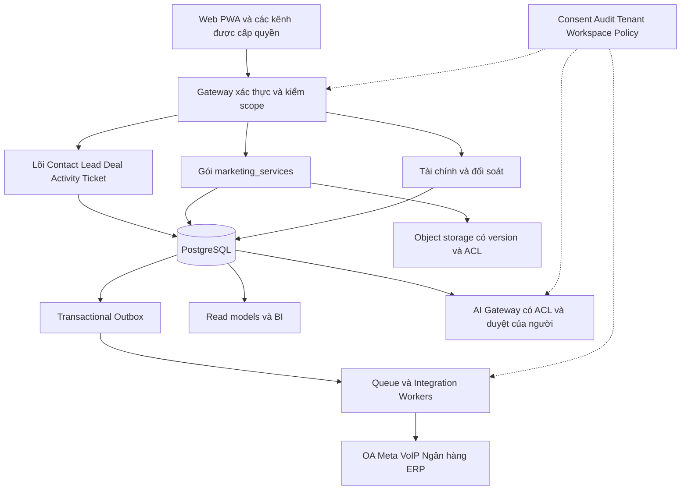
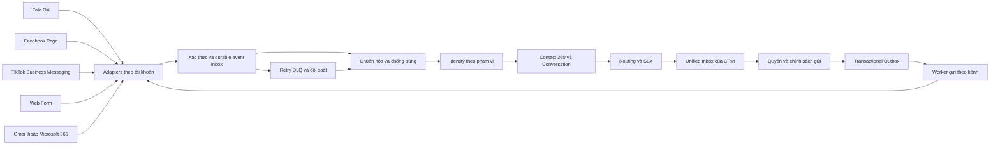
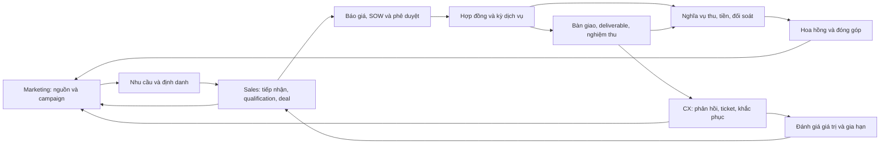
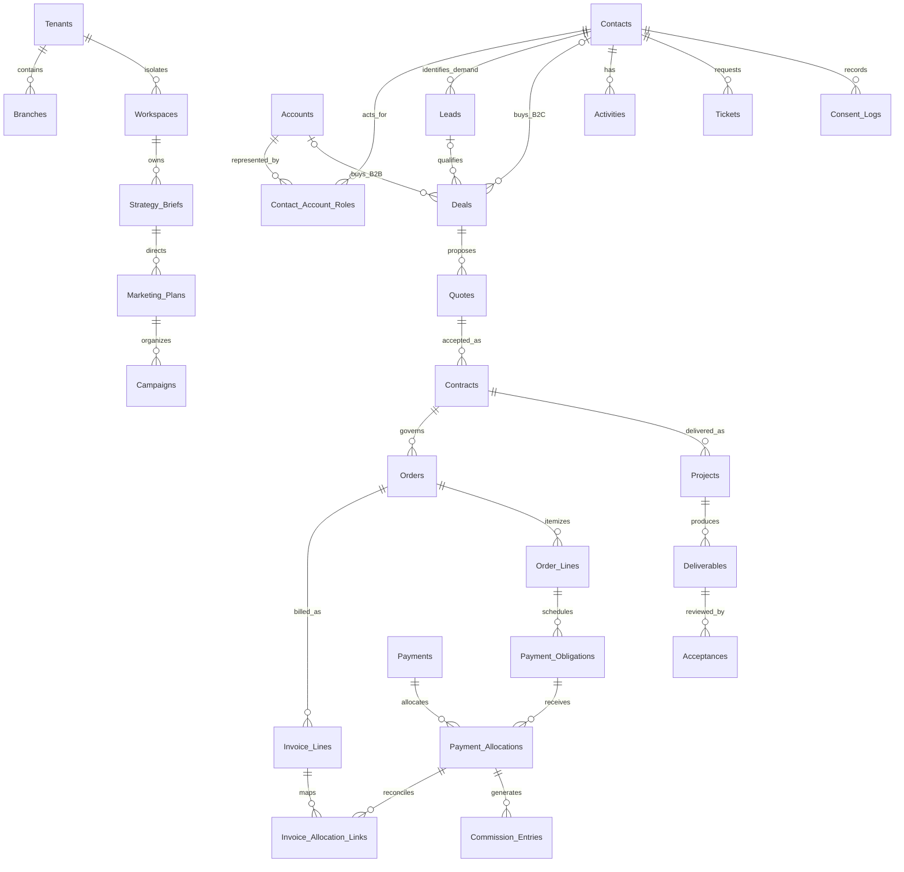

# TÀI LIỆU ĐẶC TẢ NGHIỆP VỤ VÀ KIẾN TRÚC HỆ THỐNG CRM

Dịch vụ marketing B2B và B2C

Master BRD & SRS  
Nền tảng dùng chung và gói nghiệp vụ mở rộng đa ngành

Phiên bản 1.4 — Master chính thức duy nhất, đã thẩm định và hợp nhất phản biện vòng hai  
Ngày 15 tháng 10 năm 2026  
Đơn vị sử dụng: Chủ dự án CRM

Phạm vi thiết kế: vận hành cá nhân ban đầu; mở rộng đến 30 Sales, 10 Marketing, ban giám đốc và 2 chi nhánh. Khối lượng đầu vào khoảng 100 lead và 50 khách hàng mỗi tháng, có khả năng tăng trưởng.

Mục đích: làm cơ sở thống nhất nghiệp vụ, lựa chọn giải pháp, lập backlog phát triển, kiểm thử nghiệm thu và dự toán đầu tư. Các ngưỡng KPI, SLA và chi phí được đề xuất để chủ dự án quyết định trước khi triển khai.

**TỆP MASTER DUY NHẤT HIỆN HÀNH:** `CRM_MASTER_BRD_SRS_HOP_NHAT.md` — phiên bản 1.4. Dùng tệp này để thống nhất yêu cầu, thiết kế, lựa chọn giải pháp và lập nghiệm thu. Nội dung rà soát CEO/CMO/CX đã được tích hợp vào 40 FR, 22 UC, schema, quyền, báo cáo và UAT. Các tài liệu nghiên cứu cũ chỉ là hồ sơ lịch sử trong `docs/archive/research-2026-10-15/`, không phải bản đặc tả song song. Phụ lục F phân tích lợi/hại của bản phản biện HTML mới, quyết định nhận/sửa/bác và phương án triển khai.

**Cách đọc:** Chương 3 nêu chức năng, lý do, chủ trách nhiệm và liên kết; 3.13 quy định các bàn giao xuyên module; Chương 5 là dictionary thống nhất; Chương 9 chứa phạm vi, gate và UAT; Phụ lục E ghi quyết định hợp nhất và nguồn nghiên cứu. Các tham số kinh doanh chưa được cung cấp được ghi tại A.6; điều đó không tạo thêm một bản Master khác. Đây là đặc tả chính thức của dự án, chưa phải chứng nhận phần mềm đã xây/chạy đạt hoặc các giả định ngân sách đã được phê duyệt.

## Kiểm soát tài liệu

| Hạng mục | Quy định |
| --- | --- |
| Chủ sở hữu | Chủ dự án CRM; CEO phê duyệt phạm vi và ngân sách khi triển khai đội ngũ. |
| Người đọc | CEO, quản lý kinh doanh, Marketing, BA, kỹ sư, QA, kế toán và người phụ trách bảo vệ dữ liệu. |
| Mốc dữ liệu | Thông tin do chủ dự án cung cấp trong trao đổi; nguồn công khai được tra cứu ngày 15/10/2026. |
| Trạng thái quyết định | Phiên bản đặc tả chính thức hiện hành. Các quy tắc được xác định trong bản này là baseline thiết kế; tham số SLA/giá/thuế/hoa hồng, sản phẩm và ngân sách còn cần xác nhận theo A.6 trước kích hoạt nghiệp vụ tương ứng. Chưa có biên bản UAT production. |
| Quy ước | P0: bắt buộc cho MVP; P1: sau khi lõi ổn định; P2: chỉ kích hoạt khi có nhu cầu. FR: chức năng; BR: quy tắc; NFR: phi chức năng; UC: luồng; UAT: kiểm thử. |
| Thay đổi | Mỗi thay đổi có mã CR, lý do, chủ sở hữu, tác động dữ liệu/API/chi phí/UAT, người phê duyệt và phiên bản áp dụng. |

**Lịch sử phiên bản:** 1.2 bổ sung Omnichannel và nguồn CRM tham khảo; 1.3 hợp nhất báo cáo phản biện và ba chuyên đề CEO/CMO/CX, xử lý các mâu thuẫn và thu gọn phạm vi pilot. [Quyết định hợp nhất 1.3](#phu-luc-e). Bản 1.2 được lưu lịch sử; mọi chỉnh sửa tiếp theo cập nhật đúng tệp Master này và lịch sử phiên bản.

## Mục lục

Điều hướng đến các chương và phụ lục bên dưới. Bản này hợp nhất nội dung nguồn và bổ sung đặc tả còn thiếu; đánh giá giữ/sửa/hoãn nằm tại Phụ lục A.

- [Chương 1 — Tổng quan chiến lược và mục tiêu dự án](#chuong-1)

- [Chương 2 — Kiến trúc tổng thể và hệ sinh thái tích hợp tại Việt Nam](#chuong-2)

- [Chương 3 — Đặc tả chi tiết các phân hệ nghiệp vụ](#chuong-3)

- [Chương 4 — Use cases và luồng quy trình nghiệp vụ](#chuong-4)

- [Chương 5 — Thiết kế cơ sở dữ liệu và từ điển dữ liệu](#chuong-5)

- [Chương 6 — Phân quyền bảo mật và tuân thủ pháp lý](#chuong-6)

- [Chương 7 — Yêu cầu phi chức năng](#chuong-7)

- [Chương 8 — Hệ thống báo cáo và BI Dashboard](#chuong-8)

- [Chương 9 — Lộ trình 90 ngày quản trị thay đổi và đào tạo](#chuong-9)

- [Chương 10 — Ngân sách đầu tư và hiệu quả đầu tư](#chuong-10)
- [Phụ lục A — Đánh giá tài liệu và lý do](#phu-luc-a)
- [Phụ lục B — Truy vết và mẫu vận hành](#phu-luc-b)
- [Phụ lục C — Nguồn công khai](#phu-luc-c)
- [Phụ lục D — Nghiên cứu CRM và quyết định tích hợp](#phu-luc-d)
- [Phụ lục E — Quyết định hợp nhất 1.3 và nguồn CEO/CMO/CX](#phu-luc-e)
- [Phụ lục F — Thẩm định phản biện vòng hai và quyết định 1.4](#phu-luc-f)

<a id="chuong-1"></a>

## CHƯƠNG 1 TỔNG QUAN CHIẾN LƯỢC VÀ MỤC TIÊU DỰ ÁN

### 1.1 Quyết định định hướng

Xây lõi quản lý quan hệ khách hàng cho agency dịch vụ marketing, ưu tiên quản trị từ lead đến hợp đồng, thực thu, bàn giao và gia hạn. B2B quản lý doanh nghiệp, nhiều người liên hệ và vai trò ra quyết định; B2C quản lý người mua cá nhân. Không ép hai mô hình dùng chung một phễu hoặc một bộ tiêu chí qualification.

Ở giai đoạn cá nhân, một người có thể kiêm nhiều vai trò nhưng vẫn ghi lại hành động theo nghiệp vụ. Khi có đội ngũ, kích hoạt phân quyền và phân tách phê duyệt mà không di chuyển khách hàng sang hệ thống mới. Thiết kế khoảng 45 tài khoản để dự trù 40 người đã nêu cộng quản lý và vai trò hỗ trợ; số 45 là giả định ngân sách, không phải số nhân sự được xác nhận.

Tầm nhìn CEO là đo lợi nhuận và dòng tiền theo khách hàng thay vì chỉ nhìn doanh thu ký hợp đồng. Tầm nhìn CMO là nối nguồn lead, chi phí thu hút và chất lượng doanh thu. Tầm nhìn CTO là lõi ổn định, mở rộng có kiểm soát và không để khách hàng của agency bị lẫn với dữ liệu người tiêu dùng do agency xử lý thay khách hàng. BA quản lý tính nhất quán giữa quy tắc, màn hình, dữ liệu và nghiệm thu.

### 1.2 Phạm vi và giả định cần kiểm chứng

| Mã | Nội dung | Cách xử lý |
| --- | --- | --- |
| A01 | 100 lead/tháng; 50 khách/tháng | Phân biệt khách đang phục vụ, khách mới và khách thanh toán. Không suy ra conversion 50% trước khi xác định cohort. |
| A02 | Cá nhân trước và đội ngũ sau | Pilot 1 người, sau đó 5 Sales và 2 Marketing, cuối cùng mở 2 chi nhánh. |
| A03 | Kênh chưa được chỉ định | Đề xuất website/form, email công ty, Zalo OA, Facebook Page và tổng đài; chưa coi là hệ thống đang dùng. |
| A04 | Dịch vụ chưa có bảng giá | Mô hình hỗ trợ retainer, dự án trọn gói, sản xuất nội dung và phí quản lý quảng cáo. |
| A05 | Chưa có CSKH/kế toán/triển khai | Định nghĩa vai trò nghiệp vụ; CEO chỉ định người kiêm nhiệm trước go-live. |
| A06 | Chưa có ngân sách và biên lợi nhuận | Dùng kịch bản minh họa ở chương 10; không cam kết ROI. |

### 1.3 Bài toán và kết quả mong đợi

Ba ưu tiên đề xuất là tránh bỏ sót lead, bảo toàn lịch sử khách khi thay người phụ trách, và kiểm soát hợp đồng đến thực thu đến gia hạn. Đây là giả thuyết nghiệp vụ cần kiểm chứng qua phỏng vấn; chưa phải các nỗi đau được chủ dự án xác nhận.

| Mã BR | Vấn đề cần kiểm soát | Yêu cầu và bằng chứng |
| --- | --- | --- |
| BR01 | Lead không có người xử lý | Tất cả lead hợp lệ có owner hoặc hàng đợi; cảnh báo quá SLA với timestamp. |
| BR02 | Khách phụ thuộc Sales | Lịch sử thuộc tổ chức; bàn giao owner không xóa hoạt động cũ; nguồn Zalo cá nhân khai báo thủ công. |
| BR03 | Bán sai phạm vi dịch vụ | Báo giá khóa phiên bản, số vòng sửa, đầu ra, điều kiện nghiệm thu và phần không bao gồm. |
| BR04 | Lẫn phí dịch vụ và media budget | Dòng hàng có loại SERVICE, MEDIA_PASS_THROUGH, PRODUCTION; tính hoa hồng theo cơ sở được phê duyệt. |
| BR05 | Gián đoạn tái ký | Nhắc theo ngày quyết định/notice deadline và kỳ hợp đồng; 45/30/15 ngày chỉ là template cấu hình. Gắn success review, health và người chịu trách nhiệm; không áp tự động cho mọi one-off. |
| BR06 | Mở rộng ngành làm hỏng lõi | Gói ngành có namespace, phiên bản schema và workflow riêng; có kiểm thử hồi quy lõi. |

### 1.4 Ma trận KPI

Baseline được thu trong 14 ngày đầu; mục tiêu dưới đây là đề xuất pilot. Nếu mẫu dưới 30 quan sát, hiển thị cả tử số/mẫu số và không xếp hạng nhân viên bằng tỷ lệ đơn lẻ.

| KPI | Công thức | Mục tiêu và chủ sở hữu |
| --- | --- | --- |
| SLA phản hồi đầu | Lead có lần tiếp cận hợp lệ trong hạn / lead đến hạn | ≥95% trong giờ làm việc; quản lý Sales; đo p50/p95 cùng tỷ lệ. |
| Conversion cohort | Lead mới trong tháng trở thành khách trả tiền trong 90 ngày / lead hợp lệ cùng cohort | Đo baseline trước đặt mức tăng; CMO và Sales cùng ký định nghĩa. |
| Win rate | Deal Won / (Won + Lost) theo ngày đóng | Không dùng deal còn mở ở mẫu số; Sales Director chịu trách nhiệm. |
| CAC | Chi phí thu hút phân bổ / số khách mới trả tiền | Tách paid CAC và fully loaded CAC; chưa có dữ liệu thì hiển thị chưa đủ dữ liệu. |
| LTV đóng góp | Tổng doanh thu dịch vụ trừ chi phí trực tiếp trong vòng đời quan sát của cohort / số khách cohort | Không dùng ngân sách quảng cáo thu hộ; chỉ dự báo sau đủ dữ liệu giữ chân. |
| Tái ký | Hợp đồng tái ký / hợp đồng đến hạn đủ điều kiện | Đo theo số và giá trị; nêu rõ loại trừ hợp đồng một lần. |
| DSO | Phải thu bình quân / doanh thu bán chịu kỳ × số ngày kỳ | Kế toán; kèm tuổi nợ 0–30/31–60/61–90/>90 ngày. |
| Sử dụng CRM | Deal hoạt động có owner và next action đúng hạn / tổng deal hoạt động | ≥95% pilot, hướng tới 100%; loại trừ sự cố đã ghi nhận. |

### 1.5 Nghiên cứu hành vi và cách kiểm chứng

Với dịch vụ marketing, niềm tin được hình thành qua case study, năng lực thực thi, minh bạch số liệu và phản hồi nhanh. B2B thường cần nhiều người duyệt ngân sách, phạm vi và hợp đồng; B2C thường cần gói dễ hiểu, giá rõ và lịch hẹn thuận tiện. Đây là giả thuyết thiết kế, không phải kết quả khảo sát đại diện người tiêu dùng Việt Nam.

Trong 14 ngày, phỏng vấn 5 khách B2B và 5 khách B2C, rà 20 cuộc trao đổi có quyền sử dụng và 10 deal thắng/thua gần nhất. Ghi kênh đầu tiên, kênh ưu tiên, thời gian ra quyết định, lý do mất, mức tin tưởng và trở ngại thanh toán. Không suy rộng kết quả mẫu nhỏ thành tỷ lệ toàn thị trường.

Kiểm chứng ba thử nghiệm: form ngắn so với form đầy đủ; phản hồi 15 phút so với baseline; báo giá có lộ trình và tiêu chí nghiệm thu so với mẫu cũ. Chia ngẫu nhiên khi khả thi, giữ nguyên định nghĩa khách mới, không hứa mức tăng doanh số trước khi đo.

### 1.6 Ranh giới sản phẩm

MVP đi hết hành trình: hồ sơ → nhu cầu → deal → brief/báo giá/SOW → hợp đồng/kỳ thu → tiền/đối soát → bàn giao → đầu ra/nghiệm thu → ticket/khắc phục → gia hạn phù hợp. Một nguồn lead và một kênh giao tiếp trước. Có thể nhập và đối soát tài chính thủ công có kiểm soát; không bắt tự động hóa hết để đảm bảo đúng dữ liệu.

P0 giữ quyền/scope, source/consent, next action, revision/approval, tiền/phân bổ, evidence, recovery cơ bản, báo cáo ít chỉ số và backup/restore. P1 theo nhu cầu gồm tích hợp kế toán/PMS/calendar, spend/capacity, referral, health/NPS và một vòng phản hồi CRM→Meta. P2 gồm loyalty/Mini App, strategy editor đầy đủ, experiment engine, multi-touch, predictive scoring, scorecard nhân sự và AI tự hành.

Mỗi FR bên dưới có lý do, liên kết và điều kiện mở. Feature ở P1/P2 vẫn có trong thiết kế đích đến nhưng không được tính vào cam kết MVP/90 ngày. Chọn giải pháp cấu hình hoặc hybrid nhẹ trước khi tự xây toàn bộ; ngân sách và PoC quyết định nền tảng theo Chương 10.

<a id="chuong-2"></a>

## CHƯƠNG 2 KIẾN TRÚC TỔNG THỂ VÀ HỆ SINH THÁI TÍCH HỢP TẠI VIỆT NAM

### 2.1 Kiến trúc triển khai ban đầu

Đề xuất ứng dụng web responsive/PWA, backend modular monolith và PostgreSQL managed; worker bất đồng bộ xử lý webhook, lịch nhắc và tác vụ tích hợp. Dùng object storage cho hợp đồng và ghi âm, hàng đợi bền vững cho sự kiện. Chưa cần Kafka, Kubernetes hoặc lakehouse với 100 lead/tháng. Backup, quyền truy cập và tính đúng đắn tài chính cần có ngay dù lưu lượng thấp.

Nguồn sự thật phân theo miền: CRM sở hữu lead/deal/hoạt động; ERP sở hữu chứng từ kế toán và công nợ đã hạch toán; ngân hàng/provider sở hữu giao dịch thanh toán xác thực; hệ thống quản lý dự án sở hữu tác vụ giao hàng nếu đã tích hợp. Kho BI là bản chiếu phân tích, không thay thế sổ nghiệp vụ giao dịch.

### 2.2 Sơ đồ kiến trúc và ranh giới microservices

Sơ đồ dưới thể hiện hướng luồng dữ liệu. Các khối nghiệp vụ có thể cùng chạy trong một backend khi pilot; ranh giới API và sự kiện được giữ để tách dịch vụ khi tăng tải.



Hình 1. Kiến trúc logic; Marketing Services Pack là gói nghiệp vụ agency, không sở hữu hồ sơ khách hàng độc lập.

| Miền | Trách nhiệm | Điều kiện tách dịch vụ |
| --- | --- | --- |
| Identity và Consent | Định danh, policy, chứng cứ đồng ý | Dùng chung nhiều sản phẩm, cần vòng phát hành riêng. |
| Lead và Sales | Owner, pipeline, báo giá | Nhóm phát triển riêng và yêu cầu scale độc lập đã đo được. |
| Integration | Token, webhook, retry, mapping | Ưu tiên tách worker sớm để lỗi đối tác không chặn giao diện. |
| Finance | Phân bổ thanh toán, ledger hoa hồng | Cần kiểm soát giao dịch độc lập; giữ một owner ghi sổ. |
| AI Gateway | Redaction, model routing, quota | Không cho mô hình gọi SQL hoặc API tùy ý. |

### 2.3 Lõi dùng chung và gói ngành

`tenant_id` cô lập tổ chức; `workspace_id` phân phạm vi AGENCY/CLIENT; `branch_id` phân trách nhiệm vận hành; `legal_entity_id` xác định pháp nhân ký/hạch toán/nhận tiền. Bốn khái niệm này không thay nhau. Mỗi tenant có workspace AGENCY ngay từ pilot; workspace CLIENT chỉ xử lý dữ liệu theo phạm vi khách ủy quyền, không tự chuyển người tiêu dùng thành khách bán dịch vụ của agency.

Dữ liệu scoped dùng `workspace_id NOT NULL`. Danh mục cấp tenant được khai báo riêng. Hồ sơ Account mua dịch vụ của agency, hợp đồng và tài chính nội bộ thường thuộc AGENCY workspace; dữ liệu delivery/người tiêu dùng của khách có thể thuộc CLIENT workspace. Liên kết qua scope chỉ qua quan hệ được khai báo và kiểm quyền, không tự cấp quyền đọc toàn bộ hợp đồng/commission. Một pháp nhân/chi nhánh mặc định đủ cho pilot khi thực tế chỉ có một; không xây multi-company engine nếu chưa cần.

Core gồm Contact, Account, Lead, Deal, Activity, Ticket, Consent và Audit. Gói marketing_services bổ sung Brief, SOW, Deliverable, Acceptance, Retainer và CampaignAsset. Ngành bán lẻ bổ sung SKU/Inventory/Return; nha khoa bổ sung lịch điều trị và hồ sơ chuyên ngành với kiểm soát riêng. Không thêm hàng trăm cột tùy chọn vào Contacts cho tất cả ngành.

| Thành phần mở rộng | Cơ chế | Điều kiện an toàn |
| --- | --- | --- |
| Custom fields | field_definition theo tenant + entity + namespace | Kiểu dữ liệu, giới hạn, dữ liệu nhạy cảm, kiểm tra server; index chỉ trường được duyệt. |
| Workflow | Định nghĩa có version, trạng thái và transition | Instance cũ giữ version cũ; chuyển phiên bản bằng migration có kiểm thử. |
| Industry pack | Manifest tên, version, dependencies, migrations | Namespace marketing.*, retail.*; không được ghi trực tiếp bảng của pack khác. |
| Feature flag | Theo tenant và vai trò | Tắt tính năng không xóa dữ liệu; API vẫn kiểm quyền. |
| Khách nhiều ngành | Contact có liên kết business_line | Chia sẻ theo mục đích và quyền; không tự chia sẻ consent marketing giữa các ngành. |

Ví dụ thêm ngành giáo dục: đăng ký education.v1, thêm enrollment và course, tạo pipeline tư vấn riêng. Bản ghi Contact vẫn dùng core nhưng enrollment FK có tenant_id; không thay enum stage của pipeline marketing đang chạy. Bộ kiểm thử phải chứng minh một sales giáo dục không thấy SOW của agency nếu chưa được cấp quyền.

### 2.4 Danh mục tích hợp đề xuất

| Hệ thống | Vai trò và dữ liệu | Giai đoạn và điều kiện |
| --- | --- | --- |
| Website/form + email công ty | Thu lead có UTM, consent và nguồn; gửi thư báo giá | P0; chống spam, email domain được cấu hình, mailbox quyền công ty. |
| Zalo OA và ZBS Template Message | Inbox, nhắc lịch, thông báo giao dịch theo mẫu hợp lệ | P0/P1; OA, App, quyền và ngân sách phải được kiểm tra. Tài liệu 2026 dùng ZBS Account [S03](#s03). |
| Zalo Mini App | Đặt lịch, xem tiến độ, điểm và giới thiệu | P2; chỉ xây sau khi chứng minh khách sẽ sử dụng. Không mặc định được lấy số điện thoại. |
| Zalo cá nhân | Nguồn khách do Sales khai báo; chuyển tương tác sang kênh công ty | Không cam kết đọc đồng loạt chat cá nhân. Tích hợp không chính thức không nằm trong baseline. |
| Facebook Page và Lead Ads | Form lead, hội thoại và campaign ID | P1; app review, scope, token và chính sách gửi tin phải được xác minh theo API hiện hành. |
| TikTok Shop và Shopee | Đơn/sản phẩm của khách thuê agency khi có ủy quyền | P2, pack thương mại điện tử riêng; không trộn GMV của khách với doanh thu agency [S07](#s07), [S08](#s08). |
| Stringee hoặc OmiCall | Click-to-call, call ID, trạng thái, ghi âm | P1; chọn qua PoC về webhook, masking, chất lượng và chi phí; không mua cả hai mặc định. |
| Ngân hàng hoặc provider được cấp quyền | Giao dịch nhận tiền, mã đối soát | P0 nhập sao kê có kiểm soát; P1 API. VietQR chỉ hỗ trợ khởi tạo chuyển khoản [S04](#s04). |
| MISA AMIS Kế toán + meInvoice | Khách hàng, hóa đơn, chứng từ và trạng thái công nợ | P1; kiểm đúng API từng sản phẩm, không dùng tài liệu AMIS CRM thay cho kế toán [S05](#s05), [S06](#s06). |
| Công cụ quản lý dự án hiện có | Dự án, milestone, người phụ trách và nghiệm thu | P1; CRM giữ liên kết và trạng thái cần cho chăm sóc, không nhân đôi toàn bộ quản lý task. |
| GHN/GHTK | Giao POSM, quà hoặc vật phẩm | P2 chỉ khi có giao vận thực; không bắt buộc cho dịch vụ số. |

### 2.5 Hợp đồng kỹ thuật tích hợp

Webhook phải xác minh chữ ký theo nhà cung cấp, kiểm timestamp/replay khi được hỗ trợ, ghi durable inbox trước khi trả 2xx. Khóa chống trùng là tenant + connector + external_event_id. Nếu đối tác không cung cấp ID ổn định, tạo hash có tài liệu và kiểm rủi ro va chạm; không dùng riêng thời điểm nhận làm khóa.

Sau commit nghiệp vụ, transactional outbox phát event. Consumer xử lý ít nhất một lần nhưng tác động nghiệp vụ chỉ một lần bằng unique key và transaction. Retry lỗi tạm thời với backoff 1/5/15/60 phút có jitter; lỗi quyền hoặc schema vào hàng đợi xử lý. Không retry mù POST thu tiền, phát hóa đơn hoặc gửi tin có phí khi chưa biết kết quả.

Event nội bộ gồm event_id, tenant_id, aggregate_type, aggregate_id, aggregate_version, occurred_at UTC, schema_version, correlation_id và payload tối thiểu. Không đưa mật khẩu, access token hoặc toàn bộ nội dung chat vào log. Sự kiện đến muộn không được làm trạng thái Paid quay về Pending.

| API nội bộ mẫu | Kiểm tra bắt buộc | Kết quả và lỗi |
| --- | --- | --- |
| POST /v1/leads | Tenant từ token, nguồn, contact method, consent purpose | 201 hoặc trả kết quả cũ theo Idempotency-Key; 422 dữ liệu sai. |
| POST /v1/leads/{id}/claim | RBAC, hàng đợi, capacity, expected_version | 200 một owner; 409 khi người khác đã nhận. |
| POST /v1/quotes/{id}/approve | Quyền, giá, biên lợi nhuận, version | 200 khóa snapshot; 403 nếu tự duyệt ngoài hạn mức. |
| POST /v1/payments/{id}/allocate | Quyền allocate, confirmed payment và nghĩa vụ thu hợp lệ; tenant/workspace/legal entity/currency/party, số dư và expected_version; invoice không là tiền điều kiện | Transaction atomic; 409 khi balance/version thay đổi, 403 trái quyền; invoice mapping là nghiệp vụ riêng. |
| POST /v1/consents/revoke | Xác thực chủ thể phù hợp, purpose và channel | Ghi event rồi chặn gửi; 202 nếu còn tác vụ lan truyền. |

### 2.6 Quản trị credential và lỗi đối tác

Token giữ trong secret manager, mỗi tenant và connector có scope tối thiểu; UI chỉ hiện trạng thái kết nối. Refresh token đồng bộ bằng lock để tránh nhiều worker ghi đè. Khi token hết hạn, connector chuyển Degraded, báo người phụ trách, lưu hàng đợi và cho phép nhập thủ công với provenance. Theo dõi quota, thời gian hết hạn, lỗi 401/403/429, backlog, duplicate và reconciliation mismatch.

### 2.7 Kiến trúc Omnichannel hợp nhất năm kênh

**Quyết định bổ sung ngày 15/10/2026:** CRM là điểm làm việc và hồ sơ nghiệp vụ thống nhất cho Zalo, Facebook, TikTok, Web Form và Email. “Toàn bộ” có nghĩa là toàn bộ dữ liệu thuộc phạm vi tài khoản doanh nghiệp được ủy quyền, được API cho phép và được chính sách lưu giữ cho phép. Không cam kết lấy lịch sử vô hạn, tin nhắn tài khoản cá nhân hoặc dữ liệu nền tảng chưa cấp quyền. Mỗi connector phải công bố khoảng lịch sử đồng bộ, thời điểm cập nhật cuối và phần dữ liệu còn thiếu.

Một Contact có thể có nhiều danh tính kênh, nhiều cuộc hội thoại và nhiều vai trò tại các Account. Hợp nhất hồ sơ không có nghĩa trộn các luồng chat thành một thread hoặc công khai nội dung cho mọi nhân viên. CRM quản lý Contact, Account, Lead, Deal, quyền và consent; nền tảng kênh vẫn là nguồn xác nhận việc tiếp nhận/phát tin. Nếu dùng Chatwoot, chỉ chọn một hệ thống làm chủ trạng thái hội thoại, không cho hai bộ router cùng phân công.



#### Ma trận khả năng và điều kiện kết nối

| Kênh | Dữ liệu đưa vào | Gửi từ CRM | Điều kiện và giới hạn phải kiểm chứng trước cam kết |
| --- | --- | --- | --- |
| Zalo OA | Sự kiện/tin nhắn OA được API cấp; UID trong phạm vi OA; metadata được phép | Qua OA API hoặc template phù hợp sản phẩm/chính sách hiện hành | OA, app và quyền hợp lệ; kiểm tra hạn mức, cửa sổ gửi, loại nội dung, lịch sử, sự kiện thu hồi. Zalo cá nhân không được coi là OA API [R10](#r10) |
| Facebook | Page Messenger; Lead Ads là feed riêng nếu được cấp; comment là loại tương tác riêng | Page Messenger qua quyền và điều kiện gửi tương ứng | Quyền Page/app review, token, webhook; định danh có phạm vi Page. Lead Ads không tự tạo quyền nhắn Messenger; ngoài cửa sổ phải có cơ chế hợp lệ [R11](#r11) |
| TikTok | DM qua Business Messaging API cho Business Account được ủy quyền; Lead Gen và Shop qua connector khác | Chỉ khi account/app thực sự được cấp quyền messaging | API chính thức có tồn tại; chưa xác nhận tài khoản này đủ điều kiện tại Việt Nam. Không lấy API Shop thay cho DM, không suy luận Ads account có quyền inbox [R12](#r12) |
| Web Form | Submission, trường khách tự khai, consent version, UTM/referrer được phép | Form không phải kênh chat hai chiều; tạo task hoặc trả lời bằng email/kênh đã xác minh | Chống spam, kiểm tra server, submission ID; email nhập tay chưa phải email đã xác minh; không tự thêm vào marketing audience |
| Email | Mailbox doanh nghiệp được cấp quyền; thư, thread, attachment theo phạm vi cấu hình | Gmail API/Graph hoặc SMTP OAuth được phê duyệt | Watch/subscription phải gia hạn; webhook có thể chỉ chứa thông báo thay đổi, cần fetch nội dung; shared mailbox cần quyền thích hợp [R13](#r13)[R14](#r14) |

Zalo cá nhân: quy trình chuyển sang OA bằng liên kết/QR, ghi nhận hoạt động thủ công có nguồn và consent; nếu đánh giá nhà cung cấp bridge phải kiểm chứng quyền chính thức và điều khoản, không dùng cookie/session cá nhân như nền móng hệ thống. Với TikTok chưa được duyệt, nhân viên xử lý trong giao diện chính thức, CRM ghi task và đường dẫn tham chiếu; hiển thị “chưa kết nối hai chiều”. Không dùng fallback để giả lập trạng thái đã gửi.

#### Hợp đồng adapter và vòng đời kết nối

Mỗi adapter công bố `capabilities`: receive, send, attachments, delivery_receipt, read_receipt, history_backfill, edit, delete, native_reply_echo. Trạng thái từng capability là `verified`, `unsupported`, `pending_approval` hoặc `unknown`, kèm ngày test, phiên bản API và tài khoản thử. UI dựa trên capability thực tế; không hiện nút reply cho connector chỉ nhận lead.

Lifecycle: `pending_authorization → active → degraded → reauthorization_required → disconnected`. Khi token hết hạn, dừng gửi và cảnh báo người phụ trách; giữ hàng đợi có TTL. Sau cấp quyền lại, kiểm tra lại policy tại thời điểm gửi; không xả hàng loạt tin marketing đã hết hiệu lực. Thu hồi tài khoản không tự xóa dữ liệu cần lưu hợp pháp, nhưng chặn truy cập mới ngay.

Inbound: xác minh theo cơ chế nhà cung cấp, giới hạn kích thước, ghi event bền vững rồi mới ACK trong timeout của kênh. Nếu ghi thất bại, trả lỗi để retry; không ACK trước lưu. Worker parse, chuẩn hóa, deduplicate, resolve identity, cập nhật conversation và tạo routing event trong transaction. Event chứa `tenant_id`, `workspace_id`, `connection_id`, `provider_event_id`, `provider_message_id`, `occurred_at`, `received_at`, `schema_version`, `correlation_id`, `payload_ref`. Tenant/workspace lấy từ connection được xác thực, không tin giá trị do payload khách gửi.

Outbound: lưu ý định gửi và outbox trong cùng transaction; worker kiểm tra quyền, consent/purpose, loại tin, cửa sổ gửi và hạn mức. Mỗi ý định có `client_request_id` duy nhất. Provider nhận thành công mới ghi `provider_message_id`; trạng thái `accepted` không tương đương `delivered` hay `read`. Nếu timeout sau khi provider có thể đã nhận, chuyển `unknown_outcome`; tra cứu/đối soát nếu API hỗ trợ, không retry mù. Không tuyên bố exactly-once xuyên nền tảng; mục tiêu là at-least-once inbound với xử lý idempotent và kiểm soát gửi trùng outbound.

Retry có exponential backoff, jitter, tôn trọng Retry-After, giới hạn tổng thời gian; lỗi quyền/policy không retry như lỗi mạng. DLQ có mã lỗi đã làm sạch, owner, lần thử, nút replay có quyền và audit. Backfill dùng cursor/checkpoint, cùng pipeline chống trùng với realtime, không kích hoạt chiến dịch hoặc SLA mới cho dữ liệu lịch sử. Gmail cần watch renewal và history sync; Microsoft cần quản lý subscription lifecycle. Chi tiết thời hạn lấy từ tài liệu/version đang triển khai, không hardcode chung cho mọi kênh.

### 2.8 Tổ chức code và gói ngành sau đối chiếu CRM tham khảo

Đây là **thiết kế đề xuất của dự án**, không phải cây thư mục được sao chép nguyên trạng từ một CRM. Các bằng chứng ở phụ lục D giải thích vì sao chọn module extension, API/worker riêng và mô hình quan hệ có vai trò.

```text
apps/
  web/                         # Unified Inbox, CRM, quản trị
  api/                         # HTTP, auth, composition root
  worker/                      # inbox/outbox, sync, SLA, jobs
packages/
  domains/
    identity/                  # Contact, identity links, merge review
    sales/                     # Lead, Deal, Quote
    conversations/             # Inbox, Conversation, Message, assignment
    service/                   # Ticket, SLA
    finance/                   # Payment allocation, commission ledger
  contracts/                   # OpenAPI, event schemas, typed clients
  policy/                      # RBAC/ABAC, consent, send eligibility
  connectors/
    zalo-oa/ facebook/ tiktok-business/ web-form/ email/
  industry-packs/
    marketing-services/        # Brief, SOW, deliverables, acceptance
  ui/                          # Thành phần hiển thị dùng chung
  observability/               # Trace, metrics, log redaction
db/migrations/                 # Lịch sử migration theo thứ tự toàn hệ thống
tests/contract/                # Fixtures đã khử dữ liệu cá nhân
tests/integration/             # DB, transaction, webhook replay
tests/e2e/                     # Quyền, gửi tin, UAT trọng yếu
docs/adr/                      # Quyết định và lý do thay đổi
deploy/                        # IaC, runbooks, backup/restore
```

Module có `domain`, `application`, `ports`, `adapters` khi độ phức tạp cần; không ép mọi CRUD nhỏ thành hàng chục lớp. Chỉ import API công khai của domain; CI cấm import vòng và truy cập repository nội bộ domain khác. Domain không gọi trực tiếp SDK Zalo/Meta. Adapter chuyển dữ liệu ngoài thành command/event đã kiểm tra; thư viện `contracts` không chứa nghiệp vụ hay khóa truy cập. Không có thư mục `utils` khổng lồ chứa cả pricing, routing và quyền.

Stack tham chiếu nếu tự xây: TypeScript, React cho web, NestJS cho API, PostgreSQL cho giao dịch, queue worker cho việc nền, object storage cho tệp. Đây là lựa chọn để giảm số ngôn ngữ trong đội, không là kết luận benchmark. Redis/BullMQ chỉ thêm khi cần queue/rate limit và có vận hành; có thể khởi đầu bằng PostgreSQL job queue đáng tin cậy. Không đưa Kafka, Kubernetes, ClickHouse, vector DB hoặc microfrontend vào MVP chỉ vì dự án tham khảo có chúng. AI gateway là adapter; model/version và quyền tool thay đổi độc lập core.

Manifest gói ngành gồm `pack_key`, `version`, `requires_core`, `dependencies`, `owned_entities`, `permissions`, `event_subscriptions`, `migration_ids`, `feature_flags`. Namespace ví dụ `marketing_services.sow`; không cho hai pack cùng sở hữu một field core. Cài pack cần kiểm tra dependency và migration trên bản sao dữ liệu; conflict phải chặn build, không âm thầm “pack nạp sau thắng”. Gỡ pack mặc định vô hiệu chức năng, không DROP dữ liệu. Đây là biện pháp bổ sung vì cơ chế override theo thứ tự của EspoCRM hữu dụng nhưng nếu lạm dụng có thể che thay đổi của pack khác [R02](#r02).

Pipeline phát hành: lint/typecheck → boundary checks → unit domain trọng yếu → migration/integration → connector contract tests → E2E quyền và gửi tin → dependency/license scan → staging → canary → production. Mỗi release ghi commit và schema version. Migration theo expand/migrate/contract; rollback ứng dụng không đồng nghĩa rollback dữ liệu. Chỉ tách service khi có bằng chứng bottleneck, nhu cầu cô lập hoặc ownership riêng, có ADR và số đo trước/sau.

<a id="chuong-3"></a>

## CHƯƠNG 3 ĐẶC TẢ CHI TIẾT CÁC PHÂN HỆ NGHIỆP VỤ

### 3.1 CDP và hồ sơ khách hàng 360 độ

#### 3.1.1 FR01 Hồ sơ và định danh

**Mục đích và trách nhiệm:** FR01 Hồ sơ — Sales Ops/AM. Giữ quan hệ xuyên nhân viên và nhiều hợp đồng; tránh khách phải nhắc lại.

**Liên kết đầu vào → đầu ra:** Connector/form → Contact/Account/roles → Lead/Deal/Ticket/Project.

**Nghiệm thu và giai đoạn:** Một người đại diện hai công ty, quyền và lịch sử không lẫn; P0.

Hồ sơ hiển thị thông tin pháp nhân/cá nhân, người phụ trách, chi nhánh, nguồn, consent, timeline, deal, hợp đồng, dự án, ticket và công nợ. Người dùng chỉ xem các trường và đối tượng được cấp quyền. B2B có quan hệ contact_account_roles gồm vai trò quyết định, người dùng, tài chính và người ảnh hưởng, ngày hiệu lực và ngày kết thúc.

Chuẩn hóa số điện thoại về E.164 khi xác định được quốc gia; giữ bản gốc và không tự suy quốc gia cho số mơ hồ. Email trim và chuẩn hóa domain; không tự xóa dấu chấm hoặc phần + vì quy tắc khác nhau giữa nhà cung cấp. Tên tiếng Việt giữ dấu; bản không dấu chỉ phục vụ tìm kiếm. Mã số thuế và pháp nhân cần phân biệt trụ sở, chi nhánh và người liên hệ.

#### 3.1.2 FR02 Identity resolution và merge

**Mục đích và trách nhiệm:** FR02 Identity/merge — Steward. Tránh gọi trùng nhưng không gộp sai người và consent.

**Liên kết đầu vào → đầu ra:** Identity/evidence → candidate/merge mapping → timeline/assignment/consent.

**Nghiệm thu và giai đoạn:** Unmerge sau tin mới/revoke không gửi sai; chứng từ đã chốt không tự chuyển chủ; P0 phần chống trùng.

Ưu tiên mapping external_id đã xác thực theo tenant + channel + channel_account_id. Số điện thoại/email đã xác thực là bằng chứng mạnh nhưng có thể dùng chung hoặc tái cấp; không auto merge khi có xung đột người. Tên giống, địa chỉ giống hoặc cùng công ty chỉ tạo ứng viên. Chỉ auto-link khi định danh đã được xác minh và không có mâu thuẫn; trường hợp khác vào hàng đợi steward.

Merge giữ survivor_id, alias cũ, lý do, chứng cứ, người duyệt, snapshot và danh sách bản ghi liên quan. Trường verified thắng unverified; dữ liệu mới hơn chỉ thắng khi nguồn đủ tin cậy. Không cộng gộp consent thành quyền rộng hơn. Không merge qua tenant hoặc client_workspace; cần chia sẻ hợp lệ bằng quy trình riêng.

Unmerge dùng mapping/provenance trước và sau merge; tự tách phần đủ bằng chứng, steward xét phần mơ hồ. Chứng từ đã ký/chốt không tự đổi chủ thể theo Contact. Không hứa đảo ngược mọi tác động tự động như tin đã gửi. UAT FR02: hai người dùng chung số tổng đài phải tồn tại riêng; một webhook trùng không tạo contact mới.

#### 3.1.3 FR03 Phân nhóm RFM

**Mục đích và trách nhiệm:** FR03 RFM — CMO/AM. Phân nhóm để ưu tiên chăm sóc; chỉ có ích khi phù hợp nhịp mua.

**Liên kết đầu vào → đầu ra:** Kỳ dịch vụ, phí, payment → segmentation → journey/account review.

**Nghiệm thu và giai đoạn:** Hai khách cùng retainer nhưng lịch trả khác không bị xếp hạng máy móc; P1.

RFM là lát cắt giao dịch, không thay health. Giữ `payment_recency`, số kỳ dịch vụ/mua và service cash sau refund; loại VAT/media theo policy. Frequency không tăng thành ba lần mua khi một nghĩa vụ trả ba đợt. B2B tính theo Account, B2C theo Contact trong đúng scope.

Khách trả trước năm vẫn đang được phục vụ không bị đánh ngủ đông chỉ vì lâu không có khoản thu. Phân nhóm hành động ưu tiên hợp đồng/kỳ dịch vụ đang hiệu lực, engagement, delivery, overdue và ticket. Nhãn Khách mới/Giá trị cao/Có rủi ro/Không hoạt động có thể đồng thời tồn tại; mỗi nhãn có reason, window, version, owner và hành động. Ngưỡng được pilot theo mô hình dịch vụ; dữ liệu thiếu là Unknown. Không dùng ngưỡng R≤30/F≥6 chung cho mọi lịch trả.

### 3.2 Quản trị lead và phễu bán hàng

#### 3.2.1 FR04 Hai pipeline có kiểm soát

**Mục đích và trách nhiệm:** FR04 Pipeline — Sales Director. Dự báo và gỡ nghẽn cần cơ hội có trạng thái thật.

**Liên kết đầu vào → đầu ra:** Demand/qualification → Deal/stage history → Quote/forecast.

**Nghiệm thu và giai đoạn:** Không tạo pipeline từ ticket; quay lại giữ lineage/aging; P0.

Lead biểu diễn một nhu cầu/đợt tiếp nhận: New → Assigned → Contacting → Qualified → Converted; các nhánh Nurture, Dormant, Disqualified có lý do và điều kiện thoát. `handover_status` Marketing→Sales tách khỏi trạng thái này: Pending/Accepted/Rejected/Recycled; ghi người giao/nhận, timestamps, policy, reason/evidence. NoCapacity không phải NoFit. MQL/SAL/SQL là milestones có định nghĩa, không ghi đè lifecycle Customer của Contact.

Deal B2B: Discovery → Proposal → Negotiation → Won/Lost; B2C: Offer → Won/Lost theo gói. OnHold có lý do, review date, quy tắc forecast và lịch sử; giữ total age/active time/hold time. Không clone chỉ để làm ngắn sales cycle. Qualified cần đầu mối, nhu cầu và next action; budget/decision maker chưa rõ ghi Unknown. Vai trò ở Account khác thẩm quyền ký/nghiệm thu một hợp đồng.

Nhu cầu mới của khách cũ tạo Lead/Deal mới có lineage; hỗ trợ sau bán tạo Ticket. Cùng nhu cầu thì nối lịch sử hiện hữu, không dùng ngưỡng 14 ngày duy nhất. Kiểm trùng mềm theo buyer/account + service/campaign/nhu cầu và scope; cho phép các deal song song hợp lệ. Conversion idempotent và chỉ link activity/thread thuộc nhu cầu đó; Lost không xóa quote/history.

#### 3.2.2 FR05 Phân lead và SLA thu hồi

**Mục đích và trách nhiệm:** FR05 Routing/SLA — Sales Ops. Không bỏ sót và không hai người giành cùng lead.

**Liên kết đầu vào → đầu ra:** Scope/skill/availability/ownership → assignment + episode → activity/escalation.

**Nghiệm thu và giai đoạn:** Claim cạnh tranh, owner nghỉ ca, busy/NoAnswer và hai nhu cầu cùng contact; P0.

Router lọc tenant/workspace/quyền và phạm vi phục vụ/kỹ năng trước; ưu tiên owner hợp lệ rồi kiểm lịch khả dụng/backup và ngưỡng capacity mềm/cứng. Trùng phone/email hash chỉ cảnh báo nghi trùng, không trao quyền hoặc tự merge. Người trực thay không tự đổi chủ Deal hay quyền hưởng commission. Atomic claim/CAS hoặc row lock, history và outbox cùng transaction.

Tách đồng hồ nhận việc, nỗ lực đầu, phản hồi người thật và kết nối thành công; completion theo đúng nhu cầu/episode. NoAnswer/busy có evidence là attempt theo policy, chưa là kết nối/phản hồi thành công. Không dùng riêng 15 giây đổ chuông để chứng minh đã chăm sóc. Có next action/callback và cơ chế xử lý race khi activity đến muộn hoặc lead đang bị thu hồi.

Business calendar Asia/Ho_Chi_Minh khai báo ca, nghỉ trưa/ngày nghỉ và version; ngoài giờ theo ca tiếp. Ngưỡng pilot theo kênh/intent/nhân sự: kênh có người trực có thể thử phản hồi đầu 15–30 phút, tư vấn B2B chuyên sâu 2–4 giờ làm việc; lead có hẹn theo lịch khách. Đây là giả định cần xác nhận, không cam kết 5/15 phút cho mọi lead. Cảnh báo/thu hồi theo policy; tối đa hai lần chuyển tự động rồi queue quản lý. Chuyển owner không reset nghĩa vụ khách hàng; provider outage có exception/audit, không sửa timestamp gốc.

#### 3.2.3 FR06 Năng suất và chất lượng dữ liệu

**Mục đích và trách nhiệm:** FR06 Năng suất — Sales Manager. Giúp biết việc cần làm và dữ liệu thiếu; giảm báo cáo ngoài.

**Liên kết đầu vào → đầu ra:** Activity/next action/stage → Today/data quality → coaching.

**Nghiệm thu và giai đoạn:** Người dùng hoàn tất tác vụ đại diện, ghi thời gian/khó khăn; overdue phân nguyên nhân; P0.

100 lead/tháng chia 30 Sales chỉ khoảng 3,3 lead/người nếu phân đều, nên không mở cả 30 người nhận inbound ngay. Pilot pool 5 người, phân theo capacity và giữ nhóm chuyên ngành; tính toán capacity từ thời gian xử lý thật. Không dùng số lượng thao tác làm KPI duy nhất vì dễ khuyến khích ghi hoạt động rỗng.

### 3.3 Omnichannel Inbox và Zalo tập trung

#### 3.3.1 FR07 Hội thoại thuộc tổ chức

**Mục đích và trách nhiệm:** FR07 Inbox — CX Ops. Lịch sử thuộc tổ chức, có người trả lời chính và ngữ cảnh.

**Liên kết đầu vào → đầu ra:** Kênh/identity/thread → conversation → lead/ticket/activity.

**Nghiệm thu và giai đoạn:** Private note không outbound; hội thoại không biến thành khách mới mỗi message; P0 một kênh.

Conversation có channel_account_id, external_thread_id, participants và owner; message có provider_message_id, direction, delivery state và attachment reference. Cho một người trả lời chính trong phiên, có chỉ báo đồng nghiệp đang nhập và chuyển giao có lý do. Gửi tin qua queue để kiểm policy và tránh trùng; trạng thái Accepted khác Delivered và Read.

Thiết kế ưu tiên OA và Page thuộc doanh nghiệp. Khách phát sinh trên Zalo cá nhân được tạo lead, ghi nguồn và xin chuyển sang OA/email/cổng khách khi phù hợp. Không cam kết tự thu hồi lịch sử tài khoản cá nhân, không lấy cookie/session của Sales và không dùng API không chính thức làm điều kiện vận hành cốt lõi.

#### 3.3.2 FR08 Data masking và bàn giao

**Mục đích và trách nhiệm:** FR08 Masking/bàn giao — Privacy + Ops. Dùng dữ liệu đủ cho công việc và thu hồi đúng khi nghỉ việc.

**Liên kết đầu vào → đầu ra:** Assignment/ACL → quyền liên hệ/tệp → handoff + audit.

**Nghiệm thu và giai đoạn:** Sales nghỉ việc không còn phiên/tệp, AM được trao quyền hợp lệ; P0.

API kiểm row/field policy trước khi trả dữ liệu. Người được giao nhiệm vụ liên hệ được xem số/email cần thiết trong thời gian quyền còn hiệu lực, không phải nhập lý do lặp mỗi 5 phút. Người ngoài phạm vi thấy mask/không thấy theo policy; hồ sơ nhạy cảm hoặc break-glass dùng reveal có purpose/lý do/TTL cấu hình và audit. Search, file, BI, export và AI cùng kiểm soát; rate-limit/cảnh báo bổ sung không thay authorization.

Offboarding nhân sự thu hồi login/session/token/grant, bàn giao open lead/deal/ticket, lời hứa cập nhật, draft, scheduled send, approval pending, lịch và automation ownership. Job kiểm lại authority khi chạy; người không có quyền không dùng link/file/cache cũ để đọc tiếp. Giữ actor lịch sử và quyền hưởng hoa hồng theo policy; watermark hỗ trợ truy vết, không cam kết chống chụp ảnh tuyệt đối.

### 3.4 Marketing automation và Loyalty trên Mini App

#### 3.4.1 FR09 Journey engine

**Mục đích và trách nhiệm:** FR09 Journeys — CMO/CX. Follow-up và onboarding có lịch; tránh bỏ sót hoặc nhắc sai khi đang khiếu nại.

**Liên kết đầu vào → đầu ra:** Event, purpose, consent, lifecycle → scheduled action → message/task/outcome.

**Nghiệm thu và giai đoạn:** Revoke khi đang chờ hủy marketing; refund/complaint dừng upsell phù hợp; P0 đơn giản/P1 engine.

Journey definition chứa version, entry event, filter, wait, action, exit và re-entry policy. Trước dispatch phải kiểm consent/purpose/endpoint hiện thời, suppression, kênh, mẫu được duyệt, cap toàn scope và quota và giờ yên lặng 20:00–08:00 theo chính sách nội bộ. Người dùng rút consent trong lúc chờ thì hủy các bước marketing còn lại; thông báo phục vụ hợp đồng được đánh giá theo mục đích riêng.

| Kịch bản | Trigger và nhánh | Thoát và kiểm soát |
| --- | --- | --- |
| Lead tải tài liệu | Opt-in nội dung; gửi tài liệu; sau 2 ngày đề nghị tư vấn nếu còn quyền | Thoát khi đặt lịch, từ chối, hết quyền hoặc đạt 2 tin/7 ngày theo đề xuất. |
| Báo giá chưa phản hồi | Sau 2 ngày làm việc chưa có quyết định | Tạo task Sales; chỉ gửi follow-up khi phù hợp chính sách kênh. |
| Onboarding | Hợp đồng có hiệu lực và đủ điều kiện khởi động | Xin asset, họp kickoff, thông báo thiếu tài liệu; không gửi yêu cầu mật khẩu quảng cáo qua chat. |
| Gia hạn | Mốc review/notice theo hợp đồng; template45/30/15 chỉ khi phù hợp | Nếu ticket nghiêm trọng đang mở, chuyển account manager xử lý trước chào bán. |
| Win-back | 90 ngày không hợp đồng hiệu lực | Kiểm consent và loại trừ khách khiếu nại chưa giải quyết. |

#### 3.4.2 FR10 Loyalty và referral

**Mục đích và trách nhiệm:** FR10 Loyalty/referral — CMO/Finance. Referral có thể tạo nguồn khách; tích điểm chỉ hữu ích khi có hành vi lặp và kinh tế phù hợp.

**Liên kết đầu vào → đầu ra:** Referral + khách đủ điều kiện + thực thu → reward ledger → payout/reversal.

**Nghiệm thu và giai đoạn:** Refund không thưởng lại, referral không cộng trùng hoa hồng sales trái policy; P1 referral/P2 loyalty.

Tách referral khỏi loyalty. Referral có nguồn, referrer, khách mới theo định nghĩa, ngày/điều kiện khóa attribution, dispute và payout. Kiểm tự giới thiệu, trùng pháp nhân, khách đã có, bên liên quan và thưởng trùng với pool sales theo policy. Chỉ thưởng khi đạt điều kiện thực thu/kiểm soát hoàn tiền đã công bố; refund tạo reversal một lần. Marketing attribution không tự tạo quyền nhận thưởng.

Referral nhẹ ở P1 và không phụ thuộc Mini App. Loyalty điểm/hạng, ưu đãi và Mini App ở P2, chỉ bật khi có hành vi mua lặp và business case. Khi bật phải có earn/reserve/redeem/expire/reverse append-only, policy economics, fraud control và consent. Không áp một tỷ lệ điểm/chi tiêu giả định cho mọi agency.

### 3.5 AI Co-Pilot và Agentic CRM

#### 3.5.1 FR11 Tóm tắt cuộc gọi tiếng Việt

**Mục đích và trách nhiệm:** FR11 Call summary — Sales Ops/AI owner. Tiết kiệm ghi chú nếu transcript đúng; sai số tiền/ngày hẹn làm sai cam kết.

**Liên kết đầu vào → đầu ra:** Recording được phép → STT/draft/source timestamp → human-confirmed activity.

**Nghiệm thu và giai đoạn:** Câu phủ định, số tiền, lịch hẹn, người nói và tên riêng; field quan trọng người duyệt; P1.

Ghi âm có cơ sở sử dụng → STT → che dữ liệu không cần thiết → draft nhu cầu/ngân sách/ngày hẹn → người dùng xác nhận. Giữ call_id, model/prompt version, source timestamps và reviewer; không tự ghi dữ liệu thương mại quan trọng từ câu mơ hồ.

Pilot có thể bắt đầu với 60 cuộc được phép dùng, nhiều giọng/nhiễu, nhưng không coi mẫu đó chứng nhận chất lượng tổng quát. Tách tập sửa prompt và tập kiểm; đo exact-match/precision/recall của field quan trọng, omission, unsupported claims và phân biệt người nói. Mục tiêu 95% chỉ có nghĩa trên bộ đo đã định nghĩa; confidence model không tự là xác suất đúng. Số tiền/ngày hẹn cần người xác nhận; không đạt thì chỉ transcript/summary draft. P1 sau lõi.

#### 3.5.2 FR12 Lead scoring và gợi ý hành động

**Mục đích và trách nhiệm:** FR12 Scoring/recommendation — CMO/Sales. Ưu tiên effort khi có nhiều lead; score không thay qualification.

**Liên kết đầu vào → đầu ra:** Fit/intent/coverage/outcome → explainable score → next best action.

**Nghiệm thu và giai đoạn:** Hiển thị lý do, Unknown và override; backtest theo thời gian nếu làm predictive; P1 rule/P2 predictive.

Khởi đầu bằng rule score 0–100: phù hợp dịch vụ 30, nhu cầu rõ 25, ngân sách 20, thời điểm 15, tương tác 10. Thiếu thông tin không đồng nghĩa khách kém; hiển thị coverage và lý do. Không dùng dữ liệu nhạy cảm hoặc đặc điểm không liên quan để chấm điểm. Với 100 lead/tháng, chưa có cơ sở huấn luyện mô hình dự báo đáng tin nếu chưa tích lũy nhãn và outcome đủ đại diện.

AI gợi ý câu hỏi discovery, nhắc phần SOW còn thiếu, đề xuất tài liệu case study có quyền dùng và draft email. RAG chỉ lấy tài liệu đúng tenant, đúng quyền và phiên bản còn hiệu lực; trả kèm nguồn. Khi không có nguồn, phải nêu thiếu thông tin, không tạo số liệu hiệu quả chiến dịch giả.

#### 3.5.3 FR13 Giới hạn agent tự hành

**Mục đích và trách nhiệm:** FR13 AI actions — Product/Privacy. Giới hạn hậu quả của lời gợi ý sai hoặc nội dung độc hại.

**Liên kết đầu vào → đầu ra:** User intent + current ACL + evidence → draft/approved action → tool audit.

**Nghiệm thu và giai đoạn:** Tệp khách chứa lệnh xuất dữ liệu không đổi quyền; đổi recipient sau duyệt bắt duyệt lại; P0 guard/P2 tự hành.

| Hành động | Quyền AI | Bằng chứng nghiệm thu |
| --- | --- | --- |
| Tóm tắt và tạo task nháp | Cho phép trong quyền của người gọi | Có nguồn và không làm mất bản gốc. |
| Chuyển lead theo router cố định | Worker quy tắc làm; AI chỉ gợi ý | Tái chạy không đổi owner trái policy. |
| Gửi email hoặc tin khách | Cần người duyệt ở MVP | Có preview, recipient, nội dung và audit approval. |
| Giảm giá, hợp đồng, hoàn tiền | Không tự phê duyệt | Tool bị từ chối nếu thiếu approval token đúng hành động. |
| Export, xóa khách, đổi quyền | Cấm agent tự thực hiện | Prompt injection trong file khách không mở quyền [S10](#s10). |

Giới hạn ngân sách theo tenant/ngày, timeout 30 giây cho tác vụ đồng bộ, circuit breaker khi lỗi và nút tắt AI. Không đưa khóa API vào prompt. Không cho nội dung chat/tệp khách trở thành chỉ dẫn hệ thống. Kiểm thử injection, rò rỉ chéo tenant và sự cố nhà cung cấp trước khi dùng dữ liệu thật.

### 3.6 Báo giá đơn hàng hợp đồng công nợ và hoa hồng

#### 3.6.1 FR14 Danh mục dịch vụ và báo giá

**Mục đích và trách nhiệm:** FR14 Catalog/quote — Sales + Finance. Chốt giá và lời hứa delivery, tránh bán rẻ/phạm vi mơ hồ.

**Liên kết đầu vào → đầu ra:** Catalog/cost/brief → quote revision + SOW + approval → contract/order.

**Nghiệm thu và giai đoạn:** Sửa lịch thu/số vòng sửa làm xét lại phần approval bị tác động; bản đã duyệt không tự đổi; P0.

Catalog có phiên bản/hiệu lực, đơn vị, gói/phạm vi, loại SERVICE/PRODUCTION/MEDIA_PASS_THROUGH, thuế được kế toán xác nhận, cost estimate và mẫu SOW. Thuế là cấu phần net/tax/gross của dòng, không thay loại dịch vụ. Quote revision giữ price/cost basis, currency, validity, terms, số vòng sửa, đầu ra và phần loại trừ; bản đã gửi/approved bất biến.

Tách preliminary estimate chưa ràng buộc khỏi approved offer. Thiếu cost không mặc định 0/margin 100%; approved offer cần cost hoặc ngoại lệ có quyền. Biên đóng góp = phí dịch vụ thuần − cost trực tiếp theo định nghĩa; tỷ lệ chia cho phí thuần, mẫu số 0 là N/A; ghi rõ trước/sau commission và cost allocation.

Approval theo giá/discount, margin, payment terms, phạm vi, KPI/claim và quyền sở hữu/trách nhiệm. Discount=0 không tự đủ autoapprove. Ngưỡng minh họa 5%/30% chỉ áp sau khi chủ nghiệp vụ chốt; cá nhân self-approval có log, đội ngũ tách người tạo/duyệt ngoại lệ. Đổi field làm mất hiệu lực đúng approval bị tác động; quote expired phải revalidate. Customer acceptance và nội bộ approve là hai mốc riêng.

#### 3.6.2 FR15 Hợp đồng và bàn giao dịch vụ marketing

**Mục đích và trách nhiệm:** FR15 Contract/handoff — AM/Delivery. Không mất lời hứa bán hàng; biết khi nào được bắt đầu và chi tiền.

**Liên kết đầu vào → đầu ra:** Accepted quote + signer + tiền/ngoại lệ + asset access → contract/service period/project.

**Nghiệm thu và giai đoạn:** Tiền đã thu nhưng invoice sync trễ không kẹt giả; cọc chỉ thu một phần chưa tự đủ; P0.

SOW ghi mục tiêu/baseline, deliverable, lịch, quota sửa, tiêu chuẩn nghiệm thu, tài sản/đầu vào khách phải cấp, stakeholder có quyền duyệt, sở hữu và loại trừ. MSA có nhiều SOW/order/project; phụ lục/CR liên kết hợp đồng gốc và version. `document_type` (MSA/CONTRACT/ADDENDUM) khác `service_model` (RETAINER/ONE_OFF).

Won, contract effective, handoff accepted, start authorized, service started, accepted, invoiced và paid là các mốc riêng. Tạo nháp theo SOW/handoff idempotency key, không unique Project chỉ theo contract_id. Kickoff cần hợp đồng hiệu lực, tiền/credit đúng điều khoản, asset/capacity và người nhận xác nhận. Ngoại lệ có người duyệt, hạn, exposure và công việc được làm; cho bắt đầu sáng tạo không tự cho chi media.

Onboarding giữ success plan/sổ cam kết: mục tiêu khách, điều đã hứa, first value, owner, due, communication cadence và evidence. Client-wait ghi interval/reason; lịch dự kiến khác ngày hợp đồng/ngày sự kiện. Quota sửa theo SOW; một vòng là batch feedback; lỗi agency không tự trừ quota đổi ý hoặc ép CR. Acceptance trỏ đúng asset version và approver. Retainer có service periods và notice date; termination chốt khối lượng/nghĩa vụ/công nợ, settlement riêng. Offboarding khách bàn giao tài sản/quyền/records đúng hợp đồng, retention và tranh chấp.

#### 3.6.3 FR16 Đối soát thanh toán

**Mục đích và trách nhiệm:** FR16 Reconciliation — Kế toán. Tiền thật phải truy được về khách/nghĩa vụ, không cộng lặp.

**Liên kết đầu vào → đầu ra:** Bank/provider/statement → confirmed receipt + match/allocation → balances/ERP/commission.

**Nghiệm thu và giai đoạn:** Cùng giao dịch qua API+sao kê, invoice đến muộn, hai worker phân bổ; tổng không sai; P0.

Tiền chỉ xác nhận từ ngân hàng/provider hoặc sao kê đã kiểm tra; QR/ảnh bill là tham khảo. Một giao dịch canonical có nhiều Payment_Evidence từ API/file; unique connector event không đủ chống trùng xuyên nguồn. Hai giao dịch thật cùng số tiền/ngày/nội dung không bị tự loại bằng fingerprint.

Tách verification_state, matching_state, allocation_state và reconciliation_state. Tiền confirmed vẫn có thể unidentified/unallocated. Phân bổ vào Payment_Obligations thuộc kỳ/dòng hợp đồng; Invoice_Allocation_Links đối chiếu invoice ERP khi có, không tạo cash/commission thêm. Giữ legal entity, tài khoản nhận, payer/buyer, currency. Người trả hộ vào case xác minh; không tự chuyển giữa pháp nhân.

Thứ tự phân bổ: điều khoản/kỳ đã duyệt → chỉ định được kế toán xác nhận → fallback policy được duyệt; chưa đủ cơ sở thì pending. Pro-rata không mặc định đúng mọi hợp đồng. Lock payment/obligation, kiểm số dư, insert allocation/outbox cùng transaction. Dư tiền là credit, partial giữ số còn nợ; refund/reversal liên kết phần gốc và kỳ khóa. Write-off, discount, bank fee có chứng từ là các loại khác; write-off không tạo cash-based commission.

Sales được đề xuất match có evidence, Finance duyệt; reconciliation case có owner/hạn/giải thích và đối soát CRM–ERP–bank. Nhắc nợ xét disputed amount/promise-to-pay và trạng thái ticket. Hóa đơn có nghĩa vụ pháp lý theo bản chất dịch vụ; sync ERP chậm không là quyền trì hoãn hóa đơn. Nhãn MEDIA_PASS_THROUGH không tự quyết định thuế/doanh thu.

#### 3.6.4 FR17 Hoa hồng động

**Mục đích và trách nhiệm:** FR17 Commission — Sales + Finance. Minh bạch quyền hưởng, giữ động lực không chi nhầm tiền media/thuế.

**Liên kết đầu vào → đầu ra:** Eligible allocation + policy/share → preview/approval/payout → reversal/period close.

**Nghiệm thu và giai đoạn:** Hoàn một phần, đổi owner sau chốt, nhiều người hưởng và rounding không nhân chi; P0 preview khi có policy.

Base commission = eligible service cash × rate snapshot × share của pool/policy/version. Base loại VAT/media theo chính sách, sau giảm/hoàn; không lấy write-off thành thực thu. Pool hunter/renewal/referral tách và tổng share trong từng pool bằng 1. Policy snapshot truy được; đổi owner/chi nhánh/người trực inbox không đổi quyền hưởng đã chốt.

Preview khác Earned/Approved/Payable/Paid; từng chuyển trạng thái có điều kiện, authority và evidence. Khi tiêu chí chất lượng chưa có, phần liên quan pending; MVP tách base commission và quality bonus/adjustment nếu quy chế cho phép, không mặc định quality_factor=1 để chi. Bút toán số tiền bất biến; workflow status là projection của lịch sử, payout có batch và đối soát riêng.

Ví dụ không thuế: kỳ đã duyệt có 20 triệu service + 80 triệu media, thu 50 triệu và phân bổ pro-rata thì service base 10 triệu, rate5%=pool500.000; share70/30=350.000/150.000. Nếu kỳ đầu chỉ thu media, service base=0. Thiếu policy thì pending. Refund sau payout/kỳ khóa tạo adjustment liên kết, không xóa khoản đã trả hoặc tự khấu trừ ngoài quy chế hợp lệ. Preview mục tiêu ≤60 giây tính từ allocation đủ điều kiện, không từ ảnh bill/QR.

### 3.7 CSKH bảo hành dịch vụ và khiếu nại

#### 3.7.1 FR18 Ticket và SLA

**Mục đích và trách nhiệm:** FR18 Ticket — CX Lead. Khiếu nại/sự cố có trách nhiệm và kế hoạch khắc phục.

**Liên kết đầu vào → đầu ra:** Complaint/incident/entitlement → triage/response/resolution → recovery/learning.

**Nghiệm thu và giai đoạn:** Không đóng tự động P1 chỉ vì khách im lặng; reopen không xóa breach; P0.

Ticket tiếp nhận complaint/incident/question/defect/change và liên kết hợp đồng/project/deliverable qua Business_Subjects và các link typed. Entitlement snapshot lưu scope hỗ trợ, calendar, policy, authority và giới hạn. Luôn có intake khiếu nại; chưa rõ Contact dùng provisional và xác minh, không bỏ sự cố khẩn. Lỗi agency khác đổi scope; quota hết không tự từ chối lỗi.

Severity S1/S2/S3 theo impact×urgency và hợp đồng, khác P0/P1/P2 ưu tiên phát triển. Mẫu cần xác nhận: S1 phản hồi30 phút giờ có trực, giảm thiểu4 giờ; S2 phản hồi4 giờ làm việc, phương án1 ngày; S3 phản hồi1 ngày, lịch3 ngày. Không tự cam kết 24/7 khi không có người trực. Major incident có owner, containment/mitigation, affected assets và nhịp cập nhật.

Một engine SLA theo subject/episode gồm first attempt khi áp dụng, FRT, NRT, resolution và promised update; autoack/private note không dừng human clock, tin khách gửi lại không trượt hạn từ tin chưa đáp đầu. Pause theo clock/calendar/policy, pending_internal không tự pause. Reopen nối case gốc trong khoảng chính sách (mẫu7 ngày), giữ breach và remaining business time; không tự reset, không sửa timestamp lịch sử. WaitingCustomer có nhắc/hạn review, đóng no-response theo severity/điều khoản, không đóng S1 mù hoặc coi là đã xử lý. Đóng thread không tự đóng ticket khác.

#### 3.7.2 FR19 CSAT và NPS

**Mục đích và trách nhiệm:** FR19 Voice of Customer — CX + CMO. Biết trải nghiệm thực và sửa nguyên nhân, không chỉ thu điểm.

**Liên kết đầu vào → đầu ra:** Touchpoint/survey/comment/ticket → feedback + recovery action → verify/root cause.

**Nghiệm thu và giai đoạn:** Điểm thấp có owner/hạn/closure evidence; chống chọn mẫu làm đẹp; P1 survey, P0 recovery.

Thu feedback ở milestone/onboarding/ticket và quan hệ, lưu nguồn/câu hỏi version/role/contact/account. CSAT1–5, tỷ lệ4–5 trên người trả lời; NPS %9–10−%0–6 theo tập đủ trải nghiệm, kỳ90 ngày là cấu hình. CES chỉ thêm ở tương tác có mục tiêu giảm effort; không cộng ba thang thành điểm chung. Báo eligible/sent/delivered/responded và sample, không trả lời khác điểm0.

Survey có unique business effect, recheck consent/channel, cooldown contact/account và arbitration với incident; một close replay không spam, reopen trước gửi xét lại. Không chỉ chọn khách dễ cho điểm cao; B2B ghi vai trò và view account-level tránh account nhiều contact bị nhân trọng số ngầm.

Recovery: detected → triaged → owner accepted → contacted → remedy agreed → remedy done → verified → closed. Có due, evidence, quyền duyệt refund/đền bù, no-contact/refused callback là kết quả riêng; không sửa điểm gốc hoặc ép khách đổi điểm. Root cause theme dẫn corrective action có owner và kiểm tái diễn, nối lại launch checklist, lời hứa Sales, scope và renewal.

### 3.8 Thực địa và chi nhánh

#### 3.8.1 FR20 Lịch hẹn và check-in

**Mục đích và trách nhiệm:** FR20 Appointment/field — Sales/AM. Hẹn đúng người/nguồn lực, giảm no-show và lỡ lịch.

**Liên kết đầu vào → đầu ra:** Availability/request → booking/confirmation → meeting/activity.

**Nghiệm thu và giai đoạn:** Double booking và đổi lịch không để reminder cũ gửi tiếp; P0 lịch/P2 GPS.

Agency ưu tiên lịch discovery, kickoff, quay chụp và nghiệm thu tại khách; tài nguyên gồm nhân sự, phòng họp và ekip. Chặn lịch trùng, lưu timezone, địa điểm, contact, mục đích và trạng thái xác nhận. Check-in GPS chỉ tại thời điểm công việc được cho phép; không theo dõi liên tục ngoài ca. Nếu khách từ chối vị trí hoặc GPS sai, cho nhập lý do và bằng chứng thay thế, quản lý xác nhận.

#### 3.8.2 FR21 Phân quyền hai chi nhánh

**Mục đích và trách nhiệm:** FR21 Branch/team — Ops/Privacy. Bàn giao/phối hợp đúng quyền khi mở rộng.

**Liên kết đầu vào → đầu ra:** Org/team/grants → scope/assignment → reporting/handoff.

**Nghiệm thu và giai đoạn:** Khách shared account, hai branch và thu tiền theo pháp nhân đúng; P0 scope/P1 vận hành hai nhánh.

Scope theo tenant/workspace/branch/legal entity và row/field policy. Tạo branch/pháp nhân mặc định khi thực tế đơn; dữ liệu Contact/Account có thể dùng chung theo grant, Deal/Project/Ticket có phạm vi riêng. Không ép branch NOT NULL cho mọi danh mục/shared record; giao dịch có trách nhiệm chi nhánh thì phải phân nhánh rõ.

Account/Contact/Deal/Project team grants có role, action/field scope, thời hạn và actor. B2C không cần Account giả để chia sẻ. Membership account không tự cho xem mọi CLIENT workspace hay tài chính agency. Deny thắng Allow là policy của dự án, phải PoC nền tảng có role merge khác. Quyền approve độc lập edit; Admin không mặc định đọc nghiệp vụ, CEO không sửa ledger bằng vai quản trị.

Chuyển nhánh bàn giao active work/promises/appointments/tickets, giữ đúng pháp nhân công nợ và commission lịch sử. Mọi đường API/search/count/file/export/AI và background job kiểm quyền hiện tại; break-glass có TTL/audit. Không dùng đổi branch để di chuyển công nợ.

### 3.9 Quản trị chiến lược marketing và IMC

#### 3.9.1 FR22 Chuỗi chiến lược đến thực thi

**Mục đích và trách nhiệm:** FR22 Strategy/IMC — CMO/Strategist. Delivery phải phục vụ mục tiêu đã thống nhất, không chỉ có lịch đăng.

**Liên kết đầu vào → đầu ra:** Business goal/baseline/brief → approved plan/version → scope/campaign/measurement.

**Nghiệm thu và giai đoạn:** Gói thiết kế nhỏ không đi đủ nghiên cứu lớn; goal thay đổi có impact review; P0 brief/P1 full.

CRM giữ chuỗi business goal/baseline → brief/giả thuyết → SOW → approved plan → campaign/deliverable → measurement → learning. Mỗi quyết định có owner, version, nguồn và tiêu chí; phân biệt kết quả cam kết với mục tiêu kỳ vọng. Scope template chọn mức bắt buộc theo gói; logo/job nhỏ không phải đi đủ nghiên cứu chiến lược lớn.

Tài liệu strategy/IMC chi tiết có thể ở Slides/Sheets/Figma; CRM giữ link phiên bản hoặc snapshot/checksum, người duyệt, thời điểm và approved scope. URL thay đổi được đơn lẻ chưa đủ evidence. Không bắt nhập lại toàn bộ message house/content matrix. P0 brief/SOW/goals gọn; editor và schema chiến lược đầy đủ chỉ mở theo nhu cầu P1/P2.

#### 3.9.2 FR23 Điều kiện phê duyệt và launch

**Mục đích và trách nhiệm:** FR23 Launch gates — CMO/AM. Ngăn chạy sai asset, sai ngân sách/quyền/tracking.

**Liên kết đầu vào → đầu ra:** Scope/budget/asset/tracking/account access → go/no-go → launch evidence.

**Nghiệm thu và giai đoạn:** Creative được thay thì approval cũ không dùng; tăng chi vượt quyền bị chặn/escalate; P0 nếu quản campaign.

Campaign chỉ Live khi đạt gate áp dụng của scope template: approved scope, budget owner và funding/credit, asset đúng version, tracking đã test nếu có measurement, quyền tài khoản, lịch và người phụ trách. Người duyệt creative khác quyền tăng chi. Logo không media không đòi tracking pixel.

Approval gắn subject/version/hash, chiều rủi ro, authority, cap/expiry và evidence (email gốc nếu dùng). Dependency map làm mất hiệu lực đúng approval bị ảnh hưởng khi đổi offer/claim/audience/ngân sách/terms. Trong optimization envelope đã duyệt có thể tinh chỉnh và audit không xin lại từng lần; vượt envelope cần duyệt. Emergency pause có quyền/playbook; CRM chặn nút không tự chặn thao tác bên Ads Manager, cần least privilege ngoài kênh và đối soát spend. API chưa hỗ trợ thì tác vụ thủ công/evidence, không giả đã điều khiển được.

#### 3.9.3 FR24 Nghiên cứu thử nghiệm và học hỏi

**Mục đích và trách nhiệm:** FR24 Experiments/learning — CMO. Không kết luận hiệu quả từ dao động nhỏ, giữ lý do quyết định.

**Liên kết đầu vào → đầu ra:** Hypothesis/baseline/design → result/limitations → approved learning.

**Nghiệm thu và giai đoạn:** Chưa đủ mẫu không gán winner; bài học khách A không chia sẻ trái quyền cho B; P1 mẫu/P2 engine.

Giữ nhật ký hypothesis, biến/đơn vị thử, population, KPI/guardrail, baseline, window, budget, stop rule và decision evidence. Khi định lượng cần thiết kế sample/contamination/time horizon thích hợp, không đổi chỉ số sau khi thấy kết quả. 100 lead agency ít không suy mọi campaign khách cũng ít mẫu; thiếu mẫu ghi chưa kết luận, không ép winner.

Learning có source, owner, confidence/limitations, ngày áp dụng và scope quyền. Root cause từ CX nối cải tiến checklist/strategy; không sao creative/data khách A sang B trái quyền. P0/P1 mẫu và decision log nhẹ; experiment orchestration nâng cao P2.

### 3.10 Quản trị chiến dịch công việc và nguồn lực

#### 3.10.1 FR25 Task và capacity

**Mục đích và trách nhiệm:** FR25 Tasks/capacity — Delivery Lead. Không nhận vượt nguồn lực và không quên dependency.

**Liên kết đầu vào → đầu ra:** SOW/milestone/availability → planned work → actual effort/acceptance.

**Nghiệm thu và giai đoạn:** Đổi scope cập nhật tải; tránh hai nơi cùng sửa task; nghỉ phép không bị tính thiếu năng suất; P0 milestone/P1 capacity.

P0 quản milestone/deliverable, owner/reviewer, due, QA, acceptance và dependency thiết yếu. Task nội bộ khác đầu ra khách mua. Chọn PMS hoặc CRM module làm nguồn ghi task duy nhất; đồng bộ external ID/version/status, không hai master ghi đè.

Capacity có skill/calendar/availability, soft reservation trước chốt lớn và allocation sau kickoff; việc vắng mặt/khách chờ không tự thành KPI yếu. Khi cần task chi tiết: estimate/actual, definition of done, dependency không cycle, reviewer/evidence. Timesheet chỉ bật khi cần tính cost/capacity và lợi ích hơn nhập liệu; có thể dùng summary cost kiểm tra ở giai đoạn nhỏ. Rework do defect khác change; đổi scope đánh giá date/resource/cost và approval.

#### 3.10.2 FR26 Ngân sách và campaign health

**Mục đích và trách nhiệm:** FR26 Budget/health — Finance + CMO. Giữ tiền và phát hiện rủi ro theo objective.

**Liên kết đầu vào → đầu ra:** Approved budget/commitments/actual/KPI freshness → forecast-at-completion/alerts.

**Nghiệm thu và giai đoạn:** Dữ liệu stale=Unknown; PO thành invoice không giảm budget hai lần; P0 cơ bản/P1 forecast.

Tách agency acquisition spend, agency service economics, client media spend và client business outcomes bằng namespace/scope/beneficiary. Budget line có owner, cost bearer, funding/credit, category, currency, tax basis, kỳ và approval. Available = approved − actual − outstanding commitment khi cùng basis; commitment chuyển actual chỉ giảm phần được thay thế, không cộng đôi. Estimate to complete/contingency ghi riêng và tránh trừ lại phần đã nằm trong commitment.

Theo dõi estimated/committed/actual cost, cost-to-complete và margin-at-completion có nguồn. Thiếu cost không coi0. Pacing theo flighting; health tách financial/delivery/relationship/outcome, có component/version/freshness và action owner. Data stale là Unknown/Degraded; CPL tăng là tín hiệu điều tra, không tự tắt kênh thiếu bằng chứng. Phép chi media xét tiền được phép dùng/credit và độ trễ spend, không dùng toàn bộ số dư ngân hàng cho mọi khách.

#### 3.10.3 FR27 Hiệu suất và phần HR tối thiểu

**Mục đích và trách nhiệm:** FR27 People scorecard — Delivery/Ops. Biết năng lực/chi phí phục vụ; tránh suy xét nhân viên từ số thao tác.

**Liên kết đầu vào → đầu ra:** Membership/availability/cost/quality → staffing/coaching.

**Nghiệm thu và giai đoạn:** Thiếu dữ liệu không xếp hạng; không tự phạt do client delay hoặc lỗi tracking; P0 membership/P2 scorecard.

P0 giữ membership, org/team/branch, delegation; availability và cost rate theo effective date khi phục vụ capacity/margin. Payroll, lương cá nhân, tuyển dụng, bệnh lý/bảo hiểm và chấm công HR thuộc hệ khác, không đưa Customer360.

Scorecard nhân sự ở P2 khi có mục tiêu/owner/dữ liệu đủ; không áp trọng số25/30/20/25 như chuẩn. Từng role có metric/đơn vị/bối cảnh project mix/quality/client-wait và quyền giải trình; thiếu dữ liệu không xếp hạng, không suy nhân quả cá nhân từ hiệu quả campaign. Không tự phạt vì thiếu thao tác hoặc AI dự báo burnout/nghỉ việc.

### 3.11 Quản trị dữ liệu đo lường và attribution

#### 3.11.1 FR28 KPI dictionary và provenance

**Mục đích và trách nhiệm:** FR28 KPI/provenance — CMO + data owner. Các phòng ban dùng cùng định nghĩa, truy được nguyên nhân số liệu.

**Liên kết đầu vào → đầu ra:** Canonical events/dimensions/version → metric fact + quality → dashboard/decision.

**Nghiệm thu và giai đoạn:** Replay không nhân denominator; tỷ lệ hiển thị cả mẫu số; sửa definition không âm thầm đổi snapshot cũ; P0.

Metric contract có code/namespace, mục đích/quyết định, formula/grain, scope/beneficiary, event time/processing time, timezone/currency/tax basis, source, owner, exclusions, version, freshness và mẫu số. P0 chọn bộ ít metric chốt định nghĩa trước dashboard. MQL/SAL/SQL dùng demand episode và transition history; no-capacity không bị gộp invalid/no-fit.

Tracking plan có event schema, trigger/ID/required fields, legal purpose, late event và correction policy. Source IDs/UTM không chứa PII trong URL; email open không chứng minh intent. Data quality errors có owner/hạn sửa; definition thay đổi giữ snapshot đã công bố và restatement trace. Payment/invoice/cost khác basis phải ghi rõ, không cùng gọi chung doanh thu.

#### 3.11.2 FR29 Phân bổ doanh thu và giới hạn suy luận

**Mục đích và trách nhiệm:** FR29 Attribution — CMO + Finance. Biết nguồn góp vào cơ hội/đóng góp, tránh phân ngân sách theo số ảo.

**Liên kết đầu vào → đầu ra:** Touchpoint + identity/role + demand/deal + cost/outcome → attributed views.

**Nghiệm thu và giai đoạn:** Own CAC không dùng media khách; money basis rõ booked/recognized/collected; P1, P0 source capture.

P0 lưu source event/IDs, UTM có quyền và nguồn tự khai riêng. First-touch/last-touch là hai model báo cáo riêng theo demand/outcome, không cộng. Window90 ngày là giả định cần theo sales cycle; quy định first từ quan hệ hay nhu cầu, last xử lý Direct ra sao. Unknown do thiếu tracking khác Direct/Organic; giữ coverage.

Touchpoint→identity→account role có hiệu lực→demand/deal→outcome với model version/currency/value basis. Không gán mọi doanh thu account cho mọi contact. Tổng credits mỗi outcome/model không vượt1, phần thiếu Unknown; multi-touch P2. Refund/late events điều chỉnh có version, giữ báo cáo cũ. Platform Google/Meta có thể claim cùng outcome, không cộng thành thực thu; attribution không chứng minh incrementality.

P1 một connector CRM→Meta qualified/outcome sau PoC: canonical event→purpose/ACL→dataset/ad account binding đúng workspace→outbox→receipt/reconcile. Won khác Paid; đổi stage không tạo nhiều purchase; correction/refund theo khả năng API thực tế. Sent/accepted khác matched/attributed; hash không thay quyền chia sẻ. Không xuất tệp khách A sang dataset B hoặc dùng tìm khách agency. Có token owner, latency/error/coverage và kill switch.

### 3.12 Đặc tả Unified Inbox và Customer 360 mở rộng

#### 3.12.1 FR30 Connections

**Mục đích và trách nhiệm:** FR30 Connections — Integration owner. Không hứa tính năng API/tài khoản chưa cho phép.

**Liên kết đầu vào → đầu ra:** Authorization/scopes/capabilities → active connection → ingest/send.

**Nghiệm thu và giai đoạn:** Kênh receive-only không có nút reply; revoke dừng đúng chiều; P0 kênh chọn.

Mỗi connection công bố capability riêng cho Lead Ads, Messenger, comment hoặc Shop, kèm scope, API version, checked_at/evidence, người sở hữu và hạn cấp quyền. Receive-only không có nút reply. Token hoặc permission bị thu hồi phải đổi trạng thái và dừng chiều bị ảnh hưởng; không hiển thị xanh chỉ vì webhook còn trả HTTP200.


#### 3.12.2 FR31 Identity liên kênh

**Mục đích và trách nhiệm:** FR31 Identity liên kênh — Steward. Một hồ sơ có nhiều danh tính nhưng không dùng tên/hash làm chứng minh.

**Liên kết đầu vào → đầu ra:** Scoped external IDs + evidence → link/review → FR01/02/timeline.

**Nghiệm thu và giai đoạn:** Hai Page cùng provider_subject_id không tự merge; scope khác không leak candidate; P0.

Dùng cùng identity/link/merge engine với FR02. Provider subject ID unique trong namespace tenant/workspace/connection; phone/email có nguồn, hiệu lực và trạng thái xác minh. Hotline dùng chung, số tái cấp và chuyển công ty có lịch sử; candidate chưa xác minh không tạo quyền đọc/gửi mới.


#### 3.12.3 FR32 Unified conversations

**Mục đích và trách nhiệm:** FR32 Unified conversations — CX Ops. Tập trung thao tác mà vẫn gửi đúng luồng/tài khoản.

**Liên kết đầu vào → đầu ra:** Thread/participants/message ACL → composer/timeline → FR34/39.

**Nghiệm thu và giai đoạn:** Trả lời trong app kênh gốc được reconcile; không mở nhầm recipient; P0.

Composer hiển thị tài khoản gửi, recipient và thread. Internal note/public reply là kiểu riêng; participant To/CC/BCC và group có role/visibility. Native reply echo được đối soát khi API hỗ trợ; nếu không thì công bố gap. Attachment/báo giá phải đúng version và quyền publish; timeline không mở thread ngoài ACL.


#### 3.12.4 FR33 Inbound

**Mục đích và trách nhiệm:** FR33 Inbound — Integration owner. Webhook lặp/lệch thứ tự không nhân lead, SLA hay trạng thái.

**Liên kết đầu vào → đầu ra:** Authenticated event → durable receipt/dedup → domain update + outbox.

**Nghiệm thu và giai đoạn:** Crash sau commit, status cũ tới sau, hai sự kiện cùng nhu cầu; P0.

Inbound xác minh nguồn rồi durable write trước ACK; worker chuẩn hóa và ghi domain/outbox trong transaction. Event key có namespace/version và giữ occurred_at/received_at. Transport dedup không thay business duplicate detection. Backfill không tạo nurture/live-SLA/lead mới mù; status reducer xử lý lệch thứ tự, crash/replay không nhân effect.


#### 3.12.5 FR34 Outbound

**Mục đích và trách nhiệm:** FR34 Outbound — CX/Integration. Tin không gửi trùng hoặc gửi khi consent/quyền đã đổi.

**Liên kết đầu vào → đầu ra:** Intent + policy + recipient snapshot → attempts → accepted/delivered/unknown.

**Nghiệm thu và giai đoạn:** Provider nhận rồi timeout không tự gửi lại; duplicate click một intent; P0.

Send intent có idempotency key, recipient/asset version, expiry và attempt history. Tại dispatch kiểm lại quyền/purpose/consent/endpoint/window/quota; approval snapshot không thay eligibility hiện tại. Timeout sau khi provider có thể nhận là unknown_outcome; đối soát nếu API hỗ trợ hoặc người có quyền quyết định với audit/deadline. Không tự gửi lại mù hoặc hiển thị delivered khi chỉ accepted.


#### 3.12.6 FR35 Assignment

**Mục đích và trách nhiệm:** FR35 Assignment — CX Ops. Giữ một người xử lý chính, continuity nhưng có backup.

**Liên kết đầu vào → đầu ra:** Scope/skill/shift/capacity/owner → assignment active có version → handoff.

**Nghiệm thu và giai đoạn:** Chuyển ca/nghỉ việc/owner unavailable không reset SLA; tab của người đã được chuyển việc không còn quyền gửi. Nếu dùng lease, kiểm cả expiry/fencing; P0.

Conversation assignee là người phục vụ hiện tại, khác Deal owner là quan hệ hợp lệ. Durable assignment unique active với row_version/CAS là mặc định MVP; reassignment ghi actor/reason/time/handoff/promises và backup. Nếu triển khai lease, phải có expiry/renewal/fencing kiểm tại thao tác gửi; typing indicator không là khóa. Thay người trực không tự đổi ownership thương mại hoặc commission.


#### 3.12.7 FR36 Service timers

**Mục đích và trách nhiệm:** FR36 Service timers — CX Lead. Khách cần phản hồi suốt hành trình, không chỉ tin đầu.

**Liên kết đầu vào → đầu ra:** Unanswered customer turn + priority/calendar → first/next response, resolution, promised update.

**Nghiệm thu và giai đoạn:** Trả lời lần đầu rồi im lặng vẫn cảnh báo; public reply đúng request mới hoàn thành; P0.

SLA theo Business_Subject và waiting episode có clock_type nhận việc/nỗ lực/FRT/NRT/resolution/promised_update, calendar/policy version, start/completion event, breach và pause/exception history. NRT tính từ tin đầu chưa đáp; tin khách gửi lại không lùi hạn. Chỉ hoàn thành nghĩa vụ đúng request; không dừng chung theo Contact. Reopen/mitigation và pause theo policy, pending_internal không tự pause.

Tiêu chí hoàn thành response clock nêu rõ provider accepted/delivered hay evidence hợp lệ khác theo capability. Không đòi read receipt kênh không cung cấp, không gọi accepted là khách đã nhận/đọc và không coi unknown_outcome là thành công. Bot/private note không dừng human clock; phản hồi thực chất cần định nghĩa và QA mẫu, không chỉ một lời chào để né SLA. Deadline trên Lead/Ticket là projection cùng engine.


#### 3.12.8 FR37 Search/data protection

**Mục đích và trách nhiệm:** FR37 Search/data protection — Privacy/Security. Search/export/AI/file không thành đường vòng xem hồ sơ.

**Liên kết đầu vào → đầu ra:** Current role/resource/field ACL → filtered content/count/snippet → UI/BI/RAG.

**Nghiệm thu và giai đoạn:** User bị revoke không tìm snippet/count/tệp qua URL cũ; P0.

Search/filter/count/snippet/preview/file/BI/AI áp ACL hiện tại tới object và field. Account membership không tự cấp mọi CLIENT workspace. Revoke/merge/deletion cập nhật cache/index; permission version và hậu kiểm ngăn kết quả cũ lộ nội dung. Download kiểm quyền lúc cấp URL; link ký ngắn hạn không là cơ chế trao quyền vượt scope.


#### 3.12.9 FR38 Sync health

**Mục đích và trách nhiệm:** FR38 Sync health — Integration owner. Biết dữ liệu đang thiếu, phục hồi được mà không gây hiệu ứng lặp.

**Liên kết đầu vào → đầu ra:** Checkpoint/provider cursor/DLQ/outcome → coverage/alert/reconcile → repair.

**Nghiệm thu và giai đoạn:** Outage phục hồi không kích hoạt marketing cũ; không hứa coverage tuyệt đối nếu không có nguồn đối chiếu; P0.

Connection health gồm token/scopes, checkpoint, queue lag/DLQ, expired cursor/full sync, deletion/echo, send unknown và coverage gap. Mỗi alert có severity/owner/runbook. Replay có range/dry-run/quyền, qua idempotency và current policy; dữ liệu lịch sử/intent hết hạn không gửi bù mù. Không đo được denominator nguồn thì coverage tuyệt đối là Unknown.


#### 3.12.10 FR39 Business links

**Mục đích và trách nhiệm:** FR39 Business links — Sales/CX. Tin hỏi mới, support và feedback đi đúng nghiệp vụ.

**Liên kết đầu vào → đầu ra:** Conversation intent + existing work → linked Lead/Deal/Ticket/Deliverable.

**Nghiệm thu và giai đoạn:** Cùng contact hỏi gói mới và báo lỗi cũ, mỗi nghĩa vụ đúng owner/SLA; P0.

Một thread có nhiều yêu cầu và một request có nhiều thread. Dùng link table typed/N:M với purpose, actor/evidence và scope; giữ context của complaint, inquiry, deal hoặc deliverable. Người xử lý xác nhận khi phân loại chưa rõ. Không tạo Lead/Deal từ mọi message hoặc link mọi thread theo Contact; đóng một work item không đóng nghĩa vụ còn lại.


#### 3.12.11 FR40 Email/files

**Mục đích và trách nhiệm:** FR40 Email/files — Security/CX. Email/file là kênh mang nội dung, quyền và mã độc.

**Liên kết đầu vào → đầu ra:** Mailbox permissions + MIME/participants → quarantined/clean asset → preview/reply.

**Nghiệm thu và giai đoạn:** File chưa clean không tải/forward; recipient preview; email sender spoof không tự merge/approve; P0 khi bật.

Kiểm mailbox/sender permissions, From/To/CC/BCC và reply-all preview. HTML không thực thi script hoặc tải remote tracking mặc định. Tệp kiểm MIME thật, size/decompression và malware, giữ version/hash; chỉ clean mới download/forward, scan chưa xong có trạng thái pending. Forwarded chain/sender tự khai không tự xác minh danh tính hoặc thẩm quyền duyệt.


#### Identity resolution: quy tắc quyết định

Khóa external identity là `(tenant, workspace, connection, provider_subject_id)`; email/phone chuẩn hóa là thuộc tính có nguồn, độ xác minh và thời hạn, không phải khóa toàn cầu. Không bỏ dấu chấm hoặc phần `+tag` của mọi email theo quy tắc riêng của Gmail; không gộp hotline dùng chung thành một cá nhân. Một người đại diện nhiều công ty được gắn nhiều `Contact_Account_Roles`, gồm buyer, approver, billing, end-user và hiệu lực; hướng quan hệ được khai báo rõ. Mô hình association có nhãn của HubSpot là bằng chứng thiết kế tham khảo [R07](#r07).

Tự liên kết chỉ khi đã có external identity hợp lệ trong đúng phạm vi hoặc có bằng chứng xác minh được phê duyệt. Email/phone trùng nhưng chưa xác minh tạo candidate review; tên, địa chỉ, ảnh, nội dung chat chỉ hỗ trợ tìm kiếm. Trường hợp liên kết qua form/OTP cần purpose phù hợp và audit. Cross-workspace không merge tự động, kể cả cùng email: dữ liệu khách agency A và B phải cách ly.

Merge có preview survivor, source fields, conversation refs, consent và ownership; dữ liệu xung đột lưu provenance. Không “OR consent” để biến sự đồng ý của một kênh thành đồng ý mọi kênh. Undo cần lịch sử các liên kết cũ và xử lý các thay đổi phát sinh sau merge; không chỉ đổi lại tên Contact. Customer timeline truy vấn nhiều thread nhưng vẫn tôn trọng ACL từng thread.

#### Trải nghiệm xử lý cuộc hội thoại

Màn hình ba vùng: hàng đợi và bộ lọc; cuộc hội thoại có nhãn kênh/tài khoản; hồ sơ Contact, vai trò công ty, Deal, Ticket và next action. Nhân viên được lọc “của tôi”, “chưa nhận”, “sắp quá SLA”, chi nhánh, dịch vụ; ô soạn luôn cho biết đang gửi từ OA/Page/mailbox nào. Bản nháp và ghi chú nội bộ có kiểu dữ liệu riêng, không phân biệt chỉ bằng màu. Một người mua có thể hỏi Facebook rồi gửi brief qua email: timeline liên kết sau xác minh, hai conversation vẫn độc lập.

Conversation tách `status=open/resolved/closed`, `waiting_party=agent/customer/internal/none` và assignment/queue. Reopen là event mở episode theo policy version. Pending cần reason, due và next owner; không đóng để né SLA. First/next-response, resolution và promised update là các clock khác, theo subject/episode. Năm tin khách chưa được đáp không lùi hạn từ tin chưa đáp đầu; chuyển nhóm không reset; bot/note không hoàn thành phản hồi người thật.

Routing kiểm hard scope/quyền/skill trước; owner hợp lệ được ưu tiên continuity rồi availability/backup và capacity theo policy. Claim CAS/row lock; durable assignment có version đủ cho MVP. Nếu dùng lease phải có expiry/renew/fencing, kiểm khi gửi để tab cũ không vượt quyền. Chuyển ca bàn giao note, promises, due và open work; supervisor override có lý do. Conversation assignee khác Deal owner là hợp lệ; không tự đổi commission. Typing indicator chỉ là UX, không thay idempotency/authorization.

AI chỉ đề xuất phân loại, tóm tắt và draft có liên kết message nguồn. Nội dung khách gửi là dữ liệu không đáng tin để ra lệnh cho tool; agent không được export, đổi tài khoản nhận tiền, hứa giá hay gửi chiến dịch chỉ vì trong tin nhắn có yêu cầu. Trước mỗi hành động cần kiểm tra quyền hiện tại và approval tương ứng. Retrieval giới hạn đúng tenant/workspace, không dùng chung bộ nhớ chứa nội dung nhiều khách hàng.

### 3.13 Hành trình khách hàng và hợp đồng bàn giao xuyên module



Các mũi tên là trao đổi dữ kiện có kiểm quyền, không đồng nghĩa một module được tùy ý ghi vào database của module khác. Identity, consent, quyền, phiên bản, audit, event và chất lượng dữ liệu là các kiểm soát xuyên suốt.

#### 3.13.1 Bốn đối tượng không được nhập làm một

| Đối tượng | Trả lời câu hỏi | Lỗi nếu gộp |
| --- | --- | --- |
| Contact/Account | Ai đang có quan hệ với tổ chức? Đại diện cho ai? | Một người nhiều công ty bị nhập nhằng quyền/người mua |
| Inquiry/Demand episode | Lần này họ cần gì? | Mỗi tin thành lead mới hoặc nhu cầu mới bị ghi đè lịch sử cũ |
| Deal/Commercial opportunity | Có một quyết định mua cụ thể nào cần theo đuổi? | Tin hỗ trợ thành pipeline doanh thu; nhiều dịch vụ bị khóa thành một deal |
| Conversation/Ticket/Project | Đang trao đổi ở đâu, giải quyết việc gì, giao cái gì? | Gửi nhầm kênh, đóng nhầm SLA, lẫn yêu cầu sửa với khiếu nại |

Demand episode có thể chính là Lead với định nghĩa lại rõ, không bắt buộc thêm bảng mới. Buying group thuộc cơ hội cụ thể phải liên kết quan hệ Contact–Account có hiệu lực; vai trò “người duyệt” trong công ty không luôn đồng nghĩa có quyền ký hợp đồng hoặc nghiệm thu mọi dự án.

#### 3.13.2 Service blueprint tối thiểu

| Giai đoạn | Khách mong đợi | Người chịu trách nhiệm | Dữ liệu/bằng chứng cần bàn giao | Điều kiện kết thúc |
| --- | --- | --- | --- | --- |
| Tìm hiểu/để lại yêu cầu | Được hiểu đúng và biết thời gian phản hồi | Marketing + người trực | Nguồn, nhu cầu, quyền liên hệ, timestamp | Yêu cầu có người xử lý hoặc queue được giám sát |
| Qualification | Không phải khai lại, không bị hỏi form máy móc | Sales | Mục tiêu, fit, hạn, ngân sách Unknown nếu chưa rõ | Accepted/recycled/rejected có lý do |
| Đề xuất | Biết giá bao gồm gì, kết quả nào được cam kết | Sales + chuyên môn | Brief, SOW, giả định, loại phí, cost estimate | Quote/phiên bản được duyệt và khách quyết định |
| Ký và onboarding | Lời hứa bán hàng được chuyển đầy đủ | Sales + AM/Delivery | Người ký, mục tiêu thành công, lịch, asset access, giới hạn chi | Người nhận handoff chấp nhận; việc còn thiếu có owner/hạn |
| Thực hiện | Biết tiến độ, ai cần quyết định, lần cập nhật tiếp | AM + Delivery | Deliverable version, review, change, dependency | Nghiệm thu theo SOW hoặc ngoại lệ được xử lý |
| Thu tiền | Hóa đơn/đề nghị thu đúng và giải thích được | Kế toán + AM | Nghĩa vụ, chứng từ, khoản thu, phân bổ, tranh chấp | Số dư đối soát được; không suy Paid từ Won |
| Phát sinh lỗi | Có giảm thiểu, cập nhật và chịu trách nhiệm | CX/AM + xử lý kỹ thuật | Impact, priority, promise, evidence, recovery action | Khắc phục có xác nhận/kiểm tra; không chỉ đổi Closed |
| Gia hạn/rời đi | Thấy giá trị và được bàn giao tử tế | AM + Sales + CX | Success review, quyết định renewal, quyền/tài sản cần trả | Gia hạn hợp lệ hoặc offboarding hoàn tất có lịch sử |

#### 3.13.3 Quy tắc liên kết và tác động bắt buộc

Mỗi dòng dưới là một giao dịch/luồng cần định nghĩa trong SRS, không bắt buộc tách thành microservice. “Phát sự kiện” có thể là outbox nội bộ trong monolith.

| Liên kết | Trigger và dữ liệu tối thiểu | Chủ thể nhận / kết quả | Bất biến và lỗi phải có đường xử lý |
| --- | --- | --- | --- |
| Marketing → Sales | Demand qualified theo policy version, source/campaign, evidence, owner đề nghị, occurred_at | Sales nhận/từ chối/recycle; CMO có reason | Không đếm lại acquisition khi recycle; no-capacity khác no-fit; chưa ai nhận phải có queue owner |
| Identity → Timeline/quyền | Link/merge có scope, evidence và operation ID | Canonical view cập nhật; search/consent re-evaluate | Không OR consent; không tự mở thread cấm; undo có provenance |
| Deal → Quote | Scope/brief, người mua, service/currency, loại offer | Quote revision và approval request | Draft không phải approved; expired phải revalidate; thiếu cost là Unknown |
| Quote → Contract | Approved revision + customer acceptance + authority | Contract/SOW version; nghĩa vụ thu/giao | Một lời đồng ý trên thread chưa chắc có thẩm quyền; sửa terms không ghi đè snapshot |
| Contract → Project | SOW/handoff ID, scope, success criteria, tiền/ngoại lệ, capacity | Người nhận xác nhận và prerequisites | Idempotent theo handoff/SOW; MSA có nhiều project hợp lệ; Won không tự Active |
| Acceptance → Billing/collection | Deliverable/version, người có quyền, amount/milestone | Đề nghị hóa đơn/thu theo nghĩa vụ và pháp luật | Task Done không tự Accepted; không chờ acceptance nếu nghĩa vụ hóa đơn áp dụng trước đó |
| Bank → Reconciliation | External evidence, bank account/legal entity, amount/currency/time/ref | Payment canonical, case match, allocation | Hai evidence không tự hai khoản thu; hai khoản thật giống số tiền không tự bỏ một |
| Allocation → Commission | Base đúng line/policy/pool/share version | Preview có giải thích; duyệt/payout riêng | Không dùng media/tax/write-off như service cash; refund/đổi owner xử lý riêng |
| Payment + Budget → Media authorization | Funding/credit, approved spend, committed/actual, freshness | Headroom/alert/quyết định chi | CRM gate không đủ chặn Ads UI nếu quyền ngoài hệ thống rộng; có đối soát và owner |
| Ticket → Delivery/Finance | Type, entitlement, severity, evidence, remedy request | Defect/CR/refund review; customer update | Người nhận complaint không tự có quyền hứa refund; hết quota không chặn ghi nhận |
| Feedback → Recovery → Learning | Score/comment/context/role, theme và impact | Owner accepted, remedy, verification, corrective action | Không sửa điểm gốc; closed no-contact khác verified recovered; không gom dữ liệu chéo workspace |
| Health/notice → Renewal | Contract term, notice deadline, success review, risk | Renewal/expansion/reduction hoặc offboarding | Không tự gia hạn bằng timer; one-off không ép churn; giữ contract gốc |
| CRM outcome → Ad platform | Eligible event + source ID + dataset binding + purpose | Export intent/receipt/reconcile | Scope sai chặn trước gửi; sent/accepted khác attributed; policy tại send-time |
| Privacy/offboarding → Mọi consumer | Revocation/request, đối tượng/phạm vi/mục đích/hiệu lực | Revoke session/grant, stop intents, retention flow | Job/search/file/AI phải cập nhật; restore không làm sống lại suppression đã rút |

#### 3.13.4 Ngoại lệ, tiền dư và điều phối đồng thời

- NoCapacity chuyển assignment về queue có owner/escalation trong transaction với expected_version/outbox; giữ Lead lifecycle, first_attempt/history và deadline khách. Attempt limits/OnHold review là policy; không ép gọi đủ quota hoặc Lost sau60ngày. Bị từ chối liên hệ thì stop theo phạm vi phù hợp.
- API kiểm Quote expiry tại accept/contract; scheduler chỉ cập nhật projection. Contract/Order Terminated tạo settlement review từng obligation: giữ phần đã phát sinh/minimum commitments/fees hợp lệ; giảm/void phần thật sự được hủy bằng adjustment có căn cứ. ERP credit/invoice theo nguồn, không xóa ledger. Contract obligations chưa hạch toán không thay AR/denominator DSO.
- Client-wait là blocker có owner/review và replan tài nguyên riêng; không tự acceptance/billing/đổi ngày cam kết. Ticket có thể kỹ thuật đã giải quyết nhưng khách chưa xác nhận: giữ technical evidence, no-response outcome, authority và reopen; incident/notice nghĩa vụ còn mở không tự đóng theo ticket.
- Placeholder reply không chứng minh phản hồi thực chất. Nếu còn xử lý nội bộ, lưu promise due và resolution đang chạy; cho phép trạng thái Resolved/NoReplyNeeded hợp lệ, không ép hai nút mỗi message. Lời hứa tại thời điểm tuyệt đối dùng WallClock; các clock khác theo policy/entitlement, có thể24/7 chứ không luôn giờ hành chính. Assignment intervals/owner_at_breach chỉ là evidence; không tự kết tội người giữ>50%.
- Sweeper có thể SKIP LOCKED để chia queue nhưng tất cả lệnh đổi assignment/tạo-dispatch intent phải dùng cùng aggregate lock/version contract. In-flight phối hợp chuyển người có grace hữu hạn theo episode/actual attempt, không giữ vô hạn vì pending intent. Ghi breach theo due gốc; không sửa deadline chỉ vì mạng chậm. Provider call ngoài DB transaction; unknown reconcile, không giả đã gửi.
- Merge/unmerge giữ lock order nhất quán cho contact và dependent aggregates, xử lý deadlock retry có bound; resolve canonical với version và giữ origin identity/contact/evidence. Redirect không xóa nguồn, không OR consent và không sửa chủ chứng từ. Không cho cycle hoặc link sang tenant/workspace khác.
- Rounding phân bổ dùng integer minor units và rule approved: quota chính xác của nhóm dòng hợp lệ→floor→phân từng đơn vị dư theo fractional remainder giảm dần, tie-break key ổn định; phải giữ caps/currency/tax/net semantics và tổng. Không bù dư sang cấu phần thành âm hoặc sang dòng khác loại. Số liệu invoice ERP không được tự sửa cho khớp thuật toán quản trị.
- Hoàn tiền dư chưa phân bổ: lock receipt/số dư, reserve refund amount và authority, gửi lệnh theo hệ thống có quyền, chờ xác thực, ghi Refund linked original; không cần đảo allocation chưa từng có hoặc clawback service commission không phát sinh. Nếu refund phần đã allocate, reversal đúng phần gốc. Available = confirmed incoming − confirmed refunds − net active allocations − active refund reservations theo cùng ledger scope; không tính confirmation đồng thời như cả reserve lẫn refund. Pending/unknown refund không được giải phóng số dư để allocate lại mù.
- Short-payment có case phân loại: payer thiếu tiền, phí ngân hàng có chứng từ, commercial discount hoặc write-off. Finance dùng adjustment đúng loại và hạn mức; ngưỡng100.000/0,5% chỉ là đề xuất, không chứng minh bản chất phí. Với gross/net settlement qua provider, định nghĩa receipt/cost/commission basis rõ; không tạo cash giả từ xóa nợ. Production commission theo line/pool/policy đã duyệt, chưa có rule là PendingPolicy; không tự full hoặc0.

<a id="chuong-4"></a>

## CHƯƠNG 4 USE CASES VÀ LUỒNG QUY TRÌNH NGHIỆP VỤ

Các luồng sau là hợp đồng hành vi end-to-end. “Đậu” là hoàn tất đúng điều kiện; “rớt” là không được chuyển bước, lưu lý do và chuyển hàng đợi xử lý. Mỗi bước thay đổi dữ liệu ghi actor, timestamp, correlation_id và version. Không xóa lịch sử khi retry.

Các quy tắc ngoại lệ và tính tiền tại 3.13.4 áp dụng xuyên các UC. Mỗi UC giữ đúng trạng thái đã có; không xem queue/reassign như nhu cầu mới hoặc xóa breach. Các chính sách mang số cụ thể phải qua A.6 trước activate.

### 4.1 UC01 Tiếp nhận lead đa nguồn

| Thành phần | Đặc tả |
| --- | --- |
| Yêu cầu liên quan | FR01, FR04, FR05 |
| Tác nhân | Marketing, webhook worker, Sales |
| Đầu vào và tiền điều kiện | Form hợp lệ, tenant xác định, nguồn và quyền xử lý được ghi nhận |
| Luồng chính | Nhận payload → kiểm schema/chống spam → durable inbox → chuẩn hóa → tìm định danh → tạo/link lead → router chọn owner → tạo task/SLA → phản hồi nhận thành công |
| Đậu rớt và rẽ nhánh | Đậu: một lead có owner/task. Trùng event: trả kết quả cũ. Thiếu consent marketing: vẫn xử lý yêu cầu tư vấn theo cơ sở phù hợp, chặn nurture. Payload sai: quarantine, không mất dữ liệu thô tối thiểu. |
| Đầu ra và lưu trữ | Lead, contact, assignment, consent evidence; event lead.created |
| Tiêu chí nghiệm thu | Gửi cùng event 3 lần chỉ có 1 lead; hai sự kiện khác cho nhu cầu khác được liên kết nhưng không mất lịch sử. |
| Quy tắc liên kết bắt buộc | Durable receipt, provisional subject/contact, marketing consent không mặc định; business duplicate khác event duplicate; FR liên quan: 01,02,04,05,31,33. |

### 4.2 UC02 Nhận và thu hồi lead

| Thành phần | Đặc tả |
| --- | --- |
| Yêu cầu liên quan | FR05 |
| Tác nhân | Sales, SLA worker, trưởng nhóm |
| Đầu vào và tiền điều kiện | Lead assigned, deadline theo lịch ca |
| Luồng chính | Sales claim → kiểm expected_version → ghi accepted_at → tiếp cận → ghi activity có chứng cứ → cập nhật next action; sweeper rà deadline |
| Đậu rớt và rẽ nhánh | Đậu: activity hợp lệ đúng hạn. Quá hạn: cảnh báo rồi reassign. Race activity/thu hồi: lock/version chọn một kết quả, giữ log. Hết người: queue và escalation. |
| Đầu ra và lưu trữ | Assignment history, SLA breach, task gọi lại |
| Tiêu chí nghiệm thu | Hai Sales nhận cùng lúc chỉ một người thành công; lead ngoài giờ không bị phạt trước ca. |
| Quy tắc liên kết bắt buộc | CAS/version, lịch khả dụng, attempt vs response, race activity/reassign, capacity và backup; FR liên quan: 05,06,35,36. |

### 4.3 UC03 Qualification B2B và B2C

| Thành phần | Đặc tả |
| --- | --- |
| Yêu cầu liên quan | FR04 |
| Tác nhân | Sales và quản lý |
| Đầu vào và tiền điều kiện | Lead có nhu cầu và liên hệ |
| Luồng chính | Nhận/Accepted lead → discovery nhu cầu → B2B/B2C → thu trường tối thiểu/Unknown → kiểm trùng theo nhu cầu → Qualified → tạo/link Deal idempotent và đầu mối buying group tối thiểu nếu B2B |
| Đậu rớt và rẽ nhánh | Đậu: đủ tiêu chí và next action. Thiếu ngân sách: Unknown + nurture có hạn, không bịa. Không phù hợp: disqualify có reason. Khách từ chối: suppression theo phạm vi. |
| Đầu ra và lưu trữ | Deal hoặc lead nurture/disqualified |
| Tiêu chí nghiệm thu | B2C không bắt mã số thuế công ty; B2B nhiều contact không tạo nhiều doanh nghiệp trùng. |
| Quy tắc liên kết bắt buộc | Demand episode, SAL/reject/recycle, B2C buyer, buying group tối thiểu, conversion idempotent; FR liên quan: 01,04,12,28. |

### 4.4 UC04 Strategy đến campaign launch

| Thành phần | Đặc tả |
| --- | --- |
| Yêu cầu liên quan | FR22, FR23, FR24, FR26 |
| Tác nhân | Strategist, CMO/Manager, khách hàng, người chạy kênh |
| Đầu vào và tiền điều kiện | Brief, SOW, business goal, baseline |
| Luồng chính | Research → diagnosis → strategy approval → plan/budget → IMC/assets → QA/tracking → client approval → go/no-go → launch → theo dõi → post-mortem |
| Đậu rớt và rẽ nhánh | Đậu: đủ gate, đúng phiên bản. Rớt asset hoặc tracking: trả về sửa. Đổi ngân sách: duyệt lại. Thiếu quyền API: task thủ công có chứng cứ. |
| Đầu ra và lưu trữ | Approved strategy/plan/campaign, launch log, learning |
| Tiêu chí nghiệm thu | Không launch bằng bản creative cũ đã bị thay; AI không tự tăng ngân sách. |
| Quy tắc liên kết bắt buộc | Template theo gói, approval đúng subject/version, optimization envelope, quyền tài khoản và tracking khi áp dụng; FR liên quan: 22–26,30. |

### 4.5 UC05 Báo giá và phê duyệt ngoại lệ

| Thành phần | Đặc tả |
| --- | --- |
| Yêu cầu liên quan | FR14 |
| Tác nhân | Sales, trưởng nhóm, giám đốc |
| Đầu vào và tiền điều kiện | Deal qualified, service catalog, brief |
| Luồng chính | Lập quote + SOW → kiểm line type/VAT/cost → tính margin → route approval → khóa version → gửi khách → ghi quyết định |
| Đậu rớt và rẽ nhánh | Đậu: hạn mức và margin hợp lệ. Rớt: người tạo không đủ quyền duyệt, thiếu cost hoặc giá hết hạn. Khách sửa: revision mới, hủy hiệu lực approval cũ tương ứng. |
| Đầu ra và lưu trữ | Quote snapshot và approval trail |
| Tiêu chí nghiệm thu | Giảm giá vượt ngưỡng không gửi như approved; link bản cũ thể hiện superseded. |
| Quy tắc liên kết bắt buộc | Estimate vs binding offer; cost/margin/terms approval; acceptance expired; revision không ghi đè; FR liên quan: 14,21,22,26. |

### 4.6 UC06 Hợp đồng đến kickoff

| Thành phần | Đặc tả |
| --- | --- |
| Yêu cầu liên quan | FR15 |
| Tác nhân | Sales, người triển khai, kế toán, khách |
| Đầu vào và tiền điều kiện | Báo giá chấp thuận, hợp đồng và chứng cứ ký |
| Luồng chính | Xác thực signer/authority → lưu hợp đồng → Won → order → payment schedule → checklist asset → kiểm điều kiện ứng trước → người nhận handoff xác nhận → kickoff |
| Đậu rớt và rẽ nhánh | Đậu: SOW/tiền/owner đủ. Chưa có tiền: pending start. Ngoại lệ có duyệt: cho chạy nhưng gắn risk. Thiếu asset: chờ khách, không giả vờ hoàn tất. |
| Đầu ra và lưu trữ | Contract, project, milestone, handoff record |
| Tiêu chí nghiệm thu | Won không tự trở thành Paid; replay cùng handoff/SOW không tạo thêm project; một MSA có nhiều SOW/project hợp lệ. |
| Quy tắc liên kết bắt buộc | MSA/SOW, handoff acceptance, funding/credit scope, capacity, success plan; nhiều project hợp lệ; FR liên quan: 15,16,20,25,26. |

### 4.7 UC07 Nhận tiền và tính hoa hồng

| Thành phần | Đặc tả |
| --- | --- |
| Yêu cầu liên quan | FR16, FR17 |
| Tác nhân | Ngân hàng/provider, kế toán, worker |
| Đầu vào và tiền điều kiện | Giao dịch xác thực hoặc sao kê đã kiểm tra |
| Luồng chính | Verify và lưu evidence → reconcile canonical receipt xuyên nguồn → ghi nhận tiền → match buyer/nghĩa vụ → kiểm currency/legal entity/số dư → allocate/outbox → invoice mapping khi có → preview → kế toán duyệt cuối kỳ |
| Đậu rớt và rẽ nhánh | Đậu: exact match và còn số dư. Thiếu/thừa: partial/credit. Mơ hồ: unmatched. Callback timeout: query trạng thái trước replay. |
| Đầu ra và lưu trữ | Payment, allocations, ledger, commission entries |
| Tiêu chí nghiệm thu | Replay 5 lần không cộng hoa hồng; tiền media và VAT không vào cơ sở. |
| Quy tắc liên kết bắt buộc | Verification/matching/allocation riêng, cross-source evidence, invoice mapping, earned/payable policy; FR liên quan: 16,17,28. |

### 4.8 UC08 Nghiệm thu và thay đổi phạm vi

| Thành phần | Đặc tả |
| --- | --- |
| Yêu cầu liên quan | FR15, FR18, FR25 |
| Tác nhân | Delivery, Account Manager, khách |
| Đầu vào và tiền điều kiện | Deliverable đúng version, checklist QA |
| Luồng chính | QA nội bộ → review đúng version → phân loại defect/change → defect sửa theo cam kết, đổi ý theo quota/CR → acceptance có authority → billing/collection theo nghĩa vụ áp dụng |
| Đậu rớt và rẽ nhánh | Đậu: evidence acceptance đúng version. Rớt do lỗi: reopen sửa. Thêm yêu cầu: CR báo giá/duyệt, không tự coi là lỗi miễn phí. |
| Đầu ra và lưu trữ | Acceptance, revision, change request, invoice request |
| Tiêu chí nghiệm thu | Không tự nghiệm thu vì khách im lặng trừ điều khoản hợp đồng hợp lệ và quy trình đã duyệt. |
| Quy tắc liên kết bắt buộc | Defect không trừ quota đổi ý; review batch/version; client wait không tự sửa cam kết; impact cost/date; FR liên quan: 14,15,18,23,25,26. |

### 4.9 UC09 Ticket và khảo sát

| Thành phần | Đặc tả |
| --- | --- |
| Yêu cầu liên quan | FR18, FR19 |
| Tác nhân | CSKH/AM, Delivery, khách |
| Đầu vào và tiền điều kiện | Yêu cầu có liên hệ và phạm vi |
| Luồng chính | Intake/provisional khi cần → entitlement/impact/urgency → SLA subject/episode → xác minh/giảm thiểu/cập nhật → resolution evidence → đóng/reopen đúng policy → survey đủ điều kiện → recovery/root cause/verify |
| Đậu rớt và rẽ nhánh | Đậu: có resolution và evidence. Thiếu thông tin: pause giải quyết có giới hạn. Tái phát: reopen nối ticket. Điểm thấp: task follow-up, không sửa điểm. |
| Đầu ra và lưu trữ | Ticket timeline, SLA facts, CSAT response |
| Tiêu chí nghiệm thu | Pause không xóa thời gian phản hồi; survey gửi một lần dù close event replay. |
| Quy tắc liên kết bắt buộc | Entitlement/triage, FRT/NRT/update/resolution, cooldown, recovery và lịch sử reopen; FR liên quan: 18,19,36,39. |

### 4.10 UC10 Gia hạn và upsell

| Thành phần | Đặc tả |
| --- | --- |
| Yêu cầu liên quan | FR09, FR15 |
| Tác nhân | AM, Sales, khách |
| Đầu vào và tiền điều kiện | Hợp đồng đến mốc review/notice theo điều khoản và lịch tương lai; health có nguồn hoặc Unknown được AM rà soát |
| Luồng chính | Rà hiệu quả/deliverables/nợ → review với khách → xác định nhu cầu → renewal deal → báo giá → ký → tạo kỳ mới |
| Đậu rớt và rẽ nhánh | Đậu: ký mới và ghi điều kiện. Rủi ro ticket: ưu tiên khắc phục. Không tái ký: reason và bàn giao tài sản, thu hồi quyền đúng hợp đồng. |
| Đầu ra và lưu trữ | Renewal deal, churn reason, asset return checklist |
| Tiêu chí nghiệm thu | Không gia hạn tự động vì timer nếu hợp đồng không cho phép. |
| Quy tắc liên kết bắt buộc | Notice period, success review, one-off vs recurring, unique reminder, termination/offboarding; FR liên quan: 09,15,18,19,26,28. |

### 4.11 UC11 Rút consent và yêu cầu xóa

| Thành phần | Đặc tả |
| --- | --- |
| Yêu cầu liên quan | FR01, FR09 |
| Tác nhân | Chủ thể dữ liệu, privacy owner, worker |
| Đầu vào và tiền điều kiện | Yêu cầu được xác thực vừa đủ, xác định tenant/purpose |
| Luồng chính | Ghi yêu cầu → chặn marketing ngay → cập nhật consent log → tìm bản sao/export/provider → đánh giá nghĩa vụ lưu giữ → xóa/ẩn danh hoặc hạn chế → thông báo kết quả |
| Đậu rớt và rẽ nhánh | Đậu: dữ liệu thuộc phạm vi được xử lý và có evidence. Cần giữ chứng từ: hạn chế truy cập, ghi cơ sở/thời hạn. Chưa xác thực: yêu cầu thông tin tối thiểu, không tiết lộ hồ sơ. |
| Đầu ra và lưu trữ | Privacy request, suppression, deletion log |
| Tiêu chí nghiệm thu | Journey đang chờ không gửi tiếp; restore backup tái áp dụng deletion ledger. |
| Quy tắc liên kết bắt buộc | Purpose/endpoint scope, identity/merge, job cancel, retention/legal hold, search/file/backup deletion workflow; FR liên quan: 01,02,08,09,34,37,38. |

### 4.12 UC12 Bàn giao khi Sales nghỉ việc

| Thành phần | Đặc tả |
| --- | --- |
| Yêu cầu liên quan | FR08, FR21 |
| Tác nhân | Quản lý, Admin, chủ dữ liệu |
| Đầu vào và tiền điều kiện | Nhân sự chuyển vai trò/nghỉ việc đã xác nhận |
| Luồng chính | Khóa phiên đăng nhập → revoke quyền → liệt kê open work → chuyển owner có xác nhận → thông báo khách phù hợp → kiểm quyền tài sản → đóng checklist |
| Đậu rớt và rẽ nhánh | Đậu: không còn open work vô chủ. Không có người nhận: queue quản lý. Tài khoản cá nhân: xử lý theo thỏa thuận, không giả định lấy được lịch sử. |
| Đầu ra và lưu trữ | Access log, reassignment, checklist |
| Tiêu chí nghiệm thu | URL cũ và token cũ không đọc được; lịch sử activity vẫn gắn actor cũ. |
| Quy tắc liên kết bắt buộc | Open work, scheduled intent, approval owner, integration grant, session/file access và actor history; FR liên quan: 08,21,35,37. |

### 4.13 UC13 Hoàn tiền và điều chỉnh hoa hồng

| Thành phần | Đặc tả |
| --- | --- |
| Yêu cầu liên quan | FR16, FR17 |
| Tác nhân | Kế toán, người duyệt tài chính |
| Đầu vào và tiền điều kiện | Yêu cầu refund có hợp đồng, payment gốc và lý do |
| Luồng chính | Kiểm số đã hoàn → phê duyệt → gửi lệnh ở hệ thống có thẩm quyền → chờ xác nhận → reversal allocation → commission negative entry → đối soát |
| Đậu rớt và rẽ nhánh | Đậu: xác nhận thực tế. Provider không rõ: pending investigation. Kỳ đã khóa: bút toán kỳ sau có link, không sửa số đã chốt. |
| Đầu ra và lưu trữ | Refund, reversal ledger, commission adjustment |
| Tiêu chí nghiệm thu | Không hoàn quá số còn được hoàn; replay không đảo hai lần. |
| Quy tắc liên kết bắt buộc | Partial refund, paid commission adjustment, locked periods, provider replay và marketing outcome correction; FR liên quan: 16,17,28,29. |

### 4.14 UC14 Mở ngành hoặc client workspace mới

| Thành phần | Đặc tả |
| --- | --- |
| Yêu cầu liên quan | FR22, FR28 và kiến trúc pack |
| Tác nhân | Chủ dự án, Admin, BA, QA |
| Đầu vào và tiền điều kiện | Pack manifest, mục đích xử lý, owner |
| Luồng chính | Tạo workspace → schema migration → policy/feature flag → workflow/KPI template → dữ liệu test → isolation test → enable |
| Đậu rớt và rẽ nhánh | Đậu: không tác động ngành cũ. Mismatch migration: rollback release, không xóa hồ sơ. Contact giống ở khách khác: không auto-merge. |
| Đầu ra và lưu trữ | Pack version, migration log, role bindings |
| Tiêu chí nghiệm thu | Truy cập bằng ID của workspace khác bị chặn ở API, search, export và AI. |
| Quy tắc liên kết bắt buộc | Namespace/schema ownership, allowed cross-scope links, policy fixture, migration và activation gate; FR liên quan: 21,30,37; kiến trúc 2.8. |

### 4.15 UC15 Import và hợp nhất có kiểm soát

| Thành phần | Đặc tả |
| --- | --- |
| Yêu cầu liên quan | FR02, FR28 |
| Tác nhân | Data steward, Sales, privacy owner |
| Đầu vào và tiền điều kiện | CSV/template, nguồn dữ liệu và cơ sở sử dụng |
| Luồng chính | Upload → quét tệp → dry-run → mapping → chuẩn hóa → duplicate candidates → steward duyệt → commit batch → đối chiếu |
| Đậu rớt và rẽ nhánh | Đậu: báo cáo tổng nguồn = accepted + rejected + duplicate. Sai dòng: file lỗi có mã, không nhập im lặng. Rollback theo batch chỉ khi không có phụ thuộc mới. |
| Đầu ra và lưu trữ | Import batch, mapping, rejects, merge history |
| Tiêu chí nghiệm thu | Không import consent=true mặc định; điện thoại tổng đài không gộp mọi người. |
| Quy tắc liên kết bắt buộc | Staging/dry-run/provenance, source IDs, consent không default true, business duplicates, repair; FR liên quan: 01,02,31,33,37. |

### 4.16 UC16 Báo cáo chiến dịch và vòng học hỏi

| Thành phần | Đặc tả |
| --- | --- |
| Yêu cầu liên quan | FR24, FR26, FR28, FR29 |
| Tác nhân | Analyst, CMO, khách |
| Đầu vào và tiền điều kiện | Spend, lead, outcome, KPI version, period |
| Luồng chính | Load snapshot → kiểm freshness/duplicates → reconcile → tính chỉ số → giải thích gap → review → publish report version → learning/experiment |
| Đậu rớt và rẽ nhánh | Đậu: số truy về nguồn, đúng client. Thiếu dữ liệu: hiện thiếu, không điền 0. Client dispute: correction version, không ghi đè báo cáo đã gửi. |
| Đầu ra và lưu trữ | Report snapshot, metric facts, learning item |
| Tiêu chí nghiệm thu | Tổng attribution không vượt outcome; GMV khách không cộng doanh thu agency. |
| Quy tắc liên kết bắt buộc | Metric definition, cost/time/scope, late data, uncertainty và quyết định cải tiến có owner; FR liên quan: 22,24,26,28,29. |

### 4.17 UC17 Nhận tin năm kênh về cùng điểm làm việc

| Thuộc tính | Đặc tả |
| --- | --- |
| Tác nhân và tiền điều kiện | Khách, provider, adapter, worker; connection active và đã xác thực; form có cấu hình workspace server-side |
| Đầu vào | Webhook/message notification/submission với ID, thời điểm, nội dung hoặc tham chiếu nội dung |
| Luồng chính | Xác minh → lưu durable event → ACK → fetch nếu cần → normalize → dedup → identity lookup → lưu Message/Conversation → route → hiện Inbox; tạo Lead chỉ khi intent phù hợp |
| Đậu | Một tin chuẩn hóa xuất hiện đúng workspace, nguồn và người nhận; có audit/correlation ID; SLA bắt đầu theo thời gian quy định |
| Rớt và nhánh | Sai chữ ký: reject; schema lạ: quarantine; token lỗi: dừng fetch và cảnh báo; trùng: no-op; không rõ danh tính: tạo provisional contact, không merge đoán |
| Đầu ra và kiểm tra | Message, conversation, assignment, task nếu cần; replay 10 lần vẫn một hiệu ứng nghiệp vụ |
| Quy tắc liên kết bắt buộc | Capability theo account, thread/ID namespace, intake không tạo lead từ mọi message, provisional path; FR liên quan: 30–33,38,39. |

### 4.18 UC18 Liên kết Facebook, Zalo và Email của cùng khách

| Thuộc tính | Đặc tả |
| --- | --- |
| Tác nhân/đầu vào | Sales đề xuất, data steward duyệt; 3 identities trong cùng workspace và bằng chứng xác minh |
| Luồng chính | Tìm candidate → xem provenance → kiểm tra quyền → preview merge → duyệt → relink identities và refs trong transaction → lưu merge journal |
| Đậu | Timeline một Contact, ba conversation riêng; role công ty giữ nguyên; chỉ đọc phần có quyền |
| Rớt/nhánh | Tên trùng: không đủ; email chung: không merge người; khác workspace: chặn; conflict consent: giữ từng scope; phát hiện sai: undo qua journal |
| Đầu ra | Contact survivor, identity links, audit; không sửa provider ID hoặc tạo quyền gửi mới |
| Quy tắc liên kết bắt buộc | Không dùng tên/hash chưa xác minh làm authority; merge/unmerge ảnh hưởng quyền/consent rõ; FR liên quan: 01,02,31,37. |

### 4.19 UC19 Trả lời từ CRM và xử lý gửi chưa rõ kết quả

| Thuộc tính | Đặc tả |
| --- | --- |
| Tác nhân/đầu vào | Sales có quyền gửi; conversation cụ thể, body, attachment sạch, client_request_id |
| Luồng chính | Chọn người nhận/kênh → policy gate → lưu send intent/outbox → worker gửi → nhận acknowledgment → cập nhật trạng thái theo event provider |
| Đậu | Provider chấp nhận và có external ID; UI chỉ hiện delivered/read khi có chứng cứ tương ứng |
| Rớt/nhánh | Hết cửa sổ/thiếu quyền: blocked; 429: backoff; timeout sau request: unknown_outcome, tra cứu nếu được; attachment lỗi: không gửi; echo: gắn vào tin đã gửi |
| Đầu ra | Message và send attempts; không nhân đôi khi double-click; thao tác gửi lại bất định phải cảnh báo rủi ro trùng và có audit |
| Quy tắc liên kết bắt buộc | Recipient/attachment approval, eligibility dispatch, idempotency, timeout reconcile/manual policy; FR liên quan: 08,09,32,34,40. |

### 4.20 UC20 Chuyển ca, quá SLA và bàn giao khách

| Thuộc tính | Đặc tả |
| --- | --- |
| Tác nhân/đầu vào | Router, Sales, trưởng nhóm; lịch ca, capacity, skill, SLA policy |
| Luồng chính | Queue → atomic claim → timer phản hồi người thật → cảnh báo → escalation/chuyển người có capacity → handoff note → trả lời |
| Đậu | Có người chịu trách nhiệm, không mất tin; lịch sử chuyển người đầy đủ, SLA không bị reset |
| Rớt/nhánh | Không ai trực: queue có owner nhóm/on-call; autoack: không tính hoàn thành SLA; agent nghỉ việc: revoke session và chuyển việc; không tự sửa commission owner |
| Đầu ra | Assignment history, SLA episode, human reply activity và lý do escalation |
| Quy tắc liên kết bắt buộc | Durable assignment/version hoặc lease đủ điều kiện, promise/clock tiếp tục, owner deal không tự đổi; FR liên quan: 05,08,35,36. |

### 4.21 UC21 Mất kết nối và phục hồi không gây spam

| Thuộc tính | Đặc tả |
| --- | --- |
| Tác nhân/đầu vào | Operator, connection owner; cursor cuối, lỗi OAuth/subscription hoặc DLQ |
| Luồng chính | Phát hiện degraded → cảnh báo → reauthorize/renew → đọc delta từ checkpoint hoặc backfill được phép → dedup → đối soát → xác nhận healthy |
| Đậu | Dữ liệu phục hồi có nhãn historical; không tái gửi tin hoặc tạo lead/commission; coverage và gap hiển thị |
| Rớt/nhánh | API không cho lịch sử: ghi khoảng thiếu, không báo “đầy đủ”; event độc: quarantine; backlog outbound hết hạn: cancel/blocked theo policy |
| Đầu ra | Sync run, counts và checkpoint; báo cáo khoảng dữ liệu không thể phục hồi |
| Quy tắc liên kết bắt buộc | Cursor/quota/token, bounded replay, expired intents, echo/backfill và coverage/freshness; FR liên quan: 30,33,34,38. |

### 4.22 UC22 Từ yêu cầu trong inbox đến dự án marketing

| Thuộc tính | Đặc tả |
| --- | --- |
| Tác nhân/đầu vào | Sales, strategist, account manager; form/DM/email yêu cầu dịch vụ |
| Luồng chính | Phân loại inquiry → qualify B2B/B2C → xác minh Contact/Account và vai trò duyệt → brief → Deal → SOW/báo giá → ký/đặt cọc → kickoff → deliverables → nghiệm thu → gia hạn |
| Đậu | Mọi bước có owner, next action và liên kết nguồn; revenue chỉ từ nghiệp vụ hợp lệ, không từ lượt chat |
| Rớt/nhánh | Khiếu nại khách cũ: Ticket; yêu cầu ngoài SOW: change request; không đủ fit: nurture có điều kiện hoặc lost reason; nhiều người cùng Account không bị gộp Contact |
| Đầu ra | Chuỗi trace message → lead/deal → contract/project/ticket, giúp tìm lại cam kết khi bàn giao |
| Quy tắc liên kết bắt buộc | Liên kết request có mục đích; thẩm quyền/quote/SOW/handoff; không chat-to-project bỏ qua gate; FR liên quan: 04,14,15,32,39. |

<a id="chuong-5"></a>

## CHƯƠNG 5 THIẾT KẾ CƠ SỞ DỮ LIỆU VÀ TỪ ĐIỂN DỮ LIỆU

### 5.1 Nguyên tắc schema

PostgreSQL là lựa chọn thiết kế ban đầu. UUID làm định danh; thời gian dùng timestamptz lưu UTC, hiển thị Asia/Ho_Chi_Minh; tiền numeric(18,2), VND làm tròn 0 chữ số ở bước nghiệp vụ có quy tắc. Không dùng float cho tiền. NN = NOT NULL; NULL là chưa biết/không áp dụng, không thay bằng chuỗi rỗng. PK/FK dưới đây là khóa logic: quan hệ nội workspace kiểm tenant/workspace; quan hệ cross-workspace chỉ hợp lệ theo bridge được cấp phép bên dưới. Không mặc định mọi FK đều phải cùng workspace, cũng không dùng FK tenant-only để bỏ kiểm quyền.

Bảng nghiệp vụ scoped có trường chung dưới đây; catalog cấp tenant có ngoại lệ được khai báo, không ép Workspaces/Tenants tự tham chiếu workspace. Mỗi bảng đích có UNIQUE(tenant_id,id), và bảng scoped có UNIQUE(tenant_id,workspace_id,id) để FK ghép. Ledger giữ số tiền/policy bất biến; trạng thái workflow là projection từ status events. Schema là dictionary triển khai cần xuất DDL/OpenAPI và kiểm thử trước production; không có hai bộ tên bảng cho cùng thực thể.

Workspaces có loại AGENCY/CLIENT; tên cũ `client_workspace_id`/`Client_Workspaces` của v1.2 chỉ là mapping migration, không là cột/bảng mới song song. Dữ liệu chưa phân loại giữ ở intake/quarantine có scope xác định, không tự gán NULL để bypass quyền. Cross-scope link hợp lệ (CLIENT workspace → Account trong AGENCY) dùng relation rõ và quyền/publish tối thiểu; không áp same-workspace một cách mù lên liên kết đó.

| Trường chung | Kiểu | Ràng buộc | Ý nghĩa |
| --- | --- | --- | --- |
| id | uuid | PK, NN | ID bản ghi |
| tenant_id | uuid | FK tenants, NN | Tổ chức sở hữu; suy từ session được xác thực |
| branch_id | uuid | FK Branches; bắt buộc nếu giao dịch được phân nhánh | Phạm vi vận hành; shared catalog/account theo grant, không thay pháp nhân |
| legal_entity_id | uuid | FK Legal_Entities, NN cho hợp đồng/tài chính | Bên ký/hạch toán/nhận tiền; giữ một pháp nhân mặc định khi pilot |
| business_line_id | uuid | FK business_lines | Dòng nghiệp vụ |
| workspace_id | uuid | FK Workspaces, NN với dữ liệu scoped | Workspace AGENCY/CLIENT; không dùng NULL để biểu diễn agency |
| created_at / updated_at | timestamptz | NN, server generated | Ngày tạo/cập nhật; UTC |
| created_by / updated_by | uuid | FK users hoặc service principal | Tác nhân có trách nhiệm |
| row_version | bigint | NN, default 1, >0 | Optimistic lock; API expected_version đối chiếu trường này |
| archived_at | timestamptz | NULL | Archive không đồng nghĩa đã xóa dữ liệu cá nhân |



ERD thể hiện quan hệ chính; mọi quan hệ còn chịu tenant/workspace policy. Với deal B2B bắt buộc Account, deal B2C bắt buộc buyer Contact; không tạo pháp nhân giả. Mỗi hợp đồng có thể có nhiều kỳ/order và mỗi hóa đơn có thể được thanh toán nhiều đợt.

#### Ràng buộc nội workspace và cross-workspace được cấp phép

Nội workspace dùng FK(tenant_id,workspace_id,target_id) đến key tương ứng. Cross-workspace như CLIENT Project→AGENCY Contract dùng FK vật lý cùng tenant và Workspace_Account_Links/Contract_Workspace_Grants có source/target workspace, customer account, allowed relation, effective dates và authority. Contract buyer phải khớp billing legal party của workspace/brand được ủy quyền. Nếu workspace không theo account chuẩn, quan hệ thay thế phải được phê duyệt, không bỏ kiểm.

FK composite qua bridge hoặc constraint trigger được thiết kế để kiểm cả insert/update child, đổi customer/contract/bridge đích và revoke; transaction locking bảo toàn tính đúng khi hai bên đổi đồng thời. Không dùng CHECK gọi bảng khác như sự bảo đảm toàn vẹn liên tục. Link không tự cấp quyền đọc tài liệu; publish/field ACL vẫn kiểm. Tenant context thiếu phải default-deny. Cấm merge người qua workspace chỉ để vượt ràng buộc.

### 5.2 Bảng Leads

| Trường | Kiểu | Khóa và ràng buộc | Mô tả |
| --- | --- | --- | --- |
| contact_id | uuid | FK Contacts, NN khi tạo Lead nghiệp vụ | Intake event lưu trước; tạo/link contact provisional cùng transaction khi cần consent/Lead |
| account_id | uuid | FK Accounts, NULL | Có thể thiếu với B2C |
| business_model | varchar(8) | NN, B2B/B2C | Xác định bộ qualification |
| source_code | varchar(50) | NN | Nguồn tạo lead |
| source_record_id | varchar(255) | NULL; unique có scope nguồn | Chống trùng sự kiện nguồn |
| campaign_id | uuid | FK Campaigns, NULL | Campaign acquisition đúng workspace |
| status | varchar(24) | NN, state machine | New/Assigned/Contacting/Qualified/Nurture/Dormant/Disqualified/Converted |
| owner_id | uuid | FK Users, NULL chỉ khi queued | Người phụ trách |
| queue_id | uuid | FK Queues, NULL | CHECK owner hoặc queue khi lead hoạt động |
| received_at | timestamptz | NN | Thời điểm nhận; không sửa |
| sla_due_at | timestamptz | Projection từ SLA_Episodes | Hạn obligation theo policy/subject; không reset khi đổi owner |
| handover_status / handover_policy_version | text | Pending/Accepted/Rejected/Recycled; policy version | MQL/SAL/SQL và reason/evidence trong Lead_Transitions |
| previous_lead_id / demand_key | uuid / text | FK Leads NULL; scoped demand key | Liên kết nhu cầu quay lại; không dùng để tự merge người |
| first_attempt_at | timestamptz | NULL | Lần tiếp cận có chứng cứ |
| score | smallint | NULL hoặc 0..100 | Rule score |
| score_version | varchar(30) | NULL | Phiên bản công thức |
| next_action_at | timestamptz | Bắt buộc cho lead đang chăm sóc | Hạn hành động tiếp theo |
| disqualify_reason | varchar(80) | Bắt buộc khi Disqualified | Mã lý do |

### 5.3 Bảng Contacts

| Trường | Kiểu | Khóa và ràng buộc | Mô tả |
| --- | --- | --- | --- |
| display_name | varchar(255) | NN | Tên giữ dấu, chưa biết được gắn nhãn rõ |
| phone_ciphertext | bytea | NULL, mã hóa trường | Số điện thoại đã chuẩn hóa |
| phone_lookup_hash | bytea | NULL, indexed non-unique | HMAC để tìm ứng viên, không tự merge |
| email_ciphertext | bytea | NULL, mã hóa | Email; không global unique |
| email_lookup_hash | bytea | NULL, indexed non-unique | Tra cứu có kiểm soát |
| preferred_channel | varchar(30) | NULL | Sở thích không thay consent |
| lifecycle_stage | varchar(30) | NN | Subscriber/Lead/Customer/Inactive; khác trạng thái nhu cầu |
| identity_status | varchar(30) | NN | Provisional/Verified/Conflict; không trộn vào lifecycle |
| owner_id | uuid | FK Users | Owner hồ sơ |
| verified_at | timestamptz | NULL | Thông tin xác minh mức hồ sơ; identity có bằng chứng riêng |
| merged_into_id | uuid | FK Contacts, NULL | Không tự tham chiếu; không tạo cycle |
| traits | jsonb | NN default {} | Trường mở rộng qua schema validator |

### 5.4 Bảng Accounts

| Trường | Kiểu | Khóa và ràng buộc | Mô tả |
| --- | --- | --- | --- |
| legal_name | varchar(255) | NN | Pháp nhân/doanh nghiệp B2B |
| tax_id / tax_country / tax_scheme | varchar / char(2) / text | NULL khi chưa rõ; legal identity đã xác minh unique theo tenant/workspace/country/scheme/tax_id | Account pháp nhân canonical; brand/business unit tham chiếu billing Account, không dùng parent_account_id để cho mọi account con trùng MST |
| domain | varchar(255) | NULL, không unique toàn cục | Chỉ bằng chứng liên kết, không định danh chắc chắn |
| parent_account_id | uuid | FK Accounts, NULL | Kiểm cycle quan hệ mẹ con |
| industry_code | varchar(50) | NULL | Ngành của khách, khác ngành của CRM pack |
| owner_id | uuid | FK Users, NN | Account owner |
| billing_address | text | NULL | Địa chỉ thanh toán |
| lifecycle_stage | varchar(30) | NN | Target/Active/Inactive |
| service_health | smallint | NULL hoặc 0..100 | Có phiên bản và freshness |

### 5.5 Bảng Deals

| Trường | Kiểu | Khóa và ràng buộc | Mô tả |
| --- | --- | --- | --- |
| lead_id | uuid | FK Leads, NULL | Nguồn phát sinh |
| account_id | uuid | FK Accounts, B2B bắt buộc | Đơn vị mua |
| buyer_contact_id | uuid | FK Contacts, B2C bắt buộc | Cá nhân mua hoặc liên hệ chính |
| pipeline_id | uuid | FK Pipelines, NN | Pipeline có business_model |
| stage_id | uuid | FK PipelineStages, NN | Stage thuộc đúng pipeline/version |
| owner_id | uuid | FK Users, NN | Sales chính |
| service_amount | numeric(18,2) | NN >=0 | Giá trị dịch vụ dự kiến không VAT |
| media_amount | numeric(18,2) | NN >=0 default 0 | Media riêng |
| currency | char(3) | NN | VND mặc định |
| expected_close_date | date | NULL | Ngày dự kiến, khác ngày thực |
| closed_at | timestamptz | NULL | Thời điểm Won/Lost, có stage history |
| lifecycle_status / work_state | text / text | Open/Won/Lost theo stage category; Active/OnHold khi Open | Hoãn không thay stage_id Proposal/Negotiation; consistency kiểm trong command |
| on_hold_since / hold_reason / review_at / previous_deal_id | timestamptz / text / timestamptz / uuid | Lý do/hẹn khi OnHold; lineage FK NULL | Hold interval ghi history, accumulated_hold_seconds là cache readonly có thể rebuild |
| lost_reason | varchar(80) | NN khi Lost | Bắt buộc lý do |
| next_action_at | timestamptz | NN khi open | Hạn tiếp theo |
| commission_policy_id | uuid | FK CommissionPolicies, NULL | Snapshot khi phê duyệt |

### 5.6 Bảng Orders

| Trường | Kiểu | Khóa và ràng buộc | Mô tả |
| --- | --- | --- | --- |
| deal_id | uuid | FK Deals, NN | Nguồn bán |
| contract_id | uuid | FK Contracts, NN | Điều khoản chi phối |
| order_no | varchar(50) | NN unique tenant, gồm cả bản archived | Mã đã phát hành không tái sử dụng; số nháp khác reference thanh toán. Nếu cần numbering theo pháp nhân/series phải có ADR và match có scope, không partial unique theo archived_at. |
| status | varchar(30) | NN | Draft/Confirmed/InDelivery/Completed/Cancelled/Terminated |
| currency | char(3) | NN | Không phân bổ chéo tiền tệ trực tiếp |
| subtotal | numeric(18,2) | NN >=0 | Trước thuế sau giảm |
| tax_amount | numeric(18,2) | NN >=0 | Theo chứng từ được duyệt |
| total_amount | numeric(18,2) | NN >=0 | CHECK total = subtotal + tax |
| payment_state | varchar(30) | NN | Unpaid/Partial/Paid/PartialRefund/Refunded projection; Completed/Terminated không tự Paid |
| service_start / service_end | date | NULL, end >= start | Kỳ cung cấp |
| external_erp_id | varchar(255) | NULL unique theo connector | Mapping ERP |

### 5.7 Bảng Activities

| Trường | Kiểu | Khóa và ràng buộc | Mô tả |
| --- | --- | --- | --- |
| contact_id | uuid | FK Contacts, NULL | Chủ thể liên quan |
| account_id | uuid | FK Accounts, NULL | Tổ chức liên quan |
| lead_id / deal_id | uuid | FK Leads/Deals, NULL | Quan hệ tường minh |
| campaign_id | uuid | FK Campaigns, NULL | Nguồn campaign |
| actor_id | uuid | FK Users/service principal, NN | Người thực hiện/service |
| source_channel_identity_id / origin_contact_id | uuid | FK scoped NULL theo nguồn | Provenance để merge/unmerge và trace hoạt động |
| activity_type | varchar(30) | NN | Call/Email/Meeting/Message/Note |
| occurred_at | timestamptz | NN | Khi hoạt động xảy ra |
| received_at | timestamptz | NN | Khi hệ thống nhận |
| provider_event_id | varchar(255) | NULL unique connector scope | Chống trùng |
| outcome | varchar(50) | NULL | Connected/NoAnswer/Delivered/... |
| evidence_asset_id | uuid | FK Assets, NULL | Recording hoặc tài liệu |
| summary | text | NULL, kiểm quyền | Tóm tắt được người dùng xác nhận |
| ai_draft | jsonb | NULL | Không coi là dữ liệu đã xác minh |

### 5.8 Bảng Tickets

| Trường | Kiểu | Khóa và ràng buộc | Mô tả |
| --- | --- | --- | --- |
| contact_id | uuid | FK Contacts, NN | Người yêu cầu |
| account_id | uuid | FK Accounts, NULL | B2B |
| contract_id / project_id | uuid | FK Contracts/Projects, NULL | Phạm vi phục vụ |
| subject | varchar(255) | NN | Tóm tắt không lộ dữ liệu không cần thiết |
| description | text | NN | Chi tiết kiểm quyền |
| severity | varchar(4) | NN S1/S2/S3 | Impact × urgency theo entitlement, khác priority backlog P0/P1/P2 |
| entitlement_snapshot_id / business_subject_id | uuid | FK Entitlement_Snapshots / Business_Subjects | Scope/SLA/quyền hỗ trợ và subject chuẩn |
| status | varchar(30) | NN | Open/InProgress/WaitingCustomer/Resolved/Closed |
| owner_id | uuid | FK Users, NULL khi queued | Người xử lý |
| first_response_due_at / next_response_due_at / resolution_due_at | timestamptz | Projection từ SLA engine; NULL nếu không áp dụng | Các clock độc lập, giữ breach history |
| next_customer_update_at / impact / urgency | timestamptz / text / text | Theo incident/promise policy | Nhịp cập nhật và phân loại tác động |
| resolved_at | timestamptz | NULL | Có resolution code |
| parent_ticket_id | uuid | FK Tickets, NULL | Reopen/cùng nguyên nhân |
| sla_policy_version | varchar(30) | NN | Đóng băng chính sách tại tạo |

### 5.9 Bảng Consent_Logs

| Trường | Kiểu | Khóa và ràng buộc | Mô tả |
| --- | --- | --- | --- |
| contact_id | uuid | FK Contacts, NN | Chủ thể trong đúng phạm vi |
| purpose_code | varchar(80) | NN | Mục đích cụ thể |
| contact_point_id / source_channel_identity_id / origin_contact_id | uuid | FK Contact_Points/Channel_Identities/Contacts; NULL có semantics rõ | Endpoint cụ thể hoặc contact-wide scope; provenance không mất khi merge |
| channel | varchar(30) | NN | Email/Zalo/SMS/... |
| action | varchar(20) | NN Grant/Revoke/Expire | Log bất biến |
| policy_version | varchar(50) | NN | Thông báo đã trình bày |
| occurred_at | timestamptz | NN | Thời điểm hành động |
| received_at | timestamptz | NN | Thời điểm server nhận |
| evidence_asset_id | uuid | FK Assets, NULL có lý do | Bằng chứng được bảo vệ |
| source | varchar(50) | NN | Form/Portal/AgentVerified |
| idempotency_key | varchar(255) | NN unique tenant | Ngăn ghi lại một event |
| supersedes_id | uuid | FK Consent_Logs, NULL | Chuỗi sửa sai có dấu vết |

### 5.10 Bảng Payments

Payment là giao dịch canonical; evidence nguồn được lưu riêng. Số tiền đã xác thực không biến mất khi chưa match.

| Trường | Kiểu | Khóa và ràng buộc | Mô tả |
| --- | --- | --- | --- |
| legal_entity_id / bank_account_id | uuid | FK Legal_Entities/Bank_Accounts, NN | Chủ thể và tài khoản nhận/chi; cùng tenant |
| amount / currency / direction | numeric(18,2) / char(3) / text | amount>0; In/Refund | Số gốc; không phân bổ chéo currency ngầm |
| payer_ref / buyer_account_id / buyer_contact_id | text / uuid / uuid | NULL khi unidentified; FK scoped | Người trả có thể khác người mua, cần case xác minh |
| verification_state / confirmed_at | text / timestamptz | Pending/Confirmed/Rejected; timestamp theo evidence | Xác thực tách matching |
| matching_state | text | Unidentified/Identified/Ambiguous | Không thay verification_state |
| allocation_state / reconciliation_state | text | Projection; Unallocated/Partial/Full và Open/Reconciled/Disputed | Theo allocation ledger/case |
| reference / bank_transaction_ref | text | Theo namespace tài khoản/provider | Candidate dedup, không fingerprint unique toàn cục |
| original_payment_id | uuid | FK Payments NULL cho khoản gốc | Refund/reversal liên kết; partial refund không phủ toàn giao dịch |

Payment_Evidence giữ connector/provider_transaction_id, sao kê dòng nào, verified_by/at, raw ref, payment_id và mapping version. Unique nguồn ở evidence; một Payment nhiều evidence. Kế toán xác nhận canonical match xuyên nguồn, giữ audit khi mơ hồ.

### 5.11 Bảng Payment_Allocations

| Trường | Kiểu | Khóa và ràng buộc | Mô tả |
| --- | --- | --- | --- |
| payment_id | uuid | FK Payments, NN | Giao dịch canonical đã xác thực |
| obligation_id | uuid | FK Payment_Obligations, NN | Đích nghĩa vụ/kỳ/dòng order xác định; không rỗng |
| amount / currency | numeric(18,2) / char(3) | >0; khớp payment/nghĩa vụ | Lock tổng hiệu lực không vượt tiền hoặc nghĩa vụ |
| service_net / production_net / media_net / tax_component / other_component | numeric(18,2) | >=0; tổng cấu phần = amount theo rounding policy | Phân rã loại phí và thuế theo nghĩa vụ/version, không tự coi toàn tiền là service |
| eligible_service_net | numeric(18,2) | Projection theo policy, không vượt net của loại dòng đủ điều kiện | Cơ sở commission; không cộng thêm thành cấu phần tiền thứ hai |
| allocation_policy_version | text | NN | Điều khoản/kỳ được duyệt hoặc quyết định Finance |
| entry_type / reverses_id | text / uuid | Allocate/Reverse; FK gốc nếu Reverse | Append-only, không đảo quá phần còn hiệu lực |
| idempotency_key | text | Unique trong tenant/workspace | Replay cùng command một effect |

Invoice_Allocation_Links liên kết allocation với invoice line và mapped amount, có điều chỉnh/đảo/audit. Invoice sync đến sau chỉ bổ sung mapping, không thêm allocation/cash/commission. Bỏ phụ thuộc `invoice_line_id NOT NULL` khỏi allocation; không thay bằng đích tùy ý rỗng. Không phân bổ qua pháp nhân/party/currency/scope nếu chưa có nghiệp vụ chuyển hợp lệ.

### 5.12 Bảng Commission_Entries

| Trường | Kiểu | Khóa và ràng buộc | Mô tả |
| --- | --- | --- | --- |
| allocation_id / user_id | uuid | FK Payment_Allocations/Users, NN | Gốc cash đủ điều kiện và người hưởng |
| pool_id / policy_snapshot_id | uuid | FK Commission_Pools/Policy_Snapshots, NN | Tách pool, truy được policy version/effective date |
| base_amount / rate / share | numeric | Base>=0; rate/share theo policy | Không gồm phần media/thuế/write-off ngoài base được phép |
| amount / currency / rounding_policy | numeric / char(3) / text | NN | Giá trị bất biến sau posting |
| entry_type / reverses_id / period_id | text / uuid / uuid | Base/Reverse; FK gốc/kỳ | Reversal không vượt phần được đảo; kỳ khóa có adjustment |
| entry_key | text | Unique tenant/workspace/allocation/user/pool/policy/type/operation | Chống replay, hỗ trợ partial reversals khác operation |

Commission_Status_Events lưu Preview/Approved/Earned/Payable/Paid/Reversed theo policy; trạng thái hiện tại là projection, không sửa amount gốc. Payout_Batches/Payout_Links lưu chi thực tế và phần đã trả. Commission_Adjustments cho quality bonus/điều chỉnh có reason/evidence/authority; không dùng quality_factor chưa đo làm tiền chắc được hưởng. Tổng share=1 trong pool và version áp dụng; attribution lịch sử độc lập owner hiện tại.

### 5.13 Các bảng mở rộng bắt buộc theo phân hệ

Các bảng dưới dùng trường chung tại 5.1. UUID FK cùng tenant áp dụng cho mọi tên *_id; trường quan hệ không tồn tại chưa được phép tạo bằng JSON tùy ý. Phần mở rộng được triển khai theo priority, không phải tất cả đều bắt buộc trong pilot cá nhân.

| Bảng | Trường chuyên biệt chính | Ràng buộc nghiệp vụ |
| --- | --- | --- |
| Tenants, Branches, Business_Lines | code varchar(50), name varchar(255), status varchar(20) | Code unique trong cha; Branches/Business_Lines FK tenant. |
| Users, Memberships, Role_Bindings | auth_subject varchar(255), role_id uuid, branch_id uuid, valid_until timestamptz | Principal có nhiều binding; không lấy tenant từ request body. |
| Workspaces | workspace_type AGENCY/CLIENT, client_account_id uuid NULL, controller_name text, processing_scope text | Một AGENCY mặc định/tenant; CLIENT gắn account agency qua link có kiểm quyền; có ủy quyền/DPA phù hợp. |
| Contact_Account_Roles | contact_id uuid, account_id uuid, role_code varchar(30), valid_from/to date | Quan hệ nhiều-nhiều; một người có thể đại diện nhiều công ty. |
| Pipelines, Pipeline_Stages | model varchar(8), definition_version int, stage_code text, transition_rules jsonb | Stage phải thuộc pipeline; không đổi trực tiếp instance đang chạy. |
| Queues, Assignments | queue_id uuid, lead_id uuid, owner_id uuid, from_at/to_at timestamptz, reason text | Chỉ một assignment active cho mỗi lead; partial unique index. |
| Quotes, Quote_Lines | deal_id uuid, revision int, status Draft/PendingApproval/Approved/Sent/Accepted/Rejected/Expired/Superseded, expires_at timestamptz, accepted_at timestamptz NULL, cost_total numeric NULL, cost_basis/version, service_id uuid, qty/unit_price numeric, line_type text | Version/bản giá bất biến sau approval; API kiểm expiry/authority/revision tại thời điểm chấp thuận, không chỉ cron. Phản hồi trễ được xét theo evidence thời điểm; Accepted đúng hạn không tự Expired. Net/tax/gross và rounding policy tách. |
| Contracts, SOW_Versions | accepted_quote_id/parent_contract_id uuid NULL, document_type/service_model text, legal_entity_id/signer_contact_id uuid, status, signed_asset_id, revision; effective_from/effective_to date NULL theo lifecycle; notice_value/unit/basis, notice_deadline_at timestamptz NULL, renewal_mode, allocation_policy_snapshot_id | Draft chưa biết ngày được NULL; Active phải đủ điều kiện hiệu lực, evergreen có end NULL. Notice theo điều khoản/kỳ và timezone, có audit khi đổi; không default PASS_THROUGH_FIRST hoặc auto-renew. MSA nhiều SOW/project; settlement riêng. |
| Invoice_Lines | order_id uuid, external_invoice_id text, line_type text, net/tax/gross numeric(18,2), currency char(3) | Chứng từ gốc ERP; lịch sử điều chỉnh riêng; không tự hủy pháp lý. |
| Projects, Deliverables, Acceptances | contract_id/sow_version_id uuid, handoff_key text, owner_id uuid, planned/committed_due_at timestamptz, asset_version_id uuid, accepted_by uuid, max_revisions/used_revisions int | Unique handoff effect không unique contract; batch sửa/defect khác quota; client-wait intervals; acceptance đúng version/authority. |
| Change_Requests | project_id uuid, scope_delta text, cost_delta numeric, schedule_delta int, status text | Duyệt trước đổi baseline; giữ liên kết phụ lục. |
| Strategy_Briefs | workspace_id uuid, goal text, baseline jsonb, diagnosis text, stp jsonb, proof_refs jsonb, status text, revision int | Gói ngành marketing; approved version đóng băng. |
| Marketing_Plans, IMC_Plans | strategy_id uuid, period daterange, funnel jsonb, message_house jsonb, content_matrix jsonb, measurement jsonb | Schema version kiểm tra JSON; không chạy mã tùy ý. |
| Campaigns | plan_id uuid, objective text, owner_id uuid, start/end timestamptz, status text | Phân biệt agency acquisition và client campaign; gate launch. |
| Budget_Lines, Budget_Adjustments | campaign_id uuid, category text, approved/actual/committed numeric, currency char(3), approval_id uuid | Giảm committed khi actual ghi nhận; lưu adjustment ledger. |
| Tasks, Time_Entries, Availability | owner_id uuid, project_id uuid, due_at timestamptz, estimate/actual numeric, reviewer_id uuid | Không dependency cycle; giờ không âm; holiday/calendar riêng. |
| KPI_Definitions, KPI_Targets, Metric_Facts | metric_code text, formula_version int, grain text, source text, period date, value numeric, freshness_at timestamptz | Unique metric + dimension hash + period + version; Null khác 0. |
| Touchpoints, Attribution_Credits | contact_id uuid, campaign_id uuid, occurred_at timestamptz, outcome_id uuid, model_version text, credit numeric | Tổng credit mỗi outcome/model ≤1; Unknown nhận phần thiếu. |
| Experiments, Learning_Items | hypothesis text, metric_id uuid, design jsonb, result text, evidence_refs jsonb, applicability text | Không tự chuyển bài học khách A sang B; version và confidence. |
| Journeys, Journey_Instances | definition jsonb, version int, contact_id uuid, current_step text, exit_reason text | Instance giữ version; suppression kiểm lại trước từng action. |
| Loyalty_Ledger, Referrals | contact_id uuid, points numeric, entry_type text, source_payment_id uuid, referrer_id uuid | Không tự giới thiệu; đảo điểm qua ledger, không UPDATE balance tùy ý. |
| Assets, Asset_Versions, Approvals | object_key text, checksum text, mime text, size bigint, status text, approver_id uuid, approved_hash text | Quét malware, URL ký hạn ngắn, approve đúng checksum/version. |
| Consent_State, Processing_Records | contact_id uuid, purpose text, channel text, legal_basis text, evidence_ref text | Consent_State là projection log; cơ sở khác consent được ghi riêng. |
| Privacy_Requests, Retention_Policies | subject_id uuid, type text, due_at timestamptz, legal_hold bool, retention_days int | Mục đích và cơ sở lưu; xóa cả projection theo quy trình. |
| Outbox, Webhook_Inbox, Connector_Mappings | event_id uuid, connector_id uuid, payload jsonb, status text, retry_count int | Unique event scope; encryption/retention cho payload. |
| Audit_Logs, Finance_Periods | actor_id uuid, action text, target_id uuid, correlation_id uuid; start/end date, closed_at timestamptz | Log append-only; kỳ khóa không sửa ledger đã chốt. |

### 5.14 Index transaction và ràng buộc

Index trọng tâm: Leads(tenant_id,owner_id,status,sla_due_at), Activities(tenant_id,contact_id,occurred_at DESC), Deals(tenant_id,pipeline_id,stage_id,owner_id), Tickets(tenant_id,status,resolution_due_at), Consent_Logs(tenant_id,contact_id,purpose_code,channel,occurred_at DESC). Index workspace trên bảng xử lý thay khách. Chỉ thêm index sau xem query plan; tránh đánh index mọi custom field.

Phân bổ tiền chạy trong transaction: khóa canonical payment và obligation balance, kiểm tổng hiệu lực, insert allocation/outbox, commit. Consumer commission idempotent theo allocation/pool/policy/operation; không giả exactly-once giữa hệ thống. FK ghép tenant/workspace áp dụng dữ liệu scoped; cross-scope relations được khai báo riêng và kiểm quyền. workspace_id của dữ liệu scoped không NULL. Các thuộc tính optional khác có unique nullable phải dùng NULLS NOT DISTINCT/partial index khi semantics cần, không giả NULL tự chống trùng. Không giữ DB lock khi gọi provider ngoài.

RLS kiểm tenant và phạm vi là lớp bổ sung cho policy ở application. Service DB role không sở hữu bảng, không BYPASSRLS; migration role tách biệt. Với bảng cần ép owner qua policy dùng FORCE ROW LEVEL SECURITY và kiểm thử restore/job theo role thật [S09](#s09). Search, cache, storage key và vector index cũng mang tenant/workspace; RLS trong SQL không tự bảo vệ những kho này.

### 5.15 Migration và lifecycle dữ liệu

Import qua staging, validate, dry-run và báo cáo lỗi trước commit. Giữ source_record_id để chạy lại; không nhập consent bằng default true. Backup mapping/source snapshot có hạn lưu. Export migration phải có metadata về schema và encoding UTF-8, mã hóa khi chuyển.

Áp dụng expand → migrate → contract cho schema: thêm trường tương thích, backfill có checkpoint, kiểm số lượng/checksum, đổi ứng dụng, sau đó mới bỏ trường cũ qua release được duyệt. Không rollback dữ liệu tài chính bằng DROP TABLE. Tài liệu này định nghĩa schema nghiệp vụ; khi phát triển phải xuất DDL/OpenAPI versioned và contract tests tương ứng.

### 5.16 Schema Omnichannel bổ sung

Các bảng dưới bổ sung cho schema Chương 5. UUID là khóa nội bộ; external IDs luôn là text để không mất số 0 đầu hoặc vượt miền số. Mọi bảng có `id uuid PK`, `tenant_id uuid NOT NULL`, `workspace_id uuid NOT NULL`, `created_at timestamptz NOT NULL`. Bảng thay đổi trạng thái có `updated_at`, `row_version bigint`. FK gồm tenant/workspace với khóa đích tương ứng để chặn liên kết chéo phạm vi; không chỉ dựa bộ lọc UI. Tên bảng trong đặc tả được ánh xạ snake_case trong migration.

| Bảng | Trường nghiệp vụ và kiểu | Ràng buộc/ý nghĩa |
| --- | --- | --- |
| Channel_Connections | provider varchar(40); external_account_id text; secret_ref text; capabilities jsonb; scopes jsonb; status varchar(30); api_version text; expires_at timestamptz NULL; last_sync_at timestamptz NULL | Unique tenant/workspace/provider/external_account_id; secret_ref trỏ vault, không lưu token plaintext; capability có checked_at/evidence |
| Channel_Identities | connection_id uuid FK; provider_subject_id text; contact_id uuid FK NULL; verification_status varchar(30); evidence_ref uuid NULL; verified_at timestamptz NULL | Unique tenant/workspace/connection/provider_subject_id; NULL contact trong quarantine/provisional; không unique tên hoặc ảnh |
| Inboxes | name text; connection_id uuid FK; branch_id uuid FK NULL; team_id uuid FK; routing_policy_id uuid FK; status varchar(20) | Một connection có thể nhiều hàng đợi nội bộ; inbound resolver xác định một inbox đích, tránh fanout tạo trùng |
| Conversations | inbox_id uuid FK; connection_id uuid FK; channel_identity_id uuid FK; provider_thread_id text NULL; status open/resolved/closed; waiting_party agent/customer/internal/none; assignee_id uuid FK NULL; team_id uuid FK; opened_at timestamptz; last_message_at/last_inbound_at timestamptz NULL; last_qualifying_interaction_at timestamptz NULL; qualifying_event_id/type; messaging_policy_version; eligibility_projection jsonb; source_mode varchar(20) | Partial unique connection + provider_thread_id khi có thread bền vững; nếu provider không có, lưu session rule/version; source_mode live/backfill/manual |
| Conversation_Participants | conversation_id uuid FK; participant_key text; channel_identity_id uuid FK NULL; role varchar(20); visible_to_customer boolean | Unique conversation/participant_key/role; email To/CC/BCC và agent tách vai trò; không render BCC ra ngoài |
| Messages | conversation_id uuid FK; connection_id uuid FK; provider_message_id text NULL; client_request_id uuid NULL; direction varchar(12); visibility varchar(12); content_type varchar(40); body_ref text NULL; occurred_at timestamptz; received_at timestamptz; delivery_status varchar(25); deleted_at timestamptz NULL | Partial unique connection/provider_message_id; partial unique workspace/client_request_id; private note không có outbound; body mã hóa/ACL; không dùng text content làm dedup key |
| Message_Attachments | message_id uuid FK; object_key text; mime_type text; size_bytes bigint; sha256 char(64); scan_status varchar(20); expires_at timestamptz NULL | size >= 0; allowlist/size policy; signed URL ngắn hạn; chỉ clean mới được tải hoặc forward |
| Message_Status_Events | message_id uuid FK; connection_id uuid FK; provider_event_id text; status varchar(30); occurred_at timestamptz; received_at timestamptz; detail jsonb | Append-only; unique connection/event/type; reducer theo transition của provider, không ghi đè trạng thái bằng thứ tự nhận đơn thuần |
| Inbound_Events | connection_id uuid FK; event_key text; event_type text; payload_ref text; occurred_at timestamptz NULL; received_at timestamptz; processing_status varchar(20); attempts int; error_code text NULL | Unique connection/event_key; provider ID ưu tiên; fallback key có version và giữ raw reference; payload retention ngắn có cấu hình |
| Outbound_Intents | message_id uuid FK; idempotency_key uuid; policy_snapshot jsonb; status varchar(25); next_attempt_at timestamptz NULL; expires_at timestamptz; attempt_count int | Unique workspace/idempotency_key; policy_snapshot không thay thế recheck khi gửi; unknown_outcome cần reconcile |
| Send_Attempts | outbound_intent_id uuid FK; attempt_no int; request_ref text; provider_response_ref text NULL; started_at timestamptz; completed_at timestamptz NULL; outcome varchar(25) | Unique intent/attempt_no; log đã bỏ token/PII; không giả định network timeout là rejected |
| Conversation_Assignments | conversation_id uuid FK; assignee_id uuid FK NULL; team_id uuid FK; assigned_at timestamptz; released_at timestamptz NULL; reason text; actor_id uuid FK NULL | Partial unique conversation khi released_at NULL; giữ history chuyển ca; concurrency qua transaction |
| SLA_Episodes | business_subject_id uuid FK NN; waiting_episode_key text; start_event_id/completion_event_id uuid; policy/calendar_version text; clock_type text; time_basis BusinessCalendar/WallClock; remaining_business_seconds bigint NULL; owner_at_breach_id uuid NULL; started_at/due_at timestamptz; stopped_at/breach_at timestamptz NULL; pause_intervals jsonb; exception_ref uuid NULL; outcome text | Subject typed và FK thật; claim/attempt/FRT/NRT/resolution/promised_update độc lập; một clock nguồn chuẩn, deadline Lead/Ticket projection; chuyển nhóm không reset |
| Sync_Checkpoints | connection_id uuid FK; stream_key text; cursor_encrypted text NULL; coverage_from timestamptz NULL; coverage_to timestamptz NULL; last_success_at timestamptz NULL; gap_reason text NULL | Unique connection/stream_key; advance cursor sau xử lý bền vững toàn page; coverage không giả lập từ thời điểm cài app |
| Identity_Merge_Journal | survivor_id uuid FK; merged_contact_id uuid FK; evidence_ref uuid; before_refs jsonb; actor_id uuid FK; approved_at timestamptz; undone_at timestamptz NULL | Lưu quan hệ trước merge và operation ID; quyền riêng; không lưu vô hạn PII chỉ để hỗ trợ undo |

FK `Messages.connection_id` phải khớp connection của Inbox/Conversation; cưỡng chế bằng composite references hoặc invariant được kiểm thử trong transaction. Khóa unique cho message cần theo namespace thực của provider; nếu provider chỉ đảm bảo ID trong thread thì thêm provider_thread_id vào khóa. Một identity nhiều conversation; một conversation nhiều participant; một Contact nhiều identity. Account không đồng nghĩa Contact, Inbox không đồng nghĩa Channel Connection.

Index tối thiểu: `(tenant_id, workspace_id, assignee_id, status, last_message_at DESC)` trên Conversations; `(conversation_id, occurred_at, id)` trên Messages; pending intents theo next_attempt_at; inbound pending theo received_at. Search index dùng document ACL và xóa đồng bộ; PostgreSQL full-text là điểm xuất phát, chưa cần Elasticsearch khi chưa đo tải. Tệp và raw payload không nhét toàn bộ vào event JSON; chỉ lưu object reference có retention và access check.

### 5.17 Hợp đồng API nội bộ và giao dịch mẫu

| Endpoint đề xuất | Kiểm tra bắt buộc | Kết quả/lỗi |
| --- | --- | --- |
| POST /v1/conversations/{id}/messages | RBAC + workspace + recipient + capability + send policy; Idempotency-Key | 202 queued với intent_id; replay cùng key/body trả cùng intent; khác body trả 409 |
| POST /v1/conversations/{id}/claim | Team membership, capacity, expected row_version | 200 nhận thành công; 409 đã được người khác nhận |
| POST /v1/identity-merge-reviews | Cùng phạm vi, evidence, review permission | 201 review pending; không tự merge chỉ vì API được gọi |
| POST /v1/connections/{id}/replay | Operator role, event range, dry-run preview, reason | Job ID; từng event qua dedup, không bypass quyền/consent |
| GET /v1/contacts/{id}/timeline | Contact access và từng conversation/message access | Cursor pagination; không leak counts/snippet của thread bị cấm |

Ví dụ transaction inbound: insert event guard → upsert identity theo scoped key → insert message theo provider key → update conversation summary → insert domain outbox → mark processed → commit. Nếu unique conflict, đọc bản ghi hiện hữu và xử lý phần status mới nếu đó là event khác; không nuốt tất cả exception như “trùng”. Job retry sau crash phải cho kết quả nhất quán. Giao dịch gọi provider nằm ngoài DB transaction để không giữ lock trong khi chờ mạng.

### 5.18 Dữ liệu bổ sung cho liên kết nghiệp vụ 1.3

Các bảng logic có thể ánh xạ capability của nền tảng được chọn; không bắt tạo mọi bảng độc lập. Khi triển khai phải có schema/FK/version thật, không generic JSON để né isolation. Bảng ở P1/P2 chỉ tạo khi module mở.

| Miền / đối tượng | Dữ liệu tối thiểu | Ràng buộc và phạm vi |
| --- | --- | --- |
| Legal_Entities, Bank_Accounts | legal name/tax identity, currency, account ref, authority | Pháp nhân ký/nhận tiền; mặc định một khi pilot; secret không ở field thường |
| Contact_Points, Identity_Links | contact_id, loại/endpoint encrypted+lookup hash, verified/status/effective dates, origin refs | Endpoint vs người tách; hotline/shared không unique toàn cục; provenance sau merge |
| Lead_Transitions, Deal_Stage_History | entity_id, from/to, occurred/received, policy, actor, reason/evidence, hold interval | MQL/SAL/SQL/handover history; không sửa cohort/aging bằng ghi đè |
| Entity_Team_Grants | contact/account/deal/project/ticket FK typed, user/team, role, field/actions, from/until | Mỗi grant đúng một resource; deny-wins theo policy; B2C không cần Account |
| Order_Lines | order_id, line_type, approved revision, net/tax/gross, currency, service period | Phiên bản loại phí/cost; khác Invoice_Lines gốc ERP |
| Payment_Schedules, Payment_Obligations | order_line_id, schedule_id, due_at, net/tax/gross/currency, policy, remaining projection | Mỗi obligation chỉ thuộc một dòng order/kỳ; tổng nghĩa vụ theo bản hợp đồng còn hiệu lực |
| Payment_Evidence, Reconciliation_Cases | payment_id NULL khi unresolved, connector/event ID, raw ref, verification, proposed match, owner/due/resolution | Một receipt nhiều evidence; cùng source unique; không tự dedup theo amount/text |
| Invoice_Allocation_Links | allocation_id, invoice_line_id, mapped amount, entry_type/reversal, actor/evidence | Mapping không ghi receipt/commission lần nữa; tổng mapping không vượt phần tương ứng |
| Commission_Pools, Policy_Snapshots, Commission_Status_Events, Payout_Batches/Links, Commission_Adjustments | pool/version/effective rules, status evidence, amount paid, adjustment reason | Share/payout số dư đúng; freeze policy; không UPDATE tiền gốc |
| Business_Subjects | lead_id/deal_id/ticket_id/conversation_id/project_id/deliverable_id uuid NULL, subject_type enum | CHECK num_nonnulls(sáu FK)=1 VÀ type khớp FK; mỗi FK unique scoped; subject kế thừa scope target. Không tự tạo SLA cho mọi type; clock chỉ theo policy đã bật. |
| Conversation_Subject_Links | conversation_id, business_subject_id, purpose, actor/evidence/effective dates | N:M qua FK thật; đúng scope hoặc bridge cross-workspace được cấp phép. Đọc link không mở toàn hồ sơ đích; các clock còn lại không đóng theo một thread. |
| Entitlement_Snapshots, Customer_Promises | contract/SOW/version, support calendar/rules, authority; subject/promise owner/due/source | Tại thời điểm áp dụng; hết quota không chặn complaint intake; update promise có lịch sử |
| Success_Plans, Feedback, Recovery_Cases, Corrective_Actions | project/account/role, baseline/target/first-value, score/question version, recovery owner/due/remedy/evidence | Verify khác no-contact; giữ score gốc; theme cải tiến không chia sẻ data trái workspace |
| Client_Wait_Intervals, Revision_Batches | deliverable/version, requested/answered_at, reason, feedback_batch, defect/change | Không cộng trùng interval; không tự dời contractual date; lỗi khác quota đổi ý |
| Media_Funding_Authorizations | contract/line/budget, funding receipt/credit policy, cap/expires, committed/actual/freshness | Phép chi riêng kickoff; không dùng tiền khách khác; thiếu spend data ghi degraded |
| Outcome_Events, Platform_Export_Intents | demand/deal/outcome ID/version/value basis, source IDs, dataset binding, purpose/policy, receipt | Closed-loop P1; scope mismatch chặn; refund/correction theo provider capability |

| Miền / đối tượng bổ sung | Dữ liệu tối thiểu | Ràng buộc và phạm vi |
| --- | --- | --- |
| Appointments | type/title, subject link, owner/participants, start_at/end_at timestamptz NN, timezone, status Tentative/Confirmed/Cancelled/Completed/NoShow | end>start, finite và non-NULL; reschedule version hủy reminder cũ; GPS/evidence check-in chỉ khi feature phù hợp được bật |
| Resources, Resource_Bookings | tenant resource_id, appointment_id, capacity model, start/end, status Hold/Confirmed/Released/Expired, hold_expires_at, row_version | Resource độc quyền dùng range[start,end) non-overlap cho active status; resource chia sẻ nhiều workspace vẫn giữ identity chung. Hold hết TTL được release dưới lock, confirm kiểm lại; pool capacity>1 cần model riêng |
| Workspace_Account_Links, Contract_Workspace_Grants | source/target workspace, buyer/billing account, contract/project, relation type, validity, authority/evidence | Bridge tenant-consistent theo loại quan hệ, kiểm khi đổi đích; không đồng nghĩa broad data grant |
| Brands, Business_Units | display_name, billing_account_id, customer reference, effective dates | Tùy chọn P1 theo nghiệp vụ; giữ pháp nhân thanh toán canonical. Deal/Project có brand reference khi cần |
| Obligation_Adjustments | obligation_id, direction Debit/Credit, type/reason, amount>0, currency, policy/approval/evidence/ERP ref, reversal | Append-only; net obligation = gross + debit − credit; adjustment không tạo cash/commission. Credit vượt phần còn phải thu đi xử lý credit/refund đúng nguồn, không chặn bằng công thức gross đơn giản |
| Refund_Reservations | original_payment_id, request/operation ID, amount, allocation linkage NULL nếu hoàn dư, state, expires/reconcile_at | Dư khả dụng trừ reservation; provider unknown không nhả tiền mù. Confirmation chuyển reserve thành confirmed refund một lần; không trừ hai lần |
| Policy_Definitions, Policy_Versions | typed config/scope/unit/owner/source/version/effective_at, Draft/Reviewed/Active, precedence/validation | Có thể là config platform thay bảng riêng; seed HTML chỉ Draft. Policy không có người sở hữu không tự bật |

Projection last_inbound/qualifying interaction lấy occurred_at/evidence hợp lệ theo reducer, không lấy reply outbound hoặc thời gian backfill để gia hạn cửa sổ. Eligibility khác phí/quota; provider/message class/permission/policy version quyết định tại dispatch. Chữ ký webhook không bắt mọi Channel_Identity có Contact: trạng thái kỹ thuật/anonymous/quarantine giữ NULL; promote Lead/Ticket/Consent mới tạo/link Contact tạm trong transaction theo đường intake.

`Inbound_Events` là canonical durable inbox cho kênh; `Webhook_Inbox` ở 5.13 là tên năng lực chung, ánh xạ cùng ingestion registry thay vì tạo hai consumer nhận cùng payload. Outbox vẫn là hướng phát sự kiện. Consent_State chỉ projection; permission/suppression kiểm tại dispatch. FK start/completion event và provenance phải trỏ canonical event registry hoặc source typed được kiểm transaction khi xuất DDL.

### 5.19 Gate triển khai vật lý và dependency closure

Không có quota bảng P0 mặc định. Mỗi capability ánh xạ bảng/field/API/provider do CRM/ERP/PMS/connector sở hữu, dependency, nguồn ghi, feature flag, migration, test và owner. Các bảng logic có thể ánh xạ đối tượng của nền tảng; không đếm tên bảng thành effort hoặc cam kết90ngày.

| Lát cắt | Bắt buộc trước bật | Có thể hoãn/tích hợp | Điều kiện mở |
| --- | --- | --- | --- |
| Nền/quyền/hồ sơ | Scope, principal/grant, contact/demand, audit, purpose/retention/suppression, source IDs | Bộ máy pack/metadata lớn, tự động hóa privacy chưa cần có bảng riêng | Không leak và thực hiện quy trình dữ liệu được; controls áp từ ngày đầu |
| Sales→contract→cash | Pipeline, activity, quote/SOW/version, contract/obligation, evidence/allocation/adjustment/period nếu tự ghi tiền | API ERP; commission nếu chưa có chính sách; PMS chi tiết | Tiền/quyền/history/reconcile đúng; field bắt buộc có mapping hoặc feature không bật |
| Một inbox/kênh | Identity/thread, durable event/outbox, send policy/attempt, assignments/SLA và health tối thiểu | Kênh thứhai, five-channel feature parity, survey engine | Quyền tài khoản/capability và recovery đã test |
| Delivery/CX | Handoff, deliverable/acceptance, issue/recovery/promises, lịch nếu thực dùng | Timesheet/editor strategy/scorecard, resource reservations nếu chưa quản ekip | SOW và request liên kết đúng, không quên cam kết |
| Mở rộng | Dependency closure và ngân sách vận hành của feature | Loyalty, MTA, AI tự hành theo business case | DDL/API + migration + UAT tương ứng, không chỉ thêm bảng |

Invoice mapping chỉ bắt buộc khi theo dõi chứng từ; chọn manual mapping hoặc ERP connector tương ứng. Commission payout/adjustment cần trước khi chi thật, không được gắn P1 rồi cho P0 payout thiếu lịch sử. Processing/retention có thể cấu hình/registry bên ngoài nhưng trách nhiệm không được hoãn. Nullable feature reference hoặc cột chưa tạo chỉ hợp lệ khi API/feature flag không yêu cầu nó và migration đã kiểm.

<a id="chuong-6"></a>

## CHƯƠNG 6 PHÂN QUYỀN BẢO MẬT VÀ TUÂN THỦ PHÁP LÝ

### 6.1 Mô hình quyền

RBAC quyết định hành động, ABAC quyết định phạm vi tenant/branch/team/owner/client workspace và mức nhạy cảm. Quyền Deny thắng Allow khi xung đột. C/R/U/D là tạo/đọc/sửa/archive; xóa vĩnh viễn chỉ qua privacy workflow. X/I là export/import. Quyền phê duyệt là quyền riêng theo loại chứng từ/hạn mức, không suy ra từ U.

CMO không mặc nhiên là quản trị hệ thống hoặc được xem lương; Admin không mặc nhiên được đọc hợp đồng/ghi âm. CEO xem báo cáo toàn tổ chức nhưng không thay người hạch toán để chỉnh khoản thu. Ở chế độ cá nhân có thể kiêm vai nhưng giữ audit và chuyển sang phân tách khi đủ nhân sự.

| Vai trò | Phạm vi | CRM C/R/U/D | Export / Import |
| --- | --- | --- | --- |
| Chủ dự án/CEO | Toàn tenant; nhạy cảm theo nhu cầu | R; C/U qua vai nghiệp vụ; D qua stewardship | X có phê duyệt, watermark và log; I chỉ khi được gán steward |
| Giám đốc kinh doanh | Sales toàn tenant hoặc chi nhánh phụ trách | C/R/U lead/deal; D yêu cầu steward | X tổng hợp; X PII có duyệt; I staging |
| Trưởng nhóm Sales | Nhóm/chi nhánh được giao | C/R/U; reassign trong nhóm; không hard delete | X PII mặc định không; I staging khi cấp |
| Sales | Owner và grant còn hiệu lực | C/R/U Lead/Deal/Quote/Activity được giao; R payment state/obligation và Ticket summary cần thiết; R commission bản thân; không raw finance/PII ngoài nhiệm vụ | Không X danh sách; I hàng loạt chỉ khi có quyền riêng |
| CMO/Marketing Manager | Campaign/audience được giao | C/R/U campaign; đọc contact đã mask, không sửa ledger | X aggregate; activation qua connector có policy; I staging |
| Marketing thực thi | Task/asset/campaign tham gia | C/R/U task/asset; R hồ sơ tối thiểu | Không X PII; I asset theo quyền |
| AM/CSKH | Account/Contact/Project/contract grant đúng nhiệm vụ | C/R/U onboarding/success plan/ticket/recovery; tạo/sửa renewal/upsell Deal/Quote khi có commercial permission; R SOW/acceptance và công nợ summary liên quan; approve/refund quyền riêng | X tài liệu publish đúng khách, không X customer list |
| Delivery | Project/deliverable/campaign được phân | C/R/U task/asset/deliverable phù hợp giai đoạn; R brief/SOW/plan; acceptance theo authority, không đọc commission/finance nội bộ mặc định | Không X PII; nhập asset/evidence theo quyền dự án |
| Kế toán | Tenant/legal entity và hồ sơ tài chính được gán | R approved quote/contract/SOW/acceptance/billing identity tối thiểu. Commands post/allocate/reconcile/propose-adjust/reverse/close-period theo quyền và hạn mức riêng; không UPDATE/DELETE tiền gốc/khóa kỳ tùy ý hoặc sửa commercial Lead/Deal | X sổ đối soát được duyệt, I sao kê có mapping và dedup; duyệt ngoại lệ tách người theo quy chế |
| Data steward/Privacy owner | Phạm vi yêu cầu dữ liệu | Merge/archive/xóa theo workflow; R tối thiểu cần thiết | X/I cho tác vụ có duyệt và thời hạn |
| Admin kỹ thuật | Cấu hình/connector/health | Không C/R/U/D dữ liệu nghiệp vụ mặc định | Không X/I nghiệp vụ; break-glass có TTL và log |
| Khách qua portal | Chính client workspace và project được mời | R tài liệu publish; C feedback; approve đúng vai | Download asset đã chia sẻ, không export hệ thống |

Account/Contact/Deal/Project grants được kiểm cùng role và độ nhạy cảm; chia sẻ Account không tự cho đọc tài chính agency hay toàn CLIENT workspace. Policy Deny-wins phải được test trên nền tảng thật (EspoCRM có semantics gộp quyền rộng hơn theo tài liệu tham khảo). Kiểm quyền object/action/field ở API, search/count/snippet, file, export, BI và AI; cache/index có permission version và revoke propagation. Job kiểm authority hiện tại khi thực thi, không chỉ lúc enqueue. RLS role thật không owner/BYPASSRLS, tenant context reset/transaction-scoped khi dùng pool. MFA và quản lý phiên theo rủi ro; break-glass có mục đích/TTL/audit.

Activity/timeline kiểm quyền trên chính activity và các resource restrictions áp dụng (account/deal/project/branch), bên cạnh quyền Contact. Không suy Contact access=mọi lịch sử; không dùng OR branch để vượt account deny. Activity B2C/field NULL/internal note có policy riêng, không hard-code AND mọi cột. Counts/snippet/file/AI tuân cùng quyền.

Với pool PostgreSQL: bắt đầu explicit transaction, bind context từ identity/server-side mapping qua SET LOCAL hoặc parameterized set_config(...,true), rồi mới chạy query scoped; missing/invalid context fail closed. Không dùng session-level context cho request dùng chung pool; bảo đảm không có stale session baseline và scoped query ngoài transaction. App role không owner/BYPASSRLS; SQL injection hoặc quyền đổi context tùy ý vẫn phải phòng, SET LOCAL không tự xác thực người dùng. Các job/cursor/retry có cùng contract và test hai tenant liên tiếp trên một connection.

### 6.2 Bảo vệ dữ liệu và chống thất thoát

MFA cho quản lý, Admin, kế toán; session timeout cấu hình, revoke khi nghỉ việc. Mã hóa đường truyền, mã hóa storage/backup, bảo vệ khóa trong secret manager. Tệp upload kiểm MIME thật, kích thước, malware; download dùng URL ký ngắn hạn và kiểm ACL tại lúc cấp. Không public bucket; tên file không là biện pháp bảo mật.

Export thực thi ở backend, giới hạn dòng và purpose; yêu cầu người duyệt khác với người yêu cầu khi có đội ngũ. Gắn user/time/request_id vào tệp, log phạm vi và số dòng, hết hạn link. Che dữ liệu trong preview, autocomplete, notification và log. Không tuyên bố chặn được camera hay người đã có quyền ghi nhớ thông tin. DLP và cảnh báo bất thường hỗ trợ phát hiện, không thay chính sách truy cập.

Audit ghi actor, impersonation nếu có, action, target, trước/sau đã redact, reason, correlation_id, IP theo mục đích hợp lệ. Tách quyền xóa log khỏi Admin ứng dụng; cấu hình immutable storage khi cần. Bản ghi tài chính dùng correction/reversal; consent dùng log grant/revoke. Không ghi tràn dữ liệu cá nhân vào audit chỉ vì yêu cầu truy vết.

### 6.3 Khung pháp lý Việt Nam tại thời điểm nghiên cứu

Luật Bảo vệ dữ liệu cá nhân số 91/2025/QH15 là căn cứ pháp lý năm 2026. Nghị định 356/2025/NĐ-CP có hiệu lực từ 01/01/2026; Điều 42 quy định Nghị định 13/2023/NĐ-CP hết hiệu lực từ cùng ngày. Vì vậy bản này giữ Nghị định 13 làm tham chiếu lịch sử, không coi đó là căn cứ hiện hành duy nhất [S01](#s01), [S02](#s02). Các nghĩa vụ cụ thể phải được đối chiếu với vai trò xử lý dữ liệu của doanh nghiệp trước go-live.

Thiết kế cần quản lý mục đích/cơ sở xử lý, chứng cứ consent khi áp dụng, quyền chủ thể, retention, nhà cung cấp và chuyển dữ liệu xuyên biên giới. Agency phải phân biệt dữ liệu tự thu để bán dịch vụ và dữ liệu xử lý theo chỉ dẫn khách hàng. Không mặc định “dùng cá nhân” hoặc doanh nghiệp nhỏ là miễn mọi nghĩa vụ. Hồ sơ đánh giá tác động và trường hợp ngoại lệ cần được người phụ trách pháp lý kiểm tra theo mô hình thực tế.

| Nhóm kiểm soát | Thực hiện trong CRM | Chứng cứ và người chịu trách nhiệm |
| --- | --- | --- |
| Mục đích xử lý | Purpose registry; bảng Processing_Records | Privacy owner phê duyệt mô tả, dữ liệu và cơ sở trước bật connector. |
| Consent | Thông báo versioned, lựa chọn rõ, log grant/revoke | Evidence truy xuất được; không dùng checkbox chọn sẵn làm baseline. |
| Quyền chủ thể | Request queue, xác minh vừa đủ, hạn xử lý theo quy định áp dụng | Có owner, due_at, kết quả và lý do phần chưa xóa. |
| Nhà cung cấp | Vendor register, phạm vi dữ liệu, nơi xử lý, subprocessor, điều khoản xóa | Hợp đồng/DPA, security review và phương án thay thế. |
| Xuyên biên giới | Ghi luồng sang cloud/AI/support và bên nhận | Pháp lý xác định nghĩa vụ hồ sơ, thủ tục và điều kiện áp dụng. |
| Sự cố | Phát hiện, cô lập, bảo toàn evidence, đánh giá phạm vi | Incident register và quy trình thông báo theo nghĩa vụ hiện hành. |
| Quảng cáo và tin nhắn | Kiểm mục đích, suppression, chính sách kênh, danh sách chặn liên quan | Không đánh đồng đồng ý nhận dịch vụ với đồng ý quảng cáo mọi kênh. |
| Ghi âm và GPS | Thông báo, quyền truy cập hẹp, thu tối thiểu | Không giám sát liên tục; cơ sở xử lý và thời hạn được duyệt. |

#### Deadline pháp lý và luồng AI: cấu hình theo nghĩa vụ

Privacy_Requests lưu received_at, valid_request_received_at, verified_at, request_type, legal_basis/version, response_due_at, action_due_at, extension/history và owner. Tính deadline theo loại quyền/sự kiện đúng thủ tục ở S02/Phụ lục F; không mặc định72h sau verified_at hoặc dùng xác minh để reset hạn. Incident lưu detected/awareness/assessment/confirmed và notification obligations riêng; không đợi nhãn Confirmed mới xem xét clock. Privacy owner xác nhận nhánh/recipient/căn cứ áp dụng.

Suppression cho yêu cầu hợp lệ được commit atomically trước xác nhận xử lý thành công; dispatch recheck trạng thái authoritative, không chờ cleanup15phút mới chặn marketing. Cleanup queued/replicas có SLO đo riêng; unavailable và in-flight có reconciliation/exception, không hứa0giây vật lý hay thu hồi chắc chắn tin provider đã nhận. Không đổi consent dựa yêu cầu giả chưa được xác minh vừa đủ.

AI data gateway áp minimization, data classification và pseudonymization/redaction có policy; mapping placeholder là dữ liệu có thể tái định danh, cần kiểm quyền/retention. Training permission, retention/log/cache/feature settings, region/subprocessor và căn cứ chuyển dữ liệu là tiêu chí riêng; không dùng nhãn Training Opt-out như ZDR. Trường hợp vendor/feature chưa đáp ứng, giữ tác vụ thủ công/khôngAI phù hợp. Không gửi CCCD/tài khoản/PII không cần thiết hoặc tin toàn thread chỉ vì đã dùng regex che số.

### 6.4 Lưu giữ xóa và legal hold

Thời hạn sau là đề xuất vận hành, không phải khẳng định thời hạn pháp luật: lead không hoạt động rà soát sau 180 ngày; ghi âm 90 ngày; payload tích hợp tối thiểu 30 ngày; log bảo mật 180 ngày. Privacy owner điều chỉnh theo mục đích, hợp đồng và nghĩa vụ lưu trữ. Chứng từ kế toán/hợp đồng không xóa theo một TTL chung; kế toán/pháp lý đặt lịch lưu riêng và legal hold khi cần.

Xóa gồm primary store, cache, search, BI, AI vector, tệp và tác vụ connector. Backup hết hạn theo vòng đời; sau khôi phục phải áp lại deletion/suppression ledger trước mở truy cập. Legal hold hạn chế truy cập và ngăn dùng lại cho marketing; không giữ vô thời hạn chỉ vì kỹ thuật chưa có nút xóa.

### 6.5 Quyền và bảo vệ dữ liệu trong inbox hợp nhất

| Vai trò | Xem/nhắn | Gộp danh tính | Quản trị kết nối | Xuất và replay |
| --- | --- | --- | --- | --- |
| Sales | Thread được phân công/được chia sẻ trong workspace; gửi qua policy gate | Đề xuất, không tự duyệt merge rủi ro | Không đọc token | Không export mặc định; không replay |
| Trưởng nhóm | Thread thuộc nhóm/chi nhánh được cấp; chuyển người có lý do | Duyệt theo phạm vi nếu được giao stewardship | Xem health, yêu cầu reconnect | Export theo quyền riêng và audit; không xem secret |
| Marketing | Chỉ conversation/segment có purpose và quyền được cấp | Xem candidate cần thiết, không merge hàng loạt | Quản lý chiến dịch không mặc nhiên quản lý mailbox | Không lấy raw inbox làm danh sách broadcast |
| Operator tích hợp | Metadata lỗi đã khử PII; mở nội dung cần quyền hỗ trợ có thời hạn | Không | Kết nối/rotate qua vault và approval nội bộ | Replay theo range, lý do và audit; không gửi tùy ý |
| CEO | Dashboard và hồ sơ theo role được cấp | Không mặc định | Không cần secret | Quyền xem tổng hợp không mặc nhiên cho bulk export |

Tách mailbox agency nội bộ và mailbox hỗ trợ khách hàng; không đồng bộ toàn bộ email nhân sự vào CRM. Lưu consent/purpose theo nguồn, thời điểm, nội dung thông báo, phạm vi và việc rút lại. Có quyền xử lý yêu cầu dịch vụ không tự đồng nghĩa được remarketing. Quy định pháp lý ở 6.3 tiếp tục áp dụng; policy kênh và consent là các điều kiện bổ sung, không thay thế nhau.

Xóa/ẩn dữ liệu cần propagate tới body store, attachment, search, read model, AI cache và bên xử lý liên quan theo chính sách đã phê duyệt. Backup có vòng đời riêng và suppression khi restore; legal hold áp dụng đúng phần có cơ sở lưu giữ. Watermark và khóa export giảm rủi ro nhưng không ngăn tuyệt đối chụp màn hình; kiểm soát cần least privilege, đào tạo và audit. Không tuyên bố gom về CRM sẽ tự động ngăn Sales dùng kênh riêng.

<a id="chuong-7"></a>

## CHƯƠNG 7 YÊU CẦU PHI CHỨC NĂNG

### 7.1 Hồ sơ tải và tiêu chuẩn nghiệm thu

Khối lượng giao dịch hiện tại thấp nhưng số người dùng có thể khoảng 45. Số event quảng cáo của khách hàng không suy ra từ 100 lead agency; phải đo riêng trước nhập raw ad events. Kịch bản kiểm tải dưới đây là mục tiêu thiết kế có điều kiện, không phải kết quả benchmark đã thực hiện.

| Mã | Yêu cầu | Cách đo và ngưỡng đề xuất |
| --- | --- | --- |
| NFR01 | Thao tác phổ biến | P95 API nội bộ đọc/ghi ≤800 ms trên dữ liệu 100.000 contacts và 1 triệu activities; loại thời gian API ngoài, báo riêng. |
| NFR02 | Giao diện | P95 mở danh sách lead ≤2 giây trên mạng 4G mô phỏng; ghi rõ thiết bị, RTT, bandwidth. |
| NFR03 | Tải đồng thời | 50 phiên hoạt động, 10 request/giây duy trì 30 phút, burst 50 request/giây 5 phút; lỗi nội bộ <1%, không mất ghi. |
| NFR04 | Webhook | ACK P95 ≤2 giây sau ghi inbox bền vững; queue backlog bình thường <60 giây. |
| NFR05 | Khả dụng | SLO 99,9%/tháng cho hành trình login/read/write CRM; tháng 30 ngày tương đương 43,2 phút downtime. |
| NFR06 | Khôi phục | Production RPO ≤15 phút, RTO ≤4 giờ; pilot RPO 24 giờ/RTO 8 giờ phải được chấp nhận rõ. |
| NFR07 | Isolation | 0 truy cập chéo tenant/workspace trong bộ kiểm thử âm; áp cả API, file, search, BI, AI. |
| NFR08 | Tiền và replay | Replay100lần không nhân effect thuộc module đã bật; tiền/commission cần test khi dùng; điểm loyalty chỉ khi mở P2. Ledger/caps/rounding đối chiếu đúng; không yêu cầu tạo Loyalty_Ledger để pass MVP. |
| NFR09 | Khả năng sử dụng | Tạo next action, ghi kết quả gọi, mở khách từ task trong tối đa 3 thao tác điều hướng; ≥90% người pilot hoàn thành không trợ giúp. |
| NFR10 | Khả năng tiếp cận | Nhãn form rõ, thao tác bàn phím, focus, tương phản phù hợp, lỗi có hướng sửa; không chỉ dùng màu. |
| NFR11 | Quan sát | Correlation xuyên request/event; alarm failure/backlog/quota; log không chứa secret và PII không cần thiết. |
| NFR12 | Tính di chuyển | Xuất dữ liệu được phép cùng dictionary, assets và external IDs; test nhập lại một tập mẫu vào môi trường độc lập. |

### 7.2 Độ sẵn sàng và vận hành

99,9% yêu cầu hạ tầng, on-call và vận hành tương ứng; không phải thuộc tính tự có của microservices. Production dùng app có khả năng phục hồi, DB managed HA khi ngân sách cho phép, health check và triển khai rolling. Định nghĩa SLI bằng probe hành trình người dùng; bảo trì có kế hoạch và phụ thuộc đối tác hiển thị riêng, không âm thầm bỏ khỏi số liệu tổng trải nghiệm.

Tích hợp lỗi vẫn phải cho CRM đọc/ghi và lưu backlog. Circuit breaker ngăn retry bão; bulkhead cho AI/tổng đài khỏi chiếm worker tài chính. Alert critical nếu mất backup, payment mismatch, nghi rò dữ liệu; alert warning nếu chậm connector. Có runbook, người trực và escalation backup.

### 7.3 DRP cụ thể

Backup DB có PITR đủ RPO production, snapshot hằng ngày, retention dự kiến 30 ngày; object storage bật versioning và policy phù hợp. Bản sao tách account hoặc miền lỗi, quyền backup không đồng nhất Admin ứng dụng. Kiểm checksum và thử restore định kỳ; có backup không đồng nghĩa restore được.

Runbook: tuyên bố sự cố → chặn ghi nếu cần → chọn recovery point → khôi phục DB/object/secrets theo quyền → replay outbox có dedup → áp deletion ledger → đối soát số lượng và tổng tiền → smoke test login/lead/payment → người phụ trách cho mở lại → thông báo và post-mortem. Diễn tập ít nhất trước go-live và hằng quý, đo RPO/RTO thực tế.

### 7.4 Mobile offline và UX

PWA ưu tiên Today gồm cuộc hẹn, lead đến hạn và next action. Chỉ yêu cầu dữ liệu tối thiểu lúc tạo lead; thông tin bổ sung tại qualification. Tìm kiếm tiếng Việt có/không dấu, số điện thoại mask, lọc theo owner và deadline. Form lưu nháp rõ ràng, không báo thành công khi server chưa nhận.

Offline MVP chỉ cho nháp ghi chú/task, không approve hợp đồng hoặc payment. Đồng bộ bằng client_operation_id; xung đột version cần người dùng chọn, không last-write-wins cho giá/owner/consent. Không cache PII diện rộng trên thiết bị cá nhân; hết phiên xóa cache nhạy cảm và không cho offline export.

### 7.5 Kiểm thử bảo mật và release

Tách dev/staging/prod, dữ liệu test ẩn danh. CI kiểm unit rule, integration tiền/SLA, policy, contract connector và smoke workflow; quét dependency/secret. Release có migration plan, feature flag, rollback app và kế hoạch sửa dữ liệu. Không chạy kiểm thử có phí thật hoặc gửi tin thật cho khách từ môi trường test.

### 7.6 NFR và quan sát vận hành Omnichannel

Các ngưỡng sau là mục tiêu thiết kế cần đo trong PoC, không phải hiệu năng đã đạt. 100 leads/tháng không cho biết tải message: phải đo messages/conversation, số mailbox, attachment và burst chiến dịch.

| Mã | SLI/SLO đề xuất | Phương pháp xác minh |
| --- | --- | --- |
| ONFR01 | p95 từ event nhận hợp lệ đến Inbox hiển thị <= 5 giây ở tải baseline đã chốt | Timestamp received_at đến projected_at; tách thời gian provider chưa giao, không gọi đó là độ trễ CRM |
| ONFR02 | ACK sau durable write trong timeout provider; ngân sách nội bộ p95 <= 1 giây | Test payload tối đa, DB chậm, restart worker; khi DB không lưu được không ACK thành công |
| ONFR03 | Không trùng hiệu ứng với 10 lần replay cùng event; không leak dữ liệu giữa hai workspace | Integration tests với duplicate, concurrent delivery, same external ID khác connection |
| ONFR04 | Chịu profile thử 10 event/giây trong 15 phút, burst 50 event/giây trong 60 giây | Fixture không PII, ghi queue lag, DB CPU, latency và thời gian drain; đây là profile dự phòng để test, chưa là forecast |
| ONFR05 | Cảnh báo connection lỗi/quyền hết hạn và backlog vượt 5 phút | Fault injection; owner nhận cảnh báo có runbook; suppress alert lặp có kiểm soát |
| ONFR06 | Availability CRM 99,9% đo riêng với khả dụng từng provider | Báo cáo hai lớp, kể cả thời gian provider lỗi; không loại lỗi nhà cung cấp khỏi trải nghiệm người dùng mà giấu đi |

Metrics: inbound_received/accepted/rejected/deduplicated/failed, oldest_pending_age, outbound_unknown, provider429, renewal_failures, identity_review_backlog, SLA_breach. Trace dùng correlation ID xuyên adapter-worker-domain; log không chứa token, body chat hoặc email raw mặc định. Read receipt không được hỗ trợ là `unknown`, không phải `false` hay “khách chưa đọc”. DR drill phải bao gồm credential restore có kiểm soát, cursor, outbox và suppression; không replay tất cả send intent sau restore như gửi mới.

<a id="chuong-8"></a>

## CHƯƠNG 8 HỆ THỐNG BÁO CÁO VÀ BI DASHBOARD

### 8.1 Dashboard theo quyết định

Mỗi biểu đồ có kỳ đo, time basis, filter scope, source, last_refreshed_at và link drill-down. Dữ liệu nhạy cảm theo quyền; màn hình tổng không tạo đường vòng để export PII. “Realtime” chỉ dùng cho dữ liệu thực sự có sự kiện cập nhật; báo cáo chậm phải ghi độ trễ, không đổi nhãn để tạo cảm giác chính xác.

| Vai trò | Báo cáo trọng tâm | Quyết định và tần suất |
| --- | --- | --- |
| CEO | Phí dịch vụ, biên đóng góp, thực thu, tuổi nợ, pipeline, tái ký, tập trung doanh thu top khách | Điều chỉnh ưu tiên và nguồn lực; tiền gần realtime, tài chính đã chốt theo ngày/kỳ. |
| CMO | Sourced pipeline, CAC, CPL/CPQL, MQL→SAL→SQL, channel spend, campaign health, tracking quality | Phân bổ ngân sách và kiểm tra nút thắt; refresh 15–60 phút tùy API, đối soát hằng ngày. |
| Giám đốc kinh doanh | Deal theo stage, aging, win/loss, cycle, forecast, SLA, capacity pool | Gỡ nghẽn và coaching; operational ≤5 phút. |
| Trưởng nhóm | Lead chưa owner, quá SLA, next action trễ, workload, lý do reject | Phân lại công việc; operational ≤1 phút mục tiêu khi hệ thống khỏe. |
| Sales | Today, khách cần gọi, báo giá chờ, hợp đồng sắp ký, commission preview | Hành động tiếp theo; không xếp hạng khi mẫu quá nhỏ. |
| AM/Delivery | Onboarding, milestone, vòng sửa, nghiệm thu, ticket, gia hạn | Phân bổ ekip và giữ chất lượng; ≤5 phút nội bộ. |
| Kế toán | Unmatched payment, công nợ, credit chưa phân bổ, refund, payout | Đối soát trước khóa kỳ; ledger nội bộ gần realtime, ERP có freshness riêng. |
| Khách hàng | Deliverable, tiến độ, quyết định cần duyệt, KPI campaign được chia sẻ | Duyệt và theo dõi phạm vi hợp đồng; snapshot có version. |

### 8.2 Công thức phải thống nhất

| Chỉ số | Công thức | Điều kiện tránh hiểu sai |
| --- | --- | --- |
| CPL | Chi phí acquisition / lead hợp lệ cùng phạm vi | Không lấy lead của khách agency làm mẫu số cho chi phí tìm khách agency. |
| CPQL | Chi phí acquisition / lead qualified | Định nghĩa qualification versioned; mẫu số 0 → N/A. |
| Proposal win rate | Deal thắng có proposal / proposal deals đã có kết quả | Không dùng tổng báo giá revision làm mẫu số. |
| Sales cycle | Trung vị ngày từ qualified đến Won | Kèm số mẫu và percentile, tách B2B/B2C. |
| Margin đóng góp | Phí dịch vụ thuần − chi phí trực tiếp phân bổ | Không đồng nhất với lợi nhuận kế toán sau mọi chi phí. |
| ROAS | Doanh thu được gán theo model / ad spend | Không đồng nghĩa ROMI, không chứng minh nhân quả. |
| ROMI | (Đóng góp tăng thêm ước tính do marketing − chi phí marketing) / chi phí marketing | Nếu không đo incrementality, ghi proxy/attributed ROMI và phương pháp. |
| Retainer MRR | Phí dịch vụ định kỳ chuẩn hóa tháng đang hiệu lực | Loại one-off/media; khác cash thu trong tháng. |
| Capacity utilization | Giờ công đã phân cho delivery / giờ khả dụng | Phân biệt billable utilization và tổng workload. |
| Adoption chất lượng | Bản ghi active đủ owner/next action/evidence / tổng active | Login count chỉ chỉ báo kỹ thuật phụ. |

Bốn scope đo lường tách: acquisition cost của agency; service economics agency; client media spend; client business outcome. CAC agency không dùng media khách; doanh số khách không thành doanh thu agency. Metric lưu grain, time/currency/tax basis, beneficiary và freshness. Unknown do thiếu nguồn khác Direct/Organic. MQL/SAL/SQL theo demand episode/transition, không đếm acquisition lại khi recycle. LTV quan sát khác dự báo lifetime; cohort tuổi khác nhau cần cùng cửa sổ quan sát. Sales cycle báo total/active/hold và open aging; không clone hoặc OnHold làm đẹp tỷ lệ. Renewal/expansion/contraction/churn theo recurring model; one-off đủ điều kiện tái ký riêng.

Health theo financial/delivery/relationship/outcome component có nguồn, missing là Unknown; kết quả phải dẫn action owner. Survey response rate nêu eligible/sent/delivered; NPS contact và account view nêu weight/role. Restore/restate giữ snapshot đã công bố. First/last và platform-attributed views riêng, không cộng các model thành tổng tiền.

Health MVP dùng các chiều tài chính, giao hàng, quan hệ và outcome riêng với evidence, freshness, coverage và action owner. Missing không tự100 hoặc0. Score tùy chọn có metric direction/window/sample/weights/version; quan sát100 với coverage60% phải hiện thiếu dữ liệu, không tự Healthy/upsell. Không tính actual/target cho mọi KPI: CPL thấp tốt, revenue cao tốt, một số metric có target range. Risk flags như S1/unpaid cần severity/aging/value/dispute context; nhiều ticket cùng incident không tự trừ lặp. Score chạy shadow/pilot trước khi dùng tự động; không lấy trọng số30/30/20/20 và cap40 làm chuẩn chưa được phê duyệt.

### 8.3 Kiểm soát sai số và phân tích

Data quality dashboard đo completeness, duplicate candidate rate, unresolved identities, orphan FK, missing attribution, stale connectors và chênh lệch ERP. Owner xử lý từng lỗi, có SLA; không che lỗi bằng “0”. Thay đổi định nghĩa metric lưu version và ngày áp dụng, báo cáo lịch sử có thể tái tính nhưng phải giữ snapshot đã công bố.

Forecast MVP là tổng deal amount × xác suất stage cấu hình, tách committed/best case/pipeline; xác suất chưa hiệu chỉnh phải ghi “giả định”. Không gắn nhãn AI forecast nếu chỉ nhân hệ số. Với dữ liệu nhỏ, báo khoảng kịch bản và risk thay vì một con số chắc chắn.

### 8.4 Dashboard Omnichannel và định nghĩa không gây hiểu nhầm

| Người dùng | Chỉ số/quyết định | Quy tắc đo |
| --- | --- | --- |
| CEO | Inquiry đủ điều kiện → hợp đồng → lợi nhuận gộp theo nguồn | Một người chat nhiều kênh không tự thành nhiều khách mới; giữ first-touch và assisted-touch riêng |
| CMO | Lead hợp lệ, cost/qualified inquiry, conversion theo campaign | Tách paid/organic/unknown; thiếu UTM không điền đoán; phí quảng cáo khách hàng không cộng CAC agency |
| Giám đốc kinh doanh | Queue aging, first-human-response, tỷ lệ mất lead, workload | Median và p90 cùng mẫu số; autoack tách; không phạt Sales do outage provider được ghi nhận |
| Trưởng nhóm | Unassigned, sắp vi phạm SLA, số cuộc mở theo capacity | Reassignment không reset đồng hồ; chuyển pending phải có lý do |
| Sales | Công việc tiếp theo, lịch sử cam kết, draft, người cần follow-up | Chỉ thấy phạm vi được cấp; conversation active không đồng nghĩa cơ hội bán mới |
| Operator | Connection health, coverage gap, retry/DLQ, send unknown | “Không có sự kiện” không đủ kết luận khỏe; kết hợp token, heartbeat/sync và lịch sử lưu lượng |

Tỷ lệ hợp nhất đúng phải đo bằng mẫu được steward xác minh, không tối ưu chỉ “merge rate”. Tỷ lệ thu nhận = số ID hợp lệ ghi nhận / số ID trong nguồn đối soát có thể quan sát; nếu provider không cung cấp denominator thì ghi “không đo được độ bao phủ tuyệt đối”, không báo 100%. Mỗi dashboard hiện timezone, freshness, phạm vi dữ liệu và định nghĩa metric version.

<a id="chuong-9"></a>

## CHƯƠNG 9 LỘ TRÌNH 90 NGÀY QUẢN TRỊ THAY ĐỔI VÀ ĐÀO TẠO

### 9.1 Kế hoạch 90 ngày theo gate

Kế hoạch tính từ ngày khởi động được chủ dự án chọn, không tự ấn định ngày bắt đầu. 90 ngày hướng tới MVP ổn định; không bao gồm tự xây toàn bộ CRM/CDP/HRM/AI/sàn thương mại điện tử. Với cá nhân không có đội kỹ thuật, ưu tiên cấu hình giải pháp có sẵn hoặc hybrid nhẹ và kéo dài kế hoạch nếu nguồn lực không đáp ứng.

| Thời gian | Phạm vi | Gate và người xác nhận |
| --- | --- | --- |
| Ngày 1–10 | Discovery, làm rõ 50 khách, danh mục dịch vụ, pain point, vai trò, inventory dữ liệu | Chủ dự án chốt scope P0, giả định và người chịu trách nhiệm. |
| Ngày 11–20 | Prototype/pilot cá nhân: hồ sơ, lead, next action, pipeline, mẫu brief/SOW | Thực hiện 10 tình huống thật đã ẩn danh; baseline nhập liệu và usability. |
| Ngày 21–35 | Quyền/scope, import staging, quote, contract, task/SLA, audit, consent | QA pass dedup/isolation; Sales và Marketing xác nhận quy tắc. |
| Ngày 36–50 | Payment thủ công kiểm soát, commission preview, handoff, ticket, dashboard | Kế toán/owner đối soát bộ số mẫu; không có sai lệch tiền. |
| Ngày 51–65 | Pilot 5 Sales + 2 Marketing; một nguồn lead và một kênh giao tiếp | ≥95% active records có owner/next action; lỗi critical =0. |
| Ngày 66–75 | Fix pilot, thử 2 chi nhánh, kiểm chuỗi brief/SOW/approval và bàn giao; restore drill | Pass quyền chi nhánh, backup/restore, SLA và offboarding. |
| Ngày 76–85 | UAT đầy đủ P0, dry-run migration, đào tạo, rehearsal cutover | Chủ nghiệp vụ ký UAT; phát hiện critical/high chưa xử lý thì no-go. |
| Ngày 86–90 | Go-live theo nhóm, hypercare, rà chỉ số hằng ngày | Hoạt động ổn định; bàn giao runbook, owner và backlog P1. |

### 9.2 Nguồn lực và trách nhiệm

Chủ dự án quyết phạm vi/ngân sách; BA quản rule/KPI/traceability; technical lead quản API/schema/security; QA quản UAT; Sales champion và Marketing champion hướng dẫn nhóm; người phụ trách tài chính đối soát; privacy owner kiểm mục đích/retention. Chưa có người giữ một vai thì CEO chỉ định kiêm nhiệm rõ ràng, không giả định chức năng tự vận hành.

Họp backlog hằng tuần, review pilot hai lần/tuần, báo rủi ro theo owner và hạn. CR vượt phạm vi 90 ngày phải ghi chi phí/lợi ích và ảnh hưởng ngày go-live. Tích hợp không có quyền API đúng hạn chuyển sang nhập thủ công kiểm soát, không dùng scraping làm lối tắt mặc định.

### 9.3 Quy chế sử dụng và động lực

CRM là nguồn ghi nhận chính cho owner, pipeline, next action và chứng cứ bàn giao. Báo cáo họp lấy từ CRM; bỏ báo cáo Excel trùng khi đối soát đạt. Sales được thấy lợi ích trực tiếp: ít nhập lại, lịch nhắc, báo giá mẫu, lịch sử khách và hoa hồng minh bạch.

Giai đoạn đầu hướng dẫn và sửa quy trình; sau đó nhắc nhở, coaching và xử lý theo nội quy hợp lệ. Không thiết kế phạt tiền/cắt lương làm biện pháp thay kỷ luật lao động. Thưởng chất lượng dữ liệu phải có tiêu chí công bố trước, xác minh và cơ chế khiếu nại; khoản hoa hồng đã phát sinh theo thỏa thuận không bị tước tùy ý chỉ vì thiếu thao tác CRM. Quy chế cần rà soát pháp lý trước áp dụng [S13](#s13).

Có cơ chế sự cố: nếu hệ thống/tổng đài lỗi thì ghi exception và cho backfill có chứng cứ; không buộc nhân viên giả timestamp. Quản lý cũng phải làm approval trong CRM, tránh yêu cầu Sales dùng hệ thống nhưng duyệt qua chat không lưu bằng chứng.

### 9.4 Chương trình đào tạo

| Nhóm | Nội dung và thời lượng đề xuất | Bài kiểm tra thực hành |
| --- | --- | --- |
| Cá nhân/chủ dự án | 2 buổi ×90 phút: pipeline, brief, quote, payment, review | Tự chạy 1 lead B2B và 1 B2C từ intake đến gia hạn. |
| Sales | 2 buổi ×90 phút: Today, SLA, discovery, báo giá, handoff | Nhận lead, ghi call đúng, tạo quote, xử lý mất deal. |
| Marketing | 2 buổi ×120 phút: strategy/IMC, campaign, KPI, consent | Tạo plan, QA tracking, trình duyệt và đọc lỗi spend. |
| Quản lý | 90 phút: capacity, exception, dashboard, approval | Duyệt đúng hạn mức, thu hồi lead và kiểm audit. |
| Tài chính/AM | 2 buổi ×90 phút: partial payment/refund; nghiệm thu/ticket | Đối soát 3 trường hợp và phân biệt defect/change request. |
| Admin/Privacy | 120 phút: quyền, offboarding, backup, yêu cầu dữ liệu | Thu hồi phiên, kiểm isolation, diễn tập request và restore. |

### 9.5 Bộ UAT tối thiểu

Mỗi test lưu test_id, FR/UC, dữ liệu chuẩn bị, người chạy, thời gian, expected/actual, evidence và defect_id. Toàn bộ kiểm tra P0 phải pass, không chỉ đủ tỷ lệ phần trăm. Test tích hợp dùng sandbox hoặc bộ mô phỏng trước khi thử giao dịch thật được cho phép.

| Test | Liên kết | Dữ liệu hoặc hành động | Kết quả mong đợi | Ưu tiên |
| --- | --- | --- | --- | --- |
| U01 | UC01 | Webhook lặp 3 lần | 1 lead, 1 assignment, đủ log | P0 |
| U02 | UC02 | Hai Sales claim đồng thời | 1 thành công, 1 conflict; owner không thay ngẫu nhiên | P0 |
| U03 | UC02 | Lead 18:00 thứ Sáu | Deadline tính từ ca kế tiếp theo lịch nghỉ | P0 |
| U04 | UC02 | Không activity sau SLA | Thu hồi có history; tối đa 2 vòng rồi escalation | P0 |
| U05 | UC03 | B2C không có doanh nghiệp | Cho tạo deal không cần account giả | P0 |
| U06 | UC15 | Hai contact dùng chung số | Không tự merge; steward có hàng đợi | P0 |
| U07 | UC05 | Giảm giá vượt quyền | Chặn gửi approved; đúng người duyệt | P0 |
| U08 | UC06 | Won nhưng chưa ứng trước | Order tạo; Paid không bật; kickoff pending | P0 |
| U09 | UC07 | Ảnh chuyển khoản chưa có xác thực | Không ghi confirmed hoặc commission | P0 |
| U10 | UC07 | Thu 50% + media + VAT | Base chỉ phần dịch vụ đủ điều kiện; tiền còn lại đúng | P0 |
| U11 | UC07 | Replay payment 100 lần | Ledger/commission không nhân bản | P0 |
| U12 | UC13 | Refund sau khóa kỳ | Adjustment kỳ mới; không sửa kỳ cũ | P0 |
| U13 | UC08 | Khách thêm đầu việc | CR riêng; không âm thầm đổi SOW | P0 |
| U14 | UC09 | Pause rồi reopen ticket | Timer phản hồi giữ nguyên; nguyên nhân truy được | P0 |
| U15 | UC11 | Rút consent khi journey chờ | Chặn bước gửi tiếp và có propagation log | P0 |
| U16 | UC12 | User đã offboard dùng token cũ | 401/403; không đọc file qua link dài hạn | P0 |
| U17 | UC14 | Dùng ID workspace khác | Không lộ qua API/search/file/BI/AI | P0 |
| U18 | UC15 | Import có 2 dòng sai/consent trống | Dry-run báo lỗi; không gán true mặc định | P0 |
| U19 | UC04 | Đổi creative sau approval | Gate yêu cầu duyệt đúng version mới | P1 |
| U20 | UC16 | Spend thiếu một ngày | Freshness/partial rõ, không tính như 0 | P0 |
| U21 | NFR06 | Khôi phục backup môi trường độc lập | Đạt RPO/RTO mục tiêu và đối soát tiền | P0 |
| U22 | FR13 | Prompt injection trong tệp khách | Không export/đổi quyền/gửi tin tự động; feature-off không mở tool bypass | P0 guard trước bật AI; N/A model test nếu không triển khai AI |
| U23 | FR10 | Refund referral transaction | Đảo thưởng một lần, giữ lịch sử | P2 |
| U24 | NFR09 | 5 người pilot ghi cuộc gọi | ≥90% hoàn tất không trợ giúp; không quá 3 điều hướng | P0 |

### 9.6 Cutover rollback và hypercare

Trước cutover: chốt data owner, backup, freeze cửa sổ ghi cũ, export delta, import staging, reconcile count + tổng tiền + owner + consent, chạy smoke và ký go/no-go. Nếu lệch tiền, lỗi isolation hoặc thiếu backup thì no-go. Không xóa hệ thống nguồn ngay sau chuyển đổi.

Rollback ứng dụng khác rollback dữ liệu: nếu đã có giao dịch mới, phải xuất delta và đối soát trước quay về hệ thống cũ. Một hệ thống được chỉ định nguồn ghi tại từng thời điểm; tránh hai bên cùng phát hóa đơn hoặc gửi tin. Hypercare ít nhất 2 tuần sau go-live, không ép kết thúc chỉ vì hết ngày 90; ghi lỗi, owner, SLA và thông báo người dùng.

### 9.7 Backlog sau MVP

P1 theo nhu cầu: connector kế toán/PMS/calendar/spend, workload, referral nhẹ, health/NPS và một closed-loop CRM→Meta đã PoC; AI draft/STT khi đo đạt. P2: Mini App/loyalty, strategy editor đầy đủ, experiment engine, multi-touch, predictive scoring và scorecard nhân sự. FR guard tiền/quyền/consent/AI phải đạt trước bật chức năng tương ứng. HRM/payroll, retail inventory và hồ sơ y tế là pack/tích hợp riêng qua dự án có phạm vi, dữ liệu và đánh giá tuân thủ riêng.

### 9.8 Gate Omnichannel và kế hoạch lựa chọn nền tảng

Đợt triển khai cá nhân ưu tiên một nguồn lead và một kênh giao tiếp đã đủ quyền; không mặc định bật cùng mailbox/OA/Facebook. Sau pilot mới mở toàn đội và kênh còn lại. Mục tiêu năm kênh không đồng nghĩa cả năm phải bật dù chưa được provider cấp quyền. Ngày 1–15 kiểm kê tài khoản, quyền, khoảng lịch sử, consent, demo inbound/outbound và 3 lựa chọn nền tảng. Ngày 16–30 xây/đấu nối foundation identity/event/inbox và pilot. Ngày 31–60 bổ sung kênh đủ quyền, routing, lead/deal và handoff. Ngày 61–75 fault tests, security, training. Ngày 76–90 cutover theo nhóm và hypercare. Mốc phụ thuộc app review phải ghi riêng trong critical path.

So sánh PoC ba hướng: (A) CRM hiện hữu tùy biến như Espo/Frappe với adapter; (B) core CRM riêng và inbox engine Chatwoot; (C) SaaS được kiểm chứng quyền năm kênh. Chưa chọn sản phẩm chỉ từ website. Mỗi phương án phải chạy cùng fixtures, đo chi phí nâng cấp, quyền, export dữ liệu và thao tác thực tế; không cộng tổng số tính năng để che một lỗi cách ly dữ liệu.

### 9.9 UAT bổ sung cho Omnichannel

| ID | Kịch bản và dữ liệu thử | Kết quả Đậu; nếu sai là Rớt |
| --- | --- | --- |
| OC01 | Một tin gửi 10 webhook giống nhau | Một message, một routing effect; log dedup đầy đủ |
| OC02 | Hai Page có cùng chuỗi subject ID, khác người | Hai identities; không gộp Contact tự động |
| OC03 | Hai client workspace dùng cùng email khách | Không đọc chéo hoặc merge chéo; search không leak snippet |
| OC04 | Hai nhân viên claim đồng thời | Một người thành công; người còn lại nhận conflict, không ghi đè |
| OC05 | Double-click send và retry request của browser | Một intent với cùng Idempotency-Key; khác body bị từ chối |
| OC06 | Provider nhận tin nhưng API timeout | unknown_outcome; không tự tạo tin thứ hai; operator có đối soát |
| OC07 | Read event đến trước delivered event | Không lùi trạng thái; giữ event ledger; không tự suy read nếu không có |
| OC08 | Token hết hạn rồi kết nối lại sau 2 giờ | Cảnh báo, checkpoint resume; tin hết hạn không bị gửi bù trái policy |
| OC09 | Import lịch sử 30 ngày | Timeline có nhãn lịch sử; không tạo SLA live/campaign/lead lặp |
| OC10 | Autoack trong 1 giây, người thật sau SLA | Autoack không che vi phạm first-human-response |
| OC11 | Private note chứa thông tin giá vốn | Không tạo outbound; khách không thấy qua API/attachment/share |
| OC12 | Merge nhầm rồi undo sau có message mới | Khôi phục links có review, không mất message và audit |
| OC13 | Email reply-all với CC/BCC và HTML nguy hiểm | Preview đúng recipients; không lộ BCC, không thực thi script |
| OC14 | Attachment có mã độc/URL hết hạn | Quarantine/chặn tải; renew URL cần quyền hiện tại |
| OC15 | TikTok account không được cấp messaging | UI pending/unsupported; không báo đã đồng bộ hoặc dùng scraping |
| OC16 | Facebook reply ngoài điều kiện gửi hợp lệ | Block có lý do; chỉ dùng phương thức khác khi đủ điều kiện |
| OC17 | Khách rút marketing consent khi intent đang queue | Recheck trước gửi, cancel/blocked; không làm mất ticket dịch vụ hợp lệ |
| OC18 | Sales nghỉ việc, còn thread/Deal đang mở | Revoke access, bàn giao, không đổi hoa hồng vô căn cứ |
| OC19 | Restore DB có send intents cũ | Đối soát trước resume, không phát lại hàng loạt; audit restore |
| OC20 | Người dùng yêu cầu AI đọc hồ sơ workspace khác qua chat | Bị chặn ở retrieval/tool policy; không chỉ dựa prompt |
| OC21 | Provider không cho backfill khoảng mất kết nối | Báo gap và coverage đúng, không tuyên bố 100% dữ liệu |
| OC22 | Form spam/replay, email chưa xác minh | Chống trùng/rate limit; chưa auto-merge hoặc consent marketing |
| OC23 | Sales trả lời từ console chính thức của kênh | Nếu hỗ trợ echo thì reconcile; nếu không, công bố gap và quy chế xử lý |
| OC24 | Nâng version marketing pack cùng pack ngành thử | Không trùng namespace/migration/quyền; thất bại thì chặn release |

Điều kiện go-live: toàn bộ test cách ly, gửi nhầm, duplicate, consent, private note và DR phải đậu; các kênh còn chờ quyền phải có trạng thái và fallback được chủ nghiệp vụ chấp nhận. Bằng chứng UAT gồm dataset đã khử PII, build ID, API version, actual/expected, người kiểm và ngày. Tài liệu này là đặc tả kiểm thử, **chưa phải biên bản UAT đã chạy trên hệ thống**.

### 9.10 UAT tích hợp xuyên module phiên bản 1.3

Các ca sau bổ sung U01–24 và OC01–24, không thay test cũ còn áp dụng. Kết quả chưa chạy; mỗi ca có fixture/expected/actual/evidence/owner. P0 của luồng đã bật phải qua trước go-live.

| Mã | Tình huống phân biệt đúng/sai | Kết quả bắt buộc | Trace |
| --- | --- | --- | --- |
| INT01 | Lead Ads/webform vào lặp rồi lịch sử backfill | Một effect live; backfill không nurture/khởi SLA mới; source ID giữ | UC01/17, FR33 |
| INT02 | Hai người dùng hotline, contact đại diện nhiều công ty | Không merge/credit/share trái scope; Unknown có review | FR01/02/31/29 |
| INT03 | Sales từ chối vì hết capacity | Không gọi là lead rác; re-route có owner và giữ thời gian | FR04/05/28 |
| INT04 | Một contact đang hỏi giá và khiếu nại | Gọi hỏi giá không dừng SLA complaint; liên kết đúng request | FR36/39 |
| INT05 | Đã trả lời đầu, khách gửi 5 tin tiếp; agent chuyển ca | NRT từ tin chưa đáp đầu, không trượt hạn, promise được bàn giao | FR35/36 |
| INT06 | Hết quota nhưng đầu ra không đúng SOW | Nhận defect, không ép mua vòng sửa, giữ evidence | FR15/18/25 |
| INT07 | Khách chậm duyệt khi ngày sự kiện cố định | Ghi waiting/risk; không tự dời cam kết hoặc cộng trùng delay | FR15/20/25 |
| INT08 | Quote không giảm giá nhưng đổi credit term | Review đúng chiều rủi ro; bản approved cũ không đổi | FR14/15/21 |
| INT09 | MSA có hai SOW, replay handoff một SOW | Hai project hợp lệ; replay không tạo thứ ba | UC06, FR15 |
| INT10 | Tiền đã xác thực chưa có invoice trong CRM | Tiền tồn tại, match/allocation theo nghĩa vụ, invoice due còn theo dõi | FR16 |
| INT11 | API và sao kê cùng một khoản; hai khoản thật giống nhau | Hai evidence một payment khi đủ chứng minh; không bỏ khoản thật vì fingerprint | FR16/38 |
| INT12 | Hai worker phân bổ cùng số dư; invoice đến sau | Không vượt số dư; không tăng cash/commission khi link invoice | FR16/17 |
| INT13 | Đợt đầu chỉ thu media, sau đó refund service | Base service theo kỳ đúng; refund đảo đúng phần một lần | FR16/17/26 |
| INT14 | Write-off, bank fee có chứng từ, discount | Loại điều chỉnh khác nhau; cash không tăng bởi write-off | FR16/17/28 |
| INT15 | Đổi owner sau payout, refund sau khóa kỳ | Giữ người hưởng lịch sử, payout và adjustment đúng policy | FR17/21 |
| INT16 | Cho kickoff nội dung, chưa cho chi media | Không tự mở quyền chi; exposure có hạn; spend ngoài app được phát hiện | FR15/23/26 |
| INT17 | Hai journey cùng cap; revoke sau enqueue | Không vượt cap trong scope đúng; dispatch chặn marketing đã rút quyền | FR09/34 |
| INT18 | Dataset khách B gắn nhầm lead khách A | Fail closed; payload không đi; lỗi có owner sửa | FR28/29/30/34 |
| INT19 | Khách trả trước năm, hợp đồng đang phục vụ | Không tự win-back vì payment recency lớn; health theo dữ kiện | FR03/09/15 |
| INT20 | First/last/platform attribution cùng claim outcome | Không cộng thành doanh thu thật; Unknown khác Direct; refund có version | FR28/29 |
| INT21 | Client approver NPS thấp, end-user CSAT cao | Hai metric/role giữ riêng; recovery và account review có owner | FR19/01 |
| INT22 | Một lỗi launch lặp ở nhiều khách | Corrective action chung nhưng dữ liệu khách còn cách ly; xác minh tái diễn | FR18/19/23/24 |
| INT23 | Bị revoke quyền khi tab/search/job còn mở | Kiểm lại send/export/download; snippet/count/AI không leak | FR08/13/35/37 |
| INT24 | Email spoof/forward file độc, internal note | Không auto-approve/merge; file quarantine; BCC/note không gửi ra | FR02/32/40 |
| INT25 | Provider đã nhận send rồi timeout | Unknown, reconcile/quyết định có dấu vết; không tự gửi lặp | FR34/38 |
| INT26 | Restore backup trước một revoke và payment mới | Phục hồi suppression/đối soát trước outbound; không nhân tiền/commission | UC11/13/21, NFR06/08 |
| INT27 | AI nghe nhầm “không phải 50 triệu” thành “50 triệu” | Field chưa xác minh không vào quote; source timestamp, người duyệt | FR11/12/14 |
| INT28 | Tệp khách chứa lệnh export/đổi tài khoản nhận tiền | Tool policy từ chối; nội dung tệp không đổi quyền/approval | FR13/37 |
| INT29 | Hai role allow/deny trên nền tảng ứng viên | Kết quả đúng policy được chốt, không mặc định từ tên RBAC | FR21/37 |
| INT30 | Hợp đồng notice 60 ngày, retainer ngắn hạn, one-off | Lịch theo điều khoản, không catch-up spam, không giả auto-renew | UC10, FR09/15 |

### 9.11 Nhịp điều hành và điều kiện ký nghiệm thu

| Nhịp | Việc cần quyết định | Đầu ra, không chỉ dashboard |
| --- | --- | --- |
| Hằng ngày | Lead/ticket/promise/next action trễ, handoff bị chặn, connector lỗi | Người xử lý, hành động tiếp, hạn và lý do ngoại lệ |
| Theo lượt đối soát | Tiền chưa khớp, invoice/cash lệch, refund/commission pending | Reconciliation case được giải thích và đóng đúng bằng chứng |
| Hằng tuần | Pipeline đủ fit, capacity, margin at risk, media funding, khách có rủi ro | Quyết định nhận/từ chối/dời việc, phê duyệt ngoại lệ giới hạn |
| Hằng tháng/kỳ review | Hiệu quả nguồn, chất lượng delivery, recovery, retention, chi phí | Thay đổi ngân sách/dịch vụ/quy trình có owner và kiểm chứng lần sau |
| Trước release/đổi policy | Quyền, migration, connector, timer, số tiền | UAT/rollback/restore được ký; không sửa rule production thiếu version |

Với cá nhân đây có thể là checklist ngắn. Không biến CRM thành thêm nhiều cuộc họp hoặc báo cáo trùng.

Một chức năng chỉ được coi đủ đặc tả khi có: mục tiêu/quyết định phục vụ; owner; actor và scope; trigger; precondition; dữ liệu đầu vào; state machine; success/exception; side effects và idempotency; quyền; audit; metric; UAT. Mỗi thay đổi có ADR/CR liên kết FR→UC→schema/API→test.

Gate trước go-live:

1. Chủ nghiệp vụ chốt scope P0 và giải quyết các mâu thuẫn trong CR01–12 của phần được triển khai.
2. Có bản dictionary/DDL/API versioned duy nhất; không để engineering tự suy từ bảng mô tả rút gọn.
3. Ca tiền/quyền/consent/SLA trọng yếu đạt trên môi trường đại diện; lỗi sai tiền, truy cập trái quyền hoặc gửi trái policy chưa xử lý là no-go. Các lỗi khác có mức độ và quyết định xử lý rõ.
4. Mỗi connector có bằng chứng capability/tài khoản/API version, owner, quota/error handling và đường xử lý thủ công khi mất kết nối.
5. Đối soát dữ liệu mẫu và restore diễn tập đạt; nguồn dữ liệu được nhập có quyền, mapping và retention rõ.
6. Người dùng pilot làm được công việc, đo thời gian/nhập trùng/lỗi; mục tiêu SLA thực sự có người đáp ứng.
7. Hóa đơn, thuế, bảo vệ dữ liệu, quyền sử dụng media, thưởng/hoa hồng và điều khoản khách đã được người có trách nhiệm xác nhận theo mô hình thực tế. Đây là gate nghiệp vụ, không phải tuyên bố đã hoàn tất kiểm toán pháp lý trong báo cáo này.

Dữ kiện còn thiếu để chọn cấu hình cuối: “50 khách/tháng” nghĩa gì; dịch vụ và mẫu hợp đồng; pháp nhân/tài khoản nhận tiền; kênh/API hiện có; ERP/PMS; chính sách commission/cost; ngân sách và người bảo trì. Những dữ kiện này không ngăn rà soát thiết kế, nhưng ngăn kết luận có căn cứ rằng một sản phẩm cụ thể là tốt nhất.

### 9.12 Ca nghiệm thu chuyên sâu theo vai trò

76 ca chuyên đề sau có giao nhau với bộ INT; không tính như các bằng chứng độc lập hoặc kết quả đã pass. Chọn ca theo module/giai đoạn triển khai, đối chiếu và gộp test case ID khi lập test plan.

#### Tài chính và CEO

| ID | Tình huống | Kết quả đạt | FR |
| --- | --- | --- | --- |
| CEO-U01 P0 | Cost chưa nhập hoặc hết hiệu lực | Không hiển thị biên 100%; yêu cầu xác nhận/review đúng quyền | 14,26,28 |
| CEO-U02 P0 | Quote đã approved, sửa SOW hoặc lịch trả | Approval ảnh hưởng mất hiệu lực; bản cũ không bị viết đè | 14,15 |
| CEO-U03 P0 | Người liên hệ chấp thuận nhưng không có quyền nghiệm thu | Giữ evidence; không tự chuyển accepted khi chưa đủ thẩm quyền | 01,15,21 |
| CEO-U04 P0 | Hợp đồng khung có hai SOW; replay handoff của một SOW | Hai gói delivery hợp lệ; replay không tạo bản thứ ba | 15,25 |
| CEO-U05 P0 | Chỉ được duyệt kickoff sáng tạo, chưa duyệt chi media | Cho đúng phần công việc; không mở ngân sách quảng cáo ngoài quyền | 15,23,26 |
| CEO-U06 P0 | Tiền xác thực nhưng chưa biết hóa đơn/chủ thể | Tiền vẫn tồn tại confirmed; case match mở; không tạo commission vô căn cứ | 16,17 |
| CEO-U07 P0 | Cùng giao dịch xuất hiện qua bank API và file sao kê | Hai evidence, một payment canonical; không tăng thực thu hai lần | 16 |
| CEO-U08 P0 | Hai giao dịch thật cùng ngày/số tiền/nội dung | Không tự bỏ một giao dịch chỉ do fingerprint | 16 |
| CEO-U09 P0 | Hai worker phân bổ 70 triệu từ cùng số dư 100 triệu | Không commit tổng 140 triệu; transaction thua nhận conflict/retry rõ | 16 |
| CEO-U10 P0 | Phân bổ payment của pháp nhân A sang nghĩa vụ pháp nhân B | Chặn hoặc đi nghiệp vụ hợp lệ riêng; không sửa scope để lách | 16,21 |
| CEO-U11 P0 | Invoice đến sau khoản ứng trước đã phân bổ | Mapping cập nhật; cash và commission không nhân đôi | 15,16,17 |
| CEO-U12 P0 | Hợp đồng service/media, kỳ đầu chỉ thu media | Commission service bằng 0 hoặc pending theo dữ kiện; không pro-rata tùy tiện | 16,17 |
| CEO-U13 P0 | Refund một phần service sau payout; callback replay | Đảo đúng phần một lần; giữ payout cũ và adjustment theo quy chế | 16,17 |
| CEO-U14 P0 | Write-off 1 triệu thay vì khách thực trả | AR giảm theo ERP nhưng cash-based commission không tăng | 16,17,28 |
| CEO-U15 P0 | Đổi Sales/chi nhánh giữa dự án | Không tự chuyển quyền hưởng lịch sử; handoff task/ticket/ACL có audit | 17,21 |
| CEO-U16 P0 | Quality chưa có và kỳ trả tới hạn | Hiện pending theo policy; không mặc định factor=1 | 17,18,19 |
| CEO-U17 P0 | Client workspace user mở link hợp đồng/commission agency | Chỉ truy cập phần đã được publish/grant; chặn dữ liệu nội bộ | 15,17,21 |
| CEO-U18 P0 | Thu hồi quyền sau khi job export đã xếp hàng | Recheck tại execution/download; không xuất nhờ snapshot quyền cũ | 21 |
| CEO-U19 P0 | Khách chậm feedback nhưng ngày khai trương cố định | Ghi thời gian chờ/rủi ro; không tự dời cam kết | 15,20,25 |
| CEO-U20 P0 | Hết quota sửa nhưng deliverable lỗi so với SOW | Đi quy trình defect; không tự bắt mua thêm vòng sửa | 15,18 |
| CEO-U21 P0 | Hai booking đồng thời cho một ekip độc quyền | Chỉ một reservation hợp lệ; hold hết hạn nhả tài nguyên | 20,25 |
| CEO-U22 P0 | Chuyển committed cost thành actual | Tổng forecast cost không cộng trùng; truy được nguồn | 26,28 |
| CEO-U23 P0 | Kỳ tài chính đã khóa, ERP điều chỉnh sau | Adjustment kỳ cho phép + lịch sử, báo cáo đã công bố truy được | 16,17,28 |
| CEO-U24 P0 | Khách dispute invoice và automation đang nhắc nợ | Route theo policy; không xóa nợ, không gửi nội dung sai/ngược lịch xử lý | 07,09,16,18 |
| CEO-U25 | Retainer hủy giữa kỳ hoặc rollover chưa dùng | Kết quả theo đúng điều khoản version, không pro-rata/rollover ngầm | 15,16,28 |
| CEO-U26 P0 | Restore DB rồi replay payment/invoice/outbox | Không tạo thêm cash, commission, project hay thông báo đã gửi; reconciliation còn thực hiện được | 15,16,17 |

#### Marketing và CMO

| Mã | Tình huống | Kết quả phải đạt |
| --- | --- | --- |
| M01 | Khách B2B hiện hữu nảy sinh nhu cầu mới | Quan hệ Customer được giữ; demand/deal mới có lineage, không tính khách mới lần hai |
| M02 | Sales từ chối vì hết capacity | Reason no-capacity; không cộng vào invalid lead; trưởng nhóm có hành động điều phối |
| M03 | Lead chuyển MQL→Recycle→MQL | Không đếm acquisition lead mới; giữ hai episode chuyển trạng thái và thời gian từng lần |
| M04 | Contact đại diện hai account | Touchpoint chỉ credit deal có liên kết hợp lệ, không lan toàn bộ doanh thu hai công ty |
| M05 | Khách trả trước năm, vẫn đang phục vụ | Không auto win-back/dormant chỉ do R>90; hiển thị hợp đồng/period paid đúng |
| M06 | Một hóa đơn thanh toán ba đợt | Cash đủ ba khoản nhưng purchase/service frequency không tăng thành ba |
| M07 | Hai journey đồng thời, cap 2/7 ngày | Tổng marketing sends trong scope không vượt cap; có lý do defer/suppress |
| M08 | Rút consent lúc đang chờ gửi | Dispatch kiểm lại và hủy bước marketing chưa gửi; audit giữ policy decision |
| M09 | Retry event 10 lần | Một send effect và một canonical outcome, nhiều attempt logs nếu cần |
| M10 | Ticket nghiêm trọng đang mở | Upsell bị chặn/AM review; cập nhật xử lý ticket vẫn hoạt động theo mục đích phù hợp |
| M11 | Creative approved v1, sửa offer v2 | Không dùng approval v1 cho v2; người duyệt có đúng authority |
| M12 | Điều chỉnh nhỏ trong hạn mức tối ưu đã duyệt | Lưu audit; không bắt duyệt lại phần không chịu tác động |
| M13 | Logo đơn lẻ không có ads | Gate không đòi tracking pixel; vẫn có scope, asset version, acceptance |
| M14 | Khách chờ duyệt 5 ngày | Client-wait và forecast đổi có lịch sử; contractual deadline không âm thầm đổi |
| M15 | Lỗi do agency phải sửa | Ghi defect/rework, không tự trừ quota change request của khách |
| M16 | Commitment 100, actual 40 | Outstanding commitment 60; tổng exposure không thành 140 |
| M17 | Sửa cost rate hiện tại | Chi phí kỳ đã chốt giữ snapshot; thay đổi hồi tố cần adjustment/restate |
| M18 | Agency spend 20, client media 300 | CAC agency chỉ dùng cost đủ điều kiện agency, không 320 |
| M19 | UTM mất do lỗi và truy cập Direct thật | Hai bucket/phân loại riêng; data quality issue không biến thành Direct |
| M20 | Một outcome được Meta và Google cùng claim | CRM không cộng hai platform totals thành doanh thu thật |
| M21 | Refund một phần sau đóng kỳ | Delta revenue/referral/credit theo policy, giữ snapshot báo cáo cũ |
| M22 | Connector Meta bị gán nhầm dataset khách B cho khách A | Fail closed trước gửi; có lỗi cấu hình để admin sửa; không lộ payload A |
| M23 | Won chưa trả tiền | Won event và cash event khác; không gửi Paid hoặc tính thưởng đủ điều kiện nếu chưa có cash |
| M24 | A/B có 8 observations mỗi nhóm | Hiển thị sample/uncertainty; không tự tuyên bố winner đủ tin cậy theo rule chưa đạt |
| M25 | Spend API ngừng cập nhật | Freshness Degraded/Unknown; không hiển thị campaign health xanh mặc định |
| M26 | Có referrer nhưng khách đã tồn tại | Kiểm new-customer policy và dispute; không tự thưởng chỉ vì nhập mã referral |

#### Dịch vụ và CX

| UAT | Tình huống | Kết quả bắt buộc |
| --- | --- | --- |
| CX-U01 | Cùng người đại diện hai doanh nghiệp; agent chỉ được một bên | Không lộ deal, ticket, note, số lượng hay attachment bên kia. |
| CX-U02 | Hai người dùng chung hotline; một người đổi công ty | Không tự merge; role cũ kết thúc đúng hiệu lực; lịch sử giữ phạm vi cũ. |
| CX-U03 | Khách gửi 5 tin trước khi agent trả lời | Next-response due tính từ tin đầu chưa được trả lời, không bị trượt mỗi lần có tin mới. |
| CX-U04 | Bot chào, agent private note, rồi chuyển nhóm | Human-response timer vẫn chạy; chuyển nhóm không reset. |
| CX-U05 | Một khách hỏi giá và khiếu nại đồng thời | Hai work item liên kết; trả lời hỏi giá không hoàn thành SLA khiếu nại. |
| CX-U06 | Agent đã hứa cập nhật 15:00 nhưng chưa có lời giải | Đến 15:00 vẫn phải cập nhật tiến độ; resolution clock giữ đúng policy. |
| CX-U07 | Agent đặt pending_internal hoặc đổi priority sau breach | Không xóa vi phạm cũ; pause/hạn mới có lý do, version và audit. |
| CX-U08 | Một provider message đến trễ sau outage | occurred/received giữ nguyên; provider delay thấy được; không quy tất cả lỗi cho agent hoặc che thời gian khách chờ. |
| CX-U09 | Người cũ đang soạn khi cuộc hội thoại chuyển ca | Gửi từ tab cũ bị kiểm version; agent mới có handoff note và due hiện hữu. |
| CX-U10 | Khách hết revision quota nhưng deliverable sai SOW | Tiếp nhận/triage bình thường; phân loại lỗi và xử lý theo cam kết, không ép mua CR. |
| CX-U11 | Yêu cầu thêm ngoài SOW | CR ghi chi phí/lịch/phê duyệt; không làm mất ticket source và không đổi hợp đồng âm thầm. |
| CX-U12 | Phàn nàn lộ tài sản, chưa xác minh Contact | Intake khẩn có owner; xác minh vừa đủ; không tiết lộ dữ liệu, không bỏ qua containment. |
| CX-U13 | Close event replay; reopen trước survey gửi | Một survey hợp lệ; policy hoãn/hủy có reason; score cũ không bị thay. |
| CX-U14 | NPS 2/10 của approver, user khác cho CSAT 5/5 | Hai nguồn/metric/role tồn tại độc lập; recovery phù hợp; không lấy trung bình để tuyên bố khỏe. |
| CX-U15 | Khách từ chối callback | Không tự gọi tiếp; chọn kênh/cách phục hồi hợp lệ và ghi lý do. |
| CX-U16 | Remedy cần refund vượt hạn mức AM | Yêu cầu phê duyệt tài chính; chưa tạo hoàn tiền hoặc hứa chắc trước approval. |
| CX-U17 | Một lỗi launch xuất hiện ở nhiều Account | Gộp theme, tạo corrective action, owner, kiểm tra tái diễn; không gộp dữ liệu khách vượt phạm vi. |
| CX-U18 | Hợp đồng yêu cầu báo gia hạn trước 60 ngày | Reminder dựa notice deadline; 45 ngày không dùng cứng. |
| CX-U19 | Kết thúc hợp đồng đang có dispute công nợ | Bàn giao/thu hồi đúng quyền/hợp đồng; không xóa bằng chứng hoặc tự khóa tài sản của khách. |
| CX-U20 | Consent bị rút sau enqueue; Contact vừa merge | Policy tại send chặn đúng purpose/endpoint; suppression còn hiệu lực sau undo. |
| CX-U21 | Chuyển nhân sự, có scheduled send và approval pending | Tất cả work item được bàn giao/hold có owner; actor lịch sử không bị xóa. |
| CX-U22 | CRM đọc bình thường nhưng Page đã mất scope gửi | Registry degraded; UI giải thích lỗi; không báo delivered, không tự đổi sang kênh khác. |
| CX-U23 | Một conversation có hai ticket, ticket A resolved | Chỉ clock thuộc A dừng; ticket B vẫn hiển thị due và owner. |
| CX-U24 | Bảng health thiếu deliverable và survey mới | Unknown/data stale xuất hiện; không mặc định xanh hoặc tự upsell. |

### 9.13 Nghiệm thu bổ sung sau phản biện vòng hai

Các ca dưới là đặc tả chưa chạy trên sản phẩm/DB/provider. Số liệu Decimal trong F.4 là phép kiểm logic độc lập, không thay bằng chứng tích hợp. Ca quyền/tiền/pháp lý của feature được bật là gate trước go-live.

| ID | Tình huống | Kết quả bắt buộc |
| --- | --- | --- |
| RV01 | Link thread với Deal/Project/Deliverable và nhiều request | Đúng type/FK/scope; có link không tự tạo mọi SLA hoặc mở quyền đọc |
| RV02 | Deal Negotiation hoãn rồi trở lại, review quá lâu | Stage giữ nguyên, hold history khớp; escalate không Lost giả |
| RV03 | Draft/evergreen/notice theo60ngày và đổi terms | Constraint theo lifecycle; reminder kịp notice, không default offsets sai basis |
| RV04 | Hold booking hết hạn chưa sweep, hai người confirm | Confirm recheck/release, chỉ một booking hợp lệ; [end,start kế] không overlap; resource pool đúng capacity |
| RV05 | Outbound sau inbound, CTA tương tác và backfill cũ | Reply không kéo window; eligibility theo provider/event class, không24hchung |
| RV06 | Termination còn phí tối thiểu và invoice đã phát hành | Settlement giữ nghĩa vụ hợp lệ; adjustment/credit evidence, không void/xóa nợ mù |
| RV07 | Phí ngân hàng có evidence và payer thực sự trả thiếu | Loại xử lý khác nhau, approval đúng, cash-based base theo policy không bị write-off làm tăng |
| RV08 | Hoàn dư song song với allocate và provider timeout | Reservation/lock không chi/phân bổ vượt; confirmation đúng một effect; unknown không nhả mù |
| RV09 | Amount3VND, năm share0,6VND và caps khác nhau | Tổng3, không âm, cap đúng, tie-break tái lập; không sai tax/dòng để bù |
| RV10 | Cross-workspace cùng tenant nhưng khác khách; đổi Contract buyer sau grant | Chặn link sai cả insert/update; không chỉ kiểm một lần bằng CHECK function |
| RV11 | Signed read/status/spam và inquiry có consent | Không tạo Contact cho mọi event; promote nghiệp vụ cần FK có Contact hợp lệ, evidence không mất |
| RV12 | Ownership40/35/25, provider outage, bàn giao sát hạn | Không autoquy lỗi50%; giữ intervals/owner/cause; clock khách không reset |
| RV13 | Placeholder reply chọn waitingcustomer nhưng việc vẫn nội bộ | Không coi state chọn là bằng chứng chất lượng; còn due/update, QA và escalation |
| RV14 | Pending intent trước hạn được tạo liên tục | Không giữ lead vô hạn hoặc sửa breach; aggregate version/dispatch/reassign nhất quán |
| RV15 | Hai tenant dùng cùng pooled connection, rollback/savepoint/missing context | Default-deny, không rò session baseline; job/query không đi ngoài context contract |
| RV16 | Các loại privacy request, xác minh trễ và breach xác nhận muộn | Response/action/notification theo policy/căn cứ; không reset due khi verified/confirmed |
| RV17 | Revoke commit khi intent queue/inflight; vendor có no-train nhưng có logs | New dispatch bị chặn; inflight audit/reconcile; retention được đánh giá riêng, không tuyên bố ZDR giả |
| RV18 | Production cost đổi sau quote/thu một phần, quality survey không trả lời | Basis/pool/version đúng; preview/holdback/true-up theo quy chế; không autoqualify14ngày |
| RV19 | Score100coverage60%, CPLtarget100actual150, tickets cùng incident | Coverage/direction/dedup đúng; không xanh giả, không weight chưa approved |
| RV20 | Tắt featureP1 có FK/table dependency; seed thứBảy/selfdiscount/480phút | Dependency closure có mapping/nullability hợp lệ; configDraft không đổi lịch/quyền production |

<a id="chuong-10"></a>

## CHƯƠNG 10 NGÂN SÁCH ĐẦU TƯ VÀ HIỆU QUẢ ĐẦU TƯ

### 10.1 Nguyên tắc ước tính

Các con số dưới đây là giả định lập kế hoạch theo triệu đồng, chưa VAT và không phải báo giá bất kỳ nhà cung cấp nào. Giữ cùng phạm vi MVP để so sánh; hệ thống đầy đủ mọi P1/P2 và đa ngành chưa nằm trong giá. Không dùng bảng giá cũ trong playbook để ra quyết định mua năm 2026. Lấy ít nhất 2–3 báo giá theo cùng bộ UAT và kiểm chi phí API, lưu trữ, export, hỗ trợ và chấm dứt dịch vụ.

TCO36 = triển khai một lần + 36 × chi phí vận hành tháng + dự phòng. Bao gồm license, nhân sự kỹ thuật/vận hành, hạ tầng, tích hợp và usage giả định. Không bao gồm media budget của khách, lương Sales/Marketing thường xuyên, thuế, chi phí vốn, tăng giá tương lai và mở rộng ngoài scope; các khoản này cần lập kịch bản riêng nếu phát sinh.

### 10.2 So sánh ba phương án cho khoảng 45 tài khoản

| Phương án | Một lần | Mỗi tháng | TCO 36 tháng gồm dự phòng 15% |
| --- | --- | --- | --- |
| SaaS tùy biến | 120 | 18 | (120 + 36×18) ×1,15 = 883,2 |
| Hybrid | 350 | 28 | (350 + 36×28) ×1,15 = 1.561,7 |
| In-house | 900 | 65 | (900 + 36×65) ×1,15 = 3.726,0 |

Chi phí monthly minh họa: SaaS 9 license + 4 vận hành/integration + 3 usage + 2 storage/backup; Hybrid 8 license + 12 support engineering + 5 cloud + 3 usage; In-house 48 kỹ thuật vận hành + 12 cloud/tool/security + 5 usage. Đây là cách phân rã giả định để lấy báo giá, không hàm ý một mức phí mua được mọi tính năng đã mô tả.

Chi phí triển khai minh họa: SaaS 30 discovery + 40 cấu hình + 20 migration + 20 tích hợp + 10 đào tạo; Hybrid 50 discovery + 140 core/extension + 80 integration + 40 migration/UAT + 40 security/training; In-house 100 BA/design + 500 build + 150 QA/security + 80 migration/integration + 70 rollout. Chi phí tăng nếu yêu cầu HA, trực 24/7, nhiều connector hoặc dữ liệu nguồn kém.

### 10.3 Phương án cá nhân trước

Không mua 45 seats ngay. Ngân sách thử nghiệm giả định: 10–30 triệu thiết lập, 0,5–2 triệu/tháng cho công cụ và usage nhỏ; chưa gồm thời gian tự làm và custom development. Nếu cần tự xây production, dải này không áp dụng. Pilot 30 ngày dùng một pipeline B2B/B2C, 1 form, 1 inbox hoặc ghi nhận thủ công, mẫu brief/SOW, payment đối soát và next action.

Chỉ mở rộng khi có bằng chứng dữ liệu đầy đủ, tiết kiệm thao tác và quy trình lặp lại được. Với 100 lead/tháng, xây nền tảng enterprise từ đầu khó có ROI nếu giá trị hợp đồng thấp; quyết định đầu tư phải dựa biên đóng góp và giá trị tài sản phần mềm mong muốn, không chỉ số lượng nhân viên.

### 10.4 Mô hình ROI và nhạy cảm

Ví dụ minh họa cho Hybrid: mỗi khách mới tăng thêm đem lại 12 triệu đồng đóng góp trong kỳ giả định; tiết kiệm vận hành quy đổi 15 triệu/tháng chỉ được tính nếu thực sự giảm chi hoặc tạo năng lực có giá trị. Không cộng cùng khoản giờ tiết kiệm vào cả giảm nhân sự và tăng doanh thu nếu chưa có chứng cứ tránh đếm đôi.

| Kịch bản | Khách tăng thêm/tháng | Lợi ích gross/tháng | Lợi ích sau vận hành 28/tháng |
| --- | --- | --- | --- |
| Thận trọng | 2 | 2×12 +15 =39 | 11 |
| Cơ sở | 4 | 4×12 +15 =63 | 35 |
| Thuận lợi | 6 | 6×12 +15 =87 | 59 |

Giả định ramp-up 3 tháng không có lợi ích nhưng vẫn trả vận hành, sau đó 33 tháng đạt mức ổn định. ROI36 = (33 × lợi ích gross/tháng − TCO36) / TCO36. Với Hybrid: thận trọng (1.287−1.561,7)/1.561,7 = −17,6%; cơ sở (2.079−1.561,7)/1.561,7 = 33,1%; thuận lợi (2.871−1.561,7)/1.561,7 = 83,8%. Đây là ROI danh nghĩa chưa chiết khấu và không phải dự báo chắc chắn.

Payback minh họa chưa tính dự phòng: chi ban đầu cộng 3 tháng vận hành = 350+84=434; thời gian từ bắt đầu ≈3+434/net benefit tháng. Tương ứng 42,5; 15,4; 10,4 tháng. Nếu net benefit ≤0 thì không có payback trong mô hình. Khi trình duyệt ngân sách chính thức, lập dòng tiền từng tháng có dự phòng, thuế và discount rate được chủ dự án chọn.

Điểm hòa vốn ổn định với giả định trên: khách tăng thêm cần để trang trải vận hành = (28−15)/12≈1,08 khách/tháng, chưa thu hồi chi đầu tư. Không suy ra 4 khách tăng thêm chỉ vì có 100 lead; conversion tăng từ đâu phải được pilot chứng minh.

### 10.5 Tiêu chí chọn giải pháp

| Tiêu chí | Trọng số | Cách chứng minh |
| --- | --- | --- |
| Phù hợp agency và B2B/B2C | 25% | Chạy UC03/05/06/08 với dữ liệu mẫu. |
| Cô lập dữ liệu và quyền | 20% | U17 và kiểm export/file/AI; tiêu chí loại nếu không đạt. |
| Tích hợp và di chuyển dữ liệu | 20% | Webhook replay, API scopes, export hoàn chỉnh và test nhập lại. |
| UX và adoption | 15% | Pilot người dùng thật, thời gian thao tác và feedback. |
| TCO và hợp đồng | 15% | Báo giá 36 tháng cùng scope, usage và exit cost. |
| Năng lực hỗ trợ | 5% | SLA, escalation, backup/restore evidence và trách nhiệm hai bên. |

Chấm 0–5 có bằng chứng, quy đổi trọng số; chưa có PoC thì để “chưa đánh giá”. Không mặc định SlimCRM, AMIS hay giải pháp quốc tế thắng từ nội dung tiếp thị. MISA AMIS Kế toán/meInvoice là ứng viên tích hợp tài chính; chọn CRM lõi là quyết định khác. Phương án đề xuất là SaaS cấu hình hoặc hybrid nhẹ cho pilot, chỉ tự xây sâu khi phần khác biệt agency và nhu cầu đa ngành đã được kiểm chứng.

### 10.6 TCO bổ sung cho hợp nhất năm kênh

Không coi connector là miễn phí sau lần cài đầu. Chi phí gồm phát triển adapter, app review, license inbox, message/template, email provider, object storage, log retention, vận hành token, API changes và hỗ trợ outage. Chi phí bán hàng/marketing hiện tại cần đo trước khi khẳng định tiết kiệm nhân sự.

Ví dụ lập kế hoạch **không phải báo giá thị trường**: 30 ngày công foundation + 5 connector × 10 ngày + 20 ngày UAT/hardening = 100 ngày công. Giả định 3 triệu VND/ngày → 300 triệu; dự phòng 25% → 375 triệu triển khai. Giả định vận hành tăng thêm 5 triệu/tháng + bảo trì 2 ngày/tháng × 3 triệu = 11 triệu/tháng; 36 tháng = 396 triệu. Tổng minh họa 771 triệu chưa gồm VAT, phí provider/license và AI. Hướng thuê engine/SaaS có thể giảm ngày xây nhưng tăng thuê bao và chi phí kết nối; phải thay số bằng báo giá/PoC. Nếu Chương 10.2 đã gồm một hạng mục, chỉ cộng phần chênh lệch, không cộng trùng 771 triệu.

Mô hình volume: 100 inquiry/tháng × 30 message/inquiry = 3.000 message, cộng 50 khách đang phục vụ × 80 message = 4.000, tổng 7.000/tháng là **kịch bản giả định**. Chạy nhạy cảm ×1, ×5, ×10; thêm file size, retention và số tài khoản kênh. “50 khách/tháng” chưa được xác nhận là khách mới, khách active hay đơn; không sử dụng con số đó để suy conversion 50%.

ROI tăng thêm = lợi nhuận gộp đóng góp từ hợp đồng thực sự tăng + giá trị thời gian tiết kiệm thực hiện được − chi phí Omni tăng thêm. Chỉ quy attribution khi có nhóm/thời kỳ so sánh đủ tương đồng; việc thấy thêm message trong CRM không tự chứng minh tăng doanh thu. Gate quyết định: nếu cá nhân chưa có lượng inbox lớn, triển khai foundation và 2–3 kênh ưu tiên trước, bảo toàn khả năng mở rộng năm kênh.

<a id="phu-luc-a"></a>

## PHỤ LỤC A ĐÁNH GIÁ VÀ HỢP NHẤT TÀI LIỆU DỰ ÁN

### A.1 Kết luận đánh giá

Bộ nguồn có nhiều ý tưởng tốt nhưng chưa có một đặc tả xuyên suốt đủ chặt từ nghiệp vụ đến dữ liệu, quyền, ngoại lệ, nghiệm thu và chi phí. Nên giữ tư duy chiến lược của Agency V3, khung điều hành CMO, modular monolith và governance từ tài liệu kỹ thuật/HRM, cùng phương pháp triển khai lấy người dùng làm trọng tâm từ playbook. Không ghép nguyên văn các file vì sẽ lặp nội dung, giữ mâu thuẫn và làm phình phạm vi.

Bản hợp nhất này giữ lõi CRM dùng chung, đặt nghiệp vụ agency vào gói marketing_services, tách dữ liệu phục vụ từng khách thuê agency và đưa HRM đầy đủ thành tích hợp/pack độc lập. “Chưa phù hợp” không có nghĩa nội dung nguồn luôn sai; quyết định bên dưới phân biệt lỗi khái niệm, thiếu đặc tả, giả định chưa kiểm chứng, nội dung cũ và tính năng tốt nhưng chưa đến lúc làm.

### A.2 Danh mục nguồn và phạm vi đã đọc

Đã đọc toàn bộ văn bản, bảng trong 4 tệp DOCX, 2 tệp Markdown và 71 trang PDF trong thư mục docs tại thời điểm rà soát. Các DOCX không chứa tệp ảnh trong word/media. Đã kiểm tra trực quan trang 39 của PDF để xác nhận bối cảnh và niên đại số liệu tăng trưởng. Hai cặp tệp trùng được xác nhận bằng SHA-256; tổng cộng 7 tệp tương ứng 5 nội dung độc lập. Không xóa hoặc sửa các tệp nguồn.

| Mã | Tài liệu | Phạm vi và nhận xét về nguồn |
| --- | --- | --- |
| D01 | docs/Nghien-cuu-He-thong-CRM-Marketing-Enterprise-B2B.md | Bản nghiên cứu 02/07/2026. Mục lục có 13 mục nhưng phần nội dung kết thúc tại 4.5; thiếu các mục 5–13 đã liệt kê. |
| D01b | docs/CRM V8/Nghien-cuu-He-thong-CRM-Marketing-Enterprise-B2B.md | Trùng byte hoàn toàn D01; tên thư mục V8 không chứng minh nội dung mới hơn. |
| D02 | docs/CRM_Marketing_Phan_Tich_Nghiep_Vu_CMO.docx | Bản BA 1.0, phần A–G; tốt cho góc nhìn CMO, chưa phải SRS kỹ thuật chi tiết. |
| D02b | docs/CRM_Marketing_Phan_Tich_Nghiep_Vu_CMO - Copy.docx | Trùng byte hoàn toàn D02; không tính thành nguồn bằng chứng độc lập. |
| D03 | docs/CRM_Tich_Nghiep_Vu.docx | Bản CRM Marketing & HRM 2.0; có phần mở rộng HRM và phụ lục lặp lại phần lớn D02. |
| D04 | docs/Quy_trinh_Agency_Marketing_va_CRM_v3_Strategy_IMC.docx | Agency V3 Strategy & IMC, 14 mục; phù hợp nhất với đặc thù dịch vụ marketing. |
| D05 | docs/CRM V8/slimcrm_crm_playbook_version_2.0.pdf | 71 trang PDF, nguồn tổng hợp/biên dịch của nhà cung cấp; tốt cho đào tạo và adoption, không dùng làm bằng chứng độc lập về giá/tính năng năm 2026. |

D04 dẫn PHILIP KOTLER vol 1 và vol 2 3 cùng phiên bản V2, nhưng các tệp đó không có trong docs. Bản này không tuyên bố đã đọc chúng và không coi nội dung được dẫn gián tiếp là nguồn gốc đã xác minh. Các trang thương mại được tài liệu cũ dẫn cũng không tự trở thành nguồn đã xác minh; nguồn công khai thực sự dùng trong lần này được ghi riêng ở phụ lục C.

### A.3 Những phần tốt được giữ hoặc bổ sung

Bảng A.3–A.4 lưu lý do kế thừa nguồn từ các vòng trước; phạm vi/field/giai đoạn hiện hành theo Chương 3/5/9 phiên bản 1.3. Các quyết định trong nguồn cũ không ghi đè baseline mới.

| Mã | Vị trí nguồn | Phần tốt | Đã hợp nhất thế nào | Lý do |
| --- | --- | --- | --- | --- |
| G01 | D04 mục 3–5 | Tách mục tiêu kinh doanh, strategy và plan | Giữ thành FR22; strategy quyết định đối tượng/định vị, plan phân ngân sách và nguồn lực. | Giúp agency giải quyết vấn đề kinh doanh trước khi chạy kênh. |
| G02 | D04 mục 6–8 | Funnel toàn vòng đời và IMC | Bổ sung FR23, message house, channel role, content matrix, launch gate. | Tránh IMC bị rút thành content calendar; nối bán hàng với retention. |
| G03 | D04 mục 12–13 | Experiment và learning repository | Bổ sung FR24, experiment design, evidence, scope quyền và version. | Biến tổng kết thành tài sản học hỏi có thể tái sử dụng hợp lệ. |
| G04 | D02 phần B | Task, capacity và chất lượng đầu ra | Bổ sung FR25/27, definition of done, reviewer, time entry và availability. | Đội marketing cần năng lực giao hàng, không chỉ dashboard lead. |
| G05 | D02 phần C | Brief, budget, health score, cảnh báo | Giữ FR26 nhưng thêm commitments, freshness và approval revision. | Đo được chi tiêu và nguyên nhân can thiệp mà không che dữ liệu thiếu. |
| G06 | D02 phần D | KPI tổng và KPI theo ngành | Giữ FR28 cùng metric dictionary versioned và namespace. | Đổi ngành không làm sai định nghĩa và báo cáo lịch sử. |
| G07 | D02 phần E/F | Customer 360, consent và quyền theo scope | Giữ chương 3/6; bổ sung field masking, export policy, privacy request. | Thông tin khách liền mạch nhưng không mở quyền cho mọi nhân viên. |
| G08 | D03 kiến trúc CTO | Modular monolith có thể tách dịch vụ | Giữ chương 2; worker integration tách áp lực sớm. | Phù hợp pilot cá nhân và vẫn có đường mở rộng. |
| G09 | D03 liên kết CRM và HRM | Capacity, cost center, delegation | Giữ phần HR tối thiểu, đồng bộ cost rate có kiểm quyền. | Tính chi phí và xử lý người vắng mà không xây payroll trước. |
| G10 | D01 mục 2/3.2 | Idempotency, traceability và event version | Giữ outbox/inbox, dedup, retry và correlation_id. | Ngăn mất lead và ghi tiền hai lần khi webhook lặp. |
| G11 | D01 mục 3.3/4 | Account-centric và buying group B2B | Giữ nhưng contact–account nhiều-nhiều, B2C có buyer cá nhân. | Bám hành vi mua doanh nghiệp đồng thời hỗ trợ B2C. |
| G12 | D01 mục 3.3 | Survivorship, merge/unmerge history | Giữ FR02 với guardrail và steward review. | Có khả năng sửa gộp sai và không làm consent rộng lên. |
| G13 | D05 trang PDF 46–55 | Chọn theo nhu cầu, must-have và dùng thử | Bổ sung tiêu chí PoC và scorecard ở chương 10. | Tránh chọn công cụ chỉ vì nhiều tính năng hoặc nội dung quảng cáo. |
| G14 | D05 trang PDF 58–63 | Con người, quy trình, hệ thống, đào tạo và migration | Bổ sung pilot theo nhóm, cutover, rollback, training theo vai. | Giảm rủi ro triển khai thất bại do nhập liệu nặng và thiếu chủ sở hữu. |
| G15 | D05 trang PDF 29–30/42 | Duy trì ngữ cảnh khách và chăm sóc dịch vụ | Giữ ticket, account review, gia hạn và chuẩn hóa bàn giao. | Agency phải bảo vệ chất lượng sau bán, không chỉ chốt hợp đồng. |

### A.4 Những phần cần sửa hoãn hoặc không đưa vào baseline

| Mã | Nguồn hoặc khoảng trống | Vấn đề | Quyết định | Lý do |
| --- | --- | --- | --- | --- |
| R01 | D01 mục lục và kết thúc 4.5 | Thiếu nội dung đã hứa trong mục lục | Hoàn thiện thành 10 chương ở bản này. | Không thể giao dev dựa trên các mục chỉ có tên mà chưa có đặc tả. |
| R02 | D01 mục 2 và 4.3; D02 A.2 | Warehouse là source of truth chung nhưng OLTP cũng được mô tả nguồn ghi | Sửa thành nguồn sự thật theo miền ở 2.1. | Kho phân tích có trễ và không thay transaction system cho tiền, consent và hợp đồng. |
| R03 | D01 mục 3.2/3.4/4.5 | Kafka/Flink/Cassandra/ClickHouse/lakehouse và sharding sớm | Hoãn tới có tải đo được; dùng PostgreSQL + queue + object storage. | 100 lead/tháng không tự tạo nhu cầu nhiều tầng lưu trữ và đội SRE. |
| R04 | D01 mục 3.2 | Event sourcing bị gắn là bắt buộc cho consent pháp lý | Sửa thành chứng cứ log bất biến; kiến trúc event sourcing là lựa chọn. | Nghĩa vụ chứng minh không tự đồng nghĩa một công nghệ triển khai bắt buộc. |
| R05 | D01 mục 3.3; D03 quy tắc khách hàng | Auto merge dựa phone/email/domain hoặc fingerprint quá rộng | Chỉ auto-link định danh xác minh không xung đột; steward review phần còn lại. | Số dùng chung/tái cấp, domain tập đoàn và thiết bị dùng chung gây gộp sai người. |
| R06 | D01 schema Account/Contact | Domain UNIQUE và Contact một Account | Bỏ domain unique toàn cục; thêm Contact_Account_Roles. | Một công ty có nhiều domain và một người có thể đại diện nhiều doanh nghiệp. |
| R07 | D01 mục 4.3/4.5 | Activity mặc định chỉ ở ClickHouse và TTL 3 năm | Hoạt động nghiệp vụ ở OLTP; analytics bản sao khi cần; retention theo mục đích. | Ghi chú/call/task là nghiệp vụ vận hành; không phải mọi event cần 3 năm. |
| R08 | D02 phần F.2 | CMO có cấu hình phân quyền hệ thống và quyền khách hàng rất rộng | Tách CMO, Admin và Privacy owner; xem dữ liệu theo nhu cầu. | Vai trò marketing không mặc nhiên có quyền thay policy hoặc đọc toàn PII/HR. |
| R09 | D02 phần B/C/D; D03 AI HR | AI dự báo hiệu suất, burnout, nghỉ việc và khả năng chuyển đổi | Giữ trợ lý nháp; hoãn dự báo, bỏ suy đoán sức khỏe/nhân sự khỏi MVP. | Thiếu dữ liệu đại diện và dễ gây quyết định không công bằng hoặc rò dữ liệu. |
| R10 | D02 D.2/D.3; D03 KPI | Mọi chiến dịch dùng cùng bộ KPI và chuỗi MQL→SQL→PQL | Định nghĩa metric tùy objective; PQL là tín hiệu song song ở pack SaaS. | Brand, dịch vụ và product-led growth không có cùng tuyến chuyển đổi bắt buộc. |
| R11 | D02 D.3.4 | CPM mô tả theo nghìn tiếp cận | Chuẩn hóa CPM theo 1.000 impressions; cost per 1.000 reached users là metric khác. | Trộn reach và impression làm so sánh chi phí sai khi frequency thay đổi. |
| R12 | D03 phạm vi HRM | Tuyển dụng/chấm công/lương/bảo hiểm trong cùng roadmap rộng | Hoãn thành HRM riêng; MVP chỉ organization, capacity, delegation và cost allocation. | Làm phình phạm vi, tăng dữ liệu nhạy cảm và chậm giải quyết lead–cash. |
| R13 | D03 phụ lục; D01b/D02b | Nội dung lặp và bản copy không có thay đổi | Hợp nhất một lần, lập source register, không xóa bản gốc. | Lặp không tăng giá trị, dễ khiến các bản lệch nhau khi chỉnh sửa. |
| R14 | D04 mục 13 | Quy trình toàn bộ quá dài nếu ép mọi job đi đủ tầng | Tạo scope_template gọn/đầy đủ ở FR22. | Dự án chiến lược cần nghiên cứu sâu; một job nhỏ không cần đủ nghi thức. |
| R15 | D04 các template | Phê duyệt mới có tên nhưng thiếu version và invalidation | Bổ sung approval theo hash/version và gate launch. | Không thể nghiệm thu khi khách duyệt một creative nhưng đội chạy bản khác. |
| R16 | D05 trang PDF 8–9/17–18 | SaaS/cloud/self-hosted và license bị chia cứng | Sửa so sánh theo trách nhiệm vận hành, khả năng tùy biến, license và TCO [S12](#s12). | SaaS là mô hình dịch vụ cloud; self-hosted có thể trên cloud, không luôn mua đứt. |
| R17 | D05 trang PDF 15/38–39 | Tỷ lệ tăng trưởng được dùng dễ như hiệu quả mặc định | Không đưa tỷ lệ cũ vào KPI/ROI; dùng baseline và kịch bản của dự án. | Trang 39 ghi khảo sát Salesforce 2014–2016; khác thời gian, mẫu và doanh nghiệp hiện tại. |
| R18 | D05 trang PDF 56/64 | Danh sách nhà cung cấp và đánh giá tốt nhất có tính quảng bá | Chỉ xem như danh mục tham khảo, không mặc định chọn; PoC theo UAT. | Nguồn do nhà cung cấp biên soạn và chưa xác minh giá/tính năng hiện thời. |
| R19 | D05 trang PDF 63 | Số lần login như thước đo áp dụng chính | Thay bằng owner/next action/evidence, thời gian hoàn thành việc và tỷ lệ sai. | Login có thể cao nhưng hồ sơ thiếu, không phản ánh giá trị sử dụng. |
| R20 | D05 trang PDF 59 | Dùng nhiều phần mềm bị xem như vô nghĩa | Sửa thành tránh nhập trùng và có source owner rõ. | CRM tích hợp kế toán, tổng đài, dự án là hợp lý khi giao diện và dữ liệu thống nhất. |
| R21 | D01/D03 tuân thủ; đề bài ban đầu | Chỉ dùng Nghị định 13/2023 cho năm 2026 | Cập nhật Luật 91/2025 và Nghị định 356/2025, nêu trạng thái NĐ13. | Điều 42 NĐ356 quy định NĐ13 hết hiệu lực từ 01/01/2026. |
| R22 | Khoảng trống chung các nguồn | Chưa tách dữ liệu agency và dữ liệu người dùng của khách thuê agency | Bổ sung client_workspace, processing purpose và isolation test. | Rủi ro trộn tệp khách hàng là đặc thù quan trọng của marketing agency. |
| R23 | Khoảng trống chung các nguồn | Chưa đủ partial/refund/replay/media pass-through và commission ledger | Bổ sung FR16/17, UC07/13 và schema ledger. | Chỉ mô tả doanh thu/ROI không đủ để kiểm soát tiền thật. |
| R24 | Khoảng trống chung các nguồn | Thiếu RPO/RTO, cutover, rollback, UAT và traceability cụ thể | Bổ sung chương 7/9 và phụ lục B. | Đây là điều kiện để triển khai và nghiệm thu có bằng chứng, không chỉ thuyết trình. |
| R25 | Yêu cầu chống Sales ôm khách | Zalo cá nhân và chống export tuyệt đối chưa có căn cứ khả thi | OA tập trung, nhập nguồn cá nhân, masking server, DLP và audit. | Không hứa đọc chat cá nhân hoặc chặn tuyệt đối camera; phải có quyền API thật. |
| R26 | Yêu cầu thưởng phạt sử dụng CRM | Dễ biến kỷ luật dữ liệu thành phạt tiền/cắt lương | Thiết kế coaching, thưởng hợp lệ, đối soát và nội quy được rà soát. | Bảo đảm quy chế sử dụng không tạo hành vi xử lý lao động không phù hợp. |

### A.5 Phần bổ sung mới và giá trị thực tế

Bản mới bổ sung ranh giới tenant/branch/business line/client workspace; approval theo version; quyết định dùng trước cá nhân rồi đội ngũ; 16 luồng có nhánh đậu/rớt; dictionary tám bảng bắt buộc cùng payment/commission; ma trận quyền theo phạm vi; SLA đo theo lịch; NFR có cách đo; DRP/cutover; UAT liên kết; và TCO/ROI có giả định kiểm tra được. Đây là các thiết kế đề xuất từ phân tích nhu cầu, không gán thành nội dung vốn có trong nguồn.

Khung đa ngành không có nghĩa một workflow áp dụng tất cả. Core giữ định danh, hoạt động, quyền, tài chính và các cơ chế chung; từng pack sở hữu dữ liệu chuyên ngành, mẫu KPI và state machine. Muốn mở một ngành cần migration, policy và UAT tương ứng. Với ngành nhạy cảm như sức khỏe/tài chính, phải bổ sung phân tích pháp lý và chuyên môn trước bật tính năng.

### A.6 Quyết định còn mở trước triển khai

| Mã | Cần làm rõ | Chủ trì và mốc |
| --- | --- | --- |
| O01 | 50 khách/tháng là active, khách mới hay khách trả tiền; lead unique tính thế nào | Chủ dự án, ngày 1–3. |
| O02 | Dịch vụ cụ thể, giá, retainer, số vòng sửa và mẫu hợp đồng | Chủ dự án/BA, ngày 1–7. |
| O03 | Nhân sự đã có hay mục tiêu tương lai; ai kiêm kế toán, AM và privacy | Chủ dự án, ngày 1–5. |
| O04 | Kênh, OA/Page, domain, tài khoản ngân hàng và phần mềm hiện hữu | BA/technical lead, ngày 1–10. |
| O05 | Ngân sách pilot/36 tháng, quyền sở hữu mã nguồn và khả năng thuê kỹ thuật | Chủ dự án, trước chọn nhà cung cấp. |
| O06 | Agency có xử lý data khách cuối thay khách hàng hay chỉ báo cáo tổng hợp | Chủ dự án/privacy owner, trước client workspace thật. |
| O07 | Chính sách hoa hồng, attribution và điều kiện hoàn/đảo | Sales + kế toán, trước cấu hình ledger. |
| O08 | Yêu cầu 24/7, legal entity của chi nhánh và khả năng DR | Chủ dự án/technical lead, trước cam kết SLA. |

Mỗi policy/parameter cần type/unit/scope, owner, source/evidence, default đề xuất, version/effective_at, Draft/Reviewed/Active và validation. Chốt lịch/ngày làm việc thực tế, phân biệt claim/FRT/discovery, notice basis, self-approval/discount, cost/margin, tolerance/waterfall/production basis và quality fallback. Không autoactivate seed từ tài liệu phản biện; working day không cố định480phút nếu ca được khai báo7,5giờ. Lịch thứBảy chỉ bật khi chủ dự án xác nhận. Legal deadline policy không được thay bằng marketing/internal SLA tùy ý.

Các điểm mở không ngăn sử dụng tài liệu làm baseline thiết kế và thảo luận. Chúng ngăn việc coi mọi giả định trong bản này là quyết định đã phê duyệt hoặc báo giá cam kết. Mọi cập nhật tiếp theo thực hiện trong đúng tệp Master duy nhất, tăng version và giữ lịch sử quyết định. Không yêu cầu người dùng đọc các báo cáo nguồn để hiểu baseline hiện hành.

<a id="phu-luc-b"></a>

## PHỤ LỤC B MA TRẬN TRUY VẾT VÀ MẪU VẬN HÀNH

| Nhóm yêu cầu | Luồng | Dữ liệu và quyền | Nghiệm thu |
| --- | --- | --- | --- |
| FR01–03 Customer 360 | UC01/11/15 | Contacts, Accounts, Channel_Identities, Consent; steward | U01/U06/U15/U18 |
| FR04–06 Lead/pipeline | UC01/02/03 | Leads, Deals, Assignments; owner/team | U01–U05 |
| FR07–08 Inbox/masking | UC01/12 | Conversations, Messages, Assets; scope | U16/U17 và kiểm masking API |
| FR09–10 Journey/referral/loyalty | UC10/11/13 | Consent/suppression; Journey/Referral theo feature; Loyalty_Ledger chỉ points P2 | U15/OC17/INT17; U23 khi referral/points được bật; không bắt points trong P0 |
| FR11–13 AI | UC03 hỗ trợ, không quyết định | AI drafts, model/prompt version; user ACL | U22 và bộ 60 call được phép |
| FR14–17 Sales/finance | UC05/06/07/08/13 | Quote/Contract/Order/Payment/Commission | U07–U13 |
| FR18–21 CS/branch | UC09/10/12/14 | Ticket, project, branch và lịch | U14/U16/U17 |
| FR22–24 Strategy/IMC | UC04/08/16 | Strategy, Plans, Assets, Experiments | U13/U19 và kiểm gate launch |
| FR25–27 Work/budget | UC04/06/08/16 | Tasks, availability, cost, budget | U19/U20 và kiểm commitment→actual |
| FR28–29 KPI/attribution | UC15/16 | Metric facts, touchpoints, credits | U18/U20; tổng attribution đối soát |
| FR30–32 Connections/Identity/Thread | UC17/18/19/22 | Channel_Connections/Identities, Inboxes, Conversations/Participants, journal; scoped ACL/capability | OC01–03/11–13/15/23; INT02/24; RV05/11 |
| FR33–34 Inbound/Outbound | UC17/19/21 | Inbound_Events, Messages/Status, Outbound_Intents/Attempts/Outbox; policy/idempotency | OC01/05–09/16–17/19; INT01/17/25/26; RV05/14/17 |
| FR35–36 Assignment/Timers | UC02/09/20 | Assignments, Business_Subjects, SLA_Episodes/Promises; version/calendar | U02–04; OC04/10/18; INT04/05/23; CX-U03–CX-U09; RV01/12/13/14 |
| FR37 Search/File/Protection | UC11/12/14/18 | ACL/grants, search/cache/file/RLS; không bypass bằng link | U16/17; OC03/14/20; INT23/28/29; RV10/15/17 |
| FR38 Sync/Recovery | UC21 | Checkpoints, connection, event/intent state, coverage/reconcile | OC08/09/19/21; INT11/25/26; RV14/17 |
| FR39–40 Business Links/Email | UC17/19/22 | Business_Subjects/Conversation links/Message_Attachments; typed FK/MIME/policy | OC11/13/14; INT04/24; CX-U05/23; RV01/05/10 |
| NFR01–12 | Mọi luồng | Monitoring, restore, policy, export; feature scope | Load test, U17/U21/U24, portability và RV tests theo module bật |

### B.1 Mẫu brief dịch vụ marketing

Mã khách/workspace; người liên hệ và người duyệt; sản phẩm; mô hình B2B/B2C; mục tiêu kinh doanh; baseline và nguồn; phân khúc; vấn đề ưu tiên; ngân sách phí dịch vụ/media riêng; thời điểm; phạm vi đề nghị; điều kiện nghiệm thu; tài sản khách phải cấp; quyền sử dụng dữ liệu; rủi ro; người chịu trách nhiệm; next action. Trường chưa biết ghi Unknown và task làm rõ, không thay bằng giả định không nhãn.

### B.2 Mẫu SOW và nghiệm thu

Mỗi deliverable có tên, số lượng, format, thời hạn, người cung cấp đầu vào, số vòng sửa, tiêu chuẩn QA, người duyệt khách và evidence. Bảng loại trừ nêu rõ media budget, mua tài nguyên, quyền sở hữu, vận hành sau bàn giao và cam kết performance nếu có. Nghiệm thu ghi asset version/checksum, quyết định Accept/Reject, lý do, thời điểm và thẩm quyền người ký.

### B.3 Mẫu kiểm tra campaign trước launch

Objective và strategy được duyệt; ngân sách đúng version; audience/exclusion và purpose hợp lệ; asset QA; URL và tracking test; offer và claim có chứng cứ; quyền tài khoản kênh; người giám sát; thời gian chạy; stop rule; phương án rollback; client approval. Kết quả từng mục là Pass/Fail/NotApplicable có lý do; Fail trọng yếu chặn launch.

### B.4 Mẫu hội nghị đánh giá khách hàng hằng tháng

Kết quả theo mục tiêu; deliverable đã nghiệm thu; spend và fee tách biệt; hạn chế dữ liệu; ticket mở; điều đã học; quyết định cần khách duyệt; kế hoạch tháng sau; rủi ro và owner; lịch gia hạn. Không dùng report marketing của khách để thay báo cáo tài chính agency.

### B.5 Mẫu yêu cầu thay đổi và quyết định kiến trúc

CR/ADR ID; vấn đề; bối cảnh và nguồn; lựa chọn; tác động người dùng/dữ liệu/API/quyền/chi phí; lựa chọn được đề xuất; lý do; người quyết; ngày; tiêu chí xem xét lại; kế hoạch migration/rollback; UAT bổ sung. Ví dụ ADR01 chọn modular monolith vì tải hiện tại thấp; xem xét tách khi đo được contention hoặc cần nhóm phát hành độc lập, không chỉ vì số lượng dòng code tăng.

<a id="phu-luc-c"></a>

## PHỤ LỤC C NGUỒN CÔNG KHAI VÀ GIỚI HẠN XÁC MINH

Nguồn công khai được tra cứu ngày 15/10/2026. Tài liệu chính thức dùng để xác minh pháp lý, khả năng nền tảng và các nguyên tắc kỹ thuật cụ thể; ngưỡng vận hành, kiến trúc lựa chọn, chi phí và chính sách nội bộ là đề xuất của dự án. Chưa thử API trên tài khoản doanh nghiệp thật, chưa thu báo giá và chưa có khảo sát khách hàng riêng của doanh nghiệp.

<a id="s01"></a>

#### S01 Công báo Luật số 91/2025/QH15

[Công báo Luật số 91/2025/QH15](https://congbao.chinhphu.vn/cong-bao/cong-bao-so-971-972-ngay-24-07-2025-45574.htm)

Khung pháp lý dữ liệu cá nhân; không thay việc đối chiếu từng nghĩa vụ.

<a id="s02"></a>

#### S02 Nghị định 356/2025/NĐ-CP bản Công báo

[Nghị định 356/2025/NĐ-CP bản Công báo](https://congbao.cdnchinhphu.vn/180507251028987904/2026/1/17/356signed-1768638052103952849513.pdf)

Điều 42 hiệu lực và thay thế NĐ13; chương 6.3.

<a id="s03"></a>

#### S03 Zalo OA hướng dẫn ZBS Account

[Zalo OA hướng dẫn ZBS Account](https://oa.zalo.me/home/documents/guides/huong-dan-tao-zbs-account)

Tên ZBS Account từ 01/01/2026 và dịch vụ liên quan; không suy ra mọi loại tin được gửi.

<a id="s04"></a>

#### S04 NAPAS chuyển nhanh bằng mã VietQR

[NAPAS chuyển nhanh bằng mã VietQR](https://napas.com.vn/dich-vu-chuyen-tien-nhanh-napas-247)

VietQR hỗ trợ chuyển khoản; cơ chế xác nhận tiền phải thiết kế với nguồn ngân hàng/provider.

<a id="s05"></a>

#### S05 MISA cổng tài liệu tích hợp

[MISA cổng tài liệu tích hợp](https://www.misa.vn/tich-hop/tai-lieu/)

Tách tài liệu AMIS Kế toán, meInvoice và CRM; cần chọn đúng sản phẩm.

<a id="s06"></a>

#### S06 MISA tổng quan Open API CRM

[MISA tổng quan Open API CRM](https://www.misa.vn/154981/tong-quan-open-api-misa-crm/)

Ứng viên tích hợp API; không coi phạm vi CRM API là phạm vi kế toán.

<a id="s07"></a>

#### S07 TikTok Shop Partner API

[TikTok Shop Partner API](https://partner.tiktokshop.com/docv2/api-document)

Ủy quyền và phạm vi theo đối tác; chưa xác nhận endpoint cho từng tính năng dự án.

<a id="s08"></a>

#### S08 Shopee Open Platform

[Shopee Open Platform](https://open.shopee.com/faq/92)

Điểm kiểm chứng với nhà cung cấp; chưa chốt quyền chat/đơn và hạn mức cho tài khoản cụ thể.

<a id="s09"></a>

#### S09 PostgreSQL Row Security Policies

[PostgreSQL Row Security Policies](https://www.postgresql.org/docs/17/ddl-rowsecurity.html)

RLS bổ sung giới hạn truy cập hàng; vẫn cần policy ở ứng dụng và kho ngoài SQL.

<a id="s10"></a>

#### S10 OWASP Top 10 cho LLM và GenAI

[OWASP Top 10 cho LLM và GenAI](https://owasp.org/www-project-top-10-for-large-language-model-applications/assets/PDF/OWASP-Top-10-for-LLMs-v2025.pdf)

Tham chiếu rủi ro prompt injection, lộ dữ liệu và quyền agent; dùng cho test design.

<a id="s11"></a>

#### S11 AMA định nghĩa Marketing

[AMA định nghĩa Marketing](https://www.ama.org/the-definition-of-marketing-what-is-marketing/)

Kiểm tra định hướng tạo và trao đổi giá trị của D04; không phải chứng cứ KPI của doanh nghiệp.

<a id="s12"></a>

#### S12 NIST Definition of Cloud Computing

[NIST Definition of Cloud Computing](https://www.nist.gov/publications/nist-definition-cloud-computing)

Phân biệt mô hình dịch vụ và triển khai; sửa phân loại SaaS/cloud quá cứng trong playbook.

<a id="s13"></a>

#### S13 Bộ luật Lao động 2019 Điều 127

[Bộ luật Lao động 2019 Điều 127](https://thuvienphapluat.vn/van-ban/Lao-dong-Tien-luong/Bo-Luat-lao-dong-2019-333670.aspx)

Bản toàn văn tra cứu; quy chế thưởng/kỷ luật cần rà soát theo tình trạng pháp lý và hợp đồng thực tế.

<a id="s14"></a>

#### S14 Zalo OA khởi tạo ứng dụng và cấp quyền

[Zalo OA khởi tạo ứng dụng và cấp quyền](https://oa.zalo.me/home/documents/guides/Khoi-tao-ung-dung-va-cap-quyen_117071366476220195)

OA OpenAPI và cấp quyền ứng dụng; không chứng minh khả năng đọc lịch sử Zalo cá nhân.

### Dấu vân tay tệp nguồn

SHA-256 dùng để xác định bản trùng và truy vết phiên bản đã rà soát.

- `docs/CRM V8/Nghien-cuu-He-thong-CRM-Marketing-Enterprise-B2B.md`: `24e613221ef74664408885f3be1f4e1a77bb48620799d3c4ff8d86fdf0701763`
- `docs/CRM V8/slimcrm_crm_playbook_version_2.0.pdf`: `61910ac9efad3c72cc5da1adf5f0aba65bbb0d105e77daba81e43160a0182af5`
- `docs/CRM_Marketing_Phan_Tich_Nghiep_Vu_CMO - Copy.docx`: `073a9e78a11455fcee573161cbfc60783b1559d9e038d0c8ba86e76dbaeed52f`
- `docs/CRM_Marketing_Phan_Tich_Nghiep_Vu_CMO.docx`: `073a9e78a11455fcee573161cbfc60783b1559d9e038d0c8ba86e76dbaeed52f`
- `docs/CRM_Tich_Nghiep_Vu.docx`: `36947a2c5979900345aa2f7cb23f356aec9b278a1828b32f0513b57270a5ae21`
- `docs/Nghien-cuu-He-thong-CRM-Marketing-Enterprise-B2B.md`: `24e613221ef74664408885f3be1f4e1a77bb48620799d3c4ff8d86fdf0701763`
- `docs/Quy_trinh_Agency_Marketing_va_CRM_v3_Strategy_IMC.docx`: `099ef06b91d03811beaf996ea33a00adb6ba473a0bbb48ff8e101d70d19ef364`


<a id="phu-luc-d"></a>

## PHỤ LỤC D NGHIÊN CỨU CRM THAM KHẢO VÀ QUYẾT ĐỊNH TÍCH HỢP

### D.1 Phương pháp, phạm vi và độ chắc chắn

Ngày đối chiếu: **15/10/2026**. “Tốt nhất” được hiểu theo độ phù hợp: mở rộng nhiều ngành, agency B2B/B2C, inbox năm kênh, khả năng nâng cấp, dữ liệu và tổng chi phí. Không có sản phẩm tốt nhất tuyệt đối. Chọn sáu dự án có code/tài liệu kiến trúc công khai (Twenty, EspoCRM, Frappe CRM, Odoo, SuiteCRM, Chatwoot) và ba nền tảng doanh nghiệp để học mô hình (Salesforce, HubSpot, Microsoft Dynamics/Dataverse). Chatwoot là engine hội thoại, không thay toàn bộ CRM/ERP.

Đã đối chiếu một số tệp code/manifest công khai và tài liệu chính thức; chưa clone/đọc toàn bộ code của chín sản phẩm, chưa chạy benchmark, chưa kiểm thử tích hợp với tài khoản của doanh nghiệp. Các URL `main`, `develop`, `master` là nhánh thay đổi, không phải snapshot bất biến; khi chọn triển khai phải pin commit/tag, lockfile, LICENSE và lưu bằng chứng PoC. Không lấy số sao GitHub, quảng cáo AI hoặc tính năng trên website làm bằng chứng hiệu năng/ROI. Mã nguồn tải qua shell thất bại do kết nối môi trường; các nhận định dưới dùng nội dung nguồn đọc qua công cụ web. Ba agent song song đã dừng vì giới hạn sử dụng, không có kết quả agent được đưa vào báo cáo.

Phân biệt: **quan sát** là nội dung nguồn chứng minh; **đề xuất** là suy luận thiết kế cho dự án; **rủi ro** là điều kiện có thể gây hại, không là cáo buộc sản phẩm có lỗi. Không đưa kết luận “framework X nhanh hơn Y” khi chưa đo.

### D.2 So sánh có bằng chứng và điều kiện áp dụng

| Dự án | Quan sát đã có nguồn | Điều nên áp dụng và vị trí tích hợp | Điều có thể hại nếu áp dụng sai / quyết định |
| --- | --- | --- | --- |
| Twenty | Server package có NestJS, TypeORM, BullMQ, OpenTelemetry; lệnh chạy API/worker riêng và package workspace [R01](#r01) | API/worker tách entrypoint, contracts dùng chung, tracing; áp dụng 2.8 và 7.6 | Sao chép toàn bộ dependency làm tăng gánh nâng cấp và vận hành ở 100 lead/tháng; học cấu trúc, không chép toàn stack. LICENSE cần đọc theo package, không mặc định permissive [R16](#r16) |
| EspoCRM | Extension backend/frontend có thư mục riêng, metadata/controller override theo order [R02](#r02) | Pack ngành có namespace, routes và dependency rõ; áp dụng 2.8, OC24 | Hai pack override cùng key có thể che nhau; thêm conflict detection. Không sửa core trực tiếp; workflow/sales add-on phải kiểm tra edition và báo giá, không mặc định miễn phí |
| Frappe CRM | Frontend manifest dùng Vue/Vite; framework DocType mô tả dữ liệu và hành vi [R03](#r03)[R04](#r04) | Metadata có schema/validation và form tái sử dụng; xét PoC nếu chọn hệ sinh thái Frappe | Custom mọi thứ bằng script không kiểm thử gây lệch giữa môi trường; giữ quy tắc tiền/quyền trong logic được test, migration versioned. Không chọn Vue chỉ vì sản phẩm dùng Vue |
| Odoo CRM | Module crm có models/views/security/data/tests/wizard và manifest; có pipeline, activities và leads [R05](#r05) | Đóng gói ngành có model, UI, quyền và test đi cùng; hoạt động tiếp theo gắn opportunity | Lôi cả ERP vào giai đoạn cá nhân tăng phạm vi/đào tạo; chỉ xét mạnh khi thực sự cần vận hành ERP chung. Không tự cho rằng community có mọi tính năng enterprise |
| SuiteCRM 8 | Tài liệu extension tách app/backend/modules/config, Angular và Symfony extension [R06](#r06) | Extension có cấu trúc và dependency injection; UI cấu hình tái sử dụng | Microfrontend tạo thêm build/version/runtime seam; chưa cần cho đội nhỏ. Nếu chọn SuiteCRM, PoC nâng cấp extension bắt buộc thay vì giả định tương thích |
| Chatwoot | ContactInbox nối contact/inbox, unique inbox+source_id trong model; API Channel cho kênh tùy biến [R08](#r08)[R09](#r09) | Tách người–danh tính kênh–conversation; dùng làm lựa chọn engine inbox trong PoC | Hai router/master cùng sửa assignee/status gây vòng lặp; adapter custom không tự tạo quyền Zalo/TikTok. Thêm Rails engine là thêm stack vận hành, không mặc định bắt buộc. Enterprise license tách [R17](#r17) |
| Salesforce | Hướng dẫn lựa chọn automation theo độ phức tạp và một entrypoint chính cho object [R18](#r18) | Rule registry, thứ tự, chống recursion, version hóa và test; phân biệt AI với nghiệp vụ deterministic | Nhiều trigger không owner gây side effect và khó audit; chuyển mọi rule sang agent AI làm kết quả không ổn định. Không suy ra code nội bộ Salesforce từ tài liệu công khai |
| HubSpot | Associations API hỗ trợ quan hệ có nhãn, hướng quan hệ và limits theo subscription [R07](#r07) | Contact–Account nhiều vai trò, decision maker/billing, provenance; áp dụng 3.12 và schema hiện hữu | Ép một Contact chỉ một công ty làm sai B2B; copy raw type ID sang hệ khác gây lỗi. Quyền/tier API phải kiểm chứng khi mua |
| Dynamics/Dataverse | Solution layer tách base managed và app extensions; quản lý source và deployment [R19](#r19)[R20](#r20) | Core contract ổn định, pack version/dependency, dev/staging/prod và release artifact | Tùy biến trực tiếp production gây drift và phụ thuộc vòng; lớp extension không giải quyết permission sai. Chưa xác nhận license/tổng chi phí phù hợp giai đoạn cá nhân |

### D.3 Quy trình nghiệp vụ được tích hợp và lý do

1. **Account và vai trò người mua:** giữ riêng người duyệt ngân sách, người ký và người nghiệm thu; một người có thể nhiều vai trò. Bằng chứng mô hình associations [R07](#r07); suy luận cho agency giúp tránh gửi báo giá cho sai người hoặc mất quan hệ khi người đại diện chuyển công ty. Đã tích hợp 3.12, UC18, UC22.
2. **Next action trên cơ hội:** mỗi Deal mở có owner, việc tiếp theo và hạn, theo cách CRM tổ chức pipeline/activities như Odoo [R05](#r05). Với agency, quote không được treo vô hạn; lost reason và stage gate phải xác định. Không ép mọi chat thành Deal vì làm sai conversion.
3. **Quản trị automation:** registry event → điều kiện → hành động → owner → version → test; lấy nguyên tắc quản trị từ Salesforce [R18](#r18). Mỗi intent gửi/commission được xử lý idempotent; import và replay có chế độ riêng. Chế độ bypass chỉ bỏ automation được chỉ định, không bypass tenant/ACL/audit.
4. **Tách identity theo kênh:** bằng chứng cụ thể từ ContactInbox của Chatwoot [R08](#r08); dự án bổ sung tenant/workspace và kiểm chứng danh tính. Tên giống nhau là tín hiệu tìm kiếm yếu; gộp nhầm có thể lộ hợp đồng/chiến dịch của khách khác.
5. **Gói ngành và ALM:** học extension Espo/Suite và base solution Microsoft [R02](#r02)[R06](#r06)[R19](#r19); dự án bổ sung namespace conflict checks và migration ownership. Custom qua core patch làm mỗi lần nâng cấp phải giải quyết xung đột và có nguy cơ mất bản vá.
6. **Phục hồi đồng bộ:** Gmail mô tả notifications có thể trễ/mất và cần sync dự phòng [R13](#r13). Dự án áp dụng checkpoint/dedup/reconcile cho từng provider theo khả năng, không hứa webhook luôn giao đủ hoặc đủ lịch sử.

### D.4 Những lựa chọn không đưa vào MVP và lý do gây hại theo bối cảnh

| Lựa chọn | Điều kiện gây hại và cơ chế | Khi nào cân nhắc lại |
| --- | --- | --- |
| Microservices cho mọi entity | Đội nhỏ phải quản lý distributed transaction, network retry và nhiều deployments trước khi có tải; tăng thời gian tìm lỗi | Có ranh giới đội/tải/cô lập rõ, số đo và nguồn lực vận hành |
| Metadata/EAV không giới hạn | Field không kiểm soát kiểu, quyền và index làm report khó đúng và query chậm; tên ngành đụng nhau | Metadata có schema registry; fields trọng yếu được typed và migration kiểm thử |
| Fork sâu một CRM để có đủ năm kênh | Nợ merge upstream; mất đường nâng cấp và bản vá; vẫn không vượt được giới hạn API | Có owner fork dài hạn và kinh phí, không có extension đáp ứng |
| Scrape Zalo cá nhân/TikTok bằng session | Credential mong manh, không kiểm soát quyền, không có hợp đồng API ổn định; dễ gián đoạn và lộ nội dung | Không là baseline; chỉ dùng cơ chế chính thức được xác minh |
| AI tự merge, tự báo giá, tự gửi | Sai định danh hoặc cam kết thương mại khuếch đại ra khách thật; khó rollback tin đã gửi | Task rủi ro thấp có eval, policy gate, phạm vi tool và approval |
| Một inbox cho mọi khách agency không workspace ACL | Nhân sự account A đọc brief/chi phí của account B qua search/AI/attachment | Luôn yêu cầu isolation; một UI hợp nhất vẫn phải lọc quyền từng tài nguyên |
| Cam kết 100% lịch sử/đọc tin trên mọi kênh | API không cung cấp backfill/read receipt thì không có dữ liệu để chứng minh | Chỉ cam kết capability đã test và coverage đo được |
| Đánh giá Sales theo số tin/autoack | Tạo động cơ spam, đóng/mở ticket để né SLA; không phản ánh chất lượng qualification | Đo phản hồi người thật, next action, conversion và chất lượng bằng mẫu |

Các rủi ro trên là phân tích thiết kế của dự án, không khẳng định mọi sản phẩm tham khảo đều mắc lỗi. Chi phí cụ thể, mức độ bảo mật và tốc độ chỉ được kết luận sau PoC.

### D.5 Nhật ký nguồn và giới hạn xác minh

Nguồn R01–R20 được đối chiếu ngày 15/10/2026. Nội dung tóm tắt mỗi nguồn chỉ dùng làm bằng chứng cho quan sát tương ứng; thiết kế chi tiết ở các chương là đề xuất riêng. Không xem nhánh development là release production đã ổn định.

| ID | Nguồn chính thức | Bằng chứng dùng / giới hạn |
| --- | --- | --- |
| <a id="r01"></a>R01 | [Twenty server package.json](https://raw.githubusercontent.com/twentyhq/twenty/main/packages/twenty-server/package.json) | Dependency và script API/worker/workspace; không chứng minh runtime performance |
| <a id="r02"></a>R02 | [EspoCRM Modules](https://docs.espocrm.com/development/modules/) | Thư mục extension và override order; cần kiểm thử xung đột của pack thực tế |
| <a id="r03"></a>R03 | [Frappe CRM frontend package](https://raw.githubusercontent.com/frappe/crm/develop/frontend/package.json) | Vue/Vite và scripts; không xác minh toàn backend bằng file này |
| <a id="r04"></a>R04 | [Frappe DocTypes](https://docs.frappe.io/framework/user/en/basics/doctypes) | Mô hình metadata; không phải cam kết mọi customization upgrade-safe |
| <a id="r05"></a>R05 | [Odoo CRM module 19.0](https://github.com/odoo/odoo/tree/19.0/addons/crm) | Cấu trúc module và nghiệp vụ CRM; nhánh tham khảo, không khẳng định latest |
| <a id="r06"></a>R06 | [SuiteCRM extension structure](https://docs.suitecrm.com/8.x/developer/extensions/extension-structure/) | Phân vùng frontend/backend/config và DI; không benchmark |
| <a id="r07"></a>R07 | [HubSpot Associations](https://developers.hubspot.com/docs/api-reference/latest/crm/associations/associate-records/guide) | Quan hệ có nhãn/hướng; URL v4 chuyển sang tài liệu mới khi đối chiếu, version triển khai cần pin riêng |
| <a id="r08"></a>R08 | [Chatwoot ContactInbox model](https://raw.githubusercontent.com/chatwoot/chatwoot/develop/app/models/contact_inbox.rb) | Liên kết contact/inbox/source và unique index; đề xuất tenant/workspace là bổ sung của dự án |
| <a id="r09"></a>R09 | [Chatwoot API Channel](https://www.chatwoot.com/hc/user-guide/articles/1677839703-how-to-create-an-api-channel-inbox) | Kênh tích hợp tùy biến; không có nghĩa hỗ trợ native mọi kênh Việt Nam |
| <a id="r10"></a>R10 | [Zalo OA khởi tạo ứng dụng và cấp quyền](https://oa.zalo.me/home/documents/guides/Khoi-tao-ung-dung-va-cap-quyen_117071366476220195) | Cơ chế ứng dụng/OA; chưa thử tài khoản doanh nghiệp, không chứng minh quyền Zalo cá nhân |
| <a id="r11"></a>R11 | [Meta Messenger API — official Postman workspace](https://www.postman.com/meta/messenger-platform-api/documentation/iyp204x/messenger-platform-api) | Page messaging và điều kiện cửa sổ gửi; chính sách/permission cần xác minh theo app tại triển khai |
| <a id="r12"></a>R12 | [TikTok Business Messaging Education Hub](https://business-api.tiktok.com/portal/bm-api/education-hub) | API DM cho authorized Business Accounts; trang động, nội dung được tìm thấy qua chỉ mục tìm kiếm chính thức, chưa xác minh eligibility tài khoản Việt Nam |
| <a id="r13"></a>R13 | [Gmail push notifications](https://developers.google.com/workspace/gmail/api/guides/push) | Watch, history notification, renewal và khả năng mất/trễ; không phải body email trong mọi webhook |
| <a id="r14"></a>R14 | [Graph Outlook change notifications](https://learn.microsoft.com/en-us/graph/outlook-change-notifications-overview?tabs=http) | Subscription và phạm vi quyền mailbox; không tự đồng bộ shared mailbox bằng mọi delegated scope |
| <a id="r15"></a>R15 | [SuiteCRM frontend architecture](https://docs.suitecrm.com/8.x/developer/architecture/front-end-architecture/) | UI tái sử dụng và cấu hình; không suy ra mọi UI nghiệp vụ đều nên metadata hóa |
| <a id="r16"></a>R16 | [Twenty LICENSE](https://github.com/twentyhq/twenty/blob/main/LICENSE) | Phải kiểm tra điều khoản theo thành phần; không đưa kết luận pháp lý chỉ từ tên repo |
| <a id="r17"></a>R17 | [Chatwoot LICENSE](https://raw.githubusercontent.com/chatwoot/chatwoot/develop/LICENSE) | MIT phần ngoài ngoại lệ; enterprise và dependency có điều khoản riêng |
| <a id="r18"></a>R18 | [Salesforce record-triggered automation](https://architect.salesforce.com/docs/architect/decision-guides/guide/record-triggered.html) | Quy tắc governance/entrypoint; không có mã nguồn nội bộ của nền tảng |
| <a id="r19"></a>R19 | [Microsoft organize solutions](https://learn.microsoft.com/en-us/power-platform/alm/organize-solutions) | Base solution và app extension; áp dụng nguyên tắc, không sao chép quy trình enterprise quá nặng |
| <a id="r20"></a>R20 | [Microsoft solution concepts](https://learn.microsoft.com/en-us/power-platform/alm/solution-concepts-alm) | Source/deployment managed-unmanaged; không định giá sản phẩm |

### D.6 Ma trận thay đổi so với bản hợp nhất 1.1

| Nội dung cũ | Đánh giá và bổ sung bản 1.2 | Lý do |
| --- | --- | --- |
| Modular monolith + industry pack | Giữ; thêm code boundary, pack manifest và CI ở 2.8 | Phù hợp quy mô, nhưng chỉ nói “modular” chưa ngăn coupling/đụng ngành |
| Inbox tập trung ở 3.3 | Giữ, mở rộng 2.7 và 3.12 thành năm kênh có capability | Thiếu hợp đồng ingest/send, policy và coverage dễ hứa quá API |
| Contact 360 và merge | Bổ sung identity scoped, review/undo, association roles | Cùng tên/email không bảo đảm cùng người hoặc quyền đọc chung |
| Webhook retry/outbox | Bổ sung durable ACK, echo, unknown outcome, backfill | Retry mù có thể gửi trùng; ACK sớm có thể mất tin |
| FR01–29, UC01–16 | Thêm FR30–40, UC17–22 | Chuyển yêu cầu Omni thành hành vi kiểm thử được |
| Schema nghiệp vụ nền | Thêm 15 bảng Omni ở 5.16 và API contracts 5.17 | Activities đơn lẻ không đủ message status, identities và sync checkpoints |
| Quyền/DR/BI | Thêm 6.5, 7.6, 8.4 | Search, AI, restore và dashboard có thể làm lộ hoặc đếm sai dữ liệu |
| UAT và 90 ngày | Thêm OC01–24 và gate phê duyệt kênh | Kết nối API được duyệt là phụ thuộc bên ngoài, không tự giải quyết bằng lập trình |
| TCO/ROI | Thêm 10.6 và ví dụ chi phí có giả định | Omni tạo chi phí vận hành liên tục; không suy doanh thu từ số tin nhắn |

Quyết định hiện tại: ưu tiên kiến trúc core + pack và Omnichannel có adapter; chọn nền tảng cụ thể sau PoC cùng bộ OC tests. Phiên bản 1.3 đã tích hợp các kết luận rà soát vào phần thân; đây là tài liệu thiết kế/ước lượng/nghiệm thu, chưa là chứng nhận hệ thống đã triển khai.


<a id="phu-luc-e"></a>

## PHỤ LỤC E HỢP NHẤT CHÍNH THỨC PHIÊN BẢN 1.3

### E.1 Vì sao có nhiều bản và cách sử dụng từ nay

Các báo cáo phản biện được tạo để phân biệt tài liệu nguồn với kết luận đánh giá, giữ bằng chứng/giới hạn và nghiên cứu song song theo vai. Ở vòng trước, kết quả đã dừng ở báo cáo riêng mà chưa cập nhật Master; đó là thiếu bước hợp nhất, không phải yêu cầu anh phải vận hành nhiều bản đặc tả.

Từ phiên bản 1.3 chỉ dùng `CRM_MASTER_BRD_SRS_HOP_NHAT.md`. Bản này tích hợp lý do/liên kết của 40 FR, quy tắc 22 UC, dữ liệu, quyền, phạm vi và nghiệm thu. Không ghép mọi nhận xét vào như yêu cầu bắt buộc: loại các kết luận không có bằng chứng (90%, tiết kiệm40%, ngưỡng SLA/quota cứng), không đưa những sửa nguy hiểm (dừng mọi SLA theo contact, sticky trước quyền, tự xóa chênh lệch, clone để làm đẹp cycle). Tính năng chưa cần giữ P1/P2 ngay trong Master; dữ kiện chưa biết ở A.6.

### E.2 Hồ sơ lịch sử đã hợp nhất

| Tệp nguồn lịch sử | Lý do tạo | Kết quả dùng trong Master |
| --- | --- | --- |
| gemini-code-1792004600780.md | Báo cáo kiểm toán do người dùng cung cấp | Giữ vấn đề có căn cứ; sửa suy diễn/phương án gây lỗi mới |
| PHAN_TICH_PHAN_BIEN_CRM_2026-10-15.md | Đối chiếu báo cáo với SRS và nguồn chính thức | Sửa pipeline/SLA/routing/masking/payment/schema/phạm vi |
| RESEARCH_CEO_CRM_2026-10-15.md | Nghiên cứu song song góc điều hành/tài chính | Hợp đồng, legal entity, money/commission, cost/media, 26 ca chuyên đề |
| RESEARCH_CMO_CRM_2026-10-15.md | Nghiên cứu góc marketing | Handover, RFM, scope metrics, attribution, closed-loop, 26 ca chuyên đề |
| RESEARCH_CX_CRM_2026-10-15.md | Nghiên cứu góc trải nghiệm/dịch vụ | NRT/entitlement/promises/recovery/offboarding, 24 ca chuyên đề |
| CRM_RESEARCH_REVIEW_CEO_CMO_CX_2026-10-15.md | Tổng hợp nghiên cứu và kiểm tra liên kết | 40 FR rationale/dependencies; 22 UC; INT01–30; quyết định và nguồn |
| CRM_DOCUMENT_INDEX.md; CRM_CAP_NHAT_V1_2.md | Chỉ dẫn bản cũ và nhật ký 1.2 | Giữ lịch sử; Master hiện tại đã tự chứa version/phạm vi/nguồn |

Các tệp trên và snapshot Master1.2 ở `docs/archive/research-2026-10-15/`; không là bản chính thức song song. Không cần đọc chúng để nắm yêu cầu hiện hành. Tệp nguồn gốc trong docs vẫn là bằng chứng lịch sử, không phải các phiên bản Master mới.

### E.3 Quyết định và lý do hợp nhất

| Mã | Thay đổi cần chốt | Lý do ưu tiên / owner | Tác động |
| --- | --- | --- | --- |
| CR01 | Một mô hình scope + legal entity + cross-scope links hợp lệ | Chặn lộ dữ liệu/sai tài chính; Tech lead + Finance + Privacy | Ch.2/5/6, FR01/16/21/30/37 |
| CR02 | Canonical schema và dictionary, loại mô tả chồng lấn | Dev không tự đoán field/index/FK; BA + Tech | ERD/5.13/5.16/API/UAT |
| CR03 | Demand episode và Marketing→Sales handover | Đo chất lượng lead và giữ lịch sử; CMO + Sales | FR04/05/28/29, UC01/03 |
| CR04 | Receipt–allocation–invoice–reconciliation | Tránh sai tiền và commission; Finance | FR15–17, UC06/07/13 |
| CR05 | SLA subject, NRT, promised update, calendar | Chặn bỏ quên khách/đóng nhầm timer; CX + Sales Ops | FR05/18/35/36/39 |
| CR06 | SOW/approval dependency/handoff/success plan | Bảo toàn cam kết và margin; Sales + AM + CMO | FR14/15/22–26 |
| CR07 | Entitlement/defect/change/recovery/offboarding | Phục vụ và khắc phục có trách nhiệm; CX + Delivery | FR15/18/19, UC08–10 |
| CR08 | Cost/commitment/funding và phép chi media | Không lãi giả hoặc dùng nhầm tiền khách; Finance + CMO | FR14/16/23/25/26 |
| CR09 | KPI dictionary và bốn scope tài chính | Dashboard không dẫn tới quyết định sai; CMO + Finance | FR03/28/29, Ch.8 |
| CR10 | Quyền team/grants/role conflict/field ACL | Bàn giao đủ mà không mở rộng dữ liệu; Privacy + Ops | FR08/21/37, Ch.6 |
| CR11 | Connector capability và recovery contract | Không hứa quyền/lịch sử API chưa có; Integration owner | FR30–40, UC17–21 |
| CR12 | Consent/purpose/endpoint + send arbitration | Ngăn gửi sai/trùng và không mất suppression; CMO + Privacy | FR02/09/13/34/37 |
| CR13 | PoC/observability/restore/go-live ownership | Chứng minh vận hành trước mở rộng; Tech + Ops + QA | Ch.7/9/10 |
| CR14 | AI evaluation/approval binding | Sai gợi ý không thành cam kết/chi tiền; AI owner + nghiệp vụ | FR11–13; P0 guard khi bật AI |

CR01–12 đã được tích hợp ở cấp quy tắc thiết kế trong phiên bản 1.3; tham số và cấu hình thực tế cần chốt trước khi phát triển phần tương ứng; không có nghĩa phải xây toàn bộ connector/AI ngay trong MVP. CR13 bắt đầu sớm và xuyên suốt. CR14 kích hoạt khi có AI. Ưu tiên độ đúng của chuỗi giao dịch hơn thêm màn hình hoặc cắt số bảng cho đẹp.

### E.3b Quan sát mã nguồn và giới hạn

Phần này chỉ nêu các quan sát đã có nguồn; lựa chọn thiết kế của dự án được ghi riêng. Bảng không phải xếp hạng sản phẩm.

| Nguồn đã đọc | Quan sát cụ thể | Áp dụng/điều kiện PoC |
| --- | --- | --- |
| [Frappe CRM crm_deal.py](https://raw.githubusercontent.com/frappe/crm/develop/crm/fcrm/doctype/crm_deal/crm_deal.py) | Có primary contact, status history, lost reason, forecasting và SLA. `share_with_agent` xử lý DocShare khi đổi owner; `contact_exists` tìm contact bằng email/phone | Học lịch sử và gate. Không sao chép identity match hoặc sharing rồi mặc định đáp ứng workspace/Account Team của dự án; đọc call chain và test quyền thực |
| [EspoCRM Roles](https://docs.espocrm.com/administration/roles-management/) | Tài liệu mô tả gộp nhiều vai trò theo quyền rộng hơn | Khác yêu cầu Deny-wins của SRS. PoC role conflict bắt buộc; đây là khác semantics, không phải kết luận EspoCRM có lỗi bảo mật |
| [AWS outbox](https://docs.aws.amazon.com/prescriptive-guidance/latest/cloud-design-patterns/transactional-outbox.html) | Pattern ghi dữ liệu/outbox cùng transaction, xử lý lặp ở consumer | Áp dụng nhất quán command→event; không cần thêm message broker phức tạp khi chưa có nhu cầu |
| [ERPNext payment_entry.py](https://raw.githubusercontent.com/frappe/erpnext/version-15/erpnext/accounts/doctype/payment_entry/payment_entry.py) | `validate_duplicate_entry` kiểm trùng dòng References của một payment; có validation allocation/reference | Không được suy hàm này chống cùng bank transaction qua API và file. PoC cross-source và concurrent allocations vẫn bắt buộc |
| [ERPNext Payment Reconciliation](https://docs.frappe.io/erpnext/payment-reconciliation) | Liên kết khoản tiền đã có với hóa đơn, không ghi khoản thu ngân hàng lần hai | Áp dụng tách receipt khỏi invoice mapping. Không tự suy hỗ trợ đầy đủ nghĩa vụ hóa đơn/commission agency Việt Nam |
| [Odoo crm_lead.py 19.0](https://raw.githubusercontent.com/odoo/odoo/19.0/addons/crm/models/crm_lead.py) | `crm.lead` có UTM/activity, company/team/user, stage và dữ liệu forecast | Học source capture và stage history; một trường UTM hiện tại không thay touchpoint ledger; không mặc định multi-company bằng client-workspace isolation |
| [Odoo sale_order.py 18.0](https://raw.githubusercontent.com/odoo/odoo/18.0/addons/sale/models/sale_order.py) | Nhánh CEO đọc `action_confirm` và các điểm chuyển trạng thái | Confirm sale không tự chứng minh đủ ứng trước, thẩm quyền và capacity. Không ghép hành vi branch18/19 thành một bản cài đã kiểm thử |
| [Chatwoot sla_policy.rb](https://raw.githubusercontent.com/chatwoot/chatwoot/develop/enterprise/app/models/sla_policy.rb) | Có first-response, next-response, resolution thresholds và business hours | Cơ sở thiết kế NRT; không sao chép ngưỡng, không coi đây là SLA miễn phí trong mọi edition |
| [Chatwoot applied_sla.rb](https://github.com/chatwoot/chatwoot/blob/develop/enterprise/app/models/applied_sla.rb) | Nhánh CX đọc NRT theo waiting_since và trạng thái có thể còn lịch sử missed | Giữ breach history; cần test reopen/pause/ticket subject của dự án riêng |
| [Chatwoot ContactInbox](https://github.com/chatwoot/chatwoot/blob/develop/app/models/contact_inbox.rb) | Model ánh xạ contact–inbox–source, không chỉ một phone trên Contact | Áp dụng identity theo kênh; không coi HMAC widget là xác minh danh tính mọi kênh |
| [Chatwoot Enterprise LICENSE](https://raw.githubusercontent.com/chatwoot/chatwoot/develop/enterprise/LICENSE) | Điều kiện production/subscription/seat khác quyền dùng code để phát triển/thử nghiệm | Phải kiểm edition và hợp đồng triển khai; code công khai không tự là quyền dùng miễn phí |

### E.4 Nguồn chuyên môn bổ sung và ý nghĩa

| Nguồn | Điều dùng trong đánh giá | Giới hạn |
| --- | --- | --- |
| [HubSpot lifecycle stages](https://knowledge.hubspot.com/records/use-lifecycle-stages?tab=content) | Phân biệt lifecycle/lead status và thời gian stage; tham chiếu cho handover | Không ép doanh nghiệp dùng toàn bộ stage của vendor |
| [Mautic Campaign Builder](https://kb.mautic.org/article/creating-campaigns.html) và [Email 7.2](https://docs.mautic.org/en/7.2/channels/emails.html) | Decision/action/condition và quy tắc gửi; tham chiếu journey | Tài liệu khác phiên bản/ngày; chưa chạy Mautic, không tuyên bố đã đọc source Mautic |
| [Microsoft SLA](https://learn.microsoft.com/en-us/dynamics365/customer-service/administer/define-service-level-agreements) | KPI có start/calendar/pause khác nhau | Không sao chép ngưỡng hoặc semantics sang CRM khác mà không PoC |
| [Bain Closing the loop](https://media.bain.com/Images/LOYALTY_INSIGHTS_Closing_the_loop.pdf) | Phương pháp liên hệ/khắc phục và học hỏi từ feedback | Tài liệu phương pháp, không phải benchmark ROI 2026 |
| [Qualtrics CES](https://www.qualtrics.com/en-au/articles/customer-experience/customer-effort-score/) | Đo công sức của khách ở tương tác cụ thể | Chỉ thêm khi có owner cải tiến; không cộng cơ học CES/CSAT/NPS |
| [Meta Blueprint CRM](https://www.facebookblueprint.com/student/activity/603002-improve-lead-quality-with-meta-conversions-api-for-crm) | Landing page mô tả mục tiêu kết nối CRM và lead quality | Chưa chứng minh payload/quyền/hiệu suất tài khoản hiện tại |
| [Facebook greeting Help](https://www.facebook.com/help/1698046970464236/) | Nhánh CX ghi nhận nội dung greeting tự động; lượt kiểm lại của agent tổng hợp chuyển login/blocked | Bằng chứng truy cập không ổn định; không dùng làm xác nhận API window hiện hành hoặc khảo sát cộng đồng |
| [Meta Lead Generation Guide](https://about.fb.com/ltam/wp-content/uploads/sites/14/2023/11/LeadGenerationGuide.pdf) | Hướng tích hợp lead với CRM; mức truy cập khác nhau giữa các nhánh | Tài liệu 2023, không đủ chứng minh entitlement/API ngày triển khai |

Nguồn PostgreSQL, AWS, OWASP, NIST, Gmail, Microsoft Graph và W3C được dẫn ngay tại từng nhận định kỹ thuật ở Chương 2/6/7 và E.5. Các source register chuyên đề giữ đường dẫn/hàm đã đọc và giới hạn riêng; không dùng nguồn không mở được như bằng chứng đã xác minh đầy đủ.

### E.5 Bằng chứng kỹ thuật bổ sung

| Nguồn | Nguyên tắc dùng | Giới hạn |
| --- | --- | --- |
| [AWS transactional outbox](https://docs.aws.amazon.com/prescriptive-guidance/latest/cloud-design-patterns/transactional-outbox.html) | Ghi nghiệp vụ/outbox cùng transaction; consumer idempotent | Không yêu cầu AWS/microservices |
| [OWASP API1](https://api-security.owasp.org/editions/2023/en/0xa1-broken-object-level-authorization/) | Kiểm quyền object/action ở backend | Không thay test quyền theo schema dự án |
| [OWASP LLM01](https://genai.owasp.org/llmrisk/llm01-prompt-injection/) | RAG không tự loại prompt injection; tool gate | Không phải chứng nhận AI an toàn |
| [NIST AI 600-1](https://nvlpubs.nist.gov/nistpubs/ai/NIST.AI.600-1.pdf) | Quản trị rủi ro/đo lường GenAI | Eval theo tác vụ và dữ liệu có quyền |
| [Gmail push](https://developers.google.com/workspace/gmail/api/guides/push) | Watch/history/checkpoint và sync bù | Kiểm scope/quota/version khi kết nối |
| [Microsoft Graph Outlook](https://learn.microsoft.com/en-us/graph/outlook-change-notifications-overview) | Subscription và mailbox permissions | Không suy shared mailbox dùng mọi quyền delegated |
| [WCAG2.2](https://www.w3.org/TR/WCAG22/) | Mục tiêu accessibility phù hợp, kiểm keyboard/focus/forms | Không tuyên bố đạt chỉ vì có label |
| [Chính phủ NĐ70/2025 về hóa đơn](https://xaydungchinhsach.chinhphu.vn/nghi-dinh-70-2025-nd-cp-sua-doi-bo-sung-quy-dinh-ve-hoa-don-chung-tu-11925032321512617.htm) | Không mặc định mọi tạm ứng marketing được chờ nghiệm thu mới xuất hóa đơn | Kiểm bản chất dịch vụ/văn bản áp dụng tại triển khai |

### E.6 Độ chắc chắn và lịch sử thay đổi

Đây là hợp nhất tài liệu/desk research và đọc một số file mã nguồn, chưa cài/chạy benchmark hay chứng nhận mọi edition. Ba agent đã hoàn thành nghiên cứu ban đầu; lượt phản biện thứ hai bị giới hạn sử dụng, agent tổng hợp tự kiểm cuối. Không có kết quả lượt hai được dùng như bằng chứng. Facebook bị giới hạn đăng nhập/truy cập, không có khảo sát đại diện nhóm cộng đồng. Branch GitHub có thể thay đổi; PoC phải pin release/commit/license/tài khoản và UAT.

| Phiên bản | Ngày | Nội dung và thẩm quyền sử dụng |
| --- | --- | --- |
| 1.2 | 15/10/2026 | Bản trước rà soát chuyên sâu; đã lưu lịch sử |
| 1.3 | 15/10/2026 | Baseline trước phản biện vòng hai, được lưu snapshot; nội dung phù hợp kế thừa1.4 |
| 1.4 | 15/10/2026 | Master duy nhất hiện hành; vá lỗi đã xác minh và hợp nhất thẩm định HTML ở F, tham số chưa chốt theo A.6; go-live theo Chương9 |

NFR99,9% là mục tiêu cần năng lực vận hành; RTO4h phục hồi thảm họa không bảo đảm vẫn đạt SLO tháng. Bộ kiểm tải phải chốt dataset/shape/role/capability; chọn ACK nội bộ p95≤1giây cho kênh khi khả thi (NFR04 tổng≤2giây không thay timeout provider), báo riêng provider lag. Gate restore gồm suppression/deletion/cursor/outbox và đối soát tiền trước bật outbound; dữ liệu thiếu không coi0 hoặc healthy.


<a id="phu-luc-f"></a>

## PHỤ LỤC F THẨM ĐỊNH BẢN PHẢN BIỆN HTML VÀ PHƯƠNG ÁN CHỐT THIẾT KẾ 1.4

### F.1 Kết luận, phạm vi và phương pháp

Nguồn phản biện: [gemini-code-1792078127639.html](<D:/AI Agent/CRM/gemini-code-1792078127639.html>), tiêu đề “Báo cáo kiểm định chốt chặn cuối cùng”, đánh giá Master1.3. Đã đọc toàn bộ phần nội dung, bảng và sáu bản vá, đối chiếu Master trước khi sửa. Các câu “dán”, “bắt buộc”, “đóng băng” trong HTML được xem là đề xuất để thẩm định; không tự trở thành lệnh của chủ dự án.

**Kết luận:** phản biện có giá trị nhất ở phát hiện lệch API/schema/traceability và yêu cầu làm rõ ngoại lệ. Không chấp nhận kết luận “91/100, conditional go sau sáu bản vá” làm chứng nhận triển khai: thiếu rubric, DDL chạy thật, bằng chứng UAT, cấu hình tài khoản và người ký duyệt có trách nhiệm. Bản vá chứa cả quy tắc tốt, chính sách chưa xác nhận và lỗi mới.

Master1.3 thực sự còn các lỗi cần nhận và sửa: API allocate còn phụ thuộc hóa đơn; dictionary chưa cụ thể hóa bookings, trạng thái hoãn và điều khoản notice; liên kết typed chưa đầy đủ; ma trận B thiếu FR30–40; guard AI bị để P1 trong U22. Đồng thời, không phải mọi điểm bị nêu là thiếu hoàn toàn: ngoại lệ cross-workspace đã có, hợp đồng đã nhắc notice/termination, contact tạm đã có đường vào và quyền đã có nguyên tắc. Thiếu ở độ cụ thể/đồng bộ, không thể suy là phần mềm đang crash “100%”.

Phiên bản1.4 sửa trực tiếp các bất nhất đã xác minh, giữ nguyên tệp Master. Những ngưỡng và công thức trong HTML không được đưa vào production như mặc định bắt buộc. Chưa cài DB, chạy provider hay nghiệm thu production; các ví dụ số chỉ kiểm tra phép tính và logic tài liệu.

### F.2 Lợi ích, rủi ro và quyết định với sáu bản vá

| Bản vá HTML | Lợi ích có căn cứ | Rủi ro nếu dán nguyên văn | Phương án chấp nhận |
| --- | --- | --- | --- |
| 1. Trạng thái/SLA/tài chính | Làm rõ hết hạn quote, lời hứa cập nhật, tiền dư, rounding và đường thoát | Ép Lost/void nghĩa vụ, quy lỗi50%, pending send giữ lead, waterfall/commission bắt buộc, rounding có thể âm | Tách thành state machine, policy có phiên bản và bất biến tài chính; không hard-code các ngưỡng |
| 2. FK/schema/bookings | Bổ sung field còn thiếu, typed relations, inbound timestamp, đặt lịch có ràng buộc | Unique tax_id theo parent không mô hình hóa brand; order_no tái dùng sau archive; NN Contact cho mọi signed event; một status chung Project/Deliverable | Hoàn thiện model đúng ý nghĩa; FK/grant bridge cụ thể; timestamps theo loại tương tác; booking có TTL và trạng thái riêng |
| 3. Quyền/RLS/pháp lý | AM cần renewal, Finance cần evidence; transaction-scoped context giảm rò giữa request | C/R/U ledger quá rộng;72h DSAR và0giây tuyệt đối; đợi Confirmed Breach mới tính giờ; đồng nhất no-training/ZDR | Command permissions cho ledger; deadline theo loại nghĩa vụ; suppression tại commit/dispatch; vendor policy theo tính năng |
| 4. P0/P1/P2 DDL | Yêu cầu chốt phạm vi vật lý trước phát triển là đúng | Danh sách P0 có81 tên, lại hoãn các kiểm soát retention/processing; phụ thuộc schema P1 có thể làm P0 không chạy | Gate theo lát cắt nghiệp vụ và dependency closure, giữ kiểm soát từ ngày đầu nhưng có thể thực hiện bằng cấu hình/quy trình |
| 5. Health/config | Cần định nghĩa metric, units, owner, effective version và công thức tái lập được | Trọng số/ngưỡng không chứng minh đúng; thiếu dữ liệu thành xanh; CPL lower-is-better bị tính ngược; tự thêm ca thứ Bảy/self-discount | V1 dùng health từng chiều + evidence/coverage/risk flags; policy đề xuất ở trạng thái Draft, được duyệt mới activate |
| 6. UAT/trace | Đúng: nối đủ40FR–22UC, AI guard trước bật AI | Thêm vài dòng trace không chứng minh test đã chạy hoặc tất cả trigger đã đủ | Bổ sung trace và UAT; chốt test scope theo feature flag, chạy kiểm thử DB/provider trước go-live |

### F.3 Ma trận chi tiết 42 luận điểm

Ký hiệu: **Nhận** = áp dụng nguyên tắc; **Sửa** = phát hiện có ích nhưng cách vá cần điều chỉnh; **Bác** = không dùng như rule mặc định; **Đã có một phần** = cần đồng bộ/chi tiết thêm. Từng quyết định dưới đây là kết quả phân tích, không là thống kê độ chính xác của người viết báo cáo.

| ID / luận điểm HTML | Đánh giá | Lợi nếu làm đúng | Hại hoặc điểm thiếu | Quyết định thiết kế |
| --- | --- | --- | --- | --- |
| R01 Điểm91/100 và sign-off | Bác kết luận nghiệm thu | Buộc quan tâm readiness | Không có rubric/test evidence/chữ ký; danh xưng ARB không chứng minh đã có hội đồng thật | Chỉ cho tiếp thiết kế/PoC theo gate; không coi là quyền go-live |
| R02 CC-01 typed links thiếu Deal/Project/Deliverable | Nhận khoảng trống | Link yêu cầu đúng đối tượng và FK | SRS đã nêu link typed riêng nhưng chưa định nghĩa; không phải mọi object tự cần SLA | Business_Subjects đủ sáu loại, đúng một FK/type; link N:M và policy quyết định clock |
| R03 CC-02 Deal OnHold thiếu dimension | Nhận | Không mất Proposal/Negotiation khi hoãn | Hold seconds mutable và history cùng nguồn có thể lệch | Giữ commercial stage; work_state riêng; hold time tính từ history, cache có thể rebuild |
| R04 CC-03 contract dates/notice | Nhận, sửa NN | Nhắc đúng hạn và điều khoản | Draft chưa biết ngày; evergreen không ngày cuối; notice có đơn vị/basis khác ngày thường | Ngày hiệu lực theo lifecycle; notice value/unit/basis, review plan và auto-renew theo hợp đồng |
| R05 CC-04 Appointments/Resource_Bookings | Nhận | Giữ ekip/tài nguyên và chống overlap | GPS đang là tùy chọn, không phải toàn bộ P0; ràng buộc DB chưa xử lý hold hết hạn/pool capacity | Calendar cơ bản và resources nếu thực dùng; GPS hoãn; booking có TTL, confirm recheck |
| R06 CC-05 last_inbound_at/window | Nhận field, bác24h chung | Outbound không tự gia hạn quyền gửi | User interaction hợp lệ không chỉ inbound text; API và OA Manager khác | Lưu inbound và qualifying interaction; eligibility theo provider/message class/version |
| R07 API2.5 còn “hóa đơn cùng tenant” | Nhận lỗi hồi quy | Tiền trước invoice vẫn phân bổ được | Copy invoice check có thể kẹt ứng trước | Kiểm Payment_Obligations/đúng pháp nhân/tiền tệ/party/số dư; invoice mapping riêng |
| R08 Thuật ngữ client_workspace | Đã có một phần | Glossary thống nhất | Tên khái niệm hoặc migration alias không là cột bị sót | Chỉ có cột workspace_id; giữ thuật ngữ workspace CLIENT và alias lịch sử rõ |
| R09 Loyalty ghost reference ở NFR/B | Sửa | Không ép tạo bảng P2 trong MVP | NFR replay toàn sản phẩm không đồng nghĩa phải bật loyalty | Tính điểm chỉ kiểm khi mở FR10-points; scope P0 không cần ledger points |
| R10 TraceB và U22 | Nhận | Yêu cầu có test và guard trước bật AI | P0 guard không ép triển khai model/STT P0 | B nối FR30–40/UC17–22/OC/INT; U22 P0 có điều kiện bật AI |
| R11 Lead5lần/2khung/7ngày | Policy thử, không chuẩn | Có đường review/unreachable | Có thể làm phiền, sai hẹn/consent, trì hoãn closure hoặc thiếu cho bán B2B | Attempts/review date theo intent/kênh/quyền/hẹn; stop khi từ chối, không bắt gọi đủ quota |
| R12 NoCapacity bắt Lead.status=New | Sửa | Không để việc vô chủ sau reject | Xóa tiến độ Contacting/Qualified về mặt nghĩa, có thể reset báo cáo và timer | Queue/assignment transition atomic giữ lifecycle/history/SLA; New chỉ khi nhu cầu chưa được xử lý |
| R13 OnHold30/60 rồi Lost | Bác mặc định | Ngăn giấu pipeline | Chu kỳ mua dài bị Lost giả; quyền quản lý không chứng minh khách từ chối | Review/escalate, forecast bucket riêng; Lost/no-decision do quyết định có evidence |
| R14 Cron Quote Expired | Nhận, bổ sung API | Quote cũ không thành cam kết ngầm | Cron ngày/lệch timezone có khoảng hở; accepted đúng hạn không tự mất hiệu lực | expires_at có timezone/basis; API revalidate khi accept/contract, cron là projection |
| R15 Terminated tự void mọi kỳ chưa làm | Bác blanket | Không sinh nhắc nợ giả cho phần đã hủy thật | Có minimum commitment/cost đã commit/cancel fee; invoice ERP cần chứng từ điều chỉnh. DSO không lấy tổng nghĩa vụ chưa xuất hóa đơn làm mẫu số | Settlement phê duyệt phân loại từng nghĩa vụ; adjustment/credit đúng nguồn; không xóa khoản phải thu |
| R16 Client im lặng15ngày→stalled/quyết toán | Sửa | Có trạng thái blocked và escalation | Đổi status không tự giải phóng lịch/nghĩa vụ hay tạo acceptance/quyền thu tiền | Block reason/review và resource replan; thanh toán/đổi cam kết theo hợp đồng |
| R17 S1/S2 Resolved_Unverified | Nhận có điều kiện | Không giữ mãi case khi đã khắc phục có evidence | Ba lần/hai kênh có thể trái sở thích/quyền; mitigation khác resolution, incident pháp lý chưa hết | Technical verification, CX authority, no-response outcome, reopen và reporting còn hiệu lực |
| R18 Quality14ngày không survey→release | Bác mặc định | Có owner xử lý pending | Không trả lời không chứng minh chất lượng, Delivery Lead có thể xung đột lợi ích | Tách base commission/bonus; fallback evidence và approver theo policy đã thỏa thuận |
| R19 Composer chỉ hai lựa chọn | Sửa | Giữ việc nội bộ đi kèm lời hứa cập nhật | Người dùng chọn WaitingCustomer vẫn lách; thiếu Resolved/NoReplyNeeded, tăng click mỗi tin | State transition theo công việc, preserve default hợp lệ; promise khi cần; QA nội dung và automation guard |
| R20 Tất cả clock business, promise wall | Nhận phân biệt, sửa tuyệt đối | Lời hứa15:00 không bị pause qua ca | FRT/resolution có hợp đồng24/7, legal clock khác; reminder ngoài giờ khác due | time_basis từng policy; promise timestamp tuyệt đối và history khi thỏa thuận đổi |
| R21 >50%time tự ghi người có lỗi | Bác | Có dữ kiện xem xét bàn giao | Không ai>50% khi40/35/25; nhiều yếu tố ngoài kiểm soát; chiếm thời gian không chứng minh lỗi | Ownership intervals, owner_at_breach, cause/evidence và review; không auto phạt/xếp lỗi |
| R22 Pending/inflight trước hạn giữ60giây | Sửa sâu | Tránh hai người trả lời khi mạng chậm | Pending không chứng minh gửi; tạo intent liên tục giữ việc; SKIP LOCKED không khóa intent mới | Bounded handoff coordination, dispatch state/version guard; không xóa breach hoặc kéo grace vô hạn |
| R23 BL-DB-01 cross-workspace FK | Nhận cần cụ thể, đã có ngoại lệ | Chặn link nhầm khách mà vẫn cho delivery nối hợp đồng | FKtenant-only một mình bỏ ranh giới; hàm CHECK đọc bảng khác không đủ | Workspace/account/contract grant bridge, FK compound hoặc constraint trigger transaction, kiểm cả đổi đích |
| R24 Partial unique tax_id theo parent | Bác cách chữa | Nhu cầu quản nhiều brand là thật | parent không có nghĩa brand; cho mọi account con trùng MST gây nhiều bản pháp nhân | Pháp nhân canonical; brand/business unit liên kết billing legal party, tax ID gắn đúng loại |
| R25 Mọi identity ký hợp lệ→Contact NN | Bác blanket | Contact hợp lệ trước nghiệp vụ có FK | Chữ ký chứng minh nguồn, không chứng minh người/nội dung; status/anonymous/spam cũng là signed event | Quarantine/channel identity có thể NULL; tạo contact provisional khi promote Lead/Ticket/consent cần |
| R26 Công thức production bắt buộc | Sửa, không universal | Tránh trả gross commission trên phần lớn cost nhà thầu | Margin khóa là dự toán; thiếu policy, rate/pool/cost recognition và biến động | Commission basis theo line/pool đã duyệt; production pending nếu chưa có rule; preview estimate khác settlement |
| R27 Adjustment và unallocated refund | Nhận nguyên tắc | Thiếu tiền/credit xử lý không tạo cash giả | Không tự gọi shortfall là bank fee; tổng<=gross không đủ cho debit/credit/credit balance; refund race chưa giải | Signed adjustment ledger có authority/ERP ref; refund reservation và đối soát dưới lock |
| R28 PASS_THROUGH_FIRST mặc định | Bác mặc định | Có thể bảo vệ funding nếu hợp đồng cho phép | Phân loại cash và quyền chi khác nhau; có thể trái chỉ định, làm sai service cash/commission | Thỏa thuận/kỳ→Finance xác nhận→fallback được duyệt; thiếu thì unallocated, funding theo dõi riêng |
| R29 Round n−1, largest chịu dư | Bác như thuật toán tổng quát | Muốn bảo toàn tổng tiền là đúng | Có thể cấu phần âm; không bảo đảm caps/tax/remaining obligation | Integer minor units, largest remainder trong nhóm được phép và caps; thiếu cơ sở thì pending |
| R30 Khóa UUID và redirect merge | Nhận một phần | Giảm deadlock trên các contact cùng thứ tự | Không loại mọi deadlock dependent rows; redirect mất origin làm sai consent/unmerge | Lock order toàn aggregate, retries có bound; canonical mapping và provenance bất biến |
| R31 Activity double ACL | Nhận nguyên tắc | Contact chia sẻ không mở lịch sử mọi công ty | OR branch/account/deal quá rộng hoặc AND mù trên NULL gây lộ/khóa nhầm | ACL của activity + các resource restrictions áp dụng; fallback B2C/internal explicit; test snippet/file |
| R32 order_no unique chỉ chưa archive | Bác | Cho phép numbering series theo pháp nhân là hợp lý | Archive khác Cancelled; tái dùng mã khiến tiền chuyển muộn match đơn mới | Mã đã phát hành không tái dùng; scope pháp nhân/series/kỳ nếu policy, draft ID riêng |
| R33 AM/Finance/Sales rights | Nhận, giảm quyền | Người thực hiện UC có quyền đủ | C/R/U finance ledger/period như CRUD phá append-only/separation | AM renewal theo grant/authority; Finance commands post/reverse/reconcile/close riêng; Sales đọc tối thiểu |
| R34 SET LOCAL | Nhận | Context hết transaction theo semantics DB | Ngoài transaction không tác dụng; stale session baseline, thiếu context hay SQL injection vẫn nguy hiểm | Explicit transaction, parameterized set_config true, server-derived context, default-deny/least role; không query scoped ngoài tx |
| R35 DSAR72h từ verified_at | Bác pháp lý | Có deadline engine là đúng | Không đúng một hạn chung; đợi xác minh có thể dời mốc tùy ý | Deadline theo loại quyền/căn cứ/sự kiện đúng thủ tục; response/action/extension riêng |
| R36 Breach72h từ Confirmed Breach | Bác trigger chung | Incident cần đồng hồ và owner | Có thể trì hoãn sau mốc phát hiện nghĩa vụ áp dụng; recipient/role khác nhau | detected_at/awareness/assessment/confirmed riêng; rule pháp lý theo loại vụ, không reset lúc confirm |
| R37 Revoke0giây và cancel15phút | Sửa | Muốn chặn marketing ngay | 0s tuyệt đối không thể cam kết mạng/DB; cleanup queued không thay dispatch gate; gửi đã rời hệ thống không thu hồi chắc chắn | Suppression atomic khi xử lý request hợp lệ, read-after-commit/send recheck; cleanup SLO riêng, in-flight đối soát |
| R38 Redaction và ZDR/training opt-out | Nhận minimization, bác tương đương | Giảm dữ liệu ra vendor | Placeholder có thể còn tái định danh; không dùng để train khác không lưu; regex không bắt mọi dữ liệu | Data-class policy, pseudonymization/access map, vendor/feature/region/retention audit; đường xử lý khôngAI khi chưa đủ điều kiện |
| R39 P0 DDL75bảng/Sprint1–4 | Bác cổng cứng | Có dependency map tốt cho triển khai | Danh sách thật81tên P0; hợp đồng/schema/control còn phụ thuộc P1;4sprint chưa có team capacity | Triển khai vertical slice, physical mapping +dependency closure+effort; không chứng nhận90ngày từ số bảng |
| R40 Health score/ngưỡng | Bác làm chuẩn, giữ thiết kế thử | Điểm tái lập/giải thích được | Missing nâng điểm; lower-is-better đảo nghĩa; survey im lặng khởi100; nhiều ticket cùngincident bị trừ lặp | Health vector +coverage+flags; score thử có version, direction/cỡ mẫu/window và validation |
| R41 Seed configs23tham số | Bác autoactivate | Typed/versioned config giảm luật rải trong code | Có24dòng; lịch thứBảy chưa xác nhận,480phút khác ca7,5h, selfdiscount5% xung đột, SLA B2B/Chat lẫn response/discovery | DRAFT→review→active theo owner/scope/effective_at; không tự bật policy từ HTML |
| R42 Đóng băng sau copy-paste | Bác | Cần một baseline kiểm soát | Append thêm bảng không sửa bản cũ tạo hai định nghĩa; chưa migration/invariants/runtime | Sửa ở đúng mục, một dictionary/trace, UAT và PoC; go/no-go có bằng chứng |

### F.4 Bốn phản ví dụ chứng minh không thể dán nguyên văn

**1. Làm tròn tạo tiền âm.** Tổng3đồng chia năm cấu phần bằng nhau, mỗi phần0,6đồng. Làm tròn bốn phần thành1đồng rồi để phần lớn nhất chịu dư cho kết quả `[-1,1,1,1,1]`. Tổng vẫn3 nhưng vi phạm amount>=0. Với các share bằng nhau, tie-break chọn phần nào chịu dư cũng gặp phản ví dụ này. Floor từng phần rồi phân bổ ba đơn vị dư theo remainder/key ổn định cho `[1,1,1,0,0]`. Còn phải kiểm caps/thuế/nghĩa vụ; không chuyển dư sang dòng khác loại chỉ để khớp số. Đây là phép kiểm số bằng Decimal, không phải kiểm thử code CRM.

**2. Người có lỗi theo đa số thời gian không tồn tại.** A giữ40%, B35%, C25% thời gian episode trước breach; không ai vượt50%. Ngược lại, A giữ60% nhưng phải chờ provider trong phần lớn thời gian cũng chưa chứng minh A có lỗi. Lưu assignment intervals và trạng thái hệ thống là bằng chứng; trách nhiệm cần rule/review đúng vai, không một field kết tội tự động.

**3. Health xanh vì chưa biết outcome.** Tài chính100, delivery100 và chưa có relationship/outcome: công thức tái chuẩn hóa cho100, dù chỉ60% tổng trọng số có dữ liệu. Khi outcome10 đến, score còn77,5. Điểm giảm do dữ liệu mới hé lộ, không chắc quan hệ vừa xấu đi. Cần hiển thị observed score +coverage +unknown components và không auto upsell khi thiếu chiều quan trọng.

**4. KPI càng xấu lại càng xanh.** CPL mục tiêu100.000đ, thực tế150.000đ. Nếu hiểu “tỷ lệ hoàn thành” là actual/target thì150% được100điểm, trong khi CPL tăng là xấu. Metric contract phải có direction, target range, window và rule aggregation. Logo/branding không có revenue KPI không được chấm kém hoặc tự phân bổ trọng số như performance campaign.

### F.5 Kiểm chứng nguồn chính thức

**Pháp lý:** Điều5 Nghị định356 quy định thời hạn theo loại quyền: phản hồi2ngày làm việc; xem/sửa/cung cấp10ngày, rút/hạn chế/phản đối15ngày, xóa20ngày; có nhánh bên xử lý và gia hạn. Vì vậy không dùng72h từ verified_at làm luật chung. [Công báo NĐ356, Điều5](https://congbao.cdnchinhphu.vn/180507251028987904/2026/1/17/356signed-1768638052103952849513.pdf).

Điều23 Luật91 đặt nghĩa vụ thông báo với điều kiện cụ thể, mốc72h từ phát hiện hành vi thuộc diện áp dụng; không đợi gắn nhãn Confirmed để bắt đầu. Người phụ trách xác định căn cứ, bên nhận và trigger chính xác. [Luật91 bản ký](https://datafiles.chinhphu.vn/cpp/files/vbpq/2025/7/91qh.signed.pdf), [Bộ Công an giải thích Điều23](https://mps.gov.vn/chinh-sach-phap-luat/bai-viet/canh-bao-nguy-co-vi-pham-phap-luat-ve-an-ninh-mang-doi-voi-doanh-nghiep-ho-kinh-doanh-trong-qua-trinh-chuyen-doi-so-1785806444). Các nguồn này không biến mọi incident hoặc mọi yêu cầu thành cùng một thủ tục72h.

**Kênh gửi:** Zalo OA nêu Tin Tư vấn qua OpenAPI trong7ngày từ tương tác cuối; khung48giờ liên quan miễn phí; OA Manager có điều kiện khác. Các tương tác đủ điều kiện cũng không chỉ tin nhắn inbound. [Zalo Tin Tư vấn](https://oa.zalo.me/home/documents/guides/tin-tu-van). Meta có cửa sổ chuẩn24h và điều kiện khác cho ngoài cửa sổ. [Meta Messenger API chính thức](https://www.postman.com/meta/messenger-platform-api/documentation/iyp204x/messenger-platform-api). Đây là kết quả tài liệu tại ngày rà soát; connector phải pin rule/version/account được phép, không lấy một số làm chuẩn mọi kênh.

**CSDL:** PostgreSQL xác nhận SET LOCAL chỉ có tác dụng trong transaction; hết transaction trở về session setting. [SET](https://www.postgresql.org/docs/current/sql-set.html). SKIP LOCKED phù hợp queue nhưng bỏ qua row bị khóa, không cung cấp ảnh chụp toàn bộ nhất quán. [SELECT](https://www.postgresql.org/docs/current/sql-select.html). Thứ tự lock nhất quán giúp phòng deadlock, vẫn cần xử lý transaction bị abort. [Explicit locking](https://www.postgresql.org/docs/current/explicit-locking.html).

Exclusion constraints hỗ trợ non-overlap với range; scalar kết hợp range có thể cần btree_gist. [Range constraints](https://www.postgresql.org/docs/current/rangetypes.html), [btree_gist](https://www.postgresql.org/docs/current/btree-gist.html). CHECK gọi dữ liệu bảng khác không đảm bảo toàn vẹn liên tục như FK/constraint phù hợp. [Constraints](https://www.postgresql.org/docs/current/ddl-constraints.html). Những nguồn này chứng minh tính chất PostgreSQL, không chứng minh schema đề xuất đã chạy.

**AI:** Tài liệu Google Cloud phân biệt training restriction với các điều kiện retention/logging/cache để đạt zero retention. Không được đồng nhất hai cam kết khi chọn vendor. [Google Cloud retention](https://docs.cloud.google.com/gemini-enterprise-agent-platform/resources/zero-data-retention). Đây là ví dụ chứng minh cần tách tiêu chí, không là khuyến nghị mua sản phẩm đó.

### F.6 Phương án tốt nhất cho giai đoạn hiện tại

Chọn **vá chọn lọc, triển khai theo luồng hoàn chỉnh và cấu hình có chủ sở hữu**. Giữ modular monolith hoặc CRM cấu hình/hybrid nhẹ; không tạo thêm phân hệ chỉ để đạt số bảng. Đi tiếp thiết kế/PoC phần đã chốt; chưa go-live tiền/quyền/kênh trước các test trọng yếu.

**Luồng tối thiểu:** nhu cầu→owner/next action→qualification→quote/SOW→contract/kỳ thu→receipt/allocation→handoff/deliverable/acceptance→ticket/recovery→review/renewal. Nếu một ứng dụng có sẵn biểu diễn đủ và xuất dữ liệu được, dùng capability đó thay bảng tự xây. Lịch hẹn có thể tích hợp hệ lịch đã dùng; cần reservation thực chỉ khi agency quản ekip độc quyền.

**Commission:** mỗi loại dòng/pool có basis đã duyệt. SERVICE có thể theo net cash; PRODUCTION có thể theo contribution dự toán hoặc thực tế theo quy chế, có cost source/holdback/true-up nếu cần. Không chốt công thức universal hoặc tỷ lệ70–90% cost chưa có dữ liệu. Nếu chưa có chính sách, production commission là PendingPolicy, không tự cho0 hoặc trả full. Tách tính khả dụng funding media khỏi phân loại tiền để trả hoa hồng.

**Health:** MVP dùng bốn chiều tài chính/giao hàng/quan hệ/kết quả với reason, evidence, freshness, owner/action. Coverage và cỡ mẫu hiện rõ. Cờ incident/chậm thanh toán có đường xử lý nhưng không tự thành kết luận khách bất mãn. Khi đủ dữ liệu mới chạy score shadow có version và đối chiếu outcome; chỉ dùng auto suppression theo policy đã duyệt.

**Config:** một giá trị có type/unit/scope/owner/source/effective_at/version, trạng thái Draft/Reviewed/Active, priority rule và validation. Các con số trong HTML là đề xuất pilot; lịch làm thứBảy, claim/FRT, quota sửa, discount/margin, tolerance, production basis, waterfall và quality fallback phải được chốt theo thực tế. Không coi chọn số bất kỳ là đã “xóa hết điểm mờ”.

**Readiness:** một baseline đúng không đồng nghĩa đã đủ DDL/REST/provider contract/migration. Cần dependency closure, DDL/invariants dưới concurrency, fixtures quyền/tiền, kênh/tài khoản thực và người có trách nhiệm ký. Phạm vi90ngày theo năng lực đội triển khai; bốn sprint không có estimate chưa là kế hoạch đáng tin.

### F.7 Những điều đã cập nhật vào Master1.4

| Vị trí | Thay đổi đã hợp nhất | Điều không tự kích hoạt |
| --- | --- | --- |
| 2.5, 5.1 | Allocate theo obligation; cross-scope distinction rõ | Không cho FKtenant-only tự cấp quyền |
| 5.5, 5.13, 5.18 | Deal hold riêng stage; quote/contract dates/lifecycle; appointments/resources; subject đủ loại | Không forced Lost, GPS đại trà hoặc tự gia hạn |
| 5.16 | Inbound/qualifying interaction, policy time basis, history SLA | Không window24h chung hoặc quy lỗi50% |
| 3.13.4, 5.18 | Settlement/adjustment/refund reservations/rounding và workflow ngoại lệ | Không xóa tiền/công nợ hoặc tự gọi shortfall là phí |
| 5.19 | Gate vật lý và dependency closure theo lát cắt | Không seed81bảng P0 bắt buộc |
| 6.1–6.3 | Tách AM/Delivery, quyền Finance bằng commands, SET LOCAL, legal timer policy và AI data policy | Không C/R/U amount ledger,72hchung,0s hay ZDR=opt-out |
| 8.2, A.6 | Health vector/coverage và policy registry Draft | Không weight/threshold tự thành điều khoản |
| B, 9.5, 9.13 | Trace đủ Omnichannel, U22 có conditionalP0, test mới RV01–RV20 | Không coi test được mô tả là test đã pass |

HTML nguồn được giữ để truy vết; chỉ có tệp Master hiện hành. Snapshot1.3 và metadata kiểm tra ở thư mục archive; không tạo thêm một bản báo cáo chính thức cạnh tranh với Master.
