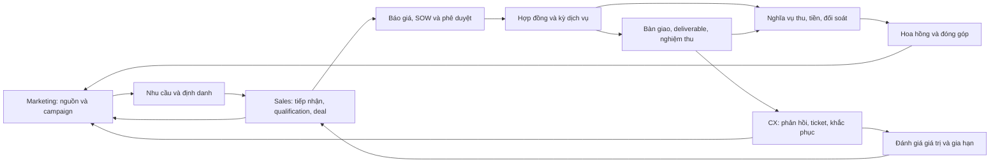

# Rà soát chuyên sâu CRM Agency — CEO, CMO, CX và kiến trúc vận hành

Ngày nghiên cứu: 15/10/2026. Đối tượng: Master BRD/SRS 1.2, FR01–FR40, các UC/schema/quyền/NFR/KPI và hai báo cáo phản biện liên quan.

## 1. Kết luận điều hành

**Thiết kế hiện tại có khung nghiệp vụ tốt nhưng chưa đủ nhất quán để giao toàn bộ cho đội phát triển và mặc định nghiệm thu được.** Cần giữ phần lõi, bổ sung các liên kết xuyên phòng ban, làm rõ nguồn dữ liệu chính, rồi mới chốt phạm vi và nền tảng. Không cần xây thêm một ứng dụng riêng cho mọi khoảng trống.

Ba góc nhìn có mục tiêu khác nhau nhưng phải dùng cùng sự thật nghiệp vụ:

- **CEO:** thu tiền và lợi nhuận đúng, giới hạn rủi ro tín dụng/phạm vi, không phụ thuộc một nhân viên, biết năng lực phục vụ trước khi nhận thêm hợp đồng.
- **CMO:** phân biệt lead nhiều với lead có giá trị; nối thông điệp/nguồn/campaign đến chất lượng cơ hội, kết quả bán và đóng góp; phân biệt marketing của agency với marketing làm cho khách.
- **CX:** khách không phải nhắc lại thông tin, không bị bỏ quên sau phản hồi đầu, biết ai chịu trách nhiệm và khi nào có cập nhật; khi có lỗi phải có khắc phục và xác nhận kết quả.

“Chuẩn” trong bản này nghĩa là chức năng có mục đích, chủ sở hữu, đầu vào/đầu ra, trạng thái, ngoại lệ, ràng buộc dữ liệu/quyền và ca nghiệm thu rõ. Không có một bộ danh sách tính năng duy nhất chứng nhận mọi CRM là chuẩn cho mọi agency.

**Đề xuất:** triển khai theo một hành trình khép kín từ nhu cầu → hợp đồng → delivery → thực thu → trải nghiệm → gia hạn; CRM có sẵn cấu hình hoặc hybrid nhẹ là ứng viên ưu tiên theo dữ kiện hiện tại. Nếu tự xây, giữ modular monolith/PostgreSQL/worker. Quyết định sản phẩm cụ thể phải qua PoC về tiền, quyền, workflow và connector, không chọn bằng số sao GitHub.

## 2. Phương pháp và phạm vi bằng chứng

Ba agent đã hoàn tất nghiên cứu song song theo CEO/tài chính, CMO/marketing và CX/dịch vụ; agent tổng hợp đọc kết quả, kiểm lại các nguồn trọng yếu, rà chéo FR, kỹ thuật, AI, NFR và tính nhất quán. Lượt yêu cầu phản biện thứ hai của các agent gặp giới hạn sử dụng; không có kết quả lượt hai được tính vào bằng chứng. Agent tổng hợp tiếp tục tự kiểm tra và hoàn thiện. Các báo cáo chuyên đề là phụ lục nghiên cứu, không tự trở thành yêu cầu sửa bản gốc.

Tài liệu nội bộ:

- [Master BRD/SRS 1.2](<D:/AI Agent/CRM/CRM_MASTER_BRD_SRS_HOP_NHAT.md>).
- [Báo cáo Gemini cần phản biện](<D:/AI Agent/CRM/gemini-code-1792004600780.md>).
- [Phản biện vòng trước](<D:/AI Agent/CRM/PHAN_TICH_PHAN_BIEN_CRM_2026-10-15.md>).

Phân loại bằng chứng:

| Loại | Có thể kết luận | Không thể suy ra |
| --- | --- | --- |
| Tài liệu gốc nội bộ | Thiết kế đã mô tả gì, chỗ thiếu/mâu thuẫn | Hệ thống chạy thật đã có bug hoặc đã đạt UAT |
| Tài liệu chính thức sản phẩm | Cách dùng, khả năng và điều kiện được công bố | Tính năng có trong mọi edition, được cấp quyền cho tài khoản này, hiệu năng thực tế |
| File mã nguồn đã đọc | Hàm/model được quan sát thực hiện điều gì | Toàn bộ call chain, bảo mật toàn sản phẩm, khả năng production sau tùy biến |
| Bài Facebook công khai/cộng đồng | Tín hiệu vấn đề hoặc quan điểm cần kiểm chứng | Chuẩn nghiệp vụ, tỷ lệ hiệu quả đại diện, cam kết API/pháp luật |
| Đề xuất trong báo cáo này | Quyết định thiết kế có lập luận cho bối cảnh agency | Kết quả benchmark, ROI, thời hạn triển khai hay cam kết của nhà cung cấp |

Các URL nhánh `develop`, `version-15`, `19.0` là nguồn tham khảo có thể thay đổi. Khi chọn nền tảng phải cố định commit/release, đọc license/edition và chạy PoC. Việc truy cập GitHub API bằng shell trong phiên này bị chặn kết nối; không có bản clone hoặc benchmark toàn bộ repository.

Facebook được tìm kiếm và thử mở nội dung công khai. Một số trang Business Help chuyển sang đăng nhập, tìm kiếm nhóm/bài cộng đồng không cho tập dữ liệu đủ tin cậy. Phần kết luận kỹ thuật Meta dựa nguồn chính thức truy cập được, không được trình bày như khảo sát đại diện cộng đồng Facebook hay đọc nhóm kín.

Phụ lục có kết quả đã hoàn tất:

- [CEO: tài chính, hợp đồng và quản trị vận hành](<D:/AI Agent/CRM/RESEARCH_CEO_CRM_2026-10-15.md>) — 26 ca nghiệm thu đề xuất.
- [CMO: marketing, đo lường và vòng phản hồi](<D:/AI Agent/CRM/RESEARCH_CMO_CRM_2026-10-15.md>) — 26 ca nghiệm thu đề xuất.
- [CX: dịch vụ, SLA và phục hồi trải nghiệm](<D:/AI Agent/CRM/RESEARCH_CX_CRM_2026-10-15.md>) — 24 ca nghiệm thu đề xuất.

Tổng 76 ca chuyên đề có phần giao nhau; không tuyên bố là 76 ca độc lập hoặc đã chạy thành công. Phạm vi rà soát gồm đủ 40 FR và 22 UC, không đồng nghĩa đã chứng nhận mọi trường dữ liệu/API đầy đủ như một thiết kế triển khai cuối cùng.

## 3. Mô hình liên kết nghiệp vụ phải có trước khi thiết kế màn hình

Các mũi tên là trao đổi dữ kiện có kiểm quyền, không đồng nghĩa một module được tùy ý ghi vào database của module khác. Identity, consent, quyền, phiên bản, audit, event và chất lượng dữ liệu là các kiểm soát xuyên suốt.

### 3.1 Bốn đối tượng không được nhập làm một

| Đối tượng | Trả lời câu hỏi | Lỗi nếu gộp |
| --- | --- | --- |
| Contact/Account | Ai đang có quan hệ với tổ chức? Đại diện cho ai? | Một người nhiều công ty bị nhập nhằng quyền/người mua |
| Inquiry/Demand episode | Lần này họ cần gì? | Mỗi tin thành lead mới hoặc nhu cầu mới bị ghi đè lịch sử cũ |
| Deal/Commercial opportunity | Có một quyết định mua cụ thể nào cần theo đuổi? | Tin hỗ trợ thành pipeline doanh thu; nhiều dịch vụ bị khóa thành một deal |
| Conversation/Ticket/Project | Đang trao đổi ở đâu, giải quyết việc gì, giao cái gì? | Gửi nhầm kênh, đóng nhầm SLA, lẫn yêu cầu sửa với khiếu nại |

Demand episode có thể chính là Lead với định nghĩa lại rõ, không bắt buộc thêm bảng mới. Buying group thuộc cơ hội cụ thể phải liên kết quan hệ Contact–Account có hiệu lực; vai trò “người duyệt” trong công ty không luôn đồng nghĩa có quyền ký hợp đồng hoặc nghiệm thu mọi dự án.

### 3.2 Service blueprint tối thiểu

| Giai đoạn | Khách mong đợi | Người chịu trách nhiệm | Dữ liệu/bằng chứng cần bàn giao | Điều kiện kết thúc |
| --- | --- | --- | --- | --- |
| Tìm hiểu/để lại yêu cầu | Được hiểu đúng và biết thời gian phản hồi | Marketing + người trực | Nguồn, nhu cầu, quyền liên hệ, timestamp | Yêu cầu có người xử lý hoặc queue được giám sát |
| Qualification | Không phải khai lại, không bị hỏi form máy móc | Sales | Mục tiêu, fit, hạn, ngân sách Unknown nếu chưa rõ | Accepted/recycled/rejected có lý do |
| Đề xuất | Biết giá bao gồm gì, kết quả nào được cam kết | Sales + chuyên môn | Brief, SOW, giả định, loại phí, cost estimate | Quote/phiên bản được duyệt và khách quyết định |
| Ký và onboarding | Lời hứa bán hàng được chuyển đầy đủ | Sales + AM/Delivery | Người ký, mục tiêu thành công, lịch, asset access, giới hạn chi | Người nhận handoff chấp nhận; việc còn thiếu có owner/hạn |
| Thực hiện | Biết tiến độ, ai cần quyết định, lần cập nhật tiếp | AM + Delivery | Deliverable version, review, change, dependency | Nghiệm thu theo SOW hoặc ngoại lệ được xử lý |
| Thu tiền | Hóa đơn/đề nghị thu đúng và giải thích được | Kế toán + AM | Nghĩa vụ, chứng từ, khoản thu, phân bổ, tranh chấp | Số dư đối soát được; không suy Paid từ Won |
| Phát sinh lỗi | Có giảm thiểu, cập nhật và chịu trách nhiệm | CX/AM + xử lý kỹ thuật | Impact, priority, promise, evidence, recovery action | Khắc phục có xác nhận/kiểm tra; không chỉ đổi Closed |
| Gia hạn/rời đi | Thấy giá trị và được bàn giao tử tế | AM + Sales + CX | Success review, quyết định renewal, quyền/tài sản cần trả | Gia hạn hợp lệ hoặc offboarding hoàn tất có lịch sử |

## 4. Ma trận rà soát đủ 40 yêu cầu chức năng

Đây là ma trận **đề xuất cho bối cảnh hiện tại**. P0 = cần trong luồng MVP được chọn; P1 = sau lõi ổn định hoặc khi nghiệp vụ phát sinh; P2 = thử nghiệm/tùy chọn. Với kênh chưa kết nối, kiểm soát chỉ bắt buộc trước khi bật kênh đó. Các ca UAT ở bảng là tiêu chí cần chạy, chưa là kết quả đã đạt.

### 4.1 Hồ sơ, bán hàng và làm việc hằng ngày

| FR / chủ nghiệp vụ | Vì sao cần và hậu quả nếu thiếu | Liên kết đầu vào → đầu ra | Kết luận và sửa cần thiết | Nghiệm thu tối thiểu / giai đoạn |
| --- | --- | --- | --- | --- |
| FR01 Hồ sơ — Sales Ops/AM | Giữ quan hệ xuyên nhân viên và nhiều hợp đồng; tránh khách phải nhắc lại | Connector/form → Contact/Account/roles → Lead/Deal/Ticket/Project | Giữ; tách lifecycle, identity verification và nhu cầu. Người mua B2C không cần Account; external ID theo connection | Một người đại diện hai công ty, quyền và lịch sử không lẫn; P0 |
| FR02 Identity/merge — Steward | Tránh gọi trùng nhưng không gộp sai người và consent | Identity/evidence → candidate/merge mapping → timeline/assignment/consent | Giữ; merge có provenance, version và xử lý hậu merge; khi chưa có undo an toàn thì ưu tiên link/review, chưa bật merge tùy ý | Unmerge sau tin mới/revoke không gửi sai; chứng từ đã chốt không tự chuyển chủ; P0 phần chống trùng |
| FR03 RFM — CMO/AM | Phân nhóm để ưu tiên chăm sóc; chỉ có ích khi phù hợp nhịp mua | Kỳ dịch vụ, phí, payment → segmentation → journey/account review | Sửa; trả một lần cả năm không đồng nghĩa mất tương tác. Tách recency tương tác/dịch vụ/thanh toán; frequency theo giao dịch thương mại thực, không số đợt trả | Hai khách cùng retainer nhưng lịch trả khác không bị xếp hạng máy móc; P1 |
| FR04 Pipeline — Sales Director | Dự báo và gỡ nghẽn cần cơ hội có trạng thái thật | Demand/qualification → Deal/stage history → Quote/forecast | Giữ+sửa; tách lead và deal, accepted/recycle/reject, OnHold, deal scope và buying group tối thiểu; Unknown được biểu diễn | Không tạo pipeline từ ticket; quay lại giữ lineage/aging; P0 |
| FR05 Routing/SLA — Sales Ops | Không bỏ sót và không hai người giành cùng lead | Scope/skill/availability/ownership → assignment + episode → activity/escalation | Sửa; hard scope trước sticky; người dự phòng; tách claim/attempt/contact success; không dừng mọi timer theo contact | Claim cạnh tranh, owner nghỉ ca, busy/NoAnswer và hai nhu cầu cùng contact; P0 |
| FR06 Năng suất — Sales Manager | Giúp biết việc cần làm và dữ liệu thiếu; giảm báo cáo ngoài | Activity/next action/stage → Today/data quality → coaching | Giữ; đo chất lượng/outcome và effort, không số click; field bắt buộc theo thời điểm, chưa biết không nhập giả | Người dùng hoàn tất tác vụ đại diện, ghi thời gian/khó khăn; overdue phân nguyên nhân; P0 |
| FR07 Inbox — CX Ops | Lịch sử thuộc tổ chức, có người trả lời chính và ngữ cảnh | Kênh/identity/thread → conversation → lead/ticket/activity | Giữ; FR07 là UX nghiệp vụ, FR30–40 là đặc tả chi tiết, tránh hai implementation. Reply luôn chỉ rõ tài khoản/recipient | Private note không outbound; hội thoại không biến thành khách mới mỗi message; P0 một kênh |
| FR08 Masking/bàn giao — Privacy + Ops | Dùng dữ liệu đủ cho công việc và thu hồi đúng khi nghỉ việc | Assignment/ACL → quyền liên hệ/tệp → handoff + audit | Sửa; người đang có nhiệm vụ được đọc trường cần thiết; reveal nhạy cảm theo điều kiện; bàn giao cả promise, draft, queue, tài sản | Sales nghỉ việc không còn phiên/tệp, AM được trao quyền hợp lệ; P0 |

### 4.2 Marketing automation và AI

| FR / chủ nghiệp vụ | Vì sao cần và hậu quả nếu thiếu | Liên kết đầu vào → đầu ra | Kết luận và sửa cần thiết | Nghiệm thu tối thiểu / giai đoạn |
| --- | --- | --- | --- | --- |
| FR09 Journeys — CMO/CX | Follow-up và onboarding có lịch; tránh bỏ sót hoặc nhắc sai khi đang khiếu nại | Event, purpose, consent, lifecycle → scheduled action → message/task/outcome | Giữ rule mẫu P0, hoãn builder tổng quát; re-entry, exit, suppression, frequency cap theo mục đích/scope; kiểm lại ngay lúc gửi | Revoke khi đang chờ hủy marketing; refund/complaint dừng upsell phù hợp; P0 đơn giản/P1 engine |
| FR10 Loyalty/referral — CMO/Finance | Referral có thể tạo nguồn khách; tích điểm chỉ hữu ích khi có hành vi lặp và kinh tế phù hợp | Referral + khách đủ điều kiện + thực thu → reward ledger → payout/reversal | Tách referral khỏi loyalty. Chưa chứng minh ROI thì không có điểm/hạng/Mini App trong MVP; tránh tự giới thiệu/trùng hưởng | Refund không thưởng lại, referral không cộng trùng hoa hồng sales trái policy; P1 referral/P2 loyalty |
| FR11 Call summary — Sales Ops/AI owner | Tiết kiệm ghi chú nếu transcript đúng; sai số tiền/ngày hẹn làm sai cam kết | Recording được phép → STT/draft/source timestamp → human-confirmed activity | Hoãn sau lõi; đo exact field accuracy, omission và hallucination theo nhóm giọng/nhiễu. 60 cuộc/95% là giả định test, chưa chứng minh chất lượng tổng quát | Câu phủ định, số tiền, lịch hẹn, người nói và tên riêng; field quan trọng người duyệt; P1 |
| FR12 Scoring/recommendation — CMO/Sales | Ưu tiên effort khi có nhiều lead; score không thay qualification | Fit/intent/coverage/outcome → explainable score → next best action | Rule có version; không mặc định thiếu ngân sách là kém. Không dùng nhãn thu được sau Won để dự báo lúc intake; không claim AI forecast khi chỉ nhân hệ số | Hiển thị lý do, Unknown và override; backtest theo thời gian nếu làm predictive; P1 rule/P2 predictive |
| FR13 AI actions — Product/Privacy | Giới hạn hậu quả của lời gợi ý sai hoặc nội dung độc hại | User intent + current ACL + evidence → draft/approved action → tool audit | Giữ guard khi bật AI; approval gắn document hash/recipient/amount/action/expiry; recheck lúc chạy; có kill switch/cost cap | Tệp khách chứa lệnh xuất dữ liệu không đổi quyền; đổi recipient sau duyệt bắt duyệt lại; P0 guard/P2 tự hành |

### 4.3 Thương mại, tài chính, phục vụ và tổ chức

| FR / chủ nghiệp vụ | Vì sao cần và hậu quả nếu thiếu | Liên kết đầu vào → đầu ra | Kết luận và sửa cần thiết | Nghiệm thu tối thiểu / giai đoạn |
| --- | --- | --- | --- | --- |
| FR14 Catalog/quote — Sales + Finance | Chốt giá và lời hứa delivery, tránh bán rẻ/phạm vi mơ hồ | Catalog/cost/brief → quote revision + SOW + approval → contract/order | Giữ; estimate chưa ràng buộc khác approved offer; discount=0 không đủ autoapprove; giá, credit term, scope, liability có hạn mức riêng | Sửa lịch thu/số vòng sửa làm xét lại phần approval bị tác động; bản đã duyệt không tự đổi; P0 |
| FR15 Contract/handoff — AM/Delivery | Không mất lời hứa bán hàng; biết khi nào được bắt đầu và chi tiền | Accepted quote + signer + tiền/ngoại lệ + asset access → contract/service period/project | Giữ+sửa; MSA/SOW/change order; nghĩa vụ recurring; success plan; nhận bàn giao; expiry/exposure ngoại lệ; termination tách settlement | Tiền đã thu nhưng invoice sync trễ không kẹt giả; cọc chỉ thu một phần chưa tự đủ; P0 |
| FR16 Reconciliation — Kế toán | Tiền thật phải truy được về khách/nghĩa vụ, không cộng lặp | Bank/provider/statement → confirmed receipt + match/allocation → balances/ERP/commission | Sửa P0; verification khác matching; order lines/schedule; đối chiếu xuyên nguồn; partial/refund/credit/write-off/currency/legal entity | Cùng giao dịch qua API+sao kê, invoice đến muộn, hai worker phân bổ; tổng không sai; P0 |
| FR17 Commission — Sales + Finance | Minh bạch quyền hưởng, giữ động lực không chi nhầm tiền media/thuế | Eligible allocation + policy/share → preview/approval/payout → reversal/period close | Giữ+sửa; preview≠payable; quality chưa có không suy là đạt; referral/bonus tách; policy snapshot và quy tắc clawback có kiểm tra | Hoàn một phần, đổi owner sau chốt, nhiều người hưởng và rounding không nhân chi; P0 preview khi có policy |
| FR18 Ticket — CX Lead | Khiếu nại/sự cố có trách nhiệm và kế hoạch khắc phục | Complaint/incident/entitlement → triage/response/resolution → recovery/learning | Giữ+sửa; impact×urgency, entitlement/giờ hỗ trợ, next-response và promised update; defect khác scope change; major incident liên kết nhiều ticket | Không đóng tự động P1 chỉ vì khách im lặng; reopen không xóa breach; P0 |
| FR19 Voice of Customer — CX + CMO | Biết trải nghiệm thực và sửa nguyên nhân, không chỉ thu điểm | Touchpoint/survey/comment/ticket → feedback + recovery action → verify/root cause | Sửa; CSAT theo tương tác, NPS quan hệ theo đúng đối tượng; thêm effort khi có mục tiêu; cooldown, sampling, không trả lời khác điểm 0 | Điểm thấp có owner/hạn/closure evidence; chống chọn mẫu làm đẹp; P1 survey, P0 recovery |
| FR20 Appointment/field — Sales/AM | Hẹn đúng người/nguồn lực, giảm no-show và lỡ lịch | Availability/request → booking/confirmation → meeting/activity | Lịch tối thiểu P0; giữ timezone, buffer, cancel/reschedule. GPS chỉ khi có nhu cầu thực và cơ sở phù hợp, không bắt để chứng minh mọi công việc | Double booking và đổi lịch không để reminder cũ gửi tiếp; P0 lịch/P2 GPS |
| FR21 Branch/team — Ops/Privacy | Bàn giao/phối hợp đúng quyền khi mở rộng | Org/team/grants → scope/assignment → reporting/handoff | Giữ; tenant/workspace/branch/legal entity là bốn khái niệm khác. Quyền tạm thời theo account/project/contact, hỗ trợ B2C | Khách shared account, hai branch và thu tiền theo pháp nhân đúng; P0 scope/P1 vận hành hai nhánh |

### 4.4 Nghiệp vụ chuyên ngành marketing và quản trị hiệu quả

| FR / chủ nghiệp vụ | Vì sao cần và hậu quả nếu thiếu | Liên kết đầu vào → đầu ra | Kết luận và sửa cần thiết | Nghiệm thu tối thiểu / giai đoạn |
| --- | --- | --- | --- | --- |
| FR22 Strategy/IMC — CMO/Strategist | Delivery phải phục vụ mục tiêu đã thống nhất, không chỉ có lịch đăng | Business goal/baseline/brief → approved plan/version → scope/campaign/measurement | Giữ liên kết mục tiêu–quyết định–bằng chứng; tài liệu chi tiết ở công cụ chuyên môn; scope template theo gói | Gói thiết kế nhỏ không đi đủ nghiên cứu lớn; goal thay đổi có impact review; P0 brief/P1 full |
| FR23 Launch gates — CMO/AM | Ngăn chạy sai asset, sai ngân sách/quyền/tracking | Scope/budget/asset/tracking/account access → go/no-go → launch evidence | Giữ; gate theo risk và service template; optimization envelope được duyệt để không xin lại mỗi tinh chỉnh; CRM khóa nút không bảo đảm chặn thao tác ngoài Ads Manager | Creative được thay thì approval cũ không dùng; tăng chi vượt quyền bị chặn/escalate; P0 nếu quản campaign |
| FR24 Experiments/learning — CMO | Không kết luận hiệu quả từ dao động nhỏ, giữ lý do quyết định | Hypothesis/baseline/design → result/limitations → approved learning | Giữ mẫu nhẹ, hoãn engine; lead agency ít không có nghĩa mọi campaign khách ít mẫu. Ghi unit/randomization/cửa sổ/guardrail, tránh đổi KPI sau thấy kết quả | Chưa đủ mẫu không gán winner; bài học khách A không chia sẻ trái quyền cho B; P1 mẫu/P2 engine |
| FR25 Tasks/capacity — Delivery Lead | Không nhận vượt nguồn lực và không quên dependency | SOW/milestone/availability → planned work → actual effort/acceptance | Một hệ thống sở hữu task; CRM giữ milestone và summary. Capacity reservation trước close lớn; actual cost có nguồn, không nhất thiết log giờ mọi việc | Đổi scope cập nhật tải; tránh hai nơi cùng sửa task; nghỉ phép không bị tính thiếu năng suất; P0 milestone/P1 capacity |
| FR26 Budget/health — Finance + CMO | Giữ tiền và phát hiện rủi ro theo objective | Approved budget/commitments/actual/KPI freshness → forecast-at-completion/alerts | Giữ; khách media budget khác acquisition agency, committed chuyển actual không cộng đôi; health tách financial/delivery/relationship/outcome | Dữ liệu stale=Unknown; PO thành invoice không giảm budget hai lần; P0 cơ bản/P1 forecast |
| FR27 People scorecard — Delivery/Ops | Biết năng lực/chi phí phục vụ; tránh suy xét nhân viên từ số thao tác | Membership/availability/cost/quality → staffing/coaching | Giữ tổ chức và thông tin nguồn lực cần thiết; hoãn scorecard cố định. Hiệu quả cần theo vai trò, mix dự án và quyền giải trình; payroll ngoài CRM | Thiếu dữ liệu không xếp hạng; không tự phạt do client delay hoặc lỗi tracking; P0 membership/P2 scorecard |
| FR28 KPI/provenance — CMO + data owner | Các phòng ban dùng cùng định nghĩa, truy được nguyên nhân số liệu | Canonical events/dimensions/version → metric fact + quality → dashboard/decision | Giữ+sửa; định nghĩa SAL/reject/recycle, cohort, denominator, owner, ngày chốt, late data; tách Unknown/Direct/Organic | Replay không nhân denominator; tỷ lệ hiển thị cả mẫu số; sửa definition không âm thầm đổi snapshot cũ; P0 |
| FR29 Attribution — CMO + Finance | Biết nguồn góp vào cơ hội/đóng góp, tránh phân ngân sách theo số ảo | Touchpoint + identity/role + demand/deal + cost/outcome → attributed views | Giữ first/last đơn giản; nguồn tự khai riêng; account attribution có rule và evidence; refund/late events có version; không cộng hai model | Own CAC không dùng media khách; money basis rõ booked/recognized/collected; P1, P0 source capture |

### 4.5 Omnichannel và độ tin cậy vận hành

| FR / chủ nghiệp vụ | Vì sao cần và hậu quả nếu thiếu | Liên kết đầu vào → đầu ra | Kết luận và sửa cần thiết | Nghiệm thu tối thiểu / giai đoạn |
| --- | --- | --- | --- | --- |
| FR30 Connections — Integration owner | Không hứa tính năng API/tài khoản chưa cho phép | Authorization/scopes/capabilities → active connection → ingest/send | Giữ; Lead Ads, Messenger, comment, Shop là khả năng riêng; workspace/legal authority theo connection; expiration owner | Kênh receive-only không có nút reply; revoke dừng đúng chiều; P0 kênh chọn |
| FR31 Identity liên kênh — Steward | Một hồ sơ có nhiều danh tính nhưng không dùng tên/hash làm chứng minh | Scoped external IDs + evidence → link/review → FR01/02/timeline | Giữ; cùng cơ chế FR02, không hai bộ merge; nguồn dùng chung/hotline, đổi số, identity reassignment có lịch sử | Hai Page cùng provider_subject_id không tự merge; scope khác không leak candidate; P0 |
| FR32 Unified conversations — CX Ops | Tập trung thao tác mà vẫn gửi đúng luồng/tài khoản | Thread/participants/message ACL → composer/timeline → FR34/39 | Giữ; internal note/public reply tách kiểu; BCC, native reply echo, group participants và quote attachment | Trả lời trong app kênh gốc được reconcile; không mở nhầm recipient; P0 |
| FR33 Inbound — Integration owner | Webhook lặp/lệch thứ tự không nhân lead, SLA hay trạng thái | Authenticated event → durable receipt/dedup → domain update + outbox | Giữ; event key có namespace/version; business dedup khác transport dedup; backfill mode không trigger nurture | Crash sau commit, status cũ tới sau, hai sự kiện cùng nhu cầu; P0 |
| FR34 Outbound — CX/Integration | Tin không gửi trùng hoặc gửi khi consent/quyền đã đổi | Intent + policy + recipient snapshot → attempts → accepted/delivered/unknown | Giữ; approval snapshot không thay current eligibility; unknown có reconciliation/manual decision/deadline | Provider nhận rồi timeout không tự gửi lại; duplicate click một intent; P0 |
| FR35 Assignment — CX Ops | Giữ một người xử lý chính, continuity nhưng có backup | Scope/skill/shift/capacity/owner → conversation assignee/lease → handoff | Sửa chi tiết; conversation assignee khác deal owner là hợp lý; backup không đổi commission; action actor và history bắt buộc | Hết lease, chuyển ca, nghỉ việc, owner unavailable không làm reset SLA; P0 |
| FR36 Service timers — CX Lead | Khách cần phản hồi suốt hành trình, không chỉ tin đầu | Unanswered customer turn + priority/calendar → first/next response, resolution, promised update | Bổ sung NRT và promise due; định nghĩa nhiều tin trong một lượt hỏi, pause, reopen, incident mitigation. Không lấy contact làm completion scope | Trả lời lần đầu rồi im lặng vẫn cảnh báo; public reply đúng request mới hoàn thành; P0 |
| FR37 Search/data protection — Privacy/Security | Search/export/AI/file không thành đường vòng xem hồ sơ | Current role/resource/field ACL → filtered content/count/snippet → UI/BI/RAG | Giữ; account membership không tự cấp mọi client workspace; ACL cập nhật vào cache/index; download kiểm lại quyền | User bị revoke không tìm snippet/count/tệp qua URL cũ; P0 |
| FR38 Sync health — Integration owner | Biết dữ liệu đang thiếu, phục hồi được mà không gây hiệu ứng lặp | Checkpoint/provider cursor/DLQ/outcome → coverage/alert/reconcile → repair | Giữ; sync không chỉ “webhook có trả 200”; expired cursor/full sync, deletion, echo và id mapping | Outage phục hồi không kích hoạt marketing cũ; không hứa coverage tuyệt đối nếu không có nguồn đối chiếu; P0 |
| FR39 Business links — Sales/CX | Tin hỏi mới, support và feedback đi đúng nghiệp vụ | Conversation intent + existing work → linked Lead/Deal/Ticket/Deliverable | Giữ+sửa; một thread có thể nhiều yêu cầu, một request có nhiều thread; người xác nhận khi chưa rõ; không link mọi thread theo contact | Cùng contact hỏi gói mới và báo lỗi cũ, mỗi nghĩa vụ đúng owner/SLA; P0 |
| FR40 Email/files — Security/CX | Email/file là kênh mang nội dung, quyền và mã độc | Mailbox permissions + MIME/participants → quarantined/clean asset → preview/reply | Giữ; chống script, remote tracking, size/decompression, BCC/reply-all; attachment version/hash; forwarded chain không tự đổi identity | File chưa clean không tải/forward; recipient preview; email sender spoof không tự merge/approve; P0 khi bật |

## 5. Các khoảng trống xuyên module phải xử lý

### 5.1 Từ MQL đến Sales Accepted phải là giao dịch bàn giao

Chỉ ghi các nhãn MQL/SAL/SQL trong KPI dictionary chưa đủ. Cần owner gửi/nhận, thời điểm, dữ liệu tối thiểu, SLA nhận, accepted/rejected/recycled, reason và evidence. Marketing xem được phản hồi chất lượng trong quyền, Sales có thể trả lead thiếu fit có lý do. Tranh chấp được review; không biến quyền reject thành cách né KPI.

Từ kết quả accepted/qualified/won, CMO mới đánh giá nguồn/campaign và cân nhắc gửi tín hiệu tối ưu về nền tảng quảng cáo. Đây là đề xuất phát triển vòng phản hồi, không là cam kết CAPI làm tăng doanh thu.

### 5.2 Onboarding cần kế hoạch thành công và sổ cam kết

Ngoài hợp đồng, tiền và owner, bàn giao phải mang: mục tiêu khách xác nhận, baseline, đầu ra, tiêu chí thành công, giả định/phụ thuộc của khách, phạm vi loại trừ, người duyệt, người ký, lịch cập nhật và rủi ro bán hàng đã biết. Cam kết phát sinh trong cuộc gọi/chat phải trở thành bản ghi có nguồn, owner, hạn và trạng thái; không chỉ nằm trong tóm tắt AI.

Liên kết FR14/15 → FR22/23/25 → FR18/19 → renewal. Nếu bỏ liên kết này, CRM vẫn cho biết “đã bán” nhưng không giải thích được khách bất mãn vì lời hứa nào chưa được thực hiện.

### 5.3 Hài lòng phải dẫn đến hành động khắc phục

CSAT/NPS là phép đo, không phải toàn bộ CX. Cần vòng: feedback → phân loại → liên hệ/giảm thiểu → hành động → người chịu trách nhiệm → xác minh với khách/kiểm tra kết quả → nguyên nhân gốc → thay đổi quy trình. Chỉ thêm “task gọi lại” chưa chứng minh vấn đề đã giải quyết.

Không đồng nhất người dùng đầu ra với người mua/người ký: designer phía khách hài lòng với asset nhưng CFO chưa thấy giá trị kinh tế; phải lưu vai trò người trả lời. Không dùng điểm trung bình để che sự cố nghiêm trọng. Escalation cho rò rỉ/tài khoản quảng cáo có luồng riêng với update cadence và quyền xử lý.

### 5.4 Renewal phải xuất phát từ giá trị, không chỉ lịch hết hạn

Retainer cần service period, review outcome, mức sử dụng/phạm vi, health có nguồn, lịch quyết định và cửa sổ thông báo chấm dứt theo hợp đồng. Nhắc 45/30/15 ngày chỉ là một policy. Dự án một lần dùng follow-on opportunity khi có nhu cầu; không coi mọi khách không mua tiếp là churn của retainer.

Rời đi cần offboarding: tài sản, quyền tài khoản quảng cáo, quyền truy cập, hồ sơ/bản giao, invoice/credit, retention/legal hold và phạm vi dừng gửi. Lý do không gia hạn phải tách giá trị, fit, ngân sách, thay đổi chiến lược và lỗi dịch vụ.

### 5.5 Tiền, nghĩa vụ và giá trị phải được định nghĩa riêng

Không dùng một trường `Paid` làm kết luận cho mọi miền. Cần các mốc riêng: giá trị ký, nghĩa vụ còn hiệu lực, đã giao/được nghiệm thu, đã lập hóa đơn, tiền đã xác thực, đã phân bổ, công nợ còn lại và doanh thu do kế toán ghi nhận. Media thu hộ không tự thành base hoa hồng; PRODUCTION cần policy cost/margin riêng.

Payment đã xác thực có thể chưa khớp khách. Payment đã khớp order có thể chưa phân bổ hết. Invoice đồng bộ muộn không tạo một receipt mới. Bank fee, credit note, discount, bad debt và refund không cùng một loại điều chỉnh. Legal entity phát hành/chủ tài khoản ngân hàng phải rõ nếu có nhiều pháp nhân; branch không thay legal entity.

### 5.6 Lợi nhuận cần cả cost và capacity dù không xây PMS

Chỉ lấy phí dịch vụ trừ ad spend chưa cho biết biên đóng góp agency. Cần cost trực tiếp liên quan như freelance, sản xuất, công cụ được phân bổ và labor theo chính sách. Chọn một nguồn cost và thời điểm cut-off; chi phí chưa về phải có estimate/commitment, tránh dashboard lãi giả đầu kỳ.

Capacity giúp quyết định nhận dự án và ngày hứa, nhưng không phải lý do bắt mọi người log từng phút trong CRM. Tích hợp hoặc cập nhật summary đã kiểm tra là lựa chọn đủ cho giai đoạn nhỏ. Vượt scope làm đổi workload, cost, date và approval, không chỉ tạo task thêm.

### 5.7 Bốn tập tiền và kết quả Marketing phải tách

| Tập | Ví dụ minh họa | Quyết định phục vụ | Không được trộn |
| --- | --- | --- | --- |
| Chi phí tìm khách agency | Agency chi 20 triệu tìm khách thuê dịch vụ | CPL/CPQL/CAC agency | Không cộng media do khách tài trợ |
| Kinh tế dịch vụ agency | Phí 40 triệu, cost trực tiếp 25 triệu | Biên đóng góp 15 triệu theo cost basis đã chọn | Không coi doanh số bán hàng của khách là doanh thu agency |
| Media của khách | Khách có ngân sách 300 triệu | Pacing, chi trong hạn mức, CPL/ROAS của khách | Không đưa vào base service commission mặc định |
| Kết quả kinh doanh của khách | Khách báo doanh số 900 triệu | Đánh giá chiến dịch theo nguồn/model hợp lệ | Không coi là cash agency hoặc chứng minh nhân quả |

Số liệu là ví dụ đại số, không phải benchmark. Mỗi metric cần namespace, beneficiary, scope, kỳ đo, currency, tax basis, event time, nguồn và freshness. LTV quan sát của cohort trẻ không phải lifetime forecast; CAC phải nêu acquisition lag; ROAS từ các nền tảng có thể claim trùng một outcome. Không cộng first-touch, last-touch, Google và Meta thành doanh thu thực.

### 5.8 Vòng phản hồi CRM → nền tảng quảng cáo

Trang Meta Blueprint công khai nêu học phần về tích hợp CRM qua Conversions API, qualified leads, trạng thái tích hợp và coverage. Nội dung đọc được là mục tiêu khóa học, không phải xác nhận toàn bộ API schema hoặc hiệu quả tài khoản cụ thể. [Meta Blueprint](https://www.facebookblueprint.com/student/activity/603002-improve-lead-quality-with-meta-conversions-api-for-crm).

Thiết kế đề xuất: qualification/outcome đã xác nhận → canonical event → kiểm purpose/quyền → mapping có version → dataset/ad account đúng workspace → outbox → kết quả gửi/đối soát. Source lead/click ID chỉ lưu khi nguồn trả và có quyền. Mỗi event có ID ổn định; đổi stage qua lại không tạo nhiều purchase. Won khác cash received; refund/correction theo khả năng API thực tế, không tự hứa thu hồi được mọi tín hiệu đã gửi.

Người tiêu dùng khách A chỉ đi tới dataset A theo ủy quyền; không dùng tệp A/B để quảng cáo tìm khách cho agency hoặc bù volume. Hash identifier không tự tạo quyền chia sẻ. Khả năng Lead Ads intake không tự cho phép Messenger outbound. P0 giữ provenance và source ID đúng; P1 mới bật một connector feedback sau gate dữ liệu/tài khoản/quyền. Cửa sổ gửi và tham số API phải kiểm phiên bản hiện dùng; nghiên cứu này không xác nhận bằng số cụ thể.

### 5.9 Entitlement, SLA và cấu trúc nhiều yêu cầu

Ticket phải snapshot được quyền hỗ trợ theo gói/hợp đồng: phạm vi, giờ hỗ trợ, loại yêu cầu, mức cam kết và phiên bản policy. Tiếp nhận phản ánh của khách luôn có đường đi; hết quota không có nghĩa từ chối ghi nhận khiếu nại hoặc lỗi agency. Microsoft mô tả entitlement có thời hạn/giới hạn/phạm vi hỗ trợ; dự án chỉ áp dụng khái niệm phù hợp. [Microsoft Entitlements](https://learn.microsoft.com/en-us/dynamics365/customer-service/administer/create-entitlement-define-support-terms-customer).

Conversation↔Ticket/Inquiry/Deal cần liên kết nhiều–nhiều có purpose và kiểm scope, có thể bằng các link table typed để giữ FK. Một ticket có Facebook và email; một email thread chứa hỏi giá lẫn phản ánh hóa đơn. Cùng Contact chỉ hỗ trợ tìm kiếm, không được tự gộp công việc hoặc đóng chung SLA.

SLA có subject rõ: inquiry, conversation waiting episode, case hoặc lời hứa cập nhật. `SLA_Episodes` hiện chỉ có conversation_id là chưa đủ cho các nghĩa vụ khác; chọn FK theo miền hoặc supertype có constraint rõ. Due trên Lead/Ticket chỉ là projection nếu dùng engine chung. Ghi start/completion event, calendar/policy version, pause reason, breach history và exception. Tin khách gửi lần nữa không lùi hạn tính từ tin chưa trả lời đầu tiên.

Tiêu chí gửi đủ để hoàn thành response clock cần ghi rõ theo capability: provider accepted, delivered hoặc bằng chứng khác được policy chấp nhận. Không đợi read receipt ở kênh không cung cấp; không gọi accepted là khách đã nhận/đọc. `unknown_outcome` không được tự biến thành thành công. Gửi lời chào rỗng có thể đáp ứng thao tác kỹ thuật nhưng chưa chứng minh phản hồi thực chất; chất lượng nội dung cần QA mẫu và xử lý ngoại lệ.

Đề xuất MVP dùng durable assignment + version/atomic claim. Chỉ dùng lease khi thật sự có nhu cầu, khi đó cần expiry/renewal/fencing và kiểm quyền gửi của tab cũ. Typing indicator không phải khóa chống gửi trùng. Tách conversation lifecycle, waiting party và assignment; chuyển người không tự mở lại/đóng công việc.

### 5.10 Media funding, nhắc nợ và quyền chi

Được duyệt kickoff phần sáng tạo không đồng nghĩa được chi media. Quyết định chi phải xét ngân sách được duyệt, nguồn tiền/credit được phép, commitment, actual spend, độ trễ dữ liệu và giới hạn của người thao tác. Số dư ngân hàng không phải số tiền agency được tự do dùng cho mọi khách.

Nhắc nợ cần due date, promise-to-pay, disputed amount và owner. Khi khách phản ánh hóa đơn sai, chuyển thông điệp sang người xử lý theo policy; không tiếp tục gửi dồn tự động và cũng không xóa số dư chỉ vì đang dispute. Ngày lập hóa đơn pháp lý và ngày dữ liệu ERP đồng bộ là hai mốc khác nhau; thiết kế chịu sync lag không phải quyền trì hoãn hóa đơn.

Khoản mang nhãn MEDIA_PASS_THROUGH phải được kế toán xác định bản chất theo hợp đồng; nhãn hệ thống không tự quyết định thuế/doanh thu. Chi tiết pháp lý cần kiểm theo dịch vụ/pháp nhân và văn bản áp dụng khi triển khai; không dùng tỷ lệ “90% chưa xuất hóa đơn” trong báo cáo Gemini làm căn cứ. [Nguồn hóa đơn Chính phủ](https://xaydungchinhsach.chinhphu.vn/nghi-dinh-70-2025-nd-cp-sua-doi-bo-sung-quy-dinh-ve-hoa-don-chung-tu-11925032321512617.htm).

## 6. Kiến trúc kỹ thuật và logic dữ liệu cần chuẩn hóa

### 6.1 Scope, khóa và ownership

SRS 5.1 dùng `client_workspace_id NULL` cho dữ liệu agency; 5.16 lại yêu cầu `workspace_id NOT NULL`. Cần một mô hình scope thống nhất hoặc mapping chính thức. Đề xuất cho hệ thống mới: workspace loại AGENCY và CLIENT, các dữ liệu scoped có workspace rõ; danh mục tenant dùng chung được khai báo riêng. Account khách mua dịch vụ của agency không đồng nghĩa mọi nhân viên có quyền vào dữ liệu người tiêu dùng trong workspace khách đó.

Giữ khóa ghép và kiểm same-tenant/workspace; định nghĩa rõ những liên kết cross-scope hợp pháp, ví dụ Client_Workspace trỏ về Account của agency, thay vì cấm toàn bộ bằng một quy tắc chung không triển khai được. Mọi cross-scope link phải có loại, quyền và projection tối thiểu.

Hợp nhất mô tả Identities/Channel_Identities, Merge_Events/Identity_Merge_Journal, Conversations/Messages; cập nhật FR, ERD, API, UAT cùng lúc. Một số index/constraint 5.16 tham chiếu field không hiện trong danh sách trường rút gọn: `Conversations.connection_id`, `Message_Status_Events.connection_id`. Phải xác định bổ sung field hay join/constraint khác trước khi tạo DDL; không coi bảng rút gọn là migration hoàn chỉnh.

### 6.2 Append-only không có nghĩa tất cả trạng thái đều bất biến

Bút toán số tiền/base/policy không sửa sau khi chốt. Nhưng workflow Preview→Approved→Payable→Paid cần lịch sử trạng thái hoặc projection có quyền thay đổi. Không vừa tuyên bố bất biến toàn bảng vừa UPDATE cùng dòng mà không giải thích phần nào là sự thật tài chính, phần nào là trạng thái vận hành.

Phần allocation nên có đích nghĩa vụ hợp lệ; invoice link bổ sung không tạo allocation mới làm đếm đôi. Tổng được kiểm dưới lock/transaction; reversal có tham chiếu phần còn có thể đảo. Privacy xóa PII không đồng nghĩa xóa chứng từ bắt buộc lưu; cần retention theo miền và căn cứ xử lý.

### 6.3 Event và transaction

Một command nghiệp vụ thay đổi dữ liệu và ghi outbox cùng transaction; consumer phải chịu được lặp. AWS mô tả transactional outbox để xử lý vấn đề ghi hai nơi và lưu ý consumer idempotent. Đây là bằng chứng cho pattern, không phải yêu cầu dùng AWS hay microservices. [Tài liệu AWS](https://docs.aws.amazon.com/prescriptive-guidance/latest/cloud-design-patterns/transactional-outbox.html).

Event envelope đề xuất: event ID/type/version, aggregate ID/version, scope, occurred_at/received_at, correlation/causation, actor/source mode và payload reference tối thiểu. Consumers có owner, retry class, idempotency và repair procedure. Cấm automation tạo vòng lặp vô hạn do “cập nhật trạng thái → webhook → cập nhật trạng thái”.

Transport dedup, business duplicate detection và payment cross-source reconciliation là ba vấn đề khác nhau. Unique external_event_id không ngăn một giao dịch ngân hàng được đưa qua hai connector; cũng không ngăn hai form khác ID cùng một nhu cầu. Không dùng hash toàn payload để tự kết luận một giao dịch tài chính trùng.

### 6.4 Quyền phải kiểm ở mọi đường truy cập

RLS là lớp bảo vệ bổ sung; PostgreSQL lưu ý owner/bypass role có ngoại lệ. Các role thực chạy API/job/restore phải được kiểm, không chỉ test bằng tài khoản quản trị. [PostgreSQL Row Security](https://www.postgresql.org/docs/current/ddl-rowsecurity.html).

Mọi object ID nhận từ client cần kiểm quyền với object và hành động, không chỉ kiểm đã login. Đây là lớp rủi ro object-level authorization của OWASP. [OWASP API1](https://api-security.owasp.org/editions/2023/en/0xa1-broken-object-level-authorization/).

Đề xuất bổ sung cho dự án: tenant context gắn từ session/connection đáng tin, transaction-scoped context/reset connection pool; field ACL cho API, search, count, export, file và AI; worker dùng quyền tối thiểu; URL tải có TTL không thay quyền tại lúc cấp. Test tenant A/B, workspace A/B và người vừa mất quyền ở tất cả endpoint liên quan.

### 6.5 Automation và approval cần kiểm soát thay đổi

Mỗi rule có trigger, conditions, action, owner, version, effective date, scope, stop condition và conflict order. Tách rule deterministic khỏi AI suggestion. Workflow dài đang chạy phải giữ version hoặc có migration rõ; không thay quy tắc hoa hồng kỳ cũ bằng cấu hình mới.

Approval gắn đối tượng/phiên bản và chiều rủi ro: commercial price, scope, budget, payment terms, content, data export. Người duyệt creative không tự có quyền duyệt tăng media. Đổi recipient sau duyệt send hoặc đổi tài khoản nhận tiền sau duyệt hợp đồng phải xét lại quyền và xác nhận thích hợp.

### 6.6 Connector và dữ liệu trễ

Gmail push dùng watch/history, cần gia hạn và có thể trễ/mất notification; do đó cần checkpoint và cơ chế đồng bộ bù. [Gmail push](https://developers.google.com/workspace/gmail/api/guides/push). Outlook có cơ chế subscription/quyền mailbox riêng, không mặc định shared mailbox dùng được mọi scope delegated. [Microsoft Graph](https://learn.microsoft.com/en-us/graph/outlook-change-notifications-overview).

Các kiểm soát đề xuất: webhook signature, durable ACK, retry có jitter/Retry-After, phân biệt auth lỗi với transient, cursor expired, reconciliation, send unknown, echo, delete/edit event và retention. Hiển thị capability và coverage đã test trên tài khoản cụ thể. Ngừng cấp quyền phải chặn outbound mới, không tự xóa mọi dữ liệu còn phải lưu.

### 6.7 AI và dữ liệu huấn luyện/đánh giá

OWASP nêu RAG/fine-tuning không loại bỏ hoàn toàn prompt injection; không được dùng prompt “đừng làm” thay kiểm quyền tool. [OWASP LLM01](https://genai.owasp.org/llmrisk/llm01-prompt-injection/). NIST có profile rủi ro GenAI gồm các vấn đề như confabulation và quản trị đo lường. [NIST AI 600-1](https://nvlpubs.nist.gov/nistpubs/ai/NIST.AI.600-1.pdf).

Đề xuất: tập test tách khỏi tập sửa prompt, có các ca tên/số tiền/phủ định/ngày hẹn/nhiễu/giọng vùng; chấm field precision/recall hoặc exact match theo mục tiêu, tỷ lệ thiếu và unsupported claims. Model tự báo confidence không phải xác suất đúng đã hiệu chỉnh. Người dùng duyệt dữ liệu thương mại quan trọng. Tắt AI không được làm mất khả năng hoạt động của CRM.

### 6.8 NFR: giữ mục tiêu nhưng gắn khả năng vận hành

| Nhóm | Đánh giá | Điều kiện phải bổ sung |
| --- | --- | --- |
| NFR01–04 latency/load/webhook | Mục tiêu có giá trị, chưa là kết quả | Dataset shape, số message/attachment, p95/error budget, role/ACL thật; chốt 1s hay 2s ACK nội bộ ở các mục, giới hạn provider thắng |
| NFR05 availability + NFR06 DR | SLO 99,9% và RTO 4h không cùng một cam kết | RTO là mục tiêu phục hồi thảm họa; một sự cố 4h vẫn có thể làm trượt SLO tháng. Nêu risk acceptance và quy trình thông báo |
| NFR07–08 isolation/money | Phải giữ P0 | Test âm/replay/concurrency/late event/cross-source, không chỉ happy path |
| NFR09 usability | Đúng hướng | Đo task success/thời gian/error theo vai trò. “3 thao tác” không đủ nếu người dùng không hiểu trạng thái |
| NFR10 accessibility | Mô tả còn rộng | Chọn phạm vi WCAG 2.2 AA phù hợp, test bàn phím/focus/form/status/message; không tuyên bố đạt chỉ vì có nhãn. [W3C](https://www.w3.org/TR/WCAG22/) |
| NFR11 observability | Đúng hướng | Mỗi alarm có owner/severity/runbook, tránh mọi cảnh báo đến CEO; không ghi PII/secret vào log |
| NFR12 portability | Cần để tránh khóa nhà cung cấp | Xuất cả mapping, relations, asset version, consent, audit được phép; thử import lại, không chỉ tải CSV |
| Offline/restore | Giới hạn MVP hợp lý | Reconcile operation ID/version, revoke cache, restore suppression/deletion trước bật outbound; không replay send intent như mới |

## 7. Bài học từ mã nguồn và tài liệu công khai

Phần này chỉ nêu các quan sát đã có nguồn; lựa chọn thiết kế của dự án được ghi riêng. Bảng không phải xếp hạng sản phẩm.

| Nguồn đã đọc | Quan sát cụ thể | Áp dụng/điều kiện PoC |
| --- | --- | --- |
| [Frappe CRM crm_deal.py](https://raw.githubusercontent.com/frappe/crm/develop/crm/fcrm/doctype/crm_deal/crm_deal.py) | Có primary contact, status history, lost reason, forecasting và SLA. `share_with_agent` xử lý DocShare khi đổi owner; `contact_exists` tìm contact bằng email/phone | Học lịch sử và gate. Không sao chép identity match hoặc sharing rồi mặc định đáp ứng workspace/Account Team của dự án; đọc call chain và test quyền thực |
| [EspoCRM Roles](https://docs.espocrm.com/administration/roles-management/) | Tài liệu mô tả gộp nhiều vai trò theo quyền rộng hơn | Khác yêu cầu Deny-wins của SRS. PoC role conflict bắt buộc; đây là khác semantics, không phải kết luận EspoCRM có lỗi bảo mật |
| [AWS outbox](https://docs.aws.amazon.com/prescriptive-guidance/latest/cloud-design-patterns/transactional-outbox.html) | Pattern ghi dữ liệu/outbox cùng transaction, xử lý lặp ở consumer | Áp dụng nhất quán command→event; không cần thêm message broker phức tạp khi chưa có nhu cầu |
| [ERPNext payment_entry.py](https://raw.githubusercontent.com/frappe/erpnext/version-15/erpnext/accounts/doctype/payment_entry/payment_entry.py) | `validate_duplicate_entry` kiểm trùng dòng References của một payment; có validation allocation/reference | Không được suy hàm này chống cùng bank transaction qua API và file. PoC cross-source và concurrent allocations vẫn bắt buộc |
| [ERPNext Payment Reconciliation](https://docs.frappe.io/erpnext/payment-reconciliation) | Liên kết khoản tiền đã có với hóa đơn, không ghi khoản thu ngân hàng lần hai | Áp dụng tách receipt khỏi invoice mapping. Không tự suy hỗ trợ đầy đủ nghĩa vụ hóa đơn/commission agency Việt Nam |
| [Odoo crm_lead.py 19.0](https://raw.githubusercontent.com/odoo/odoo/19.0/addons/crm/models/crm_lead.py) | `crm.lead` có UTM/activity, company/team/user, stage và dữ liệu forecast | Học source capture và stage history; một trường UTM hiện tại không thay touchpoint ledger; không mặc định multi-company bằng client-workspace isolation |
| [Odoo sale_order.py 18.0](https://raw.githubusercontent.com/odoo/odoo/18.0/addons/sale/models/sale_order.py) | Nhánh CEO đọc `action_confirm` và các điểm chuyển trạng thái | Confirm sale không tự chứng minh đủ ứng trước, thẩm quyền và capacity. Không ghép hành vi branch18/19 thành một bản cài đã kiểm thử |
| [Chatwoot sla_policy.rb](https://raw.githubusercontent.com/chatwoot/chatwoot/develop/enterprise/app/models/sla_policy.rb) | Có first-response, next-response, resolution thresholds và business hours | Cơ sở thiết kế NRT; không sao chép ngưỡng, không coi đây là SLA miễn phí trong mọi edition |
| [Chatwoot applied_sla.rb](https://github.com/chatwoot/chatwoot/blob/develop/enterprise/app/models/applied_sla.rb) | Nhánh CX đọc NRT theo waiting_since và trạng thái có thể còn lịch sử missed | Giữ breach history; cần test reopen/pause/ticket subject của dự án riêng |
| [Chatwoot ContactInbox](https://github.com/chatwoot/chatwoot/blob/develop/app/models/contact_inbox.rb) | Model ánh xạ contact–inbox–source, không chỉ một phone trên Contact | Áp dụng identity theo kênh; không coi HMAC widget là xác minh danh tính mọi kênh |
| [Chatwoot Enterprise LICENSE](https://raw.githubusercontent.com/chatwoot/chatwoot/develop/enterprise/LICENSE) | Điều kiện production/subscription/seat khác quyền dùng code để phát triển/thử nghiệm | Phải kiểm edition và hợp đồng triển khai; code công khai không tự là quyền dùng miễn phí |

### 7.1 Nguồn chuyên môn bổ sung và ý nghĩa

| Nguồn | Điều dùng trong đánh giá | Giới hạn |
| --- | --- | --- |
| [HubSpot lifecycle stages](https://knowledge.hubspot.com/records/use-lifecycle-stages?tab=content) | Phân biệt lifecycle/lead status và thời gian stage; tham chiếu cho handover | Không ép doanh nghiệp dùng toàn bộ stage của vendor |
| [Mautic Campaign Builder](https://kb.mautic.org/article/creating-campaigns.html) và [Email 7.2](https://docs.mautic.org/en/7.2/channels/emails.html) | Decision/action/condition và quy tắc gửi; tham chiếu journey | Tài liệu khác phiên bản/ngày; chưa chạy Mautic, không tuyên bố đã đọc source Mautic |
| [Microsoft SLA](https://learn.microsoft.com/en-us/dynamics365/customer-service/administer/define-service-level-agreements) | KPI có start/calendar/pause khác nhau | Không sao chép ngưỡng hoặc semantics sang CRM khác mà không PoC |
| [Bain Closing the loop](https://media.bain.com/Images/LOYALTY_INSIGHTS_Closing_the_loop.pdf) | Phương pháp liên hệ/khắc phục và học hỏi từ feedback | Tài liệu phương pháp, không phải benchmark ROI 2026 |
| [Qualtrics CES](https://www.qualtrics.com/en-au/articles/customer-experience/customer-effort-score/) | Đo công sức của khách ở tương tác cụ thể | Chỉ thêm khi có owner cải tiến; không cộng cơ học CES/CSAT/NPS |
| [Meta Blueprint CRM](https://www.facebookblueprint.com/student/activity/603002-improve-lead-quality-with-meta-conversions-api-for-crm) | Landing page mô tả mục tiêu kết nối CRM và lead quality | Chưa chứng minh payload/quyền/hiệu suất tài khoản hiện tại |
| [Facebook greeting Help](https://www.facebook.com/help/1698046970464236/) | Nhánh CX ghi nhận nội dung greeting tự động; lượt kiểm lại của agent tổng hợp chuyển login/blocked | Bằng chứng truy cập không ổn định; không dùng làm xác nhận API window hiện hành hoặc khảo sát cộng đồng |
| [Meta Lead Generation Guide](https://about.fb.com/ltam/wp-content/uploads/sites/14/2023/11/LeadGenerationGuide.pdf) | Hướng tích hợp lead với CRM; mức truy cập khác nhau giữa các nhánh | Tài liệu 2023, không đủ chứng minh entitlement/API ngày triển khai |

Nguồn PostgreSQL, AWS, OWASP, NIST, Gmail, Microsoft Graph và W3C được dẫn ngay tại từng nhận định kỹ thuật ở mục 6. Các source register chuyên đề giữ đường dẫn/hàm đã đọc và giới hạn riêng; không dùng nguồn không mở được như bằng chứng đã xác minh đầy đủ.

## 8. Hợp đồng liên kết giữa các module

Mỗi dòng dưới là một giao dịch/luồng cần định nghĩa trong SRS, không bắt buộc tách thành microservice. “Phát sự kiện” có thể là outbox nội bộ trong monolith.

| Liên kết | Trigger và dữ liệu tối thiểu | Chủ thể nhận / kết quả | Bất biến và lỗi phải có đường xử lý |
| --- | --- | --- | --- |
| Marketing → Sales | Demand qualified theo policy version, source/campaign, evidence, owner đề nghị, occurred_at | Sales nhận/từ chối/recycle; CMO có reason | Không đếm lại acquisition khi recycle; no-capacity khác no-fit; chưa ai nhận phải có queue owner |
| Identity → Timeline/quyền | Link/merge có scope, evidence và operation ID | Canonical view cập nhật; search/consent re-evaluate | Không OR consent; không tự mở thread cấm; undo có provenance |
| Deal → Quote | Scope/brief, người mua, service/currency, loại offer | Quote revision và approval request | Draft không phải approved; expired phải revalidate; thiếu cost là Unknown |
| Quote → Contract | Approved revision + customer acceptance + authority | Contract/SOW version; nghĩa vụ thu/giao | Một lời đồng ý trên thread chưa chắc có thẩm quyền; sửa terms không ghi đè snapshot |
| Contract → Project | SOW/handoff ID, scope, success criteria, tiền/ngoại lệ, capacity | Người nhận xác nhận và prerequisites | Idempotent theo handoff/SOW; MSA có nhiều project hợp lệ; Won không tự Active |
| Acceptance → Billing/collection | Deliverable/version, người có quyền, amount/milestone | Đề nghị hóa đơn/thu theo nghĩa vụ và pháp luật | Task Done không tự Accepted; không chờ acceptance nếu nghĩa vụ hóa đơn áp dụng trước đó |
| Bank → Reconciliation | External evidence, bank account/legal entity, amount/currency/time/ref | Payment canonical, case match, allocation | Hai evidence không tự hai khoản thu; hai khoản thật giống số tiền không tự bỏ một |
| Allocation → Commission | Base đúng line/policy/pool/share version | Preview có giải thích; duyệt/payout riêng | Không dùng media/tax/write-off như service cash; refund/đổi owner xử lý riêng |
| Payment + Budget → Media authorization | Funding/credit, approved spend, committed/actual, freshness | Headroom/alert/quyết định chi | CRM gate không đủ chặn Ads UI nếu quyền ngoài hệ thống rộng; có đối soát và owner |
| Ticket → Delivery/Finance | Type, entitlement, severity, evidence, remedy request | Defect/CR/refund review; customer update | Người nhận complaint không tự có quyền hứa refund; hết quota không chặn ghi nhận |
| Feedback → Recovery → Learning | Score/comment/context/role, theme và impact | Owner accepted, remedy, verification, corrective action | Không sửa điểm gốc; closed no-contact khác verified recovered; không gom dữ liệu chéo workspace |
| Health/notice → Renewal | Contract term, notice deadline, success review, risk | Renewal/expansion/reduction hoặc offboarding | Không tự gia hạn bằng timer; one-off không ép churn; giữ contract gốc |
| CRM outcome → Ad platform | Eligible event + source ID + dataset binding + purpose | Export intent/receipt/reconcile | Scope sai chặn trước gửi; sent/accepted khác attributed; policy tại send-time |
| Privacy/offboarding → Mọi consumer | Revocation/request, đối tượng/phạm vi/mục đích/hiệu lực | Revoke session/grant, stop intents, retention flow | Job/search/file/AI phải cập nhật; restore không làm sống lại suppression đã rút |

## 9. Rà soát 22 use case và điều kiện hoàn thiện

Các UC gốc đã có cấu trúc đầu vào/luồng/đậu-rớt; các điểm sau là sửa/bổ sung trọng yếu để liên kết FR nhất quán.

| UC | Điều cần chốt trước implementation | FR liên quan |
| --- | --- | --- |
| UC01 Intake | Durable receipt, provisional subject/contact, marketing consent không mặc định; business duplicate khác event duplicate | 01,02,04,05,31,33 |
| UC02 Nhận/thu hồi | CAS/version, lịch khả dụng, attempt vs response, race activity/reassign, capacity và backup | 05,06,35,36 |
| UC03 Qualification | Demand episode, SAL/reject/recycle, B2C buyer, buying group tối thiểu, conversion idempotent | 01,04,12,28 |
| UC04 Strategy→launch | Template theo gói, approval đúng subject/version, optimization envelope, quyền tài khoản và tracking khi áp dụng | 22–26,30 |
| UC05 Quote | Estimate vs binding offer; cost/margin/terms approval; acceptance expired; revision không ghi đè | 14,21,22,26 |
| UC06 Contract→kickoff | MSA/SOW, handoff acceptance, funding/credit scope, capacity, success plan; nhiều project hợp lệ | 15,16,20,25,26 |
| UC07 Receipt→commission | Verification/matching/allocation riêng, cross-source evidence, invoice mapping, earned/payable policy | 16,17,28 |
| UC08 Acceptance/CR | Defect không trừ quota đổi ý; review batch/version; client wait không tự sửa cam kết; impact cost/date | 14,15,18,23,25,26 |
| UC09 Ticket/survey | Entitlement/triage, FRT/NRT/update/resolution, cooldown, recovery và lịch sử reopen | 18,19,36,39 |
| UC10 Renewal/upsell | Notice period, success review, one-off vs recurring, unique reminder, termination/offboarding | 09,15,18,19,26,28 |
| UC11 Revoke/delete | Purpose/endpoint scope, identity/merge, job cancel, retention/legal hold, search/file/backup deletion workflow | 01,02,08,09,34,37,38 |
| UC12 Nhân sự nghỉ | Open work, scheduled intent, approval owner, integration grant, session/file access và actor history | 08,21,35,37 |
| UC13 Refund/commission | Partial refund, paid commission adjustment, locked periods, provider replay và marketing outcome correction | 16,17,28,29 |
| UC14 Ngành/workspace mới | Namespace/schema ownership, allowed cross-scope links, policy fixture, migration và activation gate | 21,30,37; kiến trúc 2.8 |
| UC15 Import/merge | Staging/dry-run/provenance, source IDs, consent không default true, business duplicates, repair | 01,02,31,33,37 |
| UC16 Campaign/learning | Metric definition, cost/time/scope, late data, uncertainty và quyết định cải tiến có owner | 22,24,26,28,29 |
| UC17 Nhận năm kênh | Capability theo account, thread/ID namespace, intake không tạo lead từ mọi message, provisional path | 30–33,38,39 |
| UC18 Liên kết identity | Không dùng tên/hash chưa xác minh làm authority; merge/unmerge ảnh hưởng quyền/consent rõ | 01,02,31,37 |
| UC19 Gửi/unknown | Recipient/attachment approval, eligibility dispatch, idempotency, timeout reconcile/manual policy | 08,09,32,34,40 |
| UC20 Chuyển ca | Durable assignment/version hoặc lease đủ điều kiện, promise/clock tiếp tục, owner deal không tự đổi | 05,08,35,36 |
| UC21 Recovery connector | Cursor/quota/token, bounded replay, expired intents, echo/backfill và coverage/freshness | 30,33,34,38 |
| UC22 Inbox→project | Liên kết request có mục đích; thẩm quyền/quote/SOW/handoff; không chat-to-project bỏ qua gate | 04,14,15,32,39 |

## 10. Bộ nghiệm thu tích hợp ưu tiên

Các ca dưới chọn rủi ro xuyên module. Dùng cùng dữ liệu ẩn danh để so nền tảng, yêu cầu người nghiệp vụ và QA ký kết quả. Không xem demo giao diện là đạt.

| Mã | Tình huống phân biệt đúng/sai | Kết quả bắt buộc | Trace |
| --- | --- | --- | --- |
| INT01 | Lead Ads/webform vào lặp rồi lịch sử backfill | Một effect live; backfill không nurture/khởi SLA mới; source ID giữ | UC01/17, FR33 |
| INT02 | Hai người dùng hotline, contact đại diện nhiều công ty | Không merge/credit/share trái scope; Unknown có review | FR01/02/31/29 |
| INT03 | Sales từ chối vì hết capacity | Không gọi là lead rác; re-route có owner và giữ thời gian | FR04/05/28 |
| INT04 | Một contact đang hỏi giá và khiếu nại | Gọi hỏi giá không dừng SLA complaint; liên kết đúng request | FR36/39 |
| INT05 | Đã trả lời đầu, khách gửi 5 tin tiếp; agent chuyển ca | NRT từ tin chưa đáp đầu, không trượt hạn, promise được bàn giao | FR35/36 |
| INT06 | Hết quota nhưng đầu ra không đúng SOW | Nhận defect, không ép mua vòng sửa, giữ evidence | FR15/18/25 |
| INT07 | Khách chậm duyệt khi ngày sự kiện cố định | Ghi waiting/risk; không tự dời cam kết hoặc cộng trùng delay | FR15/20/25 |
| INT08 | Quote không giảm giá nhưng đổi credit term | Review đúng chiều rủi ro; bản approved cũ không đổi | FR14/15/21 |
| INT09 | MSA có hai SOW, replay handoff một SOW | Hai project hợp lệ; replay không tạo thứ ba | UC06, FR15 |
| INT10 | Tiền đã xác thực chưa có invoice trong CRM | Tiền tồn tại, match/allocation theo nghĩa vụ, invoice due còn theo dõi | FR16 |
| INT11 | API và sao kê cùng một khoản; hai khoản thật giống nhau | Hai evidence một payment khi đủ chứng minh; không bỏ khoản thật vì fingerprint | FR16/38 |
| INT12 | Hai worker phân bổ cùng số dư; invoice đến sau | Không vượt số dư; không tăng cash/commission khi link invoice | FR16/17 |
| INT13 | Đợt đầu chỉ thu media, sau đó refund service | Base service theo kỳ đúng; refund đảo đúng phần một lần | FR16/17/26 |
| INT14 | Write-off, bank fee có chứng từ, discount | Loại điều chỉnh khác nhau; cash không tăng bởi write-off | FR16/17/28 |
| INT15 | Đổi owner sau payout, refund sau khóa kỳ | Giữ người hưởng lịch sử, payout và adjustment đúng policy | FR17/21 |
| INT16 | Cho kickoff nội dung, chưa cho chi media | Không tự mở quyền chi; exposure có hạn; spend ngoài app được phát hiện | FR15/23/26 |
| INT17 | Hai journey cùng cap; revoke sau enqueue | Không vượt cap trong scope đúng; dispatch chặn marketing đã rút quyền | FR09/34 |
| INT18 | Dataset khách B gắn nhầm lead khách A | Fail closed; payload không đi; lỗi có owner sửa | FR28/29/30/34 |
| INT19 | Khách trả trước năm, hợp đồng đang phục vụ | Không tự win-back vì payment recency lớn; health theo dữ kiện | FR03/09/15 |
| INT20 | First/last/platform attribution cùng claim outcome | Không cộng thành doanh thu thật; Unknown khác Direct; refund có version | FR28/29 |
| INT21 | Client approver NPS thấp, end-user CSAT cao | Hai metric/role giữ riêng; recovery và account review có owner | FR19/01 |
| INT22 | Một lỗi launch lặp ở nhiều khách | Corrective action chung nhưng dữ liệu khách còn cách ly; xác minh tái diễn | FR18/19/23/24 |
| INT23 | Bị revoke quyền khi tab/search/job còn mở | Kiểm lại send/export/download; snippet/count/AI không leak | FR08/13/35/37 |
| INT24 | Email spoof/forward file độc, internal note | Không auto-approve/merge; file quarantine; BCC/note không gửi ra | FR02/32/40 |
| INT25 | Provider đã nhận send rồi timeout | Unknown, reconcile/quyết định có dấu vết; không tự gửi lặp | FR34/38 |
| INT26 | Restore backup trước một revoke và payment mới | Phục hồi suppression/đối soát trước outbound; không nhân tiền/commission | UC11/13/21, NFR06/08 |
| INT27 | AI nghe nhầm “không phải 50 triệu” thành “50 triệu” | Field chưa xác minh không vào quote; source timestamp, người duyệt | FR11/12/14 |
| INT28 | Tệp khách chứa lệnh export/đổi tài khoản nhận tiền | Tool policy từ chối; nội dung tệp không đổi quyền/approval | FR13/37 |
| INT29 | Hai role allow/deny trên nền tảng ứng viên | Kết quả đúng policy được chốt, không mặc định từ tên RBAC | FR21/37 |
| INT30 | Hợp đồng notice 60 ngày, retainer ngắn hạn, one-off | Lịch theo điều khoản, không catch-up spam, không giả auto-renew | UC10, FR09/15 |

## 11. Backlog quyết định và ưu tiên sửa SRS

| Mã | Thay đổi cần chốt | Lý do ưu tiên / owner | Tác động |
| --- | --- | --- | --- |
| CR01 | Một mô hình scope + legal entity + cross-scope links hợp lệ | Chặn lộ dữ liệu/sai tài chính; Tech lead + Finance + Privacy | Ch.2/5/6, FR01/16/21/30/37 |
| CR02 | Canonical schema và dictionary, loại mô tả chồng lấn | Dev không tự đoán field/index/FK; BA + Tech | ERD/5.13/5.16/API/UAT |
| CR03 | Demand episode và Marketing→Sales handover | Đo chất lượng lead và giữ lịch sử; CMO + Sales | FR04/05/28/29, UC01/03 |
| CR04 | Receipt–allocation–invoice–reconciliation | Tránh sai tiền và commission; Finance | FR15–17, UC06/07/13 |
| CR05 | SLA subject, NRT, promised update, calendar | Chặn bỏ quên khách/đóng nhầm timer; CX + Sales Ops | FR05/18/35/36/39 |
| CR06 | SOW/approval dependency/handoff/success plan | Bảo toàn cam kết và margin; Sales + AM + CMO | FR14/15/22–26 |
| CR07 | Entitlement/defect/change/recovery/offboarding | Phục vụ và khắc phục có trách nhiệm; CX + Delivery | FR15/18/19, UC08–10 |
| CR08 | Cost/commitment/funding và phép chi media | Không lãi giả hoặc dùng nhầm tiền khách; Finance + CMO | FR14/16/23/25/26 |
| CR09 | KPI dictionary và bốn scope tài chính | Dashboard không dẫn tới quyết định sai; CMO + Finance | FR03/28/29, Ch.8 |
| CR10 | Quyền team/grants/role conflict/field ACL | Bàn giao đủ mà không mở rộng dữ liệu; Privacy + Ops | FR08/21/37, Ch.6 |
| CR11 | Connector capability và recovery contract | Không hứa quyền/lịch sử API chưa có; Integration owner | FR30–40, UC17–21 |
| CR12 | Consent/purpose/endpoint + send arbitration | Ngăn gửi sai/trùng và không mất suppression; CMO + Privacy | FR02/09/13/34/37 |
| CR13 | PoC/observability/restore/go-live ownership | Chứng minh vận hành trước mở rộng; Tech + Ops + QA | Ch.7/9/10 |
| CR14 | AI evaluation/approval binding | Sai gợi ý không thành cam kết/chi tiền; AI owner + nghiệp vụ | FR11–13; P0 guard khi bật AI |

CR01–12 cần quyết định trước khi phát triển phần tương ứng; không có nghĩa phải xây toàn bộ connector/AI ngay trong MVP. CR13 bắt đầu sớm và xuyên suốt. CR14 kích hoạt khi có AI. Ưu tiên độ đúng của chuỗi giao dịch hơn thêm màn hình hoặc cắt số bảng cho đẹp.

## 12. Phạm vi, cách vận hành và lựa chọn giải pháp

### 12.1 MVP có thể nhỏ nhưng phải đi hết hành trình

**P0:** hồ sơ/nhu cầu/deal, source và consent, next action, một nguồn lead/một kênh giao tiếp, quote/SOW/approval, contract/kỳ thu, receipt/allocation có kiểm tra, commission preview khi có policy, handoff/milestone/acceptance, ticket và recovery cơ bản, quyền/audit, reporting nhỏ, backup/restore. Tính tiền/pháp nhân/cost có thể được đối soát thủ công có kiểm soát trước khi tự động hóa.

**P1 theo nhu cầu:** integration kế toán/PMS/calendar, campaign spend, NPS/health, referral, một vòng feedback CRM→Meta, automation giới hạn, vận hành hai chi nhánh, portal có quyền. CSAT tự động có thể P0 nếu đơn giản và đã đủ policy; bản tổng hợp ưu tiên P0 cho khả năng nhận/xử lý feedback trước, không bắt mua survey engine ngay.

**P2 có business case:** loyalty/điểm/Mini App, strategy editor toàn diện, experimentation engine, multi-touch/predictive scoring, HR scorecard, GPS đại trà và AI tự hành. Feature được hoãn không bị xóa khỏi tầm nhìn đa ngành.

### 12.2 Source of truth và trách nhiệm

| Miền | Nơi ghi chính đề xuất | Trách nhiệm nghiệp vụ |
| --- | --- | --- |
| Contact/Account/Demand/Deal | CRM | Sales Ops; Steward xử lý identity |
| SOW/quote/approval metadata | CRM + kho tài liệu versioned được chỉ định | Sales/AM; người duyệt đúng hạn mức |
| Chứng từ và công nợ đã hạch toán | ERP/kế toán | Finance; CRM là projection có freshness |
| Bank receipt evidence | Bank/provider/sao kê đã kiểm tra | Finance reconciliation |
| Task delivery chi tiết | Một PMS hoặc module đã chọn | Delivery; CRM nhận mốc/summary |
| Ticket/resolution | Chọn CRM hoặc support engine làm master duy nhất | CX/AM; không hai nơi cùng ghi trạng thái |
| Message/provider state | Kênh nguồn + bản ghi tích hợp có provenance | Integration owner; CX sở hữu nội dung trả lời |
| Metric definitions/report snapshot | Registry nhỏ và reporting layer | CMO/Finance/CX theo metric |

Một người có thể kiêm nhiều vai ở pilot. Khi đội ngũ tăng, tách approval và execution theo rủi ro. CEO không nên nhận tất cả cảnh báo; escalation chỉ lên khi owner không xử lý, vượt hạn mức hoặc sự cố trọng yếu.

### 12.3 Nhịp vận hành

| Nhịp | Việc cần quyết định | Đầu ra, không chỉ dashboard |
| --- | --- | --- |
| Hằng ngày | Lead/ticket/promise/next action trễ, handoff bị chặn, connector lỗi | Người xử lý, hành động tiếp, hạn và lý do ngoại lệ |
| Theo lượt đối soát | Tiền chưa khớp, invoice/cash lệch, refund/commission pending | Reconciliation case được giải thích và đóng đúng bằng chứng |
| Hằng tuần | Pipeline đủ fit, capacity, margin at risk, media funding, khách có rủi ro | Quyết định nhận/từ chối/dời việc, phê duyệt ngoại lệ giới hạn |
| Hằng tháng/kỳ review | Hiệu quả nguồn, chất lượng delivery, recovery, retention, chi phí | Thay đổi ngân sách/dịch vụ/quy trình có owner và kiểm chứng lần sau |
| Trước release/đổi policy | Quyền, migration, connector, timer, số tiền | UAT/rollback/restore được ký; không sửa rule production thiếu version |

Với cá nhân đây có thể là checklist ngắn. Không biến CRM thành thêm nhiều cuộc họp hoặc báo cáo trùng.

### 12.4 Chọn mua/cấu hình/hybrid/tự xây

| Phương án | Khi đáng chọn | Điều phải chứng minh |
| --- | --- | --- |
| CRM cấu hình + kế toán/PMS hiện có | Nghiệp vụ chuẩn chiếm phần lớn, muốn vận hành sớm | Scope/quyền, export, approval, mapping tiền và connector chạy được |
| Hybrid nhẹ | Một số khả năng khác biệt tạo giá trị rõ | Chỉ một master từng miền; chi phí vận hành adapter/nâng cấp; reconciliation không vòng lặp |
| Tự xây modular monolith | Có mục tiêu sản phẩm riêng hoặc gap trọng yếu không cấu hình được | Đội bảo trì, security/DR, TCO và thời gian kiểm thử; không chỉ so tiền license |

Nghiên cứu không đủ để chọn duy nhất một vendor. Shortlist 2 ứng viên theo ngân sách/stack hiện có, khóa edition/release/license rồi thử INT01–30 và các ca chuyên đề thích hợp. Chatwoot có thể là support/inbox engine nhưng không thay toàn bộ sales/contract/finance; Frappe CRM khác ERPNext; Odoo CRM khác toàn bộ bộ ERP. Không suy “mã nguồn mở” = không phí, ít bảo trì hoặc tự đáp ứng pháp lý Việt Nam.

TCO phải gồm cấu hình, dữ liệu/migration, license/seat, tích hợp, usage, hosting, bảo trì/nâng cấp, backup, đào tạo và thoát nhà cung cấp. Không dùng các con số minh họa của SRS làm báo giá. Không cam kết giảm chi phí 40%, hoàn thành toàn bộ 90 ngày hay tăng conversion trước PoC.

## 13. Điều kiện chuyển sang baseline triển khai

Một chức năng chỉ được coi đủ đặc tả khi có: mục tiêu/quyết định phục vụ; owner; actor và scope; trigger; precondition; dữ liệu đầu vào; state machine; success/exception; side effects và idempotency; quyền; audit; metric; UAT. Mỗi thay đổi có ADR/CR liên kết FR→UC→schema/API→test.

Gate trước go-live:

1. Chủ nghiệp vụ chốt scope P0 và giải quyết các mâu thuẫn trong CR01–12 của phần được triển khai.
2. Có bản dictionary/DDL/API versioned duy nhất; không để engineering tự suy từ bảng mô tả rút gọn.
3. Ca tiền/quyền/consent/SLA trọng yếu đạt trên môi trường đại diện; không còn lỗi nghiêm trọng chưa có quyết định xử lý.
4. Mỗi connector có bằng chứng capability/tài khoản/API version, owner, quota/error handling và đường xử lý thủ công khi mất kết nối.
5. Đối soát dữ liệu mẫu và restore diễn tập đạt; nguồn dữ liệu được nhập có quyền, mapping và retention rõ.
6. Người dùng pilot làm được công việc, đo thời gian/nhập trùng/lỗi; mục tiêu SLA thực sự có người đáp ứng.
7. Hóa đơn, thuế, bảo vệ dữ liệu, quyền sử dụng media, thưởng/hoa hồng và điều khoản khách đã được người có trách nhiệm xác nhận theo mô hình thực tế. Đây là gate nghiệp vụ, không phải tuyên bố đã hoàn tất kiểm toán pháp lý trong báo cáo này.

Dữ kiện còn thiếu để chọn cấu hình cuối: “50 khách/tháng” nghĩa gì; dịch vụ và mẫu hợp đồng; pháp nhân/tài khoản nhận tiền; kênh/API hiện có; ERP/PMS; chính sách commission/cost; ngân sách và người bảo trì. Những dữ kiện này không ngăn rà soát thiết kế, nhưng ngăn kết luận có căn cứ rằng một sản phẩm cụ thể là tốt nhất.

## 14. Kết luận bàn giao

Đã hoàn tất rà soát tài liệu theo CEO, CMO, CX và kỹ thuật, có ma trận 40 FR, 22 UC, các liên kết xuyên module, 14 nhóm quyết định sửa SRS, 30 ca tích hợp và ba phụ lục nghiên cứu. Các mục sửa là đề xuất để chủ nghiệp vụ quyết định; không tự thay đổi bản gốc hoặc tuyên bố phần mềm đã chạy đạt.

Giá trị cần giữ là chuỗi **lời hứa bán hàng → thực hiện → bằng chứng → tiền → phản hồi → cải tiến/tái ký**. Chức năng không phục vụ một quyết định hoặc không có owner đóng vòng xử lý nên được thu gọn/hoãn. Chức năng bảo vệ tính đúng của tiền, quyền truy cập, cam kết và lịch sử phải có ngay khi mở luồng nghiệp vụ liên quan.
